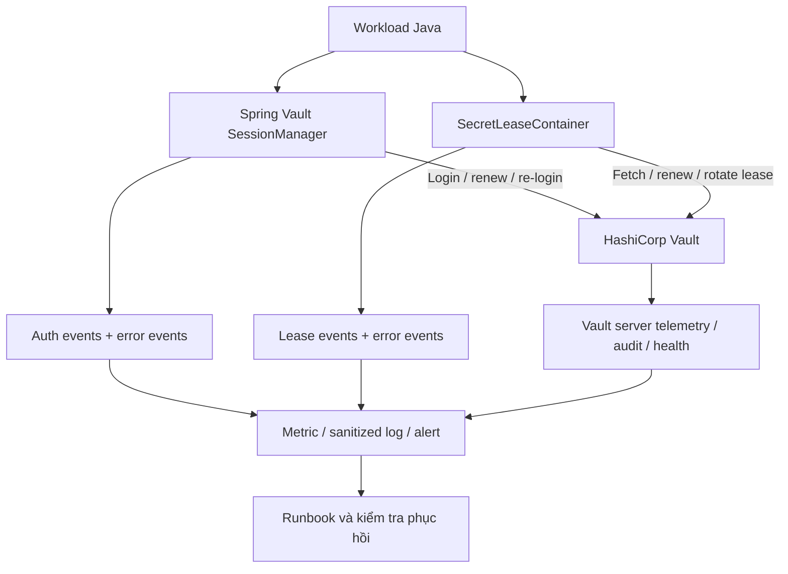

# Theo dõi gia hạn token, lease và các lỗi nền trong Spring Vault

## 1. Vì sao HTTP request thành công vẫn chưa đủ chứng minh hệ thống khỏe mạnh?

Ứng dụng Java sử dụng **Spring Vault** có thể liên tục đọc KV secrets, gọi Transit encryption, nhận chứng thư PKI hoặc xin database credentials qua `VaultTemplate`/`VaultOperations`. Ban đầu mọi request đều thành công. Tuy nhiên, bên dưới có thể xuất hiện lỗi trong **tác vụ nền**: token không gia hạn được, lease database credential đã gần hết hạn, thao tác quay vòng bí mật thất bại hoặc scheduler bị nghẽn. Lúc nghiệp vụ báo lỗi `403` hay không thể kết nối database thì sự cố đã ảnh hưởng người dùng.

Trong chương **Quan sát và hiệu năng**, nhiệm vụ của chúng ta là làm cho vòng đời bảo mật trở nên **quan sát được**: phát hiện token/lease gần hết hạn, theo dõi các sự kiện gia hạn, biết khi nào việc lấy credential mới bị lỗi, phân biệt lỗi mạng với lỗi cấu hình và phản ứng trước khi tài nguyên thực sự không còn dùng được.

Ví dụ: một dịch vụ Java lấy database username/password động từ Vault với lease 30 phút. Sau 15 phút, Vault không thể gọi database để gia hạn lease do kết nối mạng lỗi. HTTP handler của ứng dụng vẫn có thể trả `200` nhờ connection pool hiện tại. Nếu chỉ theo dõi HTTP 5xx của ứng dụng, ta sẽ bỏ lỡ dấu hiệu sự cố cho đến khi credential bị thu hồi, pool mất kết nối hoặc token đăng nhập của ứng dụng hết hạn.



### Bạn sẽ học được

- Phân biệt thời hạn của **Vault login token**, **dynamic secret lease** và **credential do backend cấp**.
- Nhận biết event của `LifecycleAwareSessionManager`, `SecretLeaseContainer` và `SessionLeaseContainer`.
- Gắn listener để quan sát các lần gia hạn thành công, thất bại, hết hạn hoặc rotate.
- Thiết kế metric, log, trace, alert và quy trình xử lý lỗi nền an toàn với secret.
- Kiểm thử tình huống Vault không sẵn sàng, token bị revoke, lease không renewable và pool database chưa nhận credential mới.

## 2. Ba vòng đời cần theo dõi riêng

Trong ứng dụng Spring Vault, không tồn tại một TTL duy nhất giải thích toàn bộ quyền truy cập.

| Đối tượng | Ai cấp và quản lý? | Thời điểm quan trọng | Hậu quả khi hết hạn |
| --- | --- | --- | --- |
| **Vault token** | Vault auth method như Kubernetes, AppRole hoặc JWT; Spring Vault session manager duy trì | TTL, max TTL, renewable, login lại | Request đến Vault bằng token đó thất bại; các lease liên quan có thể bị thu hồi |
| **Dynamic secret lease** | Vault secrets engine như database, AWS hoặc Azure; lease manager duy trì | `lease_duration`, `lease_id`, `renewable` | Vault thu hồi credential theo hợp đồng backend; có thể cần xin secret mới |
| **Credential/token của hệ thống đích** | Database/cloud/API đích | Hạn dùng thực tế, grace period, thời gian RBAC propagation | API đích từ chối credential ngay cả khi phía ứng dụng nghĩ lease còn tốt |

Ví dụ AWS STS credential có thời hạn của **STS session**. Vault token vẫn còn hợp lệ không có nghĩa AWS session token chưa hết hạn. Tương tự, Google Cloud OAuth access token cấp qua GCP secrets engine có thể **không có Vault lease**; ứng dụng phải theo dõi `expires_at_seconds` hoặc TTL của token đó theo contract API, không giả định `SecretLeaseContainer` sẽ tự renew một lease không tồn tại.

### Quy tắc quản lý thời gian

Khi nhận TTL bằng giây ở thời điểm `tReceived`, ứng dụng có thể tính mốc dự kiến:

```text
estimatedExpiry = tReceived + leaseDuration
secondsRemaining = estimatedExpiry - now
renewalSafetyWindow = networkLatency + schedulerDelay + clockSkew + backendDelay
```

Đây là **ước lượng tại client**, không phải đồng hồ tuyệt đối của Vault. Một response có thể mất thời gian truyền từ Vault đến client; thời gian xử lý phía server cũng đã tiêu tốn một phần TTL. Vì vậy cần đặt biên an toàn, đo thời gian đến hạn và cập nhật mốc dự kiến mỗi lần Vault trả kết quả renew/rotate mới. Không hardcode TTL của role thành thời hạn thực tế của credential.

Một yêu cầu `renewable=true` chỉ cho biết có thể **đề nghị gia hạn**, chưa bảo đảm gia hạn sẽ thành công mãi mãi: `max_ttl`, loại credential, trạng thái parent token và backend có thể giới hạn vòng đời.

## 3. Gia hạn Vault token bằng LifecycleAwareSessionManager

Spring Vault hỗ trợ `LifecycleAwareSessionManager` để quản lý token đăng nhập của ứng dụng. Với auth method cấp `LoginToken`, manager biết TTL và có thể **tự gia hạn trên background thread**. Nếu token đến giới hạn không thể gia hạn, ứng dụng có thể cần **đăng nhập lại** để có login token mới. `TokenAuthentication` dùng token có sẵn lại có semantics khác: manager có thể gọi `lookup-self` để tìm thông tin TTL/renewability, nếu được phép.

Theo tài liệu Spring Vault, lịch refresh mặc định của session manager được đặt rất gần mốc hết hạn token (một số phiên bản dùng khoảng **5 giây trước hạn**); phải xác nhận cấu hình đúng với phiên bản đang dùng, không giả định ngưỡng này phù hợp với latency và mức tải của mọi hệ thống.

### 3.1. Các sự kiện đăng nhập/gia hạn

Nhóm event trong package `org.springframework.vault.authentication.event` bao gồm:

| Event | Khi nào quan sát? | Hàm ý vận hành |
| --- | --- | --- |
| `AfterLoginEvent` | Đã đăng nhập thành công | Có session/token mới để gọi Vault |
| `BeforeLoginTokenRenewedEvent` | Trước khi thử renew | Tín hiệu hoạt động; **chưa** phải thành công |
| `AfterLoginTokenRenewedEvent` | Sau khi renew thành công | Gia hạn đã được Vault xác nhận |
| `LoginTokenExpiredEvent` | Manager phát hiện token hết hiệu lực | Có nguy cơ mất quyền dùng Vault và ảnh hưởng lease |
| `LoginFailedEvent` | Đăng nhập thất bại | Kiểm tra auth method, workload identity, Vault availability |
| `LoginTokenRenewalFailedEvent` | Gia hạn token thất bại | Điều tra `403`, network, max TTL, role/token lifecycle |
| `LoginTokenRevocationFailedEvent` | Thu hồi token thất bại | Kiểm tra cleanup; không tuyên bố token đã được revoke |

Hai interface khác nhau nhận event bình thường và lỗi:

- `AuthenticationListener.onAuthenticationEvent(AuthenticationEvent)`.
- `AuthenticationErrorListener.onAuthenticationError(AuthenticationErrorEvent)`.

Dùng **cả hai**. Một listener chỉ bắt `AfterLoginTokenRenewedEvent` có thể cho thấy tỷ lệ gia hạn thành công, nhưng không biết liệu một lần thử gia hạn có thất bại trong lúc hệ thống tự chuyển sang re-login hay không.

### 3.2. Token renewal thất bại không đồng nghĩa ứng dụng ngừng ngay

Theo thiết kế của `LifecycleAwareSessionManager`, nếu một lần renew gây lỗi ở client, manager có thể **bỏ trạng thái token hiện tại**, để lần yêu cầu tiếp theo kích hoạt đăng nhập lại. Điều này giúp khôi phục khỏi token hết hạn hoặc bị revoke, nhưng không bảo đảm login lại luôn thành công.

Ví dụ:

```text
10:00 Login Kubernetes thành công → Vault token T1
10:20 Background renew token T1 → timeout
10:20 LoginTokenRenewalFailedEvent được phát
10:21 Request nghiệp vụ cần Vault → thử login token T2
10:21 Nếu Kubernetes auth/Vault khả dụng: dịch vụ phục hồi
10:21 Nếu vẫn lỗi: nghiệp vụ có thể nhận lỗi xác thực/phụ thuộc Vault
```

Lưu ý cực kỳ quan trọng: nếu **T1 bị Vault thu hồi hoặc hết hạn**, các dynamic secret leases gắn với T1 có thể cũng bị thu hồi. **T2 không tự động kế thừa những lease cũ.** Do đó phải theo dõi đồng thời token events và secret lease events, chứ không chỉ quan sát việc đăng nhập lại thành công.

### 3.3. Không coi static token là loại có thể refresh tự động

Một ứng dụng cấu hình token tĩnh qua `TokenAuthentication` có thể không có đủ metadata để renew (hoặc không được quyền `auth/token/lookup-self`). Không thể suy luận rằng `LifecycleAwareSessionManager` sẽ **tạo token khác** nếu chính token tĩnh đó hết hạn: login bằng static token không sinh được danh tính mới. Với workload dài hạn, nên cấu hình **workload authentication** như Kubernetes/AppRole/JWT với quyền đúng và cơ chế lấy lại identity khi hết hạn.

## 4. Gia hạn lease và rotate secret bằng SecretLeaseContainer

`SecretLeaseContainer` quản lý những `RequestedSecret` được đăng ký: tự lấy secret, renew những lease có thể renew và tùy chế độ có thể lấy **credential mới** khi lease cũ hết hạn. Hoạt động này dùng `TaskScheduler` và chạy trong luồng nền; ứng dụng không phải cứ gọi `vaultOperations.read(...)` là đã tự đăng ký renewal.

Hai chế độ cần phân biệt:

| Chế độ | Ý nghĩa | Khi thường dùng |
| --- | --- | --- |
| `requestRenewableSecret(path)` | Theo dõi và renew lease phù hợp | Credential có thể duy trì bằng gia hạn |
| `requestRotatingSecret(path)` | Theo dõi lease và lấy secret mới khi cần rotate theo vòng đời | Dynamic database credentials cần quay vòng |

**Renew** giữ quan hệ với lease/secret hiện có trong giới hạn backend. **Rotate** yêu cầu dữ liệu bí mật/credential mới và cần cập nhật client sử dụng chúng (ví dụ HikariCP/DataSource). Chỉ quan sát `SecretLeaseRotatedEvent` không chứng minh pool database đã hoán đổi credential hoặc connection cũ đã được xử lý.

### 4.1. Các sự kiện lease

| Event | Diễn giải an toàn | Ghi nhận |
| --- | --- | --- |
| `SecretLeaseCreatedEvent` | Lấy secret/lease ban đầu thành công | Counter cấp phát, nguồn/mount đã chuẩn hóa |
| `AfterSecretLeaseRenewedEvent` | Renew lease thành công | Counter renew success, thời điểm gia hạn gần nhất |
| `SecretLeaseRotatedEvent` | Đã lấy secret mới do rotation | Counter rotation, xác nhận client đích đã dùng secret mới |
| `SecretLeaseExpiredEvent` | Container phát hiện lease đến/hết hạn | Cảnh báo tình trạng credential; không giả định Vault vừa gửi push event |
| `SecretNotFoundEvent` | Secret không tìm thấy tại path được yêu cầu | Kiểm tra path, role, mount và ACL |
| `BeforeSecretLeaseRevocationEvent` | Chuẩn bị revoke lease | Đừng đếm là revoke thành công |
| `AfterSecretLeaseRevocationEvent` | Đã xử lý revoke thành công ở mức container | Theo dõi cleanup phía backend |
| `SecretLeaseErrorEvent` / `LeaseErrorListener` | Vault hoặc I/O lỗi trong truy xuất, renew, revoke, rotate | Counter thất bại và phân loại lỗi an toàn |

`SecretLeaseContainer` **không nhận push event trực tiếp từ Vault**. Nó chủ động lên lịch kiểm tra, renew và phát event của riêng mình. Vì vậy `SecretLeaseExpiredEvent` có thể tới **muộn hơn thời điểm lease thực sự hết hạn** nếu scheduler bị nghẽn hoặc process bị tạm dừng.

Theo tài liệu dòng Spring Vault 4.1, `expiryThreshold` mặc định ở mức khoảng **một phút**, `minRenewal` mặc định khoảng **10 giây**. Đây là tham số của **SecretLeaseContainer**, khác ngưỡng refresh của **token session manager**. Tinh chỉnh tùy TTL thực tế, latency Vault, số workload, độ bận scheduler và giới hạn API; không tăng tần suất renew quá dày gây áp lực lên Vault.

### 4.2. SessionLeaseContainer kết nối hai vòng đời

`SessionLeaseContainer` là biến thể có thể tiếp nhận các event đăng nhập của `SessionManager` để khởi động lại việc lấy secrets sau khi **re-login** thành công. Spring Vault cung cấp `getAuthenticationListener()` và `getAuthenticationErrorListener()` để gắn đúng với session manager theo cấu hình.

Khi ứng dụng dùng Spring Cloud Vault hoặc cấu hình tự động của Spring Boot, **kiểm tra bean và listeners đã được wiring**. Không dựng thêm một container quản lý cùng path một cách vô tình: có thể tạo **hai lease độc lập**, làm tăng tải và phức tạp hóa quy trình revoke. Với Java thuần, cần đăng ký container, listeners và thứ tự khởi động/đóng tài nguyên đúng.

### 4.3. Hệ quả của lỗi trong background thread

Một lỗi renew xảy ra trong worker thread **không nhất thiết bị ném lên** thread đang phục vụ request REST hoặc job tại thời điểm đó. Business API vẫn có thể thành công với credential đang cache, trong khi lease đã ở trạng thái rủi ro. Vì vậy cần có **hai tuyến quan sát**: lỗi trực tiếp từ lời gọi `VaultOperations` và lỗi nền từ authentication/lease listeners.

Đăng ký listeners **trước khi container được start** hoặc trước lần request secret đầu tiên. Nếu gắn listeners muộn, bạn có thể bỏ sót event login, cấp secret hoặc renew ban đầu. Không đặt công việc nặng, gọi Vault lại hoặc blocking I/O dài trong callback; nó có thể chạy ngay trên **thread khởi động** hoặc **thread renew**, làm chậm scheduler và sinh thêm lỗi dây chuyền.

## 5. Ví dụ Java: thu thập sự kiện bằng Micrometer

Ví dụ dùng Spring Vault 3.x/4.x có các event đã nêu, Java 17, và Micrometer. Các phụ thuộc Vault và Micrometer được khai báo phù hợp với BOM của dự án. **Đây là lớp gắn listeners**, không tự tạo một SessionManager hoặc SecretLeaseContainer thứ hai; các bean đã được cấu hình bởi ứng dụng/auto-configuration.

### 5.1. Observer gắn trước khi lifecycle bắt đầu

```java
import io.micrometer.core.instrument.MeterRegistry;

import org.springframework.vault.authentication.LifecycleAwareSessionManager;
import org.springframework.vault.authentication.event.AfterLoginEvent;
import org.springframework.vault.authentication.event.AfterLoginTokenRenewedEvent;
import org.springframework.vault.authentication.event.AuthenticationEvent;
import org.springframework.vault.authentication.event.AuthenticationErrorEvent;
import org.springframework.vault.authentication.event.LoginFailedEvent;
import org.springframework.vault.authentication.event.LoginTokenExpiredEvent;
import org.springframework.vault.authentication.event.LoginTokenRenewalFailedEvent;
import org.springframework.vault.core.lease.SecretLeaseContainer;
import org.springframework.vault.core.lease.event.AfterSecretLeaseRenewedEvent;
import org.springframework.vault.core.lease.event.SecretLeaseCreatedEvent;
import org.springframework.vault.core.lease.event.SecretLeaseEvent;
import org.springframework.vault.core.lease.event.SecretLeaseExpiredEvent;
import org.springframework.vault.core.lease.event.SecretLeaseRotatedEvent;

public final class VaultLifecycleTelemetry {

    private VaultLifecycleTelemetry() {}

    // Gọi một lần từ cấu hình, trước khi container/session phát sự kiện.
    public static void attach(
            LifecycleAwareSessionManager sessions,
            SecretLeaseContainer leases,
            MeterRegistry metrics) {

        sessions.addAuthenticationListener(event ->
                metrics.counter("app.vault.auth.events",
                        "event", authEventName(event)).increment());

        sessions.addErrorListener(error ->
                metrics.counter("app.vault.auth.errors",
                        "event", authErrorName(error)).increment());

        leases.addLeaseListener(event ->
                metrics.counter("app.vault.lease.events",
                        "event", leaseEventName(event)).increment());

        // Callback này nhận lỗi nền từ fetch, renew, rotate, revoke.
        // Không ghi exception.getMessage(), event.toString() hoặc lease ID.
        leases.addErrorListener((event, exception) ->
                metrics.counter("app.vault.lease.errors",
                        "kind", classifyException(exception)).increment());
    }

    private static String authEventName(AuthenticationEvent event) {
        if (event instanceof AfterLoginTokenRenewedEvent) return "renewed";
        if (event instanceof AfterLoginEvent) return "logged_in";
        if (event instanceof LoginTokenExpiredEvent) return "expired";
        return "other";
    }

    private static String authErrorName(AuthenticationErrorEvent event) {
        if (event instanceof LoginTokenRenewalFailedEvent) return "renew_failed";
        if (event instanceof LoginFailedEvent) return "login_failed";
        return "other";
    }

    private static String leaseEventName(SecretLeaseEvent event) {
        // RotatedEvent là một subtype của CreatedEvent,
        // nên phải kiểm tra rotated trước.
        if (event instanceof SecretLeaseRotatedEvent) return "rotated";
        if (event instanceof SecretLeaseCreatedEvent) return "created";
        if (event instanceof AfterSecretLeaseRenewedEvent) return "renewed";
        if (event instanceof SecretLeaseExpiredEvent) return "expired";
        return "other";
    }

    private static String classifyException(Exception exception) {
        // Dùng allowlist các nhãn, không đưa exception message
        // hoặc tên path từ request vào metric tag.
        if (exception instanceof java.net.SocketTimeoutException) {
            return "timeout";
        }
        if (exception instanceof org.springframework.vault.VaultException) {
            return "vault";
        }
        return "other";
    }
}
```

Khi dùng Spring Cloud Vault, cách lấy reference tới `LifecycleAwareSessionManager` và `SecretLeaseContainer` phụ thuộc cấu hình bean/session manager đang hoạt động. **Không bắt buộc mọi dự án đều có đúng loại bean đó**; các lớp `SessionManager` khác hoặc custom authentication có thể không phát những event giống ví dụ. Hãy xác nhận topology bean và phiên bản trước khi gắn observer.

Ví dụ phân loại exception tối giản để minh họa. Một số lỗi network bị bọc trong `VaultException` hoặc Spring HTTP exception; ở hệ thống thực, phân loại **cause chain đã kiểm chứng** và HTTP status riêng, nhưng vẫn chỉ dùng một tập nhãn hữu hạn như `timeout`, `permission`, `backend`, `transport`, `unknown`.

### 5.2. Vì sao callback không được làm quá nhiều?

Listener được gọi trong lifecycle của Spring Vault, bao gồm **luồng renew nền**. Nếu callback gọi database đồng bộ, gửi webhook, tạo transaction hoặc đồng bộ lại tất cả lease, thời gian listener tăng sẽ gây **scheduler lag**. Thiết kế đúng thường là:

1. Counter/gauge trong bộ nhớ qua Micrometer.
2. Một log an toàn, gọn, nếu event thất bại cần điều tra.
3. Ghi tín hiệu trạng thái vào cấu trúc thread-safe nhỏ.
4. Đưa công việc khôi phục phức tạp vào worker/queue riêng, có giới hạn.
5. Không ném exception mới khỏi listener chỉ vì telemetry backend tạm không sẵn sàng.

Nếu hệ thống thực sự yêu cầu refresh credential khi nhận `SecretLeaseRotatedEvent`, sử dụng cơ chế tích hợp quản lý secret như `ManagedSecret` hoặc một subscriber có kiểm soát, xác minh client đích đã nhận credential, thay vì chỉ thay biến string trong observer.

## 6. Thiết kế các metric có thể hành động

Metric phía **ứng dụng** và telemetry phía **Vault server** phục vụ hai góc nhìn khác nhau. Một hệ thống khỏe phải so sánh cả hai, bởi vì Vault server có thể hoạt động bình thường trong khi một workload thiếu quyền, dùng sai mount hoặc đã mất lịch renew.

### 6.1. Metric phía Spring Vault application

| Metric đề xuất (tên logic) | Loại | Ý nghĩa và nhãn |
| --- | --- | --- |
| `app.vault.auth.events` | Counter | `event=logged_in/renewed/expired/other`; chỉ áp dụng auth events được quan sát |
| `app.vault.auth.errors` | Counter | `event=renew_failed/login_failed/other` |
| `app.vault.lease.events` | Counter | `event=created/renewed/rotated/expired/other` |
| `app.vault.lease.errors` | Counter | `kind=timeout/vault/other` hoặc taxonomy hữu hạn |
| `app.vault.lease.seconds.remaining` | Gauge | **Ước lượng** thời gian còn lại của từng nhóm lease đã theo dõi |
| `app.vault.auth.seconds.remaining` | Gauge | Ước lượng TTL login token, nếu có metadata |
| `app.vault.lease.last.success.age.seconds` | Gauge | Số giây kể từ renew/rotation thành công gần nhất |
| `app.vault.lifecycle.scheduler.lag.seconds` | Timer/Gauge | Độ trễ quan sát được giữa lịch dự kiến và thời điểm thực thi, nếu ứng dụng có instrumentation |
| `app.vault.secret.consumer.ready` | Gauge 0/1 | Credential hiện tại **đã được client đích tiếp nhận và kiểm thử** hay chưa |

Những metric `app.vault.*` là **metric tự thiết kế trong ví dụ**, không phải tên được Spring Vault xuất tự động. Cần instrument đối tượng đang giữ trạng thái để có gauge; việc chỉ đăng ký `Counter` như đoạn mã phần 5 không tự tạo gauge TTL hoặc trạng thái readiness.

**Metric không được chứa** Vault token, accessor, lease ID, secret path chứa tenant/customer ID, ciphertext, thông tin đăng nhập, IP riêng tùy ý hoặc exception message làm label. Giới hạn nhãn vào `service`, `environment`, `engine`, `roleAlias` từ một allowlist nhỏ. Số lượng label tăng theo từng lease sẽ gây cardinality explosion và tăng chi phí lưu trữ.

### 6.2. Metric từ Vault server

HashiCorp Vault có telemetry về token, lease và expiration manager. Những metric quan trọng cần xem (tên metric/tags có thể được exporter chuyển đổi theo kiểu Prometheus):

| Vault telemetry | Điều quan sát | Khi nào đáng chú ý? |
| --- | --- | --- |
| `vault.expire.num_leases` | Số lease đang chờ đến thời điểm hết hạn, phạm vi cluster | Tăng đột biến có thể do app tạo nhiều dynamic secret/token |
| `vault.expire.num_irrevocable_leases` | Lease không thể revoke sau các lỗi kéo dài | Tăng liên tục là dấu hiệu cleanup/backend có vấn đề |
| `vault.expire.renew-token` | Thời gian xử lý gia hạn token | Độ trễ tăng làm giảm biên an toàn trước TTL |
| `vault.expire.lease_expiration.error` | Số lỗi khi xử lý hết hạn lease | Tăng cho thấy expiration manager hoặc backend revoke đang lỗi |
| `vault.expire.leases.by_expiration` | Phân bố lease theo nhóm thời gian đến hạn | Cảnh báo lượng lớn lease hết hạn đồng thời |
| `vault.token.creation` | Số token được phát hành | Tăng bất thường có thể do login/retry storm |

Số lease **giảm mạnh** không tự động là tín hiệu tốt: có thể là TTL đã hết hàng loạt hoặc ứng dụng không xin được dynamic credential. Số lease **tăng mạnh** không tự động là dấu hiệu xấu: triển khai ứng dụng mới hoặc load test có thể giải thích biến động. Hãy đối chiếu baseline, thay đổi deploy, request rate và audit log trước khi kết luận.

Phân biệt metric **cluster-wide** (ví dụ số lease) và metric theo **node** (ví dụ độ trễ xử lý gia hạn): nếu truy vấn chỉ một node standby, bạn có thể bỏ sót dấu hiệu ở active node. Xác minh nhãn node/cluster/namespace và thời gian scrape.

### 6.3. Thu thập metric và health

Vault hỗ trợ cấu hình `telemetry` và endpoint `sys/metrics` tùy phương thức thu thập/ACL. Một cách triển khai điển hình là Vault gửi telemetry tới collector/Prometheus qua tích hợp được hỗ trợ, sau đó Grafana dựng dashboard cho token/lease và hệ thống lưu alert.

Không public `sys/metrics` hoặc audit log ra Internet và không mở quyền quản trị cho ứng dụng chỉ để lấy metric. Quyền truy cập, TLS, network policy và retention cần phù hợp. Spring Boot Actuator có thể công bố metric tự instrument qua `/actuator/prometheus` **nếu** Actuator/Micrometer registry được thêm và endpoint được cho phép trong môi trường vận hành.

`/sys/health` phản ánh trạng thái Vault (active/standby, sealed/uninitialized, HA...) với mã HTTP riêng; nó **không thay thế** probe kiểm tra secret role của workload đang có quyền và lease còn dùng được. Ngược lại, không gọi endpoint phát hành dynamic secret chỉ để làm health check theo nhịp quá nhanh: mỗi lần gọi có thể tạo **credential/lease mới**.

## 7. Alert có ý nghĩa: cảnh báo sớm và hạn chế nhiễu

Thay vì cảnh báo mỗi event thất bại đơn lẻ, nên dùng ngữ nghĩa “lỗi kéo dài + sắp đến hạn + ảnh hưởng nghiệp vụ”.

| Tín hiệu | Gợi ý điều kiện cảnh báo | Mức độ |
| --- | --- | --- |
| Login/renew token liên tục thất bại | Tỷ lệ lỗi tăng trong 5–10 phút, login mới cũng không thành công | Cao |
| Vault token sắp hết TTL | Remaining time thấp hơn biên an toàn và không có renew/re-login thành công | Cao |
| Lease sắp hết hạn nhưng không có refresh | Tốc độ renew/rotate thành công bằng 0 trong cửa sổ đủ dài, remaining TTL giảm | Cao |
| Secret rotate xong nhưng client chưa nhận | `consumer.ready=0` hoặc lỗi kết nối database tăng | Cao |
| Lease background error tăng | Lỗi kéo dài kết hợp số lease sắp hết hạn | Trung bình/Cao |
| `num_irrevocable_leases` tăng | Số lease không revoke được tăng qua nhiều lần scrape | Cao cho đội Vault |
| `num_leases` tăng quá nhanh | So sánh với baseline và mức tăng request thực | Trung bình, điều tra runaway issuance |
| Scheduler lag cao | Lịch renew thực thi trễ so với TTL safety window | Cao nếu có nguy cơ credential hết hạn |
| Vault standby/active routing bất thường | Health sai topology, request 5xx/timeout tăng | Cao |

Ví dụ giả định Prometheus xuất các metric ứng dụng phần 5 thành tên snake case với hậu tố `_total`:

```promql
# Tăng số lỗi renew token trong 5 phút qua.
sum(increase(app_vault_auth_errors_total{event="renew_failed"}[5m]))

# Lỗi lease mỗi giây, nhóm theo loại.
sum by (kind) (rate(app_vault_lease_errors_total[5m]))
```

Tên metric xuất ra thực tế phụ thuộc registry, naming convention và relabel rules. Kiểm tra `/actuator/prometheus` trong môi trường đã triển khai trước khi sao chép query vào alert. Không dùng `rate()` một mình để kết luận credential không còn dùng được; nên kết hợp **gauge remaining TTL**, thời điểm thành công cuối và tình trạng downstream.

### 7.1. Ví dụ chính sách SLO nội bộ

Một nền tảng có thể đặt mục tiêu như sau:

- **Readiness:** ứng dụng phục vụ chức năng cần Vault phải có credential còn hiệu lực và được downstream chấp nhận; một endpoint health chỉ kiểm tra process JVM là chưa đủ.
- **Renewal safety:** mỗi loại token/lease cần một biên an toàn phù hợp (`P99 Vault latency + scheduler lag + clock skew + downstream apply time`).
- **Error budget:** tần suất lỗi renew nền có thể cao hơn lỗi nghiệp vụ nếu tự phục hồi thành công; chỉ tiêu quan trọng là **thời lượng mất credential hợp lệ** và **tỷ lệ request downstream thất bại**.
- **Recovery time:** sau khi Vault hoạt động trở lại, ứng dụng phải đăng nhập lại/rotate và xác nhận consumer đã nhận credential mới trong thời gian mục tiêu.

Các ngưỡng số cần đo từ workload thật và thống nhất với SRE; ví dụ “<60 giây” chỉ là mục tiêu tham khảo, không phải mặc định chuẩn do Spring Vault bảo đảm.

## 8. Log, trace và audit: liên kết sự cố mà không lộ bí mật

Nên dùng **structured logging** có trường ổn định và giới hạn nội dung. Ví dụ sự kiện renew lease thất bại:

```json
{
  "event": "vault_lease_renew_failed",
  "service": "payment-api",
  "environment": "staging",
  "engine": "database",
  "roleAlias": "payments-readonly",
  "eventSource": "SecretLeaseContainer",
  "failureCategory": "transport",
  "httpStatus": null,
  "attempt": 2,
  "ttlRemainingSecondsEstimate": 92,
  "correlationId": "f37c7ab3-8b2d-4dc1-88d6-4b4f1bb4e750"
}
```

Đây là dữ liệu **minh họa**. `correlationId` thuộc application trace/job, không phải `lease_id` hay Vault token. `ttlRemainingSecondsEstimate` chỉ được ghi khi có nguồn TTL và clock hợp lệ; nếu không biết, lưu `null`, tránh bịa số giây.

**Không log** `X-Vault-Token`, AppRole `secret_id`, Kubernetes JWT, `lease_id` nguyên văn, raw secret path chứa tenant/cá nhân, password, Transit ciphertext/plaintext, PKI private key, exception body chưa lọc hoặc raw `event.toString()`. Một số event có `source` chứa token hoặc requested secret; **không in source** vào log.

Vault audit device ghi nhận luồng truy cập và nhiều trường nhạy cảm được HMAC hóa. Để điều tra, đối chiếu trong khoảng thời gian theo role/auth mount, loại operation, trạng thái và ID request *thực sự được Vault cấp nếu có*. Không cho rằng tự gắn HTTP header tùy ý sẽ tạo request ID trong audit log. Audit logs có quyền truy cập và retention riêng; không dùng như kho chứa full secret response.

### Trace là gì trong tác vụ nền?

Trong HTTP request có thể có trace ID từ OpenTelemetry/MDC. Nhưng background renewal **có thể chạy không có HTTP trace đang hoạt động**. Đừng ép mọi renew event phải có span/request ID của request nghiệp vụ cuối cùng. Thay vào đó có thể:

1. Tạo một trace/span nội bộ cho mỗi chu kỳ renew/rotate nếu instrument được.
2. Gắn thuộc tính **engine**, **role alias** đã lọc, **outcome**, **attempt**, **duration**.
3. Dùng link tới job/deployment/context nếu quan hệ có thật.
4. Không lưu secrets dưới dạng span attributes hoặc event payload.

## 9. Phân loại các lỗi nền thường gặp

| Dấu hiệu | Nguyên nhân có thể | Điều cần làm |
| --- | --- | --- |
| `LoginTokenRenewalFailedEvent` và sau đó `AfterLoginEvent` | Token cũ không gia hạn được nhưng re-login thành công | Ghi nhận tự phục hồi; **kiểm tra lại các lease dưới token cũ** |
| Lặp lại `LoginFailedEvent` | Role Kubernetes/AppRole/JWT sai, credential đăng nhập hết hạn, Vault không sẵn sàng | Xác minh auth method và workload identity; không retry vô hạn |
| Renew token nhận `403` | Token bị revoke/expired hoặc ACL/session thay đổi | Kiểm tra session/token lifecycle và audit; không thay bằng root token |
| Renew lease nhận `400` | Lease không renewable, lease ID sai/hết hạn, tăng TTL không hợp lệ | Đọc response đã lọc và contract backend; có thể cần rotate |
| Renew lease nhận `403` | Session token không còn quyền, namespace/policy sai | Điều tra xác thực và scope, tránh xem là lỗi mạng |
| Renew lease timeout/`5xx` | Vault/backend/network tạm lỗi | Retry hữu hạn theo LeaseStrategy, quan sát TTL còn lại |
| Có `SecretLeaseExpiredEvent` nhưng chưa có rotate thành công | Scheduler chậm, backend không cấp mới, cấu hình renew/rotate sai | Bảo vệ luồng dùng credential; kiểm tra container/scheduler |
| `SecretLeaseRotatedEvent` nhưng database lỗi login | Pool giữ credential cũ, downstream propagation chậm, role không phù hợp | Xác minh thực sự áp dụng credential mới vào datasource |
| Lỗi tăng sau rolling restart | Session/lease gắn với instance cũ bị thu hồi, chưa khởi tạo đúng thứ tự | Kiểm tra lifecycle của container, shutdown và readiness |
| Lease count tăng đột biến | `read` dynamic secret trong mỗi request, retry tạo lease mới | Cache/rotate theo vòng đời hợp lệ, giới hạn issuance |
| `num_irrevocable_leases` tăng | Vault không cleanup được credential phía backend | Điều tra auth/permission/network của plugin/target |
| Token renew event đột nhiên biến mất | Listener không đăng ký, scheduler chết/chậm, token không renewable hoặc không còn secret | Kiểm tra wiring và xác nhận cấu hình token thay vì chỉ kết luận “không có lỗi” |

**Lỗi nền có thể được tự phục hồi một phần**, nhưng không phải mọi lỗi đều nên bỏ qua. Ví dụ login lại thành công không khôi phục credential database đã bị Vault thu hồi; rotate credential thành công không có nghĩa tất cả kết nối pool cũ đã được thay.

### 9.1. Retry có thể gây lỗi nặng hơn

Nếu mã ứng dụng dùng `vaultOperations.read("database/creds/my-role")` theo chu kỳ để “kiểm tra Vault còn sống”, mỗi request **có thể tạo dynamic credential mới**. Khi timeout, retry bừa bãi tạo thêm nhiều lease mà ứng dụng không dùng. Tần suất tạo secret cao gây quota pressure, load cho Vault expiration manager và database user management.

Thay vào đó:

- Health check nên dùng health endpoint/metadata read-only phù hợp và có tần suất giới hạn.
- Với credential động, sử dụng `SecretLeaseContainer` hoặc một cơ chế duy nhất quản lý vòng đời, track owner của lease.
- Kiểm soát retry budget, backoff/jitter, và hạn chế đồng thời trong cả Vault client và consumer.
- Không tự động tăng quyền/token TTL quá lớn chỉ để chữa lỗi renew.

## 10. Readiness, liveness và hiệu năng khi phụ thuộc Vault

### 10.1. Phân biệt probe

| Probe | Nên trả lời câu hỏi | Không nên làm |
| --- | --- | --- |
| **Liveness** | Process JVM còn hoạt động, event loop/scheduler sống? | Gọi Vault hoặc cấp dynamic secret mỗi vài giây khiến pod restart liên tục vì sự cố Vault |
| **Readiness** | Service có thể thực hiện nghiệp vụ **bây giờ** bằng credential còn hợp lệ? | Chỉ kiểm tra `/actuator/health` của JVM mà bỏ qua credential downstream |
| **Vault dependency health** | Vault/network/auth path có phục vụ nhóm request cần thiết? | Đọc secret nhạy cảm hoặc root path để chứng minh health |
| **Lifecycle telemetry health** | Các listener và renew loop có chạy và không vượt TTL safety window? | Xem một lần renew thành công từ hôm qua là bằng chứng hiện tại |

Tùy nghiệp vụ, readiness có thể cần fail-closed khi không có credential hợp lệ; nhưng một lỗi mạng Vault ngắn hạn **không nhất thiết phải làm liveness thất bại** và gây restart storm trong Kubernetes. Nếu ứng dụng xử lý dữ liệu bằng credential còn hợp lệ và đã được cache theo policy, có thể duy trì readiness trong giới hạn đó; khi token/lease thực sự hết hạn phải chặn thao tác phụ thuộc secret.

### 10.2. Tránh scheduler starvation

Token và lease renewal cùng sử dụng **background scheduling**. Trong ứng dụng nhiều lease hoặc tải cao:

- Đo `TaskScheduler` queue/lag nếu có instrumentation.
- Đừng chạy tác vụ I/O dài hoặc callback xử lý secret nặng trên scheduler thread.
- Đặt kích thước thread pool scheduler theo nhu cầu thực, không chia sẻ với tác vụ batch CPU nặng nếu làm trễ renew.
- Bật timeout phù hợp cho Vault HTTP client để một request treo không giữ scheduler mãi.
- Kiểm tra độ đồng bộ đồng hồ máy chạy ứng dụng và độ trễ mạng; deploy/GC pause dài có thể khiến renew chạy muộn.
- Theo dõi active node/standby HA, rate limits, storage latency và backend plugin để biết nghẽn ở đâu.

Một trường hợp thực tế: `expiryThreshold=60s` không đủ nếu Vault P99 latency tăng 20s, JVM GC pause 25s, còn downstream mất 30s để đổi credential. Cần đo tổng thời gian và chọn safety window lớn hơn. Không chỉ tăng threshold tùy tiện nếu TTL của lease nhỏ hơn threshold; phải điều chỉnh TTL/renew logic cùng mức tải hệ thống.

## 11. Kịch bản kiểm thử tích hợp có ý nghĩa

Với bài học này, kiểm thử tốt nhất là **quan sát event và sự thay đổi hiệu lực credential thật**. Có thể chạy trong sandbox gồm Vault test, Spring Boot service và một database/cloud mock phù hợp; dùng TTL ngắn để bài test diễn ra nhanh, không dùng quyền production.

| Tình huống | Kết quả cần kiểm chứng |
| --- | --- |
| Login Kubernetes/AppRole thành công | `AfterLoginEvent` được ghi một lần theo hành vi thực tế, metric tăng; không log token |
| Token renewable sắp hết TTL | Có renew event và TTL thay đổi theo response, request Vault vẫn hoạt động |
| Token bị revoke giữa chu kỳ | Có lỗi renew/auth hoặc 403 tương ứng; app re-login theo contract nếu còn auth identity |
| Login lại thành công sau renew lỗi | Token mới hoạt động, **leased secrets cũ** được theo dõi/khởi tạo lại đúng |
| Vault ngừng đáp ứng trong lúc renew | `AuthenticationErrorListener` hoặc `LeaseErrorListener` thấy lỗi nền; metric tăng dù HTTP handler chưa lỗi |
| Lease renewable | Nhận `AfterSecretLeaseRenewedEvent`; không phát sinh credential mới ngoài dự kiến |
| Lease không renewable / vượt max TTL | Container rotate hoặc báo expired theo chế độ; không renew vô hạn |
| Secret rotate | `SecretLeaseRotatedEvent` và downstream client/pool thật sự dùng credential mới |
| Scheduler bị cố ý làm chậm trong test | Phát hiện lag/TTL risk; event expired có thể được phát muộn |
| Dynamic secret path không tồn tại | Có `SecretNotFoundEvent`; phân biệt với `403` hoặc lỗi network |
| Backend revoke không thành công | Lỗi cleanup được quan sát, Vault metric irrevocable/expiration error được kiểm tra nếu môi trường cung cấp |
| Hai listeners gắn cùng một container | Không tạo thêm lease khi chỉ thêm listeners; kiểm chứng container chỉ được quản lý một lần |
| Application shutdown | Container dừng và cleanup theo cấu hình; sự kiện revoke có thể xảy ra, không đếm thành lỗi “bất thường” |
| Lỗi chứa secret trong response exception | Metric/log/trace không lộ body, password, token hoặc path có ID nhạy cảm |

### Một bài test end-to-end

1. Tạo một Vault sandbox có auth method dành cho workload, role database credentials với TTL ngắn và policy tối thiểu cho ứng dụng.
2. Đăng ký auth/lease listeners **trước khi bắt đầu** lifecycle của Spring Vault; cấu hình app metric endpoint chỉ trong mạng test.
3. Khởi động ứng dụng, kiểm tra `AfterLoginEvent` và `SecretLeaseCreatedEvent` được ghi nhận; xác minh database login bằng credential vừa cấp.
4. Để thời gian trôi đến lượt renew bình thường; xác minh các metric `renewed` tăng, request database tiếp tục thành công, không lộ secret trong log.
5. Mô phỏng Vault không thể kết nối khi scheduler chạy; xác minh lỗi nền được báo qua **error listeners**, đồng thời alert thể hiện TTL còn lại.
6. Phục hồi Vault hoặc re-login theo contract; xác minh lease được renew/rotated theo loại, pool/database dùng credential mới.
7. Dừng ứng dụng, xác minh cleanup và kết quả revoke theo backend; kiểm tra không còn lease/quyền truy cập ngoài dự kiến trong môi trường test.

Trong bài test, không phụ thuộc vào một chuỗi `Thread.sleep` cứng để đoán đúng mốc event. Dùng điều kiện `awaitility`/`eventually` với timeout hữu hạn, đồng thời ghi nhận thời gian thật và payload đã lọc. Vì event có thể đến muộn, assertion nên kiểm tra **eventual outcome** và giới hạn thời gian phù hợp với TTL/scheduler.

## 12. Runbook xử lý sự cố thực tế

Khi dashboard báo `vault_auth_renew_failed` hoặc `vault_lease_renew_failed` tăng:

1. **Xác định phạm vi:** một instance, một role hay toàn cluster? Bắt đầu với service/environment/engine/role alias đã chuẩn hóa.
2. **Đối chiếu đồng hồ:** còn bao nhiêu giây trước TTL của token/lease và downstream credential? Có vượt safety window chưa?
3. **Phân loại lỗi:** `403` (auth/ACL), `400` (request/không renewable), `429/5xx` (rate/HA/backend), timeout/TLS (transport), sự cố scheduler.
4. **Xem Vault health/telemetry:** active/standby, sealed, `num_leases`, `num_irrevocable_leases`, renewal latency, expiration errors và gần đây có rollout không.
5. **Xem auth/lease event liên tiếp:** login mới có thành công không? Secret có rotated không? Client đích đã nhận credential và kết nối thành công chưa?
6. **Giảm tác động:** giảm request tạo lease không cần thiết; ngừng job tạo secret lặp; bảo vệ readiness hoặc fail closed cho nghiệp vụ đang mất credential.
7. **Khôi phục có kiểm soát:** sửa ACL/auth/backend, renew/rotate/re-login theo contract. Không cấp root token, không kéo TTL vô hạn và không chuyển secret qua log.
8. **Xác nhận hết sự cố:** một lần gọi Vault thành công chưa đủ; quan sát thêm chu kỳ renew sau, TTL còn đủ biên, backend login thành công và error rate về baseline.
9. **Ghi postmortem:** nguồn phát sự kiện đầu tiên, thời điểm token/lease hết hạn, gap giữa cảnh báo và ảnh hưởng, thời gian khôi phục và thay đổi monitoring cần thiết.

### Dấu hiệu phục hồi đáng tin cậy

```text
Vault health ổn định
      +
Workload login / renew thành công
      +
Lease renew hoặc rotate đã được Vault xác nhận
      +
Consumer (DB/cloud service) chấp nhận credential đang dùng
      +
Remaining TTL vượt safety window và lỗi nền giảm
      =
Ứng dụng có thể phục vụ phần phụ thuộc Vault theo policy
```

## 13. Những điều cần nhớ

- **Token renewal và lease renewal là hai vòng đời khác nhau.** Token login hết hạn có thể kéo theo secret lease, kể cả khi client đã cache password.
- **Lỗi nền không nhất thiết đi qua HTTP handler.** Bắt `AuthenticationErrorListener` và `LeaseErrorListener` từ đúng component.
- **Renew thành công không đồng nghĩa credential của consumer đã được thay.** Khi rotate, cần kiểm tra database/client SDK thực sự dùng secret mới.
- **Vault không push expiration event vào Spring Vault.** Event được phát khi container phát hiện theo lịch, nên có thể đến muộn.
- **Metric server và metric application bổ trợ nhau.** Cần quan sát số lease, thời gian renew, lỗi expiration của Vault và lỗi theo workload.
- **Telemetry không được thành nguồn rò rỉ secret.** Không log token, lease ID, event source thô, payload hay exception body chưa lọc.
- **Alert dựa trên TTL còn lại và kết quả phục hồi.** Một lỗi đơn lẻ tự hồi phục có mức ảnh hưởng khác lỗi kéo dài đến khi credential hết hạn.

## Tài liệu tham khảo

- [Spring Vault — Credentials Rotation](https://docs.spring.io/spring-vault/reference/vault/credential-rotation.html): `SecretLeaseContainer`, `SessionLeaseContainer`, event, TTL tuning và thứ tự đăng ký listener.
- [Spring Vault — SecretLeaseContainer API](https://docs.spring.io/spring-vault/reference/api/java/org/springframework/vault/core/lease/SecretLeaseContainer.html): scheduling, `requestRenewableSecret`, `requestRotatingSecret`, listener, expiry threshold.
- [Spring Vault — Lease event package](https://docs.spring.io/spring-vault/reference/api/java/org/springframework/vault/core/lease/event/package-summary.html): danh sách các event và interface listener.
- [Spring Vault — LifecycleAwareSessionManager API](https://docs.spring.io/spring-vault/reference/api/java/org/springframework/vault/authentication/LifecycleAwareSessionManager.html): token login/renew và event nền.
- [Spring Vault — Authentication Methods](https://docs.spring.io/spring-vault/reference/vault/authentication.html): `LoginToken`, `TokenAuthentication`, token lifecycle.
- [HashiCorp Vault — Key metrics for common health checks](https://developer.hashicorp.com/vault/docs/internals/telemetry/key-metrics): `num_leases`, `num_irrevocable_leases`, token renewal latency.
- [HashiCorp Vault — Telemetry Reference](https://developer.hashicorp.com/vault/docs/internals/telemetry/metrics/all): danh mục metric và loại/tần suất.
- [HashiCorp Vault — Enable telemetry](https://developer.hashicorp.com/vault/docs/internals/telemetry/enable-telemetry): cấu hình thu thập và lựa chọn backend.
- [HashiCorp Vault — Lease and Revocation](https://developer.hashicorp.com/vault/docs/concepts/lease): quản lý lease và tác động của expiration/revoke.

**Kết luận kỹ thuật:** Theo dõi gia hạn token, lease và lỗi nền trong Spring Vault phải kết hợp **auth events + lease events + thời gian còn hiệu lực + telemetry phía Vault + xác minh consumer**. Chỉ khi các tín hiệu ấy thống nhất, ứng dụng mới biết mình đang thực sự sở hữu credential hợp lệ và có đủ thời gian để phục hồi trước lần hết hạn tiếp theo.
