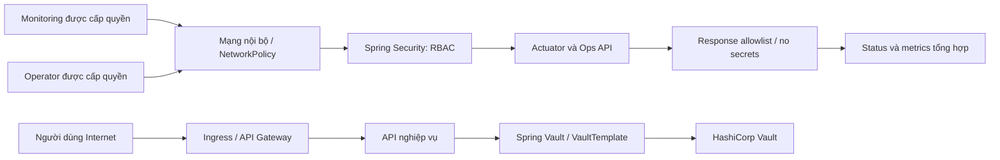
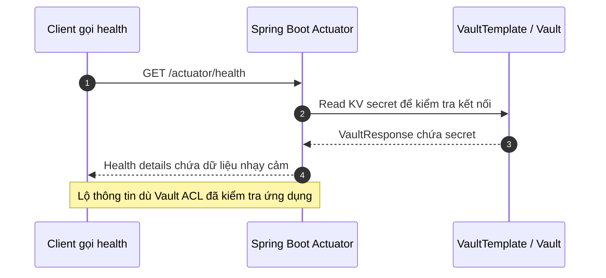

# Giới hạn thông tin xuất qua endpoint quản trị của ứng dụng Spring Vault

## 1. Bối cảnh: khả năng quan sát cũng có thể trở thành đường rò rỉ bí mật

Ứng dụng Java dùng **SPRING_VAULT** truy cập HashiCorp Vault qua `VaultTemplate`, xác thực theo workload và policy để lấy KV secrets, quản lý token/lease, thực hiện mã hóa Transit và cấp chứng thư PKI. Khi triển khai, đội vận hành thường cần endpoint quan sát tình trạng ứng dụng: health check, số lần Vault bị lỗi, độ trễ gọi Vault, phiên bản triển khai hoặc thời điểm một dependency có vấn đề.

Các endpoint này có thể được tạo bằng **Spring Boot Actuator** (chẳng hạn `/actuator/health`, `/actuator/prometheus`) hoặc API quản trị tự viết như `/internal/ops/vault`. Nếu trả dữ liệu thô để “dễ debug”, chúng có thể vô tình tiết lộ Vault token, đường dẫn secret, username/password, private key hoặc cấu trúc hạ tầng nội bộ.

Ví dụ **nguy hiểm**:

```java
// KHÔNG sử dụng mẫu này: trả nguyên response chứa secret!
@GetMapping("/admin/debug/vault-secret")
public VaultResponse debug() {
    return vaultTemplate.read("kv/data/orders/database");
}
```

Response của KV v2 có thể chứa mật khẩu trong `data.data`. Nếu endpoint được người không có quyền gọi đến, việc Vault đã bảo vệ secret bằng ACL **không còn đủ**: ứng dụng hợp lệ đã đọc secret và sau đó phát tán nó qua HTTP.

**Nguyên tắc cốt lõi:** endpoint quản trị chỉ xuất **tín hiệu đủ để vận hành**, không xuất bản thân credential, secret hay đối tượng nội bộ của Vault. Bảo vệ gồm ba lớp đồng thời: **giảm dữ liệu phản hồi, kiểm soát người truy cập và giới hạn phạm vi mạng**.

Sau bài này, bạn sẽ biết cách phân loại dữ liệu, lựa chọn Actuator endpoints, cấu hình bảo vệ bằng Spring Security, xây một API quản trị chỉ trả dữ liệu được phép, giới hạn metric/log, và kiểm thử chống rò rỉ trong hệ thống có Spring Vault.

## 2. Phân biệt endpoint quản trị ứng dụng và Vault System API

Hai nhóm API dễ bị nhầm:

| Nhóm | Ví dụ | Ai vận hành? | Dữ liệu/tác động |
| --- | --- | --- | --- |
| **Endpoint quản trị của ứng dụng** | `/actuator/health`, `/actuator/prometheus`, `/internal/ops/vault` | Ứng dụng Spring Boot | Health, metrics, version, trạng thái dependency do ứng dụng quyết định xuất |
| **Vault System API** | `/v1/sys/health`, `/v1/sys/mounts`, `/v1/sys/leases/*` | HashiCorp Vault | Trạng thái Vault, cấu hình mount, quản trị lease theo ACL |
| **API nghiệp vụ secrets engine** | `/v1/kv/data/...`, `/v1/transit/encrypt/...`, `/v1/pki/sign/...` | HashiCorp Vault | Secret, ciphertext, chứng thư hoặc thao tác mật mã |

Một ứng dụng có quyền gọi Vault System API hoặc đọc secret **không có nghĩa** người truy cập API quản trị của chính ứng dụng cũng được quyền thấy kết quả thô. Hai hệ thống phân quyền độc lập: **Vault ACL** bảo vệ đường dẫn Vault, còn **Spring Security/API gateway/network policy** bảo vệ đường dẫn HTTP của ứng dụng.

Khi cần kiểm tra Vault, endpoint ứng dụng nên trả một giá trị tổng hợp như `UP`, `DEGRADED` hoặc `UNKNOWN` cùng thời điểm quan sát an toàn. Nó không nên proxy tùy ý request của người dùng sang `sys/*` hoặc echo response `VaultTemplate`.

## 3. Dữ liệu nào có thể xuất, dữ liệu nào cần giữ kín?

Trước khi triển khai endpoint, xây bảng dữ liệu cho người xem và mục đích sử dụng.

| Thông tin | Có thể xuất ra đâu? | Rủi ro và điều kiện |
| --- | --- | --- |
| Health tổng quát `UP`/`DOWN` | Health probe nội bộ, đôi khi endpoint công khai tối thiểu | Chỉ trạng thái; không kèm stack trace, token hay danh sách dependency |
| Thời gian phản hồi gọi Vault, tỷ lệ lỗi | Metrics có xác thực cho hệ thống giám sát | Nhãn cố định; không có ID, secret path, token, request body |
| Loại thao tác Vault: `kv_read`, `transit_encrypt`, `pki_sign` | Dashboard nội bộ | Dùng danh mục hoạt động đã allowlist |
| Tên ứng dụng, phiên bản phát hành ngắn | Endpoint info riêng có kiểm soát | Chỉ trường thực sự phục vụ vận hành; cân nhắc mức nhạy cảm |
| Trạng thái xác thực workload và token sắp hết hạn | Metrics/alert nội bộ dạng tổng hợp | Không trả token, accessor, role hay TTL chính xác nếu có thể lộ thông tin vận hành |
| Số lượng lease sắp hết hạn | Metrics nội bộ dạng tổng hợp | Không trả `lease_id`, username/password động |
| Đường dẫn KV, mount nội bộ, tên role AppRole/PKI | Chỉ operator cần biết, không xuất mặc định | Có thể tiết lộ cấu trúc tổ chức và quyền |
| Vault token, Kubernetes JWT, AppRole Secret ID | **Không xuất qua endpoint quản trị** | Là thông tin xác thực; lộ token có thể dẫn tới truy cập trái phép |
| KV secret, database password, Transit plaintext DEK | **Không xuất** | Là bí mật nghiệp vụ trực tiếp |
| PKI private key, keystore password | **Không xuất** | Lộ khóa có thể phá vỡ danh tính TLS/mTLS |
| Stack trace, môi trường chạy, bean/configuration properties đầy đủ | Không xuất mặc định | Có thể chứa URL nội bộ, header, credential, cấu hình nhạy cảm |

**Metadata không mặc nhiên an toàn.** `lease_id`, serial chứng thư, tên tenant, mount path và Vault request ID có thể giúp liên kết những hoạt động nhạy cảm. Chỉ xuất khi thực sự cần và qua kênh có kiểm soát; với metric nên ưu tiên số lượng tổng hợp.

### 3.1. Ví dụ phản hồi an toàn và không an toàn

Phản hồi **nên tránh**:

```json
{
  "vaultToken": "<REAL_TOKEN>",
  "kv": {"db_password": "<SECRET>"},
  "leaseId": "database/creds/orders/<LEASE_ID>",
  "vaultPath": "kv/data/customer-123/payment",
  "errorStackTrace": "<FULL_EXCEPTION>"
}
```

Phản hồi **tối thiểu** cho operator có quyền:

```json
{
  "dependency": "vault",
  "state": "DEGRADED",
  "observedAt": "2026-11-25T09:15:00Z"
}
```

Trạng thái trong ví dụ chỉ minh họa định dạng, không phải kết quả đo thật. Chính sách của tổ chức có thể chọn chỉ xuất `{"status":"DOWN"}` cho health endpoint công khai và giữ thời điểm quan sát trong dashboard nội bộ.

## 4. Kiểm kê bề mặt quản trị của Spring Boot Actuator

Spring Boot Actuator có nhiều endpoint phục vụ vận hành. Không nên mở toàn bộ chỉ vì môi trường là intranet.

| Endpoint thông dụng | Mục đích | Cách xử lý nên chọn |
| --- | --- | --- |
| `/actuator/health` | Trạng thái tổng thể | Có thể cho probe đọc, **ẩn details/components**, không trả bí mật |
| `/actuator/health/liveness` | Tiến trình còn hoạt động | Phục vụ liveness; tránh gắn trực tiếp khả dụng của Vault |
| `/actuator/health/readiness` | Ứng dụng có sẵn sàng nhận request | Quy định điều kiện rõ ràng, hạn chế nội dung trả |
| `/actuator/prometheus` hoặc `/actuator/metrics` | Số liệu vận hành | Chỉ mạng giám sát và identity đã cấp quyền; kiểm soát labels |
| `/actuator/info` | Thông tin phiên bản/mô tả | Chỉ trường allowlist, không export cả env/build metadata nhạy cảm |
| `/actuator/env`, `/actuator/configprops` | Thuộc tính cấu hình/môi trường | **Không expose** trong cấu hình thường trực |
| `/actuator/beans`, `/actuator/mappings`, `/actuator/conditions` | Cấu trúc ứng dụng | Không expose nếu không có nhu cầu debug được phê duyệt |
| `/actuator/heapdump`, `/actuator/threaddump` | Chẩn đoán bộ nhớ/luồng | Đặc biệt nhạy cảm; có thể chứa secret đang ở bộ nhớ |
| `/actuator/logfile`, `/actuator/httpexchanges` | Log hoặc thông tin HTTP | Có thể chứa header/path/request nhạy cảm; không mở mặc định |
| `/actuator/loggers` | Xem/thay đổi log level | Bảo vệ chặt; nâng log level có thể làm lộ dữ liệu |
| `/actuator/shutdown` | Dừng ứng dụng | Không expose thông thường |

Các endpoint chỉ tồn tại khi có dependency và cấu hình liên quan; không phải ứng dụng nào cũng có `prometheus` hoặc `httpexchanges`. Với Spring Boot, **endpoint được kích hoạt trong ứng dụng** và **endpoint được công bố qua HTTP** là hai khái niệm khác nhau. Bài này tập trung giới hạn những gì được public qua HTTP và kiểm soát quyền khi truy cập.

Mặc định và thuộc tính có thể khác nhau giữa các phiên bản Spring Boot; điều quan trọng là **kiểm tra đường dẫn và khả năng truy cập thực tế** sau mỗi thay đổi cấu hình.

## 5. Cấu hình Actuator chỉ expose những endpoint cần thiết

Ví dụ `application.yml` theo cách cấu hình phổ biến của Spring Boot Actuator:

```yaml
management:
  endpoints:
    web:
      base-path: /actuator
      exposure:
        include: health,prometheus
  endpoint:
    health:
      show-details: never
      show-components: never
      probes:
        enabled: true
```

Ý nghĩa:

1. Chỉ đưa `health` và `prometheus` vào tập endpoint Actuator truy cập được bằng HTTP. `/actuator/env`, `/actuator/configprops`, `/actuator/heapdump` không nằm trong tập exposure này.
2. `show-details: never` và `show-components: never` hạn chế việc health endpoint trả metadata của từng component, kể cả khi người gọi có role cao.
3. Bật health probes để có các nhóm liveness/readiness khi ứng dụng triển khai trong môi trường cần probe.
4. Endpoint `prometheus` chỉ hoạt động nếu Micrometer Prometheus registry/dependency và cấu hình tương ứng hiện diện; việc **expose** endpoint không tự tạo quyền truy cập an toàn.

**Giới hạn exposure không phải cơ chế xác thực.** Người không được phép vẫn có thể gọi `health`/`prometheus` nếu mạng và Spring Security cho phép. Cần chính sách truy cập riêng.

Tránh cấu hình:

```yaml
# Không sử dụng cho production:
management:
  endpoints:
    web:
      exposure:
        include: "*"
  endpoint:
    health:
      show-details: always
```

Nó đưa nhiều endpoint nhạy cảm ra HTTP và có thể xuất cấu trúc nội bộ cho người không cần biết. Kể cả khi Spring Boot có cơ chế làm mờ giá trị cấu hình, **không xem việc che giá trị mặc định là rào chắn duy nhất**.

### 5.1. Nếu cần endpoint info

Chỉ bật `info` khi cần thông tin được lựa chọn trước, ví dụ tên service và phiên bản ứng dụng dùng cho vận hành. Không tự động đưa toàn bộ environment variables, Vault URL, tên namespace hoặc metadata auth vào `info`.

Ví dụ response được phép:

```json
{
  "app": {
    "name": "orders-service",
    "version": "2.4.0"
  }
}
```

Khi cấu hình contributor thông tin, audit lại dữ liệu render thành JSON vì thông tin được bổ sung từ contributor tùy ứng dụng.

## 6. Bảo vệ HTTP bằng Spring Security và phạm vi mạng

Giả sử ứng dụng Spring Boot dùng OAuth2 Resource Server với JWT và endpoint quản trị chạy **cùng HTTP context/port** với API nghiệp vụ. Một cấu hình minh họa theo Spring Security hiện đại:

```java
import org.springframework.boot.actuate.autoconfigure.security.servlet.EndpointRequest;
import org.springframework.context.annotation.Bean;
import org.springframework.context.annotation.Configuration;
import org.springframework.security.config.Customizer;
import org.springframework.security.config.annotation.web.builders.HttpSecurity;
import org.springframework.security.web.SecurityFilterChain;

@Configuration
public class ManagementSecurityConfiguration {

    @Bean
    SecurityFilterChain securityFilterChain(HttpSecurity http) throws Exception {
        http.authorizeHttpRequests(auth -> auth
                .requestMatchers(EndpointRequest.to("health")).permitAll()
                .requestMatchers(EndpointRequest.to("prometheus"))
                    .hasAuthority("SCOPE_metrics.read")
                .requestMatchers("/internal/ops/**")
                    .hasAuthority("SCOPE_ops.read")
                .anyRequest().authenticated()
        );

        // Ví dụ này giả định đã cấu hình JWT issuer/JWK, dependencies
        // Spring Security và OAuth2 Resource Server phù hợp.
        http.oauth2ResourceServer(oauth2 ->
                oauth2.jwt(Customizer.withDefaults()));

        return http.build();
    }
}
```

Policy trong ví dụ:

- `health` có thể được probe gọi mà không cần JWT; payload phải là trạng thái tối thiểu.
- `prometheus` chỉ cho principal có authority `SCOPE_metrics.read`; metrics server cần danh tính và mạng đã được cho phép.
- `/internal/ops/**` yêu cầu authority `SCOPE_ops.read`, tách khỏi quyền truy cập API nghiệp vụ của người dùng cuối.
- Mọi request khác vẫn cần xác thực; ứng dụng phải bổ sung quy tắc phân quyền nghiệp vụ cụ thể để không chỉ dừng ở mức `authenticated()`.

**Đây là ví dụ cho cấu hình JWT trên cùng context**, không phải đoạn mã thay thế nguyên cấu hình bảo mật sẵn có trong mọi dự án. Khi Spring Boot mở management server trên cổng/context riêng, cần xác minh **filter chain được áp dụng vào management context thật**, cấu hình ingress, proxy và namespace mạng; đừng giả định chain của ứng dụng chính tự động bảo vệ mọi endpoint trên cổng riêng.

Với hệ thống không dùng JWT, có thể chọn mTLS hoặc cơ chế xác thực giám sát phù hợp. Điều quan trọng là metrics/ops có identity riêng và được phân quyền cụ thể, không dùng chung Vault token làm credential đăng nhập vào API quản trị.

### 6.1. Bảo vệ ở nhiều lớp



Đặt cổng quản trị trong mạng nội bộ, hạn chế bằng firewall, Kubernetes NetworkPolicy, private load balancer hoặc mTLS khi phù hợp. **Không để /actuator/prometheus tự động đi qua ingress công khai** chỉ vì service Kubernetes có thể được truy cập từ bên ngoài.

Nếu dùng `management.server.port` và `management.server.address` để tách cổng, cần kiểm tra thực tế tính khả dụng từ pod, sidecar, ingress và network policy. Binding cổng vào loopback không tự động cho phép Prometheus từ pod khác scrape; binding vào mọi interface lại cần lớp kiểm soát mạng rõ ràng.

## 7. API quản trị tự viết phải có hợp đồng phản hồi cố định

Đôi khi Actuator không trả đúng thông tin operator cần. Bạn có thể tạo một endpoint nội bộ chỉ công bố **trạng thái được tính sẵn**, không gọi Vault để lấy secret rồi serialize response.

Ví dụ Java 17+ dưới đây dùng bộ nhớ trạng thái để lưu kết quả quan sát **không chứa thông tin xác thực**. Thành phần gọi Vault trong nghiệp vụ có thể cập nhật trạng thái khi request thành công/thất bại; endpoint chỉ đọc snapshot:

```java
import java.time.Instant;
import java.util.concurrent.atomic.AtomicReference;

import org.springframework.stereotype.Component;
import org.springframework.web.bind.annotation.GetMapping;
import org.springframework.web.bind.annotation.RequestMapping;
import org.springframework.web.bind.annotation.RestController;

@Component
class VaultObservationState {

    record Snapshot(String dependency, String state, Instant observedAt) {}

    private final AtomicReference<Snapshot> snapshot =
            new AtomicReference<>(
                    new Snapshot("vault", "UNKNOWN", Instant.EPOCH));

    void markSuccessfulCall() {
        snapshot.set(new Snapshot("vault", "OK", Instant.now()));
    }

    void markFailedCall() {
        snapshot.set(new Snapshot("vault", "DEGRADED", Instant.now()));
    }

    Snapshot current() {
        return snapshot.get();
    }
}

@RestController
@RequestMapping("/internal/ops")
class VaultOpsController {

    private final VaultObservationState observations;

    VaultOpsController(VaultObservationState observations) {
        this.observations = observations;
    }

    @GetMapping("/vault")
    VaultObservationState.Snapshot status() {
        return observations.current();
    }
}
```

**Giới hạn của ví dụ:** snapshot thể hiện *kết quả request gần nhất*, không chứng minh Vault vẫn đang khả dụng tại thời điểm người dùng GET. Nếu phải có health chính xác, thiết kế cơ chế probe/caching với TTL quan sát và ngân sách timeout, hoặc trả `UNKNOWN` khi dữ liệu đã cũ. Không gọi `transit/encrypt`, `database/creds` hay `pki/issue` mỗi lần hệ thống monitoring scrape.

Điều kiện tiên quyết là quy tắc Spring Security cho `/internal/ops/**` đã được kích hoạt trong ứng dụng. Một route đặt tên `/internal/` **không tự động trở thành private**. Nếu ứng dụng nằm sau proxy, phải kiểm thử từ **đường vào bên ngoài** để chứng minh route này không lọt ra ingress công khai.

Không thêm các field như `vaultToken`, `secretValue`, `leaseId`, `mountPath` hoặc `exception` vào record. Dùng DTO cố định là cách giảm nguy cơ lộ trường mới khi cấu trúc đối tượng Vault thay đổi.

## 8. Giới hạn dữ liệu trong health indicator

Health check chỉ cần trả trạng thái có ý nghĩa đối với **liveness** và **readiness**. Một health contributor có thể trả details chứa URL Vault, message exception hoặc đường dẫn secret; nếu cho phép hiển thị details, chúng có thể xuất hiện trong HTTP response.

| Probe | Câu hỏi cần trả lời | Có nên gọi Vault trực tiếp mỗi probe? |
| --- | --- | --- |
| Liveness | Tiến trình Java có khả năng tiếp tục hoạt động không? | **Không**: Vault tạm mất mạng không nhất thiết cần kill/restart mọi pod |
| Readiness | Ứng dụng có đủ điều kiện xử lý request mới không? | Chỉ khi Vault thực sự là dependency cứng và logic có timeout/cache hợp lý |
| Ops health nội bộ | Có cảnh báo phụ thuộc Vault gần đây không? | Ưu tiên snapshot/metrics quan sát; phân loại độ cũ |

Ví dụ một request GET tới `/actuator/health` được công bố tối thiểu:

```json
{
  "status": "UP"
}
```

Không xuất:

```json
{
  "status": "DOWN",
  "details": {
    "vaultToken": "<TOKEN>",
    "kvPath": "kv/data/payments/tenant-123",
    "exception": "<STACK_TRACE_AND_RESPONSE>"
  }
}
```

Kể cả khi `management.endpoint.health.show-details=never` đã bật, các custom controller khác **không tự động được Actuator che dữ liệu**. Cần sanitize/allowlist ở mọi đường trả dữ liệu.

### 8.1. Không biến health probe thành nguồn quá tải Vault

Ví dụ 100 pod × 2 loại probe × 6 lần/phút có thể phát sinh **1.200 lần kiểm tra mỗi phút** nếu mỗi probe trực tiếp gọi Vault. Những phép thử đó còn có thể gây login/renew token, tăng latency và khiến outage Vault trở nên nghiêm trọng hơn.

Tính toán trên là minh họa giả định; lưu lượng thực phụ thuộc cấu hình probe. Nếu cần quan sát Vault từ ứng dụng:

1. Dùng kết quả của những thao tác đã có để cập nhật trạng thái gần đây.
2. Hoặc chạy probe nhẹ theo lịch có giới hạn, timeout ngắn và jitter thích hợp.
3. Lưu kết quả trong khoảng TTL kiểm tra; nếu quá cũ, trả `UNKNOWN` thay vì giả `UP`.
4. Không fetch KV secret có dữ liệu nhạy cảm hay tạo dynamic lease mới chỉ để thực hiện health check.
5. Tách lỗi Vault khỏi liveness trừ khi tổ chức thực sự muốn tiến trình bị khởi động lại khi Vault mất kết nối.

## 9. Metrics: tránh lộ bí mật qua label và cardinality

Metrics thường được xem là “chỉ số” nên dễ bị bỏ qua khi rà soát dữ liệu. Tuy nhiên, label có thể chứa thông tin rất nhạy cảm hoặc gây **high cardinality**.

Ví dụ **không nên làm**:

```text
vault_call_duration_seconds{token="<TOKEN>",path="kv/data/customer-123/payment",lease_id="<LEASE_ID>"} 0.042
```

Mỗi tenant, path, token, lease hoặc request ID khác nhau làm số chuỗi thời gian tăng rất lớn; chúng có thể xuất hiện trong Prometheus, dashboard, long-term storage và báo cáo sự cố.

**Nhãn tốt hơn** là một tập giá trị có giới hạn:

```text
vault_client_requests_seconds_count{operation="kv_read",outcome="success",service="orders"} 187
vault_client_requests_seconds_count{operation="transit_encrypt",outcome="failure",service="orders"} 3
```

Tên metric và giá trị trong đoạn này minh họa định dạng Prometheus, không phải metric mặc định mà Spring Vault tự sinh.

### 9.1. Ví dụ Micrometer với allowlist operation

Đo thời gian xử lý lời gọi Vault và giữ nhãn cố định:

```java
import java.util.Set;
import java.util.function.Supplier;

import io.micrometer.core.instrument.MeterRegistry;
import io.micrometer.core.instrument.Timer;
import org.springframework.stereotype.Component;

@Component
public class VaultCallMetrics {

    private static final Set<String> OPERATIONS = Set.of(
            "kv_read", "transit_encrypt", "pki_sign");

    private final MeterRegistry registry;

    public VaultCallMetrics(MeterRegistry registry) {
        this.registry = registry;
    }

    public <T> T observe(String operation, Supplier<T> call) {
        if (!OPERATIONS.contains(operation)) {
            throw new IllegalArgumentException("Unsupported operation");
        }

        Timer.Sample sample = Timer.start(registry);
        String outcome = "success";
        try {
            return call.get();
        } catch (RuntimeException exception) {
            outcome = "failure";
            throw exception;
        } finally {
            sample.stop(registry.timer(
                    "vault.client.requests",
                    "operation", operation,
                    "outcome", outcome
            ));
        }
    }
}
```

Sử dụng:

```java
VaultResponse secret = vaultCallMetrics.observe(
        "kv_read",
        () -> vaultTemplate.read("kv/data/orders/config"));
```

Phần code chỉ đo **thời gian và thành công/thất bại**, không serialize `VaultResponse` hay exception vào metric. Cần chuẩn hóa nhóm lỗi trước khi thêm tag `error_type`; tuyệt đối không dùng `exception.getMessage()` làm nhãn vì có thể chứa đường dẫn nội bộ và tạo cardinality vô hạn.

Khi xuất Prometheus, định kỳ rà toàn bộ metric names/labels sau thay đổi dependencies. Những thư viện khác có thể xuất URI, client name hoặc các nhãn mặc định mà bạn cần lọc/chuẩn hóa theo chính sách dữ liệu.

## 10. Log, trace và lỗi cũng là một kênh xuất thông tin

Endpoint quản trị không chỉ là JSON của controller. Nếu bật `loggers`, `logfile`, `httpexchanges` hoặc một trace viewer, operator có thể đọc log HTTP request/response và thông tin nội bộ. Bật DEBUG/TRACE cho Vault client trong production có thể tăng nguy cơ ghi lại header, URI hoặc nội dung secrets.

Khi cần quan sát lỗi Spring Vault, ưu tiên ghi sự kiện đã lọc:

```json
{
  "event": "vault_request_failure",
  "operation": "kv_read",
  "status_group": "4xx",
  "failure_class": "authorization",
  "duration_ms": 35,
  "request_trace_id": "<OPAQUE_ID>"
}
```

Đây là schema gợi ý, không phải output tự động của thư viện. `failure_class` cần dựa vào chẩn đoán thực tế; HTTP 403 có thể liên quan token lỗi hoặc ACL deny, nên trước khi xác minh hãy dùng nhóm trung tính như `access_denied_unconfirmed`.

Không đưa các trường sau vào log/trace/metric:

- `X-Vault-Token`, `Authorization`, Kubernetes JWT, AppRole Secret ID.
- Plaintext KV secrets, database passwords, Transit data keys, PKI private keys.
- Header `Cookie`, raw request/response bodies hoặc toàn bộ `VaultResponse.getData()`.
- Giá trị `lease_id`/secret path/tenant ID chi tiết, trừ nơi audit riêng có quyền phù hợp.

Exception message có thể chứa path/URL/chi tiết backend. Trả mã lỗi chuẩn hóa cho endpoint và để dữ liệu chẩn đoán nhạy cảm trong hệ thống log nội bộ có kiểm soát.

### 10.1. Phản ứng với lỗi phân quyền

Một microservice có token hợp lệ nhưng thiếu ACL `read` thường nhận 403 từ Vault. API quản trị nên thể hiện đây là **thất bại của dependency/authorization đã được chuẩn hóa**, không trả bản thân Vault token hoặc policy gốc. Không tự tăng quyền token, gọi `sys/capabilities-self` công khai theo yêu cầu từ người dùng cuối hay xuất chi tiết ACL lên dashboard không kiểm soát.

## 11. Giới hạn truy cập bằng danh tính, mạng và thời gian

Một thiết kế thực tế thường tách ba nhóm:

| Đối tượng truy cập | Nhu cầu | Quyền gợi ý |
| --- | --- | --- |
| Kubernetes liveness/readiness probe | Đọc trạng thái đơn giản | Chỉ endpoint health tối thiểu qua mạng nội bộ |
| Prometheus hoặc collector | Đọc metrics và nhãn đã lọc | Identity `metrics.read`, chỉ qua network allowlist/mTLS |
| Operator/SRE | Đọc chẩn đoán tổng hợp, version và cảnh báo | `ops.read`, audit và identity cá nhân/dịch vụ riêng |
| Người dùng API nghiệp vụ | Gọi endpoint sản phẩm | Không có quyền gọi diagnostics của Vault |

Giới hạn thêm **thời gian và dung lượng**:

- Scrape interval cần phù hợp mục tiêu giám sát; không biến mỗi scrape thành request thực tới Vault.
- API tổng hợp nên trả payload nhỏ và không cho query tùy ý một secret path, namespace hoặc token.
- Tránh các endpoint “export all”, debug dump hoặc đọc file tùy ý. Không cho client chọn đường dẫn hệ thống/filename để trả nội dung.
- Rate limit các route quản trị nặng; log đủ sự kiện truy cập phục vụ điều tra nhưng không log credential.
- Cần thời gian truy cập đặc biệt để debug thì bật có kiểm soát, giới hạn quyền, kiểm tra sau khi kết thúc và đóng lại.

Nếu môi trường sử dụng nhiều tenant, **scope trong JWT hoặc role operator chưa thay thế phân quyền tenant** ở lớp ứng dụng. Một dashboard hoặc endpoint có bộ lọc tenant phải xác minh quyền tenant trước khi trả số liệu liên quan.

## 12. Ví dụ sự cố: một endpoint health làm lộ KV secret

Một nhóm tự viết `HealthIndicator` bằng cách gọi `vaultTemplate.read("kv/data/orders/database")` rồi trả toàn bộ `response.getData()` dưới trường `details`. Trong lúc gỡ lỗi, họ bật `show-details: always`.

Chuỗi sự kiện có thể là:



Vấn đề gồm hai phần: endpoint health **đọc secret không cần thiết**, và cấu hình xuất **details chứa dữ liệu nhạy cảm**. Cách sửa:

1. Không dùng request đọc secret thật cho mọi health probe. Nếu cần đo Vault, dùng trạng thái tổng hợp/cache của kiểm tra riêng và chi phí thấp.
2. Health contributor chỉ trả status, không đưa `VaultResponse` hoặc exception vào details.
3. Đặt `show-details: never` và `show-components: never` cho response health công bố qua HTTP.
4. Kiểm tra route có thể bị truy cập từ ingress, service mesh, port quản trị và người dùng không có quyền hay không.
5. Kiểm tra log/metrics/traces vì thông tin đã có thể bị ghi ở các kênh phụ; xử lý rotate credential nếu xác định có khả năng lộ secret.

Không giả định bật lại `show-details: never` là đủ nếu một controller tùy biến khác vẫn trả dữ liệu thô.

## 13. Checklist kiểm thử tích hợp và security regression

Trong môi trường test tách biệt với dữ liệu production (có thể dùng Testcontainers để chạy Vault dev cô lập cùng ứng dụng Spring Boot), nên có ít nhất các trường hợp:

1. **Không xác thực:** caller không có token chỉ thấy payload status tối thiểu ở health; `/actuator/prometheus` và `/internal/ops/vault` bị từ chối theo thiết kế.
2. **Sai role:** một JWT hợp lệ nhưng thiếu `SCOPE_ops.read` không đọc được endpoint vận hành; thiếu `SCOPE_metrics.read` không scrape được metrics.
3. **Đúng role:** operator/collector đúng scope nhận dữ liệu đã allowlist, không có secrets hay stack trace.
4. **Endpoint không expose:** `/actuator/env`, `/actuator/configprops`, `/actuator/heapdump`, `/actuator/logfile`, `/actuator/loggers` và `/actuator/shutdown` không truy cập được qua web. Phân biệt 404/403 tùy route và security layer.
5. **Kiểm tra dữ liệu phản hồi:** đưa giá trị secret giả định có marker đặc biệt vào nguồn test; khẳng định marker **không** xuất hiện trong JSON, metrics, log, trace hoặc error response.
6. **Không lộ metadata:** thử path/lease ID, JWT, tên tenant và private key giả lập; xác nhận không bị phản chiếu.
7. **Token Vault hết hạn:** endpoint quản trị vẫn trả trạng thái gọn; không ném raw Vault exception và không login lại theo từng scrape.
8. **Vault downtime:** readiness/liveness có hành vi được định nghĩa trước; bảo đảm không tạo thác lũ request hoặc làm restart liên tục các pod chỉ vì Vault outage.
9. **Mạng thực tế:** kiểm tra từ bên ngoài ingress và từ pod không được phép; không chỉ test trên `localhost`.
10. **Kiểm tra cardinality:** tạo nhiều request với ID/path khác nhau; số chuỗi metrics không tăng theo ID/secret path.

Một bảng kỳ vọng phản hồi (trong ví dụ sử dụng JWT và health công bố tối thiểu):

| Người gọi | `/actuator/health` | `/actuator/prometheus` | `/internal/ops/vault` |
| --- | --- | --- | --- |
| Probe không có JWT | Chỉ trạng thái | Bị từ chối | Bị từ chối |
| Người dùng nghiệp vụ | Chỉ trạng thái | Bị từ chối | Bị từ chối |
| Collector với `metrics.read` | Chỉ trạng thái | Metrics đã lọc | Bị từ chối |
| Operator với `ops.read` | Chỉ trạng thái | Bị từ chối nếu không có `metrics.read` | DTO tổng hợp an toàn |

HTTP status chi tiết có thể là 401, 403 hoặc 404 tùy Spring Security, exposure và gateway; hãy kiểm tra **quyền thực tế và nội dung trả về** thay vì chỉ assert một mã bất biến trong mọi triển khai.

### 13.1. Kiểm thử nội dung, không chỉ kiểm thử status code

Một test chỉ xác nhận HTTP 200 vẫn có thể bỏ sót secret trong JSON hoặc metric label. Với mỗi endpoint được phép, kiểm tra schema chính xác, tập trường allowlist và giới hạn kích thước, đồng thời đưa dữ liệu giả vào môi trường test để phát hiện phản chiếu. Tránh các test so sánh output với chính logic serializer và bỏ qua trường mới.

## 14. Các lỗi thiết kế thường gặp

| Sai lầm | Vì sao nguy hiểm | Hướng xử lý |
| --- | --- | --- |
| Expose `*` endpoint Actuator trong production | Mở cấu hình, diagnostics và điều khiển nhạy cảm | Allowlist health/metrics tối thiểu |
| Trả `VaultResponse` trực tiếp | Có thể gồm KV secret, token, lease metadata | Ánh xạ sang DTO chỉ chứa trạng thái tổng hợp |
| Cho mọi user authenticated xem ops API | Người dùng sản phẩm không có nhu cầu vận hành | Scope/role riêng, ủy quyền theo đường dẫn |
| Chỉ dựa vào tên path `/internal/` để bảo vệ | URL không phải cơ chế authorization | Spring Security + gateway + network policy |
| Metrics gắn nhãn `path` hoặc `lease_id` thô | Lộ nội dung hạ tầng và tăng cardinality | Nhãn cố định/allowlist |
| Health probe gọi Vault để cấp secret mỗi lần | Tăng tải, tạo lease và dễ gây sự cố dây chuyền | Probe/caching có giới hạn, không dùng secret thật |
| Ghi stack trace/exception cho HTTP caller | Có thể lộ endpoint, token và cấu hình | Response lỗi chuẩn hóa, log nội bộ đã lọc |
| Bật DEBUG cho Vault client lâu dài | Có thể ghi dữ liệu nhạy cảm và tăng chi phí log | Kích hoạt có thời hạn/kiểm tra redaction |
| Tin rằng Actuator đã sanitize mọi thứ | Custom endpoint, trace và metric không tự được che | Test từng đầu ra có thể truy cập |

## 15. Ghi nhớ

**Endpoint quản trị là một phần của ranh giới bảo mật ứng dụng.** Với Spring Vault, ứng dụng có thể truy cập nhiều bí mật theo Vault ACL, nhưng chỉ nên xuất qua HTTP những tín hiệu cần thiết cho quan sát và vận hành.

- Kiểm kê tất cả Actuator và custom ops endpoints; chỉ expose những endpoint có lý do rõ ràng.
- Dùng `health` tối thiểu, phân biệt liveness/readiness; bảo vệ `prometheus` và chẩn đoán bằng identity, role, mạng và audit.
- Không trả `VaultResponse`, KV secret, Vault token, JWT, lease ID, plaintext DEK, private key PKI hoặc stack trace.
- Giữ metrics có label thấp cardinality, không bao gồm dữ liệu động nhạy cảm; log/trace cũng cần quy tắc redaction.
- Không gọi Vault nặng hoặc tạo credential trong đường xử lý health probe; áp dụng timeout/caching cho quan sát dependency.
- Kiểm thử bằng người dùng không có quyền, người dùng đúng role, dữ liệu secret giả và kiểm tra từ đường ingress thực tế.

### Tài liệu đối chiếu

- [Spring Boot Actuator — Production-ready Features](https://docs.spring.io/spring-boot/reference/actuator/index.html)
- [Spring Boot Actuator — Exposing Endpoints](https://docs.spring.io/spring-boot/reference/actuator/endpoints.html)
- [Spring Security — Authorize HTTP Requests](https://docs.spring.io/spring-security/reference/servlet/authorization/authorize-http-requests.html)
- [Spring Vault — VaultTemplate](https://docs.spring.io/spring-vault/reference/vault/imperative-template.html)
- [HashiCorp Vault — Security Model](https://developer.hashicorp.com/vault/docs/internals/security)
