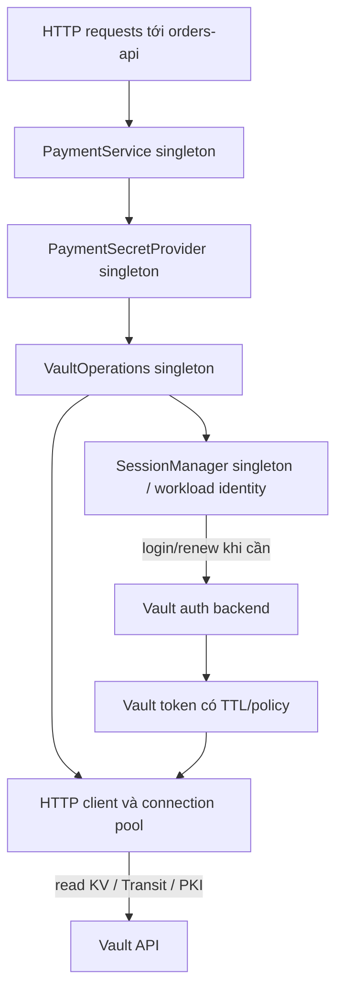
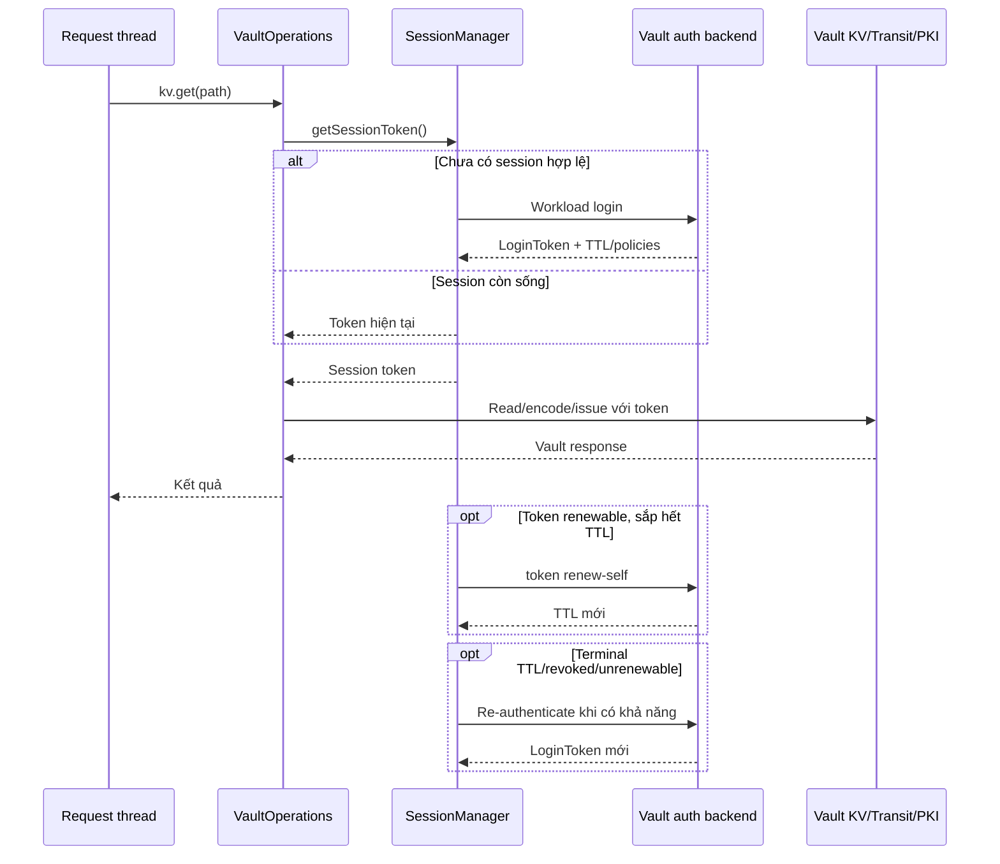

# Tái sử dụng client và giảm đăng nhập không cần thiết

> **Spring Vault — Quan sát và hiệu năng.** Khi ứng dụng Java dùng `VaultTemplate` đọc KV secrets, gọi Transit encryption, xin chứng thư PKI hoặc quản lý token/lease, việc tạo client và đăng nhập Vault cho từng request làm tăng độ trễ, tạo nhiều token và có thể gây tải đột biến lên auth backend. Thiết kế đúng là **tái sử dụng các đối tượng Vault client và HTTP transport có kiểm soát**, để `SessionManager` quản lý token theo vòng đời, sau đó đo số lần login, renew, re-authentication và số request thật sự đến Vault. Việc này khác với cache giá trị secret: tái sử dụng token không có nghĩa là giảm số lượt đọc KV.

## 1. Mục tiêu và tình huống thực tế

Giả sử dịch vụ `orders-api` chạy trên Kubernetes, mỗi Pod nhận 20 yêu cầu thanh toán/giây. Trước khi gọi cổng thanh toán, ứng dụng cần một API key lưu trong KV v2. Một kỹ sư viết mã tạo `VaultTemplate`/cấu hình auth mới trong mỗi phương thức xử lý:

```java
// PHẢN VÍ DỤ - pseudocode để minh họa vấn đề, không phải cấu hình production.
public void handleOrder(Order order) {
    ClientAuthentication authentication = newWorkloadAuthentication();
    VaultOperations perRequestVault = createNewVaultTemplate(
            authentication, newHttpClientForEachRequest());

    String gatewayKey = readGatewayKey(perRequestVault);
    callPaymentGateway(order, gatewayKey);
}
```

Đoạn này có thể kéo theo **thêm login, thêm HTTP connection, thêm scheduler/token lifecycle**, tăng chi phí khi traffic cao. Ngay cả khi engine xử lý auth nhanh, khi nhiều Pod đồng loạt khởi động, số yêu cầu login có thể đột ngột tăng.

Mục tiêu học tập:

1. Hiểu bốn vòng đời khác nhau: **Java Vault client, HTTP connection, Vault session token, dữ liệu secret**.
2. Cấu hình `VaultOperations`/`VaultTemplate` như bean dùng chung trong Spring ApplicationContext, tiêm qua constructor.
3. Lựa chọn `SimpleSessionManager` và `LifecycleAwareSessionManager` đúng nhu cầu token TTL/renew/re-login.
4. Phân biệt **renew token** với **đăng nhập lại**, và với **renew lease của dynamic secret**.
5. Thiết kế HTTP connection pooling, timeout, TLS và cleanup phù hợp phiên bản Spring Vault/Spring Framework.
6. Theo dõi tỷ lệ login/read, lỗi auth, token TTL, p95/p99, connection pool và chi phí trên Vault.
7. Viết kiểm thử đơn vị/tích hợp và thử tải để chứng minh **số login thấp** nhưng ứng dụng vẫn xử lý đúng sau khi token hết TTL hoặc bị thu hồi.

**Phạm vi:** áp dụng cho module `SPRING_VAULT`, lấy Vault theo workload identity và policy tối thiểu, các secret engine KV/Transit/PKI, vòng đời token và lease. Bài này không tự tạo workload auth hoặc quyết định thay chính sách cấp quyền của đội vận hành.

## 2. Phân biệt bốn thứ cần tái sử dụng

| Thành phần | Ai quản lý? | Có nên dùng chung? | Khi nào phải thay/refresh? |
|---|---|---|---|
| **`VaultTemplate` / `VaultOperations`** | Spring ApplicationContext hoặc cấu hình client | Có, trong phạm vi một cấu hình Vault/namespace/workload | Khi thay cấu hình endpoint, trust/auth scope hoặc đóng context |
| **HTTP client / connection pool** | HTTP transport bên dưới Spring Vault | Có, qua request factory/client dùng chung | Theo idle timeout, max age, TLS/network failure, pool lifecycle |
| **Vault session token** | `SessionManager` và Vault auth backend | Có trong phạm vi phiên ứng dụng phù hợp identity | Renew khi được phép; re-login khi hết TTL/không renew/revoked |
| **Giá trị secret** (API key, password, PEM) | Chủ secret và cache nghiệp vụ của ứng dụng | Chỉ khi hợp đồng cache và quyền cho phép | Theo rotation, lease TTL, invalidation, policy thu hồi và freshness |

Từ bảng trên có thể thấy ba cách tối ưu **không tương đương**:

- **Client reuse:** tránh tạo mới cấu hình/HTTP transport, quản lý đóng tài nguyên đúng vòng đời.
- **Token reuse:** tránh gọi auth endpoint trên mỗi request, giúp giảm token churn và chi phí xử lý auth.
- **Secret cache:** giảm số lần gọi KV/Transit/PKI nếu nghiệp vụ cho phép, đổi lại rủi ro dữ liệu stale và yêu cầu bảo mật bộ nhớ.



Ở mỗi process/Pod, một session có thể quản lý một Vault client token cho workload đó. **Không chia sẻ token máy này sang máy khác bằng static state hoặc external cache** để cố giảm tổng số login; token đại diện cho identity và phạm vi sử dụng riêng.

## 3. Anti-pattern: tạo Vault client và login theo mỗi request

Mô hình không mong muốn thường có bốn biến thể:

1. Controller hoặc service gọi `new VaultTemplate(...)` bên trong `handleRequest()`, gắn auth mới.
2. Mã gọi trực tiếp `ClientAuthentication.login()` trước mỗi lần `kv.get()`.
3. Mỗi lần đọc secret lại tạo `RestTemplate` hoặc Apache HTTP client và sau khi trả response không đóng connection.
4. HTTP request truyền token từ người dùng rồi ứng dụng tái dùng token đó như workload token chung, làm sai ranh giới identity.

### 3.1. Chi phí không chỉ là độ trễ HTTP

Giả sử 40 Pod, mỗi Pod 20 business requests/giây và mỗi request cần một KV read:

```text
Business traffic ≈ 40 × 20 = 800 request/giây.

Nếu login trước mỗi business request:
  auth login rate có thể xấp xỉ 800 login/giây.

Nếu mỗi Pod dùng một session token hợp lệ:
  không cần login trên từng request;
  auth traffic chủ yếu tại startup hoặc khi phải re-authenticate.

Dù đã tái sử dụng token:
  nếu vẫn đọc KV mỗi request, Vault vẫn có thể nhận ≈ 800 KV reads/giây.
```

Đây là phép tính **minh họa phụ thuộc cách implement**, không phải số đo benchmark. Token reuse giúp giảm login rate, còn muốn giảm KV read rate phải thay quy trình đọc/caching phù hợp hoặc chỉ đọc khi thật sự cần. Không được kết luận “login giảm 99% thì Vault traffic giảm 99%”.

### 3.2. Vì sao nhiều SessionManager độc lập cũng gây vấn đề?

Nếu ba adapter `KvSecretProvider`, `TransitCryptoProvider` và `PkiCertificateProvider` mỗi adapter tạo riêng `ClientAuthentication` + `LifecycleAwareSessionManager` cho **cùng workload**, mỗi adapter có thể có phiên token/login/renew và scheduler riêng. Khi yêu cầu cùng identity/policy, nên dùng **cùng Spring-managed VaultOperations và SessionManager**.

Trường hợp thật sự cần **tách identity/policy** (ví dụ service ký chứng thư cần policy PKI khác service đọc KV), tạo cấu hình/bean định danh rõ ràng, mỗi identity có lifecycle riêng. Không ép các quyền nghiệp vụ khác nhau dùng chung một token chỉ để bớt login.

## 4. Dùng một VaultOperations bean và constructor injection

Trong Spring, điểm tích hợp chính là `VaultOperations` (thường do `VaultTemplate` triển khai). Tạo và quản lý bean ở lớp configuration rồi inject cùng một instance vào các adapter.

Ví dụ ứng dụng đã có `VaultOperations` bean được cấu hình bằng Spring Vault / Spring Cloud Vault / `AbstractVaultConfiguration`. Adapter chỉ dùng bean đã có:

```java
package example.vault;

import java.util.Map;

import org.springframework.stereotype.Component;
import org.springframework.vault.core.VaultKeyValueOperations;
import org.springframework.vault.core.VaultKeyValueOperationsSupport.KeyValueBackend;
import org.springframework.vault.core.VaultOperations;
import org.springframework.vault.support.VaultResponse;

@Component
public final class PaymentSecretProvider {

    private static final String KEY =
            "apps/orders-api/payment-gateway";

    private final VaultKeyValueOperations kv;

    public PaymentSecretProvider(VaultOperations vaultOperations) {
        // Tạo adapter API cục bộ trên VaultOperations dùng chung.
        // Không thực hiện login hay HTTP call trong constructor này.
        this.kv = vaultOperations.opsForKeyValue(
                "secret", KeyValueBackend.KV_2);
    }

    public String readApiKey() {
        VaultResponse response = kv.get(KEY);
        if (response == null || response.getData() == null) {
            throw new IllegalStateException("Required payment secret missing");
        }

        Map<String, Object> data = response.getData();
        Object raw = data.get("api-key");

        if (!(raw instanceof String value) || value.isBlank()) {
            throw new IllegalStateException("Payment secret schema invalid");
        }
        return value;
    }
}
```

Code dùng Java 17+ cho pattern matching `instanceof`. `PaymentSecretProvider` là Spring singleton theo mặc định, nhận bean `VaultOperations` dùng chung, nên không tạo session riêng mỗi lần đọc.

**Bản hoàn chỉnh production** cần phân loại lỗi Vault, fail-closed khi thiếu credential, xử lý policy 403, timeout và cache theo hợp đồng. Đoạn trên ưu tiên thể hiện **vòng đời client**.

Tầng service:

```java
package example.vault;

import org.springframework.stereotype.Service;

@Service
public final class PaymentApplicationService {

    private final PaymentSecretProvider provider;

    public PaymentApplicationService(PaymentSecretProvider provider) {
        this.provider = provider;
    }

    public void pay(PaymentOrder order) {
        String apiKey = provider.readApiKey();
        // Gửi apiKey vào SDK thanh toán nội bộ, không log/trả ra API.
        // PaymentOrder là kiểu nghiệp vụ do ứng dụng định nghĩa.
    }
}
```

Ví dụ có kiểu `PaymentOrder` giả định của domain; không phải class Spring Vault. Mã nghiệp vụ không biết `secret/data/`, vault token, hoặc mount version.

### 4.1. Khi cần cấu hình Spring Vault thủ công

`AbstractVaultConfiguration` là một cách dựng các bean Spring Vault, cung cấp `VaultEndpoint` và `ClientAuthentication` theo môi trường, đồng thời quản lý `VaultTemplate`/`SessionManager`. Trong phần lớn ứng dụng Spring Boot đã có cấu hình Vault phù hợp, **tránh đăng ký trùng bean**.

Ví dụ skeleton:

```java
import java.net.URI;

import org.springframework.context.annotation.Configuration;
import org.springframework.vault.authentication.ClientAuthentication;
import org.springframework.vault.client.VaultEndpoint;
import org.springframework.vault.config.AbstractVaultConfiguration;

@Configuration
class WorkloadVaultConfiguration extends AbstractVaultConfiguration {

    private final ClientAuthentication workloadAuthentication;

    WorkloadVaultConfiguration(ClientAuthentication workloadAuthentication) {
        this.workloadAuthentication = workloadAuthentication;
    }

    @Override
    public VaultEndpoint vaultEndpoint() {
        return VaultEndpoint.from(
                URI.create("https://vault.internal.example:8200"));
    }

    @Override
    public ClientAuthentication clientAuthentication() {
        // Bean/workload auth được một cấu hình độc lập cung cấp.
        // Không tự tạo static root token ở đây.
        return workloadAuthentication;
    }
}
```

Đây là **khung** để minh họa cách cấu hình một client/session dùng chung; ứng dụng phải cung cấp workload auth thực tế (Kubernetes/JWT/AppRole/Cloud IAM, ...), namespace, TLS, timeout và routing theo môi trường. Cấu hình auth tùy phiên bản và nền tảng. Nếu auth bean có vòng phụ thuộc vào chính `AbstractVaultConfiguration`, cần tách factory/bootstrap phù hợp thay vì tạo vòng lặp bean.

**Phiên bản:** Spring Vault 3.x thường dùng `RestTemplate` bên dưới và các builder HTTP tương ứng. Spring Vault **4.1** giới thiệu `VaultClient` dựa trên `RestClient` và đánh dấu nhiều API builder kiểu `RestTemplate` là deprecated. Hợp đồng service theo `VaultOperations` vẫn là điểm ổn định; khi cấu hình transport chuyên sâu phải tra đúng Javadoc của phiên bản đang dùng.

## 5. SessionManager: nơi quyết định login, renew và re-login

Spring Vault có interface `SessionManager`. Vai trò của nó là **lấy token** để các request đến Vault có authenticated session phù hợp, thay vì login trước mỗi request.

Hai implementation quan trọng:

| Implementation | Hành vi chính | Nên dùng khi nào? |
|---|---|---|
| `SimpleSessionManager` | Login một lần theo cơ chế synchronized, tái sử dụng `VaultToken`; **không tự renewal/revocation** | Token tĩnh được quản trị bên ngoài hoặc bài lab có lifecycle đặc biệt |
| `LifecycleAwareSessionManager` | Tái sử dụng token, theo dõi TTL, lên lịch renew nếu renewable, có thể login lại khi cần, quản lý lifecycle/shutdown | Workload auth có TTL/renewal: AppRole, Kubernetes/JWT/IAM... theo hỗ trợ |
| Custom `SessionManager` | Tự quyết định caching/TTL/retry/auth | Chỉ khi có yêu cầu riêng và test chặt chẽ lifecycle/concurrency |

Theo tài liệu Spring Vault, `AbstractVaultConfiguration` thiết lập `LifecycleAwareSessionManager` theo mặc định. Nó **thread-safe** và đồng bộ các thread cùng muốn lấy token khi session cần login. Đây là lý do tạo một SessionManager dùng chung thường hiệu quả hơn nhiều instance tự đăng nhập.

### 5.1. Luồng token lifecycle



`renew-self` **không phải** `auth/<method>/login`. Renewal gia hạn phiên token theo giới hạn Vault; re-login tạo phiên xác thực mới. Các phương thức đăng nhập có thể cấp token không renewable, token period hoặc token có explicit max TTL, nên phải xem thông tin TTL/renewable thật.

### 5.2. `VaultToken` và `LoginToken` khác nhau

Spring Vault phân biệt:

- `VaultToken`: đại diện token, ví dụ có từ `TokenAuthentication`; bản thân nó có thể không mang metadata TTL/renewability.
- `LoginToken`: token nhận từ phương thức login, mang thông tin phiên cần cho lifecycle/renewal.
- `LifecycleAwareSessionManager` có thể dùng token self-lookup để tìm TTL/renewability của `VaultToken` nếu cấu hình cho phép; hành vi còn tùy version/permissions.
- Khi shutdown, manager chỉ thu hồi token mà lifecycle contract cho phép, không mặc định revoke mọi token tĩnh do bên ngoài cấp.

**Không ghi token vào metrics/log.** Chỉ quan sát số lần login/renew, trạng thái thất bại và thời gian còn lại nếu đo được theo cách an toàn.

### 5.3. Những tình huống dù đã dùng SessionManager vẫn login lại nhiều

| Triệu chứng | Nguyên nhân có thể | Cần xem |
|---|---|---|
| Cứ vài giây lại login | Token có TTL quá ngắn hoặc không renewable | Vault auth role/token policies/max TTL |
| Mỗi read lại login | Tạo nhiều SessionManager/`VaultTemplate`, hoặc auth bị fail liên tục | Bean scope, session lifecycle, exception |
| Login burst khi deploy 100 Pod | Mỗi Pod khởi tạo riêng session cùng thời điểm | Rollout concurrency, readiness và jitter |
| Re-login thất bại sau TTL | AppRole SecretID hết use count, JWT expired, projected token không refresh | Cơ chế cấp lại bootstrap credential/workload identity |
| Renew thất bại 403 | Token bị revoke, thiếu quyền token self-renew, token type không renew | Audit event và Vault auth configuration |
| Không thấy login nhưng request 403 | Session token cũ bị revoke hoặc policy thay đổi | Token lifecycle và xử lý re-auth |
| Một Pod dùng nhiều token khác nhau | Nhiều bean Vault client/auth độc lập | Dependency graph và container lifecycle |

Không kéo dài TTL vô hạn như một cách “tối ưu” thay cho quản lý login. Cấu hình TTL là quyết định bảo mật, cần phối hợp với đội vận hành. Auth theo Kubernetes/JWT có các yếu tố rotation/expiry riêng; token service account do platform phát hành cũng phải được đọc mới khi re-login nếu quy trình yêu cầu.

## 6. Tách vòng đời token, lease và secret cache

Trong Spring Vault, có ít nhất **ba đồng hồ khác nhau**:

| Đồng hồ | Đối tượng | Operation thay đổi | Không tự làm gì? |
|---|---|---|---|
| Token TTL | Vault client token của workload | `renew-self` hoặc re-login | Không thay API key KV đã cache |
| Dynamic secret lease TTL | Password/credential động do engine cấp | Lease renew/revoke hoặc cấp mới | Không tự thay connection pool ứng dụng đã dùng password cũ |
| Static KV secret version | API key/credential lưu KV v2 | Operator ghi version mới, rotation | Không tự cập nhật giá trị đang nằm trong bean/cache |

Nếu ứng dụng dùng `SecretLeaseContainer` để quản lý credential động, container có thể renew hoặc yêu cầu secret mới theo lifecycle. **Người sử dụng credential** (DataSource, HTTP client, SDK) vẫn cần nhận và áp dụng thay đổi đúng thời điểm.

Với KV v2, `get(path)` trên đường dẫn hiện tại đọc version theo semantics engine. Nếu adapter có cache TTL 10 phút, việc rotate giá trị trong Vault **không** tự invalidate cache trừ khi ứng dụng triển khai cơ chế đó.

**Quyết định tối ưu:** trước hết giảm login do sai cách tạo client, sau đó đo read traffic; chỉ triển khai cache secret khi hợp đồng nghiệp vụ và bảo mật chấp nhận cửa sổ stale.

## 7. HTTP connection pooling và timeout

Một token có thể tái sử dụng hiệu quả nhưng mỗi request vẫn tốn chi phí TCP/TLS handshake nếu HTTP transport tạo connection mới hoặc không có keep-alive/pool. Cần xem từng tầng:

- **HTTP client của Spring Vault:** thường đi qua request factory/connector được cấu hình; tùy Spring Vault 3.x/4.x và Spring Framework/HTTP library.
- **Connection pool:** giữ connection rảnh để tái sử dụng, giới hạn tổng kết nối và giới hạn kết nối theo host/route.
- **TLS:** xác thực hostname và chuỗi CA cho chính Vault server; kết nối tái sử dụng không phải lý do tắt xác minh TLS.
- **Timeout:** connect timeout, response/read timeout, thời gian chờ lấy connection từ pool và deadline nghiệp vụ.
- **Đóng tài nguyên:** pool/client được Spring quản lý vòng đời và đóng khi application shutdown.

### 7.1. Mẫu transport với Spring Framework 6 + Apache HttpClient 5

Đoạn sau minh họa **tạo connection pool**, cần đưa vào configuration transport của Spring Vault đúng phiên bản dự án. Nó **không tự gắn** vào `VaultTemplate` chỉ vì có bean Apache client; phải nối `ClientHttpRequestFactory` vào cấu hình Vault client của bạn.

```java
import org.apache.hc.client5.http.impl.classic.CloseableHttpClient;
import org.apache.hc.client5.http.impl.classic.HttpClients;
import org.apache.hc.client5.http.impl.io.PoolingHttpClientConnectionManagerBuilder;
import org.springframework.http.client.HttpComponentsClientHttpRequestFactory;

public final class VaultHttpTransportExample {

    public static HttpComponentsClientHttpRequestFactory factory() {
        var connectionManager =
                PoolingHttpClientConnectionManagerBuilder.create()
                        .setMaxConnTotal(64)
                        .setMaxConnPerRoute(32)
                        .build();

        CloseableHttpClient httpClient = HttpClients.custom()
                .setConnectionManager(connectionManager)
                .build();

        HttpComponentsClientHttpRequestFactory requestFactory =
                new HttpComponentsClientHttpRequestFactory(httpClient);

        requestFactory.setConnectTimeout(2_000);
        // Read/response timeout và pool acquisition timeout
        // cần cấu hình theo phiên bản Spring/HttpClient đang dùng.

        return requestFactory;
    }
}
```

Chỉ là ví dụ về **factory**. Trong Spring Boot production, nên đăng ký HTTP client/request factory **như managed beans có dispose/close** theo ứng dụng; bean `CloseableHttpClient` phải được đóng đúng vòng đời, không tạo lại từ mỗi request. Cấu hình connection eviction/TTL, TLS hostname verification, pool wait timeout và saturation metrics phải dựa vào phiên bản dependency thực tế. Với Spring Framework cũ dùng Apache HttpClient 4, import và các phương thức khác, không copy nguyên đoạn.

**Từ Spring Vault 4.1**, các API build client chuyển hướng sang `VaultClient`/`RestClient`; tránh sửa code dựa trên phương thức `RestTemplateBuilder` đã deprecated. Dù ở 3.x hay 4.x, mục tiêu là **một transport được quản lý, có giới hạn và cleanup**.

### 7.2. Chọn pool size có căn cứ

Không đặt pool size bằng tổng số request/giây. Một ước lượng sơ bộ số request đang bay đồng thời theo Little's Law:

```text
Vault operations: 200 request/giây mỗi Pod
Latency trung bình: 40 ms = 0,04 giây

In-flight concurrency ≈ 200 × 0,04 = 8

Có thể thử pool per-host 16-32 kết nối,
sau đó đo p95/p99, pool wait và CPU.
```

Đây là bài toán capacity minh họa, **không phải đề xuất cố định**. Nếu Vault p99 tăng hoặc Transit request có payload lớn, số connection cần khác. Pool quá lớn gây kết nối/FD/tài nguyên phía Vault và proxy tăng; pool quá nhỏ tạo queue, timeout. Tối ưu dựa trên tải đo được.

## 8. Đọc secret mỗi request hay cache?

Giảm login không đồng nghĩa giảm số lần gọi KV. Sau khi SessionManager được cấu hình tốt, vẫn cần xác định **thời điểm thật sự cần secret**.

| Phương án | Vault read rate | Độ mới dữ liệu | Rủi ro/vận hành |
|---|---|---|---|
| Đọc mỗi request | Có thể cao bằng business request rate | Thường đọc được latest version khi gọi | Độ trễ/tải Vault cao; network dependency trực tiếp |
| Đọc một lần khi startup | Rất thấp khi chạy bình thường | Có thể stale suốt vòng đời Pod | Rotation cần restart và xác minh rollout |
| Cache TTL ngắn | Tối đa khoảng theo expiry và concurrency | Stale trong TTL | Cần giới hạn cache/key, redaction, xử lý stampede |
| Refresh theo thông báo rotation | Thường thấp | Phụ thuộc độ tin cậy của signal | Cần event/trigger có xác thực và đường rollback |

Với token TTL 1 giờ nhưng secret cache 10 phút, token có thể renew nhiều lần mà cache vẫn giữ API key cũ. Ngược lại, mỗi lần ứng dụng refresh secret không bắt buộc login mới khi session token vẫn sống.

### 8.1. Chống cache stampede

Khi hàng nghìn request cùng thấy TTL vừa hết, nếu mỗi thread gọi Vault để refresh, số request có thể đột biến. Có thể dùng **single-flight** trong process: chỉ một thread tải bản mới cho mỗi key, thread còn lại chờ hoặc tiếp tục dùng bản cũ **chỉ khi chính sách cho phép**.

Giới hạn cache:
- Key cache nên là **logical secret ID cố định**, không phải raw path từ input HTTP.
- Không cache plaintext vô hạn hoặc ghi nó vào Redis/log chỉ để giảm read rate.
- Không mặc định dùng stale value sau `403`, revoke, soft-delete hay sự cố bảo mật.
- Lưu thời điểm refresh/expiry và phiên bản KV nếu cần audit, nhưng không log value.
- Tách auth token renewal khỏi secret refresh scheduler để tránh phụ thuộc vòng tròn.

Chỉ áp dụng cache khi nghiệp vụ chấp nhận và có thử nghiệm rotation. Transit encrypt/decrypt không thể thay bằng cache response tùy tiện vì có yếu tố input/context và yêu cầu mật mã; các API PKI có semantics phát hành chứng thư và lease khác với đọc một KV static value.

## 9. Đo đúng login traffic và hiệu năng Vault

Một dashboard cần tối thiểu **hai họ chỉ số**: hoạt động business đến Vault và hoạt động auth/session.

| Nhóm | Chỉ số gợi ý | Dùng để kết luận |
|---|---|---|
| Business Vault operations | rate, error rate, latency p50/p95/p99 theo engine/operation | KV/Transit/PKI đang tạo tải bao nhiêu |
| Authentication | login attempts/success/failure, duration, auth method | Có login không cần thiết hoặc auth bị lỗi không |
| Token lifecycle | renew attempts/failures, re-auth events, token TTL còn lại dạng bucket | Token có được gia hạn đúng không |
| HTTP transport | active/idle/pending connections, pool acquire time, timeouts | Pool là bottleneck hay TLS/connect |
| Vault server | request rate, auth backend latency, storage latency, 429/5xx, saturation | Tác động lên Vault cluster |
| App cache | hit/miss, stale discard, refresh duration, version change events | Có giảm read nhưng vẫn giữ freshness |
| Startup | thời gian từ Pod start đến Vault-ready, số lần login trong rollout | Burst khi autoscaling/deploy |

**Quan trọng:** tên metric ở đây là **metric ứng dụng gợi ý**, không khẳng định Spring Vault mặc định tự xuất tất cả. Tùy version, các số liệu có thể đến từ Micrometer instrumentation tự viết, HTTP client pool, Vault telemetry/audit (đã phân quyền) hoặc tracing. Phải xác nhận nguồn của từng metric trước khi xây dashboard.

### 9.1. Đếm tỷ lệ login/secret read

Công thức điều tra:

```text
R_login = số lần gọi auth login thành công / thời gian
R_renew = số lần gọi token renew thành công / thời gian
R_read  = số lần gọi KV read / thời gian

Login per KV read = R_login / max(R_read, 1)
```

Đây chỉ là một **tín hiệu**, không phải KPI phải luôn bằng 0. Khi workload có traffic thấp, autoscaling và token max TTL ngắn, login/read ratio có thể cao một cách bình thường. Kết luận phải so sánh với **số Pod đang hoạt động, auth method, TTL và số request nghiệp vụ**.

Không dùng **token string** hay **secret path có ID người dùng** làm metrics label, vì sẽ tạo high-cardinality và rò rỉ dữ liệu nhạy cảm.

### 9.2. Instrument một adapter bằng Micrometer

Ví dụ đo latency một KV read với tag có tập giá trị cố định:

```java
import java.util.concurrent.TimeUnit;

import io.micrometer.core.instrument.MeterRegistry;
import io.micrometer.core.instrument.Timer;

public final class MeteredPaymentSecretProvider {

    private final PaymentSecretProvider delegate;
    private final MeterRegistry metrics;

    public MeteredPaymentSecretProvider(
            PaymentSecretProvider delegate, MeterRegistry metrics) {
        this.delegate = delegate;
        this.metrics = metrics;
    }

    public String readApiKey() {
        long startNanos = System.nanoTime();
        String result = "success";

        try {
            return delegate.readApiKey();
        } catch (RuntimeException ex) {
            result = "error";
            throw ex;
        } finally {
            Timer.builder("vault.secret.read.duration")
                    .tag("engine", "kv")
                    .tag("operation", "read")
                    .tag("result", result)
                    .register(metrics)
                    .record(
                        System.nanoTime() - startNanos,
                        TimeUnit.NANOSECONDS);
        }
    }
}
```

Đoạn này chỉ tạo histogram/timer theo cách registry được cấu hình, không xuất API key hay token. Nếu muốn phân loại lỗi theo status code, nên dùng **tập error category cố định** được xác định ở adapter, không gắn `ex.getMessage()` vào tag. Cần bảo đảm instrumentation không bị lặp khi dùng cả HTTP interceptor và service wrapper.

### 9.3. Quan sát token lifecycle mà không đếm sai

Không nên gọi thêm `auth/token/lookup-self` trước **mọi request** chỉ để đo TTL: thao tác đo có thể tạo nhiều Vault calls và làm méo kết quả. Sử dụng các event/metrics do session manager hoặc auth client cung cấp theo version, đồng thời đối chiếu **audit log** ở Vault khi cần điều tra login/renew.

Spring Vault `LifecycleAwareSessionManager` hỗ trợ publish authentication events. Có thể gắn listener phù hợp với API từng phiên bản để đếm login/renew error và cảnh báo; listener phải nhanh, không log token và không đưa công việc blocking lên thread renewal.

## 10. Rủi ro khi giảm login thiếu kiểm soát

| Ý tưởng dễ mắc | Vấn đề | Thiết kế an toàn |
|---|---|---|
| Dùng một static Vault token cho toàn cluster | Mất isolation, phạm vi thu hồi/quyền quá rộng | Workload identity per instance/service với TTL |
| Token TTL không giới hạn để khỏi login | Khó thu hồi, tăng thời gian lộ nếu bị đánh cắp | TTL phù hợp, auto renew/re-auth |
| Cache secret và không refresh | Rotation không được áp dụng | TTL/invalidation có kiểm thử |
| Mọi adapter có một `VaultTemplate` riêng | Nhiều session/login và pool | Dùng chung bean theo scope identity |
| Bắt `403` rồi login lại liên tục | Token/policy sai không được chữa, auth storm | Phân loại 403/401, kiểm tra audit/policy |
| Bỏ TLS certificate verification | Có thể lộ token/secret qua MITM | Truststore/hostname đúng |
| Chỉ tối ưu pool size, không đo requests | Chỉ giảm handshake, không giảm Vault operations | Đo login rate, read rate và p95 |
| Chia token giữa hai workload có policy khác | Vi phạm least privilege | Tách session/identity có chủ đích |
| Không đóng scheduler/http client | Thread/connection leak và shutdown lỗi | Spring-managed lifecycle |
| Log `VaultResponse`/token để debug | Lộ credential | Redaction, correlation ID an toàn |

Với AppRole SecretID bị giới hạn số lần sử dụng, đừng kỳ vọng re-login không giới hạn sau token max TTL nếu không có cơ chế phát hành SecretID mới. Với Kubernetes auth, phải chú ý projected service account token rotation và audience/bound service account. Trước khi tối ưu login rate, xác nhận **re-authentication vẫn hoạt động trong điều kiện thật**.

## 11. Xử lý lỗi và kiểm soát tải khi Vault chậm

Một SessionManager dùng chung vẫn gặp network timeout, token revoked, permission denied hoặc Vault chưa sẵn sàng. Một kế hoạch resilience phù hợp:

- **401/403:** xác minh nguồn credential, policy, auth method và token session. Không lặp login vô hạn; tách 403 do read policy với 403 do auth/renew.
- **429/503/timeouts:** retry có giới hạn và backoff/jitter; kết hợp circuit breaker hoặc concurrency limit để tránh dồn tải.
- **Secret missing/invalid schema:** fail-closed, phát cảnh báo vận hành; token reuse không chữa thiếu dữ liệu.
- **Token near expiry:** dựa vào session manager renew/re-login; không ép mọi request tự gọi renew.
- **Connection pool exhausted:** giới hạn concurrency, timeout lấy connection, đo pending/active; không tăng vô hạn pool.
- **Vault HA failover:** dùng cấu hình endpoint/routing được đội vận hành xác nhận, retry read khi an toàn, phân biệt với write side effects.

Không retry các operation có side effects như cấp token, phát hành PKI certificate hoặc rotate secret **một cách vô điều kiện** sau timeout, vì server có thể đã xử lý request nhưng client chưa nhận response. Đối với read KV, retry thường an toàn hơn nhưng phải giữ giới hạn tổng deadline và phân loại lỗi.

### 11.1. Readiness không tạo auth storm

Nếu một Pod kiểm tra health bằng cách gọi Vault mỗi 1 giây và health check tự tạo client/login mới, 100 Pod sẽ gây tải auth chỉ để “kiểm tra sức khỏe”. Thay vào đó:

1. Khởi tạo client/session trong application startup.
2. Xác minh Vault auth và secret **bắt buộc** theo luồng readiness đã giới hạn cadence.
3. Cache **trạng thái kiểm tra**, không xuất credential ra health endpoint.
4. Phân biệt trạng thái `STARTING`, `READY`, `DEGRADED` và `NOT_READY` theo chính sách.
5. Không cấp quyền root cho health check để tránh lỗi 403.

## 12. Kiểm thử có chứng cứ: client reuse, renewal và load

Đánh giá tối ưu phải dựa trên **cả số lần auth thực sự và hành vi sau khi token đổi**. Mock chỉ chứng minh cách service dùng object; muốn đo Vault login/renew, dùng instance Vault test với auth method và policy có kiểm soát.

### 12.1. Kiểm thử Spring bean reuse bằng unit test

Một test đơn giản có thể kiểm tra hai service dùng đúng một bean `VaultOperations`:

```java
import static org.junit.jupiter.api.Assertions.*;

import org.junit.jupiter.api.Test;
import org.springframework.beans.factory.annotation.Autowired;
import org.springframework.boot.test.context.SpringBootTest;
import org.springframework.vault.core.VaultOperations;

@SpringBootTest
class SharedVaultOperationsIT {

    @Autowired VaultOperations vaultFromContext;
    @Autowired PaymentSecretProvider paymentProvider;

    @Test
    void sharesOneConfiguredVaultBean() {
        assertNotNull(vaultFromContext);
        assertNotNull(paymentProvider);
        // Có thể kiểm tra bean scope/identity trong bean wiring test.
        // Test này CHƯA chứng minh server login chỉ diễn ra một lần.
    }
}
```

Nếu cần chứng minh nhiều provider nhận cùng instance, dùng test cấu hình constructor injection hoặc một adapter spy ở tầng test, không expose `VaultTemplate` thành public getter của sản phẩm chỉ vì test.

### 12.2. Unit test đếm số lần auth được gọi trong SessionManager

Test với `SimpleSessionManager` dùng mock `ClientAuthentication` để chứng minh session reuse **trong vòng đời manager**:

```java
import static org.junit.jupiter.api.Assertions.*;
import static org.mockito.Mockito.*;

import org.junit.jupiter.api.Test;
import org.springframework.vault.authentication.ClientAuthentication;
import org.springframework.vault.authentication.SimpleSessionManager;
import org.springframework.vault.support.VaultToken;

class SessionReuseTest {

    @Test
    void shouldReuseSameLoginToken() {
        ClientAuthentication auth = mock(ClientAuthentication.class);
        VaultToken token = VaultToken.of("fixture-token");
        when(auth.login()).thenReturn(token);

        SimpleSessionManager session = new SimpleSessionManager(auth);

        assertSame(token, session.getSessionToken());
        assertSame(token, session.getSessionToken());
        assertSame(token, session.getSessionToken());

        verify(auth, times(1)).login();
    }
}
```

Đây là test API session đơn giản, **không** chứng minh renewal/re-login hay Vault HTTP traffic thật. Với `LifecycleAwareSessionManager`, cần kiểm thử theo auth TTL/renewability thật và kiểm soát scheduler, không đặt giả định “luôn đúng một login trọn đời”.

### 12.3. Ma trận integration test

| ID | Setup | Assertion đáng tin |
|---|---|---|
| C01 | 1 Pod/1 SessionManager, 100 KV reads | Auth login chỉ xuất hiện khi session thực sự cần; không gần 100 login |
| C02 | 2 providers dùng cùng `VaultOperations` | Số session token không tăng riêng theo provider |
| C03 | Token renewable TTL ngắn trên Vault test | Renew xảy ra trước expiry; nghiệp vụ tiếp tục đọc |
| C04 | Token unrenewable/terminal TTL | Re-auth thành công khi credential nguồn còn hiệu lực |
| C05 | AppRole SecretID đã hết lượt sử dụng | Re-auth bị từ chối rõ; không retry vô hạn |
| C06 | Pod restart / scale 10 → 100 | Login burst được đo; rollout không làm auth backend quá tải |
| C07 | Pool connections nhỏ dưới tải cao | Pending wait/latency tăng; không leak connection |
| C08 | Vault 503 tạm thời | Retry giới hạn và deadline; read được phục hồi khi server khỏe |
| C09 | Vault 403 do policy | Không có vòng login/renew storm |
| C10 | KV v2 rotated secret khi app có cache | Cache refresh theo TTL/invalidation được định nghĩa |
| C11 | Dynamic credential lease renew | Session token renew không tự sửa connection pool dùng credential cũ |
| C12 | Log/metrics/traces | Không chứa Vault token, SecretID, API key, raw payload hoặc PII |
| C13 | Multi-tenant/multi-namespace | Client/session scoped đúng identity, không dùng nhầm token |
| C14 | 100 threads đồng thời lấy session token | Không có login độc lập cho mỗi thread khi đã có valid session |

### 12.4. Quan sát login thật ở server

Trong Vault test, operator có quyền audit có thể đối chiếu số request đến endpoint:

```text
auth/kubernetes/login
auth/approle/login
auth/token/renew-self
auth/token/lookup-self
secret/data/apps/orders-api/payment-gateway
```

Các path trên là ví dụ; mount auth Kubernetes có thể đặt tên khác. **Không mặc định mọi self-lookup là login**. Session token có thể self-lookup để lấy TTL, và renew-self không tạo client login mới. Khi đánh giá “giảm login”, phân loại mỗi HTTP operation rõ ràng, tránh cộng cả renewal vào số login.

## 13. Thiết kế và chạy một thử nghiệm hiệu năng có thể lặp lại

Một kịch bản đo nên gồm hai cấu hình ứng dụng trên **Vault test riêng**, cùng dữ liệu và policy. Không dùng root token hoặc secret thật.

| Tham số | Baseline sai | Thiết kế đề xuất |
|---|---|---|
| VaultTemplate | Tạo per request | Singleton bean theo identity |
| SessionManager | Tạo mới mỗi request | Lifecycle-aware dùng chung |
| HTTP client | Tạo connection/transport mới liên tục | Connection pool có giới hạn |
| Secret cache | Không đổi | Giữ nguyên để so sánh riêng hiệu ứng auth/client |
| Traffic | 10/50/100 concurrent clients | Cùng traffic và thời lượng |
| Đo | p50/p95/p99, auth logins, KV reads, errors | Cùng metric và điều kiện |

Quy trình:

1. Khởi động Vault test và xác minh mount KV v2, policy và workload auth. Không dùng backend production.
2. Cấu hình một bộ workload identity/role đúng TTL, ghi lại engine version và độ trễ mạng.
3. Warm up ứng dụng trước khi tính kết quả; ghi riêng startup login burst.
4. Gửi tải cố định trong cùng khoảng thời gian qua các client đồng thời.
5. Đo app p95/p99, CPU, memory, connection pool pending; đối chiếu Vault audit/telemetry login và KV reads.
6. Lặp với token TTL ngắn để xác minh renewal/re-auth không phá ứng dụng sau khi cache token hết hiệu lực.
7. Lặp kiểm thử rotation cache nếu có dùng cache; đừng đánh đồng “số login thấp” với “secret luôn mới”.
8. Báo cả số lỗi 403/429/5xx, connection timeout, thử lại và tỷ lệ request business thành công.

### 13.1. Kết quả minh họa, không phải benchmark

```text
Kịch bản giả định: 10 Pods, 20 requests/s mỗi Pod, 60 giây
Business requests ≈ 10 × 20 × 60 = 12.000.

Thiết kế đăng nhập trước mỗi request:
  login attempts có thể tới khoảng 12.000,
  cộng 12.000 KV reads nếu một KV read mỗi request.

Thiết kế 1 session manager mỗi Pod:
  có thể chỉ khoảng 10 initial logins
  cộng các renewal/re-auth thật sự trong 60 giây,
  nhưng KV reads vẫn khoảng 12.000 nếu không cache.
```

Đây là **mô hình lý thuyết** để nhận biết chênh lệch. Thực tế có restart, auth errors, renewal, concurrent request, session reuse chưa được thiết lập và HTTP retry, nên các con số từ audit phải được dùng để xác minh chứ không mặc định khớp mô hình.

### 13.2. Tiêu chí chấp nhận kỹ thuật

- Dùng **một VaultOperations/SessionManager theo scope workload** đã định nghĩa, không tạo mới ở đường xử lý request.
- Số login **không tỷ lệ trực tiếp** với số KV read khi token còn hợp lệ.
- Sau token TTL/renew boundary, request tiếp tục thành công hoặc lỗi được phân loại rõ ràng, không tạo vô hạn auth retries.
- Connection pool không rò và p99 pool wait nằm trong ngân sách latency.
- Không có token/secret plaintext trong log, traces, metric tags, diagnostics.
- Nếu có cache, thay secret trong Vault phản ánh đến ứng dụng trong **SLA freshness** đã thỏa thuận.
- Có alert khi auth login failure, renew failure, 429/503, pool saturation vượt ngưỡng đã thiết kế.

## 14. Bài tập thực hành

1. Một dịch vụ tạo `new VaultTemplate` trong `@GetMapping`. Hãy viết lại dùng bean `VaultOperations` được inject bằng constructor.
2. `SimpleSessionManager` có được bảo đảm tự động renew và re-login sau token TTL không? So sánh với `LifecycleAwareSessionManager`.
3. 50 Pod × 20 business requests/s, mỗi request đọc KV một lần. Nếu tối ưu login còn một lần/Pod khi startup, Vault có còn khoảng 1.000 KV reads/s không? Tại sao?
4. Sau token renewal, API key trong `PaymentGatewayClient` có tự thay bằng version mới trong KV v2 không?
5. Vì sao không nên dùng `auth/token/lookup-self` ở trước **mỗi** request chỉ để đo TTL?
6. Hai services cần KV read và PKI issue với policy khác nhau. Có nên cho cả hai dùng chung Vault token để giảm login?
7. Khi workload có 429 và retry 10 lần không backoff, chuyện gì có thể xảy ra khi 100 Pod cùng retry?
8. Một AppRole SecretID có `num_uses=1` và token có max TTL. Tại sao re-login sau token terminal TTL có thể thất bại?
9. Số auth login mỗi phút giảm từ 500 xuống 20 nhưng p99 KV read tăng mạnh. Hãy liệt kê ba điều cần đo tiếp.
10. Khi chuyển Spring Vault 3.x sang 4.1, vì sao nên kiểm tra phần cấu hình HTTP client trong khi vẫn có thể giữ hợp đồng domain dựa trên `VaultOperations`?

**Gợi ý:** (1) singleton bean trong context; (2) simple reuse không renew/revoke; lifecycle-aware renew/re-auth theo điều kiện; (3) có, login và read là hai operation riêng; (4) không; (5) chính instrumentation sẽ làm tăng Vault requests; (6) phải tách identity theo least privilege khi policy khác nhau; (7) thundering herd/rate limiting; (8) không có SecretID hợp lệ để login lại; (9) read request rate, Vault storage/latency, pool wait, network timeouts; (10) 4.1 dùng nền tảng `VaultClient`/`RestClient` và deprecate một số RestTemplate builders.

## 15. Tài liệu tham khảo chính thức

- [Spring Vault — Introduction to VaultTemplate](https://docs.spring.io/spring-vault/reference/vault/imperative-template.html): quản lý bean VaultTemplate, tái sử dụng instance và `SessionManager`.
- [Spring Vault — Authentication Methods / Token Lifecycle](https://docs.spring.io/spring-vault/reference/vault/authentication.html): authentication, `VaultToken`/`LoginToken`, renewal và re-login.
- [Spring Vault — SimpleSessionManager API](https://docs.spring.io/spring-vault/reference/api/java/org/springframework/vault/authentication/SimpleSessionManager.html): synchronized login và tái sử dụng token, không auto-renew.
- [Spring Vault — LifecycleAwareSessionManager API](https://docs.spring.io/spring-vault/reference/api/java/org/springframework/vault/authentication/LifecycleAwareSessionManager.html): thread-safety, token renewal, authentication events, shutdown.
- [Spring Vault — AbstractVaultConfiguration API](https://docs.spring.io/spring-vault/reference/api/java/org/springframework/vault/config/AbstractVaultConfiguration.html): cấu hình `VaultTemplate`, `SessionManager`, HTTP transport.
- [Spring Vault — VaultClient API (4.1)](https://docs.spring.io/spring-vault/reference/api/java/org/springframework/vault/client/VaultClient.html): lớp HTTP client mới dựa trên RestClient.
- [Spring blog — Evolving Spring Vault: Introducing VaultClient](https://spring.io/blog/2025/12/26/evolving-spring-vault/): lý do thay đổi kiến trúc client trong Spring Vault 4.1.
- [HashiCorp Vault — Tokens](https://developer.hashicorp.com/vault/docs/concepts/tokens): service/batch tokens, TTL, renewal, periodic tokens và max TTL.
- [HashiCorp Vault — Monitoring and telemetry](https://developer.hashicorp.com/vault/docs/internals/telemetry): cách quan sát request/auth/storage và sử dụng số liệu trên server.
- [HashiCorp Vault — Lease, Renew and Revoke](https://developer.hashicorp.com/vault/docs/concepts/lease): phân biệt secret lease, token TTL, renewal/revocation.
- [Micrometer — Timers](https://docs.micrometer.io/micrometer/reference/concepts/timers.html): timer cho latency và tag cardinality.

> **Ghi nhớ:** tối ưu Spring Vault bắt đầu từ **tái sử dụng VaultTemplate/VaultOperations và HTTP transport**, dùng **SessionManager quản lý token** để tránh login trước từng request, sau đó đo riêng **login/renew, KV read rate và latency**. Cache dữ liệu secret là quyết định có thêm rủi ro freshness, rotation và quyền truy cập; phải có hợp đồng bảo mật và kiểm thử riêng.

