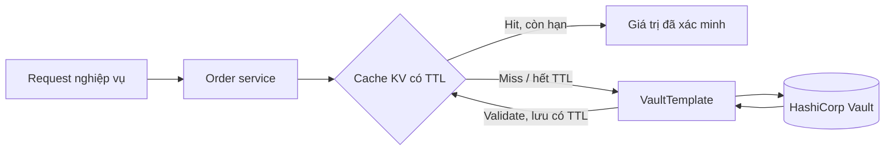
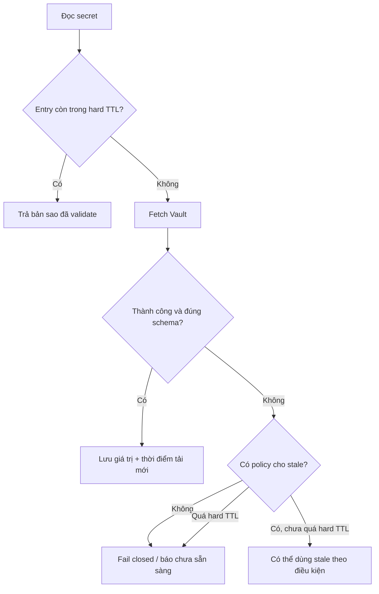
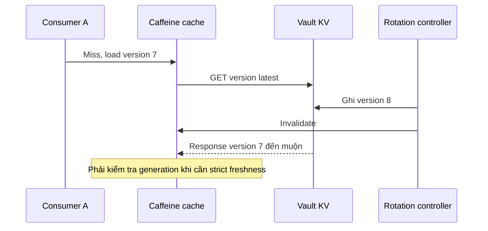

# Lưu đệm secret có thời hạn và kiểm soát dữ liệu cũ

Một ứng dụng Java dùng **Spring Vault** có thể đọc cùng một giá trị **HashiCorp Vault KV** nhiều lần trong khi secret chỉ thay đổi vài lần mỗi ngày. Cache có thời hạn (TTL) giảm độ trễ, lưu lượng tới Vault và tải cho hệ thống xác thực. Nhưng nếu một mật khẩu đã bị xoay hoặc credential động đã hết lease, **bản sao còn trong RAM có thể trở thành dữ liệu cũ nguy hiểm**.

Bài thuộc chương **Quan sát và hiệu năng** của module `SPRING_VAULT`: cách xác định loại secret được cache, thiết kế TTL và chính sách stale, triển khai với `VaultTemplate`/Caffeine, invalidation khi rotate, đo hiệu năng và kiểm thử bằng Vault.

## 1. Cache giúp gì và đánh đổi điều gì?

Giả sử `order-service` dùng `VaultTemplate` đọc `config/orders/runtime` từ KV v2. Mỗi lần đọc cần HTTP/TLS, token có quyền, sự sẵn sàng của Vault và thời gian xử lý. Nếu 100 pod liên tục đọc cùng một secret, việc cache ở từng pod có thể giảm đáng kể số request.



| Đặc điểm | Khi dùng cache | Rủi ro |
| --- | --- | --- |
| Latency | Cache hit không chờ Vault | Giá trị đã thay đổi ở Vault chưa được phản ánh. |
| Tải Vault | Giảm truy cập KV lặp | Cold start hoặc cache đồng loạt hết hạn vẫn có thể gây đỉnh tải. |
| Tính sẵn sàng | Giá trị còn hạn vẫn có thể được dùng khi kết nối chập chờn | Cache có thể che giấu sự cố hoặc thay đổi quyền. |
| Bảo mật | Giảm số lần truyền secret qua mạng | Tạo thêm bản sao plaintext trong heap, heap dump hoặc cache phân tán. |

**Cache TTL là thời gian tối đa ứng dụng dự kiến tin bản sao đủ mới.** Nó không chứng minh secret vẫn hợp lệ ở hệ thống đích và không tự buộc ứng dụng ngừng dùng một credential đã bị revoke.

## 2. Năm khái niệm thời hạn cần tách biệt

| Khái niệm | Ai quản lý? | Tác động |
| --- | --- | --- |
| **Cache TTL** | Java/Caffeine hoặc cache backend | Đến hạn thì entry phải được tải lại hay từ chối. |
| **Vault token TTL** | Vault authentication/token lifecycle | Token hết hạn thì request mới tới Vault có thể bị từ chối; giá trị đã cache không tự mất đi. |
| **Dynamic secret lease TTL** | Vault secrets engine | Credential động có lease và khả năng renew/revoke riêng. |
| **Hiệu lực credential/PKI** | Database, PKI, certificate `notAfter`, chính sách đích | Có thể không khớp cache TTL hoặc token TTL. |
| **KV v2 version/retention** | KV secrets engine | Version lưu trữ và lịch sử; **không phải cơ chế đẩy invalidation tới ứng dụng**. |

Ví dụ: một pod đọc mật khẩu từ KV lúc 10:00 và cache 60 giây. Đến 10:10:10, quản trị viên xoay mật khẩu trong database và cập nhật KV; một pod khác vừa cache giá trị lúc 10:10:09 có thể tiếp tục dùng mật khẩu cũ gần 60 giây. Nếu backend đã ngừng chấp nhận mật khẩu cũ, cache hit không giúp request thành công.

Với credential động hoặc chứng chỉ có thời điểm hết hạn, TTL dùng cho cache phải ngắn hơn **thời gian hiệu lực còn lại trừ khoảng an toàn**:

\[
TTL_{cache} \leq \min(TTL_{app},\, TTL_{leaseRemaining}-margin,\,
TTL_{credentialRemaining}-margin)
\]

Đây là nguyên tắc thiết kế, **không phải công thức Spring Vault tự áp cho tất cả dữ liệu**. Khi có thông báo revoke, yêu cầu ngừng dùng credential ngay có thể bắt buộc invalidation không chờ TTL. Một token Vault hết hạn cũng không đồng nghĩa mọi mật khẩu KV đã lấy đều hết hiệu lực: cần xem vòng đời của từng loại bí mật.

### KV v2 thay version không tự cập nhật cache

`config/data/orders/runtime` có thể tăng từ version 7 lên version 8. Client `VaultOperations` đã tải version 7 vào bộ nhớ vẫn giữ giá trị đó cho đến khi logic cache refresh/invalidate. Các thuộc tính KV như `max_versions`, `delete_version_after`, `created_time` mô tả lưu trữ ở Vault, không bảo đảm mọi process Java biết ngay khi version đổi.

## 3. Chọn TTL theo hợp đồng freshness

Nên xác định **độ trễ cập nhật tối đa chấp nhận được** trước khi chọn số giây cho TTL. Một thiết lập duy nhất cho mọi loại secret thường không phù hợp.

| Loại | Chiến lược hợp lý | Giới hạn cần bảo đảm |
| --- | --- | --- |
| KV v2 chứa tham số ít nhạy cảm | Cache-aside TTL ngắn, invalidate khi thay đổi | Độ trễ cập nhật nằm trong SLO cấu hình. |
| KV chứa mật khẩu kết nối | TTL ngắn + tín hiệu rotate, thay connection pool | Kiểm soát thời gian credential cũ còn được chấp nhận. |
| Dynamic database credentials | Quản lý lease qua Spring Vault hoặc tương đương | Không dùng quá lease/revocation; pool phải thay credential. |
| PKI certificate/private key | Refresh trước khi chứng chỉ hết hạn, reload TLS | Không dùng certificate quá `notAfter` hoặc bị revoke. |
| Vault token, AppRole SecretID | Giao vòng đời cho session/authentication manager | TTL, số lượt dùng và revoke riêng; không lưu tùy tiện. |
| Response wrapping token | Không cache để dùng lại | `unwrap` tiêu thụ token một lần. |
| Plaintext từ Transit decrypt | Hạn chế tối đa việc cache | Giảm nguy cơ lộ dữ liệu trong heap/memory dump. |

Khi Spring Cloud Vault đưa secret vào `PropertySource` lúc bootstrap, việc KV tăng version **không mặc nhiên cập nhật** mọi bean `@Value` đã được tạo. Cần cơ chế refresh ứng dụng được hỗ trợ, hoặc tự quản lý cache runtime qua `VaultTemplate`. Không coi `SecretLeaseContainer` là công cụ tự đổi mọi datasource/client đang dùng credential cũ: sự kiện thay đổi cần được nối tới các đối tượng phụ thuộc.

## 4. Cache-aside, expire và stale-if-error

Với **cache-aside**, request tìm entry; nếu chưa có hoặc quá hạn, ứng dụng đọc Vault rồi validate và nạp dữ liệu mới. Đây là lựa chọn đơn giản cho KV.



Phân biệt:

- **`expireAfterWrite`**: entry hết hiệu lực sau thời gian tính từ lần ghi; cache hit không kéo dài TTL. Phù hợp với hard TTL đơn giản.
- **`expireAfterAccess`**: liên tục có người đọc thì entry có thể tồn tại rất lâu. **Không phù hợp** nếu cần giới hạn tuổi tuyệt đối của secret.
- **`refreshAfterWrite`**: entry đủ điều kiện được làm mới khi có truy cập, nhưng có thể vẫn phục vụ giá trị cũ trong khi reload; **không thay thế hard TTL**.
- **Stale-if-error**: cố tình giữ bản cũ sau một mốc freshness khi Vault lỗi. Chỉ cho phép nếu phân loại secret và quy định nghiệp vụ chấp nhận.

Với dữ liệu nhạy cảm, **mặc định fail closed**: khi hết hard TTL và fetch thất bại, trả lỗi và xử lý sự phụ thuộc. Một cấu hình như feature flag ít nhạy cảm có thể cho phép stale tối đa 60 giây, nhưng mật khẩu đã bị revoke hoặc credential quá lease **không** được phục vụ chỉ vì Vault đang lỗi.

Nếu chọn stale-if-error, phải có **soft TTL**, **hard TTL**, thời điểm tải, `maxStale` và điều kiện cấm stale rõ ràng. Caffeine `expireAfterWrite` đơn thuần thường không còn entry quá hạn để dùng fallback; muốn stale có giới hạn phải lưu dữ liệu/metadata riêng và kiểm tra tuổi một cách tường minh.

## 5. Cache key phải có phạm vi danh tính và namespace

Nếu ứng dụng quản lý nhiều Vault namespace/mount, chỉ dùng chuỗi `app/runtime` làm key có thể trả dữ liệu của miền này cho miền khác.

```text
Scope A: endpoint=vault-prod, namespace=commerce, identity=orders,
         mount=config, path=app/runtime

Scope B: endpoint=vault-prod, namespace=finance, identity=billing,
         mount=config, path=app/runtime
```

Hai path giống nhau nhưng có thể chứa secret hoàn toàn khác. Một key logic đủ chặt nên gồm:

```text
(endpoint-alias, vault-namespace, identity-scope, mount,
 secret-path, optional-version)
```

Dùng tên scope do **server quản lý**, không dùng raw token, user-supplied namespace hoặc tenant input chưa xác thực. Nếu có ít scope, tạo cache và bean `VaultTemplate` riêng cho mỗi identity giúp giảm sai sót.

**Cache hit phải tiếp tục tuân theo kiểm tra quyền nghiệp vụ.** Vault ACL chỉ kiểm tra lần đọc Vault, không tự tái kiểm tra mỗi lần Java lấy giá trị từ RAM. Nếu cần ngừng truy cập ngay sau khi quyền bị thu hồi, TTL không tự cung cấp ranh giới thu hồi tức thì; phải invalidation đáng tin cậy hoặc kiểm tra quyền ở thời điểm sử dụng.

## 6. Thực hành Spring Vault + Caffeine: TTL cứng cho KV v2

Giả định Spring Boot đã có bean `VaultOperations`/`VaultTemplate` cấu hình TLS và authentication workload. Ta cache **một cấu hình cố định** `orders/runtime` tại KV v2 mount `config`, tối đa 30 giây, không trả dữ liệu đã hết TTL khi Vault lỗi.

Dependency Caffeine (version do BOM của dự án quản lý nếu có):

```xml
<dependency>
    <groupId>com.github.ben-manes.caffeine</groupId>
    <artifactId>caffeine</artifactId>
</dependency>
```

Ví dụ Java 17:

```java
import java.time.Duration;
import java.util.Map;

import com.github.benmanes.caffeine.cache.Cache;
import com.github.benmanes.caffeine.cache.Caffeine;
import org.springframework.stereotype.Service;
import org.springframework.vault.core.VaultOperations;
import org.springframework.vault.core.VaultKeyValueOperationsSupport.KeyValueBackend;
import org.springframework.vault.support.VaultResponse;

@Service
public final class OrdersRuntimeConfig {

    private static final String MOUNT = "config";
    private static final String PATH = "orders/runtime";
    private final VaultOperations vault;

    private final Cache<String, Config> cache = Caffeine.newBuilder()
            .maximumSize(16)
            .expireAfterWrite(Duration.ofSeconds(30))
            .recordStats()
            .build();

    public OrdersRuntimeConfig(VaultOperations vault) {
        this.vault = vault;
    }

    public Config current() {
        // Cache.get đồng bộ việc tính giá trị cho cùng key trong process.
        return cache.get(PATH, this::load);
    }

    private Config load(String path) {
        VaultResponse response = vault.opsForKeyValue(
                MOUNT, KeyValueBackend.KV_2).get(path);
        if (response == null || response.getData() == null) {
            throw new IllegalStateException("Required Vault configuration missing");
        }
        Map<String, Object> fields = response.getData();
        return new Config(
                requiredString(fields, "host"),
                requiredString(fields, "region"));
    }

    public void onAuthorizedRotationEvent() {
        // Do kênh điều phối rotate tin cậy kích hoạt.
        cache.invalidate(PATH);
    }

    private static String requiredString(Map<String, Object> map, String key) {
        Object value = map.get(key);
        if (!(value instanceof String text) || text.isBlank()) {
            throw new IllegalStateException("Invalid Vault configuration field");
        }
        return text;
    }

    public record Config(String host, String region) {}
}
```

Luồng hoạt động:

1. Lần đầu gọi `current()` bị miss, `opsForKeyValue("config", KV_2)` tự chọn đường dẫn KV v2 dạng `config/data/orders/runtime`.
2. Giá trị được kiểm tra schema và đưa vào cache. Hit tiếp theo đọc object bất biến trong RAM.
3. Sau 30 giây kể từ lần ghi, request mới tải lại Vault. Nếu fetch lỗi, exception đi lên caller: **không tự phát lại bản cũ**.
4. Khi nhận event rotation được xác minh, `invalidate` xóa entry và lần đọc kế tiếp cần fetch lại.
5. Với một key trong một process, `Cache.get(key, mappingFunction)` giảm các lượt fetch trùng khi nhiều thread cùng miss.

`VaultResponse` có thể chứa cả dữ liệu bí mật: chỉ lấy những trường cần thiết, không log nguyên response. Object `String` được đưa vào heap có thể tồn tại sau eviction cho đến khi GC; `invalidate()` **không bảo đảm xóa sạch byte ngay lập tức**. Nếu cần bảo vệ credential mạnh hơn, xem xét cơ chế giữ secret trong bộ nhớ, giới hạn heap dump và vòng đời riêng.

**TTL 30 giây là giá trị minh họa.** Quyết định thực tế dựa vào khả năng chấp nhận dữ liệu cũ, thời gian rotate, request rate, số pod và quota Vault. Việc gọi `onAuthorizedRotationEvent()` cũng là một điểm tích hợp tự xây dựng: KV v2 không tự gọi method Java khi version thay đổi.

## 7. Invalidation, version và race khi rotate

Một sự kiện `invalidate` có thể xảy ra đúng lúc request khác đang fetch:



Để chuyển secret an toàn, một số hệ thống dùng **hai pha rotate**: chuẩn bị credential mới, cho old/new cùng có hiệu lực trong khoảng ngắn, cập nhật toàn bộ consumer, rồi thu hồi cũ. Nếu không hỗ trợ overlap, phải có cửa sổ chuyển đổi và kế hoạch gián đoạn có kiểm soát.

Khi yêu cầu **ngừng dùng version cũ ngay**, cần hơn một sự kiện invalidate:

- Gắn **generation/version** vào sự kiện và cache entry; không publish kết quả fetch thấp hơn generation đã thấy.
- Đợi consumer xác nhận reload với version mới trước khi revoke credential cũ.
- Kiểm tra trạng thái đang dùng ở connection pool và dependency thực tế, không chỉ ghi nhận “đã gọi invalidate”.
- Xử lý event mất, process không nhận tín hiệu hoặc request in-flight trả chậm.

Không mặc định mọi cách gọi `invalidate()` sẽ loại bỏ toàn bộ race với loader đang thực thi. Nếu yêu cầu chính xác phiên bản, thiết kế vòng đời bằng generation/acknowledgment và kiểm thử tương tranh của implementation thực tế.

## 8. Chống cache stampede và cold start

Mỗi pod có local cache riêng. `Cache.get` giảm nhiều fetch **trong cùng process**; khi 100 pod cùng khởi động hoặc hết TTL đồng thời, Vault vẫn có thể nhận 100 miss gần cùng thời điểm.

| Biện pháp | Vai trò | Giới hạn |
| --- | --- | --- |
| Per-key atomic load | Chặn nhiều thread cùng fetch một key | Không phối hợp giữa các pod. |
| Jitter TTL hoặc thời điểm preload | Giảm miss đồng bộ | Không được vượt hard TTL bảo mật. |
| Rollout theo đợt, startup jitter | Trải tải login/đọc KV lúc triển khai | Phụ thuộc SLO startup. |
| Backoff + jitter khi lỗi | Tránh làn sóng retry | Có retry budget và phân loại endpoint. |
| Giới hạn concurrency | Bảo vệ Vault và thread pool | Cần timeout chờ slot. |
| Shared cache | Giảm số fetch giữa pod | Có thêm rủi ro rò rỉ secret, ACL, invalidation và quản lý dữ liệu lưu trữ. |

Ước lượng sơ bộ với `N` pod và TTL `T` giây, nếu mỗi pod có lưu lượng truy cập đều:

\[
\mathrm{averageRefreshRate}\approx N/T
\]

Ví dụ 120 pod cache cùng một path trong 60 giây cho trung bình khoảng **2 lượt đọc/giây** sau khi đã phân tán, nhưng lúc startup có thể vẫn dồn 120 lượt. Đây chỉ là phép tính ước lượng cho một key, chưa kể nhiều key, retries, token renewal và cache eviction.

Không đưa plaintext secret lên Redis hay một distributed cache chỉ để tối ưu vài request nếu chưa có thiết kế mã hóa, cô lập namespace/identity, kiểm toán và thu hồi tương xứng.

## 9. Khi Vault lỗi: serve stale hay fail closed?

Chính sách theo ba vùng tuổi:

| Vùng | Điều kiện | Hành vi |
| --- | --- | --- |
| **Fresh** | Chưa quá soft TTL | Có thể cache hit nếu secret chưa bị revoke. |
| **Grace** | Quá soft TTL, chưa quá hard TTL | Chỉ phục vụ stale khi policy cho phép và lỗi thuộc nhóm có thể chịu đựng. |
| **Expired/revoked** | Quá hard TTL, hết lease, bị revoke hoặc có lệnh invalidate nghiêm ngặt | Không trả bản cũ. |

Ví dụ **cấu hình nghiệp vụ do ứng dụng tự định nghĩa**, không phải property chuẩn Spring Vault:

```yaml
app:
  vault-cache:
    feature-flags:
      fresh-ttl: 30s
      max-stale-on-error: 60s
    database-credential:
      fresh-ttl: 15s
      max-stale-on-error: 0s
```

Nếu dùng stale-if-error, lưu rõ `loadedAt`, `softExpiresAt`, `hardExpiresAt`, dùng clock monotonic cho đo duration và kiểm tra tại điểm lấy dữ liệu. **Không stale** khi credential bị revoke, lease đã hết, có thay đổi policy phải chặn tức thì, lỗi quyền `403`, hoặc độ tuổi không thể chứng minh được.

Trong tình huống buộc có credential mới, readiness của ứng dụng có thể báo chưa sẵn sàng thay vì phục vụ sai secret. Liveness không nên restart pod liên tục chỉ vì Vault lỗi; restart đồng loạt lại làm tăng tải đăng nhập.

## 10. Phân loại lỗi refresh và retry

| Tín hiệu | Hành động |
| --- | --- |
| Fetch thành công, schema hợp lệ | Atomically publish giá trị mới, cập nhật thời điểm tải. |
| Secret KV không tồn tại | Báo thiếu cấu hình; không negative-cache lâu khi secret đang provision. |
| `400`/input sai | Fail fast và sửa request/path. |
| `403`/ACL, token | Xử lý auth/policy; không lấy giá trị từ cache của identity quyền cao. |
| `404` | Kiểm tra secret path, namespace và KV v1/v2. |
| `429` trên API nghiệp vụ | Backoff + jitter có giới hạn, tôn trọng `Retry-After` khi có. |
| `5xx`/timeout/read thất bại tạm | Retry **read** có số lần và deadline; hết ngân sách theo stale policy. |
| Credential động hết lease | Dừng dùng credential; renew/rotate đúng contract và cập nhật consumer. |
| Invalidation chồng với fetch | Đối chiếu generation trước khi publish nếu cần strong freshness. |

Không gom tất cả HTTP 429 vào một trường hợp: `429` ở **`/sys/health`** có thể báo standby bình thường, khác quota trên endpoint nghiệp vụ. Không retry mù các endpoint tạo credentials, cấp certificate PKI, KV write hoặc `sys/wrapping/unwrap`; sau timeout, server có thể đã xử lý request và tạo tác dụng phụ.

Dùng `SessionManager`/`LifecycleAwareSessionManager` thích hợp để quản lý token và renew/login lại, thay vì tạo một `VaultTemplate` mới và login mỗi cache miss. Dữ liệu hết hạn trong cache và token hết hạn là **hai nhóm lỗi khác nhau**.

## 11. Giám sát: đo freshness song song hiệu năng

| Metric gợi ý | Dùng để |
| --- | --- |
| `vault_cache_hit_total`, `vault_cache_miss_total` | Tính hit rate và số yêu cầu phải đọc Vault. |
| `vault_cache_load_duration_seconds` | Theo dõi p50/p95/p99 thời gian nạp secret. |
| `vault_cache_load_failure_total` | Tách `permission`, `not_found`, `transient`. |
| `vault_cache_entry_age_seconds` | Kiểm tra tuổi dữ liệu thực sự đang phục vụ. |
| `vault_cache_stale_served_total` | Cảnh báo khi fallback stale tăng hoặc sắp chạm hard TTL. |
| `vault_cache_invalidation_total` | Quan sát tín hiệu rotate/revoke đã nhận. |
| `vault_lease_renewal_failure_total` | Phát hiện credential động có nguy cơ hết hạn. |
| `vault_token_renewal_failure_total` | Phát hiện lỗi vòng đời danh tính workload. |

Caffeine có `recordStats()` và `cache.stats()`, có thể tích hợp Micrometer/Spring Boot Actuator. Đặt tag như `cache=orders-runtime`, `backend=kv-v2`, `result=transient` do server quản lý. **Không dùng raw token, SecretID, password, path chứa PII hoặc ciphertext làm metric label, log hay trace.** Tránh high-cardinality khi có hàng nghìn tenant/key.

Một hệ thống có hit rate 99% vẫn có thể lỗi toàn bộ kết nối DB sau rotate. Theo dõi cả **lỗi xác thực ở dependency đích**, phiên bản secret của consumer, thời điểm rotate và độ trễ đến lúc các pod chuyển sang version mới.

## 12. Ma trận kiểm thử tính đúng đắn

Nên có unit test dùng fake ticker để điều khiển TTL, đồng thời có integration test với Vault/KV v2 thử nghiệm và tài khoản workload đúng quyền.

| Ca | Tình huống | Kết quả mong đợi |
| --- | --- | --- |
| C01 | Hai request cùng key trước expiry | Giá trị đúng, Vault được gọi một lần. |
| C02 | Qua hard TTL, KV vẫn như cũ | Fetch lại; tuổi dữ liệu reset. |
| C03 | KV có version mới nhưng TTL chưa hết | Giá trị cũ chỉ tồn tại trong cửa sổ stale đã cam kết. |
| C04 | Nhận event invalidate | Lần lấy tiếp theo có version mới. |
| C05 | Hết hard TTL và Vault trả 5xx | Credential nhạy cảm **fail closed**, không trả cũ. |
| C06 | Vault trả `403` | Không fallback sang token/namespace có quyền cao hơn. |
| C07 | 20 thread miss cùng một key | Loader atomic giảm số fetch trùng trong process. |
| C08 | 100 pod cold start | Theo dõi đỉnh request và hiệu quả rollout/jitter. |
| C09 | Rotation diễn ra giữa một lần load | Không publish kết quả cũ sau generation mới nếu policy yêu cầu. |
| C10 | Lease của credential động hết trước cache TTL | Không sử dụng credential quá hạn. |
| C11 | Hai namespace cùng mount và path | Không trộn giá trị hoặc quyền đọc. |
| C12 | Stale-if-error cho cấu hình ít nhạy cảm | Chỉ phục vụ trong `maxStale` đã định; hết hard TTL là lỗi. |
| C13 | Process restart khi Vault lỗi | Không tự dùng plaintext lưu trên disk trái policy. |
| C14 | Secret bị revoke hoặc delete | Tuân theo policy revoke/invalidation và xử lý lỗi rõ ràng. |

Ví dụ test thời gian **minh họa**, để chạy cần inject `Ticker` giả vào Caffeine builder và mock `VaultOperations`:

```java
// Pseudocode: các hàm ticker và vaultFixture là test fixtures.
ticker.setTime(Duration.ZERO);
assertEquals("ap-south", service.current().region()); // fetch #1
ticker.advance(Duration.ofSeconds(20));
assertEquals("ap-south", service.current().region()); // hit

vaultFixture.setRegion("eu-west");
ticker.advance(Duration.ofSeconds(11)); // tổng 31 giây > TTL 30 giây
assertEquals("eu-west", service.current().region()); // fetch #2

service.onAuthorizedRotationEvent();
assertEquals("eu-west", service.current().region()); // reload
```

Không dùng `Thread.sleep(30000)` trong unit test; fake ticker giúp kiểm chứng ranh giới tuổi. Với Vault thật, kiểm tra thêm KV v2 version, quyền workload, TLS, token lifecycle và lúc ứng dụng nhận cập nhật. Các race giữa pod cần stress/integration test riêng; mock không chứng minh phân phối event rotation đáng tin cậy.

## 13. Quy trình chuyển phiên bản secret

Một cách chuyển mật khẩu KV có kiểm soát:

1. **Kiểm kê** các workload, cache TTL, phiên bản đang dùng, connection pool và giới hạn stale của từng nhóm.
2. **Chuẩn bị credential mới**; nếu backend cho phép, duy trì overlap giữa credential cũ và mới trong cửa sổ chuyển đổi.
3. **Ghi KV version mới** trong namespace/mount/path đúng, lưu version/generation của thay đổi.
4. **Phát tín hiệu refresh** hoặc điều phối restart theo lô; chờ xác nhận consumer quan trọng đã nạp bản mới.
5. **Kiểm tra nghiệp vụ** bằng danh tính workload: đăng nhập DB, mở kết nối mới, kiểm tra tỷ lệ lỗi, không chỉ xem `cache.invalidate` được gọi.
6. **Thu hồi cũ** sau khi đã đạt điều kiện hoàn tất, rồi theo dõi lỗi có thể phát sinh ở consumer chậm.
7. **Phục hồi có kiểm soát** nếu event bị mất, cache sai version hoặc Vault tạm lỗi; tránh fallback vô hạn sang credential cũ.

Nếu hệ thống đích không hỗ trợ hai credential cùng tồn tại, cần thời gian bảo trì hoặc cơ chế đổi nguyên tử theo SLO. TTL ngắn giúp giảm cửa sổ stale nhưng **không loại bỏ mọi race**.

## 14. Bảo vệ dữ liệu đang cache

- Chỉ cache những field bắt buộc; không giữ nguyên toàn bộ `VaultResponse` khi không cần.
- Không dùng chung cache plaintext giữa identity/namespace nếu chưa có cách ly quyền và mã hóa thích hợp.
- Không ghi secret vào disk, heap dump, telemetry, exception hoặc distributed cache trái chính sách.
- Không coi eviction/GC là xóa an toàn các byte của `String` khỏi RAM ngay lập tức.
- Không cache wrapping token để unwrap lại; quản lý token/lease của Vault bằng cơ chế chuyên biệt.
- Phân biệt **readiness** (có secret còn hợp lệ để phục vụ hay không) và **liveness** (process còn hoạt động hay không), tránh vòng pod restart vì Vault lỗi.
- Giữ TLS, xác thực workload và Vault ACL; cache không phải lớp phân quyền thay thế.

## 15. Tự kiểm tra kiến thức

1. Vì sao KV v2 tăng version không tự làm thay đổi giá trị trong Caffeine cache?
2. Cache TTL, Vault token TTL, dynamic lease TTL và thời hạn chứng chỉ khác nhau thế nào?
3. Tại sao `refreshAfterWrite` có thể trả dữ liệu cũ, và khi nào cần hard TTL?
4. Vì sao không nên bật stale-if-error cho credential đã revoke hoặc hết lease?
5. Cache key gồm những yếu tố nào để tránh trộn namespace/identity?
6. Chuyện gì xảy ra khi rotation đồng thời với request đang tải secret?
7. Tại sao 100 pod cùng TTL 60 giây vẫn có nguy cơ stampede?
8. Cần đo chỉ số nào để phát hiện cache đang phục vụ dữ liệu quá cũ?
9. Vì sao hit rate cao không chứng minh ứng dụng còn dùng đúng mật khẩu DB?
10. Cần xác nhận gì trước khi thu hồi credential cũ trong quy trình rotation?

**Tiêu chí đạt:** có thể chọn TTL và giới hạn dữ liệu cũ theo từng loại secret, triển khai cache-aside với Spring Vault, hiểu invalidation/race, theo dõi tuổi dữ liệu và kiểm thử rằng credential hết hạn không tiếp tục được sử dụng.

## Tài liệu tham khảo

- Spring Vault — [Key-Value Secrets](https://docs.spring.io/spring-vault/reference/vault/vault-key-value.html): KV v1/v2 qua `VaultOperations`.
- Spring Vault — [Secret Lease Container](https://docs.spring.io/spring-vault/reference/vault/lease-renewal.html): lease, renewal và rotation.
- HashiCorp Vault — [KV v2](https://developer.hashicorp.com/vault/docs/secrets/kv/kv-v2): version và metadata.
- HashiCorp Vault — [Leases](https://developer.hashicorp.com/vault/docs/concepts/lease): TTL, renewal và revoke.
- Caffeine — [Expiration](https://github.com/ben-manes/caffeine/wiki/Expiration), [Refresh](https://github.com/ben-manes/caffeine/wiki/Refresh).
