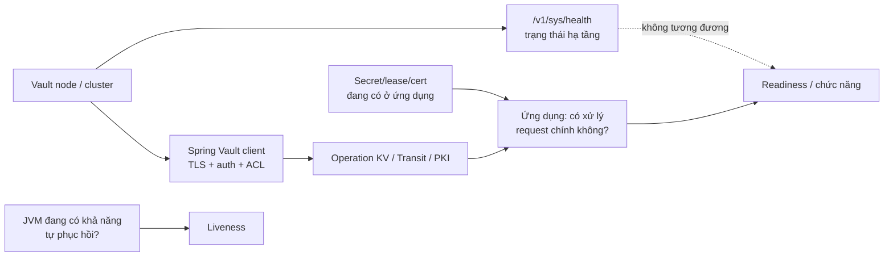
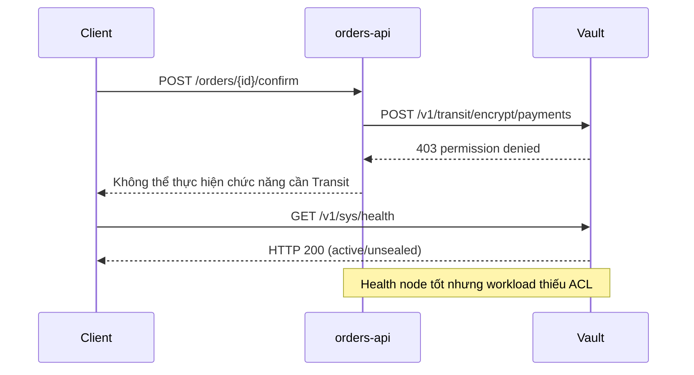
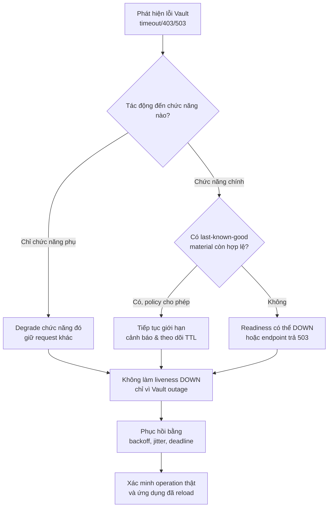

# Phân biệt health của Vault với khả năng tiếp tục phục vụ của ứng dụng

**Chương:** Quan sát và hiệu năng  
**Module:** SPRING_VAULT

## 1. Tại sao Vault “khỏe” chưa chắc ứng dụng phục vụ được?

Giả sử một dịch vụ Java `orders-api` dùng **Spring Vault** qua `VaultTemplate`/`VaultOperations` để đọc cấu hình KV v2, lấy thông tin đăng nhập database động, mã hóa thông tin qua Transit và có thể nhận chứng thư từ PKI. Hệ thống giám sát gọi `GET /v1/sys/health` và thấy **HTTP 200** trên một node Vault đang active. Tuy nhiên, yêu cầu thanh toán của người dùng vẫn có thể thất bại: token của workload đã bị thu hồi, policy không cho gọi `transit/encrypt/payments`, Vault role phát database credential đã bị xóa, đường mạng từ chính Pod ứng dụng bị lỗi, hoặc credential được lấy trước đó đã hết lease.

Trường hợp ngược lại cũng xảy ra. Vault có thể đang sealed, tạm mất kết nối hoặc chuyển active node; **ứng dụng vẫn có thể trả lời các yêu cầu nhất định** nhờ cấu hình đã tải lúc khởi động, kết nối hiện có hoặc một secret đang còn hiệu lực theo chính sách. Nếu biến mọi gián đoạn Vault thành liveness probe thất bại, Kubernetes có thể restart đồng loạt các Pod vốn còn chạy tốt, gây thêm outage.

Bài này làm rõ ranh giới giữa:

- **Vault health:** trạng thái kỹ thuật của node/cluster Vault được kiểm tra, ví dụ initialized, unsealed, active, standby, HA.
- **Khả năng truy cập Vault của workload:** từ ứng dụng Java có thể kết nối, xác thực bằng workload identity và thực hiện đúng operation với đúng Vault ACL hay không.
- **Khả năng tiếp tục phục vụ (*application availability*):** chức năng nào của ứng dụng đang đáp ứng hợp đồng nghiệp vụ, với dữ liệu/secret/lease/chứng thư còn sử dụng được.
- **Liveness, readiness và startup:** ba tín hiệu để nền tảng điều phối quyết định restart, đưa traffic vào và chờ ứng dụng khởi động.

Chúng có liên quan nhưng **không tương đương**. Khi quan sát và tối ưu hiệu năng SPRING_VAULT, phải kết hợp các lớp này để quyết định fail-fast, phục hồi và cảnh báo phù hợp.

**Mục tiêu:** phân tích được mã trạng thái `/sys/health`, thiết kế Spring Boot Actuator probes, chọn lúc nào nên kiểm tra Vault trực tiếp, theo dõi sự sẵn sàng của secret/token/lease/Transit/PKI và viết test xác minh ứng dụng vẫn phục vụ đúng khi Vault không ổn định.

## 2. Bốn câu hỏi sức khỏe cần trả lời riêng

| Câu hỏi | Cách kiểm tra phù hợp | Ý nghĩa | Điều không chứng minh |
| --- | --- | --- | --- |
| **Node Vault đang ở trạng thái nào?** | `GET/HEAD /v1/sys/health` | initialized, sealed, active/standby, HA | Không chứng minh workload có token đúng hoặc quyền đọc secret |
| **Workload có dùng Vault được không?** | Một yêu cầu có xác thực đúng path, từ chính workload, trong giới hạn tần suất | connectivity + auth + ACL + endpoint cụ thể | Không chứng minh toàn bộ engine và mọi operation đều hoạt động |
| **Ứng dụng có đủ tài nguyên để phục vụ không?** | Trạng thái cấu hình/credential/lease/cert cục bộ, tính năng và dependency cần thiết | Khả năng đáp ứng chức năng chính *ngay bây giờ* | Không chứng minh Vault đang active |
| **Ứng dụng còn hoạt động nội tại không?** | Spring Boot liveness, event loop/thread pool, các lỗi không thể tự phục hồi | Có nên restart tiến trình này? | Không đánh giá tính sẵn có của Vault/DB trên mạng |

Sự khác biệt thể hiện qua luồng sau:



Ví dụ, health node báo `200` nhưng `VaultOperations.opsForTransit("transit").encrypt(...)` vẫn gặp `403 permission denied` vì thiếu quyền `update` trên `transit/encrypt/payments`. Đây là **lỗi quyền của workload**, không phải Vault sealed. Lúc khác, health báo `503 sealed` nhưng ứng dụng vẫn có thể đọc dữ liệu công khai đã cache hợp lệ; tính năng **cần gọi Transit ngay** sẽ không thực hiện được nếu không có tuyến Vault khả dụng.

## 3. Hiểu đúng GET /v1/sys/health của Vault

Vault cung cấp endpoint trạng thái:

```http
GET /v1/sys/health HTTP/1.1
Host: vault.internal.example
```

Có thể dùng `HEAD` nếu chỉ cần status. Endpoint `sys/health` phải được gọi trong **root namespace**; khi dùng Vault Enterprise namespace, không tự suy rằng path health ở namespace ứng dụng sẽ phản ánh tình trạng toàn cluster. Phản hồi `GET` có các trường như `initialized`, `sealed`, `standby`, `performance_standby`, `replication_dr_mode` và một số metadata về HA/cluster tùy phiên bản.

### 3.1. Mã HTTP mặc định và ý nghĩa

| HTTP code | Trạng thái node Vault | Cách đọc trong vận hành |
| --- | --- | --- |
| **200** | Initialized, unsealed, **active** | Node có vai trò active và báo khỏe theo endpoint này; **chưa kiểm tra** path nghiệp vụ |
| **429** | Unsealed, **standby** | Đây là *mã health dành cho standby*, **không tự động là rate limit** khi đang gọi chính `/sys/health` |
| **472** | Disaster Recovery secondary | DR secondary không đồng nghĩa có thể phục vụ mọi thao tác như primary |
| **473** | Performance standby | Có thể phục vụ một số read theo mô hình Vault Enterprise; không kết luận mọi write hoạt động tại node |
| **474** | HA standby mất kết nối tới active, không tham gia HA khỏe mạnh | Cảnh báo node/HA, cân nhắc loại khỏi load balancing |
| **501** | Vault **chưa initialize** | Chưa sẵn sàng nhận các thao tác secrets bình thường |
| **503** | Vault **sealed** | Không thể thực hiện yêu cầu secrets bình thường qua node sealed |
| **530** | Node đã bị loại khỏi cluster | Không nên coi là đích phục vụ bình thường |

Đây là **mã mặc định** của `/sys/health`. Vault cho phép một số tham số đổi mã HTTP trả về; vì vậy khi giám sát hãy xem **endpoint và cấu hình query thực tế**, không chỉ status code. Riêng `429` trên *các API khác* vẫn có thể biểu thị giới hạn/quota; không đồng nhất với `429 standby` của health endpoint.

Phản hồi JSON minh họa được lược bớt:

```json
{
  "initialized": true,
  "sealed": false,
  "standby": false,
  "performance_standby": false,
  "replication_dr_mode": "disabled",
  "version": "1.x.x",
  "cluster_name": "vault-cluster-example"
}
```

**Các giá trị chỉ minh họa.** Trường `version`, `cluster_name` và các metadata chi tiết tùy cấu hình/phiên bản. Không hiển thị đầy đủ metadata hệ thống này lên endpoint health công khai của ứng dụng nếu không có nhu cầu.

### 3.2. standbyok và perfstandbyok chỉ đổi cách báo status

Ví dụ:

```bash
curl --silent --show-error --output /dev/null --write-out '%{http_code}\n' \
  'https://vault.internal.example:8200/v1/sys/health?standbyok=true&perfstandbyok=true'
```

- `standbyok=true` cho phép standby trả mã active thành công thay vì mã standby, hữu ích cho một số load balancer; không áp dụng cho **performance standby**.
- `perfstandbyok=true` cho phép **performance standby** trả mã active thành công.
- Các tham số `activecode`, `standbycode`, `performancestandbycode`... cũng có thể thay status được trả về.

**Trả HTTP 200 theo query không biến standby thành active.** Đây là cách định nghĩa **điều kiện chọn node cho load balancer**, phụ thuộc khả năng request forwarding/HA của topology. Một load balancer chỉ so khớp 200 vẫn có thể gửi request đến node không phù hợp nếu health query cấu hình sai.

Với môi trường HA, ngoài health node còn cần kiểm tra active routing, TLS, DNS, request forwarding, đường đi từ từng ứng dụng và các API thật. Không coi lệnh `curl /sys/health` từ laptop của quản trị viên là bằng chứng Pod Java có thể gọi Vault.

## 4. Vault health 200 có thể đi kèm ứng dụng không thể phục vụ

Xét một endpoint nghiệp vụ `POST /orders/{id}/confirm` cần ký/mã hóa dữ liệu bằng Vault Transit:



Các nguyên nhân thường gặp dù `/sys/health` trả 200:

| Nguyên nhân | Biểu hiện ở ứng dụng | Điều cần kiểm tra |
| --- | --- | --- |
| **Sai token / auth role** | Login `403`, token đã hết hạn hoặc không làm mới | Kubernetes/AppRole/IAM, SessionManager, policy |
| **Thiếu ACL** | Chỉ một API như Transit/PKI/KV trả `403` | Capability `read`/`update` trên path đúng |
| **Sai mount/namespace** | `404` hoặc không tìm thấy secret/role | KV v2 `data/`, tên mount, Vault namespace |
| **Mạng chỉ lỗi từ Pod** | DNS/TLS/connect timeout, connection reset | NetworkPolicy, proxy, service mesh, DNS, CA trust |
| **Engine/backend có sự cố** | Database secrets engine cấp credential thất bại | Plugin backend, kết nối DB, role, quota |
| **Token còn hợp lệ nhưng lease secret hết hạn** | DB login mới không thành công | Lease ID/TTL/renew/revoke, pool đang dùng credential nào |
| **Đã rotate cert nhưng JVM chưa reload** | mTLS handshake thất bại | `NotAfter`, chain/trust, SSLContext và rollout |
| **Quá tải/rate limit** | `429` trên API nghiệp vụ, P99 latency cao | Vault quota, request rate, retry storm |

Health endpoint thường không tiêu thụ token workload và không kiểm tra ACL của từng engine. Nếu muốn kiểm tra chức năng cụ thể, có thể tạo **transactional probe** từ identity test, nhưng nó vẫn chỉ phản ánh phạm vi của identity và API được kiểm tra; không biến kết quả thành bảo đảm tuyệt đối cho mọi workload.

## 5. Vault lỗi nhưng ứng dụng vẫn có thể tiếp tục phục vụ

Tình huống ngược có ý nghĩa lớn với kiến trúc khả dụng cao:

- Ứng dụng đã tải cấu hình KV khi khởi động. Vault mất kết nối 2 phút, nhưng **không cần gọi lại KV** để xử lý các request trong thời gian đó. Ứng dụng có thể vẫn đáp ứng nghiệp vụ theo quy định về độ mới cấu hình.
- Ứng dụng đang có database credential động với lease chưa hết hạn và DB vẫn chấp nhận credential. Nó **có thể tiếp tục sử dụng** cho đến khi phải renew/rotate; đây không phải quyền dùng vô hạn sau khi lease hết.
- Chứng thư TLS đã được cấp, cài vào server và còn hạn. Vault mất kết nối không tự khiến `X509Certificate.getNotAfter()` thay đổi. Dịch vụ có thể tiếp tục bắt tay TLS với cert hiện có, tùy chính sách revocation/trust.
- Endpoint trả dữ liệu công khai hoặc dữ liệu nội bộ từ cache, không sử dụng Transit. Các endpoint này vẫn có thể trả kết quả dù API mã hóa Transit đang không khả dụng.
- Một yêu cầu **bắt buộc giải mã bằng Transit tại thời điểm xử lý** sẽ thất bại hoặc phải được hoãn theo thiết kế nếu không có tuyến Vault khả dụng; không thể thay Vault bằng một khóa tĩnh tự phát sinh.

**Cảnh báo:** “còn TTL” không phải chứng cứ tuyệt đối credential chưa bị revoke; password có thể bị thay đổi ở backend, certificate có thể bị thu hồi, token có thể bị revoke trước hạn. Nếu chấp nhận dùng vật liệu cục bộ trong khi không xác minh được Vault, phải có **chính sách freshness/staleness cụ thể**, kết hợp trạng thái backend và giới hạn chức năng.

### Bảng quyết định trong một sự cố

| Trạng thái Vault | Trạng thái ứng dụng | Tín hiệu ứng dụng phù hợp |
| --- | --- | --- |
| Vault 200 nhưng workload thiếu quyền `transit/encrypt` | Chức năng cần encrypt **không hoạt động**; các chức năng độc lập có thể hoạt động | Liveness có thể UP; readiness hoặc trạng thái chức năng tùy độ thiết yếu |
| Vault 503 sealed, ứng dụng có cấu hình KV đã tải hợp lệ | Chức năng chỉ dùng cấu hình có thể tiếp tục | Không bắt buộc làm liveness DOWN; đánh dấu dependency degraded |
| Vault mất mạng và database lease đã hết | Chức năng cần tạo kết nối DB mới không bảo đảm phục vụ | Readiness của chức năng chính có thể DOWN |
| Vault 200, database backend thất bại khi cấp credential | Vault hạ tầng active nhưng luồng login DB bị lỗi | Dependency/operation-specific health DOWN |
| Vault standby 429, client được định tuyến/forward sang active khỏe | Nhiều API vẫn có thể phục vụ theo topology | Không kết luận ứng dụng DOWN chỉ từ 429 của node |
| Vault chuyển active node 20 giây, ứng dụng còn request cache hợp lệ | Ứng dụng có thể phục vụ một phần hoặc toàn bộ | Ưu tiên giới hạn thời gian khôi phục, đừng restart hàng loạt |

## 6. Liveness, readiness và startup trong Spring Boot

Spring Boot Actuator cung cấp khái niệm **Application Availability** và các health group riêng cho môi trường Kubernetes:

- **Liveness:** ứng dụng còn ở trạng thái nội tại có thể tiếp tục chạy và tự phục hồi không? Nếu liveness liên tục thất bại, Kubernetes có thể **restart** container.
- **Readiness:** instance có nên **nhận request mới qua Service** hay không? Nếu readiness thất bại, Kubernetes thường tạm đưa Pod ra khỏi các endpoint nhận traffic; không nhất thiết restart.
- **Startup probe:** ứng dụng có được **thêm thời gian khởi động** trước khi liveness/readiness bắt đầu giám sát thường xuyên hay không? Thích hợp khi khởi động lâu, ví dụ phải lấy config hoặc tạo TLS material.

**Nguyên tắc quan trọng:** **không đưa Vault hoặc DB network check trực tiếp vào liveness**. Outage của một dependency chung không phải lỗi “JVM bị kẹt”. Restart mọi instance khi Vault unreachable có thể gây thundering herd, tăng đồng thời login/token refresh và kéo dài mất dịch vụ.

Spring Boot không tự gộp mọi health indicator bên ngoài vào readiness group. Khi cần, bạn phải **chủ động** chọn custom indicator thích hợp cho chức năng chủ chốt.

### 6.1. Cấu hình Spring Boot Actuator probes

```yaml
management:
  endpoint:
    health:
      probes:
        enabled: true
      group:
        readiness:
          include: readinessState,vaultCapability
  endpoints:
    web:
      exposure:
        include: health,info
```

Ví dụ giả định ứng dụng có bean `HealthIndicator` tên `vaultCapability`, được triển khai trong phần tiếp theo. Đường dẫn điển hình:

- `GET /actuator/health/liveness` — dùng cho **livenessProbe**.
- `GET /actuator/health/readiness` — dùng cho **readinessProbe**.
- `GET /actuator/health` — phản ánh health toàn cục, có thể chứa nhiều indicator và không đồng nghĩa readiness.

Spring Boot ở Kubernetes thường bật probe group tự động; khai báo rõ `probes.enabled` giúp chạy cùng cấu hình trong môi trường kiểm thử. Đường dẫn/mapping có thể được cấu hình khác trong hệ thống của bạn. Nếu management port **khác** cổng ứng dụng, health endpoint vẫn có thể trả thành công khi main HTTP connector gặp lỗi; cân nhắc health group **additional-path** trên cổng ứng dụng và kiểm thử thật đường đi của kubelet.

Ví dụ `Deployment`:

```yaml
apiVersion: apps/v1
kind: Deployment
metadata:
  name: orders-api
spec:
  replicas: 3
  selector:
    matchLabels: { app: orders-api }
  template:
    metadata:
      labels: { app: orders-api }
    spec:
      containers:
        - name: orders-api
          image: registry.example.internal/orders-api:1.0.0
          ports:
            - containerPort: 8080
          startupProbe:
            httpGet:
              path: /actuator/health/liveness
              port: 8080
            periodSeconds: 5
            failureThreshold: 24
          livenessProbe:
            httpGet:
              path: /actuator/health/liveness
              port: 8080
            periodSeconds: 10
            failureThreshold: 3
          readinessProbe:
            httpGet:
              path: /actuator/health/readiness
              port: 8080
            periodSeconds: 5
            failureThreshold: 2
```

Các khoảng thời gian chỉ là **ví dụ**, phải căn chỉnh với thời gian startup và SLO. Probe không nên khiến mỗi Pod liên tục phát sinh một request lấy dynamic credential ở Vault. **Không bắt chước** startupProbe bằng một request cấp PKI cert/token hoặc login AppRole mỗi 5 giây.

## 7. Spring Cloud Vault HealthIndicator có vai trò gì?

Khi dùng Spring Cloud Vault cùng Spring Boot Actuator, thư viện có thể đăng ký **Vault health indicator** trong health của Spring Boot. Theo tài liệu Spring Cloud Vault, có thể bật/tắt qua:

```yaml
management:
  health:
    vault:
      enabled: true
```

Thuộc tính `management.health.vault.enabled` mặc định thường là `true` khi auto-configuration tương ứng có mặt. Điều đó chỉ có nghĩa indicator được **cung cấp** cho hệ thống health, **không có nghĩa** health của Vault là readiness hoặc liveness của ứng dụng. Cần kiểm tra health groups thực tế qua endpoint và cấu hình của đúng phiên bản Spring Boot/Spring Cloud Vault.

Ví dụ, `/actuator/health` có thể bị đánh `DOWN` khi Vault không truy cập được, trong khi `/actuator/health/liveness` vẫn `UP`. Điều này **không mâu thuẫn**: một chỉ số tổng hợp dependency và một chỉ số tiến trình có ý nghĩa khác nhau.

Trong ứng dụng dùng **Vault Agent template** mà Java chỉ đọc file đã render, không cần liên tục gửi probe từ Java tới Vault server chỉ để chứng minh khả năng phục vụ; thay vào đó theo dõi freshness của file, credential, TLS material và trạng thái Agent. Khi dùng **Vault Proxy**, health của proxy, khả năng Auto-Auth và việc proxy gọi được operation thực từ Spring Vault đều quan trọng; một cổng loopback mở không bảo đảm proxy có token hợp lệ hoặc có quyền trên API nghiệp vụ.

**Cảnh báo về quan sát:** `/actuator/health`, Vault `/sys/health` và endpoint nghiệp vụ thường trả **các tín hiệu khác nhau**. Đặt tên metrics và dashboard rõ ràng để không trộn chúng thành một đèn xanh duy nhất.

## 8. Thiết kế readiness theo năng lực đang có, tránh live probe đắt tiền

### 8.1. Cách chọn readiness cho dịch vụ có dependency Vault

Phân nhóm chức năng:

1. **Bắt buộc cho mọi request chính:** nếu không có credential/khóa cần thiết, ứng dụng không phục vụ được mục tiêu. Có thể làm readiness `DOWN` khi **không còn vật liệu hợp lệ** hoặc chức năng không thực hiện được.
2. **Chỉ một số endpoint cần Vault live:** tách đánh giá theo chức năng, đưa API đó về trạng thái tạm không khả dụng, giữ các endpoint khác hoạt động khi phù hợp. Không nhất thiết làm cả Pod unready.
3. **Dữ liệu đã cache hợp lệ:** có thể giữ readiness `UP` trong outage ngắn nếu chính sách cho phép dùng last-known-good material và chưa vượt hạn dùng.
4. **Không thể xác định validity:** nếu thao tác cần xác minh tươi ngay lúc dùng, không nên tô xanh readiness dựa vào cache không còn đáng tin.

### 8.2. Ví dụ HealthIndicator chỉ đọc trạng thái cục bộ

Ví dụ Java 17 / Spring Boot Actuator dưới đây **không gọi Vault ở mỗi probe**. Một thành phần cấp mới credential phải gọi `markMaterialReadyUntil(...)` **sau khi thực sự cài đặt material thành công**. Khi refresh lỗi, giữ thông tin về lần material cuối; readiness tự chuyển DOWN nếu material sắp hết hiệu lực theo khoảng đệm.

```java
import java.time.Clock;
import java.time.Instant;
import java.util.concurrent.atomic.AtomicReference;

import org.springframework.boot.actuate.health.Health;
import org.springframework.boot.actuate.health.HealthIndicator;
import org.springframework.stereotype.Component;

@Component("vaultCapability")
public class VaultCapabilityHealthIndicator implements HealthIndicator {

    private static final long SAFETY_MARGIN_SECONDS = 30;

    private final Clock clock = Clock.systemUTC();
    private final AtomicReference<Instant> usableUntil =
        new AtomicReference<>();

    // Chỉ gọi sau khi đã kiểm tra và cài đặt credential/cert thành công.
    public void markMaterialReadyUntil(Instant expiresAt) {
        usableUntil.set(expiresAt);
    }

    // Lỗi refresh: không xóa material vẫn còn dùng được.
    // Bộ giám sát lỗi refresh cần là tín hiệu riêng.

    @Override
    public Health health() {
        Instant expiresAt = usableUntil.get();
        Instant minimumRemaining = clock.instant()
            .plusSeconds(SAFETY_MARGIN_SECONDS);

        if (expiresAt == null || !expiresAt.isAfter(minimumRemaining)) {
            return Health.down()
                .withDetail("reason", "required-material-unavailable")
                .build();
        }

        return Health.up()
            .withDetail("source", "validated-local-material")
            .build();
    }
}
```

**Vì sao ví dụ này an toàn hơn việc gọi GET Vault trên mỗi readiness probe?**

- Không phát sinh hàng loạt request Vault nếu Kubernetes liên tục kiểm tra Pod.
- Phân biệt lỗi **cấp mới** với việc **material hiện có còn dùng được**.
- Không ghi credential/token/lease ID/private key vào response health.
- Khoảng đệm 30 giây giúp từ chối traffic mới trước khi material đến sát thời điểm hết hạn.

**Giới hạn quan trọng:** đây chỉ là **mẫu cơ chế**, chưa đủ cho production. `usableUntil` phải được xác định từ **hạn dùng thật** và khả năng sử dụng được xác minh (database credential, phiên bản config, lease hoặc cert); không chỉ dựa vào TTL đoán. Credential có thể bị revoke **trước** hạn, service cần cập nhật tình trạng khi nhận lỗi xác thực từ DB, TLS, Vault hoặc tín hiệu vận hành đáng tin. Với KV tĩnh không có TTL, dùng một **chính sách freshness riêng** thay cho `expiresAt` giả. Bean này cũng phải được nối vào vòng cấp mới/rotate thật; nếu không gọi `markMaterialReadyUntil`, readiness luôn DOWN.

### 8.3. Khi nào không nên thêm Vault vào readiness?

Spring Boot cảnh báo việc gộp mọi external dependency vào readiness có thể làm tất cả instance cùng mất readiness khi dependency chung outage. Nếu không còn endpoint nào nhận traffic, load balancer có thể không có đích để gửi cả các request vốn **không cần Vault**. Vì vậy, đừng thêm một indicator “Vault network ping” vô điều kiện cho toàn bộ ứng dụng đa chức năng. Ưu tiên **đánh giá khả năng phục vụ chức năng thiết yếu**; quan sát outage của Vault qua metrics/alerts riêng.

Cần quyết định theo **hợp đồng API**: một gateway chỉ có nhiệm vụ realtime Transit encrypt có thể unready nếu Vault không thể encrypt và không có queue hợp lệ; một service chỉ dùng KV khi boot có thể tiếp tục phục vụ trong cửa sổ freshness. Những lựa chọn này phải được test trong kịch bản outage.

## 9. Vòng đời token, lease, certificate và cache quyết định khả năng phục vụ

Một lỗi thiết kế phổ biến là nhìn thấy “Vault có health 200” rồi tin dữ liệu đã nhận từ Vault mãi còn hợp lệ. Mỗi loại vật liệu có vòng đời:

| Loại | Cần quan sát | Khi Vault tạm không khả dụng |
| --- | --- | --- |
| **Vault client token** | TTL, renew/re-login, quyền token | Client không thể gọi API Vault khi token hết hạn; vật liệu đã lấy có thể vẫn dùng theo quy tắc riêng |
| **KV static secret** | Phiên bản/freshness, thay đổi cấu hình, policy cache | Có thể dùng last-known-good trong giới hạn đã chấp nhận; không mặc định vô hạn |
| **Database dynamic credential** | Lease TTL/renewable, DB có chấp nhận login không, pool hiện dùng gì | Có thể còn dùng nếu hợp lệ; trước/sau expiry phải thay/đóng kết nối theo chính sách |
| **Transit operation** | Endpoint live, token ACL, latency/error | Nếu không thể gọi encrypt/decrypt lúc request, tính năng có thể bị chặn |
| **PKI certificate/private key** | `NotBefore`, `NotAfter`, issuer/chain, trạng thái reload, revocation | Cert đã nạp có thể tiếp tục dùng cho tới giới hạn thực tế; không tự làm mới khi Vault down |
| **Response wrapping token** | TTL và trạng thái đã unwrap/chưa unwrap | Wrapping token hết hạn hoặc đã tiêu thụ không thể dùng để nhận lại payload |
| **Vault Agent/Proxy** | Auto-Auth state, template freshness, listener/proxy token | File hoặc local proxy có trạng thái riêng; port nghe mở chưa chắc ứng dụng có material hợp lệ |

**Token TTL khác lease TTL và certificate validity.** Việc Agent/SessionManager renew Vault token không gia hạn tự động password DB hoặc chứng thư X.509. Tương tự, một phiên DB đã kết nối có thể còn hoạt động sau khi credential bị thu hồi, nhưng mở **kết nối mới** có thể thất bại; kiểm tra readiness bằng kết nối đã mở duy nhất có thể bỏ sót lỗi đó.

Đối với Transit, ciphertext từ lần mã hóa trước không tự mất hiệu lực khi Vault đang downtime. Tuy nhiên, việc giải mã ciphertext cần quyền và Vault hoạt động trở lại; nếu yêu cầu nghiệp vụ cần plaintext ngay, tính năng có thể không phục vụ được. Không xuất private key Transit thành file chỉ để tránh dependency.

## 10. Health check nào có thể tạo thêm tải và lỗi?

Không nên biến health check thành một workflow đắt tiền hoặc có side effect.

| Probe | Chi phí/tác động | Dùng cho |
| --- | --- | --- |
| `GET/HEAD /v1/sys/health` | Rẻ hơn hầu hết operation; vẫn tạo network request | Node/cluster status, load balancer, giám sát Vault |
| `GET /v1/secret/data/test-key` | Có auth + ACL + payload; thường không tạo version mới | Synthetic check được giới hạn tần suất nếu cần |
| `GET /v1/database/creds/role` | **Có thể phát credential + lease mới mỗi lần** | Không dùng làm liveness/readiness probe định kỳ |
| `POST /v1/pki/issue/role` | Tạo chứng thư và có thể private key mới | Không dùng làm health probe liên tục |
| `POST /v1/auth/approle/role/.../secret-id` | Sinh SecretID mới | Không dùng làm health probe |
| `POST /v1/transit/encrypt/key` | Hoạt động crypto, quota/latency và ciphertext mới | Transaction test tần suất thấp, với test data nếu cần |
| `POST /v1/sys/wrapping/unwrap` | **Tiêu thụ wrapping token một lần** | Không bao giờ dùng làm readiness định kỳ |
| **Đánh giá snapshot local** | Không gọi Vault; phản ánh trạng thái thật của ứng dụng | Readiness khi đã có vòng quản lý material/lease đúng |

Một health check gọi `database/creds` mỗi 5 giây trên 40 Pod có thể sinh **hàng nghìn credential và lease** trong thời gian ngắn. Ngoài bão request, nó còn làm tăng tải backend DB và phức tạp cleanup. Kiểm tra “có thể tạo credential” bằng synthetic monitor tập trung, test environment hoặc lịch hạn chế, rồi theo dõi tín hiệu cấp phát thật cho production.

**Synthetic/transactional monitoring** do operator thực hiện có thể đăng nhập bằng identity test, gọi API phù hợp và so sánh kết quả dự kiến; nó bổ sung tín hiệu end-to-end. Kết quả probe này không nên quyết định restart hàng loạt Pod.

## 11. Sơ đồ xử lý khi Vault mất kết nối



Đừng coi mọi `403` là timeout transient. Nếu thiếu ACL, retry nhiều lần không cấp thêm quyền; cần phân loại nguyên nhân. Với lỗi mạng, timeout, `429` hoặc `5xx`, cân nhắc retry **theo ngữ nghĩa endpoint** và tổng deadline. Việc cấp chứng thư, tạo token, cấp credential hay unwrap có thể gây side effect và **kết quả chưa xác định** khi response bị mất; không tự động retry như GET KV tĩnh.

Khi Vault khôi phục, cần phân tán refresh (jitter) và giới hạn concurrency để không tạo `thundering herd`. Chỉ nâng readiness trở lại khi **chức năng ứng dụng thực sự phục vụ được**, ví dụ credential mới đã nạp vào DB pool hoặc TLS listener đã dùng cert mới, không chỉ vì health node chuyển từ 503 sang 200.

## 12. Dashboard và cảnh báo nên tách theo tầng

| Nhóm chỉ số | Ví dụ metric/signal | Khi nào cảnh báo |
| --- | --- | --- |
| **Vault cluster** | `/sys/health` theo node, active/standby/sealed, HA forwarding | Node sealed kéo dài; 474 HA unhealthy; không có active khỏe |
| **Network/client** | DNS/TLS failure, connect/read timeout, latency P95/P99 theo Vault operation | Lỗi tăng chỉ ở một namespace/Pod hoặc theo request path |
| **Authentication** | Login/renew thất bại, TTL token còn lại, 403 do auth | Token sắp hết hạn và không thể làm mới |
| **Authorization** | 403 theo operation/role đã allowlist | ACL/config thay đổi khiến luồng nghiệp vụ chính không thực hiện được |
| **Secrets** | KV refresh tuổi, lease seconds remaining, issued credential failures | Credential gần hết hạn, refresh liên tục thất bại |
| **PKI** | Certificate seconds until expiry, thay cert thành công, TLS handshake failures | Cert gần hết hạn, listener chưa reload |
| **Application** | Readiness/liveness, tỷ lệ success của endpoint, queue backlog, connection pool errors | Không thể hoàn thành chức năng chính dù Vault health 200 |
| **Resilience** | Retry count, circuit breaker state, unknown outcome, request budget | Bão retry, timeout tăng hoặc thao tác chưa xác định tồn đọng |

Tên như `vault_client_operation_duration_seconds` hoặc `application_secret_freshness_seconds` chỉ là **ví dụ metric tự định nghĩa**, không phải tên có sẵn trong Vault/Spring Vault. Khi triển khai, ưu tiên tên metric thực mà thư viện và collector đang xuất.

### Bảo vệ dữ liệu khi quan sát

- **Không log** Vault token, wrapping token, AppRole SecretID, DB password, private key PKI, Transit plaintext hay nguyên `VaultResponse`.
- Hạn chế nhãn metric có độ phân biệt cao như token, lease ID, serial number, path chứa user/tenant ID; tránh bùng nổ cardinality và lộ dữ liệu.
- Dùng operation category, tên role/mount đã duyệt và error code thay cho raw URL/query chứa thông tin nhạy cảm.
- Không đưa `Vault /sys/health` toàn bộ JSON ra health endpoint public của ứng dụng.
- Theo dõi request ID/correlation ID an toàn từ ứng dụng; Vault audit hỗ trợ điều tra nhưng không bảo đảm response bị mất luôn trả request ID cho client.

### Đặt SLO đúng chỗ

Một Vault cluster có `sys/health` 200 trong 99,99% thời gian **không tự suy ra** chức năng cấp credential của ứng dụng đạt 99,99%. Nên đo **tỷ lệ yêu cầu nghiệp vụ hoàn tất** và latency theo nhóm: KV configuration read, Transit encrypt, PKI issue, database credential refresh. Trạng thái Vault là **tín hiệu chẩn đoán**, trong khi SLO ứng dụng phải dựa vào trải nghiệm thật của workload.

## 13. Kiểm thử tích hợp: lỗi hạ tầng và khả năng phục vụ

Để đánh giá mô hình health, chạy Vault dev/test cô lập, token/role giới hạn, workload Java thử nghiệm và bộ test traffic. Không dùng root token làm test cho quyền workload: nó sẽ che dấu lỗi ACL.

### 13.1. Ma trận tình huống

| Fault injection | Vault health dự kiến | Kết quả ứng dụng cần xác minh |
| --- | --- | --- |
| Vault active, policy Transit bị thiếu | `200` | Encrypt nhận 403; ứng dụng chỉ degrade chức năng cần encrypt |
| Vault active, secret path KV v2 sai | `200` | 404/missing; không báo “Vault đang down” |
| Vault sealed node | `503` | Chức năng phải gọi Vault bị chặn; endpoint độc lập có thể còn hoạt động |
| Vault standby | `429` mặc định | Client qua LB/forwarding vẫn có thể phục vụ; không suy từ 429 trên health thành throttle |
| Vault primary chuyển active node | Tạm thay đổi theo node | Ứng dụng backoff/refresh, không restart vô hạn |
| Cắt kết nối chỉ của Pod A | Vault có thể vẫn `200` từ monitor khác | Pod A lỗi network; Pod B vẫn phục vụ |
| Token hết TTL, không renew được | Vault vẫn `200` | Vault requests của workload bị từ chối, cần re-login |
| DB lease vẫn còn hạn trong Vault outage | Vault không truy cập | Endpoint DB có thể tiếp tục dùng credential còn hiệu lực theo policy |
| DB lease hết hạn, pool vẫn giữ credential cũ | Vault có thể `200` hoặc outage | Tạo connection mới có thể lỗi; readiness phản ánh nhu cầu thật |
| Agent có file mới nhưng Java chưa reload | Vault `200` | Readiness dựa vào material đang dùng, không chỉ file timestamp |
| PKI cert `NotAfter` sắp hết | Vault `200` | Cảnh báo expiry và kiểm tra TLS listener đã reload |
| 3 Pod chung Vault outage | Vault `503`/mất kết nối | Liveness vẫn UP; readiness theo khả năng phục vụ của từng Pod |
| Proxy loopback trả HTTP 200 nhưng Auto-Auth hỏng | Vault có thể `200` | Operation cần Vault fail; kiểm tra auth/token của proxy |

### 13.2. Unit test cho readiness cục bộ

Vì ví dụ `VaultCapabilityHealthIndicator` ở trên dùng `Clock.systemUTC()`, để test các mốc thời gian ổn định hãy **inject `Clock`** hoặc cung cấp constructor chỉ dùng trong test. Test quan trọng gồm:

1. **Chưa có material:** health `DOWN`.
2. **Material đã cài, còn hạn đủ dài:** health `UP`.
3. **Refresh Vault thất bại nhưng material vẫn còn hạn:** health vẫn `UP`; một signal khác báo refresh lỗi.
4. **Còn dưới 30 giây đến hạn:** health `DOWN` theo policy safety margin minh họa.
5. **Credential đã bị xác nhận revoked, dù `expiresAt` còn xa:** chuyển `DOWN` sau khi cập nhật trạng thái nghiệp vụ.
6. **Có material mới nhưng chưa được cài vào DB pool hoặc TLS server:** chưa được nâng readiness.
7. **Không leak secret:** Health details chỉ có trạng thái, không chứa password, token, key hay lease ID.

Có thể bổ sung test với proxy lỗi mạng để cắt response sau khi Vault đã xử lý, bảo đảm code nghiệp vụ không nhầm lỗi network với “chưa thực thi”. Với readiness/liveness, cần kiểm tra Kubernetes thật: một Vault outage chung **không khiến liveness probe DOWN và Pod bị restart liên tục**.

### 13.3. Thử tải khi outage

Kiểm tra khi 20–100 instance đồng thời refresh token/lease theo mô hình test: số request Vault/giây, P95/P99, retry attempts, bulkhead saturation, time-to-recover và thời gian ứng dụng trở lại ready sau outage. Nếu chỉ theo dõi `/sys/health`, bạn có thể bỏ lỡ lỗi request surge, quota và DB connection pool đã lỗi. Điều chỉnh backoff/jitter, timeout và SLO trên **hành vi thực**, thay vì chỉ làm health check xanh.

## 14. Những quyết định kiến trúc thường gặp

### Tình huống A — Service chỉ đọc KV khi khởi động

Vault tạm unavailable trong runtime, nhưng dữ liệu KV đang dùng không có yêu cầu cập nhật ngay và chính sách cho phép cache tối đa 30 phút. **Quyết định:** giữ liveness UP, readiness tùy dữ liệu đã tải hợp lệ và cửa sổ freshness; cảnh báo refresh lỗi riêng. Khi quá giới hạn freshness hoặc phát hiện secret bị revoke/invalid, phải degrade hoặc từ chối yêu cầu cần giá trị đó.

### Tình huống B — Gateway chỉ mã hóa trực tiếp bằng Transit

Mọi request đến gateway đều yêu cầu gọi `transit/encrypt` ngay và không có queue an toàn. Vault mất kết nối khiến toàn bộ chức năng chính không thực hiện được. **Quyết định:** readiness có thể DOWN, nhưng liveness nên vẫn UP nếu JVM có khả năng tự phục hồi; retry giới hạn và theo dõi trạng thái khi Vault trở lại. Không lưu khóa Transit ra file để tránh dependency.

### Tình huống C — Service vừa có endpoint công khai, vừa cần cấp PKI certificate định kỳ

Vault PKI không cấp được chứng thư mới; trong khi endpoint công khai vẫn dùng certificate đã cài và còn hạn. **Quyết định:** giữ traffic ở phần hoạt động; cảnh báo/đẩy sớm lịch certificate renewal. Không làm mọi Pod unready chỉ vì tác vụ cấp cert phụ gặp lỗi, cho tới khi cấu hình thực sự không còn đáp ứng điều kiện sử dụng.

### Tình huống D — Database credential đã hết lease

Vault health báo 200 nhưng đường cấp credential bị policy từ chối 403; pool cũ đang giữ một vài connection. **Quyết định:** kiểm tra khả năng mở **connection mới**, lease và rotation; không coi connection pool hiện có là bằng chứng bền vững. Nếu DB là chức năng thiết yếu và không có credential hợp lệ, readiness phải phản ánh sự thiếu khả dụng đó.

### Tình huống E — Vault Agent/Proxy cùng Pod

Agent template có thể vẫn có file được render từ trước; Proxy có thể đang nghe `127.0.0.1` nhưng token Auto-Auth của proxy đã hết hạn. **Quyết định:** dựa vào tính hợp lệ của file/material hoặc kết quả API theo workload; kiểm tra Agent/Proxy auth độc lập. Không lấy port-open làm tín hiệu duy nhất.

## 15. Các hiểu lầm cần tránh

| Nhận định | Cách hiểu đúng |
| --- | --- |
| “`GET /sys/health` trả 200 nên ứng dụng dùng được mọi secret.” | Sai; còn TLS từ Pod, token, ACL, engine và trạng thái material của ứng dụng |
| “Vault standby trả 429 tức mọi request đang bị rate limit.” | Sai; 429 tại health mặc định biểu thị standby |
| “Vault 503 nên Kubernetes phải restart mọi app.” | Sai; phụ thuộc Vault chung bị lỗi không phải JVM liveness lỗi |
| “Readiness phải ping Vault mỗi vài giây.” | Không bắt buộc, có thể gây tải và không phản ánh material đang có |
| “Probe GET database/creds là read-only.” | Sai; endpoint có thể phát credential/lease mới |
| “Token còn hạn thì database password chắc chắn còn dùng được.” | Sai; lease và trạng thái DB độc lập |
| “Vault health 200 chứng minh SecretLeaseContainer đã renew thành công.” | Sai; cần kiểm tra tiến trình lease riêng |
| “Agent template cập nhật file nghĩa là Hikari pool tự thay password.” | Sai; ứng dụng phải reload/recreate connection theo cơ chế được kiểm thử |
| “PKI cert còn hạn nghĩa là không thể bị thu hồi.” | Sai; certificate revocation có cơ chế riêng |
| “Global Actuator health và liveness/readiness luôn giống nhau.” | Sai; health groups có thành phần khác nhau |
| “Một transactional probe chứng minh tất cả API Vault đều hoạt động.” | Sai; chỉ chứng minh tuyến/identity/operation được thử |
| “Dùng cache vô thời hạn khi Vault down là khả năng phục hồi.” | Sai nếu làm vi phạm thời hạn, policy, revoke hoặc yêu cầu độ mới |

## 16. Câu hỏi tự đánh giá

1. Một Vault node trả `200` nhưng Spring Vault nhận `403` khi đọc KV v2. Vì sao hai kết quả không mâu thuẫn?
2. Vì sao `429` ở `/sys/health` cần được diễn giải khác `429` ở API cấp credential?
3. `standbyok=true` có khiến node standby trở thành active không?
4. Vì sao không đưa phép gọi Vault HTTP vào liveness probe?
5. Một ứng dụng chỉ đọc KV khi boot nên làm gì khi Vault downtime 60 giây nhưng secret cache còn hợp lệ?
6. Tại sao một ứng dụng cần Transit encrypt trên mọi request có thể cần readiness DOWN khi Vault bị gián đoạn?
7. `management.health.vault.enabled` có bảo đảm Vault được đưa vào readiness group của Spring Boot không?
8. Thế nào là đánh giá “material đã cài đặt và còn dùng được” thay vì chỉ “file đã được render”?
9. Vì sao token TTL, DB lease TTL và `X509Certificate.getNotAfter()` không đồng nghĩa nhau?
10. Tại sao GET `database/creds/:role` không thích hợp cho readiness probe định kỳ?
11. Một Pod mất mạng tới Vault còn monitor ngoài cluster vẫn thấy Vault 200. Cần xem xét những lớp nào?
12. Sau khi Vault phục hồi, vì sao không được nâng readiness chỉ dựa trên một lần health 200?
13. Hãy thiết kế ba dashboard/tín hiệu tách biệt cho Vault node, Spring Vault client và mức độ phục vụ của ứng dụng.
14. Nếu readiness của tất cả Pod cùng DOWN vì một external health check chung, hệ thống có thể gặp hậu quả gì?

**Gợi ý:** (1) Health node khác auth/ACL của workload; (2) health standby khác quota/rate limit; (3) không, chỉ đổi status trả về; (4) outage ngoài JVM không giải quyết bằng restart; (5) tiếp tục theo chính sách freshness; (6) chức năng cốt lõi không thể thực hiện; (7) không, cần kiểm tra readiness group; (8) xác minh credential/cert/config đang được runtime sử dụng; (9) vòng đời riêng; (10) có thể tạo credential mới; (11) DNS/TLS/network/namespace/token/path; (12) cần xác minh hoạt động thực và reload; (13) node health, client errors/latency, application SLO/readiness; (14) không còn Pod nhận traffic và tạo hiệu ứng dây chuyền.

## Tài liệu tham khảo

- [HashiCorp Vault — System Health HTTP API](https://developer.hashicorp.com/vault/api-docs/system/health): trạng thái initialized/sealed/active/standby/DR/performance và HTTP status/query parameters.
- [HashiCorp Vault — Monitoring and Observability](https://developer.hashicorp.com/validated-designs/vault/administration-guide/monitoring-and-observability): health, node monitoring và transactional monitoring.
- [HashiCorp Vault — General HTTP API](https://developer.hashicorp.com/vault/api-docs): cách xử lý status, auth/ACL, rate limit và lỗi.
- [Spring Boot — Actuator Endpoints and Kubernetes Probes](https://docs.spring.io/spring-boot/reference/actuator/endpoints.html): health groups, liveness/readiness, external dependency checks.
- [Spring Boot — Application Availability](https://docs.spring.io/spring-boot/reference/features/spring-application.html): các trạng thái liveness/readiness của ứng dụng.
- [Spring Cloud Vault — Quick Start](https://docs.spring.io/spring-cloud-vault/reference/quickstart.html): Vault health indicator và `management.health.vault.enabled`.
- [Spring Vault — VaultOperations](https://docs.spring.io/spring-vault/reference/api/java/org/springframework/vault/core/VaultOperations.html): cách client Java gọi KV/Transit/PKI và các operation Vault.
- [HashiCorp Vault — Lease, Renew and Revoke](https://developer.hashicorp.com/vault/docs/concepts/lease): TTL và vòng đời dynamic secret.
- [HashiCorp Vault — Transit Secrets Engine](https://developer.hashicorp.com/vault/docs/secrets/transit): mã hóa online qua Vault và lưu ciphertext tại ứng dụng.
