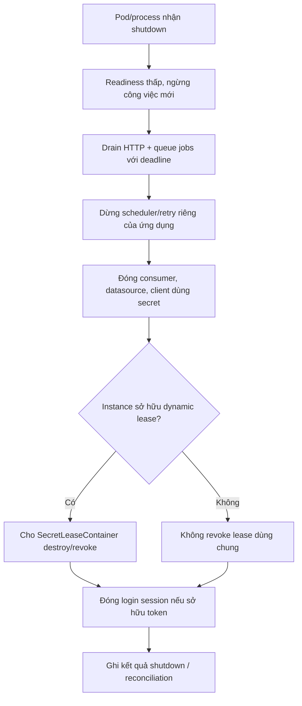

# Đóng ứng dụng đúng thứ tự để dừng tác vụ và thu hồi khi thích hợp

## Mục tiêu và bối cảnh

Trong hệ thống **Spring Vault**, ứng dụng Java thường dùng `VaultTemplate` thông qua `VaultOperations` để truy cập HashiCorp Vault. Workload đăng nhập bằng Kubernetes Auth, AppRole hoặc cơ chế được tổ chức cho phép, rồi dùng policy giới hạn để đọc KV secrets, lấy database credentials động, mã hóa qua Transit hoặc cấp chứng thư PKI. Khi ứng dụng chạy, một số thành phần còn gia hạn Vault token hoặc dynamic secret theo lịch. Vì vậy, **đóng ứng dụng** có thể tác động trực tiếp đến credential đang được các tác vụ sử dụng.

Chủ đề của chương **Quan sát và hiệu năng** là **đóng ứng dụng đúng thứ tự để dừng tác vụ và thu hồi khi thích hợp**. Mục tiêu không chỉ là JVM thoát nhanh: tránh cắt ngang giao dịch, tránh thu hồi dynamic credential khi connection pool vẫn đang dùng, không để scheduler cấp secret mới sau khi ứng dụng đã ngừng nhận công việc, và không vô tình revoke token hoặc lease của workload khác.

Ví dụ xuyên suốt: `orders-api` có HTTP endpoint, background worker tiêu thụ hàng đợi, datasource dùng dynamic database credential qua Vault, `SecretLeaseContainer` quản lý renewal/rotation và `LifecycleAwareSessionManager` quản lý token đăng nhập. Khi một pod nhận tín hiệu kết thúc, ứng dụng cần cho các tác vụ đang chạy kết thúc hợp lý rồi giải phóng tài nguyên theo phạm vi sở hữu.

Sau bài này, bạn sẽ có thể:

- Phân biệt **ngừng nhận công việc**, **drain tác vụ**, **stop** renewal/rotation, **destroy/revoke** lease và **đóng session**.
- Hiểu `SecretLeaseContainer.stop()` khác `SecretLeaseContainer.destroy()` và giới hạn của `LifecycleAwareSessionManager`.
- Chọn thứ tự shutdown phù hợp với HTTP, message worker, scheduler, datasource, dynamic lease và login token.
- Thiết kế thời hạn shutdown ở Spring Boot/Kubernetes, chính sách xử lý lỗi revoke và các chỉ số quan sát.
- Kiểm thử graceful shutdown, lỗi Vault, rollback/force termination và trường hợp nhiều instance chia sẻ credentials.

## 1. Mục tiêu shutdown và điều kiện tiên quyết

Trước hết, phân biệt bốn sự kiện:

| Sự kiện | Điều chắc chắn xảy ra | Điều **chưa** được bảo đảm |
|---|---|---|
| Ứng dụng nhận `SIGTERM`/đóng Spring context | Spring bắt đầu vòng đời shutdown nếu được xử lý bình thường | Mọi request/job đã kết thúc |
| HTTP server graceful shutdown | Thực hiện quy trình ngừng nhận request mới, cho request đang xử lý một khoảng thời gian để hoàn tất | Worker hàng đợi và tác vụ định kỳ khác tự động dừng |
| `SecretLeaseContainer.stop()` | Dừng renewal, rotation và phát sự kiện của container | **Không thu hồi** active leases |
| `SecretLeaseContainer.destroy()` | Dừng container và thực hiện logic revoke các lease đang quản lý | Mọi backend/provider bên ngoài chắc chắn đã xóa resource trong mọi tình huống |
| Session manager đóng | Dừng quản lý phiên và có thể revoke login token phù hợp | Mọi token tĩnh/chia sẻ đều cần hoặc có thể bị thu hồi |

**Các bước không hoán đổi tự do.** Nếu revoke database lease trước khi worker hoàn thành, credential có thể bị vô hiệu hóa trong lúc worker còn cần database. Nếu revoke token đăng nhập trước khi lease container thực hiện revoke, lời gọi cleanup có thể bị từ chối do không còn thông tin xác thực hợp lệ. Nếu đóng scheduler sau khi revoke, một tác vụ xoay vòng có thể cố xin credential mới trong lúc ứng dụng đang tắt.

Mặt khác, giữ token và secret lâu hơn cần thiết có thể gia tăng cửa sổ quyền truy cập. Bởi vậy, **cần xác nhận chủ sở hữu và giới hạn thời gian từng giai đoạn**, thay vì chỉ gọi `revoke-self` hoặc `close()` ngay khi nhận `SIGTERM`.

## 2. Thứ tự shutdown mục tiêu

Trong hệ thống có HTTP, hàng đợi và dynamic database credentials, thứ tự **logic** thường là:

1. **Đánh dấu đang kết thúc, giảm tải mới:** readiness chuyển sang trạng thái không nhận traffic; HTTP graceful shutdown ngừng nhận request mới; worker ngừng poll queue/nhận job mới. Không khởi tạo tác vụ Vault dài hạn mới trong khoảng đóng.
2. **Drain công việc đã nhận:** chờ request/job đang xử lý hoàn tất tới deadline. Hoàn thành commit, ack message hoặc ghi trạng thái `UNKNOWN`/pending recovery nếu một bước đã gửi nhưng không chắc kết quả.
3. **Ngừng tác vụ định kỳ do ứng dụng sở hữu:** dừng scheduler tự tạo, hàng chờ retry, timer cấp token/credential mới. Renewal cần còn sống đủ lâu cho công việc chưa hoàn tất; không tự đóng sớm nếu in-flight cần lease.
4. **Đóng consumer và các tài nguyên sử dụng secret:** đóng connection pool/datasource, HTTP client kết nối bằng credential, tạm dừng handler dùng private key hoặc secret động. Kiểm tra không còn thành phần sống cần credential đó.
5. **Kết thúc vòng đời secret:** với secret **do instance sở hữu**, để container được Spring hủy và revoke các lease theo chính sách, hoặc thực hiện cleanup thủ công có kiểm soát nếu chính ứng dụng là owner. Nếu chỉ dùng `stop()`, không suy ra lease đã được revoke.
6. **Kết thúc phiên xác thực Vault:** hủy lifecycle session manager theo cấu hình, để revoke **login token** thuộc phạm vi của instance khi được hỗ trợ. Giữ xác thực hợp lệ cho những bước cleanup cần Vault.
7. **Ghi nhận shutdown:** xuất metric/log kết quả và đóng telemetry exporters/transport theo cơ chế vòng đời tương ứng; lưu thông tin cần đối soát nếu một bước cleanup thất bại.



Sơ đồ mô tả **thứ tự mong muốn**, không khẳng định Spring tự bảo đảm đầy đủ mọi quan hệ cho bất kỳ cấu hình bean nào. `SmartLifecycle`, thứ tự phụ thuộc bean, auto-configuration và loại web/message runtime đều ảnh hưởng thứ tự thực tế; cần kiểm thử bằng trace sự kiện và fault injection.

### Điểm đặc biệt: renew còn cần khi drain kéo dài

Nếu worker đang thực thi một giao dịch dự kiến kéo dài thêm 20 giây, trong khi dynamic lease sẽ hết hạn sau 10 giây, dừng mọi renewal từ đầu shutdown có thể làm job thất bại giữa chừng. Thông thường nên **ngừng cấp job mới trước, chờ job hiện tại hoàn tất, rồi mới kết thúc quản lý lease**. Với những lease quá ngắn hoặc workload có thời gian drain dài, cần điều chỉnh lease TTL/renewal và deadline vận hành từ trước; không gia hạn vô hạn trong lúc shutdown.

### Thời gian đóng là ngân sách, không phải thời gian chờ vô hạn

Phải có trần cho các bước như “chờ request”, “đợi message ack”, “flush batch”, “đóng datasource” và “gọi Vault revoke”. Khi deadline cạn, ghi nhận công việc chưa giải quyết để hệ thống khác tiếp tục hoặc đối soát. Chờ vô hạn khiến Kubernetes hoặc runtime có thể dùng `SIGKILL`, bỏ qua mọi callback Java còn lại.

## 3. Quản lý lease bằng SecretLeaseContainer

Spring Vault có `SecretLeaseContainer` quản lý những `RequestedSecret` đã đăng ký, lấy secret ban đầu và thực hiện renew/rotate theo chính sách. Ví dụ đường dẫn `database/creds/orders-ro` trả về **credential động** cùng `lease_id`/`lease_duration`/`renewable`; khác với KV v2 secret tĩnh hoặc Transit ciphertext.

Hai API lifecycle rất dễ nhầm:

| Phương thức | Tác động được Spring Vault ghi trong Javadoc | Khi nào dùng |
|---|---|---|
| `start()` | Bắt đầu container, thực hiện lấy secret/lease ban đầu cho những request đã đăng ký | Khi khởi chạy lifecycle |
| `stop()` | **Dừng renewal, rotation và event publishing; active leases không bị expire/revoke** | Khi tạm dừng lifecycle mà chưa được phép thu hồi |
| `destroy()` | Đóng container, vô hiệu renewal và **revoke leases** được quản lý | Khi ứng dụng thật sự kết thúc và owner cho phép cleanup |
| `requestRenewableSecret(path)` | Đăng ký dynamic secret để theo dõi/gia hạn | Khi cần giữ resource theo lease |
| `requestRotatingSecret(path)` | Đăng ký secret theo kiểu xoay vòng | Khi ứng dụng cần cập nhật secret mới, không mặc định cho mọi static secret |

**Không gọi `destroy()` trong lúc những consumer vẫn cần credential.** Ngược lại, một lời gọi `stop()` thành công **không đủ** để tuyên bố database user đã bị thu hồi. Trong Spring application context thông thường, bean `SecretLeaseContainer` được quản lý bởi Spring và có vòng đời `DisposableBean`; khi context bị hủy, Spring gọi cleanup phù hợp. Nếu chính ứng dụng tự gọi `destroy()`, phải nắm rõ owner, thứ tự và tránh logic cleanup trùng hoặc gây tranh chấp với container đang được Spring quản lý.

Ví dụ đăng ký trên một container **đã được cấp qua DI** (mảnh mã, không tạo mới container trong từng request):

```java
import org.springframework.stereotype.Component;
import org.springframework.vault.core.lease.SecretLeaseContainer;

@Component
final class DatabaseCredentialRegistration {

    DatabaseCredentialRegistration(SecretLeaseContainer leases) {
        leases.requestRenewableSecret("database/creds/orders-ro");
    }
}
```

Snippet chỉ minh họa cách **đăng ký** request; trong ứng dụng thực tế, việc đăng ký phải xảy ra vào thời điểm thích hợp với lifecycle `SecretLeaseContainer` và code tiêu thụ cần lắng nghe `SecretLeaseEvent`/các event tương ứng để nhận credential mới. Không triển khai constructor như trên nếu ứng dụng đã dùng Spring Cloud Vault tạo registration cho cùng đường dẫn, vì có thể tạo hai luồng yêu cầu/renewal không cần thiết.

Khi container được Spring quản lý, ưu tiên **để framework quản lý start/stop/destroy** và xác minh các bean phụ thuộc cũng tắt theo thứ tự phù hợp. Với cấu hình tự xây dựng, chỉ gọi các phương thức lifecycle một lần theo hợp đồng của container; không hiểu `stop()` là cách thực hiện revoke.

### Lease không phải mọi loại secret

| Tài nguyên | Revoke khi shutdown? | Lý do |
|---|---|---|
| Dynamic database credential **riêng cho instance**, không còn consumer | Thường **nên** revoke lease đúng ID qua lifecycle đã cấu hình | Rút ngắn cửa sổ tài khoản còn hiệu lực |
| Dynamic credential **chia sẻ nhiều instance/job** | **Không** revoke chỉ vì một instance dừng | Các consumer khác có thể mất quyền đột ngột |
| KV v2 secret tĩnh | Không có lease động để revoke như DB credential | Không nên xóa secret khi pod tắt |
| Transit key / ciphertext | Không thực hiện revoke key chỉ vì process dừng | Khóa dùng bởi nhiều dịch vụ, có quy trình key rotation riêng |
| PKI leaf certificate | Phụ thuộc chính sách chứng thư và khả năng thu hồi | `NotAfter`/CRL/OCSP là vòng đời X.509 riêng, không mặc định revoke khi pod thoát |
| Login token do instance nhận từ auth login | Thường để lifecycle session manager revoke nếu token thuộc sở hữu phù hợp | Giảm quyền còn tồn tại sau khi process kết thúc |
| Static/shared token cấp từ ngoài | Thường **không** revoke tự động | Có thể là credential dùng chung; chính sách quản trị quyết định vòng đời |

## 4. SessionManager: đóng phiên sau các thao tác cleanup

Trong Spring Vault, `SessionManager` cấp token cho những yêu cầu mà `VaultTemplate` gửi tới Vault. `LifecycleAwareSessionManager` có thể tự login/renew theo TTL và thực hiện cleanup khi bean bị destroy. Có sự khác biệt cần nhớ:

- **`LoginToken` do phương thức login nhận được:** Spring Vault quản lý vòng đời và có thể revoke khi session manager bị hủy, với điều kiện loại token và phương thức xác thực cho phép.
- **`VaultToken` do `TokenAuthentication` cung cấp:** thường là token tĩnh do bên ngoài quản lý; Spring Vault không tự revoke loại token này chỉ vì ứng dụng dừng.
- **Service token so với batch token:** chúng có tính chất renew/revoke khác nhau. Không mặc định mọi login đều trả token có thể thu hồi thủ công.

Đối với một token **do workload riêng sở hữu**, revoke sớm làm mất quyền gọi `sys/leases/revoke` hoặc endpoint cleanup khác. Nếu token còn là **parent của các child token hoặc lease**, revoke parent có thể khiến các tài nguyên phụ thuộc bị thu hồi đồng loạt. Vì vậy hãy kiểm tra quyền sở hữu, phạm vi ảnh hưởng và thứ tự trước khi gọi `revoke`.

Trong ứng dụng bình thường, **không tự gọi `sessionManager.revoke()` trong `@PreDestroy` của một controller**. Một `@PreDestroy` chạy không đúng thứ tự có thể cắt token trong lúc `SecretLeaseContainer` hoặc worker vẫn đang dùng. Hãy để Spring quản lý bean lifecycle, hoặc tự xác định rõ quan hệ phụ thuộc trong cấu hình dùng nhiều `SessionManager`; kiểm tra bằng integration test xem cleanup lease thực sự diễn ra trước khi token không còn sử dụng được.

Ví dụ trường hợp sở hữu nhiều token:

| Tình huống | Cách đóng phù hợp |
|---|---|
| Mỗi pod login Kubernetes Auth và nhận service login token riêng | Drain workload, xử lý lease của pod, sau đó để session lifecycle revoke token được quản lý |
| Vault Agent cấp và quản lý token riêng, Java chỉ sử dụng token đó | Agent/sidecar là owner của token; ứng dụng không tự revoke chỉ vì pod Java kết thúc |
| Nhiều pod dùng cùng static token qua hệ thống phân phối cấu hình | Không revoke tại shutdown của một pod; cần quy trình rotation/revoke tập trung |
| Workload tự tạo child token cho job ngắn hạn | Cần journal + owner và quy trình revoke token/job cụ thể; không phụ thuộc hoàn toàn vào lúc JVM dừng |
| Root/admin token dùng để quản trị Vault | Không cấp cho ứng dụng runtime; không dùng cleanup tự động để thay quản trị quyền |

### Đóng ứng dụng không phải “revoke tất cả”

Đối tượng cần thu hồi là **lease/token thuộc phạm vi có thể xác định và không còn consumer**. Nếu dynamic secret dùng chung bởi nhiều service, thu hồi theo shutdown của một instance có thể gây lỗi toàn hệ thống. Với KV tĩnh, Transit và PKI, vòng đời không giống database lease; không gọi những endpoint quản trị key/secret/certificate chỉ để đưa hệ thống về trạng thái “sạch”.

Nếu quyền revoke bị từ chối bằng HTTP 403, kiểm tra lại **policy theo trách nhiệm**. Không giải quyết bằng cách cấp root token cho mọi pod hoặc thêm `sys/leases/revoke-prefix/*` vào policy ứng dụng. Một số cleanup cần quyền riêng do operator thực hiện sau khi đủ bằng chứng.

## 5. Spring Boot và Kubernetes: dành đủ thời gian cho shutdown

Spring Boot hỗ trợ graceful shutdown trên các embedded web server phù hợp. Trong các phiên bản Spring Boot hiện hành, graceful shutdown được bật mặc định; ở phiên bản cũ có thể cần khai báo `server.shutdown=graceful`. Nên khai báo rõ ý định và thời hạn:

```yaml
# application.yml (ví dụ Spring Boot với web server hỗ trợ graceful shutdown)
server:
  shutdown: graceful

spring:
  lifecycle:
    timeout-per-shutdown-phase: 30s
```

`spring.lifecycle.timeout-per-shutdown-phase` là **ngân sách cho từng phase dừng `SmartLifecycle`**, không nhất thiết là tổng thời gian JVM sẽ đóng. Nó không bảo đảm kết thúc các thao tác `@PreDestroy`/destroy hoặc lời gọi Vault bị treo đúng sau 30 giây. Đặt timeout ở HTTP client và logic drain để shutdown có giới hạn rõ ràng.

Khi chạy trên Kubernetes, ví dụ:

```yaml
apiVersion: apps/v1
kind: Deployment
metadata:
  name: orders-api
spec:
  replicas: 2
  selector:
    matchLabels:
      app: orders-api
  template:
    metadata:
      labels:
        app: orders-api
    spec:
      terminationGracePeriodSeconds: 90
      containers:
        - name: orders-api
          image: registry.example.test/orders-api:1.0
          ports:
            - containerPort: 8080
          readinessProbe:
            httpGet:
              path: /actuator/health/readiness
              port: 8080
            periodSeconds: 5
```

Đây là **mẫu deployment rút gọn**, giả định đã bật Spring Boot Actuator, health probes phù hợp và image tồn tại. Chạy thực tế cần bổ sung security context, resource limit, Secret/ServiceAccount, cấu hình Vault và các thuộc tính triển khai của tổ chức.

Kubernetes bắt đầu khoảng grace khi pod bị đánh dấu terminating và cuối khoảng sẽ cưỡng bức dừng process còn sống. `preStop` hook (nếu có) **cũng tiêu tốn ngân sách grace**, nên không thêm các lệnh `sleep` kéo dài theo thói quen. Các pod terminating bị loại khỏi các endpoint đang phục vụ theo cơ chế Kubernetes, nhưng quá trình lan truyền tới load balancer hoặc client bên ngoài có thể có độ trễ; ứng dụng vẫn cần tránh nhận công việc mới ở tầng chính nó.

Ví dụ cách phân bổ thời gian để thảo luận trong nhóm (không phải con số chuẩn cho mọi dịch vụ):

| Giai đoạn | Ngân sách mục tiêu |
|---|---:|
| Propagate readiness / ngừng nhận việc mới | 10 giây |
| Drain HTTP + queue jobs | 35 giây |
| Dừng scheduler và đóng connection pool | 15 giây |
| Revoke lease/token còn thuộc quyền sở hữu | 15 giây |
| Phần dự phòng và flush telemetry | 15 giây |
| **Tổng mục tiêu** | **90 giây** |

Các bước trong thực tế có thể chồng lấn; bảng là **ngân sách thiết kế tổng**, không phải phép cộng tự động của các phase trong Spring. Nếu một job có thể chạy lâu hơn phần thời gian dành cho drain, thiết kế cơ chế checkpoint/ack/retry qua queue thay vì giữ tiến trình chờ quá deadline.

## 6. Ví dụ Spring: chặn công việc mới và chờ phần đang chạy

Một cách chủ động quản lý những **tác vụ tự tạo bởi ứng dụng** là dùng `SmartLifecycle` để ngăn bắt đầu operation mới và chờ các operation đã được chấp nhận kết thúc. Ví dụ sau dùng khóa đọc/ghi: mỗi tác vụ giữ read lock trong lúc cần secret, còn shutdown ngừng chấp nhận và đợi write lock. Đây là **một thành phần** của shutdown; Spring Boot vẫn chịu trách nhiệm graceful HTTP và các container messaging/lease có lifecycle riêng.

```java
import java.util.concurrent.Callable;
import java.util.concurrent.RejectedExecutionException;
import java.util.concurrent.TimeUnit;
import java.util.concurrent.atomic.AtomicBoolean;
import java.util.concurrent.locks.Lock;
import java.util.concurrent.locks.ReentrantReadWriteLock;

import org.springframework.context.SmartLifecycle;
import org.springframework.stereotype.Component;

@Component
public final class VaultWorkGate implements SmartLifecycle {

    private final ReentrantReadWriteLock barrier =
        new ReentrantReadWriteLock(true);
    private final AtomicBoolean accepting = new AtomicBoolean();
    private final AtomicBoolean drained = new AtomicBoolean();

    @Override
    public void start() {
        drained.set(false);
        accepting.set(true);
    }

    public <T> T withinWork(Callable<T> operation) throws Exception {
        Lock read = barrier.readLock();
        read.lock();
        try {
            if (!accepting.get()) {
                throw new RejectedExecutionException(
                    "Application is shutting down");
            }
            return operation.call();
        } finally {
            read.unlock();
        }
    }

    @Override
    public void stop(Runnable callback) {
        accepting.set(false);
        boolean acquired = false;
        try {
            // Chờ các tác vụ đang giữ read lock, có giới hạn.
            acquired = barrier.writeLock().tryLock(15, TimeUnit.SECONDS);
            drained.set(acquired);
        } catch (InterruptedException ex) {
            Thread.currentThread().interrupt();
            drained.set(false);
        } finally {
            if (acquired) {
                barrier.writeLock().unlock();
            }
            // Thông báo Spring rằng phần stop của bean đã kết thúc.
            callback.run();
        }
    }

    @Override
    public void stop() {
        stop(() -> {});
    }

    @Override
    public boolean isRunning() {
        return accepting.get();
    }

    @Override
    public int getPhase() {
        return 0;
    }

    public boolean wasDrained() {
        return drained.get();
    }
}
```

Trong service thực tế, gọi operation qua gate:

```java
// Phương thức của service đã inject VaultWorkGate và nghiệp vụ tương ứng.
public Receipt processOrder(String orderId) throws Exception {
    return gate.withinWork(() -> {
        // Đọc/cấp secret và thực hiện toàn bộ phần công việc
        // vẫn cần credential. Khi return, read lock được giải phóng.
        return orderProcessor.process(orderId);
    });
}
```

Ở đây `gate` và `orderProcessor` là các dependency đã inject. Tất cả đường thực thi dùng credential cần đi qua cùng một cơ chế admission/drain, kể cả job background; nếu một worker vẫn chạy ngoài gate thì `wasDrained()` không thể chứng minh worker đó đã hoàn tất. Ngoài ra, ví dụ đặt toàn bộ operation bên trong lock để dễ hiểu; trong hệ thống lớn cần đánh giá thời gian giữ lock, khả năng hủy tác vụ và phạm vi chia sẻ.

**Giới hạn quan trọng:** Nếu sau 15 giây vẫn còn operation đang giữ read lock, `wasDrained()` là `false`, nhưng Spring vẫn sẽ tiếp tục đóng các bean khác sau khi `stop` hoàn thành. Do đó phải **ghi trạng thái công việc chưa hoàn tất, cảnh báo và tránh giả định tài nguyên đã được giải phóng**; không có cơ chế Java nào bảo đảm an toàn hoàn toàn khi deadline cưỡng bức tới. Điều chỉnh thời gian drain và kế hoạch xử lý việc dở dang phù hợp với tải thực tế.

Với `SmartLifecycle`, phase cao hơn thường được **dừng trước**, phase thấp dừng sau. Tuy nhiên, web server, message listener và các bean do auto-configuration tạo có phase riêng; **không đoán thứ tự chỉ từ mã nguồn ví dụ**. Hãy kiểm tra thực tế thứ tự callback `stop()`/`destroy()` trên phiên bản Spring Boot và các starter đang dùng. Nếu phải quản lý thứ tự hủy bean chặt chẽ, xác định dependency hoặc `@DependsOn` một cách có chủ ý và kiểm thử (dependent bean được hủy trước dependency).

## 7. Chính sách thu hồi có điều kiện và khi cleanup thất bại

### Trước khi revoke, trả lời ba câu hỏi

Một cleanup đúng cần xác định:

1. **Ai sở hữu?** Lease do pod này cấp và chỉ pod này dùng, do shared controller quản lý hay cấp cho một job còn hoạt động?
2. **Còn consumer?** HTTP request, worker, datasource, message handler hoặc instance khác có đang sử dụng resource không?
3. **Có thể thu hồi an toàn bằng gì?** Lease ID, token accessor, certificate serial hoặc API chuyên biệt đã được policy cấp quyền; không thu hồi theo đường dẫn quá rộng chỉ vì không biết ID cụ thể.

Ví dụ: `orders-api` dùng dynamic database credentials riêng cho mỗi pod và `SecretLeaseContainer` tự theo dõi lease. Khi rolling update, pod A ngừng nhận request, chờ worker/transaction kết thúc, đóng datasource, rồi bean lease container bị destroy và cố revoke lease của A. Pod B vẫn dùng lease riêng của B. **Không revoke toàn bộ `database/creds/orders-ro`** và không thu hồi token chung của cả Deployment.

Nếu ngược lại A và B dùng **một** tài khoản database do service trung gian quản lý, A **không được** tự revoke lease chung khi nó kết thúc. Owner trung gian hoặc bộ điều phối vòng đời phải quyết định khi không còn consumer nào.

### Lỗi khi revoke không đồng nghĩa mọi tài nguyên đã mất

| Kết quả lúc shutdown | Có thể kết luận | Hành động |
|---|---|---|
| Revoke API trả kết quả thành công, không có lỗi | Vault đã chấp nhận yêu cầu cleanup | Có thể ghi `REVOKE_REQUEST_ACCEPTED`; kiểm tra backend nếu nghiệp vụ cần chứng cứ đã vô hiệu hóa |
| HTTP 403 | Thiếu quyền hoặc session không hợp lệ | Ghi mã lỗi, điều tra policy/thứ tự đóng, không mở rộng quyền bừa bãi |
| HTTP 429 hoặc 5xx | Vault đang từ chối/quá tải | Retry ít lần có giới hạn **trước khi hết deadline** nếu có ID chính xác |
| Timeout sau khi gửi revoke | Chưa biết Vault đã xử lý revoke hay chưa | Ghi `REVOKE_UNKNOWN`, đối soát; không tuyên bố đã dọn xong |
| Không còn token hợp lệ trước khi revoke lease | Thứ tự shutdown/session không phù hợp | Kiểm tra lifecycle các bean; operator xử lý nếu cần quyền riêng |
| JVM bị `SIGKILL` hoặc node mất điện | Cleanup Java có thể hoàn toàn không chạy | Dựa vào TTL, Vault/backend và quy trình đối soát sau sự cố |
| Lease hết TTL nhưng backend revoke thất bại | Có thể còn tài khoản/resource bên ngoài | Cảnh báo, kiểm tra Vault và downstream; không coi TTL là chứng cứ xóa xong |

**Best effort không có nghĩa là im lặng.** Khi deadline gần hết hoặc kết quả revoke không rõ, ứng dụng nên lưu/công bố metadata **không nhạy cảm** cho hệ thống vận hành: owner ID, engine/role, thời điểm, loại resource, trạng thái kết thúc và correlation ID. Nếu cần lưu lease ID hoặc token accessor để operator revoke đúng đối tượng, đặt chúng ở storage hạn chế quyền truy cập; không đẩy vào public log hoặc metric label.

Không thực hiện **retry vô hạn** khi process đang shutdown, không giữ JVM mở để đợi Vault khỏe lại. Nếu yêu cầu thu hồi là bắt buộc theo quy định, cần bổ sung **reconciliation worker bên ngoài vòng đời pod**, có quyền và audit riêng, hoặc giải pháp operator được phân công. Phải đánh giá rủi ro credential còn tồn tại từ lúc pod chết đến lúc cleanup hoàn tất.

### Khi nào có thể đợi TTL?

TTL là cơ chế quan trọng để giảm thời gian tồn tại của credential khi cleanup không chạy, nhưng phải biết **max TTL**, renewal, hành vi backend và thời gian thực tế để revoke. Với database engine, Vault có thể có công việc cleanup cần retry khi database không sẵn sàng; với PKI leaf certificate, `NotAfter` và thu hồi qua CRL/OCSP lại là bài toán khác.

Nếu credential có TTL 1 giờ và doanh nghiệp chỉ chấp nhận nguy cơ còn quyền trong 5 phút sau khi pod tắt, việc “chờ nó tự hết hạn” không đủ đáp ứng mục tiêu. Phải chọn TTL/cơ chế revoke phù hợp, kết hợp giám sát và phương án cleanup khi mạng/Vault lỗi.

## 8. Spring Cloud Vault: để lifecycle do framework quản lý

Khi dùng Spring Cloud Vault, có các lớp vòng đời cho **session/token** và **secret lease**. Tùy phiên bản, các cấu hình liên quan gồm:

```yaml
spring:
  cloud:
    vault:
      # Với Spring Cloud Vault có hỗ trợ các property này:
      session:
        lifecycle:
          enabled: true
      config:
        lifecycle:
          enabled: true
```

Trong các bản Spring Cloud Vault phù hợp, lifecycle session/lease thường được bật mặc định. `spring.cloud.vault.config.lifecycle.enabled=false` vô hiệu quản lý lease tự động và có thể khiến credentials động không được renew/revoke theo cơ chế mặc định. Trước khi đổi cấu hình, đối chiếu tài liệu của **đúng Spring Cloud Vault release train** vì tên property và phạm vi auto-configuration thay đổi qua phiên bản.

Theo tài liệu Spring Cloud Vault, ứng dụng shutdown sẽ thu hồi login token và renewable leases được framework quản lý **khi điều kiện cho phép**; static token không bị revoke. Spring Vault lõi có các API lifecycle tương ứng, nhưng dùng bean `VaultTemplate` tự tạo **không tự chứng minh** bạn đã bật mọi cơ chế lease/session management. Hãy kiểm tra cấu hình thực của ứng dụng.

Một số giới hạn cần kiểm tra:

- Nếu Spring Cloud Vault đã tự cấu hình `SecretLeaseContainer` cho secret của datasource, **không tạo thêm container/registration thủ công** cho cùng resource mà không có kế hoạch.
- Nếu quản lý nhiều Vault namespace/cluster, tách ownership và lifecycle của các `VaultOperations`/`SessionManager`. Không dùng token của cluster A để revoke lease cluster B.
- Nếu session manager bị destroy trước lease container trong cấu hình tùy biến, cleanup có thể thất bại; dùng dependency wiring đúng và integration test xác thực thứ tự.
- Nếu secret cache được tự quản lý không tham gia `SecretLeaseContainer`, ứng dụng phải tự có owner và cách đóng hoặc để TTL/đơn vị vận hành quyết định. Spring không thể revoke một lease mà nó không theo dõi.
- Nếu sử dụng Vault Agent Injector hoặc sidecar, phân biệt **vòng đời của Java process**, Vault Agent và token/secret mà Agent tạo; bảo đảm không có tác vụ phụ thuộc Agent sau khi Agent dừng.

Không tùy tiện gọi `secretLeaseContainer.stop()` hoặc `sessionManager.revoke()` trong một `@PreDestroy` với mục đích “chủ động dọn sạch hơn”. Framework có quy trình `stop` và `destroy` riêng, và token bị revoke quá sớm có thể khiến các bước cleanup còn lại không thực hiện được.

## 9. Quan sát và đánh giá hiệu năng shutdown

Shutdown là một giao dịch vận hành gồm nhiều giai đoạn, nên **đo thời gian và trạng thái của từng giai đoạn**, không chỉ số lần ứng dụng “đã tắt”.

| Metric gợi ý | Ý nghĩa | Nhãn nên dùng |
|---|---|---|
| `app_shutdown_phase_duration_seconds` | Thời gian từng giai đoạn ngừng intake, drain, đóng pool, cleanup | `phase`, `outcome` |
| `app_shutdown_inflight_tasks` | Số tác vụ còn hoạt động khi đang đóng | `component` hoặc loại job |
| `app_shutdown_deadline_exceeded_total` | Lần shutdown vượt ngân sách | `phase` |
| `vault_lease_revoke_attempts_total` | Số yêu cầu revoke lease trong shutdown | `engine`, `outcome` |
| `vault_lease_revoke_unknown_total` | Trường hợp revoke mất xác nhận | `engine` |
| `vault_login_token_cleanup_total` | Kết quả kết thúc phiên/token được quản lý | `auth_method`, `outcome` |
| `vault_renewal_after_shutdown_total` | Sự kiện renewal bất ngờ sau khi đã ngừng intake/đến giai đoạn cleanup | `engine` |
| `app_shutdown_pending_cleanup` | Số resource chưa xác nhận đã cleanup | `resource_type` |

Đây là **tên metric đề xuất cho ứng dụng**, không phải tên metric mặc định mà Spring Vault tự xuất. Nếu dùng Micrometer, có thể xây `Timer`/`Counter`/`Gauge` ở adapter và lifecycle coordinator, với tag cardinality thấp. Không dùng `lease_id`, token/accessor, username, password, certificate private key hoặc business request ID làm tag.

Một chuỗi sự kiện log tối thiểu, không chứa secret:

```text
shutdown_started instance=orders-7c4 phase=admission
shutdown_phase_done phase=http_drain duration_ms=8350 inflight=0
shutdown_phase_done phase=workers duration_ms=24120 inflight=0
shutdown_phase_done phase=pool_close duration_ms=1120
vault_cleanup_result resource=database_lease outcome=accepted count=1
vault_session_cleanup_result kind=owned_login_token outcome=accepted
shutdown_completed duration_ms=36100 pending_cleanup=0
```

Không được phát log `pending_cleanup=0` chỉ vì đã gửi một HTTP revoke: nếu hệ thống yêu cầu **xác nhận tài nguyên ở backend đã mất**, phải tách `revoke request accepted` khỏi `backend cleanup verified`. Tương tự, khi pod bị `SIGKILL`, dòng `shutdown_completed` có thể không xuất hiện; cần quan sát cả số pod bị force-kill, timeout, exit code và trạng thái external resource bằng công cụ vận hành.

### Tracing của đường shutdown

Có thể tạo span cho `shutdown.drain`, `shutdown.pool_close` và `shutdown.vault_cleanup`, chỉ gắn `roleAlias` và kết quả chuẩn hóa. Phải bảo đảm exporter còn hoạt động đủ lâu để flush span cuối cùng, nhưng cũng có deadline để không làm shutdown bị treo. Audit của Vault giúp xác minh request revoke được gửi bằng identity nào; audit không thay thế chính sách bảo vệ secret hoặc khả năng đối soát backend.

### Những quyết định ảnh hưởng hiệu năng

- Drain quá ngắn làm tăng lỗi request và job bị phát lại; drain quá dài có nguy cơ bị `SIGKILL`, kéo dài rolling deployment.
- Revoke theo từng lease có thể làm tăng tải Vault/backend; cần giới hạn đồng thời và chủ động ước lượng số lease trên mỗi instance.
- Không thực hiện các truy vấn Vault mới để “liệt kê cho sạch” trong shutdown trừ khi quy trình yêu cầu, vì có endpoint `read` của dynamic engine **phát hành thêm secret**.
- Pool kết nối có thể đang chờ query dài; shutdown phải biết transaction timeout, HTTP timeout, số message in-flight và phương án chuyển công việc về queue.
- TTL ngắn giúp giảm rủi ro resource dư nhưng làm renewal thường xuyên hơn; đo tradeoff giữa tải lên Vault và độ dài cửa sổ credential còn hiệu lực.

## 10. Kiểm thử tích hợp và sự cố cần tái hiện

Sử dụng Vault **dev/test cô lập**, một database test cho dynamic role, và một ứng dụng Spring Boot có HTTP hoặc message worker. Kiểm tra thứ tự bằng log/audit/metric. Không dùng root token sản xuất hoặc tài nguyên database thực để thử thu hồi.

| Bài kiểm thử | Điều cần khẳng định |
|---|---|
| Gửi `SIGTERM` khi HTTP có request ngắn đang chạy | Server ngừng nhận request mới theo graceful behavior, request được drain trong deadline |
| Worker queue đang dùng DB credential khi shutdown | Ngừng nhận job mới; job đang chạy hoàn thành hoặc ghi checkpoint trước khi đóng pool/revoke lease |
| Gọi `SecretLeaseContainer.stop()` trong test có lease sống | Renewal/rotation dừng; **lease vẫn còn**, không ngộ nhận đã revoke |
| Hủy container được sở hữu sau khi consumer đã đóng | Container thử revoke lease; kiểm chứng bằng Vault/database test |
| Token do workload login quản lý | Session manager thực hiện cleanup token được phép sau bước sử dụng Vault cuối cùng |
| Static token do bên ngoài cấp | Shutdown không thu hồi token dùng chung |
| Hai pod cùng dùng credential do operator quản lý | Pod A dừng không cắt credential mà pod B còn dùng |
| Vault trả 403 khi revoke | Báo lỗi cleanup, ghi pending, không tự mở rộng quyền |
| Timeout sau khi gửi request revoke | Ghi trạng thái chưa rõ, có quy trình đối soát, không ghi thành công giả |
| Vault down tại lúc shutdown | Không treo vô hạn; telemetry và record pending cleanup được ghi nếu có thể |
| Gửi `SIGKILL`/kill -9 | Cleanup Java có thể không chạy; TTL và external reconciler phát hiện tài nguyên còn hiệu lực |
| Readiness đã từ chối traffic | Không bắt đầu cấp dynamic secret/token mới cho request mới trong lúc shutdown |
| Task chạy lâu hơn drain deadline | Có dấu hiệu quá hạn, dữ liệu dở dang được xử lý theo recovery policy |
| Rolling deployment 2+ replicas | Không tạo lỗi xác thực hàng loạt do revoke token/lease của replica khác |

### Fault injection theo thời gian

Ví dụ chuỗi kiểm thử khi pod `orders-A` có dynamic database lease `lease-A`:

```text
T0  orders-A đang phục vụ request, lease-A còn hiệu lực.
T1  Kubernetes gửi SIGTERM; app báo readiness không còn sẵn sàng.
T2  HTTP ngừng nhận request mới, consumer queue ngừng poll.
T3  Request/job cuối hoàn tất commit và ack; không còn consumer của lease-A.
T4  DataSource/connection pool của A đóng.
T5  SecretLeaseContainer destroy: thử revoke lease-A.
T6  Session manager kết thúc login token do A sở hữu.
T7  App ghi kết quả shutdown và thoát trong deadline.
```

Thử đảo bước **T5 trước T3** trong môi trường test để quan sát job lỗi do database credential bị thu hồi sớm. Thử lỗi mạng ở T5 và `SIGKILL` ở T3 để nhận ra vì sao cleanup cần deadline, báo động và đối soát bên ngoài. Dòng thời gian này mô tả **kỳ vọng được cấu hình và kiểm chứng**, không bảo đảm tự xuất hiện chỉ vì bật graceful shutdown của HTTP server.

### Bài tập tự đánh giá

1. **Vì sao `SecretLeaseContainer.stop()` chưa đủ để đảm bảo user database bị xóa?** Vì `stop()` dừng renewal/rotation và event, còn active leases **không bị revoke**; cleanup nằm ở `destroy()` hoặc thao tác thu hồi phù hợp khác.
2. **Có nên revoke token tĩnh được một operator chia sẻ cho ba pod khi pod thứ nhất tắt?** Không; phải theo ownership và chính sách token dùng chung, nếu không hai pod còn lại có thể mất quyền.
3. **Nếu đóng datasource xong nhưng Vault revoke bị timeout thì có thể ghi `cleanup=SUCCESS` không?** Không; kết quả revoke chưa rõ, cần trạng thái chưa xác nhận/đối soát và có thể dựa vào TTL khi phù hợp.
4. **Nếu job còn sử dụng lease nhưng `spring.lifecycle.timeout-per-shutdown-phase` đã hết?** Không giả định lease an toàn để revoke; ghi trạng thái công việc chưa hoàn tất, có cơ chế resume/retry và giám sát rủi ro khi process bị cưỡng bức dừng.
5. **Vì sao không thể dựa hoàn toàn vào `@PreDestroy`?** JVM có thể bị `SIGKILL`/crash, callback có thể không chạy; cần TTL, owner và reconciler.

## 11. Checklist đưa vào môi trường vận hành

1. **Xác định ownership:** biết token/lease nào riêng cho instance, cái nào dùng chung, cái nào do Agent/operator quản lý.
2. **Dừng intake:** ngừng request/job mới và các lịch cấp secret/token mới trước khi đóng những thành phần mà chúng phụ thuộc.
3. **Drain có deadline:** hoàn tất hoặc checkpoint request/job đang chạy; không chờ vô hạn.
4. **Đóng consumer:** dừng scheduler, queue handler, datasource và TLS/HTTP clients khi không còn tác vụ cần secret.
5. **Hiểu lifecycle:** `SecretLeaseContainer.stop()` dừng renew, `destroy()` xử lý revoke; session manager kết thúc login token đúng loại và đúng owner.
6. **Giữ token cho cleanup:** xác minh thứ tự bean/lifecycle để lease được cleanup trước khi token xác thực mất hiệu lực.
7. **Không thu hồi rộng:** revoke theo lease/accessor/serial đã được ủy quyền; tránh hủy token cha hoặc static token dùng chung.
8. **Cấu hình grace:** Spring Boot graceful, lifecycle timeout, Kubernetes grace budget, HTTP timeout và job deadline tương thích với nhau.
9. **Quan sát kết quả:** metric cho drain/revoke, log không có secret, trạng thái `UNKNOWN`/pending cleanup và quy trình đối soát ngoài pod.
10. **Thử sự cố:** Vault lỗi, revocation 403, timeout, `SIGKILL` và rolling update nhiều replica trước khi đưa production.

**Nguyên tắc chính:** Đóng ứng dụng an toàn nghĩa là **ngừng công việc mới, hoàn tất công việc đang dùng credential, giải phóng các consumer, thu hồi đúng tài nguyên có thể và nên thu hồi, rồi kết thúc phiên Vault**. Khi shutdown không sạch, phải có TTL, giám sát và đối soát làm lớp bảo vệ còn lại.

## Tài liệu tham khảo chính thức

1. [Spring Vault — SecretLeaseContainer Javadoc](https://docs.spring.io/spring-vault/reference/api/java/org/springframework/vault/core/lease/SecretLeaseContainer.html): khác nhau giữa `stop()`, `destroy()`, renewal/rotation và quản lý lease.
2. [Spring Vault — Authentication and token lifecycle](https://docs.spring.io/spring-vault/reference/vault/authentication.html): `LoginToken`, `VaultToken` và `LifecycleAwareSessionManager`.
3. [Spring Vault — LifecycleAwareSessionManager Javadoc](https://docs.spring.io/spring-vault/reference/api/java/org/springframework/vault/authentication/LifecycleAwareSessionManager.html): vòng đời token và `destroy()`/`revoke()`.
4. [Spring Cloud Vault — Lease lifecycle management](https://docs.spring.io/spring-cloud-vault/reference/advanced-topics.html): cấu hình session/lease lifecycle và cleanup khi ứng dụng đóng.
5. [Spring Boot — Graceful Shutdown](https://docs.spring.io/spring-boot/reference/web/graceful-shutdown.html): web server shutdown và `spring.lifecycle.timeout-per-shutdown-phase`.
6. [Spring Framework — SmartLifecycle](https://docs.spring.io/spring-framework/docs/current/javadoc-api/org/springframework/context/SmartLifecycle.html): phase, callback dừng và thứ tự lifecycle.
7. [HashiCorp Vault — Lease, renew and revoke](https://developer.hashicorp.com/vault/docs/concepts/lease): lease TTL, renewal, revoke và vòng đời dynamic secret.
8. [HashiCorp Vault — Token concepts](https://developer.hashicorp.com/vault/docs/concepts/tokens): service/batch tokens, parent-child token và thời hạn.
9. [Kubernetes — Pod termination](https://kubernetes.io/docs/concepts/workloads/pods/pod-termination/): `SIGTERM`, `terminationGracePeriodSeconds` và xử lý pod terminating.
