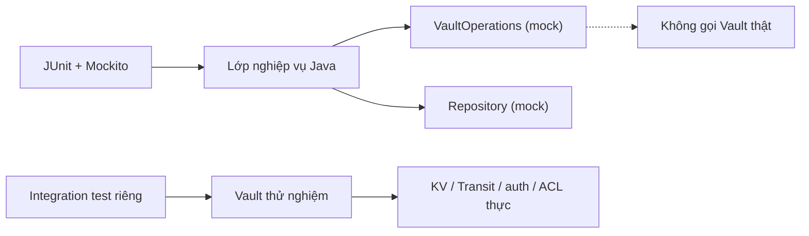
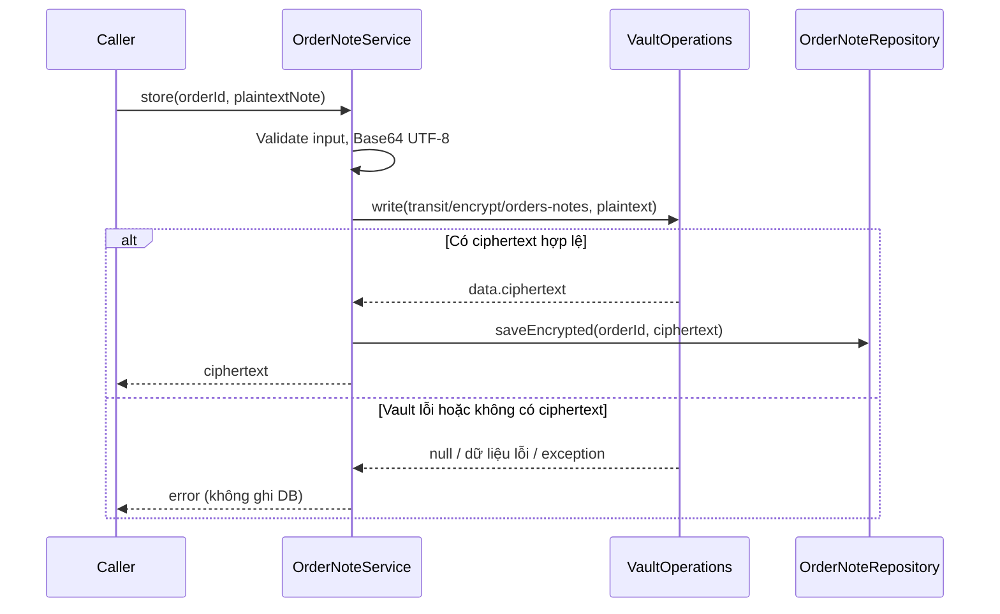
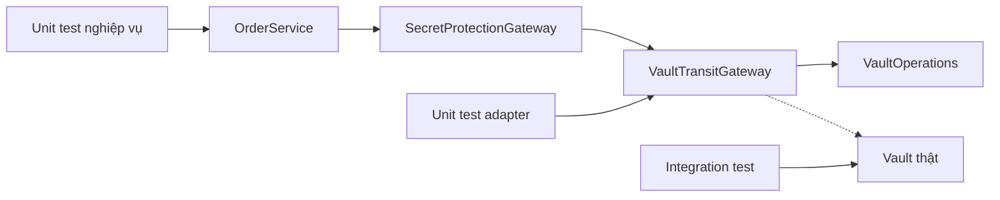

# Kiểm thử lớp nghiệp vụ với VaultOperations giả

## 1. Mục tiêu của bài học

Trong một ứng dụng Java tích hợp **HashiCorp Vault** bằng **Spring Vault**, lớp nghiệp vụ có thể gọi `VaultTemplate` thông qua giao diện `VaultOperations` để đọc KV secrets, yêu cầu Transit mã hóa, truy cập metadata của lease hoặc gọi PKI. Nếu mọi unit test đều phải khởi động Vault, kiểm thử sẽ chậm, phụ thuộc mạng/token, dễ lỗi khi môi trường CI thiếu secrets engine hoặc Vault chưa sẵn sàng.

**Kiểm thử lớp nghiệp vụ với `VaultOperations` giả** là cách thay thành phần giao tiếp Vault bằng **test double** (thường là Mockito mock/stub) để kiểm chứng *quyết định của mã Java* mà không gọi Vault thật. Đây là chủ đề của chương **Kiểm thử** trong module **SPRING_VAULT**, bên cạnh các nội dung về `VaultTemplate`, xác thực theo workload, policy phân quyền, KV, vòng đời token/lease, Transit encryption, PKI, xử lý lỗi và kiểm thử tích hợp.

Mục tiêu không phải chứng minh Vault thực sự mã hóa dữ liệu hoặc ACL hoạt động: unit test chỉ chứng minh **lớp nghiệp vụ gửi đúng yêu cầu, xử lý đúng kết quả, từ chối dữ liệu không hợp lệ và không để xảy ra side effect nguy hiểm khi Vault lỗi**. Những gì phụ thuộc Vault thực phải được kiểm tra ở tầng integration test riêng.

Sau bài này, bạn sẽ:

- Biết lúc nào mock `VaultOperations`, lúc nào dùng một fake có trạng thái và lúc nào cần Vault thật.
- Thiết kế lớp nghiệp vụ nhận `VaultOperations` qua constructor thay vì tự tạo `VaultTemplate`.
- Dùng JUnit Jupiter và Mockito để stub `read`/`write`, tạo `VaultResponse`, chụp request body và xác minh tương tác.
- Kiểm tra cả đường đi thành công lẫn trường hợp null, sai schema, thiếu quyền, timeout và dữ liệu đầu vào không hợp lệ.
- Phân biệt KV v1/KV v2 và các thao tác Transit khi tạo fixture.
- Tránh viết test giòn (brittle), rò rỉ bí mật hoặc ngộ nhận mock đã chứng minh tích hợp/ACL/TLS.

## 2. Ranh giới của kiểm thử đơn vị



| Câu hỏi | Unit test với `VaultOperations` giả | Integration test với Vault thật |
| --- | --- | --- |
| Service gọi đúng path, method và body không? | **Có**: dùng `verify`, `ArgumentCaptor`. | Có thể kiểm tra gián tiếp qua kết quả/audit. |
| Service parse đúng `VaultResponse` không? | **Có**: cho dữ liệu giả hợp lệ/lỗi. | Có: dùng response do Vault thật sinh ra. |
| Khi Vault trả null hoặc exception, service có ghi plaintext không? | **Có**: stub và xác minh repository không được gọi. | Có thể kiểm chứng end-to-end. |
| Vault token có ACL `update` trên Transit không? | **Không**; mock không thực thi ACL. | **Có**; cần policy và auth thật. |
| KV v2 mount `secret/` có tồn tại và đúng path HTTP không? | Không; chỉ kiểm tra đường dẫn mà code định dùng. | Có; bật KV v2 rồi truy cập thật. |
| Transit có mã hóa/giải mã đúng và trả ciphertext phiên bản không? | Không; `ciphertext` trong mock là fixture. | Có; dùng engine thật và kiểm tra round-trip. |
| TTL, lease renewal, token refresh và chứng thư PKI có hoạt động không? | Chỉ kiểm tra phản ứng của mã với trạng thái/sự kiện được mô phỏng. | Phải thử với Vault/backend tương ứng. |
| Mạng, TLS, timeout, retry thực tế và HA hoạt động không? | Chỉ mô phỏng exception hoặc phản hồi. | Cần integration/chaos test phù hợp. |

**Nguyên tắc:** một bài unit test tốt nhanh, độc lập và có tính quyết định; một bài integration test tốt kiểm chứng *hợp đồng thật* giữa ứng dụng và Vault. Không dùng bài test đầu để thay thế bài test sau.

### 2.1. Mock, stub, fake và spy khác gì?

- **Stub** trả một phản hồi giả cho đầu vào đã chỉ định: `when(vault.write(...)).thenReturn(response)`.
- **Mock** cho phép xác minh việc gọi: `verify(vault).write(...)`, `verifyNoInteractions(repository)`.
- **Fake** có logic đơn giản hoặc trạng thái trong bộ nhớ để mô phỏng một phần hợp đồng, ví dụ ánh xạ path → `VaultResponse`.
- **Spy** bọc đối tượng có hành vi thật và có thể ghi nhận một phần lời gọi. Không nên spy `VaultTemplate` thật trong unit test vì một đường gọi chưa stub có thể chạm Vault hoặc phụ thuộc môi trường.

Trong thực hành Mockito, một đối tượng `@Mock VaultOperations` thường vừa được **stub** để trả dữ liệu, vừa dùng như **mock** để kiểm tra tương tác. Đó là cách đơn giản nhất để xây dựng “`VaultOperations` giả” cho lớp nghiệp vụ. Nếu có nhu cầu fake phức tạp với nhiều trạng thái, cân nhắc đưa một adapter/gateway ứng dụng đứng trước `VaultOperations` thay vì cố triển khai toàn bộ interface của Spring Vault.

## 3. Thiết kế lớp nghiệp vụ để có thể kiểm thử

Giả sử dịch vụ `orders-api` phải mã hóa ghi chú đơn hàng qua **Vault Transit** rồi mới lưu vào database. Yêu cầu bảo mật: **không bao giờ lưu plaintext nếu Vault không trả về ciphertext hợp lệ**.

Đường đi nghiệp vụ:



Cặp lớp dưới đây là ví dụ tối thiểu (giả định sử dụng Java 17+ và Spring Boot với Spring Vault). Tách repository thành interface giúp test kiểm soát hành vi ghi dữ liệu mà **không cần database thật**.

```java
public interface OrderNoteRepository {
    void saveEncrypted(String orderId, String ciphertext);
}
```

Lớp nghiệp vụ:

```java
import java.nio.charset.StandardCharsets;
import java.util.Base64;
import java.util.Map;
import java.util.Objects;

import org.springframework.stereotype.Service;
import org.springframework.vault.core.VaultOperations;
import org.springframework.vault.support.VaultResponse;

@Service
public class OrderNoteService {

    static final String TRANSIT_PATH = "transit/encrypt/orders-notes";

    private final VaultOperations vault;
    private final OrderNoteRepository repository;

    public OrderNoteService(
            VaultOperations vault, OrderNoteRepository repository) {
        this.vault = Objects.requireNonNull(vault);
        this.repository = Objects.requireNonNull(repository);
    }

    public String store(String orderId, String plaintextNote) {
        if (orderId == null || orderId.isBlank()) {
            throw new IllegalArgumentException("Order ID is required");
        }
        if (plaintextNote == null || plaintextNote.isBlank()) {
            throw new IllegalArgumentException("Note is required");
        }

        String encodedInput = Base64.getEncoder().encodeToString(
                plaintextNote.getBytes(StandardCharsets.UTF_8));

        VaultResponse response = vault.write(
                TRANSIT_PATH, Map.of("plaintext", encodedInput));

        if (response == null || response.getData() == null) {
            throw new IllegalStateException(
                    "Vault Transit returned no response data");
        }

        Object value = response.getData().get("ciphertext");
        if (!(value instanceof String ciphertext)
                || !ciphertext.startsWith("vault:v")
                || ciphertext.isBlank()) {
            throw new IllegalStateException(
                    "Vault Transit returned no usable ciphertext");
        }

        // Chỉ ghi dữ liệu khi bước mã hóa đã thành công.
        repository.saveEncrypted(orderId, ciphertext);
        return ciphertext;
    }
}
```

Các quyết định có thể kiểm thử trực tiếp:

1. **Validate trước lời gọi Vault**: dữ liệu đầu vào không hợp lệ không tạo side effect và không tiêu tốn API call.
2. **Base64 ở đúng ranh giới**: Transit API nhận `plaintext` là dữ liệu đã Base64 hóa từ byte UTF-8; Base64 bản thân nó không phải mã hóa bảo mật.
3. **Đúng path**: đường dẫn `transit/encrypt/orders-notes` được cấu hình cố định; ứng dụng không nhận tên key từ người gọi để tự tạo path tùy ý.
4. **Fail closed**: không có `ciphertext` hợp lệ thì không ghi vào database; không fallback sang plaintext.
5. **Không rò rỉ trong lỗi**: exception message không chứa secret hoặc toàn bộ `VaultResponse`.
6. **Ranh giới kiểm tra**: `startsWith("vault:v")` là kiểm tra cấu trúc tối thiểu cho ví dụ, **không chứng minh ciphertext thật đã được Vault tạo**.

Đối với code production, cân nhắc dùng `VaultTransitOperations` có kiểu dữ liệu chuyên biệt nếu phù hợp phiên bản Spring Vault; bài này chủ ý dùng `VaultOperations` tổng quát để minh họa mocking và kiểm tra hợp đồng path/body.

## 4. Chuẩn bị JUnit 5 và Mockito

Một dự án Spring Boot đã có dependency quản lý qua BOM có thể khai báo:

```groovy
// build.gradle — chỉ là ví dụ dependency cho code test.
dependencies {
    implementation "org.springframework.vault:spring-vault-core"
    implementation "org.springframework.boot:spring-boot-starter"

    testImplementation "org.springframework.boot:spring-boot-starter-test"
}
```

`spring-boot-starter-test` thông thường bao gồm JUnit Jupiter, AssertJ và Mockito theo bộ phiên bản tương thích với Spring Boot. Nếu sử dụng dự án Java không có starter test, thêm `junit-jupiter`, `mockito-core` và `mockito-junit-jupiter` bằng các phiên bản tương thích do build quản lý. Không cần chạy `@SpringBootTest` hay dựng Spring context cho lớp service có hai phụ thuộc constructor như ví dụ trên.

Cấu trúc khuyến nghị:

```text
src/main/java/.../OrderNoteService.java
src/main/java/.../OrderNoteRepository.java
src/test/java/.../OrderNoteServiceTest.java
```

Để test nhất quán, dùng `@ExtendWith(MockitoExtension.class)` nhằm khởi tạo mock cho từng test, tránh trạng thái stub rò rỉ giữa các trường hợp.

## 5. Unit test đường đi thành công

Mockito mock `VaultOperations` và repository, còn **lớp nghiệp vụ được khởi tạo thật**:

```java
import static org.junit.jupiter.api.Assertions.*;
import static org.mockito.ArgumentMatchers.*;
import static org.mockito.Mockito.*;

import java.nio.charset.StandardCharsets;
import java.util.Base64;
import java.util.Map;

import org.junit.jupiter.api.BeforeEach;
import org.junit.jupiter.api.Test;
import org.junit.jupiter.api.extension.ExtendWith;
import org.mockito.ArgumentCaptor;
import org.mockito.Mock;
import org.mockito.junit.jupiter.MockitoExtension;
import org.springframework.vault.core.VaultOperations;
import org.springframework.vault.support.VaultResponse;

@ExtendWith(MockitoExtension.class)
class OrderNoteServiceTest {

    @Mock VaultOperations vault;
    @Mock OrderNoteRepository repository;

    private OrderNoteService service;

    @BeforeEach
    void setUp() {
        service = new OrderNoteService(vault, repository);
    }

    @Test
    void encryptsBeforeSavingAndSendsBase64Utf8() {
        String note = "Ghi chú có dấu tiếng Việt";
        String fakeCiphertext = "vault:v1:test-ciphertext";

        VaultResponse reply = new VaultResponse();
        reply.setData(Map.of("ciphertext", fakeCiphertext));

        when(vault.write(
                eq(OrderNoteService.TRANSIT_PATH), any()))
                .thenReturn(reply);

        String actual = service.store("order-42", note);

        assertEquals(fakeCiphertext, actual);

        ArgumentCaptor<Object> captor =
                ArgumentCaptor.forClass(Object.class);
        verify(vault).write(
                eq(OrderNoteService.TRANSIT_PATH), captor.capture());

        assertInstanceOf(Map.class, captor.getValue());
        Map<?, ?> payload = (Map<?, ?>) captor.getValue();
        assertEquals(1, payload.size());

        String base64 = (String) payload.get("plaintext");
        assertEquals(
                note,
                new String(
                    Base64.getDecoder().decode(base64),
                    StandardCharsets.UTF_8));

        // Repository nhận ciphertext, không nhận ghi chú gốc.
        verify(repository).saveEncrypted(
                "order-42", fakeCiphertext);
        verifyNoMoreInteractions(vault, repository);
    }
}
```

Vì `VaultResponse` là lớp dữ liệu bình thường, có thể tạo `new VaultResponse()` rồi đặt `setData(Map.of(...))`, thay vì mock luôn response. Hai phương thức `VaultOperations.write(String, Object)` và `VaultResponse.getData()` là API Spring Vault; hợp đồng phản hồi Transit đặt chuỗi kết quả dưới `data.ciphertext`.

Trong ví dụ, fixture `vault:v1:test-ciphertext` **không phải ciphertext có thể giải mã** và không cần như vậy: unit test quan tâm service đưa kết quả mà “Vault giả” cung cấp xuống repository. Chỉ integration test với Transit thật mới chứng minh phép mã hóa/giải mã hợp lệ.

**Vì sao dùng `ArgumentCaptor`?** Nếu chỉ xác minh `verify(vault).write(anyString(), any())`, test có thể vẫn xanh dù code gọi nhầm `transit/decrypt/...`, gửi plaintext thô thay vì Base64 hoặc gửi thiếu trường `plaintext`. Captor kiểm tra hợp đồng API một cách có ý nghĩa mà không phụ thuộc thuật toán tạo ciphertext.

## 6. Kiểm thử đầu vào sai: không gọi Vault, không ghi database

Một nghiệp vụ an toàn cần xác thực input **trước** mọi side effect. Với JUnit Jupiter, có thể dùng parameterized test (thường có sẵn qua starter test):

```java
import static org.junit.jupiter.api.Assertions.*;
import static org.mockito.Mockito.*;

import org.junit.jupiter.params.ParameterizedTest;
import org.junit.jupiter.params.provider.NullAndEmptySource;
import org.junit.jupiter.params.provider.ValueSource;

@ParameterizedTest
@NullAndEmptySource
@ValueSource(strings = { " ", "   " })
void rejectsBlankNoteBeforeCallingVault(String note) {
    assertThrows(
            IllegalArgumentException.class,
            () -> service.store("order-42", note));

    verifyNoInteractions(vault, repository);
}
```

Đây là một phương thức **nằm trong `OrderNoteServiceTest` ở mục 5**, dùng lại các field đã khai báo. Có thể viết test tương tự với `orderId` null/rỗng. Không nhất thiết phải assert chính xác từng dấu câu trong exception; điều cần bảo vệ là loại lỗi và **không thực hiện lời gọi bên ngoài** khi input không hợp lệ.

## 7. Kiểm thử phản hồi lỗi và fail closed

Vì Vault là hệ thống ngoài tiến trình, service phải đối mặt với kết quả null, sai schema hoặc exception. Mockito cho phép mô phỏng các tình huống này mà không cần tắt Vault thật.

Bổ sung các test sau vào cùng lớp `OrderNoteServiceTest`:

```java
@Test
void doesNotSaveWhenTransitReturnsNoResponse() {
    when(vault.write(
            eq(OrderNoteService.TRANSIT_PATH), any()))
            .thenReturn(null);

    assertThrows(IllegalStateException.class,
            () -> service.store("order-42", "private-note"));

    verifyNoInteractions(repository);
}

@Test
void doesNotSaveWhenCiphertextIsMissing() {
    VaultResponse reply = new VaultResponse();
    reply.setData(Map.of("other_field", "example"));

    when(vault.write(
            eq(OrderNoteService.TRANSIT_PATH), any()))
            .thenReturn(reply);

    assertThrows(IllegalStateException.class,
            () -> service.store("order-42", "private-note"));

    verifyNoInteractions(repository);
}

@Test
void doesNotSaveWhenCiphertextHasWrongType() {
    VaultResponse reply = new VaultResponse();
    reply.setData(Map.of("ciphertext", 123));

    when(vault.write(
            eq(OrderNoteService.TRANSIT_PATH), any()))
            .thenReturn(reply);

    assertThrows(IllegalStateException.class,
            () -> service.store("order-42", "private-note"));

    verifyNoInteractions(repository);
}

@Test
void doesNotSaveWhenVaultThrowsAnException() {
    when(vault.write(
            eq(OrderNoteService.TRANSIT_PATH), any()))
            .thenThrow(new IllegalStateException("Vault unavailable"));

    assertThrows(IllegalStateException.class,
            () -> service.store("order-42", "private-note"));

    verifyNoInteractions(repository);
}
```

Với `VaultResponse` có `data == null`, kết quả cũng phải là lỗi và không ghi repository. Có thể thêm test riêng cho `ciphertext=""` hoặc chuỗi thiếu prefix `vault:v`. Để tăng chất lượng, viết một **bảng các tình huống cùng kỳ vọng** rồi parameterize các fixture, thay vì sao chép nhiều test chỉ khác một trường.

Ví dụ trên mô phỏng exception chung nhằm kiểm tra **không ghi dữ liệu khi Vault thất bại**; nó không xác nhận mapping HTTP 403/429/5xx của Spring Vault. Nếu production cần phân biệt permission denied, auth expired, timeout và rate limit, thêm các test cho tầng **error classifier** riêng và một số integration test với lỗi thật.

**Chú ý đặc biệt:** nếu `vault.write(...)` báo timeout, server có thể đã thực hiện thao tác trước khi client nhận lỗi. Với ví dụ Transit encrypt, không có ghi DB khi client chưa nhận ciphertext; khi làm việc với các API có side effect (tạo token, secret ID, certificate, dynamic credential hoặc ghi KV), **không retry mù quáng** vì mock không thể chứng minh tính idempotent của hệ thống.

## 8. Test nghiệp vụ: tại sao cần kiểm tra tương tác chứ không chỉ kết quả?

Một unit test quá yếu có thể kiểm tra:

```java
assertNotNull(service.store("order-42", "note"));
```

Điều đó **không đủ**. Service sai có thể vẫn trả chuỗi nhưng gửi payload không đúng định dạng, dùng sai path hoặc lưu plaintext trước khi mã hóa. Một hợp đồng kiểm thử chặt hơn bao gồm:

1. **Input**: null/rỗng bị từ chối.
2. **Path**: chính xác `transit/encrypt/orders-notes`.
3. **Payload**: chỉ có `plaintext` được Base64 hóa từ UTF-8, không có raw secret bên ngoài những gì Transit yêu cầu.
4. **Response**: lấy `data.ciphertext`; thiếu/sai kiểu bị từ chối.
5. **Order of effects**: repository chỉ được gọi khi Vault đã trả về dữ liệu phù hợp.
6. **Error**: nếu Vault lỗi thì repository không bị gọi.
7. **Data exposure**: log/exception không chứa plaintext/ciphertext ngoài quy trình được phép.

Có thể kiểm tra thứ tự các tương tác (nếu đó là hợp đồng nghiệp vụ thực sự) bằng `InOrder`:

```java
import org.mockito.InOrder;

// Sau khi đã stub Vault và gọi service.store(...) thành công:
InOrder ordered = inOrder(vault, repository);
ordered.verify(vault).write(
        eq(OrderNoteService.TRANSIT_PATH), any());
ordered.verify(repository).saveEncrypted(
        eq("order-42"), anyString());
```

Không nên dùng `InOrder` hoặc `verifyNoMoreInteractions` cho **mọi** lời gọi nội bộ nếu chúng không quan trọng: test sẽ dễ gãy khi refactor hoặc thêm đo metric. Chỉ xác minh những tương tác mà đổi thứ tự sẽ làm sai yêu cầu bảo mật/nghiệp vụ.

### 8.1. Verify không phải bảo mật Vault

`verify(vault).write(...)` không chứng minh token có quyền `update` tại `transit/encrypt/orders-notes`. Mockito nhận mọi path nếu được stub; không có Vault policy, key, session token, TLS hay mã hóa thật. Để xác minh quyền, phải kiểm thử một workload identity thật với policy chỉ cho phép mã hóa và khẳng định các endpoint bị cấm trả lỗi đúng.

## 9. Fake dữ liệu KV: phân biệt KV v1 và KV v2 khi stub

Một service có thể dùng `VaultOperations.read("secret/legacy/app")` cho một KV v1 backend. Trong trường hợp đó, fixture của `VaultResponse.getData()` có thể chứa trực tiếp các key từ secret.

Nhưng với **KV v2**, HTTP API tại `secret/data/orders-api` có phần `data` chứa cả metadata và đối tượng `data` lồng bên trong. Nếu gọi `VaultOperations.read` trực tiếp vào HTTP path KV v2, fixture phải mô phỏng đúng shape:

```json
{
  "data": {
    "data": {
      "feature.enabled": "true",
      "service.timeout": "3s"
    },
    "metadata": {
      "version": 3
    }
  }
}
```

Với `VaultResponse` của lời gọi `read("secret/data/orders-api")`, `getData()` trỏ tới object chứa `data` (map con) và `metadata`. Một unit test stub sai shape đôi khi làm code đọc sai vẫn xanh. Vì vậy:

- Nếu service **cố ý dùng** API KV v2 trực tiếp, stub đúng cấu trúc lồng và test các trường dữ liệu thiếu.
- Nếu service dùng **`vault.opsForKeyValue("secret", KV_2)`**, Spring Vault xử lý khác biệt KV v1/v2. Kết quả từ `VaultKeyValueOperations.get("orders-api")` trả `VaultResponse` mà `getData()` chứa các key/value secret được ánh xạ phù hợp; lúc test không nên bọc thừa `data`.
- Nếu chỉ cần property lúc khởi động, cân nhắc test `@ConfigurationProperties` hoặc Spring Cloud Vault Config Data tại tầng phù hợp thay vì bắt business service hiểu HTTP schema KV v2.

Ví dụ stub API KV v2 cấp cao:

```java
import static org.mockito.Mockito.*;
import static org.mockito.ArgumentMatchers.*;

import java.util.Map;

import org.springframework.vault.core.VaultKeyValueOperations;
import org.springframework.vault.core.VaultKeyValueOperationsSupport.KeyValueBackend;
import org.springframework.vault.core.VaultOperations;
import org.springframework.vault.support.VaultResponse;

VaultOperations vault = mock(VaultOperations.class);
VaultKeyValueOperations kv = mock(VaultKeyValueOperations.class);

VaultResponse response = new VaultResponse();
response.setData(Map.of(
        "feature.enabled", "true",
        "service.timeout", "3s"));

when(vault.opsForKeyValue("secret", KeyValueBackend.KV_2))
        .thenReturn(kv);
when(kv.get("orders-api")).thenReturn(response);

// Khi lớp đang test gọi vault.opsForKeyValue(...).get(...),
// kết quả được trả về từ test double và không mở kết nối Vault.
```

Đoạn trên là **mẫu setup**; với một service cụ thể, hãy kiểm tra service gọi đúng mount `secret` và path tương đối `orders-api`. Không cần mock `RestTemplate` bên dưới `VaultTemplate` trong cùng bài unit test: điều đó kéo chi tiết transport vào lớp nghiệp vụ.

### 9.1. Khi nào cần fake có trạng thái?

Nếu service cần đọc nhiều key theo path, có thể tạo một **stub có bộ nhớ** bằng `Answer` mà không cần triển khai toàn bộ interface:

```java
Map<String, VaultResponse> fixtures = Map.of(
        "config/common", commonResponse,
        "config/orders", ordersResponse);

VaultOperations fake = mock(VaultOperations.class);

when(fake.read(anyString())).thenAnswer(invocation -> {
    String path = invocation.getArgument(0, String.class);
    return fixtures.get(path);
});
```

Trong đoạn này, `commonResponse` và `ordersResponse` là hai `VaultResponse` được chuẩn bị trước trong test. Khi service đọc một path không có trong `fixtures`, mock trả null. Đây là **fake/stub read-only tối giản**, không mô phỏng permission, token, lease hoặc engine thật.

Nếu cần mô phỏng nhiều trạng thái, hành vi retry, renew hoặc cập nhật secret, hãy cân nhắc tạo **interface gateway của ứng dụng** như `SecretReader` hoặc `OrderNoteProtector` rồi fake gateway đó. Tự tái hiện mọi semantics của Vault trong một fake phức tạp dễ tạo ra “Vault giả” sai với sản phẩm thật.

## 10. Tách lớp nghiệp vụ khỏi adapter Vault khi độ phức tạp tăng

Khi một service gọi nhiều engine (KV, Transit, PKI, lease), test nghiệp vụ có thể bị gắn chặt với tên endpoint và shape JSON. Đó là tín hiệu nên phân tách:



Ví dụ một giao diện domain nhỏ:

```java
public interface SecretProtectionGateway {
    String encryptNote(String plaintextNote);
}
```

- Unit test **`OrderService`** fake `SecretProtectionGateway`: quan tâm quyết định lưu dữ liệu và xử lý lỗi nghiệp vụ, không biết Vault path.
- Unit test **`VaultTransitGateway`** mock `VaultOperations`: quan tâm Base64, endpoint, `VaultResponse` và error mapping.
- Integration test **`VaultTransitGateway`** với Vault thật: quan tâm key Transit, quyền ACL, TLS, auth và round-trip.

Đây là một biến thể của **Ports and Adapters / Hexagonal Architecture**. Không bắt buộc chia nhỏ ngay từ đầu nếu service rất đơn giản, nhưng khi nhiều lớp business lặp lại cách gọi Vault thì adapter chung giúp thay đổi path/chính sách mà không sửa hàng loạt test.

## 11. Kiểm tra lỗi, retry, lease và bảo mật ở cấp phù hợp

### 11.1. Những gì nên mock

| Tình huống | Unit test nên làm | Giới hạn |
| --- | --- | --- |
| Vault không có secret | Stub `read` trả null; xác minh service trả lỗi hoặc trạng thái `NOT_CONFIGURED`. | Không chứng minh thực tế Vault trả HTTP 404 ra sao. |
| Access denied | Cho mock ném exception đại diện lỗi quyền; xác minh không fallback sang secret khác. | Chưa kiểm chứng Vault ACL và auth role thật. |
| Vault tạm thời không sẵn sàng | Cho mock ném exception; test retry policy qua một gateway/classifier riêng. | Không tái hiện TLS, network jitter, load balancing hay HA. |
| Ciphertext thiếu/sai kiểu | Stub `VaultResponse.getData()` sai; xác minh không lưu plaintext. | Không bảo đảm Vault thực tế có cùng schema mọi phiên bản. |
| Token/lease hết hạn | Dùng `Clock` giả hoặc sự kiện lifecycle test; kiểm tra ứng dụng dừng dùng credential cũ. | Renewal/revoke thực cần Vault thật và secrets engine phù hợp. |
| PKI certificate bị từ chối | Fake gateway trả lỗi hoặc cert không hợp lệ cho validator. | Kiểm tra chain, issuer, key matching thật cần test PKI/crypto riêng. |
| Log chứa secret | Dùng test appender/redaction ở thành phần logging, kiểm tra log không chứa plaintext. | Mock `VaultOperations` không tự kiểm tra log của HTTP client thực. |

**Không viết retry vô hạn** trong test hoặc mã production. Với read-only operation có thể retry có giới hạn; với API có side effect, phải xem xét tính idempotent của thao tác. Dùng đồng hồ hoặc scheduler giả trong test giúp kiểm thử retry/expiry nhanh và không phụ thuộc `Thread.sleep()`.

### 11.2. Với dynamic secrets và lease

Nếu ứng dụng lấy database credentials từ Vault, test nghiệp vụ có thể giả lập một đối tượng chứa `username`, `password`, `leaseId`, `leaseDuration` và `renewable`. Hãy xác minh lớp nghiệp vụ:

1. Không sử dụng credential khi lease đã hết hạn hoặc bị thu hồi.
2. Khi có credential mới, cập nhật connection pool hoặc nơi lưu trạng thái theo hợp đồng.
3. Không làm rò rỉ password trong sự kiện, exception, metric hoặc log.
4. Không nhầm việc gia hạn Vault token với việc gia hạn dynamic secret lease.

Dù unit test có thể giả lập tất cả các trạng thái này, **Spring Vault `SecretLeaseContainer`**, backend database và việc revoke thực tế cần bài integration test riêng. Đừng tự khẳng định một mock đã chứng minh cơ chế thay credential trên kết nối TCP đang mở.

### 11.3. Kiểm tra tác động của lỗi theo nguyên tắc fail closed

Trong các luồng bắt buộc bảo mật, test nên chứng minh một hành vi bị **cấm**, không chỉ rằng exception đã được ném:

```java
assertThrows(IllegalStateException.class,
        () -> service.store("order-42", "private-note"));
verifyNoInteractions(repository);
```

Nếu mã hiện tại có fallback sang plaintext, test này phải thất bại. Đây là giá trị quan trọng của unit test lớp nghiệp vụ: nó biến một **quy tắc an toàn** thành điều kiện có thể kiểm tra sau mỗi thay đổi code.

## 12. Chống test giòn và tránh lộ secrets trong fixture

Một bộ unit test liên quan Vault nên tránh các lỗi thiết kế sau:

1. **Mock chính lớp đang test:** nếu mock `OrderNoteService` rồi `when(service.store(...))`, bạn đang kiểm tra Mockito chứ không kiểm tra logic của service.
2. **Dùng `@SpringBootTest` cho mọi test:** tạo context chậm, có thể kích hoạt auth/config Vault từ môi trường và khó cô lập. Constructor injection + Mockito thường đủ cho unit test.
3. **Stub quá rộng `anyString(), any()` nhưng không verify path/body:** che lỗi gõ sai endpoint, sai field hoặc sai encoding.
4. **Giả định thứ tự JSON map khi không cần:** `Map` không phải hợp đồng thứ tự field của Vault; so sánh key/value thay vì serialized JSON nguyên chuỗi.
5. **Kỳ vọng ciphertext thật giống fixture cố định:** thuật toán/nonce có thể làm ciphertext thay đổi; mock chỉ trả giá trị đã stub.
6. **Lưu token thật/password trong test:** fixture nên là giá trị giả như `vault:v1:test-ciphertext`, `fake-role`, `example`, không dùng secret của môi trường.
7. **Kiểm tra thông báo exception chứa secret:** không đặt raw request/payload vào message; tránh log full `VaultResponse`.
8. **Test chỉ happy path:** thiếu các ca null, thiếu field, sai kiểu, thiếu quyền, timeout và dữ liệu đầu vào không hợp lệ.
9. **Gắn chặt test vào private implementation:** ưu tiên kiểm tra observable output/side effect và những lời gọi Vault thực sự thuộc hợp đồng.
10. **Nhầm unit test với integration test:** test xanh vẫn có thể gặp 403, sai mount KV v2 hoặc Vault bị seal.

**Mẹo quan trọng:** Vì request Transit chứa Base64 của plaintext, test có thể giải mã lại payload để xác nhận UTF-8; điều đó **không có nghĩa Base64 bảo vệ dữ liệu**. Chỉ khi Vault Transit thực thi mã hóa và service nhận `ciphertext` thì thông tin mới ở dạng được bảo vệ theo chính sách.

## 13. Kịch bản kiểm thử kết hợp và phân ranh CI

Một chiến lược CI có thể chia thành ba tầng:

| Tầng | Phụ thuộc | Mục tiêu | Đặc điểm |
| --- | --- | --- | --- |
| **Unit** | JUnit + Mockito; không Vault, không DB. | Path/body, validation, error handling, không ghi plaintext. | Nhanh, chạy với mọi commit. |
| **Integration** | Vault dev/Testcontainers hoặc Vault test có engine phù hợp. | Đường dẫn/mount, policy, token auth, KV v2, Transit round-trip, PKI/lease khi cấu hình được. | Chậm hơn; cần setup và teardown cô lập. |
| **End-to-end/resilience** | Các thành phần thực hoặc staging. | Rotation, Vault không sẵn sàng, readiness, datasource đổi credential, mTLS/cert hết hạn. | Tốn tài nguyên; cần kiểm soát môi trường và dữ liệu. |

**Gợi ý tập ca cho integration test với Vault thật:**

- Bật Transit tại mount test, tạo key `orders-notes`, cấp policy chỉ `update` trên `transit/encrypt/orders-notes`; gọi service và kiểm tra ciphertext có thể giải mã bằng danh tính được cấp quyền `decrypt` riêng.
- Dùng workload token không có `update` để xác minh thao tác encrypt bị từ chối.
- Dùng KV v2 tại mount `secret` và test `opsForKeyValue("secret", KV_2).get(...)` với secret có version.
- Tạo hoặc dùng dynamic secret có lease để kiểm thử vòng đời nếu bài tích hợp cần; không dựa vào mock để chứng minh revoke tại database.
- Cắt kết nối Vault trong môi trường test để xác minh timeout, retry budget và readiness.
- Dùng secret giả, không ghi credential vào log CI; dọn Vault test và tài nguyên backend sau khi chạy.

**Hạn chế cần nói rõ:** Testcontainers/Vault dev thường chỉ cung cấp các tính năng có trong phiên bản Vault chạy thử. Engine cần giấy phép, như một số chức năng mở rộng, phải có môi trường kiểm thử phù hợp. Các ví dụ trên là kế hoạch kiểm thử, không phải kết quả test đã chạy.

## 14. Bài tập thực hành

Bạn có một service `CustomerProfileService` đọc profile khách hàng qua KV v2 và gửi dữ liệu nhạy cảm tới Transit để mã hóa trước khi lưu. Hãy thiết kế unit tests đáp ứng:

1. Mock `VaultOperations` hoặc `VaultKeyValueOperations` theo ranh giới được chọn; không kết nối Vault thật.
2. Xác minh đúng KV mount, path logic và shape `getData()` theo API đã dùng.
3. Với thao tác Transit, xác minh đúng endpoint, payload Base64 UTF-8 và rằng repository chỉ nhận ciphertext.
4. Mô phỏng Vault trả null, thiếu `data.ciphertext`, response sai kiểu, lỗi permission và timeout.
5. Khi dữ liệu không hợp lệ, khẳng định `verifyNoInteractions` với Vault và repository.
6. Thử đưa code lỗi cố tình lưu plaintext khi Vault thất bại; bài test fail-closed phải **bắt được** lỗi này.
7. Viết riêng một integration test plan với Vault thật để kiểm tra ACL, KV v2 và round-trip Transit.

Đáp án cần nêu rõ điểm khác biệt: **unit test chứng minh lớp Java cư xử đúng với phản hồi giả**, còn **integration test chứng minh Vault và ứng dụng cùng thực hiện đúng hợp đồng**.

## 15. Checklist trước khi chấp nhận bộ unit test

- [ ] Lớp nghiệp vụ nhận `VaultOperations` qua constructor, không tự tạo client/đọc token từ môi trường trong test.
- [ ] Unit test chạy không cần Vault URL, token, TLS hay DB thật.
- [ ] Có test happy path, input invalid, null response, thiếu field/sai kiểu và exception.
- [ ] Dùng `ArgumentCaptor`/`verify` để kiểm tra endpoint, method, request body thực sự quan trọng.
- [ ] Kiểm tra Base64/UTF-8 hoặc schema KV đúng **loại API** đang dùng.
- [ ] Kiểm tra side effect: không ghi plaintext, không cấp credential hoặc gọi backend khác khi Vault lỗi.
- [ ] Không log hoặc đưa secret thật vào fixture/exception/assertion message.
- [ ] Phân biệt mock/stub/fake, tránh mô phỏng chi tiết Vault không cần thiết.
- [ ] Tách rõ test adapter Vault, test domain và integration test.
- [ ] Không tuyên bố mock đã chứng minh policy, crypto, network, lease, TLS hoặc PKI thật.
- [ ] Có kế hoạch kiểm thử end-to-end trước khi triển khai hệ thống xử lý dữ liệu nhạy cảm.

**Ghi nhớ:** Khi thay `VaultOperations` bằng test double, hãy kiểm tra **hợp đồng nghiệp vụ quan sát được**: gửi đúng yêu cầu, đọc đúng phản hồi, từ chối dữ liệu sai và không thực hiện hành vi nguy hiểm khi Vault lỗi. Mock giúp lớp Java kiểm thử độc lập; Vault thử nghiệm giúp xác nhận rằng các giả định của mock đúng với secrets engine, policy và hạ tầng thật.

### Tài liệu tham khảo

- Spring Vault — `VaultOperations` API: https://docs.spring.io/spring-vault/reference/api/java/org/springframework/vault/core/VaultOperations.html
- Spring Vault — `VaultResponse` API: https://docs.spring.io/spring-vault/reference/api/java/org/springframework/vault/support/VaultResponse.html
- Spring Vault — Spring Vault Reference: https://docs.spring.io/spring-vault/reference/
- Mockito — Documentation: https://site.mockito.org/
- JUnit 5 — User Guide: https://junit.org/junit5/docs/current/user-guide/
