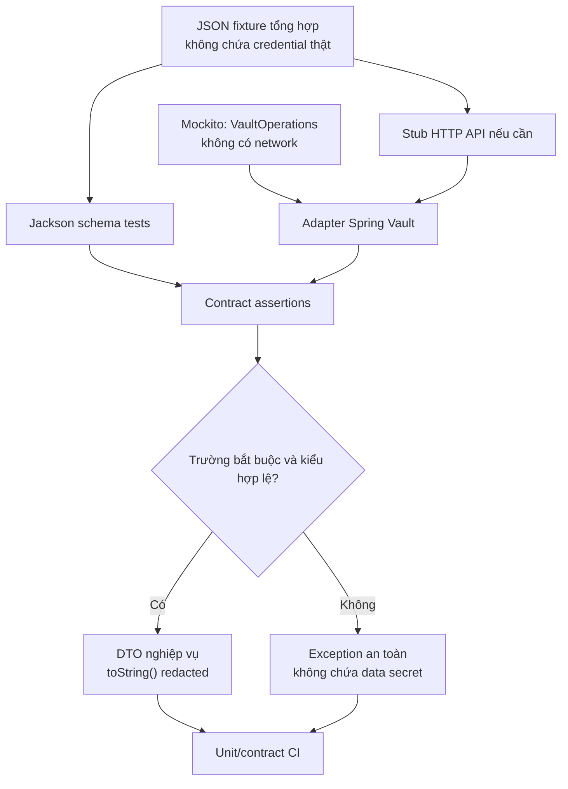
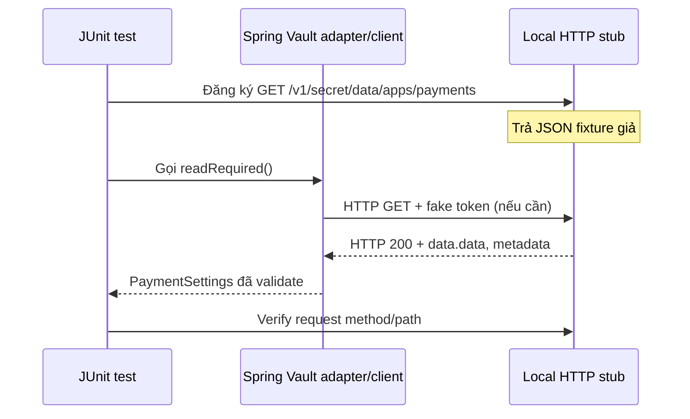

# Kiểm thử ánh xạ dữ liệu mà không dùng secret thật

Ứng dụng Java sử dụng **Spring Vault** thường ánh xạ phản hồi HashiCorp Vault thành DTO, cấu hình Spring Boot hoặc đối tượng nghiệp vụ: KV v2 trả dữ liệu dưới `data.data`, Database trả tài khoản kèm lease, Transit trả ciphertext, còn PKI trả chứng chỉ và có thể cả private key. Một lỗi ở tầng ánh xạ có thể khiến ứng dụng lấy sai đường dẫn, đánh mất TTL, nhận `null` như dữ liệu hợp lệ hoặc vô tình đưa bí mật vào log.

Trong chương **Kiểm thử** của module `SPRING_VAULT`, bài này tập trung vào cách **kiểm tra mapping, validation, error handling và không rò rỉ dữ liệu mà không cần Vault production hay secret thật**. Chúng ta dùng **fixture tổng hợp**, JUnit 5, Mockito và Jackson để thử adapter đọc dữ liệu qua `VaultTemplate`/`VaultOperations`. Những bài kiểm thử này bổ sung, nhưng **không thay thế**, integration test với Vault thử nghiệm khi cần xác nhận ACL, auth, token/lease, Transit encryption hoặc PKI thật.

> **Nguyên tắc:** Bài test ánh xạ chỉ cần biết **cấu trúc và ý nghĩa của dữ liệu**, không cần biết một mật khẩu, token, chứng chỉ hay khóa riêng thật. Nếu có thể kiểm chứng mapping bằng giá trị `FAKE_ONLY_...` hoặc dữ liệu không mang tính bí mật, tuyệt đối không copy giá trị từ Vault production vào repository.

## 1. Mục tiêu và ranh giới kiểm thử

Sau bài học, bạn có thể:

1. Xác định **schema phản hồi** cho từng endpoint Vault và phần nào cần map.
2. Tạo fixture JSON giả có đủ các lớp envelope, `data`, metadata, lease và version.
3. Kiểm thử adapter Spring Vault bằng mock `VaultOperations` mà **không mở kết nối Vault**.
4. Bắt lỗi nested `data`, sai kiểu, trường thiếu, phiên bản đã xóa và TTL bất hợp lệ.
5. Kiểm chứng DTO và thông báo lỗi **không vô tình in secret**.
6. Phân biệt test ánh xạ, HTTP contract test với stub và integration test với Vault lab.

### Cái gì được và không được chứng minh?

| Loại kiểm thử | Chứng minh được | **Không** chứng minh được |
|---|---|---|
| Pure unit test mapper | Trường JSON/Map được đọc đúng, validation, DTO an toàn | Vault server thực sự trả schema đó trên mọi phiên bản |
| Mock `VaultOperations` | Adapter gọi đúng path và xử lý `VaultResponse` hoặc lỗi trả về | Token Vault có policy phù hợp, TLS/network hoạt động |
| Stub HTTP Vault API | HTTP method/path, status và parsing JSON theo contract đã dựng | Auth method, ACL, lease renewal và mật mã ở Vault thật |
| Integration test với Vault dev/test | Engine configuration, policy, auth, KV version, Transit encrypt/decrypt, lease lifecycle | Mọi điều kiện production hoặc SLA |
| Kiểm thử với production secrets | **Không phải lựa chọn phù hợp cho test mapping** | Tăng rủi ro lộ dữ liệu và khó tái lập |

Với đề bài **kiểm thử ánh xạ dữ liệu mà không dùng secret thật**, ba loại đầu thường đủ cho feedback nhanh; loại thứ tư chạy tách biệt khi cần xác minh hợp đồng end-to-end.

## 2. Vì sao giả lập dữ liệu giúp kiểm thử tốt hơn?

Giả sử ứng dụng phải đọc cấu hình thanh toán từ KV v2:

```text
Vault mount: secret/             (KV v2)
Relative key: apps/payments
HTTP endpoint: GET /v1/secret/data/apps/payments
Fields: partner_api_key, partner_base_url, max_attempts
```

Không cần một API key thật để biết parser có đọc đúng `partner_api_key`, phân biệt `data` lồng nhau hoặc từ chối `max_attempts=-1`. Có thể dùng:

```json
{
  "partner_api_key": "FAKE_ONLY_NOT_A_REAL_API_KEY",
  "partner_base_url": "https://partner.invalid",
  "max_attempts": 3
}
```

`partner.invalid` dùng TLD `.invalid` dành cho tên miền không hợp lệ; ví dụ sẽ không vô tình trở thành endpoint đối tác thật. Giá trị có tiền tố `FAKE_ONLY` giúp reviewer, người đọc log và công cụ quét nhận ra dữ liệu cố ý dựng cho kiểm thử. Nó **không được dùng làm fallback credential trong production**.

Giả lập còn giúp tạo ra trường hợp production rất khó chủ động tái hiện: trường bị thiếu, response có kiểu `String` thay vì `Integer`, token hết hạn, metadata báo version đã bị destroy hoặc request bị `403`.

## 3. Phân loại dữ liệu giả và quy tắc fixture

| Loại dữ liệu | Fixture an toàn | Điều phải tránh |
|---|---|---|
| API key/password | `FAKE_ONLY_NOT_A_REAL_API_KEY` | Bất kỳ credential lấy từ máy cá nhân, Vault lab dùng chung hoặc production |
| Vault token | `FAKE_ONLY_TOKEN_NEVER_VALID` | Token `hvs...`/`s...`/JWT thật, kể cả đã hết hạn |
| Token accessor | `FAKE_ONLY_ACCESSOR` | Accessor thật có thể dùng để quản trị khi kết hợp quyền Vault |
| Transit ciphertext | `vault:v3:FAKE_ONLY_NOT_DECRYPTABLE` | Copy ciphertext thật từ khách hàng hoặc test decrypt với ciphertext giả |
| PKI certificate/private key | `FAKE_CERT_TEXT_NOT_PEM` | Chép PEM private key production vào `src/test/resources` |
| Username database | `fake_readonly_user` | Username production có thể tiết lộ hệ thống |
| Tenant/request ID | `tenant-test-001` và UUID test | ID khách hàng thật hoặc raw audit trace |
| Thời hạn/lease ID | `database/creds/readonly/FAKE_LEASE` | Lease ID trích từ Vault thật |

Fixture được phép **trông giống cấu trúc API** nhưng phải **không có khả năng truy cập hệ thống thật**. Với ciphertext, để xác nhận chuỗi có prefix có thể dùng giá trị giả, nhưng không khẳng định `vault:v3:FAKE_ONLY...` có thể được Vault giải mã. Khi cần kiểm tra tính đúng đắn mật mã, dùng Vault test riêng với plaintext giả và một Transit key chuyên cho môi trường đó.

### Các nguyên tắc version control

- Chỉ commit các fixture do test tạo ra hoặc được review là dữ liệu tổng hợp.
- Không chụp snapshot nguyên `VaultResponse`, `VaultTokenResponse`, response PKI `issue` hoặc response Database credentials khi chạy với Vault thật.
- Không đặt `VAULT_TOKEN`, `SECRET_ID`, plaintext Transit hoặc private key trong `application-test.yml`.
- Tắt log request/response body, hoặc thay bằng dữ liệu đã làm sạch trước khi lưu fixture.
- Chạy secret scanning trên pull request để phát hiện dữ liệu vô tình được đưa vào test source; kết quả scan không thay việc review.
- Đừng dùng `@Disabled` để giữ một bài test yêu cầu secret thật trong code rồi chờ người khác bật lại.

## 4. Sơ đồ chiến lược kiểm thử ánh xạ



Hãy để adapter thực hiện **một nhiệm vụ rõ ràng**: đọc đúng path, bỏ phần envelope/lớp lồng đúng quy tắc, validate các trường bắt buộc và tạo DTO. Phần gọi HTTP và phần ánh xạ có thể kiểm tra riêng để lỗi dễ định vị.

## 5. Mẫu cấu trúc response cần ghi nhớ

Mỗi secrets engine có payload riêng dù cùng được gọi qua Vault HTTP API:

| Endpoint | Vị trí dữ liệu cần lấy trong JSON thô | Điểm dễ map sai |
|---|---|---|
| KV v1: `GET legacy/apps/payments` | `data.partner_api_key` | Không có `data` lồng kiểu KV v2 |
| KV v2: `GET secret/data/apps/payments` | `data.data.partner_api_key` | `data.metadata.version` không phải key version Transit |
| Database: `GET database/creds/readonly` | `data.username`, `data.password` | `lease_id`/`lease_duration` ở envelope ngoài `data` |
| Transit: `POST transit/encrypt/customer-pii` | `data.ciphertext` | Giá trị là ciphertext opaque, không phải plaintext |
| Transit decrypt | `data.plaintext` | Trường này là Base64 của dữ liệu gốc; không log |
| PKI: `POST pki/issue/server` | `data.certificate`, `data.serial_number` | Có thể có `private_key`; không snapshot |
| Auth: `POST auth/.../login` | `auth.client_token` | Không phải `data.client_token` |
| Response wrapping | `wrap_info.token` | Phản hồi đã bọc **không chứa bí mật gốc** để map ngay |

Các đường dẫn trên giả định mount `legacy/`, `secret/`, `database/`, `transit/` và `pki/`. Dự án có thể đổi mount; fixture/path trong test phải khớp cấu hình đang được triển khai.

### KV v2: fixture hợp đồng JSON toàn phần

Đây là một response hợp lệ ở mức **cấu trúc minh họa**, mọi giá trị secret đều giả:

```json
{
  "request_id": "00000000-0000-4000-8000-000000000001",
  "lease_id": "",
  "renewable": false,
  "lease_duration": 0,
  "data": {
    "data": {
      "partner_api_key": "FAKE_ONLY_NOT_A_REAL_API_KEY",
      "partner_base_url": "https://partner.invalid",
      "max_attempts": 3
    },
    "metadata": {
      "created_time": "2026-01-01T00:00:00Z",
      "deletion_time": "",
      "destroyed": false,
      "version": 4
    }
  }
}
```

Với KV v2, `data.data` chứa **nội dung bí mật**, còn `data.metadata` chứa **trạng thái version**. Không xem `lease_duration=0` ở outer envelope như lỗi của KV tĩnh: KV v2 không cấp dynamic lease cho từng bản ghi như Database secrets engine.

## 6. Thiết kế adapter có thể test mà không gọi Vault

Ví dụ sau dùng `VaultOperations.read(String)` thay vì API KV chuyên biệt để minh họa rõ **hai lớp `data`**. Ứng dụng production cũng có thể dùng `opsForVersionedKeyValue("secret").get(...)` và `Versioned<T>`; khi đó mock interface versioned tương ứng, không tự tách `data.data` thêm lần nữa.

### 6.1. DTO không tự in secret

```java
import java.net.URI;
import java.util.Objects;

record PaymentSettings(
        String partnerApiKey,
        URI partnerBaseUrl,
        int maxAttempts,
        int kvVersion) {

    PaymentSettings {
        Objects.requireNonNull(partnerApiKey, "partnerApiKey");
        Objects.requireNonNull(partnerBaseUrl, "partnerBaseUrl");
        if (partnerApiKey.isBlank()) {
            throw new IllegalArgumentException("API key must not be blank");
        }
        if (!"https".equalsIgnoreCase(partnerBaseUrl.getScheme())) {
            throw new IllegalArgumentException("HTTPS partner URL is required");
        }
        if (maxAttempts < 1 || maxAttempts > 10 || kvVersion < 1) {
            throw new IllegalArgumentException("Invalid settings range");
        }
    }

    @Override
    public String toString() {
        return "PaymentSettings[partnerApiKey=REDACTED, "
                + "partnerBaseUrl=REDACTED, maxAttempts="
                + maxAttempts + ", kvVersion=" + kvVersion + "]";
    }
}
```

Đây là DTO **minh họa** dùng Java record. `toString()` của record mặc định sẽ in toàn bộ thành phần, bao gồm `partnerApiKey`; override là một biện pháp phòng thủ. Hạn chế log/serialize DTO ngay cả khi đã override `toString()` vì JSON serializer vẫn có thể xuất field credential nếu người lập trình đưa DTO ra REST API.

### 6.2. Adapter đọc Vault response và validate schema

```java
import java.net.URI;
import java.util.Map;
import java.util.Objects;

import org.springframework.vault.core.VaultOperations;
import org.springframework.vault.support.VaultResponse;

final class PaymentSettingsAdapter {

    static final String PATH = "secret/data/apps/payments";
    private final VaultOperations vault;

    PaymentSettingsAdapter(VaultOperations vault) {
        this.vault = Objects.requireNonNull(vault);
    }

    PaymentSettings readRequired() {
        VaultResponse response = vault.read(PATH);
        if (response == null || response.getData() == null) {
            throw new IllegalStateException("Required KV key not found");
        }

        // VaultResponse#getData() đã bỏ lớp envelope ngoài cùng.
        // Với KV v2, map này còn chứa "data" và "metadata".
        Map<String, Object> outer = response.getData();
        Map<?, ?> secret = requiredMap(outer.get("data"), "data");
        Map<?, ?> metadata =
                requiredMap(outer.get("metadata"), "metadata");

        Object destroyed = metadata.get("destroyed");
        Object deletionTime = metadata.get("deletion_time");
        if (Boolean.TRUE.equals(destroyed)
                || deletionTime instanceof String time
                        && !time.isBlank()) {
            throw new IllegalStateException("KV version is not readable");
        }

        String apiKey = requiredText(secret, "partner_api_key");
        String baseUrl = requiredText(secret, "partner_base_url");
        int attempts = requiredPositiveInt(secret, "max_attempts");
        int version = requiredPositiveInt(metadata, "version");

        // URI và range được validate trong PaymentSettings.
        return new PaymentSettings(
                apiKey, URI.create(baseUrl), attempts, version);
    }

    private static Map<?, ?> requiredMap(Object value, String name) {
        if (!(value instanceof Map<?, ?> map)) {
            throw new IllegalStateException("Invalid KV v2 " + name);
        }
        return map;
    }

    private static String requiredText(Map<?, ?> map, String name) {
        Object value = map.get(name);
        if (!(value instanceof String s) || s.isBlank()) {
            // Không đưa value thật vào thông báo lỗi.
            throw new IllegalStateException("Invalid field " + name);
        }
        return s;
    }

    private static int requiredPositiveInt(
            Map<?, ?> map, String name) {
        Object value = map.get(name);
        if (!(value instanceof Integer n) || n <= 0) {
            throw new IllegalStateException("Invalid field " + name);
        }
        return n;
    }
}
```

**Điểm cần nhớ khi test:** `VaultResponse.getData()` là map tương ứng phần `data` của envelope JSON, nên unit test phải stub nó thành:

```text
Map được VaultResponse#getData() trả về:
  data:
    partner_api_key: FAKE_ONLY_...
    partner_base_url: https://partner.invalid
    max_attempts: 3
  metadata:
    version: 4
    destroyed: false
    deletion_time: ""
```

Không giả lập nó thành toàn bộ HTTP response có `request_id`, `lease_id` ở ngoài. Nếu làm vậy, test của adapter có thể bị "sai một lớp" dù fixture JSON gốc đúng.

## 7. JUnit 5 + Mockito: kiểm thử mapper không cần Vault server

### 7.1. Test case thành công

```java
import java.net.URI;
import java.util.Map;

import org.junit.jupiter.api.Test;
import org.springframework.vault.core.VaultOperations;
import org.springframework.vault.support.VaultResponse;

import static org.junit.jupiter.api.Assertions.*;
import static org.mockito.Mockito.*;

class PaymentSettingsAdapterTest {

    private final VaultOperations vault = mock(VaultOperations.class);
    private final VaultResponse response = mock(VaultResponse.class);
    private final PaymentSettingsAdapter adapter =
            new PaymentSettingsAdapter(vault);

    private void stubData(Map<String, Object> value) {
        when(vault.read(PaymentSettingsAdapter.PATH))
                .thenReturn(response);
        when(response.getData()).thenReturn(value);
    }

    private static Map<String, Object> metadata() {
        return Map.of(
            "version", 4,
            "destroyed", false,
            "deletion_time", ""
        );
    }

    private static Map<String, Object> validSecret() {
        return Map.of(
            "partner_api_key", "FAKE_ONLY_NOT_A_REAL_API_KEY",
            "partner_base_url", "https://partner.invalid",
            "max_attempts", 3
        );
    }

    @Test
    void readsKvV2DataAndMetadataCorrectly() {
        stubData(Map.of(
                "data", validSecret(),
                "metadata", metadata()));

        PaymentSettings settings = adapter.readRequired();

        assertEquals("FAKE_ONLY_NOT_A_REAL_API_KEY",
                settings.partnerApiKey());
        assertEquals(URI.create("https://partner.invalid"),
                settings.partnerBaseUrl());
        assertEquals(3, settings.maxAttempts());
        assertEquals(4, settings.kvVersion());

        verify(vault).read("secret/data/apps/payments");
        verifyNoMoreInteractions(vault);
    }

    @Test
    void rejectsMissingNestedData() {
        stubData(Map.of("metadata", metadata()));
        assertThrows(IllegalStateException.class,
                adapter::readRequired);
    }

    @Test
    void rejectsBlankSecretValueWithoutEchoingIt() {
        stubData(Map.of(
            "data", Map.of(
                "partner_api_key", "",
                "partner_base_url", "https://partner.invalid",
                "max_attempts", 3),
            "metadata", metadata()));

        IllegalStateException error = assertThrows(
                IllegalStateException.class, adapter::readRequired);
        assertEquals("Invalid field partner_api_key", error.getMessage());
    }

    @Test
    void redactsSecretFromToString() {
        stubData(Map.of(
                "data", validSecret(),
                "metadata", metadata()));
        PaymentSettings settings = adapter.readRequired();

        assertFalse(settings.toString().contains(
                "FAKE_ONLY_NOT_A_REAL_API_KEY"));
        assertTrue(settings.toString().contains("REDACTED"));
    }
}
```

**Tại sao test này không kết nối tới Vault?** `vault` là Mockito mock; `read(...)` không gửi network request. Dữ liệu trong `when(...).thenReturn(...)` là Map do test dựng, không đi từ Vault thật. Vì vậy bài test chạy nhanh, không cần `VAULT_ADDR` hay `VAULT_TOKEN`, và có thể chạy trong CI không có network.

### 7.2. Những trường hợp lỗi nhất thiết phải thêm

| Input giả lập | Kết quả đúng |
|---|---|
| `vault.read(PATH)` trả `null` | Không tạo DTO; báo thiếu key theo contract |
| `response.getData()` là `null` | Báo thiếu dữ liệu, không dùng giá trị mặc định |
| `data` chứa `String` thay vì `Map` | Từ chối schema sai |
| `metadata` bị thiếu hoặc không phải `Map` | Từ chối; không tự đặt version = 0 |
| `partner_api_key` thiếu hoặc rỗng | Từ chối, không ghi giá trị vào exception |
| `max_attempts` = `"3"` (String) | Từ chối nếu contract yêu cầu Integer, không tự ép kiểu mơ hồ |
| `max_attempts` = -1 | Từ chối do range không hợp lệ |
| `partner_base_url` không phải HTTPS | Từ chối theo policy của ứng dụng |
| `metadata.version` = 0 | Từ chối version không hợp lệ |
| `metadata.destroyed` = true | Không coi version là dữ liệu đang dùng được |
| `metadata.deletion_time` khác chuỗi rỗng | Không coi version đang sẵn sàng |
| Spring Vault ném exception khi đọc | Bubble/map sang lỗi an toàn, không fallback secret thật |

Các giá trị phải được chọn từ **hợp đồng dữ liệu thực tế**. Nếu config cho phép `max_attempts=0` thì sửa validation và test theo nghiệp vụ thay vì sao chép range minh họa.

## 8. Kiểm thử cấu trúc JSON bằng Jackson, không cần Spring Context

Mock `VaultOperations` chứng minh cách adapter xử lý `VaultResponse`, nhưng không chứng minh rằng fixture HTTP chứa đúng số lớp `data`. Có thể thêm pure JSON contract tests với Jackson:

```java
import com.fasterxml.jackson.databind.JsonNode;
import com.fasterxml.jackson.databind.ObjectMapper;
import org.junit.jupiter.api.Test;

import static org.junit.jupiter.api.Assertions.*;

class VaultResponseShapeTest {

    private static final ObjectMapper MAPPER = new ObjectMapper();

    // Mọi giá trị chỉ là dữ liệu minh họa do test tạo.
    private static final String KV2_JSON = """
        {
          "data": {
            "data": {
              "partner_api_key": "FAKE_ONLY_NOT_A_REAL_API_KEY",
              "max_attempts": 3
            },
            "metadata": {
              "version": 4,
              "destroyed": false,
              "deletion_time": ""
            }
          }
        }
        """;

    @Test
    void kvV2HasTwoDataLevelsAndVersionMetadata() throws Exception {
        JsonNode json = MAPPER.readTree(KV2_JSON);

        assertEquals("FAKE_ONLY_NOT_A_REAL_API_KEY",
                json.at("/data/data/partner_api_key").asText());
        assertEquals(3, json.at("/data/data/max_attempts").asInt());
        assertEquals(4, json.at("/data/metadata/version").asInt());
        assertTrue(json.at("/data/partner_api_key").isMissingNode());
    }
}
```

Đoạn test dùng `JsonNode.at(...)` theo JSON Pointer. Nếu API key bị đọc nhầm tại `/data/partner_api_key`, đường dẫn thiếu một lớp và `isMissingNode()` sẽ giúp làm rõ lỗi. `JsonNode.asInt()` có thể chuyển đổi kiểu khi dữ liệu là chuỗi; nếu contract bắt buộc JSON number, cần thêm `isInt()`/`isIntegralNumber()` trước khi lấy số. Không để coercion âm thầm che lỗi schema.

### KV v1 và KV v2 không thể dùng chung đường dẫn JSON

```json
{
  "data": {
    "partner_api_key": "FAKE_ONLY_V1_KEY"
  }
}
```

Đây là cấu trúc KV v1, secret nằm tại `/data/partner_api_key`. Với KV v2, secret nằm tại `/data/data/partner_api_key`. Test nên xác minh **cả đường dẫn đúng lẫn đường dẫn sai** để tránh dùng nhầm mapper khi chuyển backend từ KV v1 sang KV v2.

## 9. Kiểm thử response riêng theo từng engine

### 9.1. Database: credential giả nhưng lease phải đúng

Fixture tổng hợp:

```json
{
  "lease_id": "database/creds/readonly/FAKE_LEASE",
  "lease_duration": 3600,
  "renewable": true,
  "data": {
    "username": "fake_readonly_user",
    "password": "FAKE_ONLY_PASSWORD_DO_NOT_USE"
  }
}
```

Các assertion quan trọng:

- `username` và `password` được map từ `data`, còn `lease_id` và `lease_duration` được lấy từ **envelope ngoài**.
- Nếu application yêu cầu **dynamic credentials**, không chấp nhận thiếu `lease_id` hoặc TTL không dương. Với **static database credentials**, contract/expiry có thể khác; không áp điều kiện này cho mọi endpoint `database/*`.
- Không serialise DTO credential vào log hoặc trả nguyên từ REST controller.
- Kiểm thử logic chuyển `lease_duration` từ **giây** sang `Duration`; tránh hiểu nhầm 3600 là milliseconds.
- Test expiry/renew ở lớp clock/lifecycle bằng fake `Clock`, không phải bằng một mật khẩu thật hoặc đợi nguyên một giờ.

Code test Jackson mẫu:

```java
String json = """
    {
      "lease_id": "database/creds/readonly/FAKE_LEASE",
      "lease_duration": 3600,
      "renewable": true,
      "data": {
        "username": "fake_readonly_user",
        "password": "FAKE_ONLY_PASSWORD_DO_NOT_USE"
      }
    }
    """;

JsonNode root = new ObjectMapper().readTree(json);
assertEquals(3600, root.path("lease_duration").asInt());
assertEquals("fake_readonly_user",
        root.at("/data/username").asText());
assertTrue(root.path("renewable").asBoolean());
assertTrue(root.path("data").path("lease_id").isMissingNode());
```

Đây là **đoạn nằm trong phương thức test** nên cần imports JUnit/Jackson như test ở mục 8. Không dùng `Thread.sleep(3600_000)` để kiểm tra lease hết hạn; test tính toán timeout bằng `Clock.fixed(...)` rồi test integration với lease TTL ngắn trong môi trường Vault lab riêng.

### 9.2. Transit: không thể kiểm chứng mật mã bằng ciphertext giả

Phản hồi encrypt giả:

```json
{
  "data": {
    "ciphertext": "vault:v3:FAKE_ONLY_NOT_DECRYPTABLE",
    "key_version": 3
  }
}
```

Test ánh xạ hợp lệ có thể xác minh:

- Trường `ciphertext` là chuỗi không rỗng, giữ nguyên prefix `vault:vN:`.
- `key_version` là version của **khóa Transit**, không phải `KV v2 metadata.version`.
- Không cắt bỏ tiền tố khi lưu ciphertext.
- Adapter không log plaintext đầu vào, ciphertext đầu ra hoặc Vault token.
- Token encrypt-only không có quyền decrypt là một **security invariant**, nhưng mock chỉ giúp kiểm tra code không gọi decrypt; nó không chứng minh Vault ACL thực tế.

**Không** viết test kỳ vọng Vault decrypt thành công với `FAKE_ONLY_NOT_DECRYPTABLE`. Muốn kiểm tra encrypt → decrypt, dùng Transit key và hai token được cấp trong **Vault thử nghiệm** với dữ liệu không nhạy cảm:

```text
plaintext: "hello-from-test" (UTF-8)
Vault Transit encrypt -> ciphertext thật nhưng chỉ thuộc môi trường test
Vault Transit decrypt -> bytes ban đầu
assert decrypted bytes == original bytes
```

Kết quả mã hóa có thể khác nhau giữa hai lần gọi do IV/nonce; không so sánh ciphertext bằng `equals` để khẳng định hai plaintext giống nhau.

### 9.3. PKI: phân biệt ánh xạ và tính hợp lệ mật mã

Fixture để kiểm tra **tên field**:

```json
{
  "data": {
    "certificate": "FAKE_CERT_TEXT_NOT_PEM",
    "issuing_ca": "FAKE_CA_TEXT_NOT_PEM",
    "serial_number": "01:02:03",
    "private_key": "FAKE_PRIVATE_KEY_NEVER_VALID",
    "private_key_type": "rsa"
  }
}
```

Test mapping có thể khẳng định `certificate`/`serial_number` được đọc đúng và `private_key` không bị log hoặc xuất sang API khác. **Fixture trên không phải PEM/X.509 hợp lệ** nên không dùng để test `CertificateFactory` hoặc TLS handshake.

Nếu cần kiểm tra **parse X.509**, hãy tạo chứng chỉ **tự ký chỉ dùng trong test** bằng CA/test tool cô lập hoặc dùng chứng chỉ public-test không gắn credential thật, xác định rõ `notBefore/notAfter`/SAN. Với API PKI `sign`, private key thường do client tạo từ trước qua CSR, nên không giả định mọi phản hồi PKI đều chứa `private_key`.

Nếu code thực sử dụng `VaultPkiOperations`/`CertificateBundle`, hãy mock kết quả ở lớp operations hoặc dựng fixture tương thích response `issue/sign`. Đừng buộc integration test PKI phải hoạt động bằng cách commit private key có khả năng dùng thật trong repository.

### 9.4. Authentication và response wrapping

Hai cấu trúc dễ bị nhầm:

```json
{
  "auth": {
    "client_token": "FAKE_ONLY_TOKEN_NEVER_VALID",
    "policies": ["fake-readonly"],
    "lease_duration": 600,
    "renewable": true
  }
}
```

```json
{
  "wrap_info": {
    "token": "FAKE_ONLY_WRAPPING_TOKEN",
    "ttl": 300,
    "creation_path": "auth/token/create"
  }
}
```

Test phải chỉ rõ **auth token thực** nằm tại `/auth/client_token`, còn wrapping token nằm tại `/wrap_info/token` và chỉ có mục đích unwrap một lần. **Không** đưa wrapping token vào mock session như thể đó là token có quyền đọc KV. Test mapping không chứng minh TTL hoặc one-time unwrap thực sự; cần Vault lab để xác nhận.

## 10. HTTP contract test với stub server, vẫn không có Vault thật

Unit test mock `VaultOperations` không chạm transport, nên sẽ không phát hiện sai HTTP method/path hoặc deserialization thực. Khi cần kiểm tra tầng HTTP, có thể dùng **WireMock**, `MockWebServer` hoặc `MockRestServiceServer` phù hợp với Spring HTTP client của dự án:



Ví dụ **hợp đồng stub ở dạng mô tả**:

```text
stub:
  method: GET
  path: /v1/secret/data/apps/payments
  response:
    status: 200
    content-type: application/json
    body: <KV v2 fixture tổng hợp ở mục 5>

assert:
  - client gọi đúng path và method
  - DTO có partnerBaseUrl https://partner.invalid
  - version == 4
  - không gọi /v1/secret/apps/payments (đường KV v1)
  - không có kết nối tới Vault thật
```

Điều kiện tiên quyết là **trỏ VaultEndpoint của client test vào localhost của stub**, không để URL production được kế thừa từ `VAULT_ADDR` của máy CI. Stub có thể nhận một token giả do `SimpleSessionManager` hoặc cấu hình test cung cấp; token đó chỉ tồn tại để hoàn thành hợp đồng HTTP mock, không dùng với Vault thật.

Với test `403`/`404`/`429` hoặc `5xx`, stub trả status tương ứng và adapter phải giữ nguyên phân loại lỗi. **Không** tự đổi mọi `403` thành "key không tồn tại" hoặc retry `400` do schema lỗi. Kiểm tra exception không chứa JSON body có credential.

### Hạn chế của HTTP stub

- Stub **không thực thi Vault ACL**; một token giả có thể "thành công" dù chẳng có policy thực.
- Stub **không quản lý leases hay TTL**; mọi mốc thời gian đều do test dựng.
- Stub **không xác nhận Transit ciphertext/PKI certificate** hợp lệ.
- Stub **không cung cấp bằng chứng** về Vault version, storage backend, network TLS hoặc performance production.

Muốn xác thực các giới hạn đó, phải chạy integration test riêng với Vault dev/test và token có quyền tối thiểu.

## 11. Cách tổ chức test suite trong dự án

```text
src/
  main/java/com/example/payment/
    PaymentSettings.java
    PaymentSettingsAdapter.java
  test/java/com/example/payment/
    PaymentSettingsAdapterTest.java
    VaultResponseShapeTest.java
    VaultHttpContractTest.java
  test/resources/
    vault-fixtures/
      kv-v1-payment.json
      kv-v2-payment.json
      kv-v2-deleted.json
      database-credentials-fake.json
      transit-encrypt-fake.json
      pki-issue-fake.json
```

Đường dẫn trên chỉ là **cấu trúc gợi ý**, không phải yêu cầu tạo các file này trong bài hiện tại. Nếu dự án chưa có những file đó, lập test fixture bằng text block trong test cũng được; tránh phát tán giá trị credential thật chỉ để tạo snapshot.

### Dependency test

Với một ứng dụng Spring Boot thường có:

```gradle
dependencies {
    implementation("org.springframework.vault:spring-vault-core")
    testImplementation("org.springframework.boot:spring-boot-starter-test")
}
```

`spring-boot-starter-test` thường đã cung cấp JUnit Jupiter, AssertJ và Mockito; kiểm tra dependency management của phiên bản Spring Boot thực tế. Nếu dùng HTTP stub, thêm dependency **chỉ cho test** của công cụ đã chọn (WireMock/MockWebServer) theo version tương thích với stack HTTP của dự án. Không đưa thư viện fake server hoặc fixture vào production artifact.

## 12. Test an toàn: exception, log và JSON serialization

Không dùng `toString()` của DTO để hiển thị credential. Kiểm tra trong unit test:

```java
PaymentSettings settings = adapter.readRequired();
String marker = "FAKE_ONLY_NOT_A_REAL_API_KEY";

assertFalse(settings.toString().contains(marker));
```

Nhưng assertion này **chưa đủ**: Jackson serialize record bằng accessor và vẫn có thể xuất `partnerApiKey`. Để tránh lộ secret qua REST response, nên giữ DTO secrets ở package nội bộ, không trả từ controller; nếu có DTO công khai thì tạo một kiểu **riêng không có trường secret**. Một test có thể kiểm tra serialized public DTO không chứa marker.

Ví dụ kiểm tra kiểu dữ liệu công khai:

```java
record PublicPaymentConfig(String partnerBaseUrl, int maxAttempts) {}

PublicPaymentConfig publicView = new PublicPaymentConfig(
    settings.partnerBaseUrl().toString(), settings.maxAttempts()
);
String publicJson = new ObjectMapper().writeValueAsString(publicView);

assertFalse(publicJson.contains(marker));
assertFalse(publicJson.contains("partnerApiKey"));
```

Đây cũng là **đoạn trong phương thức test** dùng imports/Jackson như trên.

**Log safety** cần kiểm thử tại nguồn ghi log thật, không chỉ xem `toString()`: với log appender test, kích hoạt một path success/error có marker giả và khẳng định log/traces không có marker. Không log raw `VaultResponse` khi debug `404`, vì ở cùng code path thành công nó có thể chứa secret thật. Cấu hình HTTP client tracing phải tắt capture header `X-Vault-Token` và request/response body của các endpoint có secrets.

### Không để test tự ý kết nối Vault production

| Lớp phòng vệ | Cách áp dụng |
|---|---|
| Không đọc `VAULT_ADDR` từ môi trường cho unit tests | Inject mock `VaultOperations` hoặc stub URL cố định |
| Không đọc `VAULT_TOKEN` thật | Dùng fake token không hợp lệ hoặc không cần token |
| Tách test profile | `@ActiveProfiles("test")`, properties chỉ chứa fixture an toàn |
| Chặn network ngoài khi test pure mapper | Chạy test trong CI container/network sandbox nếu cần |
| Credential scanner | Kiểm tra fixture, source, test report và artifacts |
| Cleanup | Nếu integration test tạo secret/token/lease trong Vault lab, revoke/cleanup sau test |

Không dùng `@SpringBootTest` mặc định để kiểm thử mapper thuần nếu nó tự khởi động toàn bộ Vault connection/config import; test càng lớn càng dễ vô tình phụ thuộc môi trường. Chỉ tạo Spring context khi thật sự cần xác nhận wiring/configuration.

## 13. Ma trận test tối thiểu cho một đội dự án

| Thành phần | Positive path | Negative path | Tình huống bảo mật |
|---|---|---|---|
| KV v1 | Map `data.partner_api_key` | Key vắng/sai kiểu | Không log secret |
| KV v2 | Map `data.data` + `metadata.version` | Nested data thiếu, soft delete/destroy | Không đọc nhầm path `metadata` |
| Database dynamic | Map username/password + `lease_id`/TTL | Missing lease, expired, parser sai unit | Redact password và lease metadata |
| Transit encrypt | Map `ciphertext`/`key_version` | Ciphertext rỗng/malformed | Không log plaintext/ciphertext |
| Transit decrypt | Chỉ map response giả ở tầng contract | Base64 sai, thiếu context | Không phát tán plaintext |
| PKI | Map field certificate/serial | Thiếu certificate, sai field type | Không commit private key |
| Auth | Map `auth.client_token` | Không có auth hoặc TTL invalid | Không log token |
| Wrapping | Map `wrap_info.token`/TTL | Sai creation_path, thiếu wrap info | Không unwrap với server thật trong unit test |
| HTTP contract | GET đúng `/secret/data/...` | `403`, `404`, `429`, `5xx` | Stub localhost, không gọi endpoint production |
| DTO/API | DTO hợp lệ theo validation | Giá trị thiếu/range sai | Public response không có credential |

### Thứ tự khuyến nghị khi triển khai

1. **Pure schema/mapper tests** trong vài mili giây, không cần Docker và không cần network.
2. **Mockito adapter tests** xác minh Vault path, typed result và lỗi.
3. **HTTP stub contract tests** xác nhận method/path/status/deserialization.
4. **Vault dev/Testcontainers integration tests** chạy ở suite riêng để kiểm tra auth, ACL, phiên bản KV, Transit và lease; tất cả dùng secret tổng hợp do test provision.
5. **Security scan + CI reporting** trước khi merge, đồng thời tránh xuất raw fixture có secret thật vào report.

Không cần chạy integration test Vault chỉ để kiểm tra một lỗi `data.data`. Ngược lại, không kết luận "ACL hoạt động" chỉ nhờ Mockito trả `403`.

## 14. Bài lab từng bước

**Bối cảnh:** một team nhận module Spring Vault có adapter đọc `secret/data/apps/payments`, nhưng môi trường CI không được phép truy cập Vault staging và không có token nào để dùng.

1. Dựng `PaymentSettings` và `PaymentSettingsAdapter` như mục 6 với injection `VaultOperations`.
2. Thêm test thành công `readsKvV2DataAndMetadataCorrectly()` bằng giá trị `FAKE_ONLY_NOT_A_REAL_API_KEY`.
3. Sửa fixture thành dạng KV v1 nhưng giữ adapter KV v2; xác minh test báo schema sai thay vì map `null`.
4. Tạo test `data` thiếu, `max_attempts` là String, `destroyed=true` và `deletion_time` không rỗng. Mỗi test phải xác minh lỗi có thông báo không chứa credential.
5. Dùng Jackson JSON test kiểm tra đường `/data/data/partner_api_key` và `/data/metadata/version`.
6. Thêm fixture Database động và kiểm chứng lease được đọc ở envelope ngoài, TTL từ seconds sang `Duration` đúng.
7. Thêm fixture Transit/PKI **giả không có khả năng sử dụng thật** để xác minh tên field; không chạy decrypt hoặc parse X.509 với các chuỗi giả đó.
8. Kiểm tra `toString()` và DTO response công khai không chứa marker secret; nếu có logger appender test, assert log không chứa marker.
9. Chạy toàn bộ unit tests khi **không đặt `VAULT_ADDR` hoặc `VAULT_TOKEN`** và không kết nối network.
10. Sau đó mới lập suite Vault dev độc lập cho ACL và các hành vi server không mock được.

Khi làm đúng, bài test **vừa tái lập được mọi lỗi mapping, vừa không phụ thuộc credential thật**, đồng thời ranh giới giữa test nhanh và integration test được ghi rõ.

## 15. Các lỗi hay gặp khi kiểm thử

| Sai lầm | Vì sao sai | Cách sửa |
|---|---|---|
| Copy JSON response thật vào fixture | Có thể chứa password, token, cert/private key | Dựng dữ liệu tổng hợp từ schema và redaction review |
| Chỉ mock DTO cuối cùng | Bỏ sót lỗi envelope/nested data | Mock `VaultResponse` hoặc dùng JSON contract test |
| Để `getData()` trả toàn bộ JSON envelope | Sai ranh giới của Spring Vault response object | Stub phần `data` tương ứng đúng kiểu Spring Vault |
| Test KV v2 bằng `/secret/apps/...` | Sai đường HTTP của KV v2 | Dùng `/secret/data/apps/...` |
| Dùng `JsonNode.asInt()` rồi không kiểm tra kiểu | Chuỗi "3" có thể bị ép thành 3 | Assert number type trước |
| Coi `null` như secret vắng nhưng không báo lỗi | Production service có thể khởi động với cấu hình thiếu | Validate trường bắt buộc, fail closed |
| Chỉ assert `toString()` redacted | JSON serializer có thể vẫn xuất secret | Tạo public DTO riêng, test serialization |
| Dùng ciphertext giả cho `Transit decrypt` | Ciphertext không do Vault tạo nên không decrypt được | Chỉ test mapping; crypto test dùng Vault lab |
| Dùng PEM giả để test X.509 parsing | Text không phải chứng chỉ | Sinh certificate test hợp lệ trong môi trường cô lập |
| Dùng `MockRestServiceServer` rồi tuyên bố đã test ACL | Stub không biết policy | Kiểm tra ACL bằng Vault test thực |
| Chạy `@SpringBootTest` vô tình import `vault://` thật | Test có thể gọi staging hoặc fail do thiếu token | Test profile cô lập và mock/config stub |
| Test thất bại làm log in raw Vault response | Fixture dễ rò khi thay bằng dữ liệu thật | Chặn body logging và kiểm tra log assertion |

## 16. Câu hỏi tự kiểm tra

1. Vì sao test mapper KV v2 có thể chạy hoàn toàn offline, không cần `VAULT_TOKEN`?
2. Trong JSON HTTP KV v2, `partner_api_key` nằm tại `/data/partner_api_key` hay `/data/data/partner_api_key`?
3. `VaultResponse.getData()` trả toàn bộ HTTP JSON envelope hay phần `data` của envelope?
4. Vì sao test với dữ liệu giả vẫn phát hiện được lỗi sai kiểu, trường thiếu hoặc bỏ sót metadata version?
5. Một `record` có `toString()` đã redact có đảm bảo Jackson không serialize `apiKey` không?
6. Tại sao một response Database dynamic phải được kiểm tra cả `lease_id` và `lease_duration`, khác KV v2?
7. Vì sao không thể kiểm tra Transit decrypt bằng một chuỗi có tiền tố `vault:v1:` do bạn tự bịa?
8. Unit test Mockito trả `403` có chứng minh Vault policy trên server đã chặn request không?
9. Khi chạy HTTP stub contract test, làm thế nào chắc chắn client không trỏ sang Vault production?
10. Nếu cần test chứng chỉ có `notAfter` chính xác, bạn chọn PEM giả hay certificate test thực sự được sinh trong môi trường riêng?
11. Tại sao test cần case `metadata.destroyed=true` hoặc `deletion_time` không rỗng của KV v2?
12. Khi fixture xuất hiện trong CI report hoặc log, làm sao đảm bảo không vô tình đưa secret thật từ staging vào đó?

**Ghi nhớ:** Kiểm thử ánh xạ Spring Vault tốt nhất nên bắt đầu bằng **fixture tổng hợp có cấu trúc đúng**, mapper có validation chặt, và test dùng **Mockito/Jackson** hoàn toàn offline. Các đặc tính của Vault server như ACL, lease renewal, Transit cryptography và PKI phải có **integration test cô lập riêng**, không được "chứng minh" bằng stub.

## Tài liệu chính thức

- [Spring Vault — VaultTemplate / VaultOperations](https://docs.spring.io/spring-vault/reference/vault/core.html)
- [Spring Vault — VaultResponse Javadoc](https://docs.spring.io/spring-vault/reference/api/java/org/springframework/vault/support/VaultResponse.html)
- [Spring Vault — VaultResponseSupport Javadoc](https://docs.spring.io/spring-vault/reference/api/java/org/springframework/vault/support/VaultResponseSupport.html)
- [Spring Vault — VaultVersionedKeyValueOperations Javadoc](https://docs.spring.io/spring-vault/reference/api/java/org/springframework/vault/core/VaultVersionedKeyValueOperations.html)
- [Spring Vault — KV và Transit secrets engines](https://docs.spring.io/spring-vault/reference/vault/vault-secret-engines.html)
- [HashiCorp Vault — KV v2 API response schema](https://developer.hashicorp.com/vault/api-docs/secret/kv/kv-v2)
- [HashiCorp Vault — Database secrets engine API](https://developer.hashicorp.com/vault/api-docs/secret/databases)
- [HashiCorp Vault — Transit API](https://developer.hashicorp.com/vault/api-docs/secret/transit)
- [HashiCorp Vault — PKI API](https://developer.hashicorp.com/vault/api-docs/secret/pki)
- [JUnit 5 — User Guide](https://junit.org/junit5/docs/current/user-guide/)
- [Mockito — Documentation](https://site.mockito.org/)
- [Jackson — JsonNode API](https://fasterxml.github.io/jackson-databind/javadoc/2.17/com/fasterxml/jackson/databind/JsonNode.html)
