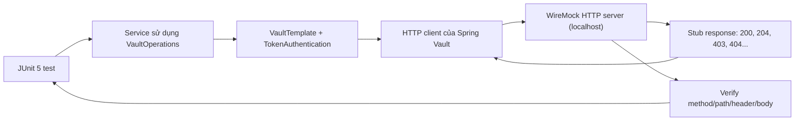

# Giả lập HTTP để kiểm tra đường dẫn, header và nội dung trong Spring Vault

## 1. Tại sao cần kiểm thử HTTP contract của Vault?

Trong module **SPRING_VAULT**, ứng dụng Java dùng `VaultTemplate`/`VaultOperations` để truy cập HashiCorp Vault: xác thực theo workload, đọc KV secrets, quản lý token và lease, gọi Transit encryption, PKI cùng các secrets engine mở rộng. Một đoạn mã chạy đúng ở tầng Java vẫn có thể gọi sai HTTP endpoint do nhầm phiên bản KV, mount, namespace, header hoặc định dạng JSON.

Ví dụ, khi KV engine được mount ở `secret` và chạy **KV v2**, đọc khóa logic `orders/config` bằng REST API phải đi tới:

```http
GET /v1/secret/data/orders/config
X-Vault-Token: <token>
```

Nếu code gửi `GET /v1/secret/orders/config`, request đang dùng cấu trúc của KV v1. Nếu POST tới `transit/encrypt/orders` nhưng gửi plaintext thô thay cho Base64, body cũng sai dù HTTP path đúng. Nếu ứng dụng chạy trong Vault Enterprise namespace, thiếu `X-Vault-Namespace` có thể dẫn đến đọc sai phạm vi hoặc bị từ chối quyền.

Kiểm thử **giả lập HTTP (HTTP mocking/stubbing)** giúp quan sát request thực sự mà Spring Vault phát ra, rồi khẳng định:

- **Method**: GET, POST, DELETE tương ứng với API.
- **Path/query**: có tiền tố `/v1/`, đúng mount, engine và segment (ví dụ `data` của KV v2).
- **Header**: `X-Vault-Token`, `X-Vault-Namespace` khi dùng namespace, `Content-Type` cho JSON; không rò rỉ credential ngoài các header cần thiết.
- **Body**: JSON có đúng field, cấu trúc lồng nhau, kiểu dữ liệu, Base64 và các tham số như `cas`, `context`.
- **Response**: map đúng `data` và metadata, xử lý `204`, `403`, `404`, `5xx`, timeout và lỗi body.

Mục tiêu của bài này là **xác nhận hợp đồng HTTP** tại ranh giới giữa ứng dụng Spring Vault và Vault API. Một mock server có thể xác nhận request được tạo đúng, nhưng không chứng minh rằng Vault thật đã bật mount, ACL hợp lệ hoặc token/lease thực sự hoạt động; những khía cạnh đó cần kiểm thử tích hợp với Vault thật trong môi trường test.

## 2. Sơ đồ và phạm vi kiểm thử



Trong bài thực hành, **chính `VaultTemplate` thật** gửi request qua HTTP client của Spring Vault tới WireMock đang lắng nghe trên một cổng ngẫu nhiên ở `localhost`. Khi test chạy, không cần mở Vault server, không dùng token production và không cần cấp quyền cloud/database thật.

Đây là sự phân tách quan trọng:

| Cách kiểm thử | Có thực sự tạo HTTP request? | Phát hiện được | Không phát hiện đầy đủ |
| --- | --- | --- | --- |
| Mock `VaultOperations` bằng Mockito | Không | Service gọi đúng phương thức/path logic nào | Header, encoding, JSON, HTTP status mapping |
| **WireMock / MockWebServer** | **Có** | Method, URL, header, body, cách Spring Vault giải mã response | Auth backend/ACL/lease semantics của Vault thật |
| `MockRestServiceServer` | Có request qua `RestTemplate` được gắn mock | Contract HTTP nếu test dùng đúng `RestTemplate` của `VaultTemplate` | Transport thực, TLS và backend Vault |
| Vault dev/Testcontainers | Có, gọi Vault thật | Mount, policy, token, KV, Transit, lease, API semantics | Tất cả hành vi của cluster HA/production hoặc cloud thật |

**Lựa chọn trong bài:** dùng WireMock 3 và JUnit 5 vì test kiểm tra toàn bộ đường HTTP mà không cần biết ứng dụng đang dùng `RestTemplate` hay một lớp wrapper service nào. Các thư viện giả lập khác có thể dùng tương đương nếu giữ nguyên mục tiêu kiểm tra request trên dây.

## 3. Những điểm phải xác định trước khi viết stub

### 3.1. Đường dẫn logic và đường dẫn HTTP

`VaultOperations.read(String path)` nhận **đường dẫn logic không có `/v1/`**. Spring Vault ghép tiền tố API version khi gửi tới Vault server.

| Nghiệp vụ | Path truyền cho Spring Vault | HTTP method và path cần verify |
| --- | --- | --- |
| Đọc KV v1 (mount `secret`) | `secret/orders/config` | `GET /v1/secret/orders/config` |
| Đọc KV v2 bằng raw `read` | `secret/data/orders/config` | `GET /v1/secret/data/orders/config` |
| Ghi KV v2 bằng raw `write` | `secret/data/orders/config` | `POST /v1/secret/data/orders/config` |
| Mã hóa Transit | `transit/encrypt/orders` | `POST /v1/transit/encrypt/orders` |
| Rewrap ciphertext | `transit/rewrap/orders` | `POST /v1/transit/rewrap/orders` |
| Đăng nhập AppRole | `auth/approle/login` | `POST /v1/auth/approle/login` |
| Gia hạn lease động | `sys/leases/renew` | `POST /v1/sys/leases/renew` |
| Cấp chứng thư PKI | `pki/issue/orders` | `POST /v1/pki/issue/orders` |

Với API chuyên biệt `opsForKeyValue("secret", KV_2)`, thư viện tự xây đường dẫn KV v2. Với raw `read`/`write`, người gọi phải sử dụng đúng segment `data`/`metadata` tương ứng.

### 3.2. Những header quan trọng

| Header | Khi nào cần | Cần kiểm tra gì |
| --- | --- | --- |
| `X-Vault-Token` | Phần lớn thao tác cần xác thực | Token đang dùng được đặt ở header này; **không** đặt trong query/body |
| `X-Vault-Namespace` | Vault Enterprise/HCP với namespace khác root | Giá trị namespace đúng và đã chuẩn hóa theo cấu hình |
| `Content-Type: application/json` | Request gửi JSON | Media type đúng; có thể có thêm `;charset=UTF-8` |
| `Accept` | Khi client cần định dạng phản hồi nhất định | Header phù hợp hợp đồng; không khẳng định luôn có nếu code không thiết lập |
| `X-Vault-Wrap-TTL` | Khi dùng response wrapping | Chỉ xuất hiện khi caller thực sự yêu cầu wrapping |
| `X-Vault-Request` | Một số health/API use case theo Vault | Kiểm tra nếu ứng dụng chủ động gửi; không tự coi là auth header |

**Ngoại lệ quan trọng:** khi gọi endpoint login như `auth/approle/login` hoặc `auth/kubernetes/login`, client đang xin token nên **không thể bắt buộc đã có `X-Vault-Token` hợp lệ**. Tách test auth HTTP khỏi test các thao tác sử dụng token đã cấp.

Trong test, dùng token giả như `unit-test-token`. WireMock ghi lại request đã nhận để verify, vì thế đừng trỏ nó tới Vault production hoặc dùng token thật, kể cả “chỉ chạy trong CI”.

### 3.3. Body KV v2 và Transit

**KV v2 ghi secret**:

```json
{
  "data": {
    "apiKey": "TEST_ONLY",
    "mode": "sandbox"
  },
  "options": {
    "cas": 4
  }
}
```

`cas` là cơ chế Check-And-Set theo phiên bản của KV v2: server chỉ chấp nhận ghi khi điều kiện CAS hợp lệ. Test phải kiểm tra đây là **số** `4`, không phải chuỗi `"4"`.

**Transit encrypt**:

```json
{
  "plaintext": "c2FtcGxl"
}
```

Giá trị trên là Base64 của bytes UTF-8 của chuỗi `sample`. Vault Transit nhận `plaintext` được Base64-encode; `ciphertext` trả về có dạng `vault:vN:...`. Với derived key có thể thêm `context` cũng là Base64 của **đúng bytes context**; đừng gửi context mới một cách tùy ý khi rewrap.

## 4. Chuẩn bị JUnit 5 và WireMock 3

Dự án Java cần test runner JUnit Jupiter và WireMock 3 (thư viện có JUnit 5 extension), ngoài các dependency Spring Vault mà ứng dụng đang dùng. Nếu dùng Spring Boot, `spring-boot-starter-test` thường đã có JUnit Jupiter; thêm artifact **`org.wiremock:wiremock`** trong test scope với phiên bản 3.x tương thích với BOM hiện tại.

Ví dụ ý tưởng cấu hình Gradle:

```kotlin
dependencies {
    testImplementation("org.springframework.boot:spring-boot-starter-test")
    // Chọn phiên bản WireMock 3.x được dự án phê duyệt.
    testImplementation("org.wiremock:wiremock:3.10.0")
}
```

Đoạn Gradle trên là ví dụ để hiểu dependency, không thay thế việc kiểm tra phiên bản/compatibility đã khóa trong dự án. Với phiên bản WireMock 2, package và cách dùng extension có thể khác. Phần dưới sử dụng WireMock 3.

Trong bài này dùng:

- `@RegisterExtension` với `WireMockExtension` để mở HTTP server ngẫu nhiên cho test.
- `VaultEndpoint` trỏ tới `localhost` và cổng WireMock.
- `TokenAuthentication` với token giả cố định để tập trung kiểm thử HTTP contract.
- `VaultTemplate` thật gửi request tới mock server.

**Chỉ dùng HTTP không TLS trên `localhost` cho test cô lập**. Với môi trường staging/production, Vault phải sử dụng TLS và truststore/certificates phù hợp. HTTP test không thể khẳng định handshake, mTLS hoặc certificate validation hoạt động đúng.

## 5. Ví dụ test hoàn chỉnh: path, token header, KV body và Transit

Ví dụ sau chủ ý dùng **raw `VaultOperations`** để phơi bày rõ path/body ứng dụng gửi. Các trường JSON trong stub là fixture, không phải secret thật. Có thể đặt toàn bộ trong một file Java test.

```java
import static com.github.tomakehurst.wiremock.client.WireMock.*;
import static org.junit.jupiter.api.Assertions.*;

import java.nio.charset.StandardCharsets;
import java.util.Base64;
import java.util.Map;

import com.github.tomakehurst.wiremock.junit5.WireMockExtension;
import org.junit.jupiter.api.BeforeEach;
import org.junit.jupiter.api.Test;
import org.junit.jupiter.api.extension.RegisterExtension;
import org.springframework.vault.VaultException;
import org.springframework.vault.authentication.TokenAuthentication;
import org.springframework.vault.client.VaultEndpoint;
import org.springframework.vault.core.VaultTemplate;
import org.springframework.vault.support.VaultResponse;

import static com.github.tomakehurst.wiremock.core.WireMockConfiguration.wireMockConfig;

class VaultHttpContractTest {

    private static final String TOKEN = "unit-test-token";

    @RegisterExtension
    static WireMockExtension mockVault = WireMockExtension.newInstance()
            .options(wireMockConfig().dynamicPort())
            .build();

    private VaultTemplate vault;

    @BeforeEach
    void createClient() {
        VaultEndpoint endpoint = new VaultEndpoint();
        endpoint.setHost("localhost");
        endpoint.setPort(mockVault.getPort());
        endpoint.setScheme("http");

        // Đây là mock token: không đăng nhập qua mạng và không dùng token thật.
        vault = new VaultTemplate(endpoint, new TokenAuthentication(TOKEN));
    }

    @Test
    void kvV2Read_hasCorrectPathAndAuthHeader() {
        mockVault.stubFor(get(urlEqualTo(
                "/v1/secret/data/orders/config"))
                .withHeader("X-Vault-Token", equalTo(TOKEN))
                .willReturn(okJson("""
                    {
                      "data": {
                        "data": {
                          "mode": "sandbox",
                          "apiKey": "TEST_ONLY"
                        },
                        "metadata": { "version": 4 }
                      }
                    }
                    """)));

        VaultResponse response = vault.read("secret/data/orders/config");

        assertNotNull(response);
        assertNotNull(response.getData());
        assertInstanceOf(Map.class, response.getData().get("data"));

        Map<?, ?> secret = (Map<?, ?>) response.getData().get("data");
        assertEquals("sandbox", secret.get("mode"));

        mockVault.verify(1, getRequestedFor(urlEqualTo(
                "/v1/secret/data/orders/config"))
                .withHeader("X-Vault-Token", equalTo(TOKEN)));

        // Chứng minh code không dùng nhầm route KV v1.
        mockVault.verify(0, getRequestedFor(urlEqualTo(
                "/v1/secret/orders/config")));
    }

    @Test
    void kvV2Write_hasNestedDataAndNumericCas() {
        mockVault.stubFor(post(urlEqualTo(
                "/v1/secret/data/orders/config"))
                .willReturn(okJson("""
                    { "data": { "version": 5 } }
                    """)));

        vault.write("secret/data/orders/config", Map.of(
                "data", Map.of("apiKey", "TEST_ONLY", "mode", "sandbox"),
                "options", Map.of("cas", 4)));

        mockVault.verify(1, postRequestedFor(urlEqualTo(
                "/v1/secret/data/orders/config"))
                .withHeader("X-Vault-Token", equalTo(TOKEN))
                .withHeader("Content-Type", containing("application/json"))
                .withRequestBody(equalToJson("""
                    {
                      "data": {
                        "apiKey": "TEST_ONLY",
                        "mode": "sandbox"
                      },
                      "options": { "cas": 4 }
                    }
                    """)));
    }

    @Test
    void transitEncrypt_base64EncodesPlaintextAndUsesPost() {
        String base64 = Base64.getEncoder().encodeToString(
                "sample".getBytes(StandardCharsets.UTF_8));

        mockVault.stubFor(post(urlEqualTo(
                "/v1/transit/encrypt/orders"))
                .willReturn(okJson("""
                    { "data": { "ciphertext": "vault:v1:FAKE_TEST" } }
                    """)));

        VaultResponse response = vault.write("transit/encrypt/orders",
                Map.of("plaintext", base64));

        assertNotNull(response);
        assertEquals("vault:v1:FAKE_TEST",
                response.getData().get("ciphertext"));

        mockVault.verify(1, postRequestedFor(urlEqualTo(
                "/v1/transit/encrypt/orders"))
                .withHeader("X-Vault-Token", equalTo(TOKEN))
                .withRequestBody(equalToJson("""
                    { "plaintext": "c2FtcGxl" }
                    """)));
    }

    @Test
    void forbiddenRead_throwsInsteadOfReturningMissingSecret() {
        mockVault.stubFor(get(urlEqualTo(
                "/v1/secret/data/orders/config"))
                .willReturn(aResponse()
                        .withStatus(403)
                        .withHeader("Content-Type", "application/json")
                        .withBody("""
                            { "errors": ["permission denied"] }
                            """)));

        assertThrows(VaultException.class,
                () -> vault.read("secret/data/orders/config"));

        mockVault.verify(1, getRequestedFor(urlEqualTo(
                "/v1/secret/data/orders/config")));
    }

    @Test
    void missingOptionalKvSecret_returnsNull() {
        mockVault.stubFor(get(urlEqualTo(
                "/v1/secret/data/orders/optional"))
                .willReturn(aResponse()
                        .withStatus(404)
                        .withHeader("Content-Type", "application/json")
                        .withBody("""
                            { "errors": [] }
                            """)));

        assertNull(vault.read("secret/data/orders/optional"));
    }
}
```

Ví dụ này tập trung vào **HTTP contract**: nếu code đổi `secret/data/orders/config` thành `secret/orders/config`, test sẽ không còn nhận response từ stub đúng và assertion/verification sẽ phát hiện. Tương tự, bỏ `X-Vault-Token` hoặc đổi `cas` thành chuỗi sẽ làm verification thất bại.

**Một số chi tiết tương thích cần kiểm tra khi dùng trong dự án:** Cú pháp text block `"""..."""` cần Java 15+, ví dụ chọn Java 17. Constructor `VaultTemplate`, `VaultEndpoint` và kiểu exception cụ thể phụ thuộc phiên bản Spring Vault/BOM; nếu thư viện thay đổi, cần đối chiếu Javadoc đúng version. Các assertion về `404 → null` áp dụng cho hợp đồng raw `VaultOperations.read` thường dùng; với `readRequired` hoặc API chuyên biệt, kết quả có thể là exception.

### 5.1. Vì sao kiểm tra cả stub matcher và verify sau khi gọi?

Một stub có điều kiện:

```java
mockVault.stubFor(get(urlEqualTo("/v1/secret/data/orders/config"))
        .withHeader("X-Vault-Token", equalTo("unit-test-token"))
        .willReturn(okJson("{\"data\":{}}")));
```

chỉ nói “khi request khớp, trả response”. **Nó không tự bảo đảm request được gửi đúng một lần**. Nếu code không gọi endpoint, hoặc gọi hai lần do retry, stub vẫn hợp lệ. Do đó dùng thêm:

```java
mockVault.verify(1, getRequestedFor(urlEqualTo(
        "/v1/secret/data/orders/config")));
```

Đếm số lần gọi rất hữu ích với endpoint **cấp token, PKI certificate, dynamic database credentials**: retry dư có thể tạo nhiều tài nguyên/lease ngoài dự kiến. Đối với request chứa bí mật, tránh in toàn bộ ServeEvents/unmatched requests trong log CI; WireMock mặc định có thể giữ request body và header trong bộ nhớ test.

### 5.2. Vì sao dùng `equalToJson`?

`equalToJson` kiểm tra JSON theo cấu trúc, không phụ thuộc thứ tự field trong `Map` Java. Ví dụ:

```json
{"data":{"mode":"sandbox","apiKey":"TEST_ONLY"}}
```

và:

```json
{"data":{"apiKey":"TEST_ONLY","mode":"sandbox"}}
```

là cùng một object JSON về mặt ngữ nghĩa. Dùng `equalTo` trên chuỗi raw JSON sẽ tạo false negative khi thứ tự field/whitespace khác.

**Lưu ý:** các tham số tùy chọn của `equalToJson` có thể cho phép bỏ qua field dư hoặc không kiểm tra thứ tự mảng. Với contract quan trọng, dùng **so sánh cấu trúc nghiêm ngặt** như trong ví dụ và thêm assertion cụ thể cho header/query. Đừng chỉ tìm chuỗi `"apiKey"` trong body: bạn có thể bỏ sót việc key nằm sai tầng JSON.

## 6. Kiểm tra header namespace, mount tùy chỉnh và URL encoding

### 6.1. Vault Enterprise namespace

Với Vault Enterprise/HCP, một namespace có thể được truyền qua header `X-Vault-Namespace`. Ví dụ kiểm tra server **chỉ chấp nhận namespace mong đợi**:

```java
mockVault.stubFor(get(urlEqualTo("/v1/secret/data/orders/config"))
        .withHeader("X-Vault-Namespace", equalTo("team-a/"))
        .withHeader("X-Vault-Token", equalTo("unit-test-token"))
        .willReturn(okJson("{\"data\":{\"data\":{\"mode\":\"sandbox\"}}}")));
```

Muốn test này PASS, cần **cấu hình namespace thật cho client Spring Vault trong test**, tương ứng với đường cấu hình ứng dụng production (ví dụ Vault endpoint provider hoặc request interceptor hỗ trợ namespace ở version đang dùng). Đừng tự thêm header bằng code test nhưng quên cấu hình ứng dụng đang kiểm thử. Cũng không giả định mọi hệ thống đều cần namespace header: namespace root thường không yêu cầu nó.

Trong ứng dụng có nhiều tenant, **namespace không phải tên tenant do người gọi tùy ý đưa vào**. Namespace phải được ràng buộc với danh tính workload/tenant đã được xác thực; kiểm thử cả tình huống cấu hình sai namespace không “fallback” sang một namespace khác.

### 6.2. Mount tùy chỉnh

Nếu Transit được mount dưới `cryptography`, endpoint mong đợi là:

```text
POST /v1/cryptography/encrypt/orders
```

Stub phải verify đúng mount như cấu hình; không tự suy ra lúc nào cũng là `transit`. Tương tự KV có thể mount ở `config` thay vì `secret`, và PKI có thể mount ở `pki-int`.

### 6.3. Query và encoding

Với những API có query như `?version=3` của KV v2, tách kiểm tra path và query:

```java
mockVault.stubFor(get(urlPathEqualTo(
        "/v1/secret/data/orders/config"))
        .withQueryParam("version", equalTo("3"))
        .willReturn(okJson("{\"data\":{\"data\":{\"mode\":\"sandbox\"}}}")));
```

`urlPathEqualTo` không bao gồm query string; dùng `withQueryParam` để kiểm tra từng tham số. Với path chứa dấu cách, dấu `/` trong segment hoặc Unicode, phải phân biệt **đường dẫn dữ liệu logic** với URL encoding trên wire. Không nối dữ liệu từ người dùng vào URL mà không validate hoặc encode; test nên bao gồm ký tự đặc biệt do ứng dụng thực sự hỗ trợ.

## 7. Mô phỏng lỗi HTTP một cách có chủ đích

Một HTTP stub tốt không chỉ trả `200`. Nó mô phỏng những đường trả lời mà service cần xử lý rõ ràng:

| Trạng thái | Body mock | Kỳ vọng ở ứng dụng |
| --- | --- | --- |
| `200 OK` | JSON `data` hợp lệ | Parse đúng cấu trúc và không lộ secret ra log |
| `204 No Content` | Body rỗng | Được chấp nhận nếu endpoint thành công không trả body |
| `400 Bad Request` | `{"errors":["invalid request"]}` | Không retry cùng payload vô hạn |
| `403 Forbidden` | `{"errors":["permission denied"]}` | Phân loại quyền/token, không coi là “secret thiếu” |
| `404 Not Found` | `{"errors":[]}` | Diễn giải theo API; raw read có thể trả `null` |
| `429 Too Many Requests` | JSON lỗi | Backoff/rate-limit; đừng gọi lặp không kiểm soát |
| `500/503` | JSON hoặc body khác | Thử lại có giới hạn **chỉ khi thao tác an toàn** |
| Timeout | Server trì hoãn hoặc cắt kết nối | Có thể không có HTTP status; xử lý lỗi transport |
| JSON thiếu field | `data` bị sai schema | Báo lỗi contract/invalid response |

Ví dụ stub cho `503`:

```java
mockVault.stubFor(get(urlEqualTo("/v1/secret/data/orders/config"))
        .willReturn(aResponse()
                .withStatus(503)
                .withHeader("Content-Type", "application/json")
                .withBody("{\"errors\":[\"vault temporarily unavailable\"]}")));
```

Sau đó test service của bạn **có ném lỗi phụ thuộc rõ ràng**, không rơi vào nhánh trả `Optional.empty()` hoặc đặt secret mặc định giả. Nếu có retry policy, xác minh số lần gọi bị giới hạn bằng `verify(n, ...)`, thời gian retry không vượt deadline và có alert khi thất bại kéo dài.

Đối với timeout, WireMock hỗ trợ `withFixedDelay(...)` để trì hoãn phản hồi hoặc các failure simulator phù hợp. Cần cấu hình **timeout của HTTP client đang được VaultTemplate sử dụng** nhỏ hơn delay và assert loại lỗi/cause chain thực tế. Không test timeout bằng `Thread.sleep()` trong business service rồi gọi đó là lỗi HTTP.

### 7.1. Kiểm thử idempotency khi retry

**HTTP method không đủ để quyết định có thể retry.** Ví dụ `GET database/creds/{role}` có thể **tạo credential và lease mới**, dù là GET. `POST pki/issue/{role}` có thể cấp thêm chứng thư mới. Nếu response thất lạc sau khi Vault đã xử lý, retry mù tạo tài nguyên dư.

Vì vậy nên đặt các assertion:

- Với GET KV thuần đọc, retry `503` tối đa số lần cấu hình là hợp lý.
- Với GET dynamic credentials, kiểm tra **không tự động lặp cấp phát** khi chưa có chiến lược đối chiếu/cleanup.
- Với Transit encrypt, mỗi lần mã hóa có thể cho ciphertext khác do ngẫu nhiên; mock chỉ kiểm tra request contract, không giả định ciphertext lặp lại phải giống nhau.
- Với KV v2 có CAS, test body `options.cas` đúng và ứng dụng xử lý xung đột version thay vì ghi đè tùy tiện.

WireMock hỗ trợ **scenario state** để lần đầu trả lỗi rồi lần kế tiếp trả thành công. Cơ chế này hữu ích khi test retry, nhưng vẫn cần kiểm tra số lần gọi và kết quả nghiệp vụ, không chỉ khẳng định cuối cùng nhận được `200`.

## 8. Kiểm thử header xác thực theo workload

Ở ví dụ phần 5, `TokenAuthentication` cho phép tập trung vào request dùng token, không mô phỏng quá trình đăng nhập. Trong hệ thống thật, ứng dụng có thể xác thực Vault qua Kubernetes auth, AppRole, JWT hoặc cloud auth.

**Muốn kiểm tra đường đăng nhập**, thay token giả cố định bằng loại `ClientAuthentication` đang dùng và stub đúng endpoint, ví dụ:

```http
POST /v1/auth/approle/login
Content-Type: application/json

{
  "role_id": "test-role-id",
  "secret_id": "test-secret-id"
}
```

Stub cần trả response `auth` chứa `client_token`, `lease_duration`, `renewable` và thông tin policy cần thiết cho session manager. Sau đó kiểm tra **request nghiệp vụ tiếp theo** có `X-Vault-Token` bằng client token mock vừa phát, và phiên session không điền nhầm `role_id`/`secret_id` vào header.

Ví dụ cấu trúc phản hồi login minh họa:

```json
{
  "auth": {
    "client_token": "unit-test-issued-token",
    "accessor": "unit-test-accessor",
    "policies": ["orders-reader"],
    "token_policies": ["orders-reader"],
    "lease_duration": 600,
    "renewable": true
  }
}
```

Giá trị trong test phải là fixture. Với Kubernetes login, payload thường chứa `role` và `jwt`; cần đảm bảo JWT fixture không phải service account token thật của cluster CI. Không assert cứng số request login nếu session manager có cơ chế lookup/renew/re-login; hãy tách test khởi tạo và test lifecycle token theo mục tiêu cụ thể.

Đối với các endpoint trả token/secret, **không in nguyên HTTP request/response** nếu logger tích hợp WireMock, RestTemplate debug logging hoặc CI failure reporter có thể thu thập body chứa credential. Có thể verify field tồn tại bằng matcher và dùng dữ liệu giả, đồng thời lọc log trước khi upload artifact kiểm thử.

## 9. Các lỗi phổ biến khi viết test HTTP mock

| Triệu chứng | Nguyên nhân có thể | Cách xử lý |
| --- | --- | --- |
| Stub không match và WireMock trả 404 | Sai tiền tố `/v1`, mount, path, method hoặc query | Dùng `urlPathEqualTo` và kiểm tra đúng path mong đợi |
| Test dùng `withHeader("Content-Type", equalTo("application/json"))` thất bại | Client gửi thêm `;charset=UTF-8` | Dùng matcher media type như `containing("application/json")` |
| KV v2 đọc được response nhưng thiếu secret | JSON bị thiếu một tầng `data` | Stub đúng envelope: `data.data` là map KV |
| Test body JSON thỉnh thoảng fail | So sánh raw string phụ thuộc thứ tự `Map` | Dùng `equalToJson` hoặc JSONPath |
| Test dùng token thật để xác minh auth header | CI/log có thể ghi token | Dùng literal giả, xoá/redact request journal khi cần |
| Timeout test treo lâu | Chưa đặt timeout trên client, stub delay quá lớn | Cấu hình connect/read timeout hữu hạn trong test |
| Spring Boot test gọi Vault thật | URL mock chưa được inject trước khi tạo bean | Kiểm tra endpoint property và thời điểm khởi tạo context |
| Test thành công dù request gọi hai lần | Chỉ định nghĩa stub, không verify số lượt | Thêm `verify(1, ...)` hoặc số lần mong đợi |
| Test mock `VaultOperations` nên không phát hiện sai header | Không có HTTP transport thật | Dùng mock HTTP server với `VaultTemplate` thực |
| Test chạy độc lập PASS, chạy cả suite FAIL | Stub/request journal/state tồn dư giữa test | Reset server giữa test, dùng port ngẫu nhiên và fixture riêng |
| Test nhận HTTP 403 nhưng code coi là missing | Logic bắt exception quá rộng | Phân biệt lỗi quyền với `read() == null` |
| Mock PASS nhưng staging Vault FAIL | Mock bỏ qua chính sách/engine semantics | Bổ sung integration test chạy Vault thật |

### Mẹo tránh test sai phạm vi

**Đừng làm yếu matcher chỉ để test pass.** Ví dụ đổi từ `urlEqualTo("/v1/secret/data/orders/config")` sang `urlMatching(".*orders.*")` có thể che mất lỗi mount/KV version mà test đang được thiết kế để tìm ra. Nếu field thực sự tùy chọn, chỉ nới matcher cho field đó và nêu rõ lý do.

Ngược lại, đừng viết test buộc client gửi một header **không nằm trong hợp đồng**, hoặc kiểm tra thứ tự JSON object tùy ý. Mục tiêu là ràng buộc nghiệp vụ và an toàn, không khóa cứng chi tiết triển khai không có ý nghĩa.

## 10. Tách lớp test và bảo vệ test fixture

Một bộ test Spring Vault đáng tin cậy thường có ba lớp:

1. **Unit test service:** mock `VaultOperations` khi cần kiểm tra logic lựa chọn path/domain, không kiểm tra wire format.
2. **HTTP contract test:** WireMock/MockWebServer để kiểm tra method/path/header/body, response parsing và mapping lỗi mà không cần Vault thật.
3. **Integration test:** Vault dev hoặc Testcontainers để kiểm tra auth methods, ACL, mount KV v1/v2, Transit keys, token/lease lifecycle và PKI end-to-end.

Nên đặt dữ liệu test dưới dạng fixture giả: `unit-test-token`, `TEST_ONLY`, `vault:v1:FAKE_TEST`. Không dùng bản sao secret production hoặc certificate private key thật. Có thể thêm một kiểm thử “không rò rỉ” bằng cách xem log/test report không chứa `unit-test-token` hay private key fixture, nhưng phải kiểm tra cách test runner xuất WireMock journal khi assertion lỗi.

### Ma trận contract tối thiểu cần bao phủ

| Tình huống | Method + path | Header/body | Điều phải xác nhận |
| --- | --- | --- | --- |
| Đọc KV v2 | `GET /v1/secret/data/orders/config` | `X-Vault-Token` | Trả map `data.data`, không gọi KV v1 |
| Ghi KV v2 | `POST /v1/secret/data/orders/config` | `data`, `options.cas` là number | Không ghi sai envelope hoặc thiếu CAS |
| Encrypt Transit | `POST /v1/transit/encrypt/orders` | `plaintext` Base64 | Nhận `data.ciphertext`, không gửi plaintext thô |
| Rewrap Transit | `POST /v1/transit/rewrap/orders` | `ciphertext=vault:vN:...`, `context` khi cần | Không đổi prefix ciphertext bằng tay |
| AppRole login | `POST /v1/auth/approle/login` | `role_id`, `secret_id` trong body fixture | Lấy token từ `auth.client_token` |
| Token API revoke | `POST /v1/auth/token/revoke` | `token` đích, header caller | Gọi một lần, không log token |
| Renew lease | `POST /v1/sys/leases/renew` | `lease_id`, `increment` khi có | Xử lý TTL/renewable theo response |
| PKI issue | `POST /v1/pki/issue/orders` | `common_name`, `ttl` | Nhận certificate/private key fixture; không retry mù |
| Permission denied | `403` từ endpoint nghiệp vụ | Body `errors` | Không diễn giải thành secret tùy chọn |
| Không tồn tại | `404` | JSON lỗi giả | Diễn giải theo API được gọi |
| Mạng lỗi/timeout | Delay hoặc kết nối ngắt | Không có HTTP status xác thực | Phân loại transport, retry theo tính chất thao tác |

## 11. Các tiêu chí hoàn thành và bài tập thực hành

Để hoàn thành bài, hãy chọn một service sử dụng `VaultOperations`, viết ít nhất ba HTTP contract tests:

1. **Đường đọc KV v2:** server chỉ stub `GET /v1/secret/data/orders/config` có token header đúng; assert map nhận được đúng và không có lượt gọi KV v1.
2. **Đường ghi KV v2:** verify `POST`, `Content-Type` có `application/json`, `options.cas` là số, `data.apiKey` nằm đúng tầng.
3. **Đường lỗi:** stub `403` và `404` cho cùng một read path trong hai test độc lập; assert tầng ứng dụng phân biệt **ACCESS_DENIED** với **NOT_FOUND**, không trả kết quả thành công giả.

Bài nâng cao: chuyển test `TokenAuthentication` sang AppRole mock login; kiểm tra request đầu gửi `role_id`/`secret_id`, request thứ hai dùng token trong response, rồi mô phỏng token hết hạn và bắt re-login theo cơ chế session manager đang dùng. Nếu cần test quyền thực sự, tiếp tục chạy integration test với Vault test và policy thật.

Khi review một test, trả lời bốn câu: **server stub gì; client thực sự gửi gì; test verify điều gì; điều gì vẫn cần Vault thật để xác minh?** Nếu không trả lời được cả bốn, test có thể PASS nhưng chưa bảo vệ được contract cần thiết.

## 12. Tài liệu tham khảo

- [Spring Vault — VaultTemplate and VaultOperations](https://docs.spring.io/spring-vault/reference/vault/vault-template.html): các phương thức `read`/`write`, đường dẫn và xử lý phản hồi.
- [Spring Vault — Vault Client Access](https://docs.spring.io/spring-vault/reference/vault/vault-client.html): cấu hình `VaultEndpoint`, HTTP transport, authentication và TLS.
- [Spring Vault — Key Value Secrets](https://docs.spring.io/spring-vault/reference/vault/vault-secret-engines.html): thao tác KV v1/v2 và các API tương ứng.
- [HashiCorp Vault — HTTP API](https://developer.hashicorp.com/vault/api-docs): tiền tố `/v1/`, response envelope và error semantics.
- [HashiCorp Vault — KV v2 API](https://developer.hashicorp.com/vault/api-docs/secret/kv/kv-v2): path `data`, `metadata`, `options.cas`.
- [HashiCorp Vault — Transit API](https://developer.hashicorp.com/vault/api-docs/secret/transit): body `plaintext`, `ciphertext`, `context`.
- [WireMock — JUnit Jupiter](https://wiremock.org/docs/junit-jupiter/): `WireMockExtension`, port ngẫu nhiên và lifecycle test.
- [WireMock — Request Matching](https://wiremock.org/docs/request-matching/): kiểm tra URL/path/query/header và `equalToJson`.
- [WireMock — Verifying Requests](https://wiremock.org/docs/verifying/): `verify(n, ...)` và request journal.
- [Testcontainers — Vault Module](https://java.testcontainers.org/modules/vault/): kiểm thử tích hợp với Vault thật khi cần xác minh policy và engine.

**Ghi nhớ:** Giả lập HTTP trong Spring Vault có giá trị nhất khi test **đúng method, đúng `/v1/` và mount, đúng header, đúng JSON/body encoding**, sau đó verify số lần request và các phản hồi lỗi. Hãy dùng WireMock để bắt lỗi ở ranh giới HTTP, rồi dùng Vault test thật để xác minh xác thực, policy, token/lease và semantics của secrets engine.
