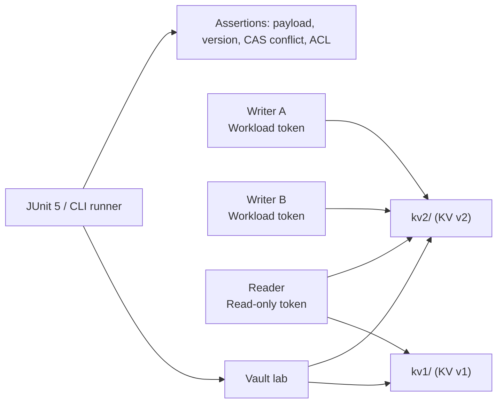
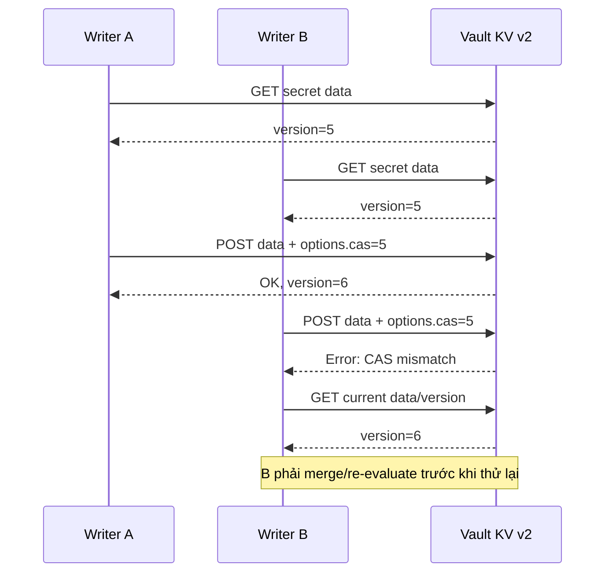
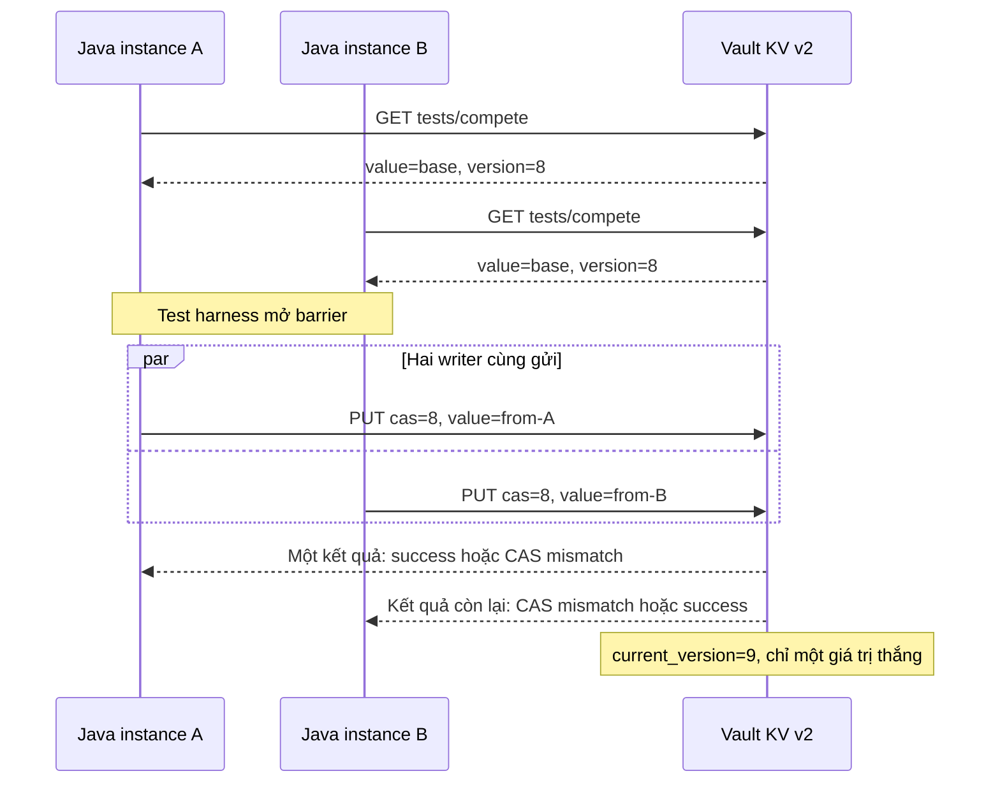

# Kiểm tra KV v1, KV v2 và cập nhật CAS trong Spring Vault

> **Chương:** Kiểm thử  
> **Chủ đề:** Kiểm tra KV v1, KV v2 và cập nhật CAS  
> **Bối cảnh:** Module **SPRING_VAULT** hướng dẫn ứng dụng Java truy cập HashiCorp Vault bằng `VaultTemplate`, xác thực theo workload, quản lý token/lease, KV secrets, Transit, PKI và kiểm thử tích hợp. Bài này đi sâu vào **kiểm thử hành vi Key/Value secrets engine** và **Compare-and-Set (CAS)** để tránh ghi đè thay đổi của một tác nhân khác.

Các ví dụ sử dụng **Vault lab/test riêng**, dữ liệu giả và hai mount minh họa: `kv1/` cho KV version 1, `kv2/` cho KV version 2. Các đường dẫn trong bài **không** phải tên mount mặc định ở mọi hệ thống.

## 1. Mục tiêu và kết quả cần chứng minh

Sau bài học, bạn có thể:

1. Phân biệt schema, đường dẫn HTTP, hành vi ghi đè và khả năng versioning giữa KV v1 và KV v2.
2. Kiểm thử đọc/ghi của `VaultTemplate` qua `VaultKeyValueOperations` và `VaultVersionedKeyValueOperations`, thay vì vô tình trộn API của hai engine.
3. Giải thích quy tắc CAS: `cas=0` khi tạo secret chưa tồn tại, `cas=N` khi phiên bản hiện hành đúng bằng N, và lỗi khi phiên bản đã thay đổi.
4. Xây dựng test **hai writer đọc cùng version rồi cạnh tranh ghi**; xác nhận chỉ một cập nhật CAS có thể thành công.
5. Kiểm thử bật `cas_required`, thao tác ghi không CAS bị từ chối, và không coi xóa mềm là xóa metadata/version.
6. Phân biệt KV v2 `put`, `patch`, `delete`, `undelete`, `destroy` trong kịch bản hồi phục/cập nhật.
7. Áp dụng ACL đúng path, tách workload và test operator; giữ token/secret ngoài log và CI artifacts.

**Định nghĩa PASS:** test phải xác minh trạng thái **sau** thao tác bằng một lần đọc mới, đồng thời kiểm tra trường hợp thất bại không tạo version không mong muốn. Chỉ kiểm tra HTTP response thành công là chưa đủ để kết luận dữ liệu đúng.

## 2. KV v1 và KV v2 khác nhau ở đâu?

| Tiêu chí | KV v1 | KV v2 |
| --- | --- | --- |
| Lưu secret | Một giá trị hiện hành cho mỗi path | Nhiều version cho mỗi secret path |
| Ghi `put` nhiều lần | Ghi sau thay toàn bộ bản cũ | Mỗi lần thành công tạo version mới, cũng thay **toàn bộ payload** của version mới |
| Đọc HTTP | `GET /v1/kv1/<path>` | `GET /v1/kv2/data/<path>` |
| Ghi HTTP | `POST /v1/kv1/<path>` | `POST /v1/kv2/data/<path>` |
| Response dữ liệu | `data` là map secret trực tiếp | `data.data` là map secret, `data.metadata` chứa version và trạng thái |
| Version/CAS | Không hỗ trợ CAS/version native | `options.cas` và `metadata.version` |
| Liệt kê | `LIST /v1/kv1/<folder>` | `LIST /v1/kv2/metadata/<folder>` |
| Xóa | `DELETE /v1/kv1/<path>` xóa giá trị v1 | Xóa mềm version hiện hành; có API undelete/destroy riêng |
| Metadata key | Không có cấu trúc version metadata như KV v2 | `kv2/metadata/<path>`, `current_version`, `cas_required`, `max_versions` |
| Điều kiện phù hợp | Secret đơn giản không cần lịch sử/optimistic concurrency | Secret cần audit version, rollback có kiểm soát và CAS |

**Quan trọng:** `vault kv get -mount=kv2 app/feature` tự biết engine là KV v2 và chuyển sang API path `kv2/data/app/feature`. Nhưng `VaultTemplate.read("kv2/app/feature")` là **raw HTTP path**: sẽ sai vì thiếu `/data/`. Khi code dùng `opsForVersionedKeyValue("kv2")`, Spring Vault tự xử lý tiền tố path cho API.

**Ghi đè:** Với cả hai engine, `put` không merge từng field. Nếu v1/v2 hiện có `{username: "reader", password: "old"}` rồi put `{password: "new"}`, version mới chỉ có `password`; `username` không được giữ lại. Trong KV v2, nếu muốn cập nhật **một phần** cần dùng `PATCH` với JSON merge patch và các điều kiện CAS phù hợp.

### 2.1. KV không đồng nghĩa dynamic secret có lease

KV lưu giá trị do người dùng/pipeline ghi. Nó không tự cấp database user mới như `database/creds/<role>` và thường **không có lease động để renew/revoke**. Một field tên `ttl` do ứng dụng ghi vào KV v1/v2 không khiến Vault tự cấp lease cho từng bản ghi. Khi kiểm thử thời gian làm mới KV, dùng version/polling/trigger phù hợp; không thiết kế test `vault lease renew` cho KV.

## 3. Kiến trúc test và phạm vi dữ liệu



Sử dụng **tên path riêng cho mỗi test** để tránh phụ thuộc thứ tự chạy hoặc dữ liệu lưu từ test trước. Ví dụ `tests/<test-id>/profile`; với test song song, thêm ID duy nhất từ test harness, không lưu username/token thật trong path. Không dùng key production để thử CAS thất bại.

Các lớp kiểm thử cần tách:

- **Unit test:** mô phỏng hành vi ứng dụng khi cập nhật map, xử lý lỗi CAS, không gọi Vault thật; chạy nhanh nhưng không chứng minh ACL/version enforcement.
- **Integration test:** Vault thật trong container/lab; xác minh API v1/v2, metadata và CAS bằng request thực.
- **Concurrency test:** hai client được cấp token/phiên riêng, đọc cùng version, cùng cố ghi; xác minh chính xác một writer thắng.
- **Security test:** token có `read` không ghi được, token write không quản trị metadata/mount; không dùng root token để xác nhận ACL.
- **Resilience test:** mạng/Vault chập chờn giữa đọc version và ghi; không retry mù CAS đã thất bại.

## 4. Chuẩn bị hai mount trong môi trường lab

Giả định đã có Vault dev/test server và operator test có quyền tạo secrets engine. **Đừng chạy lệnh bật engine trên production** khi chưa được phê duyệt. Nếu `kv1/` hoặc `kv2/` tồn tại thì dùng mount test riêng, không bật lại một mount đang hoạt động.

```bash
# Dành cho operator của Vault test instance:
vault secrets enable -path=kv1 -version=1 kv
vault secrets enable -path=kv2 -version=2 kv

# Xác minh hai mount và options.version tương ứng:
vault secrets list -detailed
```

Khởi tạo dữ liệu giả:

```bash
# KV v1:
vault kv put -mount=kv1 tests/sample state=one owner=test
vault kv get -mount=kv1 tests/sample

# KV v2:
vault kv put -mount=kv2 tests/sample state=one owner=test
vault kv get -mount=kv2 tests/sample

# Lấy metadata version riêng của KV v2:
vault kv metadata get -mount=kv2 tests/sample
```

Kỳ vọng: ở KV v1 đọc được `state` và `owner` không kèm version; ở KV v2 có version khởi đầu `1`, và `kv metadata get` có `current_version`. CLI in dữ liệu theo bảng, trong khi HTTP API của KV v2 bọc hai lớp `data.data`/`data.metadata`.

**Lưu ý:** CLI `vault kv put` chuyển giá trị dòng lệnh thành chuỗi. Khi cần giá trị Boolean/số/object chính xác để test schema, dùng JSON API hoặc file JSON với quy trình không làm lộ dữ liệu bí mật.

## 5. ACL chính xác cho KV v1 và KV v2

Vault ACL đánh giá **API path thực**, không dựa trên tên gợi nhớ trong `vault kv` CLI.

### 5.1. Reader chỉ có quyền đọc

```hcl
# KV v1:
path "kv1/tests/*" {
  capabilities = ["read"]
}

# KV v2: data path là nơi đọc secret:
path "kv2/data/tests/*" {
  capabilities = ["read"]
}

# Chỉ khi cần liệt kê metadata theo thư mục:
path "kv2/metadata/tests/*" {
  capabilities = ["list"]
}
```

Một reader có `read` trên `kv2/data/tests/...` chưa chắc được `vault kv metadata get`, vì API metadata riêng cần capability `read` trên `kv2/metadata/...`. Tương tự, `list` không tự trao quyền đọc nội dung.

### 5.2. Writer chỉ ghi dữ liệu trong không gian test

```hcl
path "kv1/tests/*" {
  capabilities = ["create", "update"]
}

path "kv2/data/tests/*" {
  capabilities = ["create", "update", "read"]
}
```

Writer ở KV v2 cần `read` để lấy version hiện hành nếu thiết kế **read → CAS write**. Không cấp quyền `update`/`delete` trên `kv2/metadata/*` cho writer vì có thể tác động cấu hình version/cas của key.

**Phân biệt quyền:**
- `create` cho secret chưa tồn tại, `update` cho secret đã tồn tại; KV v2 CAS vẫn kiểm tra điều kiện version **ngoài** ACL.
- `cas_required=true` không thay thế Vault ACL: người không có quyền tạo/ghi không thể lách bằng một số CAS đúng.
- Trong lab có thể dùng root token để **provision** mount/policy, nhưng test phân quyền phải chạy bằng token workload riêng từ AppRole/Kubernetes Auth hoặc token thử nghiệm được cấp policy tương đương.

## 6. Quy tắc CAS: so phiên bản trước khi ghi

CAS (*Check-and-Set*) là cơ chế **optimistic concurrency control** của KV v2. Client ghi kèm `options.cas` trong **cùng một request ghi**. Vault sẽ so CAS với **current version** tại thời điểm xử lý để quyết định chấp nhận hay từ chối.



| Yêu cầu | Khi được chấp nhận? | Kết quả test |
| --- | --- | --- |
| Ghi `cas=0` vào path **chưa từng tồn tại** | Không có current version | Tạo version 1 |
| Ghi `cas=0` lần hai | Path đã có version | Bị từ chối; version không tăng |
| Đọc version `N`, ghi với `cas=N` | Current version vẫn `N` | Tạo version `N+1` |
| Ghi với `cas=N-1` khi current `N` | Version đã thay đổi | Bị từ chối; dữ liệu mới vẫn giữ nguyên |
| Ghi **không có** CAS khi `cas_required=false` | Nếu ACL hợp lệ | Có thể tạo version mới và ghi đè thay đổi người khác |
| Ghi **không có** CAS khi `cas_required=true` | Không có `options.cas` | Bị từ chối |
| Ghi `cas=0` vào path chỉ mới **soft delete** | Metadata/current version vẫn còn | Bị từ chối; muốn khôi phục phải dùng version thực |
| `PATCH` với `cas=0` | PATCH đòi key tồn tại | Bị từ chối; CAS cho PATCH phải lớn hơn 0 |

Đối với path đã **soft delete**, metadata và current version vẫn tồn tại, nên `cas=0` không phải lệnh “tạo lại” hợp lệ. Phải chọn `cas` khớp current version để ghi version mới, hoặc sử dụng API undelete với version còn khôi phục được.

CAS **không** tự xử lý merge conflict, kiểm tra cấu trúc JSON, phân quyền tenant hay rollback dữ liệu nghiệp vụ. Nó chỉ ngăn tác nhân dựa trên phiên bản cũ ghi đè phiên bản mới.

### 6.1. CAS và các tùy chọn metadata

`cas_required` có thể được cấu hình ở cấp mount KV v2 hoặc từng path. Khi bật, mọi write tại phạm vi tương ứng phải khai báo CAS. Những tùy chọn khác có ý nghĩa riêng:

- `max_versions` giới hạn số phiên bản còn được giữ; phiên bản cũ vượt giới hạn có thể bị hủy vĩnh viễn.
- `delete_version_after` thiết lập thời điểm soft-delete cho version mới theo cấu hình.
- `current_version` phản ánh phiên bản hiện hành, **kể cả khi version hiện hành đã soft delete**.
- `custom_metadata` là metadata mô tả, không phải nơi chứa secret data.
- `destroy` vĩnh viễn loại bỏ key material của **version được chọn**, khác với soft delete/undelete.

Đặt các giá trị này bằng policy/quy trình quản trị. Một bài test CAS không nên vô tình thay đổi cấu hình toàn mount đang dùng cho nhiều ứng dụng.

## 7. CLI lab: kiểm tra KV v1, KV v2 và CAS theo từng bước

### 7.1. KV v1: ghi đè toàn bộ, không có version

```bash
# Bài test dùng path riêng:
vault kv put -mount=kv1 tests/v1 state=first owner=worker-a
vault kv get -mount=kv1 tests/v1

# Ghi lần hai chỉ có một field:
vault kv put -mount=kv1 tests/v1 state=second
vault kv get -mount=kv1 tests/v1
```

**Kỳ vọng:** giá trị `state=second`, không còn field `owner`; không có `current_version`. KV v1 không có `options.cas`, không thể dùng version để chống writer khác ghi đè.

### 7.2. KV v2: tạo mới bằng CAS=0

```bash
vault kv put -cas=0 -mount=kv2 tests/cas state=v1 owner=worker-a
vault kv get -mount=kv2 tests/cas

# Cùng request tạo lần hai phải thất bại vì path đã có version:
vault kv put -cas=0 -mount=kv2 tests/cas state=wrong
vault kv get -mount=kv2 tests/cas
```

**Kỳ vọng:** lệnh đầu tạo version 1; lệnh thứ hai báo **check-and-set mismatch** và `state` vẫn là `v1`, current version vẫn 1. CLI trả mã thoát khác 0; test script không nên bỏ qua exit code.

### 7.3. Cập nhật với CAS đúng và sai

```bash
# Sau khi tạo tests/cas version 1:
vault kv put -cas=1 -mount=kv2 tests/cas state=v2 owner=worker-a
vault kv get -mount=kv2 tests/cas

# CAS cũ, không được ghi lên version 2:
vault kv put -cas=1 -mount=kv2 tests/cas state=stale-write

# Đọc để xác nhận version 2 không thay đổi:
vault kv get -mount=kv2 tests/cas

# Cập nhật hợp lệ sau khi quan sát current_version=2:
vault kv put -cas=2 -mount=kv2 tests/cas state=v3 owner=worker-b
vault kv metadata get -mount=kv2 tests/cas
```

Lệnh cuối thành công tạo version 3. Đừng hardcode `cas=1` hoặc `cas=2` trong mã sản xuất: ứng dụng phải lấy phiên bản **thực tế** bằng một read nhất quán rồi ghi CAS tương ứng.

### 7.4. Bắt buộc CAS trên một key

```bash
# Operator lab dùng path riêng; yêu cầu CAS cho key này:
vault kv metadata put -mount=kv2 -cas-required tests/cas

# Không có -cas => phải bị từ chối:
vault kv put -mount=kv2 tests/cas state=unguarded

# Có CAS đúng current_version=3 => được:
vault kv put -cas=3 -mount=kv2 tests/cas state=v4
vault kv get -mount=kv2 tests/cas
```

Kỳ vọng secret mới có version 4; lệnh không `-cas` không tạo thêm version. `vault kv metadata put` yêu cầu quyền quản trị metadata, **không** phải thao tác mà writer nghiệp vụ được cấp mặc định.

### 7.5. Đọc lại version cũ để kiểm thử lịch sử

```bash
# Dữ liệu giả của bài lab đã có version 1..4:
vault kv get -version=1 -mount=kv2 tests/cas
vault kv get -version=4 -mount=kv2 tests/cas
vault kv metadata get -mount=kv2 tests/cas
```

V1 vẫn đọc được nếu chưa bị xóa/hủy bởi policy giữ phiên bản; V4 là bản hiện hành. Đọc một version cũ **không** đặt nó thành version hiện hành. Nếu muốn phục hồi nội dung cũ như latest, quy trình rollback tạo **version mới** và cần bảo vệ bằng CAS khi có writer khác.
## 8. Kiểm tra API JSON ở mức thấp để hiểu CAS

Khi dùng Spring Vault qua `VaultTemplate.write(...)`, client phải gửi JSON giống Vault HTTP API. Ví dụ dưới dùng `kv2/data/tests/cas`, giả định version hiện hành = 4 sau phần CLI.

```http
POST /v1/kv2/data/tests/cas HTTP/1.1
Content-Type: application/json
X-Vault-Token: <test-workload-token>

{
  "options": {
    "cas": 4
  },
  "data": {
    "state": "v5",
    "owner": "writer-a"
  }
}
```

Nếu CAS đúng, phản hồi thường có `data.version=5` cùng thời điểm tạo. Nếu current version đã vượt 4, Vault trả lỗi CAS; thao tác thất bại **không tăng** version, không thay `state`.

Đọc lại:

```http
GET /v1/kv2/data/tests/cas HTTP/1.1
X-Vault-Token: <test-workload-token>
```

Một phần response minh họa:

```json
{
  "data": {
    "data": {
      "state": "v5",
      "owner": "writer-a"
    },
    "metadata": {
      "version": 5,
      "deletion_time": "",
      "destroyed": false
    }
  }
}
```

Đối với KV v1, POST payload **không** bọc trong `"data"` và `"options"`:

```http
POST /v1/kv1/tests/basic HTTP/1.1
Content-Type: application/json
X-Vault-Token: <test-workload-token>

{
  "state": "present",
  "owner": "reader"
}
```

So sánh:

```text
KV v1 request body:            {"state":"present"}
KV v2 request body:            {"data":{"state":"present"}}
KV v2 CAS request body:        {"options":{"cas":N},"data":{"state":"present"}}

KV v1 response data:           response.data.state
KV v2 response data:           response.data.data.state
KV v2 response version:        response.data.metadata.version
KV v2 successful POST version: response.data.version
```

**Cẩn trọng với HTTP retry:** nếu client gửi CAS đúng, Vault ghi version mới nhưng response thất lạc, retry **nguyên CAS cũ** sẽ thất bại. Không được suy luận “CAS mismatch => thao tác trước chắc chắn không thành công”. Cần đọc lại current version/data, xác minh mục tiêu nghiệp vụ rồi quyết định có cần thử lại.

## 9. Spring Vault API: chọn đúng abstraction cho từng engine

Spring Vault cung cấp cả API chung và API chuyên biệt cho KV có phiên bản:

```java
import org.springframework.vault.core.VaultKeyValueOperations;
import org.springframework.vault.core.VaultKeyValueOperationsSupport.KeyValueBackend;
import org.springframework.vault.core.VaultTemplate;
import org.springframework.vault.core.VaultVersionedKeyValueOperations;

// Giả định VaultTemplate đã cấu hình endpoint HTTPS và workload auth.
VaultKeyValueOperations kv1 =
        vaultTemplate.opsForKeyValue("kv1", KeyValueBackend.KV_1);

VaultKeyValueOperations kv2Basic =
        vaultTemplate.opsForKeyValue("kv2", KeyValueBackend.KV_2);

VaultVersionedKeyValueOperations kv2WithCas =
        vaultTemplate.opsForVersionedKeyValue("kv2");
```

- `kv1.get("tests/basic")`/`kv1.put(...)` dùng path tương đối với mount `kv1/`.
- `kv2Basic` biết KV v2 nhưng **không cung cấp CAS** khi ghi; thích hợp những thao tác không yêu cầu optimistic concurrency.
- `kv2WithCas` có `get`/`put` với `Versioned`; khi `put` nhận một đối tượng `Versioned`, Spring Vault áp dụng CAS theo version được đưa vào.
- Dùng `vaultTemplate.read("kv2/data/tests/basic")` khi muốn kiểm tra raw response; API `opsForVersionedKeyValue` thường giúp hạn chế lỗi schema và path.

### 9.1. Java: CAS update sau khi đọc version hiện hành

```java
import java.util.Map;

import org.springframework.stereotype.Service;
import org.springframework.vault.core.VaultVersionedKeyValueOperations;
import org.springframework.vault.core.VaultTemplate;
import org.springframework.vault.support.Versioned;

@Service
public final class KvCasService {

    private final VaultVersionedKeyValueOperations kv2;

    public KvCasService(VaultTemplate vault) {
        this.kv2 = vault.opsForVersionedKeyValue("kv2");
    }

    public int createIfAbsent(String path, Map<String, Object> payload) {
        // Version 0 biểu thị tạo mới, tương ứng CAS=0.
        Versioned.Metadata result = kv2.put(
                path,
                Versioned.create(payload, Versioned.Version.unversioned())
        );
        return result.getVersion().getVersion();
    }

    public int replaceIfVersion(
            String path, int observedVersion, Map<String, Object> payload) {

        if (observedVersion <= 0) {
            throw new IllegalArgumentException(
                    "Updating existing key requires version > 0");
        }

        Versioned.Metadata result = kv2.put(
                path,
                Versioned.create(
                        payload,
                        Versioned.Version.from(observedVersion))
        );

        return result.getVersion().getVersion();
    }

    public Versioned<Map<String, Object>> read(String path) {
        return kv2.get(path);
    }
}
```

Đoạn code cố ý nhận `observedVersion` từ **lần đọc do caller thực hiện**. Caller có thể:

1. Gọi `read(path)` để lấy dữ liệu **và** `getVersion()` trong cùng một response.
2. Tính payload mới **đầy đủ** trên dữ liệu vừa đọc.
3. Gọi `replaceIfVersion(path, old.getVersion().getVersion(), fullPayload)`.
4. Nếu CAS conflict, đọc lại dữ liệu hiện hành rồi đánh giá thay đổi. Không retry tự động với version mới mà không giải quyết xung đột nghiệp vụ.

Đừng dùng `Versioned.create(payload)` trong code yêu cầu CAS: constructor không version cụ thể có thể phát sinh write **không CAS**. Với khóa bật `cas_required=true`, một write không CAS sẽ thất bại; với khóa chưa bật, nó có thể ghi đè phiên bản người khác.

### 9.2. Java: kiểm tra raw request CAS có `options` và `data`

Nếu cần nhìn rõ payload API:

```java
import java.util.Map;
import org.springframework.vault.core.VaultTemplate;
import org.springframework.vault.support.VaultResponse;

public final class KvCasRawClient {

    private final VaultTemplate vault;

    public KvCasRawClient(VaultTemplate vault) {
        this.vault = vault;
    }

    public VaultResponse putWithCas(
            String relativePath, int observedVersion,
            Map<String, Object> fullPayload) {

        if (observedVersion < 0) {
            throw new IllegalArgumentException("CAS must be >= 0");
        }
        return vault.write(
                "kv2/data/" + relativePath,
                Map.of(
                        "options", Map.of("cas", observedVersion),
                        "data", fullPayload
                )
        );
    }
}
```

`relativePath` phải được chọn hoặc validate từ một không gian path ứng dụng được phép. Không nhận path do người gọi HTTP tùy ý để tránh truy cập/cập nhật nhầm secret của tenant khác. Trong production, ưu tiên API abstraction được kiểm thử và xác thực workload token từ Kubernetes Auth/AppRole; không tự chèn token vào source.

## 10. JUnit 5 + Testcontainers: integration test có Vault thật

Testcontainers có module `org.testcontainers.vault.VaultContainer`, hỗ trợ chạy Vault dev instance trong container và chạy các `vault` init commands. Cần Docker/container runtime cho môi trường chạy test. Không dùng Vault production hoặc root token thật.

### 10.1. Dựng fixture với hai KV mounts

Ví dụ test Java 17+, JUnit 5, Spring Vault và Testcontainers Vault module. Đặt phiên bản dependency thống nhất bằng BOM/build của dự án; image tag `1.18` chỉ là ví dụ cố định để test ổn định, không đại diện bản Vault mới nhất.

```java
import java.net.URI;
import java.util.Map;

import org.junit.jupiter.api.Test;
import org.springframework.vault.authentication.TokenAuthentication;
import org.springframework.vault.client.VaultEndpoint;
import org.springframework.vault.core.VaultKeyValueOperations;
import org.springframework.vault.core.VaultKeyValueOperationsSupport.KeyValueBackend;
import org.springframework.vault.core.VaultTemplate;
import org.springframework.vault.core.VaultVersionedKeyValueOperations;
import org.springframework.vault.support.Versioned;
import org.testcontainers.vault.VaultContainer;

import static org.junit.jupiter.api.Assertions.*;

class KvV1V2CasIT {

    private static final String LAB_TOKEN = "only-for-ephemeral-vault-dev";

    @Test
    void kv1OverwriteAndKv2CasConflict() {
        try (VaultContainer<?> vault = new VaultContainer<>(
                "hashicorp/vault:1.18")
                .withVaultToken(LAB_TOKEN)
                .withInitCommand(
                        "secrets enable -path=kv1 -version=1 kv",
                        "secrets enable -path=kv2 -version=2 kv")) {

            vault.start();

            VaultTemplate template = new VaultTemplate(
                    VaultEndpoint.from(
                            URI.create(vault.getHttpHostAddress())),
                    new TokenAuthentication(LAB_TOKEN));

            VaultKeyValueOperations kv1 =
                    template.opsForKeyValue("kv1", KeyValueBackend.KV_1);
            VaultVersionedKeyValueOperations kv2 =
                    template.opsForVersionedKeyValue("kv2");

            // KV v1: put thay toàn bộ payload.
            kv1.put("tests/v1", Map.of(
                    "state", "old", "owner", "writer"));
            kv1.put("tests/v1", Map.of("state", "new"));

            Map<String, Object> v1Data =
                    kv1.get("tests/v1").getData();
            assertEquals("new", v1Data.get("state"));
            assertFalse(v1Data.containsKey("owner"));

            // KV v2: lần đầu ghi có CAS=0, tạo version 1.
            Versioned.Metadata created = kv2.put(
                    "tests/cas",
                    Versioned.create(
                            Map.of("state", "v1"),
                            Versioned.Version.unversioned()));
            assertEquals(1, created.getVersion().getVersion());

            Versioned<Map<String, Object>> snapshot =
                    kv2.get("tests/cas");
            assertNotNull(snapshot);
            assertEquals(1, snapshot.getVersion().getVersion());

            // Writer A dùng CAS=1 => version 2.
            Versioned.Metadata updated = kv2.put(
                    "tests/cas",
                    Versioned.create(
                            Map.of("state", "v2"),
                            snapshot.getVersion()));
            assertEquals(2, updated.getVersion().getVersion());

            // Writer B còn giữ snapshot version 1 => bị từ chối.
            assertThrows(RuntimeException.class, () -> kv2.put(
                    "tests/cas",
                    Versioned.create(
                            Map.of("state", "stale"),
                            snapshot.getVersion())));

            Versioned<Map<String, Object>> current =
                    kv2.get("tests/cas");
            assertNotNull(current);
            assertEquals(2, current.getVersion().getVersion());
            assertEquals("v2", current.getData().get("state"));
        }
    }
}
```

**Ý nghĩa assertion:** sau khi A ghi version 2, B gửi version 1 và bị từ chối; current version vẫn 2, `state` vẫn `v2`. Đây là bằng chứng CAS hoạt động ở **Vault backend thật**. Ở dự án thực tế có thể bắt exception cụ thể hơn (ví dụ exception HTTP có status 400) theo phiên bản Spring Vault/HTTP client, nhưng không coi bất kỳ exception nào cũng đương nhiên là lỗi CAS.

**Giới hạn mẫu:** test này dùng root token **chỉ trong Vault dev container** để cô lập hành vi API/version; chưa kiểm tra policy thực. Một test riêng phải cấp token workload có ACL giới hạn để xác nhận đọc/ghi và 403. Test cũng không chứng minh mọi method được biên dịch trên tất cả phiên bản thư viện; cần chọn Spring Vault/Testcontainers versions tương thích trong build thực.

### 10.2. Tách test để tránh phụ thuộc thứ tự

Nếu cả suite sử dụng cùng một VaultContainer để giảm thời gian khởi động, mỗi test nên dùng path mới; đừng phụ thuộc `current_version=1` tại một path bị các test khác ghi. Có thể dùng `UUID.randomUUID()` để tạo suffix **không nhạy cảm** trong fixture. Vẫn phải dọn secret test khi cần, và không để xóa nhầm key của test khác đang chạy.

### 10.3. Test khẳng định lỗi chứ không chỉ bắt exception

Một CAS conflict PASS cần cả ba:

1. Request ghi với version cũ thất bại bởi **CAS mismatch**, không phải lỗi TLS/403/mount sai.
2. Current version **không tăng** sau request đó.
3. Payload mới nhất **không bị ghi đè**.

Nếu `assertThrows(RuntimeException.class, ...)` bắt một lỗi mạng ngẫu nhiên, test có thể báo xanh giả. Vì vậy trong test production, ngoài exception phải đối chiếu nội dung lỗi hoặc HTTP status/backend log (đã che secret), rồi đọc lại Vault để chứng minh không có side effect.
## 11. Kiểm thử concurrency: hai writer cùng đọc một phiên bản

CAS trở nên quan trọng khi hai instance ứng dụng hoặc hai job cùng sửa cùng một key. Trong tình huống thực tế, cả A và B có thể đọc `version=8` trước khi bất kỳ bên nào ghi. Với `cas=8`, **tối đa một** request ghi thành công và tạo version 9; request còn lại nhận CAS mismatch. Thứ tự ai thắng phụ thuộc lập lịch và network.

### 11.1. Kịch bản đồng thời có barrier



Pseudocode cho JUnit (đã có `kv2` và fixture version hiện hành):

```java
// 1. Setup trước khi khởi động hai tác vụ.
Versioned<Map<String, Object>> a = kv2.get(path);
Versioned<Map<String, Object>> b = kv2.get(path);

assertNotNull(a);
assertNotNull(b);
assertEquals(a.getVersion(), b.getVersion());

// 2. Hai task chờ cùng một CountDownLatch; mỗi task
//    gọi kv2.put(path, Versioned.create(payload, oldVersion)).
// 3. Mở latch. Thu hai Future (mỗi cái có timeout).
// 4. Assert số success == 1, số CAS conflict == 1.
// 5. Read latest: version == oldVersion + 1,
//    payload là hoàn chỉnh từ writer thắng.
```

Tại sao không chỉ chạy `Thread.sleep(10)` rồi cho hai thread ghi? Lập lịch không xác định: có thể B đọc được version mới trước khi A bắt đầu, khiến **cả hai đều ghi thành công tuần tự**, không còn kiểm chứng cạnh tranh cùng một snapshot. **Đọc trước cho cả hai và dùng barrier** giúp tạo tình huống mong muốn.

### 11.2. CAS retry phải giải quyết xung đột nghiệp vụ

Giả sử A muốn đổi `smtp-host`, B muốn đổi `smtp-port`. Nếu cả hai đọc version 3 rồi thực hiện **full PUT** với từng map chỉnh sửa, B nhận mismatch sau khi A thắng. Một cách xử lý an toàn:

1. B đọc lại version 4 và **toàn bộ payload mới nhất**.
2. B kiểm tra thay đổi của A có tương thích với thay đổi mong muốn không.
3. B tạo payload hợp nhất, giữ đầy đủ field cần thiết.
4. B ghi bằng `cas=4`; nếu còn conflict, lặp với **giới hạn số lần**, backoff và deadline.
5. Nếu conflict nghiệp vụ hoặc quá số lần thử, báo lỗi rõ ràng cho caller để quyết định.

**Không** tự động đổi `cas` từ 3 lên 4 rồi ghi lại payload đầy đủ cũ: đây là cách vô hiệu lợi ích CAS và có thể làm mất thay đổi của A. CAS ngăn *lost update* ở tầng storage; giải quyết conflict ở tầng nghiệp vụ vẫn do ứng dụng thực hiện.

### 11.3. Các thuộc tính nên kiểm tra với concurrency

| Thuộc tính | Assertion đúng | Dấu hiệu lỗi |
| --- | --- | --- |
| Atomicity theo version | Một bản cập nhật thắng trọn vẹn | Một phần field của A và một phần từ B bị trộn khi dùng full put |
| Không lost update | Writer với stale version bị từ chối | Stale writer thành công dù có CAS |
| Monotonic version | Ghi thành công tăng version một đơn vị | Ghi thất bại tạo version ngoài ý muốn |
| Retry an toàn | Retry sau re-read dùng version mới và payload đã hòa giải | Retry mù ghi đè dữ liệu người khác |
| Không rò secret | Lỗi CAS được ghi bằng path/test ID không nhạy cảm, version, status | Log chứa `password`, token, toàn bộ payload hoặc dữ liệu thực |

## 12. Phân biệt PUT, PATCH và vòng đời version

### 12.1. PUT ghi thay toàn bộ payload

Ví dụ KV v2 version 2 có:

```json
{
  "host": "smtp-a.internal",
  "port": 587,
  "tls": true
}
```

Một `PUT`/`POST` gửi chỉ `{"data":{"port":465}}` tạo version mới với **chỉ field `port`**. Các field khác không tự được giữ lại, kể cả khi CAS đúng. Nếu muốn thay đổi một field nhưng giữ các field còn lại, cần xây **full payload đã merge** theo snapshot hiện hành hoặc dùng **KV v2 PATCH**.

### 12.2. PATCH là JSON merge patch, cũng có CAS

KV v2 có endpoint:

```http
PATCH /v1/kv2/data/tests/config HTTP/1.1
X-Vault-Token: <test-workload-token>
Content-Type: application/merge-patch+json

{
  "options": {
    "cas": 2
  },
  "data": {
    "port": 465
  }
}
```

PATCH theo *JSON Merge Patch*: field không xuất hiện được giữ lại; field cập nhật sẽ ghi giá trị mới; `null` có nghĩa loại bỏ field theo quy tắc merge patch, **không** đơn thuần lưu null. PATCH chỉ áp dụng cho key đã tồn tại và `cas` cho PATCH phải lớn hơn 0 nếu được cung cấp. Trước khi dùng, phải xác minh Vault edition/version hỗ trợ endpoint và capability ACL cần có cho PATCH (thường là `patch`, không suy ra chỉ có `update` đã đủ).

**Không nhầm:**
- CAS là điều kiện về **version** của thao tác.
- PUT hay PATCH là ngữ nghĩa **thay toàn bộ hay sửa một phần** dữ liệu.

Nếu workload cần semantics JSON merge patch và optimistic concurrency, hãy thiết kế test riêng xác minh cả hai thuộc tính; đừng chuyển full PUT thành PATCH mà không kiểm chứng field lồng nhau và giá trị `null`.

### 12.3. Soft delete, undelete, destroy và CAS

Trong KV v2:

- `DELETE /kv2/data/<path>` thường xóa mềm version hiện hành (hoặc dùng `/kv2/delete/<path>` để chọn nhiều version), có thể `undelete` nếu version chưa bị destroy.
- `POST /kv2/undelete/<path>` khôi phục khả năng đọc version đã soft delete; không tạo secret mới bằng `cas=0`.
- `PUT/POST /kv2/destroy/<path>` loại bỏ vĩnh viễn nội dung các version được chọn; `undelete` không phục hồi được version đã destroyed.
- `DELETE /kv2/metadata/<path>` xóa toàn bộ metadata và versions của key, là thao tác phá hủy mạnh hơn soft delete; test chỉ dùng key riêng trong lab.

Ví dụ dòng lệnh trong lab với path **riêng**, không dùng `tests/cas` đã bật CAS để tránh nhiễu:

```bash
vault kv put -mount=kv2 tests/lifecycle state=version1
vault kv put -mount=kv2 tests/lifecycle state=version2
vault kv delete -mount=kv2 tests/lifecycle

# Sau soft delete, đọc latest có thể trả lỗi không có dữ liệu:
vault kv get -mount=kv2 tests/lifecycle

# Khôi phục version 2 nếu chưa bị destroy:
vault kv undelete -versions=2 -mount=kv2 tests/lifecycle
vault kv get -version=2 -mount=kv2 tests/lifecycle

# Chỉ chạy trong test cô lập: destroy version 1 vĩnh viễn.
vault kv destroy -versions=1 -mount=kv2 tests/lifecycle
```

Bài test cần xác minh trạng thái `deletion_time`/`destroyed` trong metadata và không suy luận version bị xóa từ việc đọc latest thất bại. Đặc biệt, **soft delete không reset CAS về 0** vì path vẫn có metadata và version hiện hành.

## 13. Kiểm thử phân quyền, lỗi API và độ tin cậy

| Test | Cách tạo lỗi | Điều kiện PASS |
| --- | --- | --- |
| Đọc KV v2 nhầm API v1 | Gọi `GET kv2/tests/item` thay vì `kv2/data/...` | Lỗi path rõ ràng; sửa path chính xác |
| Reader cố cập nhật | Token chỉ có `read`, gửi `POST kv2/data/...` | HTTP 403; dữ liệu và version không đổi |
| Writer không có quyền metadata | Gọi `POST kv2/metadata/...` | Bị từ chối; không thay config |
| Ghi thiếu CAS khi bắt buộc | `cas_required=true`, body không có `options.cas` | Thất bại; version không tăng |
| CAS=0 với path tồn tại | Lặp create-if-absent | Conflict; dữ liệu vẫn nguyên |
| CAS cũ | Đọc version N, writer khác ghi N+1, thử N | Conflict; latest là bản thắng |
| CAS đúng nhưng payload thiếu field | Ghi full PUT không đủ field | Ghi thành công nhưng schema không đúng → test schema phải bắt được |
| Ghi PATCH không đúng ACL | Token có `update` nhưng không có `patch` khi endpoint yêu cầu | Bị 403; policy cấp đúng capability |
| Token hết hạn giữa read và CAS | Read N thành công; token bị revoke trước POST | 403; không coi là CAS conflict |
| Timeout sau write CAS | Request có thể đã commit nhưng response thất lạc | Đọc lại version/payload trước khi retry |
| Vault sealed/503 | Lab seal hoặc chặn API trong test | App fail closed; không ghi plaintext, không retry vô hạn |
| Hai writer cạnh tranh | Cùng đọc N, gửi CAS=N | Chính xác một thành công; latest N+1 |
| Soft delete + CAS=0 | DELETE latest, thử tạo bằng CAS=0 | Thất bại do metadata còn |
| Destroy version cũ | Destroy version 1, thử đọc/undelete | Không thể lấy lại nội dung version đã destroy |

### 13.1. Xử lý lỗi CAS trong Java

Bất kể chọn raw API hay Spring Vault typed API, phải phân biệt:

- **CAS conflict:** dữ liệu ở Vault đã có phiên bản mới; trả lỗi xung đột nghiệp vụ (ví dụ HTTP 409 của *API ứng dụng*) hoặc đọc/merge/thử lại có giới hạn.
- **ACL/Token lỗi:** 403 do credential/policy; chỉ sửa bằng xác thực đúng workload, không thay quyền rộng hơn.
- **Payload/schema lỗi:** 400 do dữ liệu sai; phải sửa request, không retry vô hạn.
- **Vault/network lỗi:** timeout/5xx; có thể yêu cầu đối soát kết quả vì write đã được commit nhưng response bị mất.

Mã lỗi HTTP từ Vault cho CAS mismatch không nhất thiết là 409; **đừng** gắn cứng ý nghĩa `409` vào Vault backend. Ở tầng API ứng dụng, việc ánh xạ CAS conflict thành 409 là lựa chọn thiết kế riêng.

Không đưa plaintext, token, password hoặc toàn bộ body vào log. Chỉ giữ request correlation ID được tạo an toàn, path test không nhạy cảm, current version, expected version, class lỗi và thời điểm. Không tái thử lặp vô hạn khi mạng phục hồi.

## 14. Ma trận bài lab và tiêu chí nghiệm thu

| ID | Mục tiêu | Thao tác chính | PASS khi |
| --- | --- | --- | --- |
| **T01** | KV v1 read/write | Put hai lần cùng path | Lần sau thay toàn bộ payload cũ, không version |
| **T02** | KV v2 version | Put lần 1, 2 rồi đọc latest | Version từ 1 lên 2; data đúng |
| **T03** | Read version cũ | `kv get -version=1` | Đọc được v1 nếu còn giữ, latest vẫn v2 |
| **T04** | CAS create | `put -cas=0` vào key mới | Version 1 |
| **T05** | CAS create trùng | Lặp `put -cas=0` | Thất bại; dữ liệu/version không đổi |
| **T06** | CAS update | Đọc version N, put CAS=N | Version N+1 |
| **T07** | CAS stale | Gửi lại CAS=N sau T06 | Thất bại; version vẫn N+1 |
| **T08** | CAS required | Bật `-cas-required`, thử write không CAS | Bị từ chối |
| **T09** | Writer cạnh tranh | Hai client đọc cùng N và ghi song song | Một success, một conflict |
| **T10** | KV v2 PUT full replace | Put bỏ một field | Field cũ không còn ở version mới |
| **T11** | KV v2 PATCH | PATCH một field với CAS đúng | Field khác được giữ, version tăng |
| **T12** | Soft delete | Delete latest | Đọc latest thất bại; metadata vẫn hiện diện |
| **T13** | Undelete | Khôi phục version còn tồn tại | Đọc lại dữ liệu version đó |
| **T14** | Destroy | Destroy version được chọn | Không thể khôi phục version đã destroyed |
| **T15** | ACL | Token reader cố ghi, writer sửa metadata | 403, không side effect |
| **T16** | Java Spring Vault | Dùng `opsForKeyValue` và `opsForVersionedKeyValue` | Đúng semantics và schema của từng engine |
| **T17** | Lost response | Mô phỏng timeout sau CAS write | Readback xác minh kết quả trước khi retry |
| **T18** | Secret freshness | Updater ghi version mới, reader reload | Reader phát hiện version mới; không dùng nửa payload |

**Đầu ra báo cáo của mỗi test** nên gồm test ID, engine/mount test, path test, expected version, observed version, loại lỗi, kết quả readback và PASS/FAIL. Không lưu giá trị secret, token hoặc response body chứa credential.

## 15. Checklist trước khi áp dụng trong ứng dụng Java

- [ ] Đã xác nhận mount là KV v1 hay v2; `VaultTemplate`/Spring Vault chọn đúng API version.
- [ ] Đường dẫn trong HCL policy dùng **API path thực**, đặc biệt `kv2/data/...` và `kv2/metadata/...`.
- [ ] Workload auth theo policy tối thiểu, không test quyền bằng root token.
- [ ] KV v1 được hiểu là ghi đè không có CAS; không dựng cơ chế concurrency dựa vào version không tồn tại.
- [ ] KV v2 dùng `Versioned`/`options.cas` khi cần chống lost update.
- [ ] Create-if-absent dùng CAS=0; update-existing dùng CAS=current_version.
- [ ] Bật `cas_required` ở mức cần thiết và kiểm thử lệnh ghi thiếu CAS bị từ chối.
- [ ] Ở mỗi CAS conflict, đọc lại, so sánh và giải quyết mâu thuẫn trước khi retry; có deadline và giới hạn.
- [ ] Hiểu rõ full PUT khác PATCH; payload thiếu field và `null` trong merge patch có semantics khác nhau.
- [ ] Soft delete không xóa metadata; version đã destroy không khôi phục được.
- [ ] Có integration test dùng Vault thật, hai writer, negative ACL test và readback sau lỗi.
- [ ] Ghi log có che secret; các test dùng dữ liệu giả, đường dẫn độc lập và cleanup an toàn.
- [ ] Ở production, không dùng CAS để thay thế kiểm tra quyền tenant, schema validation hoặc rollback nghiệp vụ.

## 16. Tài liệu chính thức

- [HashiCorp Vault — KV secrets engine: so sánh KV v1/v2 và API paths](https://developer.hashicorp.com/vault/docs/secrets/kv)
- [HashiCorp Vault — KV v1 API](https://developer.hashicorp.com/vault/api-docs/secret/kv/kv-v1)
- [HashiCorp Vault — KV v2 API: CAS, PATCH, metadata, deletion](https://developer.hashicorp.com/vault/api-docs/secret/kv/kv-v2)
- [HashiCorp Vault — `vault kv put` và cờ `-cas`](https://developer.hashicorp.com/vault/docs/commands/kv/put)
- [HashiCorp Vault — `vault kv metadata`](https://developer.hashicorp.com/vault/docs/commands/kv/metadata)
- [Spring Vault — `VaultOperations` và KV operations](https://docs.spring.io/spring-vault/reference/api/java/org/springframework/vault/core/VaultOperations.html)
- [Spring Vault — `VaultVersionedKeyValueOperations`](https://docs.spring.io/spring-vault/reference/api/java/org/springframework/vault/core/VaultVersionedKeyValueOperations.html)
- [Spring Vault — `Versioned` và `Versioned.Version`](https://docs.spring.io/spring-vault/reference/api/java/org/springframework/vault/support/Versioned.html)
- [Testcontainers Java — HashiCorp Vault module](https://java.testcontainers.org/modules/vault/)


