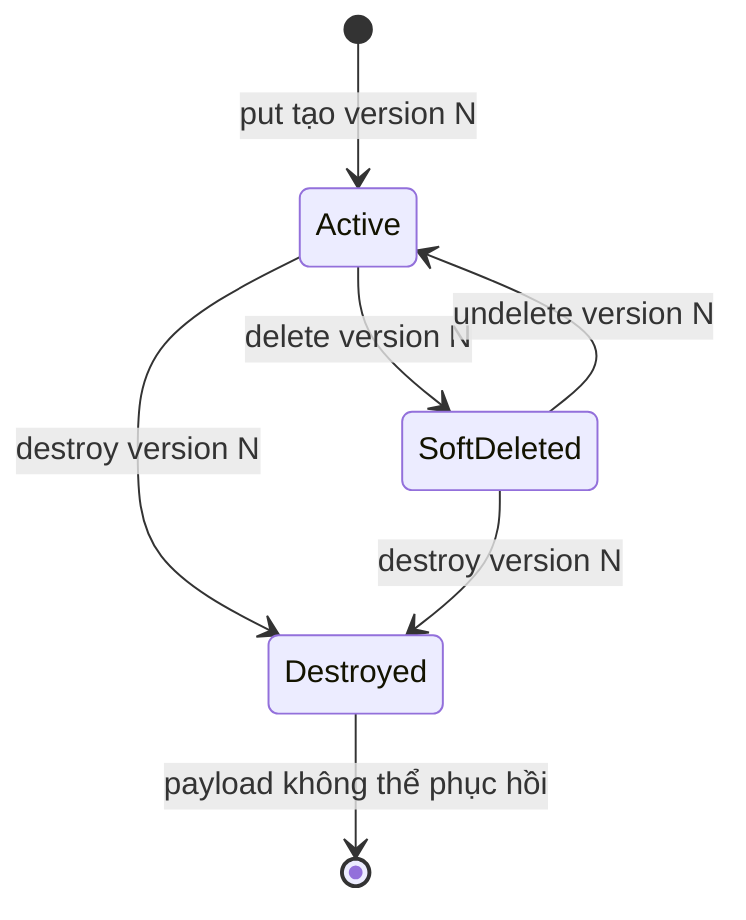
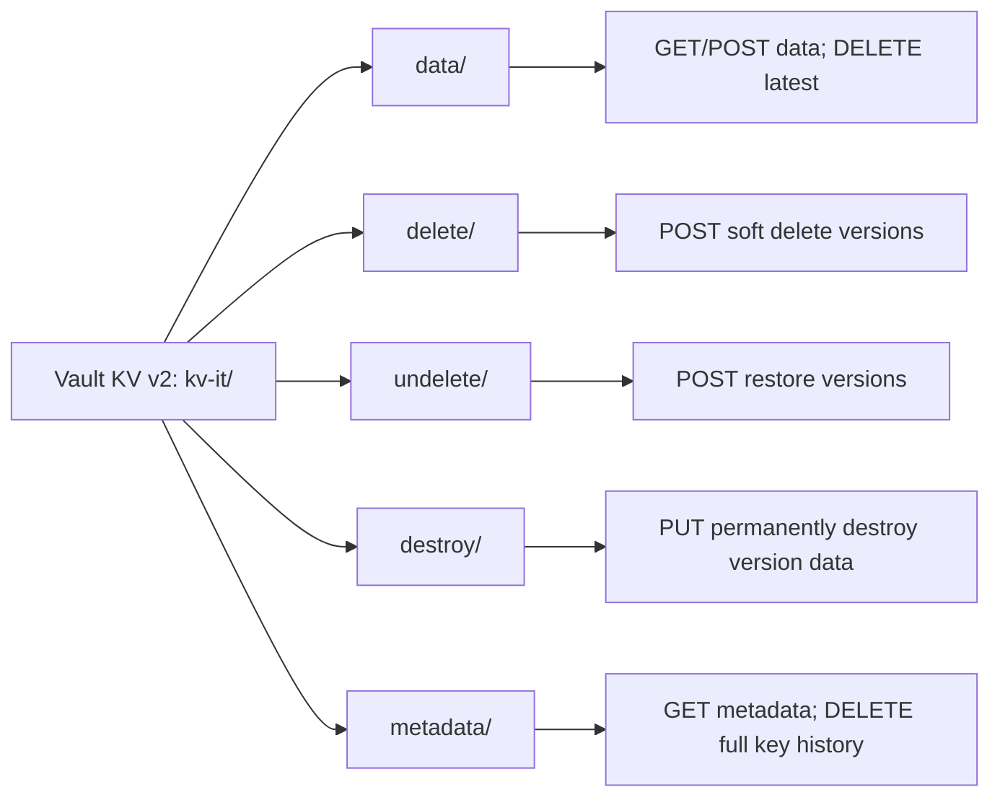

# Kiểm tra xóa mềm, khôi phục và hủy dữ liệu trong môi trường thử

> **Spring Vault — Kiểm thử.** KV secrets engine phiên bản 2 của HashiCorp Vault cho phép lưu nhiều phiên bản của một secret và phân biệt rõ **soft delete** (đánh dấu một phiên bản là đã xóa), **undelete** (khôi phục phiên bản đã soft-delete) và **destroy** (hủy vĩnh viễn dữ liệu của phiên bản). Đối với ứng dụng Java truy cập Vault bằng `VaultTemplate`, khác biệt này ảnh hưởng trực tiếp đến đọc secret, vận hành rotation, chính sách phân quyền, xử lý lỗi và kiểm thử tích hợp. Bài học xây dựng các phép kiểm chứng có bằng chứng từ metadata và API thật, chỉ thực hiện trong **Vault thử nghiệm được cô lập**.

## 1. Mục tiêu và nguyên tắc an toàn

Sau khi hoàn thành bài này, bạn có thể:

1. Giải thích sự khác nhau giữa `DELETE /data/:path`, `POST /delete/:path`, `POST /undelete/:path`, `PUT /destroy/:path` và `DELETE /metadata/:path`.
2. Tạo ít nhất hai phiên bản dữ liệu *giả* trong KV v2, lưu lại **số phiên bản thực do Vault trả về** và kiểm chứng trước/sau từng thao tác.
3. Chứng minh phiên bản soft-delete có `deletion_time`, `destroyed=false` và có thể khôi phục; phiên bản đã destroy có `destroyed=true` và **không thể undelete để lấy lại payload**.
4. Dùng `VaultOperations.opsForVersionedKeyValue(mount)`, `Versioned.Version.from(n)` và metadata API của Spring Vault trong bài kiểm thử Java/JUnit.
5. Tách lỗi "không đọc được data" khỏi "key chưa từng tồn tại", lỗi `403`, sai mount, sai KV version hoặc phiên bản đã bị hủy.
6. Thiết kế ACL tối thiểu và điều kiện cho phép chạy các test có **hành động phá hủy dữ liệu**.
7. Xác minh cleanup chỉ tác động key test được sở hữu, rồi báo kết quả rõ ràng cho CI.

**Ranh giới bắt buộc:** bài viết cung cấp ví dụ lệnh và mã test; **không chạy các lệnh delete, destroy hoặc metadata delete trên Vault chứa bí mật thật**. Các ví dụ giả định mount `kv-it/` thuộc một Vault dev/test riêng (hoặc namespace test riêng được phép phá hủy), token thử nghiệm có policy giới hạn, key có tiền tố `it/lifecycle/` và giá trị test không nhạy cảm.

## 2. KV v1 và KV v2: tại sao vòng đời khác nhau?

KV v1 lưu một giá trị hiện hành cho mỗi key; ghi đè hoặc xóa không giữ history theo cơ chế KV v2. KV v2 lưu các version có metadata, hỗ trợ CAS, soft delete, undelete và destroy cho từng version.

| Khả năng | KV v1 | KV v2 |
|---|---|---|
| Lưu các version cùng key | Không | Có, theo cấu hình `max_versions` |
| Đọc version cụ thể | Không | `GET /<mount>/data/<key>?version=N` |
| Xóa giá trị | Xóa key/value bằng API của KV v1 | Soft-delete latest hoặc một số version |
| Khôi phục version đã xóa mềm | Không | `undelete` khi dữ liệu chưa bị destroy |
| Hủy payload một version | Không có khái niệm versioned destroy | `destroy` dữ liệu version được chọn |
| Xóa cả metadata lẫn lịch sử | Xóa key | KV v2 metadata delete (khác destroy từng version) |
| Đọc trạng thái deleted/destroyed | Không có version history | `GET /<mount>/metadata/<key>` |

Sơ đồ vòng đời **của một version KV v2**:



Thực tế, sau khi destroy, **metadata của version có thể vẫn tồn tại và mang `destroyed=true`**. Mũi tên cuối của sơ đồ nghĩa là **payload không thể khôi phục**, không có nghĩa Vault tự xóa mọi thông tin metadata của key.

### 2.1. Đừng nhầm secret version, token TTL và lease

Ba vòng đời thường bị lẫn:

- **KV v2 version:** thứ tự các bản ghi tại một path; `delete`/`undelete`/`destroy` tác động vào phiên bản.
- **Vault authentication token:** chứng thực workload, có TTL, chính sách `renew` và `revoke` riêng; không bị "undelete" theo KV.
- **Dynamic secret lease:** TTL/renew/revoke của credential được engine phát hành, ví dụ database secrets engine. Nó không hoạt động giống version history của KV v2.

Trong Spring Vault, `LifecycleAwareSessionManager` quản lý vòng đời auth token; `SecretLeaseContainer` quản lý một số dynamic/static secrets theo contract riêng; **không có cái nào làm `undelete` một KV v2 version chỉ vì ứng dụng cần đọc lại secret**.

## 3. Định nghĩa chính xác các thao tác KV v2

Giả sử mount `kv-it/` và relative key `it/lifecycle/example-id`. Bảng dưới dùng route **không có tiền tố `/v1/`** cho ngắn gọn.

| Ý định | Vault HTTP API | Tác động thực tế | Có thể khôi phục? |
|---|---|---|---|
| Đọc latest hoặc version N | `GET kv-it/data/it/lifecycle/example-id?version=N` | Đọc payload nếu version khả dụng | Không thay trạng thái |
| Đọc metadata/version history | `GET kv-it/metadata/it/lifecycle/example-id` | Trả trạng thái từng version | Không thay trạng thái |
| Xóa mềm latest | `DELETE kv-it/data/it/lifecycle/example-id` | Đánh dấu version hiện hành đã xóa | Có thể undelete nếu chưa destroy |
| Xóa mềm version N | `POST kv-it/delete/it/lifecycle/example-id` với `{"versions":[N]}` | Đánh dấu **chỉ những version được chọn** | Có thể undelete |
| Khôi phục version N | `POST kv-it/undelete/it/lifecycle/example-id` với `{"versions":[N]}` | Bỏ trạng thái soft-delete của N | Chỉ khi chưa destroy |
| Hủy payload version N | `PUT kv-it/destroy/it/lifecycle/example-id` với `{"versions":[N]}` | **Xóa vĩnh viễn dữ liệu** của N | **Không** |
| Xóa key metadata và toàn bộ versions | `DELETE kv-it/metadata/it/lifecycle/example-id` | **Xóa toàn bộ history/key metadata** | **Không** |

**Khác biệt quan trọng:** `vault kv delete` và `vault kv destroy` đều khiến data không còn đọc được, nhưng chỉ `destroy` loại bỏ payload vĩnh viễn. `kv metadata delete` còn rộng hơn: nó xóa cả lịch sử/metadata, vì vậy chỉ dùng cho cleanup fixture mà bạn sở hữu toàn bộ.

Đối với KV v2, cấu hình `delete_version_after` có thể tự soft-delete theo thời gian và `max_versions` giới hạn số bản lưu. Để kiểm thử có kết quả dễ dự đoán, **không dùng key có lịch sử không biết trước**, không để quy tắc retention tự động xóa version trong khi test và không suy luận số version luôn bắt đầu tại 1 nếu đã có dữ liệu cũ.

## 4. Chuẩn bị lab cô lập và điều kiện thực thi

### 4.1. Những điều phải xác nhận trước khi viết test

| Kiểm tra tiền đề | Kết quả cần có |
|---|---|
| Vault address | Trỏ đến cluster/container dev hoặc test được phép xóa dữ liệu |
| Namespace | Namespace test đúng với cấu hình Spring Vault |
| Mount path | Một KV v2 riêng tên `kv-it/`; xác nhận `options.version=2` |
| Owner | Key nằm dưới `it/lifecycle/` và gắn UUID/test run riêng |
| Test credentials | Token chỉ có quyền trên mount/keyspace test, không dùng root token để chạy JUnit |
| Nội dung | Chuỗi giả như `dummy-v1`, `dummy-v2`; không dùng secret thật |
| Cleanup | Chỉ xóa key vừa tạo; nếu cleanup hỏng, phải báo tên key test để operator xử lý |
| CI gate | Mặc định các test destructive bị tắt; phải opt-in rõ ràng |

Một môi trường test đáp ứng contract có thể là Vault dev server do pipeline tạo riêng hoặc instance ephemeral do Testcontainers/automation điều phối. Docker container không tự mang nghĩa an toàn: phải kiểm tra nó không dùng volume/namespace hoặc token trỏ sang Vault production.

### 4.2. Tạo mount thử nghiệm

Thao tác quản trị dưới đây chạy **một lần trong Vault test**, bằng identity provisioner được phép quản lý mount:

```bash
# VAULT_ADDR và auth của bạn đã trỏ đến Vault test.
vault status
vault secrets enable -path=kv-it -version=2 kv
vault secrets list -detailed
```

Nếu `kv-it/` đã tồn tại, **không bật lại hoặc reset**. Xác minh đó là KV **version 2** và thuộc đúng lab. Một mount tên `kv-it` ở production vẫn **không an toàn** để xóa dữ liệu chỉ vì tên có hậu tố "-it".

Không chạy test bằng token operator có quyền cả Vault. Operator chuẩn bị mount/policy; JUnit dùng identity thử nghiệm hẹp cho đúng keyspace.

### 4.3. Tạo key mới cho mỗi lượt chạy

Ví dụ bash chạy thủ công trên Vault test:

```bash
# Chọn một ID riêng cho lần thực hành, không sử dụng key của người khác.
TEST_KEY="it/lifecycle/demo-$(date +%s)-$RANDOM"
printf 'Test key (chỉ metadata): %s\n' "$TEST_KEY"

# Hai giá trị dummy để phân biệt các version.
vault kv put -mount=kv-it "$TEST_KEY" marker=dummy-v1
vault kv put -mount=kv-it "$TEST_KEY" marker=dummy-v2

vault kv metadata get -mount=kv-it "$TEST_KEY"
```

**Đọc metadata để lấy đúng version numbers** từ Vault. Với key hoàn toàn mới, hai lần put thường tạo version 1 và 2, nhưng test nên **lưu version trả về** thay vì ghi cứng `1` và `2`. Các bước bên dưới ký hiệu `V1`, `V2` là hai số đã xác minh; khi chạy CLI, người thực hành điền giá trị cụ thể:

```bash
# Ví dụ CHỈ khi metadata xác nhận hai version thật là 1 và 2.
V1=1
V2=2

vault kv get -mount=kv-it -version="$V1" "$TEST_KEY"
vault kv get -mount=kv-it -version="$V2" "$TEST_KEY"
```

**Kết quả kỳ vọng:** V1 có `marker=dummy-v1`, V2 có `marker=dummy-v2`; metadata cho thấy `current_version=V2` và cả hai có `destroyed=false`, `deletion_time` trống. Chỉ khi đó mới bước sang thao tác xóa mềm.

## 5. Test D01 — Xóa mềm latest version

Để thao tác với V2 là latest mà V1 vẫn tồn tại:

```bash
# Chỉ dùng TEST_KEY đã tự tạo trong Vault test.
vault kv delete -mount=kv-it "$TEST_KEY"

# Đọc metadata an toàn, không cần in payload.
vault kv metadata get -mount=kv-it "$TEST_KEY"
```

Đối chiếu:

| Quan sát | Trước delete | Sau delete latest |
|---|---|---|
| `current_version` | V2 | V2 (không quay ngược số version) |
| V2 `deletion_time` | Rỗng | Có thời điểm xóa |
| V2 `destroyed` | `false` | `false` |
| Đọc V2 | Thành công | Không trả payload bình thường |
| Đọc V1 theo version cụ thể | Thành công | Vẫn có thể thành công |
| Khả năng undelete V2 | Chưa cần | **Có**, nếu chưa destroy |

Vault **không tự động chọn V1 làm "latest sống"** chỉ vì V2 đã bị soft-delete. Nếu ứng dụng gọi `get(path)` không có version và không còn đọc được dữ liệu, đó là kết quả phù hợp với việc latest đã bị xóa mềm. Việc tự fallback sang một version cũ có thể vô tình dùng lại credential đã bị thu hồi.

Thử hai lệnh đọc với tư cách identity test:

```bash
# Latest bị soft-delete: lệnh có thể thất bại/không trả data.
vault kv get -mount=kv-it "$TEST_KEY"

# V1 vẫn có thể đọc rõ khi yêu cầu version này.
vault kv get -mount=kv-it -version="$V1" "$TEST_KEY"
```

**Không diễn giải HTTP 404 của lần đọc latest thành "key chưa từng tồn tại".** Metadata vẫn có phiên bản và trạng thái `deleted`; một token chỉ được `read data` nhưng không được `read metadata` có thể không tra được thông tin này.

### 5.1. Xóa mềm version được chỉ định

Muốn chỉ xóa V1, không tác động V2 đang sống, dùng:

```bash
vault kv delete -mount=kv-it -versions="$V1" "$TEST_KEY"
```

API tương ứng là `POST /v1/kv-it/delete/<key>` với `{"versions":[V1]}`. Đây là một thao tác khác so với `DELETE /v1/kv-it/data/<key>` (xóa latest). Test nên xác nhận V2 còn đọc được nếu chưa xóa V2.

Khi làm các phép thử nối tiếp trên cùng một key, phải ghi rõ version nào đã delete/undelete để tránh nhầm dữ liệu trạng thái. Trong CI, thường tốt hơn dùng **một key riêng cho mỗi test case**.

## 6. Test D02 — Undelete và xác minh payload nguyên vẹn

Với V2 đã soft-delete nhưng `destroyed=false`:

```bash
vault kv undelete -mount=kv-it -versions="$V2" "$TEST_KEY"
vault kv metadata get -mount=kv-it "$TEST_KEY"
vault kv get -mount=kv-it -version="$V2" "$TEST_KEY"
```

Kỳ vọng theo ba trục độc lập:

1. **Metadata:** V2 có `deletion_time` trống và `destroyed=false`.
2. **Data:** đọc lại V2 trả đúng `marker=dummy-v2`, không phải V1 và không có giá trị tự sinh.
3. **Version:** `current_version` vẫn là V2; undelete **không tạo thêm version V3**. Nếu thấy số version tăng, hãy kiểm tra có tiến trình khác ghi cùng key không.

Khôi phục version bị xóa mềm khác với **rollback nghiệp vụ**. Khi cần rollback secret, nhiều tổ chức chọn đọc nội dung version cũ đã phê duyệt rồi tạo **một version mới** qua put với CAS, để giữ lịch sử thay đổi. Undelete không tự xác minh credential cũ còn an toàn hoặc được chấp nhận bởi hệ thống downstream.

### 6.1. Kiểm tra tính dùng được sau undelete

Một test tốt phải kiểm tra cả đọc bằng version cụ thể **và** luồng ứng dụng dự kiến:

- `vault kv get -version=V2` hoặc `kv.get(key, Versioned.Version.from(V2))` trả payload đúng.
- Consumer dùng `kv.get(key)` lấy latest như kỳ vọng khi V2 thực sự là latest.
- Nếu API key đã bị hủy bên đối tác hoặc database credential ngoài Vault không còn hiệu lực, **undelete KV không làm credential đó có hiệu lực trở lại**.
- Nếu ứng dụng có cache, phải xác minh refresh/invalidation để client Java thực sự nhận secret đã khôi phục.

Không tuyên bố hệ thống phục hồi hoàn toàn chỉ vì `undelete` trả HTTP thành công.

## 7. Test D03 — Destroy một version và chứng minh không thể khôi phục

Đây là bước **phá hủy không thể hoàn tác**: chỉ thực hiện với **dữ liệu giả thuộc key test do chính test tạo**. Để test dễ đọc, nên tạo một key riêng rồi put một hoặc hai dummy versions, ghi lại số version, sau đó destroy chính version đó:

```bash
# Dùng riêng một key cho trường hợp destroy.
DESTROY_KEY="it/lifecycle/destroy-demo-$(date +%s)-$RANDOM"
vault kv put -mount=kv-it "$DESTROY_KEY" marker=dummy-destroy-only

# Đọc metadata và ghi nhận version thực tế, ví dụ DVER=1
vault kv metadata get -mount=kv-it "$DESTROY_KEY"
DVER=1

# CHỈ chạy khi DVER khớp metadata của key test vừa tạo.
vault kv destroy -mount=kv-it -versions="$DVER" "$DESTROY_KEY"
vault kv metadata get -mount=kv-it "$DESTROY_KEY"
```

Metadata của version DVER phải cho thấy:

```json
{
  "created_time": "2026-11-25T10:00:00Z",
  "deletion_time": "",
  "destroyed": true
}
```

JSON trên là **ví dụ một phần version metadata**. Thời gian và trường cụ thể phụ thuộc server. `destroyed=true` là bằng chứng trực tiếp hơn nhiều so với việc chỉ thấy `kv get` thất bại, bởi cả soft-delete và destroy đều làm việc đọc payload không thành công.

**Đặc điểm quan trọng:**

- `destroy` xóa **payload của những version được chọn**, thường vẫn giữ metadata của key/version.
- `undelete` **không thể phục hồi payload đã destroy**; gọi lại có thể báo lỗi hoặc không làm dữ liệu xuất hiện, tùy API/server handling.
- Không tự động xóa V1/V3 nếu chỉ chọn DVER=V2; các version khác phải được đánh giá riêng.
- Không gọi destroy trên dữ liệu thật để "thử cho chắc": kiểm thử này phải có fixture riêng và quyền hẹp.

Một bài test thực sự nên kết hợp hai assertion: **metadata DVER `isDestroyed=true`** và **không thể đọc lại payload DVER**. Với Spring Vault, lỗi đọc version bị destroy có thể biểu hiện là `null` hoặc exception do 404 tùy version/client; đừng viết test chỉ kiểm tra một dạng exception rồi vô tình đánh dấu lỗi 403 là thành công.

### 7.1. Destroy khác xóa cả metadata

Hai hành động sau tác động phạm vi **khác**:

```text
vault kv destroy -mount=kv-it -versions=N <key>
  -> Hủy payload của phiên bản N.
  -> Metadata key/những version khác có thể còn.

vault kv metadata delete -mount=kv-it <key>
  -> Xóa toàn bộ metadata và mọi dữ liệu/version của key.
  -> Không thể undelete bằng KV v2 API.
```

Trường hợp `metadata delete` chỉ nên xuất hiện trong **cleanup fixture cô lập đã được kiểm tra quyền sở hữu**, không phải thủ tục thường dùng để "tạo điều kiện" cho test soft-delete. Nếu muốn kiểm tra endpoint này, viết test riêng với key disposable và guard rõ ràng.

## 8. So sánh lệnh CLI, API và Java typed operations

Sơ đồ API giúp thấy các operation không thể dùng thay thế nhau:



| Use case | CLI | Raw HTTP (sau `/v1/`) | Spring Vault 2.1+ |
|---|---|---|---|
| Tạo version | `vault kv put -mount=kv-it ...` | `POST kv-it/data/<key>` | `kv.put(relativePath, body)` |
| Đọc version | `vault kv get -mount=kv-it -version=N ...` | `GET kv-it/data/<key>?version=N` | `kv.get(relativePath, Version.from(N))` |
| Soft-delete latest | `vault kv delete -mount=kv-it ...` | `DELETE kv-it/data/<key>` | API cơ bản `VaultKeyValueOperations.delete(path)` |
| Soft-delete version N | `vault kv delete -mount=kv-it -versions=N ...` | `POST kv-it/delete/<key>` | `kv.delete(path, Version.from(N))` |
| Undelete N | `vault kv undelete -mount=kv-it -versions=N ...` | `POST kv-it/undelete/<key>` | `kv.undelete(path, Version.from(N))` |
| Destroy N | `vault kv destroy -mount=kv-it -versions=N ...` | `PUT kv-it/destroy/<key>` | `kv.destroy(path, Version.from(N))` |
| Metadata | `vault kv metadata get -mount=kv-it ...` | `GET kv-it/metadata/<key>` | `kv.opsForKeyValueMetadata().get(path)` |
| Xóa toàn bộ key và history | `vault kv metadata delete -mount=kv-it ...` | `DELETE kv-it/metadata/<key>` | `kv.opsForKeyValueMetadata().delete(path)` |

Trong bảng Java, `kv` là `VaultVersionedKeyValueOperations` từ `vaultOperations.opsForVersionedKeyValue("kv-it")`. Tất cả tham số `relativePath` **không chứa** tiền tố mount, `data/`, `delete/` hay `metadata/`. Spring Vault chọn route kỹ thuật theo method được gọi.

### 8.1. Cùng một version vẫn có hai cách đọc

Một điểm dễ gây lỗi: API typed thông thường `opsForKeyValue("kv-it", KV_2).get(path)` đọc **version hiện hành** và trả `VaultResponse` (map), trong khi API `opsForVersionedKeyValue("kv-it").get(path, Version.from(N))` trả `Versioned<T>` với dữ liệu theo version cụ thể. Đừng trộn kiểu response hoặc tự unwrap hai lần `data.data`.

Để test delete/undelete/destroy, nên dùng versioned API vì nó cung cấp phép truy cập rõ version và `Versioned.Metadata`.

## 9. Java Spring Vault: quản lý version với VaultTemplate

Ví dụ code dưới đây giả định một bean `VaultOperations` (thường là `VaultTemplate`) đã được cấu hình trỏ tới Vault **test** và workload identity thử nghiệm.

```java
import java.util.Map;

import org.springframework.vault.core.VaultOperations;
import org.springframework.vault.core.VaultVersionedKeyValueOperations;
import org.springframework.vault.support.Versioned;
import org.springframework.vault.support.VaultMetadataResponse;

public final class KvLifecycleClient {

    private final VaultVersionedKeyValueOperations kv;

    public KvLifecycleClient(VaultOperations vaultOperations) {
        // Chỉ mount KV v2 dành cho integration tests.
        this.kv = vaultOperations.opsForVersionedKeyValue("kv-it");
    }

    public int createVersion(String relativePath, String marker) {
        Versioned.Metadata metadata = kv.put(
                relativePath, Map.of("marker", marker));
        return metadata.getVersion().getVersion();
    }

    public void softDelete(String relativePath, int version) {
        kv.delete(relativePath, Versioned.Version.from(version));
    }

    public void restore(String relativePath, int version) {
        kv.undelete(relativePath, Versioned.Version.from(version));
    }

    public void destroy(String relativePath, int version) {
        kv.destroy(relativePath, Versioned.Version.from(version));
    }

    public VaultMetadataResponse metadata(String relativePath) {
        return kv.opsForKeyValueMetadata().get(relativePath);
    }

    public Versioned<Map<String, Object>> read(
            String relativePath, int version) {
        return kv.get(relativePath, Versioned.Version.from(version));
    }
}
```

**Điều cần biết về phiên bản thư viện:** `VaultVersionedKeyValueOperations` và `Versioned.Version` có trong Spring Vault từ 2.1; metadata operations có trong Spring Vault từ 2.3. Kiểm tra dependency/Javadoc đúng version thực tế của dự án. `read(path, version)` có thể trả `null` nếu không có data; khi đọc deleted/destroyed version, HTTP handling có thể ném exception. Test không nên mặc định lỗi 403 là “đã destroy”.

Đây là client minh họa phục vụ **bài kiểm thử**; không đưa method `destroy` thành endpoint public của ứng dụng. Nếu xây service quản trị thật, phải có kiểm tra owner/quyền và audit riêng.

## 10. JUnit 5 — kiểm thử xóa mềm và khôi phục có thể lặp lại

Test này cần một Spring Boot test context với `VaultOperations` đã kết nối **Vault lab**, và phải có opt-in `-Dvault.it.destructive=true`. Mỗi lần chạy tạo **UUID riêng** dưới `kv-it/it/lifecycle/`; nếu cấu hình test kết nối sai cluster, bài test phải bị chặn ngay ở bước chuẩn bị môi trường.

```java
import static org.junit.jupiter.api.Assertions.*;

import java.util.Map;
import java.util.Objects;
import java.util.UUID;
import org.junit.jupiter.api.Assumptions;
import org.junit.jupiter.api.Test;
import org.springframework.beans.factory.annotation.Autowired;
import org.springframework.boot.test.context.SpringBootTest;
import org.springframework.vault.core.VaultOperations;
import org.springframework.vault.core.VaultVersionedKeyValueOperations;
import org.springframework.vault.support.Versioned;
import org.springframework.vault.support.VaultMetadataResponse;

@SpringBootTest
class KvV2LifecycleIT {

    @Autowired VaultOperations vault;

    @Test
    void softDeleteThenUndeletePreservesExactVersion() {
        // Chỉ chạy khi pipeline đã xác minh cluster/mount test.
        Assumptions.assumeTrue(
                Boolean.getBoolean("vault.it.destructive"),
                "Destructive KV v2 integration tests are opt-in");

        VaultVersionedKeyValueOperations kv =
                vault.opsForVersionedKeyValue("kv-it");
        String path = "it/lifecycle/" + UUID.randomUUID();

        try {
            Versioned.Metadata first =
                    kv.put(path, Map.of("marker", "dummy-v1"));
            Versioned.Metadata second =
                    kv.put(path, Map.of("marker", "dummy-v2"));

            int v1 = first.getVersion().getVersion();
            int v2 = second.getVersion().getVersion();
            assertTrue(v2 > v1);

            Versioned<Map<String, Object>> before =
                    kv.get(path, Versioned.Version.from(v2));
            assertNotNull(before);
            assertEquals("dummy-v2", before.getData().get("marker"));

            kv.delete(path, Versioned.Version.from(v2));
            Versioned.Metadata deleted = versionMetadata(kv, path, v2);
            assertTrue(deleted.isDeleted());
            assertFalse(deleted.isDestroyed());

            // V1 còn sống; xóa mềm V2 không làm V1 biến mất.
            Versioned<Map<String, Object>> older =
                    kv.get(path, Versioned.Version.from(v1));
            assertNotNull(older);
            assertEquals("dummy-v1", older.getData().get("marker"));

            kv.undelete(path, Versioned.Version.from(v2));
            Versioned.Metadata restored = versionMetadata(kv, path, v2);
            assertFalse(restored.isDeleted());
            assertFalse(restored.isDestroyed());

            Versioned<Map<String, Object>> after =
                    kv.get(path, Versioned.Version.from(v2));
            assertNotNull(after);
            assertEquals("dummy-v2", after.getData().get("marker"));
        } finally {
            // CHỈ key UUID vừa được test tạo trong mount test.
            // Lỗi cleanup phải được CI báo ra, không tự reset mount.
            kv.opsForKeyValueMetadata().delete(path);
        }
    }

    private static Versioned.Metadata versionMetadata(
            VaultVersionedKeyValueOperations kv,
            String path,
            int number) {

        VaultMetadataResponse response = Objects.requireNonNull(
                kv.opsForKeyValueMetadata().get(path),
                "Expected key metadata to exist");

        return response.getVersions().stream()
                .filter(m -> m.getVersion().getVersion() == number)
                .findFirst()
                .orElseThrow();
    }
}
```

Test trên có ba điều quan trọng:

- Không suy luận phiên bản `1` và `2` từ tên test; nó dùng version do `put` trả về.
- Không chỉ assert `get` thất bại: metadata `isDeleted` và `isDestroyed` xác định bản chất trạng thái.
- Cleanup dùng `metadata.delete(path)` **chỉ trên path UUID của fixture**; vì đây là xóa toàn bộ history không thể đảo ngược, bắt buộc giữ nó trong mount test và phải kiểm tra quyền sở hữu.

**Giới hạn của opt-in:** cờ JVM chỉ là **một trong nhiều lớp bảo vệ**, không thay thế việc pipeline xác minh Vault address, namespace, mount v2 và token scope trước khi chạy. Nếu bất kỳ điều kiện nào chưa xác nhận, không bật cờ.

## 11. JUnit 5 — kiểm tra destroy không thể khôi phục

Để kiểm tra hủy, dùng key mới. Có thể đặt test thứ hai trong class trên và dùng lại helper `versionMetadata`:

```java
@Test
void destroyMarksVersionIrrecoverable() {
    Assumptions.assumeTrue(
            Boolean.getBoolean("vault.it.destructive"),
            "Destructive KV v2 integration tests are opt-in");

    VaultVersionedKeyValueOperations kv =
            vault.opsForVersionedKeyValue("kv-it");
    String path = "it/lifecycle/" + UUID.randomUUID();

    try {
        Versioned.Metadata written =
                kv.put(path, Map.of("marker", "dummy-to-destroy"));
        int version = written.getVersion().getVersion();

        kv.destroy(path, Versioned.Version.from(version));

        Versioned.Metadata destroyed =
                versionMetadata(kv, path, version);

        assertTrue(destroyed.isDestroyed(),
                "Vault metadata must mark the version destroyed");

        // Đọc version đã destroy không được trả payload.
        // Tùy phiên bản Vault/Spring Vault, read có thể trả null
        // hoặc throw khi HTTP 404. Kiểm tra metadata là bằng chứng
        // chính; test read-error riêng phải phân biệt 404 và 403.

    } finally {
        kv.opsForKeyValueMetadata().delete(path);
    }
}
```

Điểm cần bổ sung trong một integration suite đầy đủ: gọi `undelete(path, version)` sau destroy, xử lý đúng status HTTP/server (có thể bị từ chối hoặc không khôi phục gì), rồi đọc metadata lại để xác nhận `isDestroyed() == true` và data vẫn không thể lấy. **Không coi một ngoại lệ không rõ mã 403, timeout hay lỗi network là bằng chứng destroy thành công**.

Một test tốt tránh phụ thuộc cách client ánh xạ HTTP 404: có thể kiểm tra `metadata.isDestroyed()` trước/sau, cộng một test HTTP chuyên biệt assert không nhận được payload, đồng thời phân biệt lỗi auth/network.

## 12. Quyền ACL: tách đọc, xóa mềm, khôi phục và hủy

Policy trên KV v2 phải khớp route kỹ thuật. Ví dụ role thử nghiệm thực hiện toàn bộ bài:

```hcl
path "kv-it/data/it/lifecycle/*" {
  capabilities = ["create", "read", "update", "delete"]
}

path "kv-it/delete/it/lifecycle/*" {
  capabilities = ["update"]
}

path "kv-it/undelete/it/lifecycle/*" {
  capabilities = ["update"]
}

path "kv-it/destroy/it/lifecycle/*" {
  capabilities = ["update"]
}

path "kv-it/metadata/it/lifecycle/*" {
  capabilities = ["read", "delete"]
}
```

**Đây là policy dành cho test phá hủy**, không dùng cho workload sản xuất. Nên có ít nhất hai identity:

| Identity | Phạm vi | Dùng cho test |
|---|---|---|
| `app-reader-it` | `read` trên `data/it/lifecycle/*` (và metadata nếu hợp đồng cần) | Chứng minh ứng dụng chỉ đọc, không delete/undelete/destroy |
| `kv-lifecycle-admin-it` | `create/update/read/delete` data, `update` delete/undelete/destroy, `read/delete` metadata | Tạo và quản lý fixture trong namespace test |

Kiểm thử quyền âm rất quan trọng: token chỉ đọc không được gọi `kv.destroy(...)` hoặc `metadata.delete(...)`. Với token thiếu `read metadata`, ứng dụng có thể đọc data được mà không xem được lịch sử. **Đừng cấp quyền admin cho ứng dụng chỉ vì test cần đọc metadata**; test suite có thể dùng identity riêng để xác minh trạng thái sau thao tác.

ACL cần đánh giá cùng namespace, policy deny và các hệ thống cấp auth. Hành vi `403` không chứng minh secret đã bị destroy.

## 13. Những bẫy và cách đọc kết quả đúng

### 13.1. Latest bị xóa nhưng version cũ vẫn còn

Khi V2 bị soft-delete và V1 còn sống, `GET /data/<key>` mặc định vẫn có thể không trả data, dù `GET /data/<key>?version=1` trả được. Đừng tự động fallback về version cũ khi code nghiệp vụ đọc secret bắt buộc: có thể V2 bị xóa do khóa bị lộ hoặc rotation đã thu hồi credential cũ.

### 13.2. Destroy xong vẫn có metadata

Đây là hành vi bình thường: metadata có thể cho biết `destroyed=true` để audit/history, trong khi payload không còn. Nếu mục tiêu test là **xóa toàn bộ metadata và lịch sử**, phải dùng endpoint khác `DELETE /metadata/<key>`, chỉ trong lab được phép và với key test sở hữu hoàn toàn.

### 13.3. Ghi phiên bản mới sau khi delete không phải undelete

`kv.put(path, body)` tạo version mới theo semantics KV v2; nó **không khôi phục cùng version** đã soft-delete. Test undelete phải chứng minh version number giữ nguyên và payload match trước/sau. Nếu thấy V3 mới sau put, đó là một hành vi write khác với restore V2.

### 13.4. Tự động retention làm bài test khó dự đoán

`max_versions` giới hạn số version giữ; `delete_version_after` có thể xóa mềm version theo thời gian. Nếu bài test tạo quá nhiều version hoặc mất thời gian vượt TTL, các assertion có thể sai mà code ứng dụng không lỗi. Trong fixture, xác nhận config engine/key và dùng test độc lập cho automatic deletion/retention.

### 13.5. Request thành công không bảo đảm hệ thống downstream phục hồi

Undelete API có thể thành công và data khôi phục, nhưng API key đã bị đối tác revoke, token client hết hạn, hoặc service Java đang giữ cache cũ. Với Spring Vault, token auth của `VaultTemplate` và vòng đời KV version là **hai lớp khác nhau**; kiểm thử khôi phục dữ liệu không thay thế kiểm thử client sử dụng credential mới.

### 13.6. Cleanup gây mất dữ liệu ngoài phạm vi

Đừng dùng `vault kv metadata delete -mount=secret prod/payment` để "dọn test" và đừng gọi `deleteAll()` hay reset cả mount. Mỗi test tạo key riêng với UUID, dùng exact path để cleanup, và báo lỗi nếu cleanup thất bại. Không chạy hai worker cùng sở hữu một key test; với parallel tests cần UUID riêng.

## 14. Ma trận test hoàn chỉnh và tiêu chí chấp nhận

| Test | Thiết lập | Assertion chính |
|---|---|---|
| T01 — Tạo hai version | Ghi dummy-v1, dummy-v2 cùng key mới | Version tăng, mỗi version đọc đúng dữ liệu |
| T02 — Soft-delete latest | `DELETE /data/<key>` | Latest không còn đọc như active; metadata deleted=true, destroyed=false |
| T03 — Soft-delete version cụ thể | `POST /delete/<key>` version V1 | Chỉ V1 soft-delete; V2 không đổi |
| T04 — Undelete | `POST /undelete/<key>` trên version deleted | Cùng version có lại payload ban đầu, không tạo version mới |
| T05 — Destroy | `PUT /destroy/<key>` trên dummy version | Metadata destroyed=true, không đọc được payload |
| T06 — Undelete sau destroy | Test trên version đã destroy | Không thể phục hồi payload; không nhầm 403/network với kết quả hợp lệ |
| T07 — Metadata delete | Key disposable riêng | Toàn bộ history/key metadata biến mất |
| T08 — ACL chỉ đọc | Token read-only | Get PASS, delete/undelete/destroy FAIL do policy |
| T09 — ACL metadata | Token không có `read metadata` | Có thể đọc data nhưng không xem metadata |
| T10 — Wrong mount/engine | Mount KV v1 hoặc mount sai | Lỗi config/route, không diễn giải là soft-delete |
| T11 — Version không tồn tại | Chọn N chưa từng tạo | Không tạo mới dữ liệu và không “tự fallback” |
| T12 — Concurrent write/CAS | Hai writer dùng version cũ | Check-and-set chặn lost update theo config |
| T13 — Retention | Fixture max_versions nhỏ | Version quá cũ bị dọn; phân biệt với soft-delete thủ công |
| T14 — Audit/log | Test có token/dummy values | Log không chứa secret/token; có request ID/operation |
| T15 — Cleanup | Key random riêng, exact path | Không còn metadata key; không đụng dữ liệu ngoài fixture |

Tiêu chí để báo **PASS** cho một bài kiểm thử lifecycle:

- Đúng mount KV v2 và đường dẫn tương đối đã xác minh, đúng namespace và identity.
- Mỗi thao tác có version number và **trạng thái metadata trước/sau**.
- Đọc lại payload dùng **cùng version** khi kiểm chứng undelete.
- Destroy được xác nhận bằng `destroyed=true` và không thể đọc payload, không chỉ một lỗi 404 mơ hồ.
- Lỗi 403, timeout hoặc sai mount **không bị coi là PASS** cho tình huống xóa.
- Cleanup chỉ xóa key test; secret thật không bị chạm.
- Có báo cáo test environment, operation, version number và thời điểm; không log payload hoặc auth token.

## 15. Bài tập thực hành

1. Với key mới có V1, V2: sau khi `vault kv delete` latest V2, `current_version` có tự hạ xuống V1 không? Cần đọc đâu để biết V2 soft-deleted?
2. So sánh `vault kv delete -versions=2` và `vault kv destroy -versions=2` về khả năng khôi phục.
3. Một test nhận 404 khi đọc V2. Vì sao chưa thể kết luận V2 đã destroy? Nêu ít nhất ba nguyên nhân thay thế.
4. Version đã soft-delete được undelete thành công nhưng ứng dụng vẫn gọi gateway lỗi 401. Bạn sẽ kiểm tra điều gì?
5. Vai trò của metadata `deletion_time` và `destroyed` khi khẳng định bài test đúng?
6. Vì sao `VaultVersionedKeyValueOperations` phù hợp hơn `VaultKeyValueOperations` cho kiểm thử version cụ thể?
7. Khi CI chạy song song, tại sao mỗi test phải tạo key UUID riêng?
8. Policy chỉ có `read` trên `kv-it/data/...` có đủ để gọi `undelete` hay `destroy` không? Viết route capability cần bổ sung cho identity test.
9. Khi `max_versions=2`, việc tạo V3 có thể gây hậu quả gì cho V1? Điều đó khác `soft-delete` như thế nào?
10. Có nên dùng `metadata.delete(key)` để cleanup trên một key được hai nhóm chia sẻ không? Vì sao?
11. Tại sao cleanup cuối test phải báo lỗi nếu không hoàn tất, và vì sao không chạy cleanup bằng token root?
12. Nếu muốn thử xóa toàn bộ metadata/history, cần tách test thế nào để không vô tình làm hỏng các bài test undelete đang chạy?

**Gợi ý:** (1) không; xem metadata KV v2, `deletion_time` của V2; (2) delete giữ payload có thể khôi phục, destroy xóa vĩnh viễn; (3) path sai, mount sai, quyền thiếu, version soft-deleted, version chưa tồn tại; (4) credential đã thu hồi bên đối tác, cache Java, policy/app auth; (5) xác định trạng thái chứ không chỉ kết quả get; (6) API thao tác theo `Version.from(N)` và metadata; (7) tránh race/ghi đè; (8) không, cần `update` trên `undelete/` và `destroy/`; (9) V1 có thể bị dọn vĩnh viễn do retention; (10) không, metadata delete xóa mọi versions; (11) phát hiện rò fixture và tránh vượt quyền; (12) key và identity test riêng.

## 16. Tài liệu tham khảo chính thức

- [HashiCorp Vault — KV v2 HTTP API](https://developer.hashicorp.com/vault/api-docs/secret/kv/kv-v2): định nghĩa chính xác `DELETE /data`, `POST /delete`, `POST /undelete`, `PUT /destroy` và `DELETE /metadata`.
- [HashiCorp Vault — KV secrets engine](https://developer.hashicorp.com/vault/docs/secrets/kv): khác biệt KV v1/v2, versioning, soft delete, undelete và destroy.
- [HashiCorp Vault CLI — kv delete](https://developer.hashicorp.com/vault/docs/commands/kv/delete): xóa mềm latest hoặc versions được chọn.
- [HashiCorp Vault CLI — kv undelete](https://developer.hashicorp.com/vault/docs/commands/kv/undelete): khôi phục những version chưa destroy.
- [HashiCorp Vault CLI — kv destroy](https://developer.hashicorp.com/vault/docs/commands/kv/destroy): hủy vĩnh viễn payload version cụ thể.
- [HashiCorp Vault CLI — kv metadata](https://developer.hashicorp.com/vault/docs/commands/kv/metadata): xem version history và xóa toàn bộ metadata/history.
- [Spring Vault — `VaultVersionedKeyValueOperations`](https://docs.spring.io/spring-vault/reference/api/java/org/springframework/vault/core/VaultVersionedKeyValueOperations.html): `put`, `get` theo version, `delete`, `undelete`, `destroy`.
- [Spring Vault — `VaultKeyValueMetadataOperations`](https://docs.spring.io/spring-vault/reference/api/java/org/springframework/vault/core/VaultKeyValueMetadataOperations.html): đọc metadata và full-key deletion.
- [Spring Vault — `Versioned.Version`](https://docs.spring.io/spring-vault/reference/api/java/org/springframework/vault/support/Versioned.Version.html): tạo version bằng `Version.from(n)`.
- [Spring Vault — `Versioned.Metadata`](https://docs.spring.io/spring-vault/reference/api/java/org/springframework/vault/support/Versioned.Metadata.html): `isDeleted()`, `isDestroyed()` và số version.
- [Spring Vault — `VaultMetadataResponse`](https://docs.spring.io/spring-vault/reference/api/java/org/springframework/vault/support/VaultMetadataResponse.html): danh sách metadata các versions.
- [HashiCorp Vault — Policy concepts](https://developer.hashicorp.com/vault/docs/concepts/policies): capability theo route và least privilege.

> **Ghi nhớ:** **soft delete** làm dữ liệu một KV v2 version tạm không đọc được nhưng có thể khôi phục; **undelete** phục hồi đúng phiên bản nếu nó chưa bị destroy; **destroy** xóa payload phiên bản vĩnh viễn; **metadata delete** xóa cả lịch sử của key. Bằng chứng kiểm thử phải gồm **version number, metadata trạng thái và dữ liệu đọc lại**, luôn ở Vault test được cô lập và có quyền hạn rõ ràng.

