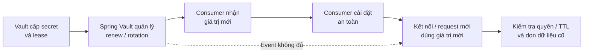
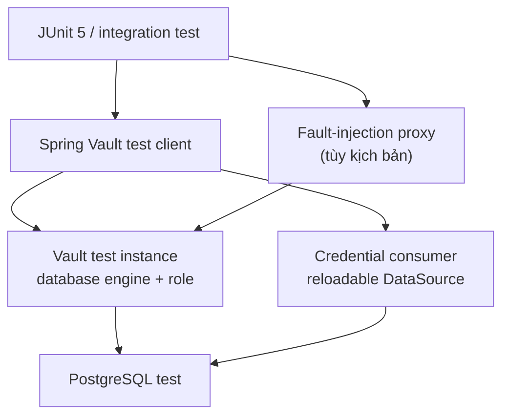
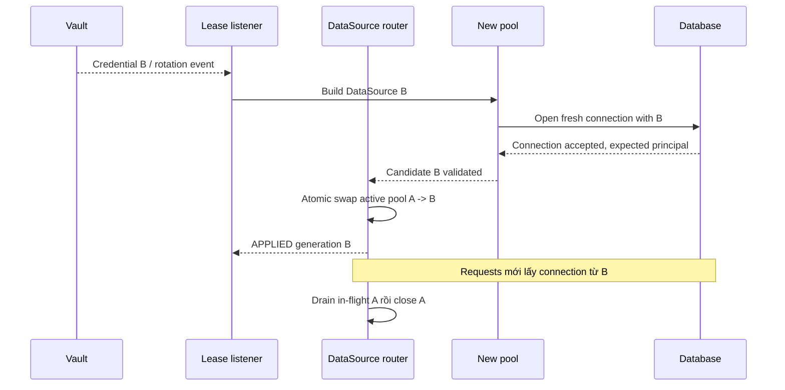
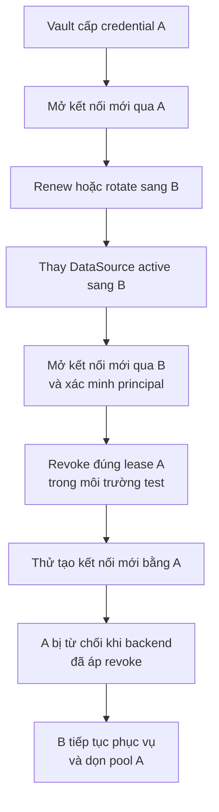

# Kiểm tra lease, xoay vòng và thành phần nhận dữ liệu mới

**Chương:** Kiểm thử  
**Module:** SPRING_VAULT

## 1. Kiểm thử đúng điều người dùng cuối cần: secret mới đã được sử dụng

Một ứng dụng Java dùng **Spring Vault** qua `VaultTemplate` / `VaultOperations` có thể nhận database credential động từ HashiCorp Vault, đọc KV v2, lấy chứng thư PKI và mã hóa dữ liệu bằng Transit. Việc Vault phát hành một giá trị mới không tự bảo đảm ứng dụng đã **sử dụng được** giá trị đó: một `SecretLeaseContainer` có thể nhận sự kiện rotation, nhưng HikariCP vẫn mở kết nối bằng user/password cũ; Vault Agent có thể ghi file mới, còn Spring Boot vẫn giữ cấu hình đã bind lúc khởi động; PKI có thể cấp certificate mới, còn TLS listener vẫn phục vụ certificate cũ.

Vì vậy, đề bài **“Kiểm tra lease, xoay vòng và thành phần nhận dữ liệu mới”** yêu cầu chứng minh một chuỗi thay đổi đầu cuối:



**Tiêu chí đạt:** test không dừng ở “Vault trả HTTP 200”, “sự kiện đã được phát” hoặc “file đã đổi timestamp”. Phải kiểm tra **đích sử dụng** thực tế: một kết nối database được mở mới dưới credential mới, một request HTTPS thấy certificate mới, hoặc một request tới upstream thật sự dùng API key mới.

Trong module SPRING_VAULT, chúng ta dùng ví dụ chính là **database credential động** để thực hành lease và rotation, đồng thời liên hệ KV secrets, Vault token, response wrapping, PKI, Transit, khả năng phục hồi và giám sát. Bài tập trung vào **thiết kế kiểm thử**, không giả định rằng các ví dụ tự chạy khi chưa có Vault/database test được chuẩn bị.

**Sau bài học, bạn có thể:**

1. Phân biệt `renew` lease, `rotate` credential, `revoke` lease và thời điểm consumer *apply* giá trị mới.
2. Thiết lập môi trường kiểm thử Vault + database độc lập với production, kiểm tra TTL thực và quyền ACL.
3. Sử dụng `SecretLeaseContainer` và sự kiện lease trong Spring Vault mà không nhầm sự kiện với kết quả cập nhật `DataSource`.
4. Viết test ở ba tầng: Vault backend, delivery/rotation, consumer.
5. Kiểm tra các tình huống lỗi: Vault tạm mất kết nối, credential bị revoke, response bị mất, reload thất bại và hai lần rotation sát nhau.

## 2. Từ vựng và những “đồng hồ” khác nhau

| Khái niệm | Định nghĩa | Điều test cần quan sát |
| --- | --- | --- |
| **Dynamic secret** | Giá trị được engine cấp tại thời điểm yêu cầu, chẳng hạn database username/password | Giá trị có thể thay đổi giữa hai lần cấp phát; thường có lease ID |
| **Lease ID** | Định danh vòng đời của secret động, ví dụ `database/creds/orders-test/...` | Chỉ quản lý đúng lease đã tạo; không revoke theo prefix diện rộng |
| **Lease TTL** | Thời gian còn lại mà Vault báo cho secret | Không dùng TTL yêu cầu làm bằng chứng; đọc TTL **thực trả về** |
| **Renewable** | Lease có thể gia hạn theo engine/role và policy hay không | Renew thay TTL, thường **không cấp username/password mới** |
| **Rotation** | Lấy một credential/secret **mới** thay cho bản cũ | Giá trị mới được truyền đến consumer và consumer thật đã chuyển sang dùng nó |
| **Revocation** | Vault vô hiệu hóa lease/credential theo khả năng của backend | Kết nối mới bằng credential cũ phải bị từ chối khi backend đã áp revocation |
| **Vault client token** | Credential dùng để ứng dụng xác thực và được Vault ACL cho phép | Vòng đời token **khác** vòng đời secret lease |
| **Certificate validity** | `NotBefore` / `NotAfter` của X.509 cert | Không phụ thuộc trực tiếp vào TTL của Vault token |
| **Static KV v2 value** | Secret lưu tại KV, có thể có version | Thường **không có lease động**; test reload bằng version/freshness, không dùng vòng đời lease giả |
| **Consumer** | Thành phần thật dùng secret: DataSource, connection pool, TLS listener, HTTP client | Không chỉ nhận dữ liệu mà phải xác nhận **đã áp dụng** và sử dụng thành công |

Theo hợp đồng Vault, gia hạn lease **không đổi nội dung secret**; nó thay thời gian được phép sử dụng. Rotation là hành động cần cấp dữ liệu mới. Trên các secret chỉ có TTL/không renewable, phải thiết kế lấy secret mới **trước khi phiên cũ trở nên không dùng được** nếu nghiệp vụ cần không gián đoạn.

**Ba đường thời gian tách biệt:**

- `T_vault`: Vault cấp hoặc renew lease; TTL bắt đầu giảm.
- `T_delivery`: Spring Vault, Vault Agent hoặc watcher quan sát và đưa giá trị mới cho ứng dụng.
- `T_applied`: thành phần nghiệp vụ **thực sự hoàn tất** cài đặt giá trị mới và có thể mở kết nối mới.

Đại lượng thường cần theo dõi là **độ trễ áp dụng** `T_applied − T_vault`, không chỉ thời gian Vault trả response. Nếu còn quá ít TTL so với thời gian rollout, hệ thống có thể nhận giá trị mới nhưng không kịp chuyển sang nó.

## 3. Phân tầng kiểm thử: ba mốc bắt buộc và một mốc bảo mật

| Tầng kiểm thử | Câu hỏi | Bằng chứng đủ mạnh | Ví dụ bằng chứng chưa đủ |
| --- | --- | --- | --- |
| **L1 — Vault/lease** | Vault đã cấp, renew/revoke/rotate đúng hợp đồng? | Lease ID, TTL thực, trạng thái revoke từ đúng test engine/backend | Một mock trả JSON `lease_duration` |
| **L2 — Delivery** | Spring Vault/Agent đã phát hiện và chuyển bản mới? | Sự kiện `SecretLeaseRotatedEvent` hoặc thay đổi file/config có nội dung hợp lệ | Chỉ thấy scheduler chạy hoặc log “refresh started” |
| **L3 — Applied consumer** | Thành phần đang phục vụ đã dùng bản mới? | Mở **kết nối mới** qua DataSource đang active với principal mới; TLS handshake thấy cert mới | Listener nhận event hoặc `dataSource.setPassword(...)` được gọi |
| **L4 — Security/cleanup** | Bản cũ còn dùng sai cách không, tài nguyên có được dọn đúng? | Sau revoke/backend cleanup, login mới bằng credential cũ bị từ chối; không rò secret | Chỉ thấy lease hết hạn trên đồng hồ test |

**Quan trọng:** backend có thể chưa revoke tức thời, hoặc database connection cũ vẫn còn sống ngay cả khi user credential bị thu hồi. L4 phải phân biệt **không mở được kết nối mới** với **session đã mở bị đóng**. Không khẳng định mọi session cũ tự ngắt sau revoke nếu plugin/database không bảo đảm điều đó.

Khi nghiệm thu, mô tả thành công theo hành vi nghiệp vụ: “`orders-api` mở được kết nối DB bằng account vừa được Vault cấp, các request mới không phụ thuộc pool cũ” cụ thể hơn “secret đã rotate”.

## 4. Môi trường kiểm thử an toàn

Không dùng Vault production, database production hoặc root token để test rotation, revoke và mất kết nối. Một fixture có thể gồm:

- Một **Vault dev/test instance** độc lập, TLS/trust cấu hình phù hợp; trong CI có thể chạy container Vault được quản lý bằng Testcontainers hoặc môi trường integration test do đội vận hành cấp.
- Một **PostgreSQL test** tách biệt để Vault database secrets engine thực sự cấp database user theo role `orders-test`. Bộ quyền DB của Vault plugin chỉ được tạo/thu hồi user test.
- Một token test dành cho workload chỉ có `read` trên `database/creds/orders-test` cùng các quyền cần cho việc renew của identity đó; một **operator test riêng** có thể cấu hình role và revoke lease theo ID.
- Thời hạn lease test được rút ngắn hợp lý so với thời gian CI, nhưng đủ lớn để Spring Vault xử lý min-renewal/expiry-threshold. Không ép TTL 1 giây rồi cho rằng test chính xác.
- Một **consumer test** có thể thay DataSource/connection factory, cùng bộ quan sát trạng thái đã *apply*.



Ví dụ đường dẫn kiểm thử:

```text
Vault mount:       database/
Vault DB role:     orders-test
Credential API:    database/creds/orders-test
KV mount phụ:      secret/ (KV v2)
Java workload:     orders-test-runner
Backend DB:        PostgreSQL chỉ dành cho test
```

Các tên chỉ là ví dụ. Test phải tự khởi tạo fixture được phép, bảo đảm cleanup khi kết thúc và không làm thay đổi cấu hình của các module hoặc workload khác.

### 4.1. Policy test tối thiểu

```hcl
path "database/creds/orders-test" {
  capabilities = ["read"]
}

# Nếu client cần gọi API renew qua sys/leases, cần cấp quyền
# tương ứng cho đúng endpoint và chính sách môi trường.
# Không cấp sys/leases/revoke-prefix rộng cho app test.
```

**Hai loại identity cần tách:** workload token chỉ đọc credential/renew theo policy; operator test quản lý role/database và thu hồi tài nguyên test khi cần. Không gắn policy quản trị toàn engine cho ứng dụng chỉ vì thao tác revoke có trong bộ test.

### 4.2. Đọc phản hồi cấp credential một lần để kiểm tra schema

```bash
# Chỉ chạy với Vault thử nghiệm. Output có password thật của DB test.
vault read -format=json database/creds/orders-test
```

Một phản hồi rút gọn:

```json
{
  "lease_id": "database/creds/orders-test/<lease-id>",
  "lease_duration": 120,
  "renewable": true,
  "data": {
    "username": "v-orders-test-xxxx",
    "password": "<generated-password>"
  }
}
```

Giá trị minh họa, **không phải output thật**. Mỗi `vault read database/creds/orders-test` có thể phát sinh một tài khoản mới. Vì vậy **không dùng endpoint này làm liveness probe** hoặc polling dồn dập để “kiểm tra còn kết nối không”.

## 5. Kiểm tra TTL và lease thực sự được Vault cấp

Một test thành công phải lấy được response đúng và **không tự bịa TTL**. Với Spring Vault:

```java
import java.util.Map;

import org.springframework.vault.core.VaultOperations;
import org.springframework.vault.support.VaultResponse;

public class DbCredentialIssuer {

    private final VaultOperations vault;

    public DbCredentialIssuer(VaultOperations vault) {
        this.vault = vault;
    }

    public LeaseSnapshot obtain() {
        VaultResponse response =
            vault.read("database/creds/orders-test");

        if (response == null) {
            throw new IllegalStateException(
                "No database credentials returned by Vault");
        }

        Map<String, Object> body = response.getRequiredData();
        String username = requireString(body, "username");
        String password = requireString(body, "password");

        String leaseId = response.getLeaseId();
        long ttl = response.getLeaseDuration();

        if (leaseId == null || leaseId.isBlank() || ttl <= 0) {
            throw new IllegalStateException(
                "Missing lease ID or non-positive TTL");
        }

        return new LeaseSnapshot(username, password,
            leaseId, ttl, response.isRenewable());
    }

    private static String requireString(
            Map<String, Object> data, String key) {
        Object value = data.get(key);
        if (!(value instanceof String s) || s.isBlank()) {
            throw new IllegalStateException(
                "Vault response lacks required field: " + key);
        }
        return s;
    }

    public record LeaseSnapshot(
        String username,
        String password,
        String leaseId,
        long ttlSeconds,
        boolean renewable
    ) {
        // Không log/serialize record này; password là secret.
    }
}
```

Chú ý:

- `getLeaseId()` và `getLeaseDuration()` là metadata của phản hồi Vault, không phải dữ liệu bên trong `data.username/password`.
- Dùng `ttlSeconds` để lên lịch test theo thời hạn **thực**; Vault role/mount/system max TTL có thể làm ngắn yêu cầu.
- `isRenewable() == true` không bảo đảm yêu cầu renew **luôn** thành công; còn có token ACL, giới hạn max TTL, backend và trạng thái Vault.
- `isRenewable() == false` nghĩa là test không được kỳ vọng sự kiện renew; phải test lộ trình rotate/cấp mới.
- `record` là cú pháp Java 16+; với Java cũ hơn dùng class bất biến tương đương.
- `record` có `toString()` bao gồm password: **không** log trực tiếp `LeaseSnapshot`, kể cả trong assertion message.

### 5.1. Test riêng renew và revoke bằng Vault CLI

Dưới identity test có quyền phù hợp:

```bash
vault lease lookup 'database/creds/orders-test/<lease-id>'
vault lease renew -increment=60 'database/creds/orders-test/<lease-id>'
vault lease lookup 'database/creds/orders-test/<lease-id>'
vault lease revoke 'database/creds/orders-test/<lease-id>'
```

`-increment=60` là **thời hạn mong muốn tính từ thời điểm renew**, không phải phép cộng 60 giây vào TTL còn lại; Vault/backend có thể trả ít hơn. Test phải kiểm tra kết quả renew thực, tránh assert chính xác 60s vì thời gian luôn trôi và các giới hạn policy. Sau revoke, nên kiểm tra hành vi của **database backend**, không chỉ kết quả HTTP từ Vault.

Đặc biệt: chỉ revoke **lease ID đã sinh riêng cho test**. Không chạy `vault lease revoke -prefix database/` trong môi trường chia sẻ; thao tác này có thể làm mất credential của các ứng dụng khác.

## 6. Cơ chế Spring Vault cần kiểm thử: SecretLeaseContainer

`SecretLeaseContainer` quản lý danh sách `RequestedSecret` và các lease, có thể renew trước khi hết hạn và yêu cầu secret mới khi cần rotate theo cấu hình. API `requestRotatingSecret(path)` dùng cho chế độ có thể **rotate**, còn `requestRenewableSecret(path)` yêu cầu secret có lifecycle **renew** phù hợp. Mỗi loại hành vi phải được hiểu theo TTL và backend thực tế.

Tài liệu Spring Vault mô tả các sự kiện:

| Sự kiện | Ý nghĩa của container | Có nghĩa consumer đã dùng giá trị mới không? |
| --- | --- | --- |
| `SecretLeaseCreatedEvent` | Đã lấy secret ở lần đầu | **Không**, consumer còn phải apply |
| `AfterSecretLeaseRenewedEvent` | Gia hạn lease thành công | **Không**; thường credential **không thay đổi** |
| `SecretLeaseRotatedEvent` | Đã lấy secret mới qua rotation | **Không**, chỉ là đã có dữ liệu mới trong layer Spring Vault |
| `SecretLeaseExpiredEvent` | Phát hiện lease hết hạn theo cơ chế đánh giá của container | **Không**; sự kiện có thể đến muộn hơn thời điểm thực hết hạn |
| `SecretLeaseErrorEvent` | Lỗi khi lấy/renew/rotate secret | **Không**, phải theo dõi trạng thái consumer đang sử dụng |
| `BeforeSecretLeaseRevocationEvent` | Sắp revoke lease theo vòng đời container | Cho cơ chế cleanup chuẩn bị trước; chưa chứng minh DB đã revoke |
| `AfterSecretLeaseRevocationEvent` | Đã thực hiện bước revoke | Chưa bảo đảm mọi kết nối đã mở đều đóng |

**Cẩn thận về version:** `SecretLeaseRotatedEvent` là subtype của `SecretLeaseCreatedEvent`; khi phân loại sự kiện, **kiểm tra rotated trước created**. Các API và cơ chế auto-configuration có thể khác theo version Spring Vault/Spring Cloud Vault; khóa version trong dự án và kiểm tra Javadoc tương ứng.

Đối với **KV tĩnh**, backend thường không tạo lease động; `SecretLeaseContainer` không biến KV v2 thành database credential có lease chỉ vì response chứa trường duration. Với **PKI**, chứng thư có thời hạn X.509 và có thể không phát sinh lease; nên quản lý/thử rotation chứng thư theo API/cơ chế PKI tương ứng.

### 6.1. Đăng ký secret và listener đúng thời điểm

Ví dụ Java dùng một container riêng trong **integration test** để nghe sự kiện. Không tạo container trùng nếu Spring Cloud Vault của dự án đã quản lý cùng secret; tránh cấp phát/renew nhân đôi.

```java
import org.springframework.scheduling.TaskScheduler;
import org.springframework.vault.core.VaultOperations;
import org.springframework.vault.core.lease.SecretLeaseContainer;
import org.springframework.vault.core.lease.domain.RequestedSecret;
import org.springframework.vault.core.lease.event.LeaseListenerAdapter;
import org.springframework.vault.core.lease.event.SecretLeaseCreatedEvent;
import org.springframework.vault.core.lease.event.SecretLeaseEvent;
import org.springframework.vault.core.lease.event.SecretLeaseRotatedEvent;

public final class LeaseTestListenerSetup {

    public SecretLeaseContainer start(
            VaultOperations vault, TaskScheduler scheduler,
            CredentialReceiver receiver) throws Exception {

        SecretLeaseContainer container =
            new SecretLeaseContainer(vault, scheduler);

        RequestedSecret target =
            container.requestRotatingSecret(
                "database/creds/orders-test");

        container.addLeaseListener(new LeaseListenerAdapter() {
            @Override
            public void onLeaseEvent(SecretLeaseEvent event) {
                if (!target.equals(event.getSource())) {
                    return;
                }

                if (event instanceof SecretLeaseRotatedEvent rotated) {
                    receiver.onNewCredentials(rotated.getSecrets());
                } else if (event instanceof SecretLeaseCreatedEvent created) {
                    receiver.onNewCredentials(created.getSecrets());
                }
                // Renew event KHÔNG phải credential mới.
            }
        });

        // Đăng ký listener trước khi start để không mất sự kiện đầu.
        container.afterPropertiesSet();
        container.start();
        return container;
    }

    public interface CredentialReceiver {
        void onNewCredentials(java.util.Map<String, Object> secrets);
    }
}
```

Giới hạn quan trọng của snippet:

- Container có scheduler, Vault được cấu hình và role DB thật; nó **không tự tạo** một database engine hay connection pool.
- `getSecrets()` là map chứa username/password nên **không log** hoặc gửi vào metrics.
- Event callback có thể chạy trong thread khởi động hoặc background renewal; **đừng thực hiện reload nặng, chặn vô hạn hoặc truy cập bean chưa khởi tạo** ngay trong listener.
- Khi kết thúc integration test, dừng/hủy container theo hợp đồng version (ví dụ `destroy()`) và dọn lease trong môi trường test; `destroy()` có thể làm revoke lease đã quản lý.
- Có thể thêm `LeaseErrorListener` để quan sát lỗi riêng. Không đếm lỗi renewal như rotation thành công.

## 7. Phải kiểm tra consumer thực, không chỉ event listener

Giả sử `SecretLeaseRotatedEvent` mang username/password mới. Có hai tầng cần nối:

1. **Delivery:** event đến một adapter phụ trách đổi cấu hình.
2. **Applied:** adapter đã tạo/cập nhật **client thật**, kiểm tra thành công rồi chuyển traffic sang client đó.

Với JDBC connection pool, gọi `setUsername` hoặc `setPassword` chưa đủ để chứng minh pool đã **thay các physical connections** hiện tại. Kết nối cũ có thể vẫn còn trong pool; việc thu hồi database account không nhất thiết chấm dứt session đang chạy.

### 7.1. Phương án thay DataSource theo thế hệ

Một thiết kế thử nghiệm được khuyến nghị:



**Tiêu chí của thiết kế:**

- Candidate pool B được cấu hình username/password mới; **mở kết nối thật đến test database** và kiểm tra identity (PostgreSQL có thể dùng `SELECT current_user`).
- Chỉ sau khi **kết nối B thành công** mới hoán đổi tham chiếu active pool sang B.
- Nếu B không thể kết nối, **không đánh dấu apply thành công**; giữ A chỉ khi credential A vẫn hợp lệ và policy cho phép. Nếu A đã bị revoke, ứng dụng phải chuyển sang trạng thái suy giảm/readiness thích hợp.
- Các request đang dùng kết nối thuộc A có thể hoàn tất trong cửa sổ drain được thiết kế; không close A lập tức giữa một transaction.
- Sau deadline drain, close pool A và xác nhận không còn mở connection mới qua A.
- Đảm bảo không tạo hàng loạt pool B do nhiều event trùng; áp dụng đúng generation và giới hạn concurrency.

**Chú ý:** đây là mẫu kiến trúc, không phải lời khuyên tự viết một JDBC pool thay thế HikariCP. Có thể dùng cơ chế rotate credentials được Spring Vault hỗ trợ theo phiên bản, nhưng test vẫn phải chứng minh một **connection mới của pool thực** đã dùng credential mới.

### 7.2. Probe database có ý nghĩa

Đoạn Java sau thử **một kết nối DB hoàn toàn mới**, độc lập với connection pool hiện có. Nó giúp chứng minh credential được Vault cấp là hợp lệ ở backend, nhưng **chưa chứng minh pool production đã reload**:

```java
import java.sql.Connection;
import java.sql.DriverManager;
import java.sql.PreparedStatement;
import java.sql.ResultSet;
import java.sql.SQLException;

public final class PostgresCredentialProbe {

    public static String connectAs(
            String jdbcUrl, String user, String password)
            throws SQLException {

        try (Connection connection =
                 DriverManager.getConnection(jdbcUrl, user, password);
             PreparedStatement statement =
                 connection.prepareStatement("SELECT current_user");
             ResultSet rows = statement.executeQuery()) {

            if (!rows.next()) {
                throw new SQLException("No identity row returned");
            }
            return rows.getString(1);
        }
    }
}
```

Dùng **PostgreSQL riêng của test** và username tạo từ role test. Nếu DB driver trả khác cấu trúc tên user (case folding, quoting), normalize theo hợp đồng backend chứ không bỏ assertion. Để kiểm tra pool đã nhận secret mới, cần thêm một phép thử mở connection **qua đúng DataSource đang phục vụ** và xác nhận principal/generation đã thay.

## 8. Kiểm thử adapter cập nhật trạng thái theo generation

Một unit test có thể tách bước “giá trị mới có được ứng dụng chấp nhận?” khỏi việc kết nối Vault thật. Ví dụ sau biểu diễn contract: **chỉ chuyển generation sau khi validate consumer thành công**.

```java
import java.util.Objects;
import java.util.concurrent.atomic.AtomicReference;
import java.util.function.Predicate;

// Mô hình minh họa; trong production active target là pool/client
// đã được build và kiểm thử, không chỉ String identity.
public final class GenerationReceiver {

    private final Predicate<String> validateNewTarget;
    private final AtomicReference<String> activeGeneration =
        new AtomicReference<>("A");

    public GenerationReceiver(Predicate<String> validateNewTarget) {
        this.validateNewTarget =
            Objects.requireNonNull(validateNewTarget);
    }

    public boolean install(String candidateGeneration) {
        if (!validateNewTarget.test(candidateGeneration)) {
            return false; // Giữ active generation trước đó.
        }
        activeGeneration.set(candidateGeneration);
        return true;
    }

    public String active() {
        return activeGeneration.get();
    }
}
```

Unit test JUnit 5:

```java
import static org.junit.jupiter.api.Assertions.*;

import org.junit.jupiter.api.Test;

class GenerationReceiverTest {

    @Test
    void doesNotPublishCandidateBeforeValidationPasses() {
        GenerationReceiver receiver =
            new GenerationReceiver(g -> g.equals("B"));

        assertEquals("A", receiver.active());
        assertFalse(receiver.install("broken"));
        assertEquals("A", receiver.active());

        assertTrue(receiver.install("B"));
        assertEquals("B", receiver.active());
    }

    @Test
    void consumerReadReflectsInstalledGeneration() {
        GenerationReceiver receiver =
            new GenerationReceiver(g -> true);

        receiver.install("B");

        // Test đọc qua chính consumer-state, không chỉ
        // kiểm tra rằng event đã được phát.
        assertEquals("B", receiver.active());
    }
}
```

**Ranh giới của test này:** nó chỉ kiểm tra **luồng trạng thái Java**, chưa kiểm tra JDBC, TLS hoặc nhận diện principal. Trong integration test cần thay `Predicate` giả bằng bước tạo candidate client và kết nối thật, rồi đo generation của client đang nhận request. Ngoài ra, một `AtomicReference` đơn giản không giải quyết thứ tự hai rotation đồng thời; tầng orchestration phải từ chối candidate cũ hơn và bảo vệ việc đóng pool theo generation.

## 9. Integration test: chứng minh SecretLeaseContainer đã rotate

Khi đã cấu hình Vault database test với TTL ngắn **có thể kiểm soát**, JUnit có thể chờ hai sự kiện độc lập: lần cấp đầu và lần rotate. `SecretLeaseRotatedEvent` phải được kiểm tra **trước** `SecretLeaseCreatedEvent` vì rotated kế thừa created.

Ví dụ sử dụng `CompletableFuture` và giới hạn thời gian rõ ràng:

```java
import static org.junit.jupiter.api.Assertions.*;

import java.util.Map;
import java.util.concurrent.CompletableFuture;
import java.util.concurrent.TimeUnit;

import org.junit.jupiter.api.Test;
import org.springframework.beans.factory.annotation.Autowired;
import org.springframework.boot.test.context.SpringBootTest;
import org.springframework.vault.core.VaultOperations;
import org.springframework.vault.core.lease.SecretLeaseContainer;
import org.springframework.vault.core.lease.domain.RequestedSecret;
import org.springframework.vault.core.lease.event.LeaseListenerAdapter;
import org.springframework.vault.core.lease.event.SecretLeaseCreatedEvent;
import org.springframework.vault.core.lease.event.SecretLeaseEvent;
import org.springframework.vault.core.lease.event.SecretLeaseRotatedEvent;

@SpringBootTest
class DatabaseLeaseRotationIT {

    @Autowired
    VaultOperations vault;

    @Test
    void freshCredentialIsDeliveredAfterRotation() throws Exception {
        CompletableFuture<String> first =
            new CompletableFuture<>();
        CompletableFuture<String> rotated =
            new CompletableFuture<>();

        SecretLeaseContainer container =
            new SecretLeaseContainer(vault);
        RequestedSecret target = container.requestRotatingSecret(
            "database/creds/orders-test");

        container.addLeaseListener(new LeaseListenerAdapter() {
            @Override
            public void onLeaseEvent(SecretLeaseEvent event) {
                if (!target.equals(event.getSource())) {
                    return;
                }
                if (event instanceof SecretLeaseRotatedEvent e) {
                    rotated.complete(requireUsername(e.getSecrets()));
                } else if (event instanceof SecretLeaseCreatedEvent e) {
                    first.complete(requireUsername(e.getSecrets()));
                }
            }
        });

        container.afterPropertiesSet();

        try {
            container.start();
            String a = first.get(45, TimeUnit.SECONDS);
            String b = rotated.get(180, TimeUnit.SECONDS);

            assertNotEquals(a, b);
            // Phần test L3 còn phải kiểm tra DataSource
            // active thực sự dùng b để mở kết nối mới.
        } finally {
            container.destroy(); // dọn các lease do container quản lý
        }
    }

    private static String requireUsername(
            Map<String, Object> data) {
        Object raw = data.get("username");
        if (!(raw instanceof String s) || s.isBlank()) {
            throw new IllegalStateException(
                "Missing test database username");
        }
        return s;
    }
}
```

**Điều kiện tiền đề:** role `orders-test` phải thực sự **cấp username mới khi hết lease**, TTL phù hợp để có rotation trong cửa sổ 180 giây, Spring Vault phải có quyền cấp/renew liên quan. Thời gian 45/180 giây chỉ là **deadline test minh họa**, không được hardcode nếu cấu hình backend dài hơn. Nếu lease luôn renewable và được gia hạn thành công, container có thể **không rotate trong khoảng chờ**. Khi cần test rotation, hãy cấu hình max TTL/lease policy hoặc test kích hoạt rotation **theo cách hỗ trợ của phiên bản** trong fixture riêng.

Đoạn test này chỉ chứng minh **L2: listener nhận credential mới**; không được đặt tên “end-to-end rotation thành công” nếu chưa kiểm tra connection qua DataSource mới và xử lý pool cũ. Với test dùng Spring Cloud Vault auto-configuration, đừng tạo thêm container nhận cùng path nếu không kiểm soát được lifecycle/side effect.

## 10. Test renew: lease được gia hạn, không nhầm với rotation

Với lease có thể renew, xây dựng test như sau:

1. Đọc lần đầu một dynamic credential và lưu **lease ID/username** trong bộ nhớ test, không log password.
2. Kiểm tra `renewable` và thời hạn thực; nếu role không renewable, test phải skip/ghi nhận fixture không phù hợp thay vì yêu cầu sự kiện renew sai.
3. Yêu cầu renew qua Spring Vault lease infrastructure hoặc operator test `vault lease renew <lease-id>`.
4. Đọc phản hồi renew và/hoặc lease lookup, kiểm tra lease còn hiệu lực và TTL được cập nhật trong giới hạn Vault trả về.
5. Dùng **chính credential đã cấp** để mở kết nối test khi lease còn hạn. Với renew thành công, không mặc định username/password đã đổi.
6. Nếu dùng `SecretLeaseContainer`, kiểm tra `AfterSecretLeaseRenewedEvent`; xác minh **consumer không bị rebuild** chỉ vì lease renew nếu chính sách không yêu cầu thay connection.

**Lưu ý:** renew thông qua CLI **bên ngoài** container không nhất thiết làm container tự phát `AfterSecretLeaseRenewedEvent`; event đó phản ánh renewal do Spring Vault container thực hiện. Không nên viết test nghe Spring event rồi chỉ gọi renew từ CLI và kỳ vọng event chắc chắn xuất hiện.

### Tránh test phụ thuộc chính xác vào từng giây

Vault trả TTL tương đối, thời gian vận chuyển mạng và lập lịch đều biến động. Thay:

```text
assertEquals(60, returnedTtl);
```

bằng kiểm tra khoảng hợp lý, ví dụ `returnedTtl > 0`, `returnedTtl <= configuredMax`, và lease vẫn có thể dùng qua mốc thời gian mong đợi. Sử dụng deadline tổng trong polling và đo bằng đồng hồ monotonic tại client khi tính elapsed, không dùng `Thread.sleep` cố định rồi coi kết quả là tất định.

Tài liệu Spring Vault mô tả expiry threshold và minimum renewal; các giá trị mặc định và cách chỉnh có thể khác theo release. Với lease test rất ngắn, cần cấu hình các ngưỡng phù hợp hoặc hiện tượng hết lease/rotate “sớm” so với trực giác sẽ làm test flaky.

## 11. Test revoke/expiry và kết nối cũ

Một vòng kiểm thử đầy đủ:



**Kết quả cần phân biệt:**

- **Từ chối kết nối mới bằng A:** phản ánh credential đã bị hủy/không còn được DB chấp nhận.
- **Kết nối hiện hữu của A bị đóng:** phụ thuộc cơ chế plugin DB, database và connection pool. Không phải hậu quả tự động của mọi Vault revoke.
- **Connection pool B phục vụ được:** đo qua active DataSource, không chỉ `DriverManager` độc lập.
- **Cleanup:** sau khi drain, không còn thread giữ pool A, không còn credential cũ được dùng để tạo physical connection mới.

Nếu thử backend revoke có độ trễ, dùng **polling có timeout** thay vì `Thread.sleep(1000)` rồi assert ngay. Không cho một credential còn hợp lệ trước khi revoke bị nhầm là lỗi bảo mật.

Với những môi trường mà role/DB plugin không thu hồi credential ngay, tài liệu hóa giới hạn và test theo **hợp đồng thực**. Không “ép” revoke-prefix để làm test pass.

## 12. Kiểm thử KV v2 và secret tĩnh: đừng giả lập lease

KV v2 thường không cấp lease động như database credentials. Với KV, cần kiểm tra **version/refresh/apply**, không đợi `SecretLeaseRotatedEvent` như thể KV luôn có lease.

Ví dụ luồng kiểm thử:

1. Ghi dữ liệu test tại logical path `apps/orders/config` với `version=N`.
2. Consumer lấy qua `VaultKeyValueOperations` hoặc `VaultVersionedKeyValueOperations`, áp dụng giá trị A.
3. Operator/test writer cập nhật bằng CAS để có `version=N+1` và giá trị B.
4. Kích hoạt cơ chế refresh đã được **thiết kế**: đọc lại API, event, watcher hoặc rolling restart (tùy ứng dụng).
5. Gọi **chính endpoint nghiệp vụ** đang dùng cấu hình, xác nhận giá trị B được phản ánh đúng.
6. Nếu refresh thất bại, kiểm tra chính sách last-known-good và freshness; không đánh dấu B đã apply nếu bean còn dùng A.

Ví dụ cấu hình `@ConfigurationProperties` được bind lúc startup không mặc định được cập nhật khi KV thay đổi. Cần cơ chế refresh/rebind hoặc tái tạo bean và kiểm tra kết quả; **đổi source value không đồng nghĩa object trong JVM đã đổi**.

Nếu ứng dụng dùng Vault Agent template, test cần so sánh **nội dung file được render** với **giá trị mà consumer đọc thực sự**. File đã có version B trong khi process vẫn chạy A phải bị test L3 phát hiện.

## 13. PKI: certificate rotation không chỉ là lấy cert mới

Chứng thư X.509 có `NotBefore`, `NotAfter` và serial/issuer; nhiều mô hình PKI Vault **không gắn một lease cần renew** cho chứng thư. Quá trình rotation thông thường là **cấp lại certificate/key pair** trước khi hết hạn, sau đó reload server/client TLS.

Trong phiên bản Spring Vault có `CertificateContainer` và các event certificate, có thể dùng API này để quản lý/lắng nghe chứng thư theo hợp đồng version. Nếu đang dùng Spring Vault phiên bản cũ, dùng integration PKI thích hợp. **Không khẳng định sự kiện secret lease tương đương certificate rotation.**

### Một test PKI end-to-end

| Bước | Assertion thực tế |
| --- | --- |
| Issue cert A | Có serial A, certificate hợp lệ, private key tương ứng (khi Vault sinh key) |
| Cấu hình server TLS | Handshake mới thực sự thấy serial A và chain đúng |
| Issue/rotate cert B | Serial B khác hoặc certificate mới được xác minh; `NotAfter` đáp ứng policy |
| Reload TLS | **Một handshake mới** tới đúng listener trả serial B |
| Xử lý kết nối cũ | Quyết định có cần ngắt/tái tạo connection pool; handshake mới mới phản ánh cert |
| Revoke A nếu được yêu cầu | Client có kiểm tra CRL/OCSP thực sự từ chối A theo chính sách |
| Vault unavailable trước hạn B | Readiness/alert dựa vào cert đang phục vụ và `NotAfter`, không chỉ health của Vault |

**Sai lầm phổ biến:** unit test listener `CertificateBundleRotatedEvent` pass, nhưng TLS server vẫn dùng `SSLContext` cũ. Để test hợp lệ, cần thực hiện TLS handshake qua cổng server thật và đọc certificate chain mà peer phục vụ. Không ghi private key vào test log hoặc commit keystore.

## 14. Transit, response wrapping và token lifecycle có gì khác?

Không áp cùng một bài test lease/rotation lên mọi engine:

| Đối tượng | Điều cần kiểm thử | Không nên giả định |
| --- | --- | --- |
| **Transit key** | Key rotation qua engine, ciphertext cũ vẫn decrypt được theo cấu hình key version; encrypt mới trả ciphertext hợp lệ | Consumer nhận “private key mới” từ Vault; Transit giữ key ở Vault |
| **Vault client token** | Auto-renew/re-login, token policies và session thay đổi; workload vẫn được gọi API sau refresh | Renew token đồng nghĩa dynamic DB credential được renew |
| **Response wrapping token** | Lookup metadata, unwrap **một lần**, TTL và path nguồn hợp lệ | Có thể unwrap lại sau timeout hoặc dùng wrapper token như login token |
| **KV v2** | Version/CAS, giá trị mới được nạp vào component | Có lease ID/renew giống database credentials |
| **Database dynamic secret** | Lease, renew/revoke/rotate, DataSource nhận credential mới | Event rotation tự cập nhật mọi physical connection |
| **PKI X.509** | Issue, expiry, certificate chain, reload TLS, revoke/CRL | Certificate lifecycle bằng đúng Vault token TTL |

Với **Transit**, nếu rotate key mà app vẫn dùng `opsForTransit(...).encrypt(...)`, Vault xử lý phiên bản khóa bên trong engine. Bài test có thể assert ciphertext mới có cấu trúc Vault hợp lệ, decrypt ra plaintext gốc và ciphertext trước rotation vẫn decrypt được **khi key version cũ còn được phép giải mã**. Không cần phát tán khóa Transit sang JVM.

Với response wrapping, unwrap thành công làm token **không sử dụng lại được**. Test lỗi mất HTTP response sau unwrap phải dự tính kết quả không xác định, **không retry mù**.

## 15. Lỗi mạng, race condition và kiểm thử phục hồi

### 15.1. Ma trận lỗi cần có

| Kịch bản | Điều cần chứng minh |
| --- | --- |
| Vault tạm timeout khi renew | Sự kiện lỗi được quan sát, không ghi nhận renew thành công giả; credential hiện có được dùng trong giới hạn còn hợp lệ |
| Vault trả `403` khi đọc/renew | Phân biệt ACL hoặc token lỗi với timeout; retry không biến thiếu quyền thành thành công |
| Vault restart trước rotation | Container/session được phục hồi hoặc tái login theo config; không cấp lặp không kiểm soát |
| Token của workload bị revoke | Leases liên quan có thể bị ảnh hưởng; consumer không giả định credential còn hợp lệ mãi |
| Response cấp credential mới bị mất | Không cho rằng chưa cấp; điều tra lease và retry theo ngữ nghĩa endpoint |
| Event B đến sau event C | Consumer không được quay ngược từ generation C về B |
| Rotation B đến trong lúc apply A | Chỉ generation mới nhất hợp lệ được publish, các resource cũ được drain đúng |
| Pool B build thất bại | Không đổi active sang pool lỗi; readiness/alert phản ánh trạng thái thật |
| Credential A bị revoke trong khi pool B chưa sẵn sàng | Endpoint cần DB phải fail/degrade theo contract, không phát giả thành công |
| Hai instance dùng chung role | Tách lease ID/identity của mỗi instance, test không cleanup credential của nhau |
| Dynamic secret TTL quá ngắn | Không tạo bão renew/rotate; có margin và theo dõi latency đủ |
| DB plugin trì hoãn revoke | Test không dựa vào sleep cố định, xác minh timeout và giới hạn hợp đồng |
| Vault Agent ghi file mới nhưng ứng dụng không đọc lại | L2 pass nhưng L3 fail — phát hiện đúng bug |
| PKI cert mới nhưng TLS listener chưa reload | L2 pass nhưng handshake thực vẫn thấy cert A — test phải fail |

### 15.2. Thử mất response sau khi Vault đã thực hiện

Dùng fault-injection proxy trong môi trường test:

```text
Test Java → proxy → Vault → database test
                 ← Vault đã cấp credential
           [proxy cắt response]
Test Java nhận read timeout / connection reset
```

Đây là ca **kết quả không xác định**. Nếu Spring Vault/client retry lời gọi `GET database/creds/orders-test`, lần thử sau có thể tạo một lease **khác**. Chỉ cho phép retry tự động với operation đã được đánh giá là an toàn; GET không có nghĩa idempotent với secret động.

Test cần ghi nhận số lần credential được cấp từ backend/audit, đánh giá cơ chế cleanup và bảo đảm ứng dụng không nhận “đã apply” khi chưa nhận/validate payload. Không đặt password vào proxy logs hoặc exception.

### 15.3. Dùng deadline thay vì Thread.sleep tùy ý

Trong integration test, có thể dùng Awaitility với timeout:

```java
import static org.awaitility.Awaitility.await;
import static org.junit.jupiter.api.Assertions.*;

import java.time.Duration;
import org.junit.jupiter.api.Test;

class ConsumerEventuallyAppliesTest {

    @Test
    void consumerBecomesGenerationB() {
        GenerationReceiver receiver =
            new GenerationReceiver(g -> true);

        // Trong integration test thật, callback rotation sẽ
        // gọi receiver.install("B") sau khi validate.

        receiver.install("B");

        await().atMost(Duration.ofSeconds(10))
            .pollInterval(Duration.ofMillis(100))
            .untilAsserted(
                () -> assertEquals("B", receiver.active()));
    }
}
```

Test nhỏ trên không kiểm tra Vault hoặc thời gian rotation: nó chỉ minh họa **cơ chế polling**. Không nên giữ một test chỉ tự gọi `install("B")` rồi tuyên bố đã kiểm thử integration. Test thật phải khởi phát rotation từ **Vault/backend test** và chờ observable **consumer sau apply**.

Nên dùng **Clock giả** trong unit test về hạn sử dụng/freshness, nhưng không kỳ vọng đồng hồ giả ở JVM làm Vault server hết lease: Vault có hệ thống thời gian thực và scheduler riêng.

## 16. Quan sát, readiness và bảo vệ dữ liệu

Phân tách các tín hiệu quan sát:

| Tên metric ví dụ | Đo tầng | Ý nghĩa |
| --- | --- | --- |
| `vault_lease_renew_success_total` | Lease manager | Renewal đã thành công ở Vault/Spring Vault |
| `vault_lease_rotation_detected_total` | Delivery | Event rotation đã đến listener |
| `secret_consumer_apply_success_total` | Consumer | Giá trị mới được cài thành công |
| `secret_consumer_apply_failure_total` | Consumer | Candidate không qua validation/reload |
| `secret_consumer_active_generation_age_seconds` | Consumer | Tuổi của generation đang thật sự phục vụ |
| `secret_lease_seconds_remaining` | Vault/consumer | Lease sắp hết hạn; phải tránh dùng stale credentials |
| `secret_rotation_apply_latency_seconds` | L1→L3 | Thời gian từ secret được cấp đến khi consumer dùng được |
| `db_new_connection_failure_total` | Backend end-to-end | Credential mới không được DB chấp nhận |
| `certificate_served_seconds_until_expiry` | TLS listener | Thời hạn cert **đang phục vụ**, không chỉ cert đã tải từ Vault |

Các tên chỉ là **gợi ý cho metric của ứng dụng**, không phải tên mặc định do Spring Vault cung cấp.

### Readiness phải nhìn vào thành phần thật

- Nếu service bắt buộc dùng database nhưng pool hiện tại không mở được kết nối mới bằng credential hợp lệ, readiness hoặc chức năng DB cần phản ánh không sẵn sàng.
- Nếu Vault tạm unavailable nhưng connection pool đã xác minh vẫn dùng credential hợp lệ trong thời hạn/policy, **không nhất thiết** đưa liveness xuống DOWN.
- Khi listener báo rotation nhưng adapter reload thất bại, không tô xanh readiness chỉ vì Vault đang `200` hoặc event đã được phát.
- Nếu cert mới được cấp nhưng handshake mới vẫn thấy cert cũ gần hết hạn, cảnh báo theo **cert đang phục vụ**, không theo giá trị đã nhận.
- Trong một số service đa chức năng, một phụ thuộc hỏng chỉ cần làm suy giảm chức năng liên quan, không phải toàn bộ Pod.

**Tuyệt đối không log:** username/password mới, raw `VaultResponse`, token, wrapping token, private key hoặc toàn bộ `getSecrets()`. Với metric, không dùng password, lease ID, raw token hoặc username động làm label: vừa lộ thông tin vừa gây nổ cardinality. Chỉ dùng operation, trạng thái, generation ID **không bí mật** do ứng dụng quản lý và correlation ID an toàn.

## 17. Checklist nghiệm thu bài kiểm thử

Trước khi đánh dấu hệ thống đã hỗ trợ rotation an toàn, kiểm tra:

- [ ] Có môi trường Vault/database **riêng**, test role và ACL tối thiểu, cơ chế cleanup theo tài nguyên test.
- [ ] Có test phát hành secret động đọc **lease ID, TTL thực, renewable**, không chỉ nhận mock JSON.
- [ ] Test renew chứng minh TTL thay đổi **mà không tự cho rằng password thay đổi**.
- [ ] Test rotation kích hoạt/cấu hình được thời điểm cấp secret mới, không phụ thuộc sleep cứng hoặc TTL đoán.
- [ ] `SecretLeaseRotatedEvent` được xử lý riêng với `SecretLeaseCreatedEvent` và `AfterSecretLeaseRenewedEvent`.
- [ ] Có tín hiệu **delivery** và tín hiệu **consumer applied** độc lập.
- [ ] Nếu dùng DB pool, một kết nối **mới qua active DataSource** đã xác nhận principal mới hoặc thao tác nghiệp vụ thành công bằng credential mới.
- [ ] Nếu dùng TLS, một handshake **mới** thấy certificate đang phục vụ đúng serial/expiry mới.
- [ ] Bản cũ được drain/revoke/cleanup theo giới hạn backend và không ảnh hưởng tài nguyên test khác.
- [ ] Apply thất bại không làm công bố generation mới giả; không quay ngược khi event đến lệch thứ tự.
- [ ] Có fault-injection cho lỗi refresh, timeout, response mất, token bị revoke và nhiều instance đồng thời.
- [ ] Có quan sát TTL, độ trễ L1→L3, consumer reload success/failure và readiness phản ánh trạng thái thật.
- [ ] Test không để lộ secret qua log, assertion message, dump hoặc báo cáo CI.

## 18. Tình huống thực hành và lời giải

**Tình huống:** `orders-api` dùng Spring Cloud Vault để lấy database credential động. Test ghi nhận `SecretLeaseRotatedEvent` với username B thay username A, rồi tuyên bố hệ thống rotation thành công. Sau khi Vault revoke lease A, phần lớn request database bắt đầu thất bại trong 30 giây.

**Phân tích:** Việc listener nhận B mới chỉ chứng minh **L2**. Nhiều khả năng pool vẫn cấp connection mới bằng A, chưa reload thành công B, hoặc các connection cũ cần được drain/evict. Không đủ bằng chứng để kết luận cơ chế apply đã hoạt động; lỗi cũng có thể do database backend chưa chấp nhận B hoặc ACL/credential format sai.

**Thiết kế lại test:**

1. Tại L1, cấp credential A và B qua backend test; lưu lease ID, TTL và test bằng fresh JDBC connection, không log password.
2. Tại L2, chờ event rotation mang B và xác nhận adapter đã nhận input hợp lệ.
3. Tại L3, tạo candidate pool B, mở kết nối kiểm tra `SELECT current_user`, chuyển active pool khi thành công.
4. Gửi request ứng dụng thật và xác minh connection mới dùng principal B; không chỉ gọi `DriverManager` riêng bên ngoài pool.
5. Drain pool A theo deadline, revoke **đúng lease A** nếu test có quyền, rồi xác minh các kết nối mới bằng A bị từ chối khi backend đã áp revoke.
6. Bổ sung test candidate B sai password, database unreachable, event C đến trước B và response lỗi mất giữa rotation.
7. Báo cáo riêng `rotation_detected` và `rotation_applied`, cùng latency chuyển đổi và trạng thái readiness.

**Kết luận thực hành:** Một rotation chỉ hoàn tất ở góc nhìn người dùng khi **thành phần đang phục vụ sử dụng được secret mới**. Bằng chứng Vault cấp đúng và Spring Vault phát sự kiện là cần thiết, nhưng chưa đủ.

## 19. Câu hỏi tự đánh giá

1. Vì sao `AfterSecretLeaseRenewedEvent` không có nghĩa username/password đã thay đổi?
2. `SecretLeaseRotatedEvent` cho biết điều gì? Nó có bảo đảm HikariCP đã tạo connection bằng credential mới không?
3. Vì sao kiểm tra `SELECT current_user` qua `DriverManager` chỉ là một phần của bài test, không thay thế kiểm tra active DataSource?
4. Nếu Vault revoke user A, mọi SQL session đã mở bằng A có lập tức bị ngắt không?
5. KV v2 static value có cần `SecretLeaseContainer` giống database dynamic credential không?
6. Điều gì xảy ra nếu lần cấp dynamic credential đầu đã thành công ở Vault nhưng response bị mất rồi client retry?
7. Vì sao TTL nhận từ Vault đáng tin hơn TTL do test tự yêu cầu?
8. Vì sao cần đăng ký `LeaseListener` trước khi `SecretLeaseContainer.start()`?
9. Khi cùng lúc có generation B và C đang được áp dụng, hệ thống phải tránh lỗi gì?
10. Vì sao application readiness nên dùng trạng thái consumer đã apply hơn là Vault `/sys/health` đơn thuần?
11. Có thể dùng `Thread.sleep` cố định để xác nhận secret đã rotate chính xác không? Cách nào tốt hơn?
12. Với PKI, sự kiện nhận certificate mới khác gì với chứng minh HTTPS listener đã reload?
13. Những thông tin nào **không nên** ghi vào log/metrics trong bài test rotation?
14. Vì sao test role và DB test phải được tách khỏi production?
15. Nêu bốn mốc để chứng minh rotation end-to-end từ Vault đến request nghiệp vụ.

**Gợi ý:** (1) Renew gia hạn TTL, không thay secret; (2) container nhận secret mới, chưa có chứng cứ pool reload; (3) đó là client khác; (4) tùy backend và pool; (5) không phải cùng hợp đồng lease; (6) có thể tạo nhiều user/lease; (7) Vault/role giới hạn TTL thực; (8) tránh mất sự kiện ban đầu; (9) tránh publish thế hệ cũ sau mới; (10) readiness phản ánh khả năng phục vụ thật; (11) polling có deadline, test đúng TTL/backend; (12) phải handshake mới trên listener thật; (13) password, token, private key, lease ID làm label; (14) tránh làm gián đoạn workload; (15) cấp → chuyển → áp dụng → sử dụng/cleanup.

## Tài liệu tham khảo

- [Spring Vault — Credentials Rotation](https://docs.spring.io/spring-vault/reference/vault/credential-rotation.html): `SecretLeaseContainer`, `RequestedSecret`, lease events, `ManagedSecret`, TTL tuning và các cơ chế rotation.
- [Spring Vault — SecretLeaseContainer API](https://docs.spring.io/spring-vault/reference/api/java/org/springframework/vault/core/lease/SecretLeaseContainer.html): `requestRotatingSecret`, `requestRenewableSecret`, listener, lifecycle và destroy.
- [Spring Vault — SecretLeaseCreatedEvent API](https://docs.spring.io/spring-vault/reference/api/java/org/springframework/vault/core/lease/event/SecretLeaseCreatedEvent.html): `getSecrets()` và nguồn event.
- [Spring Vault — SecretLeaseRotatedEvent API](https://docs.spring.io/spring-vault/reference/api/java/org/springframework/vault/core/lease/event/SecretLeaseRotatedEvent.html): secret mới, previous/current lease.
- [Spring Vault — VaultOperations API](https://docs.spring.io/spring-vault/reference/api/java/org/springframework/vault/core/VaultOperations.html): đọc secret, session và các backend API.
- [HashiCorp Vault — Lease, Renew and Revoke](https://developer.hashicorp.com/vault/docs/concepts/lease): TTL, lease ID, sự khác biệt renew và revoke; KV static không phải dynamic leased secret.
- [HashiCorp Vault — System Leases API](https://developer.hashicorp.com/vault/api-docs/system/leases): lookup, renew và revoke đúng lease ID.
- [HashiCorp Vault — Database Secrets Engine](https://developer.hashicorp.com/vault/docs/secrets/databases): dynamic credentials, database roles và cấu hình vòng đời.
- [Spring Boot — Actuator Health/Readiness](https://docs.spring.io/spring-boot/reference/actuator/endpoints.html): health groups và trách nhiệm readiness/liveness.
- [Testcontainers — Java](https://java.testcontainers.org/): tổ chức môi trường DB/container độc lập khi kiểm thử tích hợp.
- [Awaitility](https://github.com/awaitility/awaitility): polling với timeout trong asynchronous integration tests.
