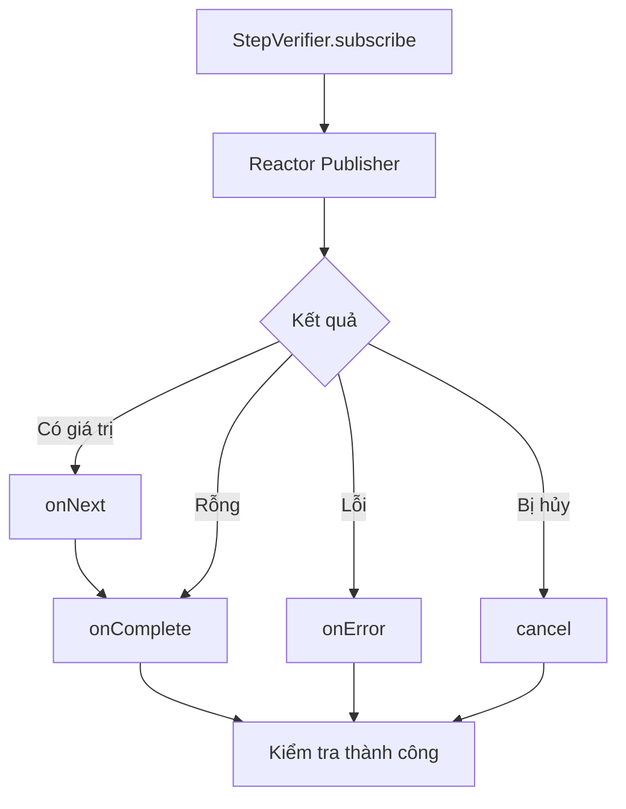

# Kiểm thử Reactor bằng StepVerifier trong Spring Vault

## 1. Vì sao cần StepVerifier khi kiểm thử Spring Vault reactive?

Trong module **SPRING_VAULT**, ứng dụng Java có thể đọc KV secrets, quản lý token và lease, mã hóa bằng Transit hoặc xin chứng thư PKI từ HashiCorp Vault. Với cách lập trình phản ứng (reactive), thay vì nhận ngay một đối tượng từ `VaultTemplate` đồng bộ, ứng dụng thường làm việc với `ReactiveVaultTemplate` hoặc giao diện `ReactiveVaultOperations` và các publisher Reactor như `Mono<T>`, `Flux<T>`.

Một phương thức trả `Mono<VaultResponse>` không có nghĩa request đã hoàn tất tại lúc phương thức được gọi. Publisher mô tả chuỗi xử lý; việc phát dữ liệu hoặc lỗi thường diễn ra sau **subscription**. Vì vậy một unit test chỉ so sánh `mono != null` hoặc chỉ gọi phương thức rồi kết thúc sẽ bỏ qua hành vi quan trọng nhất.

**StepVerifier** (thuộc module `reactor-test`) tạo subscription và kiểm tra **tín hiệu Reactor** theo thứ tự: `onSubscribe`, `onNext`, `onError` và `onComplete`. Nó còn hỗ trợ virtual time, cancellation và kiểm tra request/backpressure khi phù hợp.

Sau bài học, bạn sẽ có thể:

1. Kiểm thử luồng `Mono` thành công, rỗng và lỗi trong service Spring Vault.
2. Kiểm tra chuyển đổi cấu trúc response KV v2, bao gồm dữ liệu không hợp lệ.
3. Xác minh logic retry/backoff và timeout bằng **virtual time**, không ngủ thật.
4. Kiểm thử cancellation, tính lazy và phân biệt `Mono` với `Flux`.
5. Biết phần nào dùng Mockito/unit test, phần nào cần Vault thật hoặc Testcontainers để kiểm tra auth, ACL và lease.

## 2. Ôn tập tín hiệu Reactor trước khi viết test

| Publisher | Dạng tín hiệu hợp lệ | Kiểm tra StepVerifier thường dùng |
| --- | --- | --- |
| `Mono<T>` có giá trị | `onNext(value) → onComplete` | `expectNext(value).verifyComplete()` |
| `Mono<T>` rỗng | `onComplete`, không có `onNext` | `verifyComplete()` |
| `Mono<T>` lỗi | `onError(exception)`, không có `onComplete` sau đó | `expectError(...).verify()` |
| `Flux<T>` | 0..N lần `onNext`, rồi complete **hoặc** error | `expectNextCount(n)`, `thenRequest(n)` khi kiểm tra demand |
| Publisher bị cancel | Subscription kết thúc từ phía subscriber | `thenCancel().verify()` |

**Một stream không thể đồng thời kết thúc bằng `onComplete` và `onError`**. Khi đã phát lỗi, các thao tác phía sau trong chuỗi thông thường sẽ không chạy, trừ khi có operator xử lý hoặc thay thế lỗi như `onErrorResume`.



Trong Spring Vault reactive, cần phân biệt **không có dữ liệu** và **lỗi**. Một response `Mono.empty()` có thể biểu thị không tìm thấy dữ liệu, nhưng HTTP 403 do token không hợp lệ hoặc thiếu ACL không nên được biến thành secret rỗng để ứng dụng tiếp tục chạy với giá trị mặc định thiếu an toàn.

## 3. Dependency và bố trí kiểm thử

Với Maven, dự án cần Reactor Test và JUnit/Mockito nếu dùng mock:

```xml
<dependencies>
    <!-- Reactor StepVerifier; phiên bản do BOM Spring/Reactor quản lý -->
    <dependency>
        <groupId>io.projectreactor</groupId>
        <artifactId>reactor-test</artifactId>
        <scope>test</scope>
    </dependency>
    <dependency>
        <groupId>org.springframework.boot</groupId>
        <artifactId>spring-boot-starter-test</artifactId>
        <scope>test</scope>
    </dependency>
</dependencies>
```

Với Gradle:

```groovy
dependencies {
    testImplementation("io.projectreactor:reactor-test")
    testImplementation("org.springframework.boot:spring-boot-starter-test")
}
```

Đây chỉ là **đoạn dependency minh họa**, không thay thế file build hiện tại. Dự án cần có Spring Vault và các thành phần reactive tương ứng trong dependencies ứng dụng. Nên sử dụng Spring Boot BOM hoặc dependency management để giữ phiên bản Reactor, Spring Vault và Spring Framework tương thích; không tự điền một phiên bản mới nhất tùy ý.

Một cách phân lớp kiểm thử hiệu quả:

| Loại test | Thành phần thật | Thành phần giả lập | Điều được kiểm tra |
| --- | --- | --- | --- |
| Unit test | Service có pipeline Reactor | `ReactiveVaultOperations` hoặc adapter | Mapping dữ liệu, tín hiệu empty/error, retry logic |
| Contract/component test | HTTP client, serializer và adapter | HTTP server mô phỏng theo hợp đồng Vault | Method/path/JSON/status code và lỗi HTTP |
| Integration test | Spring Vault reactive và Vault test | Secrets/roles dữ liệu thử nghiệm | Auth, ACL, KV v2, Transit/PKI, token/lease và sự kiện thực |

StepVerifier **không thay thế** integration test: mock `Mono.just(...)` chỉ cho thấy pipeline xử lý đúng những tín hiệu giả định. Nó không chứng minh Vault API trả đúng schema, role có policy phù hợp hoặc token được renew thành công.

## 4. Ví dụ service: đọc cờ tính năng trong KV v2

Giả sử KV v2 đã được mount tại `kv/`, ứng dụng cần đọc secret `orders/config` có dữ liệu JSON:

```json
{
  "enabled": true
}
```

Ở API KV v2 cấp thấp, logical path đọc dữ liệu là `kv/data/orders/config`. Response Vault thường lồng dữ liệu thực ở `response.data.data` và metadata phiên bản ở `response.data.metadata`.

Ta xây một service Java 17+ sử dụng `ReactiveVaultOperations`, kiểm tra schema chặt chẽ và **không tự động trả `false` khi xảy ra lỗi**:

```java
import java.util.Map;

import org.springframework.stereotype.Service;
import org.springframework.vault.core.ReactiveVaultOperations;
import org.springframework.vault.support.VaultResponse;
import reactor.core.publisher.Mono;

@Service
public class FeatureFlagReader {

    static final String PATH = "kv/data/orders/config";

    private final ReactiveVaultOperations vault;

    public FeatureFlagReader(ReactiveVaultOperations vault) {
        this.vault = vault;
    }

    public Mono<Boolean> enabled() {
        return vault.read(PATH)
                .switchIfEmpty(Mono.error(
                        new IllegalStateException(
                                "Required orders configuration is missing")))
                .map(this::extractEnabled);
    }

    private Boolean extractEnabled(VaultResponse response) {
        Map<String, Object> envelope = response.getData();
        if (envelope == null) {
            throw new IllegalStateException("Missing KV response data");
        }

        Object rawSecret = envelope.get("data");
        if (!(rawSecret instanceof Map<?, ?> secret)) {
            throw new IllegalStateException("Unexpected KV v2 schema");
        }

        Object enabled = secret.get("enabled");
        if (!(enabled instanceof Boolean value)) {
            throw new IllegalStateException("Expected boolean enabled");
        }
        return value;
    }
}
```

**Giả định của ví dụ:** response JSON đã được Spring Vault ánh xạ thành `VaultResponse`. Không có secret thực trong ví dụ. Trong ứng dụng thông thường, API KV chuyên biệt của Spring Vault có thể giúp xử lý version/path KV v2; dùng API tổng quát ở đây để dễ nhìn thấy kiểu dữ liệu đi qua `Mono`.

Do `map(this::extractEnabled)` chạy khi có tín hiệu dữ liệu, một exception ném từ `extractEnabled` sẽ đi xuống stream dưới dạng **`onError`**. Điều đó giúp kiểm tra cả dữ liệu sai schema bằng StepVerifier.

## 5. Unit test đầu tiên: kỳ vọng onNext rồi onComplete

Test với JUnit Jupiter và Mockito:

```java
import static org.junit.jupiter.api.Assertions.assertEquals;
import static org.mockito.Mockito.mock;
import static org.mockito.Mockito.when;

import java.util.Map;

import org.junit.jupiter.api.BeforeEach;
import org.junit.jupiter.api.Test;
import org.springframework.vault.core.ReactiveVaultOperations;
import org.springframework.vault.support.VaultResponse;
import reactor.core.publisher.Mono;
import reactor.test.StepVerifier;

class FeatureFlagReaderTest {

    private ReactiveVaultOperations vault;
    private FeatureFlagReader reader;

    @BeforeEach
    void setUp() {
        vault = mock(ReactiveVaultOperations.class);
        reader = new FeatureFlagReader(vault);
    }

    private static VaultResponse kvResponse(Object enabled) {
        VaultResponse response = new VaultResponse();
        response.setData(Map.of(
                "data", Map.of("enabled", enabled),
                "metadata", Map.of("version", 1)
        ));
        return response;
    }

    @Test
    void emitsBooleanThenCompletes() {
        when(vault.read(FeatureFlagReader.PATH))
                .thenReturn(Mono.just(kvResponse(true)));

        StepVerifier.create(reader.enabled())
                .expectNext(true)
                .verifyComplete();
    }

    @Test
    void canAssertNextValue() {
        when(vault.read(FeatureFlagReader.PATH))
                .thenReturn(Mono.just(kvResponse(false)));

        StepVerifier.create(reader.enabled())
                .assertNext(value -> assertEquals(false, value))
                .verifyComplete();
    }
}
```

Mẫu `expectNext(true)` có hai khẳng định: stream phát chính xác giá trị `true` tại bước đó và sau đó kết thúc thành công. Nếu service phát `false`, không phát dữ liệu, phát thêm dữ liệu hoặc ném lỗi, StepVerifier báo test không đạt.

Lệnh `verifyComplete()` **không chỉ so sánh một giá trị Java**: nó subscribe, chạy pipeline và đợi tín hiệu hoàn tất. Đây là khác biệt chính so với một test chỉ khẳng định publisher khác `null`.

## 6. Kiểm thử empty, schema lỗi và onError

### 6.1. Response rỗng phải được xử lý có chủ đích

Service đã định nghĩa thiếu cấu hình bắt buộc là lỗi. Vì vậy `Mono.empty()` phải tạo `onError`:

```java
@Test
void emptyVaultResultFailsClosed() {
    when(vault.read(FeatureFlagReader.PATH))
            .thenReturn(Mono.empty());

    StepVerifier.create(reader.enabled())
            .expectErrorMatches(error ->
                    error instanceof IllegalStateException
                    && error.getMessage().contains("configuration is missing"))
            .verify();
}
```

Không dùng `expectNext(null)`: Reactor không cho phép một tín hiệu `onNext(null)`. Một `Mono` không có giá trị sẽ **complete rỗng**, không phát `null`. Khi API có quyền trả response vắng mặt, có thể kiểm thử trực tiếp bằng `StepVerifier.create(Mono.empty()).verifyComplete()`, nhưng service nghiệp vụ phải quyết định có chấp nhận vắng mặt hay không.

### 6.2. Schema KV v2 không đúng

```java
@Test
void unexpectedTypeProducesError() {
    when(vault.read(FeatureFlagReader.PATH))
            .thenReturn(Mono.just(kvResponse("true")));

    StepVerifier.create(reader.enabled())
            .expectErrorMatches(error ->
                    error instanceof IllegalStateException
                    && error.getMessage().contains("Expected boolean"))
            .verify();
}
```

Ở ví dụ trên, string `"true"` không giống boolean JSON `true`. Test này bắt được lỗi mapping khi người viết code ép kiểu hoặc fallback không kiểm soát.

### 6.3. Lỗi Vault phải đi qua stream

```java
@Test
void propagatesVaultFailure() {
    when(vault.read(FeatureFlagReader.PATH))
            .thenReturn(Mono.error(
                    new IllegalStateException("Simulated Vault failure")));

    StepVerifier.create(reader.enabled())
            .expectErrorMatches(error ->
                    error instanceof IllegalStateException
                    && error.getMessage().contains("Simulated Vault failure"))
            .verify();
}
```

Đây là lỗi mô phỏng nhằm kiểm tra pipeline, **không phải cách Spring Vault nhất thiết biểu diễn HTTP 403**. Trong integration test, nên dùng lỗi HTTP/exception đúng với thư viện đang chạy để kiểm tra cách phân loại authn, ACL denial, timeout và lỗi 5xx.

| Tình huống | Publisher giả lập | Kỳ vọng |
| --- | --- | --- |
| KV trả dữ liệu hợp lệ | `Mono.just(kvResponse(true))` | `expectNext(true).verifyComplete()` |
| Endpoint không có dữ liệu | `Mono.empty()` | Service chuyển sang lỗi thiếu cấu hình |
| Schema sai kiểu | `Mono.just(kvResponse("true"))` | `expectErrorMatches(...)` |
| Vault từ chối hoặc lỗi hệ thống | `Mono.error(cause)` | Error được giữ/phân loại an toàn |

## 7. Subscription, tính lazy và kiểm thử số lần gọi

Một publisher Reactor thường là **cold**: không chạy phần việc bên trong đến khi được subscribe. Điều này rất quan trọng cho Vault, vì request đọc dynamic credential có thể tạo lease mới, còn một POST Transit/PKI có thể tạo tài nguyên.

```java
import static org.junit.jupiter.api.Assertions.assertEquals;
import static org.mockito.Mockito.when;

import java.util.concurrent.atomic.AtomicInteger;

import org.junit.jupiter.api.Test;
import reactor.core.publisher.Mono;
import reactor.test.StepVerifier;

@Test
void startsWorkOnlyOnSubscription() {
    AtomicInteger subscriptions = new AtomicInteger();

    when(vault.read(FeatureFlagReader.PATH))
            .thenReturn(Mono.defer(() -> {
                subscriptions.incrementAndGet();
                return Mono.just(kvResponse(true));
            }));

    Mono<Boolean> pipeline = reader.enabled();
    assertEquals(0, subscriptions.get());

    StepVerifier.create(pipeline)
            .expectNext(true)
            .verifyComplete();
    assertEquals(1, subscriptions.get());
}
```

Ví dụ dùng `Mono.defer` để mô phỏng thao tác **phát sinh khi subscription xảy ra**. Việc Java gọi `vault.read(PATH)` để **tạo publisher** vẫn có thể xảy ra khi lắp pipeline; test đang đo công việc trong `defer`, không khẳng định phương thức `read` của mock chỉ được gọi tại subscription.

Đừng dùng `subscribe()` trong service rồi trả một `Mono` khác: khó kiểm soát lỗi, cancellation, context và lifecycle. Hãy **trả publisher** cho caller và để lớp ngoài quản lý subscription.

## 8. Kiểm thử retry bằng StepVerifier.withVirtualTime

Khi Vault gặp lỗi tạm thời (mất kết nối, 429 hoặc 5xx), một pipeline có thể dùng Reactor `retryWhen(Retry.backoff(...))`. Kiểm thử bằng `Thread.sleep` vừa chậm vừa dễ flake.

**Virtual time** thay thế scheduler hỗ trợ thời gian ảo trong quá trình verify. Ví dụ dưới đây giả lập hai lần lỗi tạm thời và lần thứ ba thành công; không hề gọi Vault thật:

```java
import static org.junit.jupiter.api.Assertions.assertEquals;

import java.time.Duration;
import java.util.concurrent.TimeoutException;
import java.util.concurrent.atomic.AtomicInteger;

import org.junit.jupiter.api.Test;
import reactor.core.publisher.Mono;
import reactor.test.StepVerifier;
import reactor.util.retry.Retry;

@Test
void retriesTransientFailureWithVirtualTime() {
    AtomicInteger attempts = new AtomicInteger();

    StepVerifier.withVirtualTime(() ->
            Mono.defer(() -> {
                int attempt = attempts.incrementAndGet();
                if (attempt < 3) {
                    return Mono.<String>error(
                            new TimeoutException("Simulated temporary failure"));
                }
                return Mono.just("ok");
            }).retryWhen(Retry.backoff(2, Duration.ofSeconds(2))
                    .jitter(0.0))
    )
    .expectSubscription()
    .thenAwait(Duration.ofSeconds(6))
    .expectNext("ok")
    .verifyComplete();

    assertEquals(3, attempts.get());
}
```

`Retry.backoff(2, 2 giây)` cho tối đa hai lần **retry sau lần gọi đầu tiên**. Khi jitter bị tắt cho test, lịch chờ minh họa là 2 giây rồi 4 giây, tổng cộng 6 giây **ảo**. Thời gian chính xác phụ thuộc cấu hình retry và scheduler; khi sửa cấu hình backoff, hãy cập nhật kỳ vọng test.

Các lưu ý:

- Truyền **supplier** vào `withVirtualTime(() -> ...)` để publisher và các operator liên quan đến scheduler được tạo **sau khi virtual scheduler đã được cài**. Tạo pipeline hẹn giờ từ bên ngoài supplier có thể dẫn đến test vẫn đợi thời gian thật.
- Dùng `jitter(0.0)` trong test thời gian để kết quả xác định. Trong production, jitter giúp giảm nguy cơ nhiều pod retry cùng nhịp.
- Nếu test treo hoặc chạy thời gian thực bất ngờ, kiểm tra operator có dùng scheduler ngoài Reactor virtual time không.
- Không coi ví dụ retry lỗi `TimeoutException` là policy áp dụng cho mọi endpoint Vault. Quyết định retry cần dựa trên mã lỗi, idempotency và mục đích nghiệp vụ.

### 8.1. Không retry ACL denial hay lỗi login cố định

HTTP 403 từ Vault có thể có hai nguyên nhân: token không được chấp nhận hoặc ACL thiếu quyền. **Không tự động retry vô hạn** và không dùng `retryWhen(Retry.backoff(...))` cho mọi `Throwable` trong pipeline:

- Token hết hạn: session manager có thể reauthenticate theo workload khi được cấu hình hợp lệ và có giới hạn.
- Token còn hợp lệ nhưng thiếu `read/update/list`: phải kiểm tra policy và logical path; retry không sửa được ACL.
- Login với JWT/Secret ID không hợp lệ: gửi lặp lại credential cũ thường không giải quyết lỗi.
- Request tạo credential/datakey/chứng thư: retry sau timeout có thể sinh nhiều tài nguyên hoặc lease.

Nếu xây predicate retry, chỉ cho phép **nhóm lỗi đã được phân loại rõ là tạm thời**; luôn giới hạn số lần, timeout và backoff. Test cần chứng minh lỗi 403 không bị retry, nhưng không giả định chỉ cần đọc exception message là xác định được authn hay authz.

### 8.2. Timeout bằng virtual time

```java
import java.time.Duration;
import java.util.concurrent.TimeoutException;

import org.junit.jupiter.api.Test;
import reactor.core.publisher.Mono;
import reactor.test.StepVerifier;

@Test
void timeoutBecomesOnError() {
    StepVerifier.withVirtualTime(() ->
            Mono.<String>never()
                    .timeout(Duration.ofSeconds(3)))
            .expectSubscription()
            .thenAwait(Duration.ofSeconds(3))
            .expectError(TimeoutException.class)
            .verify();
}
```

Đây là test operator Reactor, **không đo timeout kết nối TCP hoặc HTTP của Vault**. Với kết nối thật, vẫn phải cấu hình connect/read timeout của HTTP client, và integration test xử lý lỗi network phù hợp.

## 9. Cancellation, backpressure và tài nguyên

### 9.1. Cancellation của publisher

```java
import static org.junit.jupiter.api.Assertions.assertTrue;

import java.util.concurrent.atomic.AtomicBoolean;

import org.junit.jupiter.api.Test;
import reactor.core.publisher.Mono;
import reactor.test.StepVerifier;

@Test
void verifiesCancellationSignal() {
    AtomicBoolean cancelled = new AtomicBoolean();
    Mono<String> pending = Mono.<String>never()
            .doOnCancel(() -> cancelled.set(true));

    StepVerifier.create(pending)
            .expectSubscription()
            .thenCancel()
            .verify();

    assertTrue(cancelled.get());
}
```

Ví dụ này chứng minh tín hiệu **cancel** lan qua publisher giả lập. Với Vault thật, việc client cancel không đồng nghĩa request đã được hủy trên server hoặc lease/tài nguyên đã được revoke. Nếu một lời gọi cấp dynamic credential được Vault xử lý trước khi cancel, credential có thể đã tồn tại; cần chiến lược quản lý lease/cleanup độc lập.

### 9.2. Backpressure trên Flux

Các thao tác đơn lẻ của ReactiveVault thường dùng `Mono` nên chỉ phát tối đa một giá trị. Với một pipeline ứng dụng dùng `Flux`, StepVerifier có thể kiểm tra demand:

```java
import org.junit.jupiter.api.Test;
import reactor.core.publisher.Flux;
import reactor.test.StepVerifier;

@Test
void respectsRequestedDemand() {
    StepVerifier.create(Flux.just("kv", "transit"), 0)
            .expectSubscription()
            .thenRequest(1)
            .expectNext("kv")
            .thenRequest(1)
            .expectNext("transit")
            .verifyComplete();
}
```

Test này chứng minh cơ chế request của Reactor đối với `Flux.just`, **không chứng minh Vault tự hỗ trợ streaming hoặc server-side backpressure**. Nếu dùng `Flux.flatMap` để gọi nhiều path Vault song song, cần giới hạn concurrency, quản lý lease/tác dụng phụ và ngăn quá tải Vault.

## 10. Tách logic retry khỏi API để kiểm thử an toàn

Trong production, một service gọi Vault thường cần phân loại lỗi HTTP trước khi retry. Cách thiết kế dễ test là:

1. Để adapter Spring Vault trả `Mono<T>` và không che giấu exception gốc trước tầng phân loại.
2. Chuyển exception thành nhóm lỗi nội bộ có nghĩa (ví dụ `TEMPORARY_UNAVAILABLE`, `ACL_DENIED` hoặc `TOKEN_EXPIRED`) dựa trên thông tin endpoint/status đáng tin cậy.
3. Áp dụng retry **chỉ** cho `TEMPORARY_UNAVAILABLE`, có budget và giới hạn concurrency.
4. Dùng StepVerifier kiểm tra số subscription và hành vi cuối cùng.
5. Dùng integration test Vault thật để xác minh mapping từ HTTP response sang nhóm lỗi.

Ví dụ predicate minh họa, dùng exception của **ứng dụng**, không tự suy từ một chuỗi message Vault:

```java
import java.time.Duration;

import reactor.core.publisher.Mono;
import reactor.util.retry.Retry;

enum VaultFailureKind {
    TEMPORARY_UNAVAILABLE,
    ACL_DENIED,
    AUTHENTICATION_REJECTED
}

final class VaultCallFailure extends RuntimeException {
    private final VaultFailureKind kind;

    VaultCallFailure(VaultFailureKind kind, String message) {
        super(message);
        this.kind = kind;
    }

    VaultFailureKind kind() {
        return kind;
    }
}

class VaultRetryPolicy {
    static <T> Mono<T> retryTemporary(Mono<T> source) {
        return source.retryWhen(
                Retry.backoff(2, Duration.ofMillis(200))
                        .filter(error ->
                                error instanceof VaultCallFailure failure
                                && failure.kind()
                                        == VaultFailureKind.TEMPORARY_UNAVAILABLE));
    }
}
```

Trong thực tế có thể phân loại dựa trên các exception/status mà phiên bản Spring Vault/Spring WebClient phát ra. Không trích nguyên `exception.getMessage()` làm tiêu chí hoặc ghi request/response thô ra log vì chúng có thể chứa đường dẫn và dữ liệu nhạy cảm.

### 10.1. Test chứng minh ACL denial không bị retry

```java
import static org.junit.jupiter.api.Assertions.assertEquals;

import java.util.concurrent.atomic.AtomicInteger;
import org.junit.jupiter.api.Test;
import reactor.core.publisher.Mono;
import reactor.test.StepVerifier;

@Test
void doesNotRetryAclDenial() {
    AtomicInteger attempts = new AtomicInteger();
    Mono<String> source = Mono.defer(() -> {
        attempts.incrementAndGet();
        return Mono.error(new VaultCallFailure(
                VaultFailureKind.ACL_DENIED, "Access denied"));
    });

    StepVerifier.create(VaultRetryPolicy.retryTemporary(source))
            .expectErrorMatches(error ->
                    error instanceof VaultCallFailure failure
                    && failure.kind() == VaultFailureKind.ACL_DENIED)
            .verify();

    assertEquals(1, attempts.get());
}
```

Test thành công nếu chỉ có một subscription và stream giữ nguyên lỗi ACL. Đây là thuộc tính bảo mật quan trọng: **không thể giải quyết thiếu policy bằng cách thử lại hoặc tự nâng quyền**.

## 11. Bảo mật trong StepVerifier và test fixture

Dù là test, response Vault và assertion message có thể bị ghi vào báo cáo CI/CD. Với secret thật, lỗi StepVerifier có thể in giá trị `onNext` thực tế khi expectation khác với kết quả.

Thực hành an toàn:

- Unit test dùng **secret giả vô hại**, không dùng token hoặc password production.
- Không viết `assertNext(value -> System.out.println(value))` với `VaultResponse` chứa dữ liệu thật.
- Không đưa Vault token, JWT Kubernetes, AppRole Secret ID, private key PKI hay plaintext Transit data key vào test report.
- Khi kiểm tra lỗi 403, chỉ so sánh kiểu lỗi/nhóm lỗi/status đã chuẩn hóa; không snapshot toàn bộ HTTP response chứa metadata nhạy cảm.
- Với dynamic secret, ghi nhận **lease lifecycle** trong integration test và revoke/cleanup tài nguyên do test tạo.
- CI chạy Vault test với token phát hành riêng, TTL ngắn và mạng cô lập; không ghi token vào Git hoặc log build.

### 11.1. Không nhầm lỗi ACL với lỗi token

Các test tích hợp nên tạo **hai tình huống riêng**:

| Tình huống | Kỳ vọng Reactor | Điều đang được kiểm tra |
| --- | --- | --- |
| Token hợp lệ nhưng thiếu `read` KV v2 | `Mono` kết thúc bằng `onError` | Vault ACL từ chối đúng path |
| Login Kubernetes/AppRole sai thông tin | `Mono` kết thúc bằng lỗi trong giai đoạn lấy token | Xác thực không thành công |
| Token hết TTL/bị revoke | `Mono` lỗi hoặc session làm mới theo cấu hình | Token lifecycle/reauthentication |
| Vault tạm trả 5xx hoặc timeout | Pipeline có thể retry giới hạn | Resilience và backoff |

StepVerifier chỉ quan sát tín hiệu; để phân loại đúng cần biết **endpoint/giai đoạn** và logic adapter. Không kết luận `ACL_DENIED` chỉ vì thấy một `403` chung chung.

## 12. Kiểm thử tích hợp với Vault test/Testcontainers

Để kiểm tra behavior thực, có thể chạy HashiCorp Vault ở môi trường dev **cô lập** bằng Testcontainers hoặc một Vault test server. Cần giữ test độc lập với production và dọn sạch cấu hình sau test.

Một kịch bản thực hành:

1. Khởi tạo Vault test với **image version được pin** và token test riêng (chỉ dành cho container).
2. Bật KV v2 tại `kv/` và tạo secret `orders/config` có trường boolean `enabled`. Cấp policy chỉ đọc `kv/data/orders/*` cho token của client.
3. Tạo `ReactiveVaultTemplate` hoặc `ReactiveVaultOperations` trỏ đến endpoint/port được container publish, với cơ chế auth và HTTP client phù hợp; xác nhận SSL/namespace nếu môi trường có.
4. Dùng StepVerifier gọi service `FeatureFlagReader.enabled()` với token hợp lệ, kỳ vọng `true` và hoàn tất.
5. Dùng token thiếu `read` trên path đó, xác nhận tín hiệu lỗi và không rơi vào `Mono.empty()` hay giá trị mặc định.
6. Thử secret bị xóa, body/schema sai, token hết hạn hoặc bị revoke; kiểm tra tín hiệu và cách phân loại lỗi.
7. Với engine khác, tạo role test cho Transit/PKI/Database và kiểm tra tín hiệu cùng tác dụng phụ thực tế; revoke lease/thu hồi tài nguyên trong teardown.
8. Tắt Vault container/ngắt kết nối ở test dành riêng cho resilience để kiểm tra timeout và giới hạn retry.

Không cần `Thread.sleep` trong test operator khi có `withVirtualTime`, nhưng **integration test về network, TTL và lease thật** có thể phải đợi những sự kiện của hệ thống hoặc dùng cơ chế đồng bộ phù hợp. Virtual time của StepVerifier **không làm đồng hồ bên trong Vault server chạy nhanh hơn**.

### 12.1. Ma trận kiểm thử theo tính năng Spring Vault

| Tính năng | Test unit bằng StepVerifier | Test integration cần thêm |
| --- | --- | --- |
| KV v2 | Giá trị, empty, mapping sai, `onError` | Mount path, version, ACL, response thực |
| Workload auth/token | Lỗi session được truyền đúng, fallback/retry giới hạn | Kubernetes/AppRole login, token TTL, renew/revoke |
| Dynamic database credential | Dữ liệu trả về được parse, error handling | Lease được phát hành, TTL/renew, cleanup credential |
| Transit | Ciphertext/response mapping và lỗi | Key/role tồn tại, quyền encrypt/decrypt, rotation |
| PKI | Parse chứng thư/serial/expiry và errors | CSR, chain/role policy, ngày X.509 và revoke |
| System API | Response tổng quát, thiếu dữ liệu, 403 | Quyền `sudo` khi cần, ACL path, mount/auth thực |
| Resilience | Retry, virtual time, timeout/cancel | Rate limit, lỗi mạng và tác dụng phụ server |

## 13. Các bẫy thường gặp

| Sai lầm | Hệ quả | Cách sửa |
| --- | --- | --- |
| Test chỉ `assertNotNull(mono)` | Không subscribe; không kiểm tra tín hiệu | Dùng StepVerifier để verify stream |
| Kỳ vọng `Mono.empty()` phát `null` | Test không phản ánh Reactor contract | Dùng `verifyComplete()` với publisher rỗng |
| Thiếu terminal assertion | Test có thể không xác minh complete/error | Kết thúc bằng `verifyComplete()` hoặc `expectError(...).verify()` |
| Dùng `Thread.sleep` cho retry | Test chậm và dễ flake | `StepVerifier.withVirtualTime(...)`, xây publisher trong supplier |
| Retry mọi exception | 403 bị retry, phát sinh thêm lease/keys | Phân loại lỗi và giới hạn retry |
| Gọi `block()` bên trong pipeline reactive | Chặn luồng, mất lợi ích nonblocking | Chỉ subscribe ở boundary, giữ operator Reactor |
| Chỉ dùng mock để “kiểm tra ACL” | Không kiểm tra Vault thật | Thêm integration test với policy/token test |
| Dùng secret thật trong `expectNext(...)` | Lộ dữ liệu trong CI khi test fail | Dữ liệu giả, assert thuộc tính an toàn |
| Cho rằng cancel thu hồi lease | Tài nguyên trên Vault có thể vẫn tồn tại | Quản lý lease/revoke theo quy trình backend |
| Quên giới hạn `Flux.flatMap` | Tạo quá nhiều request cùng lúc | Giới hạn concurrency và theo dõi latency/429 |

## 14. Bài tập tự kiểm tra

**Bài 1 — Publisher rỗng:** Một repository trả `Mono.empty()` khi KV secret không tồn tại. Requirement: ứng dụng không được tiếp tục với cấu hình mặc định. Bạn nên dùng operator nào và StepVerifier nào?

**Gợi ý:** `switchIfEmpty(Mono.error(...))` ở service, sau đó `expectErrorMatches(...).verify()`.

**Bài 2 — Retry:** Vault trả lỗi tạm thời hai lần, lần thứ ba thành công. Bạn muốn kiểm thử backoff 2 giây rồi 4 giây mà không ngủ thật.

**Gợi ý:** Tạo publisher trong supplier của `withVirtualTime`, dùng `Mono.defer` đếm subscription và `Retry.backoff(2, Duration.ofSeconds(2)).jitter(0.0)`, sau đó `thenAwait(Duration.ofSeconds(6))` và `expectNext(...).verifyComplete()`.

**Bài 3 — ACL denial:** Token hợp lệ không có quyền `read` tại `kv/data/orders/config`. Dùng StepVerifier có thể chứng minh ACL Vault thật bị từ chối chỉ bằng `Mono.error(...)` được mock không?

**Đáp án:** Không. Mock chỉ chứng minh pipeline phản ứng thế nào khi nhận lỗi giả. Để khẳng định Vault ACL thực thi đúng, cần integration test với token, policy và endpoint Vault thật.

**Bài 4 — Cancellation:** Một GET cấp dynamic database credential đã đến Vault, sau đó subscriber cancel. Có thể chắc chắn tài khoản vừa cấp đã bị thu hồi không?

**Đáp án:** Không. Cancel là tín hiệu từ client Reactor, không phải lệnh revoke lease. Cần kiểm tra và dọn lease/credential theo API Vault và cơ chế backend.

## 15. Kết luận

**StepVerifier kiểm thử những gì một publisher phát ra, không chỉ giá trị trả về khi dựng publisher.** Trong Spring Vault reactive, hãy kiểm tra đầy đủ `onNext`, `onComplete`, `onError`, empty, retry, timeout và cancellation. Sử dụng virtual time cho operator dựa vào thời gian, mock adapter ở unit test, còn xác thực/ACL/token/lease/Transit/PKI thật phải kiểm tra bằng Vault test cô lập.

Thiết kế test tốt không chỉ giúp ứng dụng ổn định; nó còn duy trì **fail closed**, không retry lỗi quyền vô nghĩa, không lộ secret trong CI và không để test tạo tài nguyên Vault ngoài khả năng dọn dẹp.

### Tài liệu tham khảo

- [Project Reactor — Testing with StepVerifier](https://projectreactor.io/docs/core/release/reference/testing.html)
- [Reactor Test — StepVerifier API](https://projectreactor.io/docs/test/release/api/reactor/test/StepVerifier.html)
- [Spring Vault — Reactive VaultTemplate](https://docs.spring.io/spring-vault/reference/vault/reactive-template.html)
- [Spring Vault — Introduction to VaultTemplate](https://docs.spring.io/spring-vault/reference/vault/imperative-template.html)
- [HashiCorp Vault — HTTP API](https://developer.hashicorp.com/vault/api-docs)
