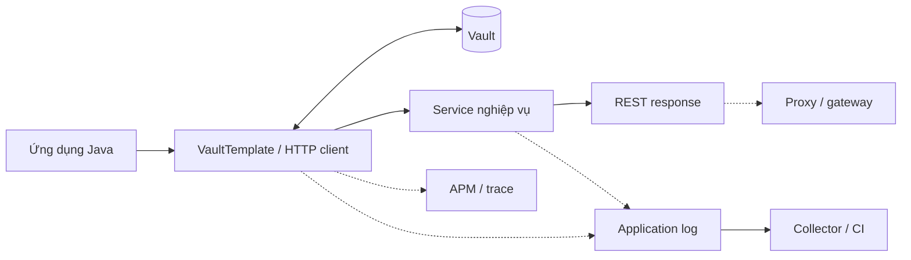

# Kiểm tra log và thông báo lỗi không chứa giá trị nhạy cảm

Ứng dụng Java dùng **Spring Vault** truy cập **HashiCorp Vault** qua `VaultTemplate` để đọc KV, đăng nhập theo workload, gọi Transit, cấp PKI và quản lý token/lease. Dù Vault có TLS và ACL, bí mật vẫn có thể lộ qua **application log, stack trace, HTTP error response, APM trace, proxy hoặc báo cáo CI** nếu ứng dụng ghi toàn bộ request/response khi thành công hoặc thất bại.

Bài thuộc chương **Kiểm thử** của module `SPRING_VAULT`. Mục tiêu là xây dựng quy tắc log an toàn và **kiểm thử tự động có canary** để chứng minh dữ liệu nhạy cảm không xuất hiện trong output, trong khi thông tin quan sát cần thiết vẫn được ghi.

## 1. Phân loại các giá trị không được ghi vào log

Không chỉ trường có tên `password` mới là secret. Trong hệ sinh thái Spring Vault, bí mật có thể ở request, header, response, DTO, metadata và exception.

| Nguồn | Giá trị cần bảo vệ | Đường rò rỉ thường gặp |
| --- | --- | --- |
| Kubernetes/AppRole auth | JWT, `secret_id`, `X-Vault-Token`, `VAULT_TOKEN`, `auth.client_token` | Log payload login, header, session object. |
| KV v1/v2 | Password, API key, signing key, connection string | `log.info("{}", response.getData())`. |
| Database dynamic secrets | Tài khoản/mật khẩu được cấp, lease metadata | Serialize `VaultResponse` hoặc sự kiện lease. |
| Transit | Plaintext Base64, context nhạy cảm, ciphertext nghiệp vụ | HTTP DEBUG/TRACE và APM spans. |
| PKI | `private_key`, khóa PEM, CSR, certificate metadata | Log nguyên response `pki/issue`. |
| Response wrapping | `wrap_info.token`, wrapping token truyền cho `unwrap` | Log token được bàn giao dùng một lần. |
| API/namespace | Path chứa tenant ID, mount/role nội bộ, request body | Access log, URL và nhãn metrics có giá trị động. |
| Exception | Raw body, headers, message và cause chain | `log.error("Vault error", ex)`; trả `ex.getMessage()` ra REST. |

Ciphertext Transit hoặc một certificate công khai không giống private key về mức độ nhạy cảm. Tuy vậy, **quy tắc mặc định** là không log bất kỳ nội dung nào từ Vault payload nếu chưa được phân loại và cho phép rõ ràng. Đặc biệt không bao giờ ghi token thật vào fixture test, source code hoặc output CI.

Một event được phép quan sát có dạng:

```json
{
  "event": "vault_kv_read_failed",
  "scope_alias": "orders-config",
  "operation": "kv_v2_read",
  "outcome": "error",
  "error_family": "permission",
  "duration_ms": 43,
  "request_id": "req-test-42"
}
```

`scope_alias` là tên cố định do server quản lý; `request_id` không được lấy từ token, SecretID hoặc input chưa xác minh. Không đưa raw Vault path chứa thông tin khách hàng vào event.

## 2. Mô hình rò rỉ: dữ liệu đi qua những đâu?



Mỗi tầng có log riêng. Một unit test của service không nhìn thấy mọi `RestTemplate` interceptor, Reactor Netty wiretap, Spring Cloud Vault startup logs, gateway access log, APM span hoặc Vault audit device.

Kiểm tra theo **hai hướng**: secret từ Vault được trả về bình thường; và lỗi phát sinh khi xác thực/đọc/decrypt/cấp credential. Đường thành công thường bị bỏ sót vì developer tạm log nguyên response để debug.

## 3. Thiết kế từ đầu: allowlist thay vì chỉ redaction

**Allowlist logging** là tạo sự kiện chỉ với field đã duyệt. Đừng ghi cả `VaultResponse`/`Throwable` rồi trông chờ một regex xóa mọi bí mật.

| Làm đúng | Cần tránh |
| --- | --- |
| `log.warn("event=vault_read_failed scope=orders")` | `log.warn("vault: {}", response)` |
| Log `error_family=permission` và status đã phân loại | `log.error("failed", exception)` nếu cause có thể chứa payload. |
| Mã lỗi API cố định, message chung | Trả nguyên error body từ Vault. |
| Metric theo operation và scope alias | Gắn token, raw path, tenant ID vào label. |
| Dùng canary giả ở môi trường test | Dùng credential thật rồi mong test không lộ. |

Ví dụ các thao tác **không an toàn**:

```java
// Không áp dụng:
log.debug("KV secrets: {}", vaultResponse.getData());
log.error("Vault read failed", originalException);
throw new ResponseStatusException(
        HttpStatus.SERVICE_UNAVAILABLE, originalException.getMessage());
```

`Throwable` có message và cause chain; một ngoại lệ của HTTP client có thể chứa raw response hoặc URL. Chỉ che `"password"` không đủ vì token có thể nằm ở `client_token`, wrapping token, private key, JSON lồng nhau hay dạng Base64/URL-encoded.

Redaction bằng regex ở appender có thể giúp giảm sự cố, nhưng **không thay thế** việc không tạo log nhạy cảm từ đầu.

## 4. Service Spring Vault: log trạng thái, không log secret

Ví dụ một bean `VaultOperations` (thường là `VaultTemplate`) đã được cấu hình TLS, namespace, authentication workload và Vault ACL tối thiểu. Service đọc KV v2 tại mount `config`, key `app/runtime`, chỉ đưa hostname cho logic nội bộ.

```java
import java.util.Map;
import org.slf4j.Logger;
import org.slf4j.LoggerFactory;
import org.springframework.stereotype.Service;
import org.springframework.vault.VaultException;
import org.springframework.vault.core.VaultOperations;
import org.springframework.vault.core.VaultKeyValueOperationsSupport.KeyValueBackend;
import org.springframework.vault.support.VaultResponse;

@Service
public final class SafeVaultConfigReader {

    private static final Logger log =
            LoggerFactory.getLogger(SafeVaultConfigReader.class);

    private final VaultOperations vault;

    public SafeVaultConfigReader(VaultOperations vault) {
        this.vault = vault;
    }

    public String readDbHost() {
        try {
            VaultResponse response = vault.opsForKeyValue(
                    "config", KeyValueBackend.KV_2).get("app/runtime");

            if (response == null || response.getData() == null) {
                log.warn("event=vault_kv_missing scope=orders-config");
                throw new SecretBackendUnavailableException();
            }

            Map<String, Object> data = response.getData();
            Object value = data.get("db-host");
            if (!(value instanceof String host) || host.isBlank()) {
                log.warn("event=vault_kv_invalid scope=orders-config");
                throw new SecretBackendUnavailableException();
            }

            log.info("event=vault_kv_read_ok scope=orders-config");
            return host; // Nội bộ; controller không trả field này cho user.
        } catch (VaultException ex) {
            // Không log ex, ex.getMessage(), raw HTTP body hoặc token.
            log.warn("event=vault_kv_failed scope=orders-config");
            throw new SecretBackendUnavailableException();
        }
    }
}

final class SecretBackendUnavailableException extends RuntimeException {
    SecretBackendUnavailableException() {
        super("SECRET_BACKEND_UNAVAILABLE");
    }
}
```

Ví dụ **không giữ `VaultException` làm cause** của ngoại lệ truyền sang API, vì nhiều hệ thống logging sẽ tự in cause khi exception bị bắt ở tầng trên. Đổi lại, cần thu thập metadata chẩn đoán an toàn như event code, status đã phân loại, latency và correlation ID. Lỗi lập trình ngoài `VaultException` cần được xử lý bởi global error handler an toàn, không nên bị im lặng hoặc retry vô hạn.

Đây là ví dụ về log hygiene, chưa quản lý TTL/lease của credential. Không xuất `VaultResponse` hoặc mật khẩu qua DTO API chỉ vì service đã không log nó.

## 5. Trả lỗi REST bằng hợp đồng ổn định

Với Spring MVC, nên trả body có tập field cho phép (`code`, `message`, một `requestId` đã kiểm soát); không đưa exception, stack trace, raw Vault path, header hoặc response vào JSON.

```java
import java.util.Map;
import org.springframework.http.HttpStatus;
import org.springframework.http.ResponseEntity;
import org.springframework.web.bind.annotation.ExceptionHandler;
import org.springframework.web.bind.annotation.GetMapping;
import org.springframework.web.bind.annotation.RestController;
import org.springframework.web.bind.annotation.RestControllerAdvice;

@RestControllerAdvice
class SafeVaultApiErrors {

    @ExceptionHandler(SecretBackendUnavailableException.class)
    ResponseEntity<Map<String, String>> unavailable() {
        return ResponseEntity.status(HttpStatus.SERVICE_UNAVAILABLE)
                .body(Map.of(
                    "code", "DEPENDENCY_UNAVAILABLE",
                    "message", "Không thể xử lý yêu cầu lúc này"));
    }
}

// Endpoint chỉ minh họa việc gọi reader và cách ánh xạ lỗi.
@RestController
class SafeDemoController {
    private final SafeVaultConfigReader reader;

    SafeDemoController(SafeVaultConfigReader reader) {
        this.reader = reader;
    }

    @GetMapping("/internal/config-ready")
    Map<String, String> ready() {
        reader.readDbHost();
        return Map.of("status", "ready");
    }
}
```

Response lỗi mẫu:

```http
HTTP/1.1 503 Service Unavailable
Content-Type: application/json

{"code":"DEPENDENCY_UNAVAILABLE",
 "message":"Không thể xử lý yêu cầu lúc này"}
```

Đây không phải thiết kế readiness nên sao chép ngay vào production: nếu probe gọi Vault quá thường xuyên, nó có thể tạo tải. Quyết định HTTP status cho API thật phải dựa trên hợp đồng nghiệp vụ; **không phải mọi lỗi Vault đều cần `503`**. Nếu ứng dụng còn exception khác, nên có error handler tổng quát trả mã lỗi không nhạy cảm thay vì trang stack trace.

## 6. Unit test: dùng canary và bắt log thật

`OutputCaptureExtension` của Spring Boot Test hỗ trợ bắt output của test. Kết hợp Mockito để giả lập `VaultOperations` và chèn **canary** giả vào response và exception. Phép thử phải chứng minh **event an toàn đã được ghi** đồng thời **canary không xuất hiện**.

```java
import static org.junit.jupiter.api.Assertions.*;
import static org.mockito.Mockito.*;

import java.util.Map;
import org.junit.jupiter.api.Test;
import org.junit.jupiter.api.extension.ExtendWith;
import org.springframework.boot.test.system.CapturedOutput;
import org.springframework.boot.test.system.OutputCaptureExtension;
import org.springframework.vault.VaultException;
import org.springframework.vault.core.VaultKeyValueOperations;
import org.springframework.vault.core.VaultOperations;
import org.springframework.vault.core.VaultKeyValueOperationsSupport.KeyValueBackend;
import org.springframework.vault.support.VaultResponse;

@ExtendWith(OutputCaptureExtension.class)
class VaultSensitiveLogTest {

    static final String FAKE_PASSWORD = "CANARY-PASSWORD-TEST-91";
    static final String FAKE_TOKEN = "CANARY-TOKEN-TEST-92";
    static final String FAKE_SECRET_ID = "CANARY-SECRET-ID-TEST-93";

    @Test
    void successDoesNotLogKvValues(CapturedOutput output) {
        VaultKeyValueOperations kv = mock(VaultKeyValueOperations.class);
        VaultResponse response = mock(VaultResponse.class);

        when(response.getData()).thenReturn(Map.of(
                "db-host", "db.test.internal",
                "db-password", FAKE_PASSWORD));
        when(kv.get("app/runtime")).thenReturn(response);

        assertEquals("db.test.internal", readerUsing(kv).readDbHost());
        assertTrue(output.getAll().contains("event=vault_kv_read_ok"));
        assertFalse(output.getAll().contains(FAKE_PASSWORD));
    }

    @Test
    void failureDoesNotLogExceptionValues(CapturedOutput output) {
        VaultKeyValueOperations kv = mock(VaultKeyValueOperations.class);
        when(kv.get("app/runtime")).thenThrow(new VaultException(
                "X-Vault-Token=" + FAKE_TOKEN
                + ", secret_id=" + FAKE_SECRET_ID));

        SecretBackendUnavailableException error = assertThrows(
                SecretBackendUnavailableException.class,
                () -> readerUsing(kv).readDbHost());

        assertEquals("SECRET_BACKEND_UNAVAILABLE", error.getMessage());
        assertNull(error.getCause());
        assertTrue(output.getAll().contains("event=vault_kv_failed"));
        assertFalse(output.getAll().contains(FAKE_TOKEN));
        assertFalse(output.getAll().contains(FAKE_SECRET_ID));
    }

    static SafeVaultConfigReader readerUsing(VaultKeyValueOperations kv) {
        VaultOperations vault = mock(VaultOperations.class);
        when(vault.opsForKeyValue("config", KeyValueBackend.KV_2))
                .thenReturn(kv);
        return new SafeVaultConfigReader(vault);
    }
}
```

Hai test này xác nhận đoạn code được mock; **chưa** kiểm chứng logging của HTTP client thật, proxy, APM hoặc Spring Cloud Vault. Nếu test dùng backend không phát log qua output mà `CapturedOutput` quan sát được, hãy cấu hình test logging phù hợp. Khi cần kiểm tra exception throwable proxy/MDC/JSON encoder, dùng `Logback ListAppender` hoặc kiểm tra event đã serialize ở collector, không chỉ `getFormattedMessage()`.

## 7. Unit test HTTP response: `MockMvc` và log cùng lúc

Dùng cùng canary giả trong một exception, gọi controller và xác minh **cả HTTP body lẫn output**. Việc không tìm thấy secret trong response không đủ nếu log vẫn chứa nó.

```java
import static org.junit.jupiter.api.Assertions.*;
import static org.mockito.Mockito.*;
import static org.springframework.test.web.servlet.request.MockMvcRequestBuilders.get;
import static org.springframework.test.web.servlet.result.MockMvcResultMatchers.status;

import org.junit.jupiter.api.Test;
import org.junit.jupiter.api.extension.ExtendWith;
import org.springframework.boot.test.system.CapturedOutput;
import org.springframework.boot.test.system.OutputCaptureExtension;
import org.springframework.test.web.servlet.MockMvc;
import org.springframework.test.web.servlet.setup.MockMvcBuilders;
import org.springframework.vault.VaultException;
import org.springframework.vault.core.VaultOperations;
import org.springframework.vault.core.VaultKeyValueOperations;
import org.springframework.vault.core.VaultKeyValueOperationsSupport.KeyValueBackend;

@ExtendWith(OutputCaptureExtension.class)
class VaultHttpErrorSafetyTest {

    @Test
    void apiAndLogsMustNotContainToken(CapturedOutput output)
            throws Exception {
        String canary = "CANARY-VAULT-TOKEN-TEST-94";

        VaultOperations vault = mock(VaultOperations.class);
        VaultKeyValueOperations kv = mock(VaultKeyValueOperations.class);
        when(vault.opsForKeyValue("config", KeyValueBackend.KV_2))
                .thenReturn(kv);
        when(kv.get("app/runtime")).thenThrow(
                new VaultException("X-Vault-Token=" + canary));

        SafeVaultConfigReader reader = new SafeVaultConfigReader(vault);
        MockMvc mvc = MockMvcBuilders
                .standaloneSetup(new SafeDemoController(reader))
                .setControllerAdvice(new SafeVaultApiErrors())
                .build();

        String body = mvc.perform(get("/internal/config-ready"))
                .andExpect(status().isServiceUnavailable())
                .andReturn().getResponse().getContentAsString();

        assertTrue(body.contains("DEPENDENCY_UNAVAILABLE"));
        assertTrue(output.getAll().contains("event=vault_kv_failed"));
        assertFalse(body.contains(canary));
        assertFalse(output.getAll().contains(canary));
        assertFalse(body.contains("X-Vault-Token"));
    }
}
```

Có thể tăng độ chặt bằng cách parse JSON và **assert tập field chỉ gồm `code`, `message`** thay vì chỉ tìm substring. Đồng thời xem HTTP response headers có thông tin nhạy cảm hay không. Canary dùng trong test là chuỗi giả; không lấy token thật để “thử cho sát production”.

## 8. Các đường thành công cần kiểm thử riêng

Nhiều hệ thống chỉ kiểm tra log khi gọi Vault thất bại mà bỏ sót các đường thành công:

- **KV v2:** secret chứa password, API key, connection string; không log `getData()`, JSON hoặc object `VaultResponse`.
- **AppRole/Kubernetes auth:** response thành công có `.auth.client_token`; login payload có SecretID/JWT; không in request/response.
- **Transit:** `plaintext` trước khi Base64, `context`, ciphertext trả về và input decrypt; cấm payload trong HTTP trace.
- **PKI:** `private_key` dạng PEM, CSR/certificate chain hoặc data cấp phát; không serializing response vào logger.
- **Database dynamic credentials:** không log username/password, kể cả khi ghi event lease/rotation.
- **Response wrapping:** không in `.wrap_info.token` hoặc token dùng cho `sys/wrapping/unwrap`; token một lần vẫn là bí mật.

Kiểm thử thành công phải đặt canary vào **đúng trường dữ liệu được trả về**, rồi kiểm tra output của logger/HTTP instrumentation; tránh chỉ mock một exception không chứa secret.

## 9. Ma trận kiểm thử bảo mật log

| Mã | Kịch bản | Sink kiểm tra | PASS khi |
| --- | --- | --- | --- |
| S01 | KV thành công trả `password` giả | Application log | Không có canary; có event thành công. |
| S02 | Vault exception có `X-Vault-Token` giả | App log và cause chain serialized | Không in token; log safe error code. |
| S03 | `403` khi đọc KV | REST body/header | Không lộ path, token, raw Vault body. |
| S04 | AppRole login có SecretID | Client/auth logs | Không in SecretID. |
| S05 | Auth response chứa `client_token` | Startup log | Không log session token. |
| S06 | Transit plaintext/ciphertext/context | Application/APM logs | Không chứa dữ liệu nghiệp vụ. |
| S07 | PKI response có private-key marker | Log + CI artifacts | Không có PEM private key. |
| S08 | Dynamic DB password | Lease/metrics | Chỉ thông tin trạng thái không nhạy cảm. |
| S09 | Wrapping token được cấp và unwrap | Log + error response | Token không bị ghi. |
| S10 | Namespace/path chứa tenant ID giả | Trace/metric labels | Không đưa ID nhạy cảm vào tag. |
| S11 | Vault `429`, `503`, timeout | Retry/error logs | Không chứa raw response/headers. |
| S12 | JSON encoder với MDC/throwable | Log collector | Field allowlist, không có payload. |
| S13 | Actuator `/env`, `/configprops` | Endpoint quản trị | Không công khai token/config secret. |
| S14 | Proxy hoặc HTTP wire logging | Ingress/APM backend test | Không log body/auth header. |
| S15 | JUnit thất bại có chủ ý | CI report | Không đưa credential thật vào artifact. |
| S16 | Nhiều tenant/namespace | Aggregated logs | Không trộn giá trị nhạy cảm giữa scope. |

**Để tránh dương tính giả**, mỗi test cần: (1) canary thật sự đi qua code path; (2) có positive control event/status xác nhận nhánh đã chạy; (3) kiểm tra sink cuối cùng chứ không chỉ logger trung gian; (4) phân biệt thất bại do Vault trả lỗi với DNS/TLS/timeout của môi trường test.

## 10. Cấu hình Spring Boot: giảm bề mặt logging

Cấu hình nền tảng nên giữ HTTP client/Vault ở mức logging phù hợp, tắt phản hồi lỗi có thông điệp/stack trace và hạn chế Actuator:

```yaml
logging:
  level:
    root: INFO
    org.springframework.vault: INFO
    org.springframework.web.client: INFO
    reactor.netty.http.client: INFO

server:
  error:
    include-message: never
    include-stacktrace: never
    include-binding-errors: never

management:
  endpoints:
    web:
      exposure:
        include: health,info,prometheus
  endpoint:
    env:
      show-values: never
```

**Đây không phải một cơ chế che secret tuyệt đối.** `INFO` vẫn có thể chứa mật khẩu nếu service chủ động log nó. HTTP interceptors, `WebClient` filters, Reactor Netty wiretap, proxy, API gateway, agent và APM có cơ chế riêng. Actuator cần Spring Security/network ACL; `health`/`info` cũng phải được xem xét dữ liệu trả về.

Kiểm tra `logback-spring.xml`, JSON encoder, MDC, Spring Cloud Vault bootstrap và cơ chế error serialization thực tế. Nếu cần mở DEBUG để chẩn đoán, không bật raw body hoặc header chứa token ở môi trường có secret thật.

## 11. Integration test với Vault thật

Mockito chứng minh logic của service; **integration test** chứng minh đường Spring Vault/HTTP logging thực tế. Dùng Vault dev/Testcontainers **trong môi trường cô lập**, token chỉ dành cho test và dữ liệu canary.

1. Provision KV v2 test với password và API key giả. Cấp workload token có policy tối thiểu.
2. Khởi tạo `VaultTemplate` bằng HTTP client thực; đọc KV thành công rồi xác nhận application logs không có canary.
3. Tạo lỗi có kiểm soát: thiếu ACL, path 404, Transit ciphertext không hợp lệ, PKI role sai, token bị revoke, timeout.
4. Thu stdout/stderr của ứng dụng, log đã đi qua encoder, HTTP error body và trace/proxy output nếu hệ thống có.
5. Quét canary theo dạng gốc, Base64, URL-encoded và JSON escaping, kể cả trong stack trace và metadata.
6. Kiểm tra event code an toàn, HTTP status đúng và không có credential trong CI artifacts.

Ví dụ chỉ dùng giá trị giả:

```bash
# Giả định đã bật mount KV v2 "config-test" ở Vault lab.
vault kv put -mount=config-test log-check \
  password=CANARY-DB-PASSWORD-ONLY-FOR-TEST \
  api-key=CANARY-API-KEY-ONLY-FOR-TEST

# Chỉ chạy với token test có quyền đọc.
vault kv get -mount=config-test log-check
```

Lệnh cuối **in canary ra terminal**, chỉ phù hợp cho fixture giả; tuyệt đối không thay canary bằng mật khẩu thật. Tránh `set -x` hoặc artifact chứa raw stdout của lệnh quản lý secret trong CI.

`CapturedOutput` không thấy log của gateway hay APM. Test end-to-end cần kiểm tra output từ sink thử nghiệm nhưng tránh sao chép request Vault production sang hệ thống log mới chỉ để kiểm thử. **Vault audit log** là một kênh riêng: Vault áp dụng HMAC cho nhiều trường tùy cấu hình audit device, nhưng cần kiểm tra field được miễn HMAC, quyền đọc sink và chính sách lưu trữ; không mặc nhiên coi mọi audit log là không nhạy cảm.

## 12. Kiểm tra biến thể và dữ liệu đã biến đổi

Secret có thể được đưa qua nhiều cách encode/format khác nhau. Tìm chỉ chuỗi gốc đôi khi bỏ sót.

| Biến thể | Cách kiểm tra |
| --- | --- |
| Raw value | Tìm đúng canary trong log/API/traces. |
| Base64 | Tìm Base64 của canary khi plaintext Transit được encode. |
| URL-encoded | Tìm giá trị encode trong URL/query nếu client mắc lỗi. |
| JSON escaped | Parse structured log, kiểm tra mọi field sau decode. |
| PEM multiline | Tìm marker `BEGIN PRIVATE KEY` và nội dung giả. |
| Cause chain | Kiểm tra stack trace/throwable proxy đã serialize. |
| MDC/APM baggage | Kiểm tra attributes/tags thay vì chỉ message. |
| Truncated log | Kiểm tra cả đoạn/tiền tố nhận diện của canary. |

Một filter chỉ che từ khóa `"password"` không phát hiện được token dưới `client_token` hoặc SecretID được đổi tên. Redaction bằng regex phải có test cho JSON lồng nhau, Base64, escaped content và PEM, nhưng vẫn chỉ là lớp dự phòng.

## 13. Phân loại lỗi để vẫn có khả năng quan sát

Có thể log **metadata đã được duyệt**, ví dụ:

```text
event=vault_kv_failed
operation=kv_v2_read
scope_alias=orders-config
error_family=permission
http_status=403
duration_ms=79
correlation_id=req-server-generated-42
```

`error_family` phải được phân loại từ status/exception type đã kiểm chứng, **không** lấy nguyên `ex.getMessage()`. `403` có thể do ACL, token, namespace hoặc auth; đừng ghi kết luận thiếu căn cứ. `429` trên `/sys/health` có thể là HA standby, khác quota `429` trên API nghiệp vụ.

Tránh lưu `VaultResponse`, `HttpHeaders` hay nguyên `Throwable` vào field JSON `data`. Nếu cần theo dõi lỗi hạ tầng, dùng latency, tỉ lệ thất bại, loại operation và request ID nội bộ. Không dùng raw Vault token, SecretID, plaintext hay path chứa người dùng làm correlation ID.

## 14. Ứng phó khi phát hiện bí mật xuất hiện trong log

Nếu test phát hiện canary: **FAIL** và sửa đúng vị trí tạo log; không tắt log trong test để “qua bài”. Thêm regression test chạy qua cả đường thành công và thất bại.

Nếu **secret thật** đã lộ qua log hoặc lỗi HTTP:

1. Giới hạn ngay quyền truy cập log store, CI artifacts, trace, proxy và hệ thống có thể đã sao chép dữ liệu.
2. Thu hồi/rotate Vault token, SecretID, mật khẩu database hoặc private key liên quan theo runbook. Một số credential cần revoke ở hệ thống đích.
3. Đối chiếu audit logs và thời điểm truy cập để đánh giá nguy cơ lạm dụng.
4. Xóa/hạn chế bản sao dữ liệu bị lộ trong log store theo chính sách, nhưng không coi việc xóa một bản log là thay cho rotate.
5. Sửa code/config, chạy lại unit/integration tests và cập nhật quy trình review; kiểm soát ai có thể bật DEBUG/TRACE.
6. Rà soát Vault ACL, TTL token, Actuator, quyền đọc log và chu kỳ giữ artifact.

Tính dùng một lần của response wrapping token không bảo vệ nếu kẻ khác đọc log rồi unwrap trước workload thật. Cần phân biệt token bị tiêu thụ với token hết hạn và xác minh qua audit trước khi kết luận.

## 15. Checklist và tiêu chí hoàn thành

- [ ] Không serialize `VaultResponse`, auth response, raw HTTP body/header hoặc exception có thể chứa secret.
- [ ] API error schema chỉ có field đã cho phép; không xuất stack trace, exception message hoặc tenant/path nhạy cảm.
- [ ] Unit test dùng canary giả ở **cả success và error**, có positive control chứng minh nhánh thực sự chạy.
- [ ] Kiểm tra log formatter/MDC/throwable và HTTP response; không chỉ tìm trong một `log.info`.
- [ ] Integration test dùng Spring Vault client thật, kiểm tra proxy/APM/collector và CI outputs khi áp dụng.
- [ ] Kiểm tra các dạng raw, Base64, JSON, URL-encoded, PEM và cause chain.
- [ ] Cấu hình DEBUG/TRACE, Actuator, gateway và quyền truy cập log được kiểm soát.
- [ ] Có quy trình rotate/revoke, giới hạn phạm vi và điều tra nếu dữ liệu thật đã bị lộ.

**Tiêu chí đạt:** có thể chứng minh bằng test rằng canary nhạy cảm đã được đưa vào request, response và ngoại lệ của Vault **không xuất hiện trong log hoặc thông báo lỗi thuộc phạm vi kiểm tra**, trong khi event an toàn và thông tin lỗi nghiệp vụ dự kiến vẫn có mặt.

## Tài liệu tham khảo

- Spring Vault — [VaultTemplate](https://docs.spring.io/spring-vault/reference/vault/imperative-template.html) và [Authentication](https://docs.spring.io/spring-vault/reference/vault/authentication.html).
- HashiCorp Vault — [Audit devices](https://developer.hashicorp.com/vault/docs/audit).
- Spring Boot — [OutputCaptureExtension](https://docs.spring.io/spring-boot/api/java/org/springframework/boot/test/system/OutputCaptureExtension.html), [Actuator](https://docs.spring.io/spring-boot/reference/actuator/endpoints.html) và [Logging](https://docs.spring.io/spring-boot/reference/features/logging.html).
- Spring Framework — [MockMvc](https://docs.spring.io/spring-framework/reference/testing/mockmvc.html) và [Exception Handling](https://docs.spring.io/spring-framework/reference/web/webmvc/mvc-controller/ann-exceptionhandler.html).
