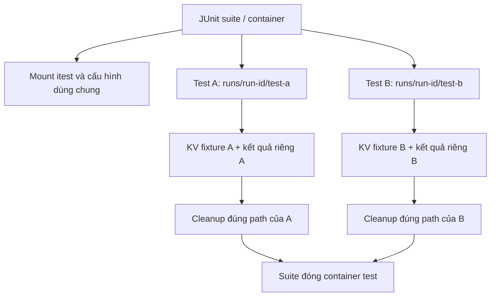
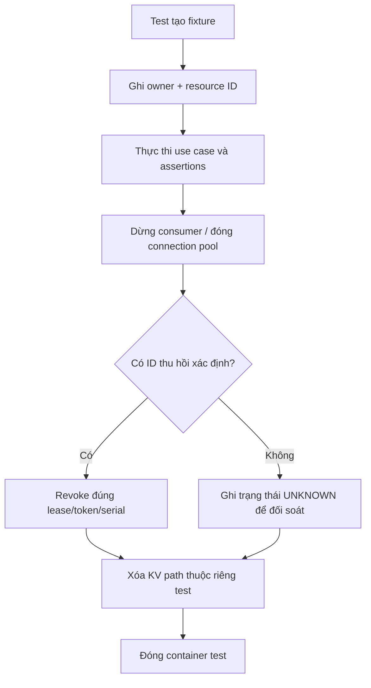

# Tổ chức dữ liệu mẫu, đồng hồ và tài nguyên dọn sau kiểm thử

## Mục tiêu và tình huống thực tế

Trong module **Spring Vault**, ứng dụng Java dùng `VaultTemplate`/`VaultOperations` để làm việc với HashiCorp Vault: đọc KV secrets, xác thực bằng danh tính workload và Vault ACL policy, quản lý vòng đời token và lease, gọi Transit encryption hoặc cấp chứng thư PKI. Kiểm thử tích hợp các chức năng này khó hơn kiểm thử một service Java thuần vì **Vault lưu trạng thái và một số API cấp tài nguyên có thời hạn**.

Một bộ test có thể chạy tốt riêng lẻ nhưng thất bại khi chạy song song: test A ghi đè secret của test B; thời điểm token hết hạn lệch vài giây trên máy CI; test trước để lại một role hoặc database user; hoặc test dùng root token nên không phát hiện thiếu quyền. Những lỗi này làm kết quả kiểm thử khó tin cậy.

Bài thuộc chương **Kiểm thử**, tập trung vào ba việc phối hợp với nhau: **dữ liệu mẫu (fixtures), đồng hồ (clock) và tài nguyên dọn sau kiểm thử (cleanup)**. Ví dụ xuyên suốt dùng dịch vụ `orders-api`, KV v2 mount `itest`, một `Clock` được inject cho logic nghiệp vụ và Vault chạy trong container thử nghiệm.

Sau khi học, bạn sẽ:

1. Phân tầng unit test và integration test để chỉ khởi chạy Vault khi cần xác minh Vault API thật.
2. Thiết kế fixture giả, có thể lặp lại, tách biệt bằng `runId`/`testId` và không chứa bí mật sản xuất.
3. Inject `java.time.Clock` và dùng `Clock.fixed(...)` để kiểm tra chính xác nhánh “sắp hết hạn” mà không phải `Thread.sleep(...)`.
4. Phân biệt thời gian **do ứng dụng quyết định** với TTL/lease, thời gian token và `NotAfter` do Vault/PKI quyết định.
5. Theo dõi ownership và dọn đúng phạm vi KV v2, token, lease, Transit key, certificate và tài nguyên ngoài Vault.
6. Xử lý trường hợp cleanup thất bại hoặc request cấp phát đã thành công nhưng response bị mất, không vô tình xóa tài nguyên của test khác.

## 1. Ba vòng kiểm thử cần tách biệt

| Tầng | Mục tiêu | Phụ thuộc | Đồng hồ | Cleanup |
|---|---|---|---|---|
| **Unit test** | Quyết định nghiệp vụ: nên rotate, đã hết hạn, retry/đổi trạng thái | Mock/fake cho `VaultOperations` hoặc port nghiệp vụ | `Clock.fixed`/`Clock.offset` | Không tạo tài nguyên Vault |
| **Integration test** | Đúng endpoint KV v2, policy, auth, Transit, lease API, mapping response | Vault thật trong Testcontainers/dev test riêng | Clock thật của Vault; app có thể inject Clock riêng | Xóa fixture, thu hồi lease/token, đóng container |
| **End-to-end** | Hành vi toàn hệ thống: database credentials, TLS/mTLS, broker, scheduler, Vault | Vault và backend ngoài cô lập | Nhiều clock thực và độ trễ mạng | Dọn cả tài nguyên Vault **và** backend ngoài |

Không đánh đồng một mock `VaultOperations` trả về dữ liệu đúng với việc Vault KV v2 đã cấu hình đúng hoặc policy cho workload truy cập được. Ngược lại, không cần khởi động Vault chỉ để kiểm tra `expiresAt.minus(safetyWindow)`.

Các quyết định cần đưa ra **trước khi tạo fixture**:

- Test đang xác minh API Vault, luật thời gian của Java hay phối hợp giữa Vault và một backend thật?
- Mỗi test sở hữu độc lập một path/token/role hay chỉ **đọc** cấu hình chia sẻ do suite quản lý?
- Thành phần nào sẽ dọn tài nguyên: `@AfterEach`, `@AfterAll`, JUnit extension, container lifecycle hay operator riêng?
- Nếu test bị crash hoặc CI mất kết nối trước cleanup, TTL/quota/namespace/container teardown nào còn bảo vệ?
- Những trường hợp lỗi/timeout có thể đã tạo tài nguyên chưa xác nhận? Có đủ ID để thu hồi đúng đối tượng không?

## 2. Hợp đồng fixture: giả, ổn định và có chủ sở hữu

**Fixture** gồm dữ liệu đầu vào, các điều kiện Vault phải được chuẩn bị và trạng thái ứng dụng mong đợi. Một fixture tốt không chỉ “có secret để đọc”: nó phải nêu loại engine, version, role, policy, dữ liệu trả về, TTL/clock và quyền sở hữu để cleanup.

| Thuộc tính fixture | Ví dụ | Vì sao cần ghi rõ |
|---|---|---|
| `suiteRunId` | `ci-24872` hoặc UUID | Phân biệt hai lượt chạy CI cùng thời điểm |
| `testId` | `read-kv-v2-success` | Gắn tài nguyên với một test cụ thể |
| Mount | `itest` (KV v2) | Tránh nhầm KV v1 với API có `data/metadata` |
| Path logic | `runs/<runId>/<testId>/webhook` | Không ghi đè vào `secret/orders` của ứng dụng hoặc test khác |
| Dữ liệu | `signing-key=fixture-not-a-real-secret` | Giá trị hoàn toàn giả, không lấy từ production |
| Expected | `get()` trả đúng trường, phiên bản hoặc bị 403 | Test chỉ assert những thứ thuộc contract |
| Clock | `2032-04-05T10:00:00Z` | Test logic thời gian có mốc cố định |
| Cleanup owner | Test hiện tại hoặc fixture manager | Chỉ xóa đúng tài nguyên được tạo |

### Quy tắc thiết kế dữ liệu

1. **Dùng giá trị giả có thể nhận biết:** `fixture-not-a-real-secret`, host `db.example.test`, số thẻ thử nghiệm được chỉ định rõ; không nhập dữ liệu khách hàng hoặc copy token thật.
2. **Để test kiểm soát path:** ví dụ `runs/<uuid>/webhook`; `UUID` giúp cô lập tài nguyên, nhưng **giá trị kỳ vọng** phải cố định. Không dùng UUID làm kết quả cần so sánh cố định.
3. **Có happy path và lỗi:** path tồn tại, field thiếu, dữ liệu sai kiểu, bản ghi bị xóa, thiếu policy, version KV v2 sai, timeout.
4. **Đóng băng schema:** ghi tên field, cách serialize và phiên bản API; nếu thay schema, cập nhật fixture/test cùng thay đổi nghiệp vụ.
5. **Bảo đảm thứ tự setup:** bật/mount engine trước, tạo role/policy trước khi dùng token giới hạn, seed secret trước khi chạy service; cleanup theo thứ tự ngược khi cần.
6. **Không cố dùng chung mutable fixture:** dữ liệu chỉ đọc có thể chia sẻ trong suite nếu bất biến; những test ghi/xóa hoặc cấp động phải có namespace/path/owner riêng.

Ví dụ payload KV v2 hợp lệ tại đường dẫn logic `runs/<runId>/<testId>/webhook`:

```json
{
  "signing-key": "fixture-not-a-real-secret",
  "algorithm": "HMAC-SHA256",
  "enabled": true,
  "version": 1
}
```

Test kiểm tra trường vắng mặt nên tạo **một bản ghi khác không có field** `signing-key`. Không sửa fixture dùng chung của happy path rồi quên phục hồi, vì test song song sẽ quan sát trạng thái trung gian.

### Một sơ đồ ownership dễ kiểm tra



Mount `itest` có thể được tạo **một lần khi khởi động suite**; mỗi test chỉ tạo và dọn path riêng. Không để một test xóa mount `itest` trong lúc test khác vẫn chạy.

## 3. Dựng Vault cô lập với Testcontainers

Testcontainers có `VaultContainer` để chạy Vault dev mode trong Docker phục vụ integration test. Nó cung cấp Vault endpoint và token thử nghiệm; cũng hỗ trợ `withInitCommand(...)` để bootstrap engine/config. Docker phải sẵn sàng trên máy phát triển hoặc CI.

Ví dụ dependency Gradle (áp dụng BOM Testcontainers tương thích với version các thư viện đang dùng; **không cần hardcode phiên bản vào từng dependency** nếu BOM quản lý):

```groovy
dependencies {
    implementation 'org.springframework.vault:spring-vault-core'

    testImplementation 'org.junit.jupiter:junit-jupiter'
    testImplementation platform('org.testcontainers:testcontainers-bom:2.0.5')
    testImplementation 'org.testcontainers:testcontainers-vault'
    testImplementation 'org.testcontainers:testcontainers-junit-jupiter'
}

test {
    useJUnitPlatform()
}
```

Lưu ý tên artifact/module Testcontainers thay đổi qua các major release: module Vault của Testcontainers 2.x được công bố dưới `org.testcontainers:testcontainers-vault`; khi dùng BOM/version khác, đối chiếu tài liệu đúng phiên bản. Cách import package Java vẫn là `org.testcontainers.vault.VaultContainer`.

Ví dụ suite Java dùng **một container tạm** và một KV v2 mount riêng `itest`:

```java
import static org.junit.jupiter.api.Assertions.*;

import java.net.URI;
import java.util.Map;
import java.util.UUID;

import org.junit.jupiter.api.AfterEach;
import org.junit.jupiter.api.BeforeEach;
import org.junit.jupiter.api.Test;
import org.testcontainers.junit.jupiter.Container;
import org.testcontainers.junit.jupiter.Testcontainers;
import org.testcontainers.vault.VaultContainer;

import org.springframework.vault.authentication.TokenAuthentication;
import org.springframework.vault.client.VaultEndpoint;
import org.springframework.vault.core.VaultOperations;
import org.springframework.vault.core.VaultTemplate;
import org.springframework.vault.core.VaultKeyValueOperationsSupport.KeyValueBackend;
import org.springframework.vault.support.VaultResponse;

@Testcontainers
class VaultKvFixtureIT {

    // Token chỉ tồn tại trong container dev của test; KHÔNG dùng production.
    private static final String TEST_TOKEN = "vault-dev-test-only-token";

    @Container
    static final VaultContainer<?> VAULT =
        new VaultContainer<>("hashicorp/vault:1.19")
            .withVaultToken(TEST_TOKEN)
            .withInitCommand("secrets enable -path=itest -version=2 kv");

    private String path;

    @BeforeEach
    void seed() throws Exception {
        path = "runs/" + UUID.randomUUID() + "/webhook";
        var result = VAULT.execInContainer(
            "vault", "kv", "put", "-mount=itest", path,
            "signing-key=fixture-not-a-real-secret");
        assertEquals(0, result.getExitCode(), result.getStderr());
    }

    @Test
    void readsSeededKvV2() {
        VaultOperations vault = new VaultTemplate(
            VaultEndpoint.from(URI.create(VAULT.getHttpHostAddress())),
            new TokenAuthentication(TEST_TOKEN));

        VaultResponse response = vault.opsForKeyValue(
            "itest", KeyValueBackend.KV_2).get(path);

        assertNotNull(response);
        assertEquals("fixture-not-a-real-secret",
            response.getRequiredData().get("signing-key"));
    }

    @AfterEach
    void cleanOwnKvPath() throws Exception {
        if (path == null) {
            return;
        }
        // KV v2 metadata delete xóa mọi version tại ĐÚNG path sở hữu.
        var result = VAULT.execInContainer(
            "vault", "kv", "metadata", "delete", "-mount=itest", path);
        assertEquals(0, result.getExitCode(), result.getStderr());
    }
}
```

**Phạm vi ví dụ:** Java 17+, Spring Vault có `opsForKeyValue(..., KV_2)`, Docker/Testcontainers chạy được và image Vault được pin phiên bản theo chính sách CI. `@Container` tĩnh được Testcontainers khởi động trước test và dừng sau suite. Mount `itest` được tạo qua `withInitCommand`; mỗi `@BeforeEach` có path riêng và `@AfterEach` xóa chính path ấy.

Trong ví dụ này, `TokenAuthentication` dùng **root token chỉ dành cho container dev** để tập trung chứng minh KV v2. Để kiểm thử **policy/auth**, phải tạo token có quyền giới hạn (hoặc mô phỏng workload auth thật) và dùng token đó cho `VaultTemplate`; root token có thể che lỗi thiếu ACL. `VaultEndpoint.from(URI)` sử dụng endpoint HTTP của container; **không** dùng HTTP/disable TLS verification cho cluster production.

**Lưu ý chạy song song:** JUnit Jupiter extension của Testcontainers được tài liệu công bố hỗ trợ chính cho các test thực thi tuần tự; parallel execution của extension chưa được bảo đảm. Việc đặt path riêng ngăn trùng dữ liệu nhưng **không tự chứng minh** extension/container dùng chung an toàn khi test song song. Để parallel, nên phân tách container theo worker hoặc kiểm chứng hạ tầng riêng, đồng thời giới hạn mức song song của CI.

Nếu fixture được seed thất bại giữa chừng, `@AfterEach` vẫn phải thử cleanup path đã tạo. Bản ghi KV v2 có nhiều version; vì vậy lệnh `vault kv delete` chỉ **soft-delete** version, còn `vault kv metadata delete` xóa **toàn bộ versions và metadata** của path được chỉ định. Hành động xóa metadata là phá hủy dữ liệu: chỉ dùng với path test có ownership rõ ràng trong môi trường cô lập.

## 4. Inject Clock để kiểm thử thời gian có thể lặp lại

Nhiều nhánh của Spring Vault phụ thuộc thời gian: ứng dụng chuẩn bị rotate credential trước khi lease hết TTL, hiển thị thông báo “chứng thư sắp hết hạn”, giới hạn retry hoặc từ chối sử dụng secret cache quá cũ. Nếu service gọi trực tiếp `Instant.now()`, `System.currentTimeMillis()` rồi test dùng `Thread.sleep(...)`, bài kiểm thử sẽ chậm và có thể lỗi ngẫu nhiên khi máy CI quá tải.

**Tách nguồn thời gian ra khỏi logic nghiệp vụ**:

```java
import java.time.Clock;
import org.springframework.context.annotation.Bean;
import org.springframework.context.annotation.Configuration;

@Configuration
class TimeConfiguration {
    @Bean
    Clock applicationClock() {
        return Clock.systemUTC();
    }
}
```

Service không tự đọc thời gian hệ thống; nó nhận `Clock` qua constructor:

```java
import java.time.Clock;
import java.time.Duration;
import java.time.Instant;

public final class RenewalWindow {

    private final Clock clock;
    private final Duration safetyWindow;

    public RenewalWindow(Clock clock, Duration safetyWindow) {
        if (safetyWindow.isNegative()) {
            throw new IllegalArgumentException("negative safety window");
        }
        this.clock = clock;
        this.safetyWindow = safetyWindow;
    }

    public boolean shouldRenew(Instant expiresAt) {
        // Đúng ngay tại ranh giới "expiresAt - safetyWindow".
        Instant renewFrom = expiresAt.minus(safetyWindow);
        return !clock.instant().isBefore(renewFrom);
    }
}
```

Trong ứng dụng thật, có thể tạo bean `RenewalWindow` hoặc để service nghiệp vụ tự nhận `Clock` và tham số `safetyWindow`. Việc quyết định `shouldRenew` không thay thế API renewal: Vault có thể từ chối vì lease không renewable, token hết quyền hoặc đã đạt max TTL.

### Test ranh giới mà không ngủ

```java
import static org.junit.jupiter.api.Assertions.*;

import java.time.Clock;
import java.time.Duration;
import java.time.Instant;
import java.time.ZoneOffset;
import org.junit.jupiter.api.Test;

class RenewalWindowTest {

    private static final Instant EXPIRY =
        Instant.parse("2032-04-05T10:10:00Z");

    private boolean shouldRenewAt(String isoUtc) {
        Clock frozen = Clock.fixed(
            Instant.parse(isoUtc), ZoneOffset.UTC);
        return new RenewalWindow(
            frozen, Duration.ofMinutes(5)).shouldRenew(EXPIRY);
    }

    @Test
    void beforeSafetyWindow() {
        assertFalse(shouldRenewAt("2032-04-05T10:04:59Z"));
    }

    @Test
    void exactlyAtBoundary() {
        assertTrue(shouldRenewAt("2032-04-05T10:05:00Z"));
    }

    @Test
    void afterExpiry() {
        assertTrue(shouldRenewAt("2032-04-05T10:10:01Z"));
    }
}
```

Ba test trên chạy tức thì và đưa ra kết quả giống nhau không phụ thuộc múi giờ máy. `Clock.offset(...)` cũng hữu ích để giả lập thời điểm sau một mốc đã biết:

```java
Clock base = Clock.fixed(
    Instant.parse("2032-04-05T10:00:00Z"), ZoneOffset.UTC);
Clock tenMinutesLater = Clock.offset(base, Duration.ofMinutes(10));

assertEquals(Instant.parse("2032-04-05T10:10:00Z"),
             tenMinutesLater.instant());
```

Không sửa đồng hồ hệ điều hành hoặc đặt lại một biến `static` toàn cục để test. Những cách đó có thể làm các test chạy song song ảnh hưởng nhau và gây sai hành vi của TLS, thread scheduler hoặc chính runtime Java.

### Điều gì được phép giả lập, điều gì không?

| Nguồn thời gian | `Clock.fixed` có ảnh hưởng? | Cách kiểm thử đúng |
|---|---|---|
| Business logic dùng `clock.instant()` | **Có** | Unit test ranh giới bằng Clock |
| Cache của ứng dụng **được thiết kế** dùng cùng Clock | Có | Test hit/miss/expiry không ngủ |
| Lịch retry của scheduler dùng đồng hồ và executor riêng | Không mặc định | Inject scheduler/fake executor hoặc test qua event |
| TTL token/lease do Vault server tính | **Không** | Integration test với Vault thật, TTL ngắn và polling có timeout |
| `NotAfter` ghi trong chứng thư PKI | **Không** | Đọc `X509Certificate.getNotAfter()` và test logic app với instant đó |
| Thời gian mạng, TLS handshake, Docker, database | **Không** | Timeout/retry có giới hạn, quan sát event thực |

**Cảnh báo quan trọng:** Đặt `Clock.fixed` trong Java **không làm Vault server hết hạn lease hoặc token sớm hơn**. Ngay cả khi `RenewalWindow` trong unit test báo “đến lúc renew”, Vault vẫn quyết định có chấp nhận `renew` hay không theo đồng hồ và lease thật của nó.

### Biên giờ, múi giờ và độ lệch đồng hồ

Dùng `Instant` và `Duration` cho TTL/expiry nội bộ; chỉ đổi sang `ZoneId` khi hiển thị cho người dùng. Ví dụ “ngày hết hạn tại Asia/Ho_Chi_Minh” là cách hiển thị, còn quyết định so sánh vẫn nên dựa vào UTC instant. Test thêm trường hợp `expiresAt == now`, `expiresAt - safetyWindow == now`, time zone khác, clock lệch vài giây và âm TTL nếu dữ liệu metadata có lỗi.

Với secret nhận từ Vault, nếu client tính `Instant.now(clock).plusSeconds(leaseDuration)` tại **thời điểm nhận response**, đó là ước lượng sử dụng ở client; không bảo đảm bằng thời điểm hết hạn tuyệt đối tại server do latency/clock skew. Nên dùng safety window, không ra quyết định sống còn dựa trên sai số mili giây. Khi Vault cung cấp metadata expire time cụ thể, đọc và diễn giải theo hợp đồng của API tương ứng.

## 5. Test TTL/lease trên Vault thật: chờ điều kiện, đừng chờ cố định

Những integration test về `SecretLeaseContainer`, `SessionManager`, dynamic database credential và revocation cần **thời gian thật của Vault**. Một test dùng `Thread.sleep(2000)` và khẳng định lease chắc chắn đã bị thu hồi sau 2 giây thường không ổn định: server có tải, renewal chạy theo scheduler, backend database có độ trễ, và khi hết TTL Vault có thể cần thời gian để thực hiện revoke.

Một cách viết test tốt hơn là **poll có thời hạn** theo trạng thái quan sát được, chẳng hạn:

```java
import static org.awaitility.Awaitility.await;
import static org.junit.jupiter.api.Assertions.assertFalse;

import java.time.Duration;

// isKnownLeaseActive(leaseId) là helper kiểm tra lease đã có,
// KHÔNG gọi lại database/creds/<role> để lấy secret động mới.
await()
    .atMost(Duration.ofSeconds(20))
    .pollInterval(Duration.ofMillis(250))
    .untilAsserted(() ->
        assertFalse(isKnownLeaseActive(leaseId)));
```

Đây là **mảnh mã minh họa** dùng thư viện Awaitility: `leaseId` và helper `isKnownLeaseActive` phải được test suite chuẩn bị; helper cần có quyền tra cứu lease hoặc kiểm tra trạng thái backend test. Kết quả lookup/revoke có thể khác nhau giữa plugin/phiên bản; tránh viết helper hiểu một exception chung là bằng chứng đã revoke nếu exception đó có thể là HTTP 403 hoặc mạng lỗi.

Nếu không dùng Awaitility, có thể tự poll bằng deadline dựa trên `System.nanoTime()` và sleep ngắn trong **integration test**, nhưng phải tách nó khỏi unit test nghiệp vụ. Đặt giới hạn tối đa, giữ khoảng poll phù hợp và chỉ retry những lỗi có thể tạm thời.

**Đặc biệt với database dynamic secrets:** `GET /database/creds/<role>` là lời gọi **phát hành credentials mới**. Không poll endpoint đó để “kiểm tra user cũ còn sống không”; việc polling sẽ tạo nhiều user/lease. Hãy tra cứu **lease ID đã biết** hoặc hỏi chính database test về user/permission tương ứng.

## 6. Registry tài nguyên: tạo ở đâu, ghi nhận ở đó

Fixture chỉ an toàn nếu từng tài nguyên tạo ra có **owner, ID và thao tác cleanup được xác định trước**. Đối với KV v2, owner là path; đối với database dynamic secret là `lease_id`; đối với service token là token/accessor; với PKI certificate là serial; với tài nguyên bên ngoài Vault cần thêm ID từ backend.

| Tài nguyên tạo trong test | Định danh cần giữ | Cách cleanup phù hợp | Cảnh báo |
|---|---|---|---|
| KV v2 fixture | Mount và path riêng | `vault kv metadata delete -mount=itest <owned-path>` hoặc metadata API | Xóa mọi version; chỉ với path do test tạo |
| KV v1 fixture | Mount và path riêng | `vault kv delete` theo path | Không có version history kiểu KV v2 |
| Transit test key | Mount và tên key riêng | Xóa key chỉ khi được phép và chắc chắn không dùng chung | Transit key có thể không cho delete mặc định; không xóa key chia sẻ |
| Child **service token** | Token ID bí mật hoặc accessor có kiểm soát | Revoke **đúng token/accessor** | Revoke parent có thể kéo theo child token và lease |
| Dynamic database credential | `lease_id` và owner/job | Revoke đúng lease sau khi đóng consumer | Backend có thể không revoke tức thì khi lỗi |
| PKI leaf certificate | Serial/issuer | Revoke theo chính sách hoặc để hết hạn trong môi trường cô lập | Không thể “lấy lại” private key đã mất |
| Test DB user ngoài Vault | DB username/role hoặc ID | Xác minh tài nguyên đã bị Vault/backend revoke | Dừng Vault container không chứng minh user đã biến mất ở DB ngoài |
| Container/port/network | Testcontainers resource ID | Testcontainers `@Container`/try-with-resources | Xem xét khi CI crash hoặc tái sử dụng container |

### Nguyên tắc cleanup theo thứ tự ngược

Khi test tạo nhiều tài nguyên phụ thuộc nhau, hãy dọn **consumer trước provider**:

1. Ngừng request/job mới trong test; chờ những thao tác đang dùng credential hoàn tất.
2. Đóng datasource, connection pool, listener hoặc HTTP client đang dùng credential.
3. Revoke **lease của instance/test** và token con do test tạo, dùng token có quyền phù hợp.
4. Xóa KV paths/roles/Transit keys **do test sở hữu**, nếu thực sự cần dọn trong môi trường cô lập.
5. Đóng Vault/Testcontainers cuối cùng để các lệnh cleanup vẫn còn endpoint xác thực.

Không revoke login/root token dùng để cleanup trước khi hoàn thành cleanup. Không dọn mount chung nếu nhiều test vẫn dùng nó.



**Tại sao phải theo dõi resource ngay sau khi tạo?** Vì lỗi có thể xảy ra ở bước kế tiếp. Nếu method phát hành credential trả về `lease_id` nhưng assertion sau đó thất bại, `@AfterEach`/`finally` vẫn cần biết lease nào phải revoke. Nếu response bị mất sau khi Vault đã tạo resource, không thể đoán `lease_id`; phải đánh dấu chưa rõ và đối soát. Không gọi lại endpoint cấp phát chỉ để lấy “ID thay thế”.

### Registry cleanup theo kiểu LIFO

Khi một test tạo **nhiều** tài nguyên, có thể ghi lại hành động cleanup ngay sau mỗi bước thành công. Registry theo nguyên tắc **last-in-first-out (LIFO)** giúp dọn tài nguyên phụ thuộc nhau theo thứ tự ngược với lúc tạo.

```java
import java.util.ArrayDeque;
import java.util.Deque;

public final class TestResourceRegistry implements AutoCloseable {

    @FunctionalInterface
    public interface CheckedCleanup {
        void run() throws Exception;
    }

    private final Deque<CheckedCleanup> actions = new ArrayDeque<>();

    public void onCleanup(CheckedCleanup action) {
        actions.push(action);
    }

    @Override
    public void close() throws Exception {
        Exception first = null;

        while (!actions.isEmpty()) {
            try {
                actions.pop().run();
            } catch (Exception ex) {
                // Dù một cleanup lỗi, vẫn thử dọn tài nguyên khác.
                if (first == null) {
                    first = ex;
                } else {
                    first.addSuppressed(ex);
                }
            }
        }

        if (first != null) {
            throw first; // Test thất bại rõ ràng nếu còn cleanup lỗi.
        }
    }
}
```

Ví dụ sử dụng trong test (đoạn trích, `vault` là `VaultOperations` với quyền phù hợp và `path` thuộc phạm vi test):

```java
try (TestResourceRegistry resources = new TestResourceRegistry()) {
    // Fixture KV đã được seed vào path do test sở hữu.
    // Đăng ký cleanup NGAY sau khi setup thành công.
    resources.onCleanup(() -> {
        vault.delete("itest/metadata/" + path);
    });

    // Nếu test còn tạo một dynamic lease:
    // VaultResponse issued = vault.read("database/creds/orders-test");
    // String leaseId = issued.getLeaseId();
    // if (leaseId != null) {
    //     resources.onCleanup(() ->
    //         vault.write("sys/leases/revoke",
    //             Map.of("lease_id", leaseId)));
    // }

    // Thực hiện assertion. Khi rời try (dù test lỗi),
    // registry gọi cleanup theo thứ tự ngược.
}
```

Ở ví dụ này, `vault.delete("itest/metadata/" + path)` gọi **HTTP DELETE trực tiếp trên endpoint KV v2 metadata**; khác với `opsForKeyValue(...).delete(path)`, vốn không bảo đảm xóa vĩnh viễn mọi version. Chỉ dùng khi test token có quyền `delete` trên `itest/metadata/...` hoặc một fixture-admin chuyên dụng được tổ chức cho phép. Không cấp quyền xóa metadata cho workload sản xuất chỉ để unit/integration test thuận tiện.

Trong ứng dụng thật, nếu tạo connection pool từ credential vừa phát hành, hãy **đăng ký cleanup lease trước, đăng ký đóng connection pool sau**; nhờ LIFO, pool sẽ đóng trước khi lease bị revoke. Registry chỉ giải quyết trường hợp **ứng dụng đã nhận được ID**. Nếu phát hành token/credential bị timeout và response mất, registry không có ID để thu hồi; phải ghi trạng thái `UNKNOWN` và chuyển cho quy trình đối soát thay vì tạo lease thứ hai.

Một số test có thể cần **hủy toàn bộ container** làm phương án cuối. Đó là lớp cleanup bổ sung, không thay thế registry khi container dùng database/cloud credentials bên ngoài hoặc chạy trên cluster Vault có trạng thái tồn tại lâu dài.

## 7. Test quyền truy cập và xác thực bằng fixture riêng

Đừng chạy mọi assertion với **root token** của Vault dev. Root token bỏ qua nhiều giới hạn ACL, nên test `GET KV` có thể PASS ngay cả khi workload thực không có quyền đọc.

Để test policy `orders-api`, fixture-admin tạo policy hẹp, ví dụ cho **một** path cụ thể:

```hcl
path "itest/data/runs/run-42/read-webhook" {
  capabilities = ["read"]
}
```

Sau đó tạo service token có policy trên, TTL ngắn và **không** gắn policy root. Test dùng token hạn chế đó để:

1. Đọc `itest/data/runs/run-42/read-webhook` và nhận response thành công.
2. Gọi `vault.write`/`kv.put` vào cùng path và xác minh bị từ chối vì thiếu `create`/`update`.
3. Đọc `itest/data/runs/run-42/another-webhook` và xác minh bị từ chối vì nằm ngoài ACL.
4. Thử token hết hạn hoặc bị revoke trong test để xác minh ứng dụng phân loại lỗi xác thực thay vì retry vô hạn.

Ở đây `run-42` là tên ví dụ; khi chạy CI phải tạo path/policy theo `runId` hoặc dùng mount/namespace cô lập cho cả suite. Dùng fixture-admin để tạo policy/role và token, rồi inject **token đã hạn chế** vào `VaultTemplate` của test. Không để controller hay application service tự nhận root token để vượt quyền.

Để cleanup, ghi nhận token ID hoặc **accessor của service token** nếu có, rồi revoke đúng token bằng fixture-admin. Token accessor không phải credential đăng nhập trực tiếp nhưng có thể dùng để lookup/revoke nếu caller có quyền; cần giữ khỏi log công khai. Với batch token, khả năng quản lý khác service token: không xây mọi test dựa vào token accessor.

### Test đúng cơ chế auth của workload

Nếu production dùng Kubernetes Auth hoặc AppRole, test dùng `TokenAuthentication` chỉ chứng minh các endpoint và policy **sau khi đã có token**. Nó **không** xác minh Vault auth role gắn ServiceAccount/namespace đúng, hoặc AppRole `role_id/secret_id` được phân phối và login đúng. Thêm một nhóm integration/end-to-end test riêng cho auth method đang dùng.

Khi dùng Spring Cloud Vault, các property như `spring.cloud.vault.uri`, `authentication` và `token` có thể được cấp cho profile test; nếu ứng dụng dùng `spring.config.import=vault://`, **thời điểm bootstrap Config Data** quan trọng. Đừng giả định `@DynamicPropertySource` luôn kịp cấu hình Vault trước mọi pha import; phải chọn cách khởi tạo phù hợp phiên bản Spring Boot/Spring Cloud Vault, hoặc dùng bean `VaultOperations` test được tạo trực tiếp như ví dụ trước.

## 8. Fixture riêng cho từng engine và bài toán kiểm thử

Không phải mọi engine có cùng vòng đời dữ liệu. Một bộ test tốt tổ chức theo bản chất resource và quyền cần cấp:

### KV v2: phiên bản và quyền xóa

- Test phiên bản mới nhất và phiên bản cụ thể bằng `VaultVersionedKeyValueOperations` khi cần xác minh version/CAS.
- Kiểm tra `get(path) == null` sau khi xóa/soft-delete trong các trường hợp tương ứng, nhưng không nhầm với **dữ liệu bị destroy vĩnh viễn**.
- Với test metadata, phân biệt `data/<path>` và `metadata/<path>`. Policy `read` ở data path không tự cấp quyền `delete` metadata.
- Nếu test kỳ vọng version tăng theo số lần `put`, mỗi test phải có **path riêng**; nếu dùng path chung, số version sẽ phụ thuộc thứ tự chạy test trước.

### Transit: assert tính chất, không đoán ciphertext

- Tạo Transit key riêng cho suite (ví dụ `itest-orders-key`), chỉ tạo một lần khi bootstrap.
- Kiểm thử `encrypt → decrypt` trả đúng byte gốc, `rewrap` giữ khả năng giải mã, và role/policy từ chối thao tác không được phép.
- **Không hardcode ciphertext** hoặc khẳng định encrypt cùng plaintext luôn trả cùng chuỗi; mã hóa chuẩn của Vault có thể tạo kết quả khác nhau qua các lần gọi.
- Không xóa Transit key đang được test khác sử dụng; với môi trường container tạm, có thể để container teardown là ranh giới cleanup của key suite.

### Dynamic database credentials: lease và backend thật

- Chỉ test thật khi có database test riêng và Vault Database engine đã cấu hình role/connection hợp lệ.
- Ghi `lease_id` cùng username được cấp ngay khi nhận response; **không ghi password** vào log/test report.
- Thực hiện thao tác database mong đợi, đóng pool/connection, rồi revoke đúng lease. Sau đó kiểm chứng trạng thái ở database test bằng cơ chế đáng tin cậy.
- Không gọi lại `GET database/creds/<role>` chỉ để kiểm tra credential cũ, vì mỗi lần có thể tạo **một credential mới**.
- Khi backend revoke lỗi, phản ánh test failure/pending cleanup; TTL hết không luôn bảo đảm user đã biến mất tức thì.

### Token và lease: quyền sở hữu, TTL, trường hợp không chắc chắn

- Với token tạo bởi test, dùng token role và TTL nhỏ; lưu ID/accessor trong registry có kiểm soát.
- Test `lookup`/`renew` trên **đúng token/lease** đã biết, tránh gọi `token/create` mới để “lấy token giống lần trước”.
- Đối với lỗi timeout sau khi request phát hành, đánh dấu outcome chưa xác nhận; test có fault injection phải chứng minh không có retry tự động gây cấp trùng.
- Không revoke **parent token** dùng chung để dọn một child token; có thể ảnh hưởng nhiều child và lease phụ thuộc.

### PKI: chứng thư và private key

- Dùng root/intermediate CA dành riêng cho suite; role test giới hạn DNS giả như `svc.example.test` và TTL ngắn.
- Test nội dung CN/SAN, chain, EKU, `NotBefore`/`NotAfter` và handshake nếu mục tiêu là TLS, thay vì chỉ assert “có PEM”.
- Private key nhận từ `issue` là bí mật: không đính kèm response/PEM vào assertion message, snapshot test hoặc CI artifact.
- Nếu bài test tạo chứng thư rồi cần revoke, phải có serial chính xác và policy đủ quyền; không thể trông chờ `@AfterEach` “thu hồi” X.509 bằng cách xóa file local.
- Dùng `Clock.fixed` cho nhánh ứng dụng “sắp hết hạn”, nhưng **không** làm thay đổi `NotAfter` đã được CA ký.

### Transform/engine Enterprise

Nếu muốn kiểm thử `VaultTransformOperations`, chỉ chạy integration test trên Vault **Enterprise/HCP có entitlement Transform**. Vault OSS trong Testcontainers không thể thay thế FPE/tokenization bằng mock rồi coi là kiểm thử engine. Với unit test, fake port hoặc mock chỉ kiểm tra logic ứng dụng; nhóm test có điều kiện cần môi trường được cấp phép.

## 9. Chạy suite song song, CI và tái lập lỗi

Khả năng chạy song song có **hai tầng độc lập**: isolation của dữ liệu và lifecycle của công cụ test. `runId` giúp chống ghi đè dữ liệu, nhưng nếu dùng một Vault container và một stateful extension không hỗ trợ parallel, test vẫn có thể lỗi về startup/teardown hoặc chia sẻ Spring application context.

Quy tắc vận hành:

1. **CI run độc lập:** mỗi job có container riêng hoặc Vault namespace/mount riêng theo quyền của job. Không kết nối nhầm cluster production bằng một biến môi trường cấu hình thiếu.
2. **Test ID độc lập:** mỗi test ghi KV path theo UUID; dynamic lease, token và cert có owner rõ ràng; nếu test cần config role riêng, dùng tên riêng hoặc tách container.
3. **Testcontainers JUnit extension:** nếu chưa kiểm tra khả năng parallel của version đang dùng, chạy các test `@Testcontainers` tuần tự; có thể chạy **nhiều worker CI** với container độc lập thay vì share container trong một JVM.
4. **Mốc thời gian:** unit test dùng `Clock.fixed` và UTC; integration test dùng deadline và polling, tránh exact-second assertion.
5. **Tái hiện:** lưu test class, scenario, `runId`, phiên bản Vault image/Spring Vault/Testcontainers và exception đã chuẩn hóa; không lưu secret thật.
6. **Retry CI:** nếu pipeline cho phép chạy lại test fail, mỗi lượt chạy lại cần scope fixture mới và kế hoạch dọn resource của lượt cũ. Retry test không tự sửa rò rỉ tài nguyên.

### Khi một test chạy thành công riêng lẻ nhưng thất bại trong suite

| Dấu hiệu | Nguyên nhân thường gặp | Cách sửa |
|---|---|---|
| KV version không như kỳ vọng | Nhiều test dùng cùng path | Tách path bằng runId/testId, tạo state mới |
| 403 ngẫu nhiên | Token bị test khác revoke hoặc hết TTL | Token riêng, TTL phù hợp và không revoke parent |
| Test timeout khác nhau giữa local và CI | `Thread.sleep` cố định, Vault/backend chậm | Clock giả cho unit; polling có deadline cho integration |
| User database còn tồn tại sau test | Cleanup không chạy hoặc revoke backend lỗi | Registry + assert trạng thái backend + reconciler |
| Suite báo secret đã có từ trước | Container được tái sử dụng hoặc path bị trùng | Tắt reuse ngoài ý muốn, pin scope và cleanup |
| Test mock pass nhưng production đọc Vault lỗi | Sai mount, KV version hoặc policy thực | Integration test với workload token và mount thật của test |
| Đã xóa KV nhưng vẫn thấy metadata/version | KV v2 soft-delete | Dọn metadata đúng scope test khi thực sự cần |
| Test tạo hai dynamic credentials | Retry một endpoint có hiệu ứng cấp phát | Tắt auto retry và lưu trạng thái khi outcome chưa rõ |

## 10. Ma trận kiểm thử và điều kiện hoàn thành

| Trục | Test tối thiểu | Điều cần kiểm chứng |
|---|---|---|
| Fixture KV hợp lệ | Seed một path riêng, gọi `get` | Trả đúng field/kiểu dữ liệu |
| Fixture thiếu dữ liệu | Thiếu `signing-key`, sai kiểu hoặc path vắng | Service báo lỗi có kiểm soát, không dùng secret mặc định |
| KV versioning | Ghi hai version vào **một path riêng** | Đọc version mong đợi; cleanup metadata đúng |
| Quyền truy cập | Token chỉ `read`, thử write/đọc path khác | HTTP 403 ở các thao tác vượt quyền |
| Clock trước ranh giới | `now < expiry - safetyWindow` | Chưa yêu cầu rotate |
| Clock đúng ranh giới | `now == expiry - safetyWindow` | Kích hoạt quy tắc rotate |
| Clock sau expiry | `now > expiry` | Không sử dụng credential đã hết hạn theo policy |
| Lease thật | Cấp credential bằng Vault test, có `lease_id` | Renew/revoke theo policy và backend được kiểm tra |
| Fault khi phát hành | Vault xử lý nhưng response bị mất | Không retry cấp trùng; ghi `UNKNOWN`/đối soát |
| Cleanup khi assertion fail | Cố ý làm assertion thất bại sau setup | `@AfterEach`/`finally` vẫn dọn path/lease xác định |
| Cleanup khi Vault lỗi | Revoke timeout hoặc 403 | Test báo lỗi cleanup; không tuyên bố dọn thành công |
| Test song song/CI | Hai lượt chạy có runId khác nhau | Không đụng dữ liệu nhau và không dùng chung lifecycle không hỗ trợ |
| PKI/Transit | Round-trip/chain và permission | Assert contract mật mã, không chụp secret/key vào snapshot |

**Tiêu chí hoàn thành:** Test có thể chạy lại trên môi trường sạch và cho cùng kết quả nghiệp vụ; dữ liệu giả được seed đúng và dọn đúng scope; các nhánh thời gian kiểm thử không ngủ cố định; một lần lỗi không làm mất quyền truy vết tài nguyên, và báo cáo không rò rỉ credential.

### Thử nghiệm fault injection: cleanup vẫn chạy khi test hỏng

Trong lab, có thể viết test tạo KV path và cố ý ném `AssertionError` sau bước seed. `@AfterEach` của JUnit vẫn chạy trên đường thực thi test thông thường, nên path sẽ được xóa. Sau đó thử làm Vault unavailable **trước cleanup**: test phải ghi nhận cleanup không xác nhận thành công thay vì im lặng. Khi process bị `SIGKILL` hoặc máy CI mất điện, callback JUnit có thể **không** chạy; container teardown/TTL và nhiệm vụ reconciliation ở môi trường dùng chung phải giải quyết trường hợp này.

Không dùng việc “đợi container tắt” làm bảo đảm đã thu hồi database user ở **database bên ngoài container**. Một Vault container ephemeral có thể biến mất, nhưng credential đã phát hành ở nơi khác vẫn có thể cần revoke/cleanup độc lập.

## 11. Checklist cho người viết test

1. **Fixture:** giá trị hoàn toàn giả, có expected contract và owner; mỗi test có path/ID riêng khi ghi.
2. **Version/config:** ghi rõ KV v2, mount, policy, TTL, phiên bản Vault image và cấu hình engine.
3. **Auth:** setup với fixture-admin; kiểm thử nghiệp vụ bằng token giới hạn theo workload.
4. **Đồng hồ:** inject `Clock`, dùng UTC/`Instant`, kiểm tra ranh giới chính xác; không chỉnh system clock.
5. **TTL thật:** test bằng Vault thật, polling có deadline, không giả định `Clock.fixed` làm server hết hạn lease.
6. **Tài nguyên:** ghi lease ID/token accessor/cert serial/path ngay khi nhận; cleanup theo thứ tự đóng consumer rồi revoke.
7. **Lỗi cleanup:** không nuốt exception, không ghi trạng thái SUCCESS khi không xác nhận; giữ thông tin phục vụ đối soát.
8. **An toàn:** không log token, password, private key, payload KV, ciphertext nhạy cảm hoặc HTTP body phát hành.
9. **Chạy lại/CI:** mỗi run cô lập, tránh chia sẻ mutable fixture; quan sát artifact/log an toàn và làm sạch tài nguyên từ job bị kill.
10. **Đúng tầng:** unit test kiểm logic, integration test kiểm contract Vault, end-to-end test kiểm backend ngoài và vòng đời thật.

**Nguyên tắc chính:** Một test Spring Vault đáng tin cậy cần có **fixture biết ai sở hữu, thời gian có thể kiểm soát ở đúng tầng và cleanup xác minh được**. Tạo ra một secret để test chỉ là nửa đầu công việc; nửa sau là đảm bảo test kế tiếp có một trạng thái độc lập và tài nguyên có thời hạn được quản lý an toàn.

## Tài liệu tham khảo chính thức

1. [Testcontainers for Java — HashiCorp Vault module](https://java.testcontainers.org/modules/vault/): `VaultContainer`, `withVaultToken`, `withInitCommand` và `execInContainer`.
2. [Testcontainers — JUnit 5 integration](https://java.testcontainers.org/test_framework_integration/junit_5/): `@Testcontainers`, `@Container` và giới hạn thực thi song song.
3. [Spring Vault — VaultKeyValueOperations](https://docs.spring.io/spring-vault/reference/api/java/org/springframework/vault/core/VaultKeyValueOperations.html): `put`, `get`, `delete` và khác biệt KV versions.
4. [Spring Vault — VaultVersionedKeyValueOperations](https://docs.spring.io/spring-vault/reference/api/java/org/springframework/vault/core/VaultVersionedKeyValueOperations.html): version/CAS, delete và destroy KV v2.
5. [Spring Vault — Vault client and secrets engines](https://docs.spring.io/spring-vault/reference/vault/vault-secret-engines.html): `VaultOperations.opsForKeyValue` và cách dùng KV v2.
6. [HashiCorp Vault — KV v2 API](https://developer.hashicorp.com/vault/api-docs/secret/kv/kv-v2): `data`, `metadata`, soft delete, destroy và xóa toàn bộ metadata.
7. [HashiCorp Vault — Lease, renew and revoke](https://developer.hashicorp.com/vault/docs/concepts/lease): lease ID/TTL, renewal/revoke và giới hạn backend.
8. [HashiCorp Vault — System lease HTTP API](https://developer.hashicorp.com/vault/api-docs/system/leases): tra cứu/renew/revoke lease và quyền liên quan.
9. [HashiCorp Vault — Token concepts](https://developer.hashicorp.com/vault/docs/concepts/tokens): token accessor, service/batch token và tác động revoke.
10. [Java SE — Clock](https://docs.oracle.com/en/java/javase/21/docs/api/java.base/java/time/Clock.html): `systemUTC`, `fixed`, `offset` và các chiến lược unit test thời gian.
