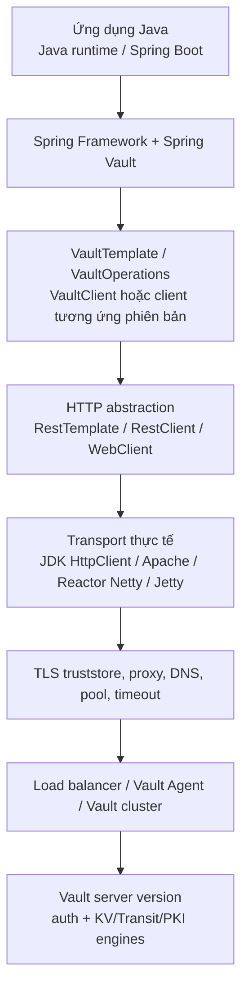
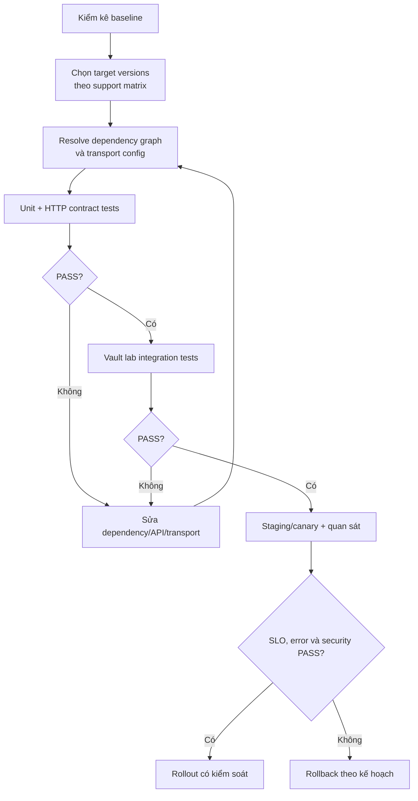

# Kiểm kê phiên bản Vault, Spring và HTTP transport

Một ứng dụng Java dùng **Spring Vault** có thể hoạt động tốt hôm nay nhưng gặp lỗi sau khi nâng cấp Spring Boot, thay Java runtime, cập nhật HTTP client hoặc thay Vault server. Nguyên nhân không nhất thiết là API `VaultTemplate` đổi: có khi dependency transitively thay phiên bản, TLS truststore khác, client mặc định được chọn lại, hoặc một auth method/secrets engine áp dụng hành vi mới.

Trong chương **Nâng cấp và tương thích** của module `SPRING_VAULT`, bước đầu tiên là **kiểm kê chính xác các phiên bản và lựa chọn transport đang chạy**, trước khi thử nâng cấp. Nội dung kết nối với toàn bộ vòng đời ứng dụng Spring Vault: xác thực theo workload, quyền Vault policy, KV secrets, token/lease, Transit encryption, PKI, giám sát và integration tests.

**Kết quả mong muốn** là một bản ghi có thể kiểm chứng: *Vault server thực tế là phiên bản nào, client Java đang nạp Spring Vault/Spring Framework/Spring Boot phiên bản nào, và request thực sự đi qua HTTP transport/TLS configuration nào*. Đây là bằng chứng đầu vào cho kế hoạch thay đổi; không phải lời hứa rằng mọi cặp phiên bản sẽ tương thích chỉ vì compile thành công.

> **Nguyên tắc quan trọng:** **Khai báo dependency ≠ dependency được resolve ≠ JAR đang chạy ≠ transport thực sự được chọn.** Cần thu thập cả bốn; tuyệt đối không suy từ `pom.xml`/`build.gradle` rồi kết luận môi trường production dùng đúng những phiên bản đó.

## 1. Vì sao cần kiểm kê theo từng lớp?

Một request thực tế có nhiều lớp, và các lớp có thể được nâng cấp độc lập:



Những câu hỏi có **đáp án khác nhau**:

- `vault version` trên laptop cho biết **Vault CLI binary**, không bảo đảm server mà ứng dụng kết nối dùng cùng version.
- `java -version` của developer cho biết JDK trên máy đó, không bảo đảm JDK bên trong container hoặc pod production giống hệt.
- `spring-vault-core` trong build file cho biết dependency được yêu cầu, không nhất thiết là phiên bản cuối cùng sau khi BOM, dependency management, constraints hoặc conflict resolution hoạt động.
- Việc ứng dụng dùng `VaultTemplate` không tự chứng minh nó đang sử dụng Apache HttpClient, `RestTemplate` hay JDK `HttpClient`. Đường đi phụ thuộc Spring Vault generation, cách wiring, các dependency trên classpath và cấu hình request factory/connector.
- Một Vault server mới chưa chắc làm ứng dụng lỗi; thay policy, KV mount version, TLS certificate hoặc auth role cũng có thể gây ra triệu chứng tương tự.

Để tránh quy kết nguyên nhân nhầm, nên lưu phiên bản **trước và sau thay đổi** cùng trạng thái hệ thống, kết quả kiểm thử và nguồn thu thập.

## 2. Bộ hồ sơ tối thiểu cần có trước khi nâng cấp

| Nhóm | Bắt buộc ghi lại | Nguồn bằng chứng |
|---|---|---|
| **Vault server** | Version, build date nếu công bố, edition, node/cluster, Vault namespace nếu có | `vault status` và `/v1/sys/seal-status` dưới endpoint đích |
| **Vault CLI/Agent** | CLI version; Vault Agent version nếu sidecar/agent được dùng | `vault version`/binary info từ đúng container/host |
| **Secrets engines/auth** | Mount path, KV v1/v2, mount type, auth method và role liên quan | Config triển khai và API mount/tune theo quyền được cấp |
| **JDK/JVM** | Java feature + patch version, vendor, runtime image/digest | `java -version` ngay trong runtime |
| **Spring** | Spring Boot, Spring Framework, Spring Vault core, Spring Cloud Vault nếu dùng | Build dependency graph + runtime JAR metadata |
| **Dependencies khác** | Spring Security, Jackson, Spring Web/WebFlux, HTTP client, Reactor nếu dùng | Resolved runtime classpath |
| **HTTP stack** | API client, request factory/connector **đang được chọn**, implementation và version | Spring configuration, runtime diagnostics, HTTP instrument |
| **TLS/network** | CA trust source, truststore type, TLS protocol, mTLS, proxy/LB và timeout/pool | Config triển khai đã redacted, handshake/probe an toàn |
| **Artifact** | Commit SHA, ứng dụng version, container image digest, thời gian deploy | Build metadata, registry/orchestrator |
| **Nghiệp vụ test** | Auth, KV, token/lease, Transit, PKI, timeout, HTTP status | Integration test chạy với token/secret thử nghiệm |

Với từng hàng, phải tách **“đã quan sát được”** và **“suy đoán từ cấu hình”**. Nếu thiếu quyền tra cứu Vault server hoặc không xác định được request factory runtime, ghi `UNKNOWN` và lý do, không tự điền phiên bản “gần giống”.

## 3. Kiểm kê đúng phiên bản Vault server

### 3.1. Phân biệt Vault CLI với Vault server

Ví dụ lệnh của người vận hành:

```bash
# Phiên bản của lệnh vault đang chạy trên máy/container hiện tại.
vault version

# Trạng thái server tại VAULT_ADDR (có thể khác CLI version).
vault status -format=json
```

`vault version` đo **binary client**. `vault status` truy vấn server và thường hiển thị `Version`, `Build Date`, trạng thái sealed, HA mode và một số chi tiết cluster. Lệnh `vault status` có **exit code 2 nếu Vault bị sealed**, vì vậy một script kiểm kê không nên coi exit code khác 0 luôn có nghĩa “không thể lấy được thông tin” mà bỏ qua output; kiểm tra trạng thái sealed riêng.

Ở môi trường HA, các node có thể đang trong một đợt rolling upgrade nên không nhất thiết cùng version tại mọi thời điểm. Ghi lại **thời điểm quan sát**, endpoint hoặc node đang được hỏi và phạm vi traffic đi qua load balancer. Không coi một lần hỏi một hostname là chứng minh mọi node đều đã nâng cấp.

### 3.2. Dùng API trạng thái nếu không có Vault CLI

API chuẩn để quan sát tình trạng seal:

```http
GET /v1/sys/seal-status
```

Ví dụ shell với TLS được xác minh:

```bash
# Chạy trên máy kiểm kê đã trust CA đúng, không dùng -k.
curl --fail-with-body --silent --show-error \
  --cacert /path/to/vault-ca.pem \
  "https://vault.example.internal:8200/v1/sys/seal-status"
```

Phản hồi có thể chứa:

```json
{
  "initialized": true,
  "sealed": false,
  "version": "X.Y.Z",
  "build_date": "<build-date-if-disclosed>",
  "storage_type": "raft"
}
```

Đây là **JSON rút gọn minh họa**, không phải dữ liệu thu từ một cụm thực tế. Endpoint `sys/seal-status` không yêu cầu client token theo API thông thường, nhưng **thông tin version/build có thể bị redacted** bởi cấu hình bảo mật của listener. Khi thấy `version=""` hoặc `n/a`, ghi `NOT_DISCLOSED`; không cố truy cập API quản trị bằng root token chỉ để lấy thông tin này.

Lệnh trên chỉ kiểm tra khả năng gọi endpoint. Một cụm đang trả sealed/standby không giống với một cụm ready nhận mọi traffic. Không dùng API status thay cho thử nghiệm nghiệp vụ KV/Transit và xác thực thật.

### 3.3. Ghi thêm các thành phần Vault ảnh hưởng compatibility

Thông tin phiên bản server không phản ánh đầy đủ contract của workload. Ít nhất ghi:

| Thành phần | Cần biết | Ví dụ điểm khác biệt |
|---|---|---|
| **Auth mount** | `auth/kubernetes/`, `auth/approle/`, JWT hoặc cloud auth; role config | Login endpoint, TTL, bound claims, audience, policies |
| **KV mount** | `secret/` là KV v1 hay KV v2 | KV v2 HTTP path có `data/`, `metadata/` và version |
| **Transit mount** | Key name, loại khóa, key version tối thiểu, derived/context | Encrypt/decrypt policy và format ciphertext |
| **PKI mount** | Issuer/role, chain/trust, TTL và algorithm | Certificate request/response, private key và SAN |
| **Database engine** | Dynamic/static role, lease TTL, connection plugin | Credential lifecycle và lease renewal |
| **Namespace** | Header `X-Vault-Namespace` nếu dùng Vault Enterprise | Path logic có thể giống nhưng scope khác nhau |
| **Vault Agent/proxy** | Agent version và có dùng auto-auth/caching không | Có thể thay cách client nhận token, cache và TLS |

Chỉ dùng API admin để inspect mount/auth khi đã được phép, không đưa toàn bộ role credentials, bootstrap secrets hoặc auth config nhạy cảm vào báo cáo. Thông thường bản ghi chỉ cần **mount type, tuning, policy fingerprint/ID, không phải nội dung bí mật**.

## 4. Kiểm kê Java, Spring Boot, Spring Framework và Spring Vault

### 4.1. Các phiên bản có quan hệ nhưng không đồng nghĩa

Một ứng dụng Spring Boot có thể có các lớp version sau:

```text
Container OS / runtime image
  └── Java vendor + feature + patch (ví dụ: Java 17/21/...)
      └── Spring Boot version
          └── Spring Framework version
              ├── spring-web / spring-webflux
              ├── Spring Vault (spring-vault-core)
              ├── Spring Cloud Vault (nếu dùng)
              ├── Jackson và codec
              └── HTTP transports / TLS provider
```

Spring Boot quản lý nhiều dependency thông qua BOM. Nếu dùng Spring Cloud Vault, thường còn có **Spring Cloud release train/BOM** phải tương thích với dòng Spring Boot. `spring-vault-core` có thể được kéo vào **trực tiếp** hoặc **transitively** qua Spring Cloud Vault starter.

Đối với các thế hệ Spring Vault mới, tài liệu chính thức có thể yêu cầu một dòng Spring Framework/Java cụ thể. **Không áp thông tin của tài liệu Spring Vault `current` vào một ứng dụng đang chạy Spring Vault cũ**. Phải chọn **đúng version tài liệu** khi đánh giá yêu cầu Java, Spring Framework và HTTP stack.

Ví dụ một thay đổi lớn: **Spring Vault 4.x** giới thiệu/tiếp tục phát triển API `VaultClient` dùng `RestClient` ở tầng dưới; các constructor `VaultTemplate` dựa vào `RestTemplateBuilder` hoặc `ClientHttpRequestFactory` đã được đánh dấu deprecated trong Javadoc **4.1** để hướng tới constructor dựa trên `VaultClient`. Điều này không có nghĩa mọi bản Spring Vault trước đó đều có cùng client abstraction hay cùng default transport. Luôn kiểm tra API của version ứng dụng thực sự đang dùng.

### 4.2. Lấy JDK thực sự chạy

Trong container/pod hoặc host chạy ứng dụng, dùng:

```bash
java -version
```

Ghi lại: Java feature version, patch/build, vendor, kiến trúc CPU và JVM flags có ảnh hưởng mạng/TLS. Nếu ứng dụng deploy bằng container, **build JDK** và **runtime JDK** có thể khác. Việc build trên Java mới không tự chứng minh runtime cũ có thể chạy bytecode tạo ra.

Trong trường hợp có Java runtime diagnostics không chứa thông tin nhạy cảm:

```java
String runtime = System.getProperty("java.runtime.version");
String vendor = System.getProperty("java.vendor");
String javaHome = System.getProperty("java.home");

// Chỉ ghi runtime/vendor vào inventory có quyền truy cập.
// javaHome là đường dẫn hạ tầng: có thể không cần xuất ra ngoài.
```

Không dùng `System.getenv()` rồi in mọi biến môi trường để “kiểm kê”; rất dễ để lộ `VAULT_TOKEN`, `SECRET_ID`, JWT hoặc password.

### 4.3. Lấy Spring version ở runtime mà không cần token

Có thể đọc version từ API và metadata của JAR đang nạp:

```java
import org.springframework.boot.SpringBootVersion;
import org.springframework.core.SpringVersion;
import org.springframework.vault.core.VaultTemplate;

public final class SpringRuntimeInventory {

    public static void main(String[] args) {
        String bootVersion = SpringBootVersion.getVersion();
        String frameworkVersion = SpringVersion.getVersion();
        String vaultVersion =
                VaultTemplate.class.getPackage().getImplementationVersion();

        System.out.println("Spring Boot: " + bootVersion);
        System.out.println("Spring Framework: " + frameworkVersion);
        System.out.println("Spring Vault: " + vaultVersion);
    }
}
```

Ví dụ là phương pháp **diagnostic**, không yêu cầu gọi Vault. `getImplementationVersion()` phụ thuộc `MANIFEST.MF` của JAR và **có thể là `null` khi chạy bằng IDE, exploded classes hoặc đóng gói khác**. Khi đó không phán đoán version; kiểm tra resolved dependency graph và artifact metadata. Nếu không muốn ứng dụng in ra console, thu thập bằng công cụ kiểm kê build/runtime có phân quyền.

Không công khai thông tin chi tiết version/hệ thống trong endpoint API business. Version inventory là thông tin phục vụ triển khai/bảo mật, nên lưu trong báo cáo nội bộ với quyền đọc phù hợp.

## 5. Tìm phiên bản dependency thực tế bằng Gradle

Với dự án Gradle, các lệnh dưới đây là **hướng dẫn cho môi trường của bạn**, không cần chạy trong khi đọc bài:

```bash
# Phiên bản công cụ Gradle wrapper + Java mà Gradle đang dùng.
./gradlew --version

# Cây dependency runtime thực tế sau khi resolution.
./gradlew dependencies --configuration runtimeClasspath

# Truy nguồn Spring Vault và Spring Framework.
./gradlew dependencyInsight \
  --dependency spring-vault-core \
  --configuration runtimeClasspath

./gradlew dependencyInsight \
  --dependency spring-web \
  --configuration runtimeClasspath

# Kiểm tra driver Apache HttpClient (nếu có).
./gradlew dependencyInsight \
  --dependency httpclient5 \
  --configuration runtimeClasspath
```

Trên Windows, dùng `.\gradlew.bat` hoặc lệnh wrapper tương ứng. Lệnh trên trả ra thông tin dependencies, không phải giá trị secret; tuy nhiên output có thể lộ đường dẫn/nội bộ repository và cần lưu trong nơi quản lý build artifacts phù hợp.

**Điều phải đọc trong kết quả:**

- `requested` và **`selected`** có thể khác nhau do Spring Boot BOM, Spring Cloud BOM, platform constraints và conflict resolution.
- `spring-vault-core` có thể bị chọn ở phiên bản khác với dependency trực tiếp trong file build.
- `spring-web`/`spring-webflux` và `spring-core` phải cùng dòng Spring Framework tương thích.
- `httpclient5` có trên classpath **không tự chứng minh** ứng dụng Vault đang dùng nó. Có thể transport được wiring thủ công hoặc ưu tiên transport khác.
- `jackson-databind` và các artifact Jackson 2/3 cần được đối chiếu với phiên bản Spring Framework/Vault đang dùng; đây là nguồn lỗi serialization khi nâng cấp lớn.

Nếu build multi-module, chạy dependencyInsight **trên project thật sự đóng gói ứng dụng**, ví dụ:

```bash
./gradlew :payment-service:dependencyInsight \
  --dependency spring-vault-core \
  --configuration runtimeClasspath
```

`payment-service` là tên module minh họa; không suy từ dependency của root project ra runtime của subproject.

### Vì sao không đủ chỉ xem version trong `build.gradle`?

```kotlin
dependencies {
    implementation("org.springframework.vault:spring-vault-core")
    implementation("org.springframework.boot:spring-boot-starter-web")
}
```

Đoạn Gradle Kotlin DSL này **cố ý không ghi version**. Nó giả định dự án có dependency management/BOM phù hợp để resolve. Ngược lại, khi version được ghi tường minh, cơ chế constraints/strict version/platform vẫn có thể ảnh hưởng. Hãy kiểm kê **resolved artifacts**, không kết luận từ cú pháp khai báo.

Nếu cần hồ sơ audit dài hạn, dùng dependency lockfile hoặc SBOM được tạo từ đúng build artifact, kèm commit SHA và image digest. Không tự sửa version trong BOM chỉ để ép báo cáo hiện ra giá trị mong muốn.

## 6. Kiểm kê phiên bản bằng Maven

Với Maven, dùng:

```bash
# Phiên bản Maven và Java Maven đang sử dụng.
mvn --version

# Cây dependency của ứng dụng.
mvn dependency:tree

# Có thể lọc ra những nhóm cần chú ý.
mvn dependency:tree -Dincludes=org.springframework.vault,org.springframework

# In effective POM khi cần truy nguồn dependencyManagement.
mvn help:effective-pom
```

Với dự án multi-module, chạy ở đúng module đóng gói app hoặc thêm tùy chọn module `-pl` thích hợp. Trên Maven, dependency tree có thể phản ánh dependency được quản lý bởi parent POM hoặc BOM import; không phải mọi version được khai báo trong từng `<dependency>`.

Đối chiếu các artifact:

| Maven coordinate | Vai trò | Có mặt khi nào? |
|---|---|---|
| `org.springframework.vault:spring-vault-core` | Spring Vault client API, `VaultTemplate` | Khi ứng dụng dùng Spring Vault core |
| `org.springframework.boot:spring-boot` | Spring Boot runtime | Ứng dụng Spring Boot |
| `org.springframework:spring-core` | Spring Framework base | Phần lớn ứng dụng Spring |
| `org.springframework:spring-web` | HTTP abstraction blocking | Khi dùng Spring MVC/RestClient/Spring Vault phù hợp |
| `org.springframework:spring-webflux` | Reactive WebClient | Khi ứng dụng/reactive client cần |
| `org.springframework.cloud:spring-cloud-vault-config` | Spring Cloud Vault config integration | Chỉ khi ứng dụng sử dụng nó |
| `org.apache.httpcomponents.client5:httpclient5` | Apache HttpClient 5 | Khi có driver này trên runtime classpath |
| `io.projectreactor.netty:reactor-netty-http` | Reactor Netty transport | Khi dự án chọn WebFlux/Netty stack tương ứng |

Đây là danh sách **để tra cứu**, không yêu cầu tất cả artifact phải có mặt đồng thời. Một ứng dụng `spring-vault-core` thuần có thể không dùng Spring Cloud Vault. Không giả định có WebFlux chỉ vì dependency tree chứa Reactor ở một nhánh không liên quan.

## 7. HTTP transport: phải kiểm kê ba tầng khác nhau

Sự khác biệt lớn giữa một API hoạt động và một API chậm/lỗi có thể nằm ở transport:

```text
Business code
   |
   +-- VaultTemplate / VaultOperations
            |
            +-- Spring Vault client abstraction
                     |
                     +-- HTTP API layer:
                     |      RestTemplate / RestClient (imperative)
                     |      WebClient (reactive)
                     |
                     +-- ClientHttpRequestFactory / ClientHttpConnector
                              |
                              +-- JDK HttpClient
                              +-- Apache HttpComponents
                              +-- Reactor Netty
                              +-- Jetty
```

**Không nhầm `RestClient` với JDK `HttpClient`.** `RestClient` là API của Spring Framework, còn JDK `HttpClient` là transport triển khai HTTP thấp hơn. Tương tự, `WebClient` không có nghĩa chắc chắn transport là Reactor Netty khi connector có thể được tùy biến.

Tài liệu Spring Vault 4.1 mô tả `VaultClient` là HTTP client API dành cho Vault, dùng `RestClient` ở tầng dưới, và hỗ trợ các driver HTTP imperative/reactive tùy dependency/config. Ở các thế hệ cũ, `VaultTemplate` có thể được xây dựng qua `RestTemplate`/`RestOperations`. Vì vậy inventory phải ghi **thế hệ thư viện**, rồi mới kiểm tra client thực tế; không copy cấu hình 4.1 cho dự án 2.x/3.x mà không đối chiếu Javadoc.

### 7.1. Thông tin transport cần lưu

| Mục | Câu hỏi cần trả lời | Ví dụ giá trị inventory |
|---|---|---|
| Client API | `VaultTemplate`, `VaultClient`, `ReactiveVaultTemplate`? | “`VaultTemplate`” |
| Client Spring HTTP | `RestTemplate`/`RestClient`/`WebClient`? | “`RestClient`” |
| Transport engine | JDK/Apache/Jetty/Reactor Netty? | “Apache HttpClient 5” |
| Library version | Phiên bản driver resolved | “theo `dependencyInsight`, chưa kiểm chứng runtime” |
| TLS | TLS versions, truststore/CA, mTLS? | “TLS qua CA riêng” |
| Network | Proxy, mesh sidecar, gateway, L4/L7 LB? | “service mesh bắt mTLS” |
| Timeouts | Connect, read/response, pool acquire | “giá trị từ config deploy đã redacted” |
| Pool | Max per route, total, keep-alive, eviction | “theo config được kích hoạt” |
| Observability | HTTP client metric/trace, retry, error translation | “Micrometer + custom Vault spans” |

Ghi rõ giá trị có được **quan sát runtime** hay chỉ được tìm thấy **trong cấu hình**. Một dependency `httpclient5` xuất hiện trong runtimeClasspath không bảo đảm `VaultTemplate` sử dụng nó, nhất là khi ứng dụng tự tạo `ClientHttpRequestFactory` hoặc `VaultClientCustomizer`.

### 7.2. Làm thế nào xác định transport đang được dùng?

Ưu tiên theo thứ tự bằng chứng:

1. **Bean/configuration thực tế**: nơi tạo `VaultClient`/`VaultTemplate`, `RestClient` hoặc `WebClient` và request factory/connector. Nếu có Spring Cloud Vault, kiểm tra customizer/settings mà auto-configuration áp dụng.
2. **Resolved runtime dependencies**: xem có JDK client, Apache HttpComponents 5, Reactor Netty, Jetty; dùng chúng để khoanh vùng, **không suy kết luận từ classpath một mình**.
3. **Runtime telemetry/tracing và thread dump đã redacted**: dấu hiệu transport thread/connection pools; không ghi raw HTTP headers hoặc Vault response.
4. **Một probe thực vào Vault lab**: kiểm tra connection reuse, timeout và TLS verification; giới hạn request, không đổi cấu hình production chỉ để thử.
5. **Client configuration riêng của Spring Vault version đó**: so với Javadoc/trang “HTTP Client Support” chính xác theo version.

Với Spring Vault 4.1, cấu hình `VaultClient` có thể chọn request factory tương ứng. Ví dụ **mang tính minh họa**:

```java
import org.springframework.http.client.HttpComponentsClientHttpRequestFactory;
import org.springframework.vault.client.VaultClient;
import org.springframework.vault.client.VaultEndpoint;

// Phụ thuộc Apache HttpClient 5 phải có trên runtime classpath.
// Đoạn này chỉ tạo client, không thiết lập auth/session lifecycle.
VaultClient vaultClient = VaultClient.builder()
    .endpoint(VaultEndpoint.create("vault.example.internal", 8200))
    .requestFactory(new HttpComponentsClientHttpRequestFactory())
    .build();
```

Trong production còn phải cấu hình HTTPS, TLS trust, timeout/pool và authentication/session manager phù hợp. **Không nên copy ví dụ chọn transport rồi bỏ cấu hình SSL hoặc session**. Nếu dùng client tùy biến để bypass `VaultTemplate` hoặc `SessionManager`, bạn có thể làm mất token renewal và error handling được hỗ trợ.

### 7.3. Lưu ý thay đổi giữa các thế hệ Spring Vault

Các điểm cần đối chiếu khi đi qua release lớn:

- Public API client: `VaultTemplate`/`VaultOperations` có còn phương thức và constructor đang dùng không?
- Constructor/method nào đã deprecated, hoặc cách cấu hình client có chuyển từ `RestTemplate` sang `VaultClient`/`RestClient`?
- Transport mặc định có thay đổi theo classpath hay không, đặc biệt khi thêm Apache HttpClient/Netty/Jackson?
- Cách serialize JSON: Jackson 2 hay Jackson 3, module Java Time/record, codec và kiểu DTO có tương thích?
- Exception mapping: status `400`/`403`/`404`/`429`/`5xx` còn được chuyển sang exception mà ứng dụng xử lý đúng không?
- Auth/`SessionManager` có cùng luồng token, lookup/renew/re-authentication như baseline không?
- Endpoint operations như `opsForVersionedKeyValue`, `opsForTransit`, `opsForPki` còn giữ hợp đồng payload mong đợi không?

**Không xem deprecated là đã bị xóa**: nó là cảnh báo cần lên kế hoạch đổi API trước phiên bản loại bỏ. Ngược lại, code compile với constructor cũ cũng chưa đủ chứng minh client/session/TLS hành xử như trước.

## 8. TLS và proxy cũng là compatibility, không chỉ phiên bản JAR

Khi đổi HTTP transport hoặc Java runtime, ứng dụng có thể đổi hành vi:

- **TLS truststore:** CA riêng được load theo cách nào? Có dùng JVM `javax.net.ssl.trustStore`, container CA store hay client-specific SSL configuration?
- **Hostname verification/SNI:** certificate có SAN phù hợp với hostname Vault qua DNS/LB không?
- **TLS protocol/cipher suites:** JDK mới có thể chặn giao thức/cipher cũ. Phải kiểm tra Vault listener, proxy và client cùng có bộ giao thức tương thích.
- **mTLS:** nơi lưu client certificate/private key, expiry, role mapping; không đưa private key vào báo cáo.
- **Proxy/service mesh:** `HTTPS_PROXY`/`NO_PROXY`, sidecar intercept, header forwarding; Vault namespace và token header không được lộ qua proxy không tin cậy.
- **Timeout/pool:** connect timeout, response timeout, pool acquire timeout, connection idle/keep-alive; thay transport có thể đổi default và tạo p99 tăng.
- **HTTP redirect/standby:** kiểm tra HA/standby redirect, retry khi leader failover và khả năng xác thực được giữ đúng.

Lệnh kiểm tra certificate chain bằng OpenSSL trong **môi trường đã cho phép**:

```bash
# Không gửi client key/private key qua command line.
openssl s_client \
  -connect vault.example.internal:8200 \
  -servername vault.example.internal \
  -verify_return_error </dev/null
```

Lệnh này giúp quan sát handshake và certificate chain, không kiểm chứng ứng dụng Java đang dùng cùng truststore. Nếu kết quả trình bày thiếu CA trong container, phải kiểm tra truststore thực tế của JVM và cấu hình Spring Vault HTTP transport. **Không dùng `curl -k`, `trustAll` hoặc tắt hostname verification** để chữa lỗi nâng cấp.

### Những gì không nên thu thập trong inventory

Không sao chép nội dung `VAULT_TOKEN`, JWT, `role_id/secret_id`, password truststore, client private key, response `auth.client_token`, KV values, Transit plaintext/ciphertext hay database dynamic credentials.

Có thể ghi nhận:

- Tên logical config key hoặc secret reference **không nhạy cảm**.
- Vault auth method và role name trong phạm vi chỉ những người vận hành được phép xem.
- Fingerprint của CA/certificate công khai và hạn X.509 nếu chính sách cho phép.
- Client library version, class name của request factory, timeout/pool config đã làm sạch.
- Kết quả probe thành công/thất bại và HTTP status **không chứa body**.

## 9. Tạo bảng kiểm kê có thể review

Mẫu dưới đây là một **manifest minh họa**. `UNKNOWN` có nghĩa chưa có bằng chứng; `x.y.z` là **placeholder, không đại diện phiên bản đã cài đặt**.

```yaml
inventory:
  service: payment-gateway
  environment: staging
  captured_at: "<UTC ISO-8601 timestamp>"
  artifact:
    commit: "<git-sha>"
    image_digest: "<sha256-image-digest>"
  vault:
    server_version: "UNKNOWN"
    version_source: "/v1/sys/seal-status on target endpoint"
    cli_version: "UNKNOWN"
    namespace: "not-used-or-redacted"
    kv_mount: "secret/"
    kv_version: 2
    auth_mount: "auth/kubernetes/"
  runtime:
    java_version: "UNKNOWN"
    java_vendor: "UNKNOWN"
    spring_boot: "UNKNOWN"
    spring_framework: "UNKNOWN"
    spring_vault_core: "UNKNOWN"
    spring_cloud_release_train: "NOT_USED"
    jackson_generation: "UNKNOWN"
  http:
    vault_client_abstraction: "VaultTemplate"
    spring_http_api: "UNKNOWN"
    transport_implementation: "UNKNOWN"
    transport_version: "UNKNOWN"
    tls_ca_source: "configured-through-approved-runtime"
    connection_pool: "UNKNOWN"
    timeouts: "UNKNOWN"
  evidence:
    build_runtime_graph: "NOT_COLLECTED"
    runtime_metadata: "NOT_COLLECTED"
    target_vault_probe: "NOT_COLLECTED"
    integration_tests: "NOT_RUN"
```

Không đưa bản manifest này thẳng vào `application.yml` để dùng làm cấu hình chạy ứng dụng: đây là một **định dạng báo cáo**, không phải schema Spring Boot hay Spring Vault. Cần cập nhật nó từ bằng chứng build/runtime và giới hạn quyền truy cập.

### 9.1. Phải ghi nguồn gốc từng giá trị

Ví dụ một phiên kiểm kê:

| Thành phần | Giá trị quan sát | Phương thức lấy | Độ tin cậy |
|---|---|---|---|
| Vault CLI | `CLI_X.Y.Z` | `vault version` trên jump host | **Chỉ** xác định CLI ở jump host |
| Vault server | `VAULT_X.Y.Z` | `GET /sys/seal-status` đến hostname staging | Xác định endpoint tại thời điểm probe |
| Spring Vault | `SPRING_VAULT_X.Y.Z` | `dependencyInsight` của service build + runtime manifest | Mạnh khi khớp image digest |
| HTTP transport | `UNKNOWN` | Chỉ có dependency graph | Chưa đủ để xác định factory active |
| TLS chain | `VALID_FOR_TARGET` | Handshake test từ container runtime | Chứng minh trust/hostname trong điều kiện đo |

Các ký hiệu `CLI_X.Y.Z`/`VAULT_X.Y.Z` chỉ là dữ liệu ví dụ. Mục tiêu là biết **vì sao tin một giá trị**, và **phạm vi mà bằng chứng có hiệu lực**.

### 9.2. Phân biệt baseline và target

```text
BASELINE (đang chạy)
  Java A + Boot B + Framework C + Spring Vault D
  HTTP transport E + Vault server F
  -> test auth/KV/Transit/PKI/lease PASS

TARGET (dự kiến)
  Java A' + Boot B' + Framework C' + Spring Vault D'
  HTTP transport E' + Vault server F'
  -> chỉ chấp nhận khi test tương ứng PASS
```

Không đổi đồng thời tất cả A–F trong một lần nếu không có lý do bắt buộc: thay ít biến giúp khoanh vùng lỗi. Với major framework upgrade có thể cần thay cả Java/Spring Boot/Spring Cloud một cách đồng bộ theo ma trận tương thích chính thức; khi đó phải coi chúng là một **upgrade unit được kiểm thử chung**.

## 10. Từ inventory tới ma trận tương thích

Không có một con số “Spring Vault version mới nhất” đủ để quyết định upgrade. Cần lập ma trận theo **trục thực sự ảnh hưởng client**:

| Trục | Cần đối chiếu | Bài thử tối thiểu |
|---|---|---|
| Vault server × Spring Vault | Các auth/secret API và tính năng Vault server hỗ trợ | `VaultTemplate` đọc KV, renew token, Transit encrypt |
| Spring Boot × Spring Framework | Dòng framework do Boot/BOM quản lý | Context startup, dependency graph không conflict |
| Spring Cloud Vault × Spring Cloud release train | Release train hỗ trợ dòng Boot nào | Config Data import, profile, Vault auth tại bootstrap |
| Spring Vault × Java | Yêu cầu JDK của phiên bản đích | JVM khởi chạy, bytecode/API compatibility |
| Spring Vault × Jackson | Mapper/codec generation, date/time và response DTO | Map JSON KV v1/v2, PKI/Transit/Database |
| Spring Vault × HTTP transport | Request factory, timeout, proxy, TLS và exception mapping | Login/read/encrypt với transport đích |
| Vault × auth mount/role | Path, policy, bound audience/claims và TTL | Login workload và thực thi đúng ACL |
| Vault × secrets engine config | KV v1/v2, Transit key, PKI role/issuer, dynamic lease | Đúng payload, rotation/expiry và error cases |

### Nguồn ưu tiên để xác nhận compatibility

1. **Spring Vault reference & Javadoc cho đúng version đích**, đặc biệt “Dependencies”, “HTTP Client Support”, “Vault Client Access”.
2. **Spring Boot documentation** và dependency management/BOM của đúng release.
3. **Spring Cloud release train mapping** nếu dùng Spring Cloud Vault; không tự ghép Spring Cloud bất kỳ vào Boot mới.
4. **HashiCorp Vault release notes + API docs** cho server version đích, đặc biệt auth, KV, Transit, PKI và breaking changes liên quan.
5. **Integration tests bằng workload identity thật trong lab**, vì không có trang compatibility nào biết toàn bộ policy, proxy, TLS và luồng nghiệp vụ nội bộ của ứng dụng.

Khi tham khảo trang `current` của Spring Vault, chú ý nó có thể đã chuyển sang dòng mới hơn ứng dụng. Một yêu cầu như Jackson 3 hay API `VaultClient` có thể **chỉ đúng với generation mới**, không nên suy ngược cho project Spring Vault cũ.

## 11. Bộ smoke test bắt buộc sau khi thay phiên bản

Tối thiểu, một ứng dụng Spring Vault cần kiểm chứng khả năng hoạt động **chứ không chỉ compile**:

| Kịch bản | Hành động thử trong Vault lab | Tiêu chí PASS |
|---|---|---|
| **TLS/transport** | Kết nối hostname đích qua CA hợp lệ | Handshake xác minh cert thành công, timeout/pool phù hợp |
| **Authentication** | Đăng nhập bằng workload role hợp lệ | Nhận token có policy/TTL mong đợi, không log token |
| **KV v2** | Đọc secret synthetic có version, thử key thiếu | Đúng `data.data`/`Versioned<T>`, lỗi `404` xử lý an toàn |
| **ACL negative** | Token read-only thử ghi KV | Vault trả từ chối, không tự động nâng quyền |
| **Session lifecycle** | Renew/reauth khi TTL ngắn ở lab | Không lặp login mỗi request; token hết hạn được xử lý |
| **Transit encrypt** | Mã hóa plaintext giả, kiểm tra prefix `vault:vN:...` | Không làm lộ plaintext, nhận ciphertext hợp lệ |
| **Transit decrypt** | Chỉ chạy bằng role có quyền riêng | Giải mã đúng bytes; encrypt-only không tự decrypt được |
| **PKI issue/sign** | Dùng role/CSR lab và CA thử nghiệm | Certificate đúng SAN/chain, xử lý private key an toàn |
| **Dynamic secret lease** | Nhận DB credential synthetic/test | Lease/TTL/renew/revoke đúng kỳ vọng, rotation hợp lệ |
| **Lỗi HTTP** | Inject `400`/`403`/`404`/`429`/`5xx`, timeout | Phân loại exception đúng, retry có giới hạn |
| **Observability** | Đọc metric/tracing của test | Có login/read/encrypt latency, không log body/token |
| **HA/redirect** | Chạy failover trong Vault lab nếu kiến trúc có HA | Client chịu failover/redirect theo hợp đồng |

Test không cần dùng secret production. Dùng token, KV key, Transit key và PKI role chỉ thuộc môi trường thử nghiệm rồi revoke/cleanup theo quy trình. Không chạy Vault dev mode vào cụm production hoặc cấp root token cho automated tests.

### Tại sao chọn smoke test theo engine?

Một lần `GET /sys/health` thành công chỉ chứng minh một phần server status. Nó không chứng minh:

- Auth role của workload có thể login từ JDK/HTTP transport mới.
- `VaultTemplate` còn đọc đúng KV v2 và metadata version.
- Transit encrypt nhận plaintext đúng Base64/codec.
- PKI trả certificate mà parser Java mới vẫn đọc được.
- Token refresh và database lease không bị lỗi do timeout/clock skew.
- HTTP status/exception mapping còn giúp ứng dụng fail closed.

Nên test **theo nhiệm vụ thật của service**, không theo một danh sách endpoint chung không được service dùng.

## 12. Phương pháp nâng cấp và rollback dựa trên inventory

### Bước 1 — Chốt baseline

Thu thập inventory cho production/staging theo nguồn **đúng môi trường**, ghi image digest, commit SHA, Java runtime, resolved dependencies, Vault server version và HTTP transport runtime. Xác minh không có hai môi trường dùng cùng artifact name nhưng khác nội dung.

### Bước 2 — Chọn mục tiêu theo support matrix

Đọc release notes của Vault, Spring Boot, Spring Framework, Spring Vault và Spring Cloud Vault nếu dùng. Ghi những API deprecated/removed, runtime requirements, dependency upgrades và thay đổi transport/Jackson. Không tự chọn một con số version mà bỏ qua BOM.

### Bước 3 — Nâng cấp trong nhánh riêng

Chỉ thay nhóm phiên bản cần thiết và cập nhật cấu hình tương ứng; kiểm tra `runtimeClasspath`/`dependency:tree` để xác nhận version resolve đúng. Với Spring Vault 4.x, đặc biệt đối chiếu thay đổi `VaultClient`/`RestClient` so với `RestTemplate` cũ và constructor Javadoc.

### Bước 4 — Kiểm thử nhiều lớp

Chạy unit/contract tests offline trước; sau đó integration tests với Vault lab có TLS/auth/policy/engines tương đương. Chỉ áp dụng thay đổi tại staging khi các phép thử token, KV, Transit/PKI và lỗi HTTP đạt yêu cầu.

### Bước 5 — Canary và quan sát

Giới hạn rollout ở một số instance, theo dõi p50/p95/p99 login/read/encrypt, tỷ lệ `403`/`404`/`5xx`, token renewal failures, handshake errors và readiness transitions. So với baseline ở **cùng traffic và điều kiện đo**, không suy rằng cải thiện nếu workload khác nhau.

### Bước 6 — Rollback đã được chuẩn bị

Rollback **artifact/client configuration** có thể nhanh, nhưng rollback **Vault server hoặc data format** có thể không đơn giản, đặc biệt khi đã đổi engine settings, keys, mount schema hoặc storage format. Phải có kế hoạch backup/snapshot, compatibility window và rollback được phê duyệt từ trước theo tài liệu HashiCorp, không tự hạ phiên bản Vault server bằng cách thay binary.



## 13. Lỗi kiểm kê thường gặp

| Sai lầm | Hệ quả | Cách khắc phục |
|---|---|---|
| Ghi `vault version` làm Vault server version | Báo nhầm phiên bản CLI trên máy operator | Đối chiếu `vault status` hoặc `sys/seal-status` của endpoint đích |
| Xem `build.gradle` là resolved version | Không thấy BOM/constraint/conflict | Dùng `dependencyInsight` đúng runtimeClasspath |
| Dùng JDK laptop thay JDK container | Runtime không tương thích với bytecode/TLS mới | Chạy `java -version` trong image đang chạy |
| Có `httpclient5` trên classpath nên kết luận Apache active | Client có thể dùng request factory khác | Xác nhận wiring và runtime diagnostics |
| Coi `RestClient` chính là JDK `HttpClient` | Không phát hiện thay đổi implementation | Tách API layer khỏi transport engine |
| Dùng tài liệu Spring Vault `current` cho dự án phiên bản cũ | Dùng API/Jackson/transport không tồn tại | Chọn Javadoc theo đúng phiên bản |
| Bỏ qua Spring Cloud Vault/BOM | Khác release train tương thích Boot | Ghi train và verify boot/Cloud mapping |
| Upgrade client nhưng giữ truststore không phù hợp | TLS handshake thất bại | Kiểm tra trust CA, hostname, mTLS trước rollout |
| Tắt TLS verification để qua smoke test | Rủi ro MITM và lộ Vault secret | Sửa certificate chain/truststore đúng |
| Chỉ kiểm tra Vault server health | Không phát hiện lỗi ACL/KV v2/Transit | Chạy thử nghiệm engine đúng workload |
| Ghi token/response vào inventory log | Rò rỉ credential | Chỉ lưu version/config đã redacted |
| Không lưu commit/image digest | Không tái hiện được artifact đã đo | Gắn inventory với build và image digest |
| Upgrade server và client cùng lúc không có baseline | Khó tìm nguyên nhân khi lỗi | Cố định các trục và thay theo giai đoạn |
| Không thiết kế rollback cho data/backend | Khó hạ phiên bản Vault an toàn | Đọc quy trình backup/restore/migration chính thức |

## 14. Checklist kiểm kê có thể giao cho đội vận hành

- [ ] Vault CLI và **Vault server** được ghi thành **hai dòng khác nhau**.
- [ ] Vault server version được lấy ở đúng endpoint/namespace, ghi thời điểm và tình trạng HA.
- [ ] Biết các mount/auth method mà workload dùng, nhất là KV v1/v2.
- [ ] Biết Java runtime version/vendor của **container đang chạy**, không chỉ build machine.
- [ ] Ghi Spring Boot, Spring Framework, Spring Vault và Spring Cloud Vault/release train nếu có.
- [ ] Có dependency graph **runtime được resolve**, không chỉ version khai báo.
- [ ] Có phiên bản Jackson và các HTTP clients liên quan.
- [ ] Xác định client API (`VaultTemplate`/`VaultClient`/reactive), Spring HTTP layer và transport thực tế.
- [ ] Ghi TLS trust source, hostname verification, proxy/mesh, connection pool và timeouts.
- [ ] Bảo đảm không có `VAULT_TOKEN`, secret ID, password, private key, plaintext/ciphertext trong inventory.
- [ ] Manifest có image digest, commit và nguồn bằng chứng từng trường.
- [ ] Có so sánh baseline → target, release notes và support matrix cho đúng phiên bản.
- [ ] Smoke tests với workload identity và secret giả bao phủ KV, auth, Transit/PKI, token/lease, HTTP errors.
- [ ] Có canary, metrics đối chiếu và rollback plan đã review trước khi thay production.

## 15. Câu hỏi tự kiểm tra

1. Vì sao `vault version` trên một máy operator không phải bằng chứng về Vault server mà service đang gọi?
2. Trong HA rolling upgrade, một kết quả `sys/seal-status` từ load balancer có đại diện cho toàn bộ cụm không?
3. `build.gradle` khai báo Spring Vault phiên bản A, nhưng `dependencyInsight` chọn B. Version nào cần ghi cho runtime classpath?
4. Làm sao xác nhận một pod đang chạy JDK nào khi CI dùng một JDK khác?
5. Phân biệt `VaultTemplate`, `RestClient` và Apache HttpClient 5 về vai trò của từng lớp.
6. Vì sao tìm thấy `httpclient5` trong dependency tree chưa chứng minh Vault client đang dùng nó?
7. Vì sao phải đưa Spring Cloud release train vào bảng kiểm kê nếu ứng dụng có `spring-cloud-starter-vault-config`?
8. Khi chuyển sang Spring Vault generation mới, những điểm nào ngoài compile API phải kiểm chứng về Jackson, TLS và session?
9. Nếu `sys/seal-status` không tiết lộ `version`, có nên dùng root token để ép lấy version không?
10. Tại sao có thể đọc KV v2 thành công nhưng Transit encrypt thất bại sau nâng cấp?
11. Trong một lỗi `403`, cần so sánh những yếu tố gì trước khi kết luận “bản Spring Vault mới bị lỗi”?
12. Vì sao rollback Vault server có thể khó hơn rollback JAR/container của ứng dụng?

**Ghi nhớ:** Kiểm kê nâng cấp Spring Vault là kiểm kê **phiên bản và hành vi thực tế xuyên suốt cả đường kết nối**: Vault server và mounts, Java/Spring dependencies đã resolve, client abstraction, HTTP implementation, TLS/proxy và session/token lifecycle. Một bảng phiên bản không có nguồn bằng chứng hoặc không kèm test theo workload chỉ là danh sách giả định, chưa phải hồ sơ compatibility đáng tin.

## Tài liệu chính thức

- [Spring Vault — Dependencies và yêu cầu Spring Framework](https://docs.spring.io/spring-vault/reference/introduction/dependencies.html)
- [Spring Vault — Getting Started và yêu cầu Java/Vault](https://docs.spring.io/spring-vault/reference/introduction/getting-started.html)
- [Spring Vault — HTTP Client Support](https://docs.spring.io/spring-vault/reference/vault/client-support.html)
- [Spring Vault — Vault Client Access](https://docs.spring.io/spring-vault/reference/vault/vault-client.html)
- [Spring Vault — VaultTemplate Javadoc](https://docs.spring.io/spring-vault/reference/api/java/org/springframework/vault/core/VaultTemplate.html)
- [Spring Boot — Dependency Management](https://docs.spring.io/spring-boot/reference/using/build-systems.html)
- [Spring Cloud — Release Train và hỗ trợ Spring Boot](https://docs.spring.io/spring-cloud-release/reference/index.html)
- [Gradle — Viewing and Debugging Dependencies](https://docs.gradle.org/current/userguide/viewing_debugging_dependencies.html)
- [Apache Maven Dependency Plugin — dependency:tree](https://maven.apache.org/plugins/maven-dependency-plugin/tree-mojo.html)
- [HashiCorp Vault — status CLI](https://developer.hashicorp.com/vault/docs/commands/status)
- [HashiCorp Vault — /sys/seal-status API](https://developer.hashicorp.com/vault/api-docs/system/seal-status)
- [HashiCorp Vault — HTTP API](https://developer.hashicorp.com/vault/api-docs)
- [HashiCorp Vault — Upgrade documentation](https://developer.hashicorp.com/vault/docs/upgrading)
