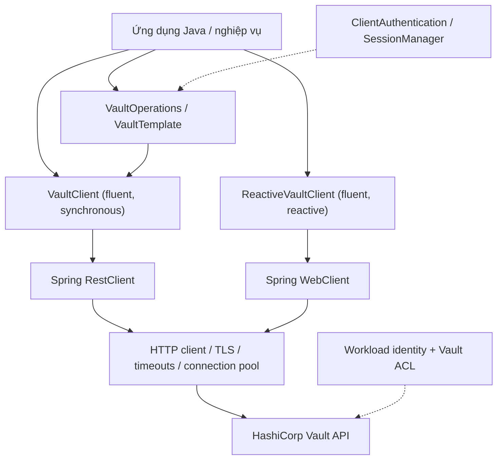

# VaultClient và các điểm tùy chỉnh mới từ phiên bản 4.1

## 1. Bối cảnh nâng cấp: tại sao Spring Vault 4.1 đưa ra VaultClient?

Trong ứng dụng Java, **Spring Vault** cung cấp `VaultTemplate`/`VaultOperations` để truy cập HashiCorp Vault, quản lý xác thực theo workload và làm việc với KV secrets, token/lease, Transit encryption, PKI cùng nhiều secrets engine. Những lớp ở tầng cao giúp mã nghiệp vụ không cần tự xử lý từng lời gọi HTTP. Tuy nhiên, thư viện, framework hoặc đội nền tảng đôi khi vẫn cần một API HTTP linh hoạt để gọi endpoint mới, đặt namespace riêng, thêm header hay thay đổi client TLS/timeout.

Trước phiên bản 4.1, việc tùy chỉnh trong nhiều ứng dụng gắn với `RestTemplate`, `RestTemplateBuilder`, interceptor hoặc những constructor/hook của `VaultTemplate`. Từ **Spring Vault 4.1**, thư viện giới thiệu **`VaultClient`** (đồng bộ) và **`ReactiveVaultClient`** (bất đồng bộ/reactive): API fluent theo phong cách Spring `RestClient`/`WebClient`, nhưng bổ sung thao tác dành riêng cho Vault. Các điểm tùy chỉnh mới cho phép thay đổi endpoint, namespace, request factory và client HTTP ở lớp phù hợp, thay vì can thiệp sâu vào `RestTemplate`.

Bài học thuộc chương **Nâng cấp và tương thích** của module **SPRING_VAULT**, tập trung trực tiếp vào đề bài **“VaultClient và các điểm tùy chỉnh mới từ phiên bản 4.1”**. Người học sẽ biết khi nào cần chuyển sang client mới, cách kết hợp nó với `VaultTemplate` và những lỗi bảo mật/tương thích thường phát sinh khi nâng cấp.

> **Mốc phiên bản:** Spring Vault 4.1 phát hành chính thức ngày 10/06/2026. Tính đến 25/11/2026, **4.1.2** là một bản vá ổn định đã được công bố (19/11/2026), bao gồm bản sửa lỗi bảo mật **CVE-2026-41698** liên quan đến xử lý đường dẫn secret chưa được làm sạch. Các ví dụ sử dụng hợp đồng API của nhánh 4.1; khi xây dựng hệ thống thật, chọn bản vá được hỗ trợ mới nhất và kiểm tra thông báo bảo mật.

### Mục tiêu

Sau bài này, bạn có thể:

- Phân biệt phạm vi sử dụng `RestClient`, `VaultClient`, `VaultTemplate` và `ReactiveVaultClient`.
- Tạo `VaultClient` bằng `create(...)` hoặc `builder()`, cấu hình `VaultEndpoint`, header, namespace và HTTP request factory.
- Gọi `get/post`, truyền `VaultToken`, request body, `retrieve().requiredBody()`, `toEntity()`, `onStatus(...)` và `wrap(Duration)`.
- Sử dụng **`VaultClientCustomizer`**, **`RestClientCustomizer`** và **`ReactiveVaultClientCustomizer`** đúng trách nhiệm.
- Chuyển cấu hình cũ dựa trên `RestTemplate` sang kiểu mới mà không phá vỡ `VaultOperations`, `SessionManager` hoặc xác thực workload.
- Lập kế hoạch kiểm thử tương thích, kiểm soát URL/path và bảo vệ token, TLS, secrets khi nâng cấp.

## 2. Vị trí của VaultClient trong kiến trúc Spring Vault



| Lựa chọn | Công việc phù hợp | Điều ứng dụng cần tự quản lý |
| --- | --- | --- |
| **`RestClient`** của Spring Framework | Tích hợp HTTP rất đặc thù, cần quyền điều khiển URL, header, message converters và transport. | Vault token/namespace, Vault path và diễn giải phản hồi Vault ở mức thấp. |
| **`VaultClient`** (mới từ 4.1) | Gọi HTTP Vault theo kiểu fluent, endpoint đặc thù, hỗ trợ token/namespace từng request và response wrapping. | Khi gọi trực tiếp, chọn token hợp lệ, kiểm tra response và giải quyết lỗi nghiệp vụ. |
| **`VaultTemplate`** | KV CRUD, Transit, PKI, secret lifecycle và các thao tác Vault có abstraction sẵn. | Cấu hình client/auth/session, xác minh dữ liệu đầu vào/đầu ra, chính sách nghiệp vụ. |
| **`ReactiveVaultClient`** (mới từ 4.1) | Pipeline Reactor/WebFlux cần HTTP Vault không chặn luồng. | Subscription, backpressure, error mapping và ngữ cảnh xác thực reactive. |

**Kết luận thiết kế:** `VaultClient` không thay thế toàn bộ `VaultTemplate`. Trong 4.1, `VaultTemplate` có thể được xây dựng **trên chính một `VaultClient`**, trong khi code nghiệp vụ vẫn dùng `VaultOperations` quen thuộc. Việc nâng cấp không bắt buộc phải viết lại mọi `vaultOps.read(...)` hoặc `vaultOps.write(...)`.

### 2.1. So sánh cú pháp gọi API

Cùng ý tưởng đọc một endpoint Vault, với các mức trừu tượng khác nhau:

```java
// REST thuần: phải tự chuẩn bị base URL và Vault headers.
RestClient rest = RestClient.create();
VaultResponse raw = rest.get()
    .uri("https://vault.example.internal:8200/v1/secret/data/orders-api")
    .header("X-Vault-Token", tokenString)
    .retrieve()
    .body(VaultResponse.class);

// VaultClient 4.1: endpoint và path Vault tách biệt.
VaultClient client = VaultClient.create(
    VaultEndpoint.from("https://vault.example.internal:8200"));
VaultResponse response = client.get()
    .path("secret/data/orders-api")
    .token(vaultToken)
    .retrieve()
    .requiredBody();

// VaultOperations: giữ API nghiệp vụ ở mức cao hơn.
// vaultOperations được cấu hình sẵn và có session/auth.
VaultResponse viaTemplate = vaultOperations.read(
    "secret/data/orders-api");
```

Đoạn mã chỉ minh họa sự khác biệt về API; `tokenString`, `vaultToken` và `vaultOperations` là những giá trị/bean **được cung cấp an toàn từ cấu hình runtime**, không phải literal nhúng vào repository. Ví dụ KV v2 dùng endpoint HTTP có segment `data/`; khi dùng `opsForKeyValue("secret", KV_2)`, Spring Vault sẽ thực hiện phần ánh xạ KV v2 thay cho ứng dụng.

## 3. Chuẩn bị dependency và kiểm tra tương thích

### 3.1. Phụ thuộc theo đúng release train

Với Gradle, nếu dự án dùng Spring Boot/Spring Cloud BOM tương thích để quản lý phiên bản:

```groovy
dependencies {
    implementation "org.springframework.vault:spring-vault-core"
    // Nếu dùng Spring Cloud Vault Config Data thì quản lý
    // spring-cloud-starter-vault-config qua BOM tương thích riêng.
}
```

Đối với dự án tự quản lý version của Spring Vault, có thể khai báo trực tiếp:

```groovy
dependencies {
    implementation "org.springframework.vault:spring-vault-core:4.1.2"
}
```

Hai cách trên là **phương án thay thế**, không phải lệnh phải đặt đồng thời để ép nhiều nguồn phiên bản khác nhau. Nếu sử dụng Spring Boot BOM, hãy xác định BOM đang quản lý **phiên bản Spring Vault nào** và chỉ override sau khi đã kiểm tra ma trận tương thích của Spring Boot, Spring Framework, Spring Cloud Vault và các thư viện liên quan.

Spring Vault 4.1 thuộc thế hệ **Spring Framework 7**. Khi kiểm tra dependency, cần chú ý sự chuyển đổi liên quan tới **Jackson 3** và các HTTP message converters. Tài liệu chính thức lưu ý Spring Vault cần JSON library phù hợp; một dự án không được bảo đảm hoạt động chỉ vì JAR `spring-vault-core` đã xuất hiện trong classpath.

### 3.2. Những gì cần kiểm tra trước khi thay đổi mã

| Mục kiểm tra | Tại sao quan trọng |
| --- | --- |
| Phiên bản Java, Spring Framework, Spring Boot, Spring Cloud BOM | Tránh `NoSuchMethodError`, xung đột Spring modules và autoconfiguration không tương thích. |
| `spring-vault-core`, `spring-cloud-vault-config` | API client 4.1 có thể không có trong dependency thực được chọn bởi build. |
| Jackson 2/3 và message converters | Request `body(Map)` hoặc JSON response có thể lỗi chuyển đổi nếu classpath thiếu hoặc mâu thuẫn. |
| Apache HttpClient, Jetty, Reactor Netty, JDK HttpClient | Sự hiện diện thư viện có thể ảnh hưởng request factory được chọn, TLS, pooling và timeout. |
| Vault server/secret engines đang dùng | Duy trì đường dẫn mount, KV version, Transit/PKI APIs, policy Vault và namespaces. |
| Constructor, bean, hook đã tùy chỉnh | Những extension points dựa vào `RestTemplate` có thể deprecated từ 4.1. |
| CVE/security advisory và patch level | Bản 4.1.2 sửa vấn đề liên quan đường dẫn secret; code vẫn phải xác thực input. |

Không tự khẳng định rằng một bộ Spring Boot cũ có thể chạy Spring Vault 4.1 chỉ bằng nâng riêng một dependency. **Kiểm thử bộ dependency thực tế của dự án** trong môi trường chuyên dụng trước khi triển khai production. Bài này không yêu cầu và không thực hiện thay đổi build của module.

## 4. Khởi tạo VaultClient: create và builder

### 4.1. Tạo client có endpoint cố định

```java
import org.springframework.vault.client.VaultClient;
import org.springframework.vault.client.VaultEndpoint;

VaultEndpoint endpoint = VaultEndpoint.from(
    "https://vault.example.internal:8200");

VaultClient client = VaultClient.create(endpoint);
```

`VaultEndpoint` mô tả **scheme, host, port và tiền tố API** của Vault (thường là `v1`). `VaultEndpoint.from(...)` giúp biểu diễn một URL HTTPS rõ ràng; một cách khác là `VaultEndpoint.create(host, port)`, mặc định tạo endpoint HTTPS.

Khi đã có endpoint, nên dùng **đường dẫn Vault tương đối** như `secret/data/orders-api`, `transit/encrypt/orders-key`, `sys/health`. Không tự thêm `https://...` hay `/v1/` vào từng `path(...)` khi client đã cấu hình endpoint.

### 4.2. Dùng VaultClient.Builder để điều chỉnh

```java
import org.springframework.vault.client.VaultClient;
import org.springframework.vault.client.VaultEndpoint;

VaultClient client = VaultClient.builder()
    .endpoint(VaultEndpoint.from(
        "https://vault.example.internal:8200"))
    .defaultHeader("X-Application-Name", "orders-api")
    .configureRestClient(rest -> rest
        .defaultHeader("X-Client-Component", "vault-integration"))
    .build();
```

Ví dụ không thêm `X-Vault-Token` làm default header vì token có **vòng đời, scope và yêu cầu rotation** riêng. Các header `X-Application-Name` hay `X-Client-Component` chỉ là metadata ví dụ; chúng không cấp thêm quyền Vault, và gateway/proxy có thể không sử dụng chúng.

Những tùy chọn quan trọng:

| Tùy chọn của `VaultClient.Builder` | Công dụng |
| --- | --- |
| `endpoint(VaultEndpoint)` | Chọn Vault server/cụm và cấu hình path tương đối. |
| `endpoint(VaultEndpointProvider)` | Cung cấp endpoint qua một provider, hữu ích cho trường hợp chọn endpoint có kiểm soát. |
| `defaultNamespace(String)` | Đặt `X-Vault-Namespace` mặc định; chỉ cần khi dùng Vault namespaces theo mô hình triển khai. |
| `defaultHeader(String, String...)` | Header mặc định, có thể bị ghi đè bởi header của request. |
| `requestFactory(ClientHttpRequestFactory)` | Điều chỉnh HTTP client, pooling, TLS, timeout và cách mở kết nối. |
| `configureRestClient(Consumer<RestClient.Builder>)` | Can thiệp vào tầng Spring `RestClient` khi cần chi tiết transport, filter hoặc message conversion. |
| `uriBuilderFactory(UriBuilderFactory)` | Thay chiến lược tạo URI; là thay thế cấp thấp cho việc chỉ định endpoint. |
| `apply(Consumer<VaultClient.Builder>)` | Gom một nhóm điều chỉnh thành callback tái sử dụng. |
| `build()` | Tạo client có thể chia sẻ cho nhiều thread; không thay đổi `Builder` đồng thời giữa nhiều thread. |

Không nên thay `uriBuilderFactory` trừ khi thật sự có yêu cầu về routing/encoding, vì cấu hình URI sai có thể làm mất ranh giới endpoint an toàn.

### 4.3. Dùng HTTP request factory và TLS riêng cho Vault

```java
import java.net.http.HttpClient;
import java.time.Duration;

import org.springframework.http.client.JdkClientHttpRequestFactory;
import org.springframework.vault.client.VaultClient;
import org.springframework.vault.client.VaultEndpoint;

HttpClient jdkHttpClient = HttpClient.newBuilder()
    .connectTimeout(Duration.ofSeconds(3))
    .build();

VaultClient client = VaultClient.builder()
    .endpoint(VaultEndpoint.from(
        "https://vault.example.internal:8200"))
    .requestFactory(new JdkClientHttpRequestFactory(jdkHttpClient))
    .build();
```

Ví dụ chủ yếu đặt **connect timeout**; còn **read/request timeout**, truststore, certificate chain, proxy và pooling cần thiết lập theo lớp client được chọn và chính sách hạ tầng. `HttpClient` trong ví dụ sử dụng cấu hình TLS/trust mặc định của JDK, **không tự tin cậy private CA của tổ chức**. Nếu Vault sử dụng CA nội bộ, bổ sung truststore/SSLContext tin cậy đúng CA, giữ hostname verification. Không tắt xác minh TLS để vượt qua lỗi kết nối.

Cấu hình transport của Spring Vault nên **tách khỏi HTTP client nghiệp vụ khác**: truststore dành riêng cho Vault không nhất thiết phù hợp với gateway thanh toán hay API công khai, và ngược lại.

## 5. Gọi Vault bằng fluent API mới

### 5.1. Đọc KV v2 bằng GET

```java
import java.util.Map;

import org.springframework.vault.authentication.SessionManager;
import org.springframework.vault.client.VaultClient;
import org.springframework.vault.support.VaultResponse;

public final class KvRawReader {
    private final VaultClient client;
    private final SessionManager sessions;

    public KvRawReader(VaultClient client, SessionManager sessions) {
        this.client = client;
        this.sessions = sessions;
    }

    public Map<String, Object> readOrdersProperties() {
        VaultResponse response = client.get()
            .path("secret/data/orders-api")
            .token(sessions.getSessionToken())
            .retrieve()
            .requiredBody();

        if (response.getData() == null) {
            throw new IllegalStateException("Vault returned empty KV data");
        }

        Object nested = response.getData().get("data");
        if (!(nested instanceof Map<?, ?> map)) {
            throw new IllegalStateException(
                "Unexpected KV v2 response structure");
        }

        // Kiểm tra type của key quan trọng tại lớp nghiệp vụ.
        return map.entrySet().stream()
            .filter(e -> e.getKey() instanceof String)
            .collect(java.util.stream.Collectors.toUnmodifiableMap(
                e -> (String) e.getKey(), Map.Entry::getValue));
    }
}
```

**Chú ý:** `VaultClient` sử dụng **HTTP API thô của Vault**, nên với KV v2 dữ liệu phản hồi thường có `data.data` và `data.metadata`. Ở đoạn trên, `VaultResponse.getData()` chứa object cấp ngoài. Nếu dùng `vaultOperations.opsForKeyValue("secret", KeyValueBackend.KV_2)`, lớp Spring Vault sẽ diễn giải phần lồng này giúp bạn. Đừng sử dụng fixture KV v1 để kiểm thử adapter KV v2.

Đoạn ví dụ đưa `SessionManager` vào lớp adapter nhằm minh họa rõ **`VaultClient` không tự sở hữu phiên đăng nhập khi được gọi trực tiếp**. Không gọi `ClientAuthentication.login()` thủ công ở mỗi request; dùng `SessionManager` phù hợp hoặc chọn `VaultTemplate` để mã nghiệp vụ không phải quản lý header token.

### 5.2. POST Transit encrypt và đọc `data.ciphertext`

```java
import java.nio.charset.StandardCharsets;
import java.util.Base64;
import java.util.Map;

import org.springframework.vault.authentication.SessionManager;
import org.springframework.vault.client.VaultClient;
import org.springframework.vault.support.VaultResponse;

public final class TransitEncryptClient {
    private final VaultClient client;
    private final SessionManager sessions;

    public TransitEncryptClient(
            VaultClient client, SessionManager sessions) {
        this.client = client;
        this.sessions = sessions;
    }

    public String encrypt(String plaintext) {
        if (plaintext == null || plaintext.isBlank()) {
            throw new IllegalArgumentException("Plaintext is required");
        }

        String input = Base64.getEncoder().encodeToString(
            plaintext.getBytes(StandardCharsets.UTF_8));

        VaultResponse response = client.post()
            .path("transit/encrypt/orders-key")
            .token(sessions.getSessionToken())
            .body(Map.of("plaintext", input))
            .retrieve()
            .requiredBody();

        Object cipher = response.getData() == null
            ? null : response.getData().get("ciphertext");

        if (!(cipher instanceof String value)
                || !value.startsWith("vault:v")) {
            throw new IllegalStateException(
                "Vault Transit returned no valid ciphertext");
        }

        return value;
    }
}
```

Đây là ví dụ dùng client HTTP ở mức thấp. Trong ứng dụng đã có abstraction `VaultTransitOperations`, việc gọi API chuyên biệt thường đơn giản hơn; chỉ dùng `VaultClient` trực tiếp khi cần kiểm soát hợp đồng HTTP hoặc endpoint không có API bậc cao phù hợp.

**Không nhầm Base64 với encryption.** Transit nhận dữ liệu đầu vào dưới dạng Base64 của byte, còn phép mã hóa thực được thực hiện ở server Vault. Khi lỗi hoặc timeout, không lưu plaintext như một “fallback”.

### 5.3. Phương thức nhận phản hồi và tác dụng phụ

Các terminal methods thường dùng:

| Terminal method | Kết quả |
| --- | --- |
| `retrieve().body()` | Trả `VaultResponse` hoặc `null` nếu không có body. |
| `retrieve().requiredBody()` | Yêu cầu phải có `VaultResponse`; ném exception nếu thiếu. |
| `retrieve().body(MyType.class)` | Chuyển response thành kiểu Java yêu cầu. |
| `retrieve().toEntity()` | Trả `ResponseEntity<VaultResponse>` gồm HTTP status và headers. |
| `retrieve().toBodilessEntity()` | Dùng cho thao tác không cần body, ví dụ một số endpoint thu hồi. |
| `retrieve().wrap(Duration.ofMinutes(2))` | Yêu cầu Vault **response wrapping** và nhận metadata/token của phản hồi được bọc. |

**Quan trọng:** chỉ gọi `retrieve()` thì **chưa gửi HTTP request**. Yêu cầu thực thi khi gọi một terminal method như `requiredBody()`, `toEntity()`, `toBodilessEntity()` hoặc `wrap(...)`. Đây là một nguồn lỗi khi chuyển từ code cũ vốn gọi API trực tiếp.

Ví dụ minh họa response wrapping:

```java
import java.time.Duration;

import org.springframework.vault.support.WrappedMetadata;

WrappedMetadata wrapped = client.post()
    .path("auth/approle/role/orders-service/secret-id")
    .token(sessions.getSessionToken())
    .retrieve()
    .wrap(Duration.ofMinutes(2));

// Chuyển wrapping token qua kênh tin cậy; không log token.
```

Endpoint tạo AppRole SecretID yêu cầu quyền phát hành tương ứng và có side effect; đoạn code chỉ dùng trong luồng provisioning được ủy quyền. Sau khi nhận wrapping token, bên sử dụng nên kiểm tra `creation_path`/TTL bằng cơ chế wrapping lookup trước khi unwrap, không chuyển tiếp token qua log/chat/ticket.

## 6. Namespace, token và header: tùy chỉnh đúng cấp độ

### 6.1. Namespace mặc định và namespace của một yêu cầu

Nếu tổ chức sử dụng Vault namespaces:

```java
VaultClient teamClient = VaultClient.builder()
    .endpoint(VaultEndpoint.from(
        "https://vault.example.internal:8200"))
    .defaultNamespace("team-a")
    .build();

VaultResponse result = teamClient.get()
    .path("secret/data/orders-api")
    .namespace("team-a/orders")
    .token(sessions.getSessionToken())
    .retrieve()
    .requiredBody();
```

`defaultNamespace(...)` áp dụng nếu request không tự cung cấp namespace; `namespace(...)` của request có thể ghi đè. Namespace là **ranh giới bảo mật/tenant** trong Vault Enterprise/HCP, không phải chuỗi ngẫu nhiên do người dùng cuối nhập vào. Thiết kế ứng dụng đa tenant phải gắn namespace với workload identity và policy được phép; **không** cho caller tự chọn namespace nhằm thử đọc secret của tenant khác.

### 6.2. Token trực tiếp và token qua SessionManager

```java
// Token được lấy từ session đã được quản lý; không hardcode.
VaultResponse response = client.get()
    .path("sys/health")
    .token(sessions.getSessionToken())
    .retrieve()
    .requiredBody();
```

Ví dụ cho thấy cách đặt token từng request; đối với endpoint `sys/health`, có thể có trường hợp không cần token, nhưng không dùng điều đó để suy rằng mọi secrets engine cũng công khai. Một `VaultClient` tạo bằng `builder()` **không tự làm renewal/re-auth**; `ClientAuthentication` và `SessionManager` vẫn là thành phần riêng. Trong nhiều ứng dụng, nên để `VaultTemplate` gắn session vào yêu cầu thay cho code nghiệp vụ tự làm.

Không dùng `defaultHeader("X-Vault-Token", "...")` chứa token tĩnh dài hạn. Token có thể hết hạn/thu hồi, và việc đặt ở builder chung làm khó kiểm soát rotation, ranh giới nhiều tenant và phân quyền theo workload.

### 6.3. Đường dẫn là dữ liệu nhạy cảm về phân quyền

`VaultClient` cho phép tạo path bằng chuỗi hoặc template:

```java
VaultResponse secret = client.get()
    .path("secret/data/{app}", "orders-api")
    .token(sessions.getSessionToken())
    .retrieve()
    .requiredBody();
```

Chuỗi template được xử lý encoding theo API, nhưng **encoding không thay thế authorization**. Không lấy nguyên path hoặc tên mount từ request HTTP rồi đưa vào `.path(userInput)` khi chính sách cho phép chỉ một role/secret.

- Dùng **allowlist** cho mount, role, đường dẫn hợp lệ.
- Giữ phần tên path từ đầu vào người dùng ở các segment đã kiểm soát; từ chối dấu phân tách và traversal không hợp lệ.
- Tạo `VaultEndpoint` cố định, tránh chuyển sang URI tuyệt đối không đáng tin.
- Không giả định Vault ACL sẽ chặn mọi lỗi kiến trúc nếu client có policy quá rộng.

Bản vá **4.1.2** có sửa **CVE-2026-41698** về path traversal từ secret path chưa được làm sạch; đó là lý do phải quản lý patch level và kiểm thử path quan trọng. Dù đã nâng cấp, vẫn cần xác thực đầu vào trước khi gửi tới thư viện.

## 7. Điểm tùy chỉnh mới: VaultClientCustomizer

### 7.1. Một bean tùy chỉnh builder

Spring Vault 4.1 bổ sung giao diện **`VaultClientCustomizer`** trong `org.springframework.vault.client`:

```java
import org.springframework.context.annotation.Bean;
import org.springframework.context.annotation.Configuration;
import org.springframework.vault.client.VaultClientCustomizer;

@Configuration(proxyBeanMethods = false)
public class VaultClientCustomization {

    @Bean
    VaultClientCustomizer teamNamespaceCustomizer() {
        return builder -> builder.defaultNamespace("team-a");
    }

    @Bean
    VaultClientCustomizer clientMetadataCustomizer() {
        return builder -> builder
            .defaultHeader("X-Application-Name", "orders-api")
            .configureRestClient(rest ->
                rest.defaultHeader("X-Client-Component", "spring-vault"));
    }
}
```

Đây là **callback nhận `VaultClient.Builder`**, không phải `RestTemplateCustomizer` kiểu cũ. Với hạ tầng cấu hình của Spring Vault (ví dụ `AbstractVaultConfiguration`), các bean customizer được áp dụng vào builder khi Spring tạo `VaultClient`. Nếu ứng dụng tự gọi `VaultClient.builder().build()` bên ngoài hạ tầng đó, không nên giả định mọi bean `VaultClientCustomizer` sẽ tự chạy; cần **chủ động áp dụng callback** hoặc dùng client do Spring quản lý.

Cấu hình nhiều customizer có thể tương tác nhau: hai customizer đều đặt `defaultNamespace` sẽ phụ thuộc thứ tự áp dụng. Hãy giữ các customizer có trách nhiệm rõ ràng và kiểm thử giá trị cuối cùng; không rải nhiều bean cùng thay TLS/path/namespace mà không có owner.

### 7.2. VaultClientCustomizer khác RestClientCustomizer như thế nào?

| Khả năng | `VaultClientCustomizer` (4.1+) | `RestClientCustomizer` |
| --- | --- | --- |
| Kiểu builder | `VaultClient.Builder` | `RestClient.Builder` |
| Endpoint/namespace | Có API Vault-specific như `endpoint`, `defaultNamespace`. | Không có API Vault-specific riêng; thao tác ở tầng HTTP. |
| HTTP request factory | Có `requestFactory`. | Cấu hình HTTP ở tầng RestClient. |
| Header toàn cục | Có `defaultHeader`. | Có thể đặt header theo RestClient API. |
| Sử dụng | **Ưu tiên** khi muốn tùy chỉnh một client của Spring Vault. | Khi thực sự cần kiểm soát tầng Spring RestClient/message conversion. |
| Phiên bản | Được giới thiệu ở 4.1. | Đã có từ nhánh 4.0. |

Tài liệu Javadoc khuyến nghị **ưu tiên `VaultClientCustomizer`** thay cho `RestClientCustomizer` khi mục tiêu trực tiếp là một `VaultClient`. Nếu cần truy cập `RestClient.Builder`, `VaultClient.Builder.configureRestClient(...)` là một điểm mở rộng rõ ràng mà không phải sửa `RestTemplate` bên dưới.

### 7.3. ReactiveVaultClientCustomizer

Đối với hệ thống WebFlux dùng `ReactiveVaultClient`, Spring Vault 4.1 cung cấp **`ReactiveVaultClientCustomizer`** với callback `customize(ReactiveVaultClient.Builder)`. Không nhầm callback này với `VaultClientCustomizer`; mỗi interface áp dụng cho builder thuộc mô hình blocking/reactive tương ứng.

## 8. Kết hợp VaultClient với VaultTemplate và SessionManager

Mã nghiệp vụ dùng `VaultOperations` thường không cần thay đổi. Tầng wiring mới có thể xây dựng `VaultTemplate` dựa trên client:

```java
import org.springframework.context.annotation.Bean;
import org.springframework.context.annotation.Configuration;
import org.springframework.vault.authentication.SessionManager;
import org.springframework.vault.client.VaultClient;
import org.springframework.vault.client.VaultEndpoint;
import org.springframework.vault.core.VaultOperations;
import org.springframework.vault.core.VaultTemplate;

@Configuration(proxyBeanMethods = false)
public class VaultIntegrationConfiguration {

    @Bean
    VaultClient vaultHttpClient() {
        return VaultClient.create(VaultEndpoint.from(
            "https://vault.example.internal:8200"));
    }

    // SessionManager phải được cấu hình từ xác thực workload phù hợp.
    // Không tạo bean vaultOperations trùng khi auto-configuration đã có.
    @Bean
    VaultOperations vaultOperations(
            VaultClient vaultHttpClient,
            SessionManager sessionManager) {
        return new VaultTemplate(vaultHttpClient, sessionManager);
    }
}
```

Ví dụ giả định có một `SessionManager` hợp lệ được cung cấp từ hạ tầng Spring Vault (có thể qua `ClientAuthentication` cho Kubernetes Auth, AppRole, IAM, v.v.). Khi dùng `AbstractVaultConfiguration` hoặc Spring Cloud Vault auto-configuration, cần xem framework **đã tạo** `VaultClient` và `VaultTemplate` chưa để tránh bean trùng/không nhất quán. Trong các dự án dùng auto-configuration, thường **chỉ cần customizer** thay vì tự tạo lại toàn bộ hạ tầng.

**Tại sao cách này tốt hơn?**

- Nghiệp vụ vẫn inject `VaultOperations` và không phụ thuộc `VaultClient` ở mọi lớp.
- Endpoint, TLS, namespace, HTTP client có thể thống nhất ở một nơi.
- `SessionManager` tiếp tục quản lý token và renewal/re-auth theo chiến lược được chọn.
- Việc gọi các API cấp cao của KV, Transit, PKI và những thành phần lease lifecycle của Spring Vault vẫn có thể giữ nguyên.

Một lỗi cần tránh là tạo hai `VaultClient` độc lập — một cho `VaultTemplate`, một cho code riêng — với khác nhau về CA trust, namespace hoặc token. Khi đó cùng một service có thể đọc được KV qua một client nhưng bị 403 ở client còn lại. Cần quản trị cấu hình chung theo nguyên tắc ít quyền và kiểm thử cả hai đường đi.

## 9. Migration: thay những điểm mở rộng cũ bằng API 4.1

Các API **deprecated** ở 4.1 không đồng nghĩa đã biến mất ngay. Điều nên làm là lập danh sách nơi code đang dùng API cũ, ưu tiên phần có custom TLS, namespace hoặc session authentication, rồi chuyển từng phần có kiểm thử.

| Trước 4.1 / điểm mở rộng cũ | Trạng thái / hướng chuyển từ 4.1 |
| --- | --- |
| `RestTemplateCustomizer` | Deprecated; dùng **`VaultClientCustomizer`** hoặc `RestClientCustomizer` cho HTTP mức thấp. |
| `RestTemplateBuilder` của Spring Vault | Deprecated; ưu tiên builder của `VaultClient` hoặc các customizer mới. |
| `RestTemplateFactory` | Deprecated; dùng `VaultClient` hoặc `RestClientBuilder`. |
| `RestTemplateRequestCustomizer` | Deprecated; dùng `ClientHttpRequestInitializer` trong hạ tầng RestClient khi phù hợp. |
| `VaultClients.createNamespaceInterceptor(...)` | Deprecated; dùng `defaultNamespace(...)` hoặc `.namespace(...)`. |
| `AbstractVaultConfiguration.restOperations()` | Deprecated; ưu tiên cấu hình `VaultClient` và `VaultTemplate`. |
| Các constructor `VaultTemplate` nhận endpoint và HTTP request factory cũ | Có biến thể deprecated; chuyển sang `new VaultTemplate(VaultClient, SessionManager)` nếu cần cấu hình thủ công. |
| Override `doCreateRestTemplate`/`doCreateRestClient` trong subclass `VaultTemplate` | Deprecated; chuyển cấu hình vào builder/client thay vì can thiệp bên trong. |
| Constructor authentication dùng `RestOperations` | Một số constructor đã deprecated; ưu tiên biến thể nhận `VaultClient` hoặc API auth mới tương ứng. |

### 9.1. Lộ trình chuyển đổi từng bước

1. **Inventory dependency:** xác định chính xác Spring Vault, Spring Framework, Spring Boot/Cloud và các thư viện HTTP hiện dùng; khóa các phiên bản cho lần nâng cấp.
2. **Inventory extension points:** tìm nơi đã tạo `RestTemplate`, interceptor namespace, customizer, `VaultTemplate` subclass và session/token logic.
3. **Thiết kế cấu hình mới:** chọn `VaultEndpoint`, request factory, TLS/truststore, `VaultClientCustomizer`, `SessionManager`; không trộn client tự tạo với client do framework quản lý mà không có lý do.
4. **Đổi một lớp adapter trước:** thay gọi `RestTemplate` thủ công bằng `VaultClient` hoặc sử dụng lại `VaultOperations`, không viết lại toàn bộ nghiệp vụ.
5. **Kiểm tra path và header:** xác minh URL đầy đủ thực là `https://<vault>/v1/<mount>/<path>`, token đúng scope, namespace đúng tenant.
6. **Chạy unit test adapter:** đối chiếu path/body, response data, lỗi 403/404/5xx, trường hợp không có body.
7. **Chạy integration test trên Vault test:** dùng policy/auth thực, KV v2, Transit, PKI hoặc lease phù hợp.
8. **Kiểm thử rolling upgrade:** cùng một Vault cluster phải phục vụ version app cũ và mới trong giai đoạn chuyển; giám sát khác biệt phản hồi và lỗi.
9. **Triển khai có rollback:** canary trước, quan sát error rate/latency, giữ cấu hình cũ trong nhánh rollback có thể khôi phục an toàn.

**Không xem deprecated warning là lý do phải thay ngay `VaultOperations` trong nghiệp vụ.** Mục tiêu migration là giảm bề mặt API cũ, tăng khả năng tùy chỉnh an toàn và không đổi hành vi bí mật đang được sử dụng.

## 10. Error handling và response wrapping khi dùng VaultClient

### 10.1. Phân loại lỗi ở tầng HTTP

`VaultClient` mặc định chuyển lỗi HTTP 4xx/5xx thành một subclass của **`VaultClientResponseException`**. Có thể kiểm tra HTTP status từ exception; mã nghiệp vụ cần phân biệt lỗi đầu vào, thiếu ACL, rate limit và sự cố Vault:

```java
import org.springframework.vault.client.VaultClientResponseException;

try {
    VaultResponse response = client.get()
        .path("secret/data/orders-api")
        .token(sessions.getSessionToken())
        .retrieve()
        .requiredBody();

    // Kiểm tra response.getData() trước khi sử dụng.
} catch (VaultClientResponseException ex) {
    int status = ex.getStatusCode().value();
    if (status == 403) {
        // Policy hoặc danh tính workload không có quyền.
        throw new IllegalStateException("Vault access denied");
    }
    if (status == 404) {
        // Context/secret không tồn tại; quyết định theo nghiệp vụ.
        throw new IllegalStateException("Required Vault secret missing");
    }
    // Với 429/5xx, cân nhắc retry có giới hạn theo SLO.
    throw new IllegalStateException("Vault operation failed");
}
```

Đây là một đoạn minh họa cần nằm trong một phương thức có sẵn `client`, `sessions` và import `VaultResponse`. Không đặt `ex.getResponseBodyAsString()` hoặc token vào message/log vì response có thể mang thông tin nhạy cảm. `VaultTemplate` có thể dịch lỗi sang các exception Spring Vault khác; khi thay client, test cần xem lại **kiểu exception mà tầng gọi đang bắt**.

### 10.2. Tùy chỉnh `onStatus` theo request

```java
import org.springframework.http.HttpStatusCode;

VaultResponse result = client.get()
    .path("secret/data/orders-api")
    .token(sessions.getSessionToken())
    .retrieve()
    .onStatus(
        HttpStatusCode::is5xxServerError,
        (request, response) -> {
            throw new IllegalStateException(
                "Vault temporarily unavailable");
        })
    .requiredBody();
```

`onStatus` chỉ áp dụng cho request đang xây dựng, trong khi `configureRestClient(...)` hoặc một customizer thay đổi lớp cấu hình client. Nên ưu tiên xử lý lỗi tại adapter hoặc policy đã được review, tránh mỗi service tự tạo quy tắc 403/404 riêng có khả năng fallback sai.

### 10.3. Response wrapping API

`VaultClient.ResponseSpec.wrap(Duration)` là một tiện ích 4.1 để yêu cầu Vault bọc phản hồi và nhận `WrappedMetadata`. Sử dụng nó khi trao bí mật khởi tạo như AppRole SecretID giữa các thành phần tin cậy. **Wrapping token vẫn là secret** có thể bị sử dụng một lần và có TTL ngắn; `wrap` không làm cho việc chuyển token qua kênh công khai trở nên an toàn.

Trước khi unwrap một token nhận từ bên ngoài, cần kiểm tra `creation_path`, TTL và hợp đồng nguồn gốc. Tránh tự retry endpoint tạo token/secret ID sau timeout mà không đánh giá khả năng yêu cầu trước đã được Vault xử lý.

## 11. ReactiveVaultClient: tương tự nhưng không được block

`ReactiveVaultClient` (4.1) cung cấp API fluent dựa trên `WebClient`. Nếu ứng dụng dùng Reactor:

```java
import reactor.core.publisher.Mono;

import org.springframework.vault.client.ReactiveVaultClient;
import org.springframework.vault.client.VaultEndpoint;
import org.springframework.vault.support.VaultResponse;
import org.springframework.vault.support.VaultToken;

ReactiveVaultClient client = ReactiveVaultClient.create(
    VaultEndpoint.from("https://vault.example.internal:8200"));

Mono<VaultResponse> result = client.get()
    .path("secret/data/orders-api")
    .token(vaultToken)
    .retrieve()
    .body();
```

Trong ví dụ, `vaultToken` phải được tạo bởi cơ chế xác thực/reactive session tương ứng; đây là minh họa API, không phải công thức lưu token cứng. HTTP request chỉ thực hiện khi `Mono` được subscribe, khác với `requiredBody()` của synchronous `VaultClient` vốn thực thi trong lời gọi terminal.

Có thể đăng ký `ReactiveVaultClientCustomizer` để tùy chỉnh builder reactive qua hạ tầng Spring Vault hỗ trợ. Với reactive pipeline, không sử dụng `.block()` trên event-loop chỉ để gọi Vault cho tiện; điều đó làm mất lợi ích bất đồng bộ và có thể gây nghẽn.

## 12. Kiểm thử sau nâng cấp: phải bảo vệ những hợp đồng nào?

Chỉ biên dịch thành công không đủ. Một đợt nâng cấp `RestTemplate` → `VaultClient` có thể thay URL encoding, header precedence, cách xử lý body rỗng và kiểu exception. Bộ test nên tách ba mức:

### 12.1. Unit test lớp adapter

- Dùng fake/mock `VaultClient` hoặc `VaultOperations` tùy mức trừu tượng; xác minh đúng path và method (GET/POST/LIST).
- Kiểm tra `token()` lấy từ session hiện tại, không phải token cũ được cache vĩnh viễn ở một field.
- Kiểm tra `defaultNamespace` và `.namespace(...)` không bị dùng sai để vượt phạm vi tenant.
- Kiểm tra `retrieve().requiredBody()` báo lỗi khi không có body; `toBodilessEntity()` phù hợp endpoint revoke không trả dữ liệu.
- Với Transit, kiểm tra payload Base64 UTF-8 đúng field và không lưu plaintext khi Vault thất bại.
- Không ghi secret, token, TLS key hay response body vào log/exception.
- Với API có side effect (PKI issue, AppRole secret ID, dynamic credentials), đánh giá idempotency trước retry.

### 12.2. Integration test với Vault thật

| Kiểm thử | Thiết lập | Tiêu chí đạt |
| --- | --- | --- |
| **Endpoint/path** | Vault test, KV v2 tại `secret/`. | `client.get().path("secret/data/...")` đọc đúng KV và không bị lỗi nối URL. |
| **Namespace** | Môi trường có Vault namespaces. | Default và override áp vào đúng request; không truy cập được namespace khác. |
| **Token/ACL** | Workload token chỉ có `read` ở KV. | Đọc được path hợp lệ; request sang path bị cấm nhận 403. |
| **Session lifecycle** | Token TTL thấp và auth method thật. | `VaultTemplate` phối hợp `SessionManager` theo chiến lược đã cấu hình. |
| **TLS** | Vault dùng CA nội bộ. | Kết nối thành công khi CA đúng; hostname hoặc trust sai phải bị từ chối. |
| **Transit** | Key test và policy `update` phù hợp. | Encode/encrypt/decrypt round-trip bằng client/role được phép. |
| **Response wrapping** | Endpoint test được cấp quyền và TTL ngắn. | Nhận metadata/token, lookup đúng nguồn, unwrap một lần. |
| **HTTP lỗi** | Sai path, thiếu ACL, Vault lỗi giả lập. | Exception/status phân loại đúng, không fallback nguy hiểm. |
| **Đường dẫn đầu vào** | Các chuỗi chứa `..`, slash, encoded segment và ký tự lạ. | Input bị validation từ chối hoặc không vượt scope cho phép. |
| **Tương thích cũ–mới** | Chạy adapter cũ và mới trên cùng Vault test. | Cùng một nghiệp vụ có kết quả tương đương và không đổi quyền. |

Vault dev/Testcontainers phù hợp cho nhiều kiểm thử KV/Transit thông thường; môi trường Vault Enterprise hoặc có giấy phép tương ứng cần thiết để kiểm thử namespace và một số secrets engine mở rộng.

### 12.3. Quan sát trong canary và rollback

Theo dõi số lần lỗi 401/403/404/429/5xx, latency khi truy cập Vault, token renewal, lỗi TLS, số request bị retry, số lần lease không renew và tác động đến connection pool. Không đặt tên token hoặc giá trị secret vào metric labels. Khi cần rollback, khôi phục **bản ứng dụng và cấu hình client** đã được xác nhận; việc rollback không có nghĩa credential/lease bị thu hồi sẽ tự hoạt động lại.

## 13. Lỗi thường gặp trong thực tế

| Hiện tượng | Nguyên nhân phổ biến | Cách khắc phục |
| --- | --- | --- |
| `NoClassDefFoundError` hoặc `NoSuchMethodError` với `VaultClient` | Build/runtime kéo Spring Vault cũ hoặc các Spring modules lệch release train. | Xem dependency tree/BOM; đồng bộ Spring Vault/Framework/Boot/Cloud trước khi rollout. |
| JSON body không chuyển đổi được | Thiếu/mâu thuẫn Jackson 3 hay message converters. | Kiểm tra classpath, phiên bản codec và fixture JSON. |
| GET Vault trả 404 sau migration | Sai `/v1/` hoặc path KV v2 `data/`, endpoint không tương ứng. | Dùng `VaultEndpoint` và path tương đối đúng; phân biệt KV v1/v2. |
| 403 chỉ xuất hiện với client mới | Sai namespace, token session khác hoặc ACL không đủ. | Kiểm tra `.namespace(...)`, `.token(...)`, workload role và policy thực. |
| `retrieve()` được gọi nhưng không có HTTP request | Chưa dùng terminal method để thực thi. | Gọi `requiredBody()`, `body()`, `toEntity()` hoặc `toBodilessEntity()`. |
| Customizer bean không có tác dụng | Client được tạo thủ công ngoài config infrastructure hoặc có bean khác override. | Xác nhận hạ tầng tạo client, vị trí apply và kiểm tra bean cuối cùng. |
| TLS lỗi sau khi đổi request factory | Client mới dùng truststore/proxy/default SSL khác client cũ. | Khôi phục cấu hình TLS theo Vault, không bỏ hostname verification. |
| Token hết hạn giữa các lời gọi | Mã gọi trực tiếp `VaultClient` giữ token tĩnh thay vì dùng session lifecycle. | Gắn `SessionManager` hoặc dùng `VaultTemplate`. |
| Gọi nhầm server/URL ngoài ý muốn | Chấp nhận URI tuyệt đối hoặc user-provided path không được kiểm soát. | Cố định endpoint, dùng allowlist path và bản vá bảo mật. |
| Lỗi ở dynamic credentials/PKI sau khi nâng client | Retry/exception mapping khác hoặc session/response body được xử lý sai. | Integration test tác vụ thực và quy tắc không lặp side effect. |

## 14. Checklist nâng cấp

- [ ] Xác nhận môi trường đang chạy bộ phiên bản Java, Spring Framework/Boot/Cloud và Spring Vault **tương thích**.
- [ ] Áp bản vá Spring Vault được hỗ trợ mới nhất của nhánh lựa chọn; rà soát **CVE-2026-41698**.
- [ ] Tìm mọi `RestTemplateCustomizer`, `RestTemplateFactory`, `RestTemplateBuilder` và namespace interceptors cũ.
- [ ] Quyết định phần nào dùng `VaultOperations` tiếp, phần nào cần `VaultClient` vì endpoint hoặc HTTP tùy chỉnh.
- [ ] Dùng `VaultClient.Builder`/`VaultClientCustomizer` cho endpoint, namespace, header và request factory.
- [ ] Duy trì `ClientAuthentication`/`SessionManager` cho workload token; không hardcode token vào builder.
- [ ] Cấu hình TLS/truststore và timeout riêng cho Vault, giữ hostname verification.
- [ ] Dùng path tương đối với endpoint đã cấu hình; kiểm soát segment do người dùng cung cấp.
- [ ] Xác minh terminal operation thực thi request, body/schema KV v2 và kiểu exception mới.
- [ ] Kiểm thử auth/ACL, KV, Transit, PKI/lease, namespace và response wrapping ở môi trường phù hợp.
- [ ] Canary, theo dõi 401/403/5xx và độ trễ; chuẩn bị rollback cấu hình client.

**Ghi nhớ:** Spring Vault **4.1 không bỏ `VaultTemplate`** mà bổ sung một lớp HTTP **`VaultClient` fluent, có thể tùy chỉnh**. `VaultClientCustomizer` là điểm mở rộng ưu tiên mới; `RestClientCustomizer` và `configureRestClient` phục vụ tầng HTTP khi cần. Nâng cấp thành công nghĩa là giữ nguyên chính sách workload, token/session, đường dẫn và tính bảo mật của secrets **trong khi giảm phụ thuộc vào các hook `RestTemplate` cũ**.

### Tài liệu tham khảo chính thức

- Spring Vault — Vault Client Access: https://docs.spring.io/spring-vault/reference/vault/vault-client.html
- Spring Vault — HTTP Client Support: https://docs.spring.io/spring-vault/reference/vault/client-support.html
- Spring Vault — `VaultClient` Javadoc: https://docs.spring.io/spring-vault/reference/api/java/org/springframework/vault/client/VaultClient.html
- Spring Vault — `VaultClient.Builder` Javadoc: https://docs.spring.io/spring-vault/reference/api/java/org/springframework/vault/client/VaultClient.Builder.html
- Spring Vault — `VaultClientCustomizer` Javadoc: https://docs.spring.io/spring-vault/reference/api/java/org/springframework/vault/client/VaultClientCustomizer.html
- Spring Vault — Deprecated API List: https://docs.spring.io/spring-vault/reference/api/java/deprecated-list.html
- Spring Vault — Dependencies: https://docs.spring.io/spring-vault/reference/introduction/dependencies.html
- Spring Vault 4.1 GA (10/06/2026): https://spring.io/blog/2026/06/10/spring-vault-4-1-available/
- Spring Vault 4.1.2 (19/11/2026): https://spring.io/blog/2026/11/19/spring-vault-4-0-5-4-1-2-available/
