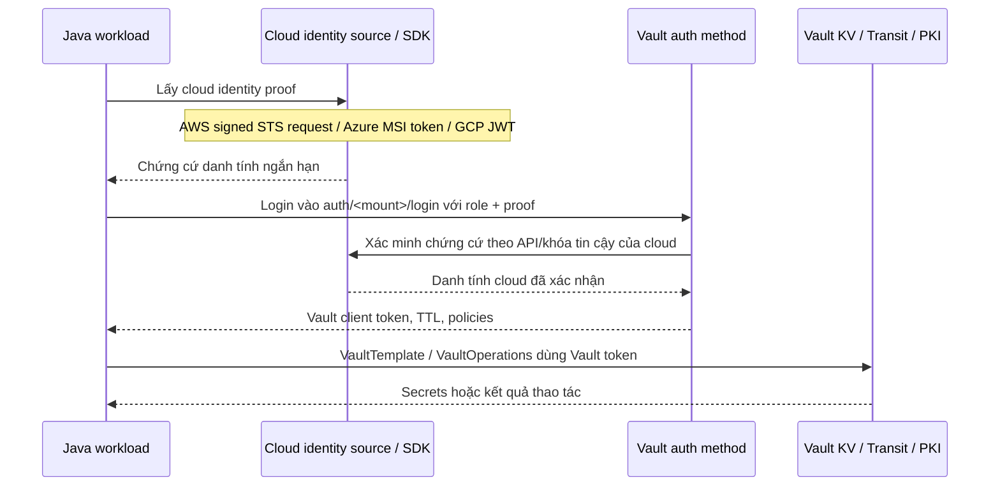
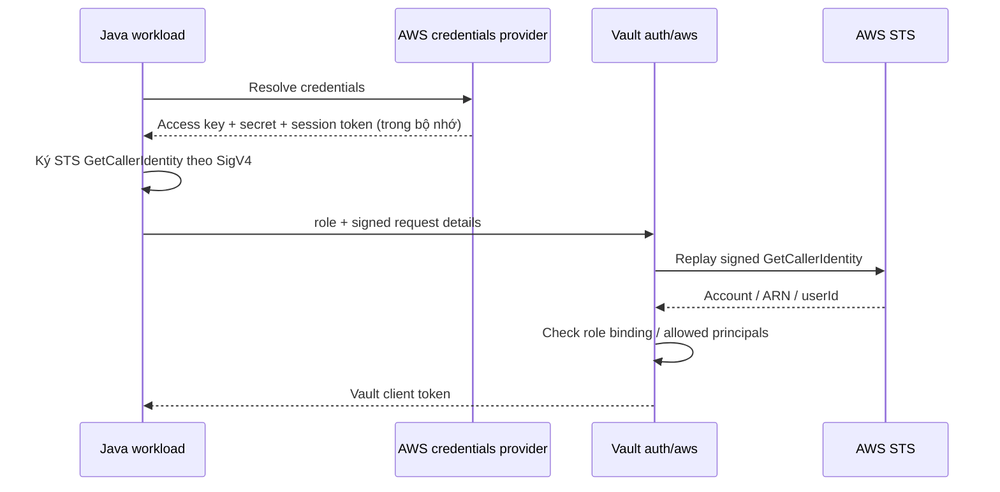
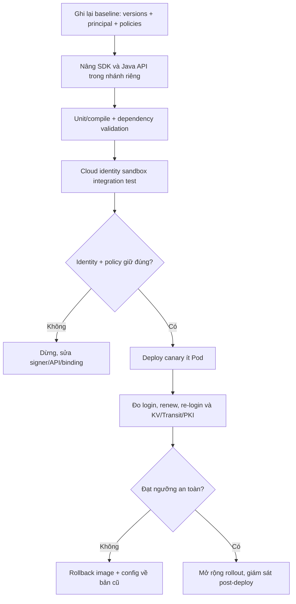

# Nâng SDK xác thực cloud cùng API danh tính tương ứng

> **Spring Vault — Nâng cấp và tương thích.** Đăng nhập HashiCorp Vault bằng danh tính cloud không chỉ là thay một dependency trong Java. Spring Vault dùng thông tin nhận dạng do **AWS, Azure hoặc Google Cloud** cung cấp để chứng minh workload là ai, gửi chứng cứ đó đến **auth method tương ứng trên Vault**, rồi nhận một **Vault client token** với policy và TTL riêng. Khi nâng SDK cloud hoặc nâng Spring Vault, phải kiểm tra đồng thời **kiểu credential, dịch vụ API danh tính, định dạng chứng cứ, role binding, tuyến mạng, vòng đời token và client HTTP**. Nếu một mắt xích đổi mà các mắt xích khác chưa tương thích, ứng dụng có thể biên dịch thành công nhưng đăng nhập thất bại khi deploy hoặc khi token cần đăng nhập lại.

## 1. Mục tiêu bài học và phạm vi

Bài này dành cho ứng dụng Java dùng Spring Vault qua `VaultTemplate`/`VaultOperations`, xác thực theo workload để truy cập KV, Transit, PKI và những secrets engine khác với policy tối thiểu.

Sau bài học, bạn sẽ biết:

1. Phân biệt **Cloud SDK**, **cloud identity API**, **Vault auth method** và **Vault token**; không coi chúng là một thành phần.
2. Nhận diện thay đổi từ AWS SDK v1 sang v2 trong API credentials và signing cho **AWS-IAM auth**.
3. Xác minh **Azure MSI** vẫn lấy identity token đúng resource/audience từ Instance Metadata Service (IMDS), kể cả khi hệ sinh thái Azure Java SDK đổi phiên bản.
4. Tách **GCP-GCE** (metadata identity token) khỏi **GCP-IAM** (JWT ký qua IAM Credentials `projects.serviceAccounts.signJwt`), chuyển khỏi Spring Vault GCP IAM API đã deprecated.
5. Đối chiếu phiên bản Spring Vault 3.x/4.x, đặc biệt thay đổi transport trong **Spring Vault 4.1** với `VaultClient`.
6. Xây dựng kế hoạch nâng cấp dependency, tích hợp kiểm thử, canary và rollback **không thay đổi Vault role/policy ngoài kế hoạch**.
7. Kiểm tra trường hợp thành công ban đầu nhưng thất bại khi **cloud credential hoặc Vault token hết hạn**.

**Giới hạn:** không có một tập phiên bản "SDK mới nhất" áp dụng cho mọi dự án. Phải xác định phiên bản thực trong dependency graph và đối chiếu release notes/Javadoc của **bản triển khai cụ thể**. Ví dụ dùng các chuỗi tên role, account và domain giả định; không chứa cloud access key, JSON service-account private key hoặc Vault token thật.

## 2. Bốn tầng xác thực phải khớp nhau



Sơ đồ mang tính khái quát: với AWS-IAM, Java **ký một HTTP request STS GetCallerIdentity** rồi Vault thực thi request có chữ ký; với Azure, Java lấy MSI JWT từ metadata; với GCP-IAM, Java gọi IAM Credentials để ký JWT; với GCP-GCE, Java lấy JWT identity trực tiếp từ metadata. Mỗi nhánh có API và rủi ro riêng.

| Tầng | Ví dụ cụ thể | Điều cần kiểm tra khi nâng |
|---|---|---|
| **Cloud credentials source** | AWS role/task/instance credentials, Azure managed identity, GCP ADC/metadata | Credential provider chain, refresh, runtime permissions |
| **Cloud identity API** | STS `GetCallerIdentity`; Azure IMDS; GCE identity endpoint; GCP IAM Credentials `signJwt` | Endpoint, region, audience, request/response schema, headers |
| **Spring Vault auth implementation** | `AwsIamAuthentication`, `AzureMsiAuthentication`, `GcpComputeAuthentication`, `GcpIamCredentialsAuthentication` | Class, method, dependency type, HTTP client constructor |
| **Vault auth backend và role** | `auth/aws/login`, `auth/azure/login`, `auth/gcp/login` | Binding theo ARN, resource ID, tenant, service account và policy |

Nâng SDK có thể chỉ thay **lớp cloud credentials** nhưng cũng có thể đổi hành vi ký/chọn endpoint. Ngược lại, nâng Spring Vault có thể làm constructor thay đổi mà cloud identity API hoàn toàn không đổi.

## 3. Kiểm kê hiện trạng trước khi thay dependency

Trước khi nâng, tạo một **hồ sơ tương thích** từ build và cấu hình đã được phép xem bởi đội dự án. Không yêu cầu copy private key hay token lên ticket.

| Nội dung cần lưu | Câu hỏi cần trả lời |
|---|---|
| Java/JDK và Spring Boot | Bản target hỗ trợ JDK nào? Có đổi major framework không? |
| Spring Vault Core | Artifact và version đang được BOM quản lý hay bị pin trực tiếp? |
| Spring Cloud Vault (nếu dùng) | Release train tương ứng với Spring Boot/Spring Vault nào? |
| Cloud SDK | AWS v1/v2, Google Auth/IAM Credentials, Azure client hoặc IMDS adapter đang hiện diện? |
| Runtime | EC2, ECS, Lambda, EKS/IRSA, Azure VM/VMSS, GCE/GKE hay CI? |
| Cloud principal | IAM ARN, managed identity object/client ID, GCP service account email nào? |
| Vault auth mount/role | `auth/aws`, `auth/azure`, `auth/gcp` có mount path nào? Role binding cụ thể? |
| Vault policy | Sau login được quyền KV/Transit/PKI nào? Token TTL/renewable? |
| Mạng, proxy và TLS | Workload tới IMDS/STS/IAM Credentials/Vault ra sao? Endpoint có private DNS không? |
| Vòng đời credential | Có thay STS credentials/MSI JWT/GCP ADC khi hết hạn, và re-auth Vault token được không? |

Một lệnh Gradle **chỉ nên chạy theo quy trình của repository do Prime/CI quản lý**, không phải bằng chứng auth đã thành công:

```bash
# Lệnh tham khảo để kiểm kê dependency trong dự án Gradle.
./gradlew dependencyInsight \
  --dependency spring-vault-core \
  --configuration runtimeClasspath

./gradlew dependencyInsight \
  --dependency software.amazon.awssdk \
  --configuration runtimeClasspath

./gradlew dependencyInsight \
  --dependency google-cloud-iamcredentials \
  --configuration runtimeClasspath
```

Khi nâng, lưu snapshot lockfile/BOM, JDK và dependency tree trong báo cáo triển khai. Không kết luận "đã nâng SDK" nếu runtime vẫn kéo một bản cũ qua transitive dependency hoặc đang chạy image chưa được build lại.

### 3.1. Đừng gộp quá nhiều thay đổi vào một PR

Các thay đổi có thể độc lập:

- Chuyển **AWS credential provider API** v1 → v2.
- Chuyển **GCP IAM signing API** deprecated → IAM Credentials `signJwt`.
- Nâng **Spring Vault** và cấu hình HTTP client.
- Đổi **Vault auth method mount, role, principal binding hoặc token policy**.
- Chuyển hạ tầng runtime (EC2 → EKS, Azure VM → AKS, GCE → GKE Workload Identity).

Ưu tiên thay theo bước có kiểm chứng. Nếu bắt buộc cùng deploy, thiết kế từng cổng kiểm thử; không sửa role binding cùng lúc với library mà không có phương án phân biệt nguyên nhân.

## 4. AWS-IAM: SDK credentials v2 và request ký gửi STS

**Cách AWS-IAM hoạt động:** Spring Vault tạo **HTTP request STS `GetCallerIdentity` được ký SigV4** từ AWS credentials của workload. Request (method, URL, body, headers) được gửi dưới dạng dữ liệu login đến Vault tại `auth/aws/login`. Vault gửi yêu cầu đã ký tới AWS STS để xác nhận principal. Đây **không phải** việc gửi thẳng AWS secret access key cho Vault.



### 4.1. Chuyển AWS SDK v1 sang v2 là đổi type, không chỉ version

| SDK v1 (đường code cũ) | SDK v2 (đường code mới) |
|---|---|
| `com.amazonaws.auth.AWSCredentialsProvider` | `software.amazon.awssdk.auth.credentials.AwsCredentialsProvider` |
| `com.amazonaws.auth.DefaultAWSCredentialsProviderChain` | `software.amazon.awssdk.auth.credentials.DefaultCredentialsProvider` |
| `com.amazonaws.auth.BasicAWSCredentials` | `software.amazon.awssdk.auth.credentials.AwsBasicCredentials` |
| Region dưới `com.amazonaws.regions.*` | `software.amazon.awssdk.regions.Region` / `AwsRegionProvider` |
| Nhiều method getter kiểu `getCredentials()` | Provider trả `AwsCredentials` qua `resolveCredentials()` |
| Credential lifecycle do SDK v1 xử lý | Provider v2 có hợp đồng refresh/cache riêng theo nguồn |

**Không trộn type v1 và v2** trong `AwsIamAuthenticationOptions` của Spring Vault hiện đại. Tài liệu Spring Cloud Vault hiện hành yêu cầu AWS SDK v2 module `software.amazon.awssdk:auth`; Spring Vault 4.1 typed API dùng các type `AwsCredentialsProvider` và `Region` của v2.

Một cấu hình dependencies minh họa (version do BOM/platform phù hợp quản lý):

```kotlin
dependencies {
    implementation("org.springframework.vault:spring-vault-core")
    implementation("software.amazon.awssdk:auth")
    implementation("software.amazon.awssdk:regions")
}
```

Nếu dự án sử dụng Spring Cloud Vault, áp dụng Spring Cloud BOM phù hợp Spring Boot; không tự thêm hai phiên bản Spring Vault mâu thuẫn vào classpath. Với AWS SDK v2, dùng SDK BOM/constraint để các module `auth`, `regions` và module liên quan cùng dòng version được kiểm chứng. Không copy version cụ thể từ ví dụ này.

### 4.2. Ví dụ Spring Vault 4.1: AWS workload credentials

```java
import org.springframework.vault.authentication.AwsIamAuthentication;
import org.springframework.vault.authentication.AwsIamAuthenticationOptions;
import org.springframework.vault.authentication.ClientAuthentication;
import org.springframework.vault.client.VaultClient;

import software.amazon.awssdk.auth.credentials.DefaultCredentialsProvider;
import software.amazon.awssdk.regions.Region;

public final class AwsVaultAuthFactory {

    public static ClientAuthentication create(VaultClient vaultClient) {
        AwsIamAuthenticationOptions options =
                AwsIamAuthenticationOptions.builder()
                        .role("orders-aws")
                        .path("aws")
                        .region(Region.AP_SOUTHEAST_1)
                        .credentialsProvider(
                                DefaultCredentialsProvider.create())
                        .serverId("vault.internal.example")
                        .build();

        return new AwsIamAuthentication(options, vaultClient);
    }
}
```

**Ngữ cảnh code:** constructor nhận `VaultClient` là API của Spring Vault **4.1+**; các bản trước dùng constructor theo `RestOperations` hoặc `RestClient` tùy minor. Không copy constructor từ Javadoc 4.1 vào ứng dụng 3.x mà chưa đối chiếu version. `DefaultCredentialsProvider` dựa vào runtime chain để lấy IAM role/task credentials, không hard-code key tĩnh. Bean factory/auth nên được cấu hình dùng chung trong Spring context; không tạo provider và login trước **từng request nghiệp vụ**.

Cần kiểm tra **region** thực tế của STS, endpoint nếu override, chữ ký SigV4 và header chống replay:

- Header **`X-Vault-AWS-IAM-Server-ID`** cần khớp cấu hình `iam_server_id_header_value` của Vault; giá trị này phải **được ký** trong request. Nó giúp ngăn replay giữa các Vault environments.
- Nếu dùng STS regional endpoint, vùng ký, endpoint và cấu hình Vault phải tương thích. Region sai dễ tạo lỗi chữ ký hoặc xác minh.
- Temporary session credentials thường có **AWS session token**; không được làm mất token này trong migration sang v2.
- Trong EKS IRSA, ECS task role, Lambda hoặc EC2 instance role, nguồn credential chain khác nhau; không dựa trên máy developer để kết luận runtime workload đang mang principal đúng.
- Kiểm tra role binding Vault: một IAM role ARN khác với ARN của một **assumed-role session** trong những biểu diễn STS. Mapping phải phù hợp cơ chế auth Vault và điều kiện bound principal.

### 4.3. AWS-IAM khác AWS-EC2 auth

**AWS-EC2 auth** dựa trên signed instance identity document/PKCS#7 và có nonce TOFU trong những cấu hình. **AWS-IAM auth** dựa trên STS signed request. Không tự chuyển AWS-EC2 sang AWS-IAM chỉ vì nâng AWS SDK. Đây là **thay đổi auth method**, phải thiết kế role/policy/identity riêng và kiểm thử đường migration.

## 5. Azure MSI: metadata endpoint và danh tính managed identity

**Azure MSI** trong Spring Vault thường gọi **Azure Instance Metadata Service (IMDS)** để lấy môi trường VM và OAuth2 access token gắn managed identity. Vault `auth/azure/login` kiểm tra JWT của Microsoft Entra ID và các thuộc tính ràng buộc role như tenant, subscription, resource group, VM/VMSS hoặc resource ID theo cấu hình.

Đường gọi thuộc **identity API của nền tảng**, không nhất thiết phụ thuộc một Azure SDK cụ thể:

```text
Java workload
  -> Azure IMDS instance metadata
     http://169.254.169.254/metadata/instance
  -> Azure IMDS managed identity token
     http://169.254.169.254/metadata/identity/oauth2/token
  -> Vault auth/azure/login (role + jwt + thông tin resource)
  -> Vault client token
```

IMDS cần header phù hợp và `api-version` theo tài liệu Azure. Các thông số truy vấn **resource/audience** cho access token phải khớp cấu hình Vault/Entra; nếu dùng user-assigned identity trong VM, phải xác định đúng identity theo client ID hoặc selector được API hỗ trợ.

### 5.1. SDK mới không tự làm đúng `aud`/`tid`

| Giá trị cần bảo toàn | Vì sao quan trọng |
|---|---|
| `aud` (audience/resource) | Vault chỉ tin token có audience mà auth config chấp nhận |
| `iss` và `tid` / tenant | Token phải do tenant/issuer kỳ vọng cấp |
| Object/client ID của managed identity | Hệ thống có nhiều identity; cần chọn identity thuộc workload |
| Subscription/resource group/VM name hoặc resource ID | Vault Azure role có thể bind theo thông tin Azure resource |
| IMDS endpoint và api-version | API metadata/token có contract riêng, không thể ghép URL tùy tiện |
| Metadata/proxy networking | IMDS link-local phải tới đúng metadata service, tránh route qua proxy lạ |

Nếu nâng Azure SDK đổi mặc định credential chain sang một identity khác, ứng dụng có thể nhận được **JWT hợp lệ nhưng sai principal/audience**. Đừng chữa bằng cách mở rộng mọi bound role của Vault.

### 5.2. Java Spring Vault 4.1: cấu hình Azure MSI

```java
import org.springframework.vault.authentication.AzureMsiAuthentication;
import org.springframework.vault.authentication.AzureMsiAuthenticationOptions;
import org.springframework.vault.authentication.ClientAuthentication;
import org.springframework.vault.client.VaultClient;

public final class AzureVaultAuthFactory {

    public static ClientAuthentication create(VaultClient vaultClient) {
        AzureMsiAuthenticationOptions options =
                AzureMsiAuthenticationOptions.builder()
                        .role("orders-azure")
                        .build();

        return new AzureMsiAuthentication(options, vaultClient);
    }
}
```

Ví dụ giả định Spring Vault được phép lấy subscription ID, resource group, VM name và token từ IMDS trong môi trường được hỗ trợ. Nếu runtime khác VM/VMSS hoặc có nhiều managed identities, phải đọc tài liệu auth/plugin đúng deployment, đặt rõ identity/token source và kiểm tra trên **runtime thật**. Không tự giả định mọi AKS Workload Identity flow dùng chính class `AzureMsiAuthentication`; AKS WIF có thể cần phương thức JWT hoặc cấu hình riêng.

**Lưu ý:** khi chuyển từ một Azure credential library sang library khác, API lấy token có thể đổi tên kiểu/constructor nhưng **điều cần xác minh ở Vault vẫn là JWT claims, Azure role binding và TTL**. Không cho phép chạy fallback sang một tenant hoặc identity khác nếu login thất bại.

## 6. GCP-GCE và GCP-IAM: hai loại bằng chứng khác nhau

GCP auth của Vault có hai nhánh chính:

| Nhánh Vault | Nguồn chứng cứ | Đường API danh tính | Tình huống |
|---|---|---|---|
| **GCE** | Identity token/JWT của instance/service account | Metadata service `/computeMetadata/v1/instance/service-accounts/default/identity` với `Metadata-Flavor: Google` | GCE/GKE có metadata identity phù hợp |
| **IAM** | JWT ký thay mặt service account | IAM Credentials API `projects.serviceAccounts.signJwt` | Workload có quyền ký JWT bằng IAM Credentials |

Cả hai cuối cùng thường gọi `POST /v1/auth/gcp/login` với `role` và `jwt`, nhưng **cách tạo JWT** và quyền cloud cần có khác nhau. GCE JWT không cần giả lập request `signJwt`; IAM JWT cần quyền tương ứng với API ký.

### 6.1. GCP-GCE: audience và instance identity

Ví dụ đọc JWT GCE identity từ runtime GCP phù hợp, chỉ dùng trong lab được phép:

```bash
# Chạy trên GCE/GKE runtime có metadata service phù hợp.
# Response là JWT nhạy cảm: KHÔNG in vào CI log hoặc ticket.
curl --silent --show-error \
  --header "Metadata-Flavor: Google" \
  --get \
  --data-urlencode "audience=http://vault/orders-gce" \
  --data-urlencode "format=full" \
  "http://metadata/computeMetadata/v1/instance/service-accounts/default/identity"
```

`audience` trong ví dụ phải khớp hợp đồng Vault GCP role/metadata token. Đây là điểm kiểm thử khi thay runtime image, proxy, Google auth library hoặc đường metadata; không lấy một JWT dành cho API khác rồi gửi vào Vault.

Spring Vault có `GcpComputeAuthentication` và `GcpComputeAuthenticationOptions` cho nhánh GCE. Không dùng nhánh GCE để thay thế IAM signing trên môi trường không có GCE metadata token phù hợp.

### 6.2. GCP-IAM: chuyển từ API cũ sang IAM Credentials `signJwt`

Spring Vault đã **deprecated `GcpIamAuthentication` và `GcpIamAuthenticationOptions` từ 2.3.2**, khuyến nghị **`GcpIamCredentialsAuthentication`** và `GcpIamCredentialsAuthenticationOptions`. Implementation mới gọi IAM Credentials `projects.serviceAccounts.signJwt` để có JWT ký thay mặt service account.

Đây là ví dụ tiêu biểu cho việc **nâng SDK cùng API danh tính**: chỉ đổi tên class trong Java mà chưa bật đúng IAM Credentials API, chưa cấp quyền `iam.serviceAccounts.signJwt` hoặc chưa chọn đúng service account sẽ khiến login thất bại.

Dependency cần thiết theo Spring Vault reference:

```kotlin
dependencies {
    implementation("org.springframework.vault:spring-vault-core")
    implementation("com.google.cloud:google-cloud-iamcredentials")
}
```

Quản lý phiên bản Google Cloud dependencies cùng BOM/constraints phù hợp; tránh kéo đồng thời một stack Google SDK cũ/không tương thích chỉ để giữ import đã deprecated.

Ví dụ typed API trên **Spring Vault 4.1+**:

```java
import java.io.IOException;

import com.google.auth.oauth2.GoogleCredentials;
import org.springframework.vault.authentication.ClientAuthentication;
import org.springframework.vault.authentication.GcpIamCredentialsAuthentication;
import org.springframework.vault.authentication.GcpIamCredentialsAuthenticationOptions;
import org.springframework.vault.client.VaultClient;

public final class GcpVaultAuthFactory {

    public static ClientAuthentication create(VaultClient vaultClient)
            throws IOException {

        GcpIamCredentialsAuthenticationOptions options =
                GcpIamCredentialsAuthenticationOptions.builder()
                        .role("orders-gcp-iam")
                        .credentials(
                                GoogleCredentials.getApplicationDefault())
                        .serviceAccountId(
                                "orders@my-project.iam.gserviceaccount.com")
                        .build();

        return new GcpIamCredentialsAuthentication(
                options, vaultClient);
    }
}
```

Lưu ý `serviceAccountId` là **service account mục tiêu được dùng để ký**; cần bảo đảm ADC đại diện **caller có quyền ký** trên service account này. Trên môi trường không lấy được account ID từ ADC, khai báo nó một cách tường minh giúp tránh suy luận sai principal. Không lưu file JSON có private key trong image để "chữa lỗi ADC": ưu tiên workload identity/federation và cấp quyền IAM tối thiểu.

**Giới hạn reactive:** `GcpIamCredentialsAuthentication` dùng Google IAM Credentials Java API đồng bộ; Spring Vault docs nêu implementation này **không hỗ trợ `AuthenticationSteps` cần cho nhánh reactive**. Nếu hệ thống dùng `ReactiveVaultOperations`, không giả định thay class rồi reactive login tự chạy tương đương; phải có thiết kế auth riêng và kiểm thử không blocking event loop.

### 6.3. Vì sao không dùng token của cloud như Vault token?

GCE JWT hoặc JWT do `signJwt` tạo là **identity proof gửi vào Vault**. Sau khi Vault xác minh, Vault cấp **client token của chính Vault**. Chỉ client token này mới được `VaultTemplate` gắn vào yêu cầu KV/Transit/PKI. Không đưa GCP identity JWT trực tiếp làm `X-Vault-Token` cho secret API.

## 7. Spring Vault và Spring Cloud Vault: hai lớp phiên bản độc lập

- **Spring Vault Core**: cung cấp `AwsIamAuthentication`, `AzureMsiAuthentication`, `GcpComputeAuthentication`, `GcpIamCredentialsAuthentication`, `VaultTemplate` và các auth/session API.
- **Spring Cloud Vault**: tự động cấu hình và import secret vào Spring Environment; cung cấp các properties như `spring.cloud.vault.authentication` và cấu hình riêng theo từng cloud provider.
- **Spring Boot/Spring Framework**: quyết định khả năng chạy của phiên bản library và HTTP client.
- **Cloud SDK**: AWS/Google/Azure modules cung cấp credentials, signing, HTTP transport hoặc client metadata tùy flow.

Spring Vault 4.1 đưa `VaultClient` (dựa trên `RestClient`) vào client API và deprecate nhiều constructor nhận `RestOperations`/`RestTemplateBuilder`. Vì vậy upgrade có thể đồng thời yêu cầu thay **SDK types** và **constructor Spring Vault**, dù Vault auth mount không đổi.

| Vị trí code | Dạng cần đối chiếu khi nâng |
|---|---|
| AWS credentials type | v1 `AWSCredentialsProvider` → v2 `AwsCredentialsProvider` |
| GCP IAM implementation | Deprecated `GcpIamAuthentication` → `GcpIamCredentialsAuthentication` |
| HTTP auth constructor 3.x/4.0 | Có thể nhận `RestOperations` hoặc `RestClient` |
| HTTP auth constructor Spring Vault 4.1+ | Ưu tiên constructor nhận `VaultClient` |
| VaultTemplate low-level client | Tránh builder kiểu `RestTemplate` đã deprecated ở 4.1 |
| API nghiệp vụ | Giữ `VaultOperations` làm abstraction để giảm lan truyền thay đổi |

**Không** nên dùng một constructor Spring Vault 4.1 với dependency 3.x; càng không nên thay `VaultTemplate` thành `RestClient` trong toàn bộ business code chỉ vì low-level transport đổi.

### 7.1. Ví dụ Spring Cloud Vault declarative cho AWS-IAM

Nếu module dùng Spring Cloud Vault config thay vì tự khai báo `ClientAuthentication`:

```yaml
spring:
  cloud:
    vault:
      authentication: AWS_IAM
      aws-iam:
        role: orders-aws
        aws-path: aws
        region: ap-southeast-1
        server-name: vault.internal.example
```

Các property minh họa theo tài liệu Spring Cloud Vault hiện hành; cần đối chiếu major/minor tương ứng với Spring Boot đang dùng. Không đặt AWS access key/secret key hoặc Vault root token trong `application.yml`. Runtime IAM principal và Vault role/policy phải được provision trước.

## 8. Bảng kiểm cloud identity contract trước và sau migration

Làm một bảng đối chiếu **trước → sau** từ chứng cứ quan sát được, không chỉ từ source code:

| Kiểm tra | AWS-IAM | Azure MSI | GCP-GCE | GCP-IAM |
|---|---|---|---|---|
| Identity principal | AWS account/role ARN, STS caller | Tenant, managed identity object/client ID | Project/instance/service account | Caller ADC + target SA cần ký |
| Identity API | STS `GetCallerIdentity`, signed request | IMDS metadata + OAuth token | Metadata identity JWT | IAM Credentials `signJwt` |
| Critical request data | Region, STS URI, signature, server ID header | Resource/audience, IMDS api-version, identity selector | Audience, metadata header, service account | JWT claims/audience, service account email, IAM signing permission |
| Vault auth mount | `auth/aws` | `auth/azure` | `auth/gcp` | `auth/gcp` |
| Vault role binding | Bound IAM ARN/account | Tenant/subscription/resource constraints | Project/zone/instance/SA bounds | Bound SA/project/role and JWT policy |
| Token result | Vault client token + TTL/policy | Như vậy | Như vậy | Như vậy |
| Rủi ro khi SDK đổi | Chọn credentials khác, mất session token, ký sai region | IMDS auth/audience/identity selector sai | Audience/metadata route sai | SignJwt API/permission/SA ID sai |

**Sự bất biến cần chứng minh:** sau upgrade, workload **vẫn là principal được duyệt**, login vào **đúng auth role/mount**, nhận **cùng phạm vi policy hoặc phạm vi hẹp hơn**, và sử dụng token trong đúng namespace của Vault. Một HTTP 200 không đủ nếu role bị cấu hình quá rộng.

## 9. Dependency management và thay đổi build có kiểm soát

Một quy trình upgrade library là:

1. Chọn target Spring Boot/Spring Framework, Spring Vault hoặc Spring Cloud Vault **được nhà phát hành hỗ trợ cùng nhau**.
2. Thêm BOM/platform hoặc dependency constraints để khóa các module cloud SDK đồng bộ; không pin jar ngẫu nhiên ở runtime.
3. Sửa **imports và API types** trong auth configuration trước, sau đó sửa constructor của Vault HTTP client nếu cần.
4. Kiểm tra classpath không chứa hai dòng SDK xung đột hoặc implementation HTTP/Jackson không tương thích.
5. Xây bản image với đúng runtime JDK và CA truststore/Proxy configuration của môi trường thật.
6. Chạy test tự động, ký image, triển khai canary có thể rollback.

Ví dụ về sự khác nhau trong import:

```java
// Cũ (AWS SDK v1):
// import com.amazonaws.auth.AWSCredentialsProvider;

// Mới (AWS SDK v2):
import software.amazon.awssdk.auth.credentials.AwsCredentialsProvider;
import software.amazon.awssdk.auth.credentials.DefaultCredentialsProvider;
```

Không xem việc build PASS là tương đương cloud API phù hợp. Trên máy developer, default provider có thể chọn local profile; trong Pod, nó có thể chọn web identity, container credentials hoặc instance metadata. Khi kiểm thử, **đọc chính principal đã được xác thực ở cloud/Vault audit**, không chỉ inspect class name của provider.

### 9.1. Giữ client và session dùng chung

Mọi ví dụ auth trong bài là **factory/configuration ở startup**, không được đặt trong controller trên mỗi request. Kết hợp với `LifecycleAwareSessionManager` để quản lý token renewal/re-authentication theo TTL. Nâng SDK phải kiểm chứng **re-login khi cần**, nhất là khi cloud credentials (AWS STS session, GCP ADC access token, Azure MSI token) thay đổi trong thời gian chạy.

Token TTL của Vault **khác** thời hạn cloud JWT/temporary credentials. Đăng nhập lần đầu thành công không bảo đảm lần re-login sau vài giờ cũng thành công nếu SDK cache credential cũ hoặc token nguồn đã hết hạn.

## 10. Kiểm thử đơn vị trước, nhưng không dừng ở mock

Unit test có thể kiểm tra cấu hình role/mount, phân nhánh auth strategy và cách mapping lỗi. Không thể dùng mock để chứng minh một request STS được ký đúng hoặc JWT được Azure/Google phát hành đúng.

### 10.1. Contract cho lớp chọn auth

Một abstraction nhỏ ở phía ứng dụng giúp test quyết định **loại** auth, không cần mock nội bộ SDK:

```java
public enum CloudAuthKind {
    AWS_IAM, AZURE_MSI, GCP_GCE, GCP_IAM
}

public record CloudAuthSettings(
        CloudAuthKind kind,
        String vaultRole,
        String vaultAuthMount) {

    public CloudAuthSettings {
        if (kind == null ||
                vaultRole == null || vaultRole.isBlank() ||
                vaultAuthMount == null || vaultAuthMount.isBlank()) {
            throw new IllegalArgumentException(
                    "Cloud Vault auth settings incomplete");
        }
    }
}
```

Hợp đồng có thể được mở rộng với AWS STS server ID, Azure audience hoặc GCP service account ID theo **type riêng**. Đừng dùng một `Map<String,Object>` và để mọi provider tùy ý đọc property của nhau; cách này dễ làm lẫn role hoặc mount.

Ví dụ unit test validate cấu hình:

```java
import static org.junit.jupiter.api.Assertions.*;
import org.junit.jupiter.api.Test;

class CloudAuthSettingsTest {

    @Test
    void rejectsMissingRoleBeforeCloudRequest() {
        assertThrows(IllegalArgumentException.class, () ->
                new CloudAuthSettings(
                        CloudAuthKind.AWS_IAM, "", "aws"));
    }

    @Test
    void acceptsConfiguredGcpIamRoleAndMount() {
        var settings = new CloudAuthSettings(
                CloudAuthKind.GCP_IAM,
                "orders-gcp-iam",
                "gcp");
        assertEquals("gcp", settings.vaultAuthMount());
    }
}
```

Các test này chứng minh **validation của adapter cấu hình**, không chứng minh AWS/Azure/GCP đã ký và Vault đã chấp nhận identity.

## 11. Integration tests: chứng minh identity thật, không dùng root token

Kiểm thử quan trọng nhất phải chạy trên **runtime tương đương production** với network và identity theo cloud đang dùng; dùng Vault test (hoặc namespace riêng) có role/policy thấp nhất cho workload.

Một bài smoke test JUnit 5 minh họa khả năng login và đọc **key test đã được cấp quyền** thông qua Spring context:

```java
import static org.junit.jupiter.api.Assertions.*;

import org.junit.jupiter.api.Assumptions;
import org.junit.jupiter.api.Test;
import org.springframework.beans.factory.annotation.Autowired;
import org.springframework.boot.test.context.SpringBootTest;
import org.springframework.vault.core.VaultKeyValueOperationsSupport.KeyValueBackend;
import org.springframework.vault.core.VaultOperations;
import org.springframework.vault.support.VaultResponse;

@SpringBootTest
class CloudIdentityVaultIT {

    @Autowired VaultOperations vault;

    @Test
    void workloadIdentityCanReadOnlyItsContractSecret() {
        Assumptions.assumeTrue(
                Boolean.getBoolean("vault.cloud.it"),
                "Cloud identity integration tests require enabled sandbox");

        VaultResponse response = vault.opsForKeyValue(
                "kv-it", KeyValueBackend.KV_2)
                .get("integration/orders-api");

        assertNotNull(response);
        assertNotNull(response.getData());
        assertEquals(
                "expected-test-marker",
                response.getData().get("marker"));
    }
}
```

Để test PASS thực sự có ý nghĩa, phải có **workload cloud identity và Vault role được kiểm soát**, không chạy bằng root token hoặc một token dev có quyền rộng. Test này chỉ chứng minh quyền đọc một path; cần kiểm thử âm riêng cho path không được phép, đồng thời đối chiếu thông tin principal, Vault auth mount, role, policy và TTL trong audit/telemetry.

### 11.1. Ma trận tương thích theo ba lớp

| Test | Mục đích | Assertion |
|---|---|---|
| AWS-01 | Default credentials chain trên runtime mới | IAM principal đúng role/account, không lấy nhầm developer profile |
| AWS-02 | STS SigV4 + region + endpoint | Vault aws login PASS khi cấu hình signer đúng |
| AWS-03 | Signed server ID header | Đúng server ID PASS; sai header/value FAIL |
| AWS-04 | Temporary session token rotate | Sau refresh AWS credentials, Vault re-login vẫn PASS |
| AZ-01 | MSI system/user-assigned identity | Chọn đúng client/object ID, tenant |
| AZ-02 | IMDS api-version/resource/audience | JWT có aud/iss/tid đúng, Vault role chấp nhận |
| AZ-03 | Metadata/proxy isolation | IMDS không đi qua proxy lạ; không gửi token ra ngoài |
| GCE-01 | GCE identity JWT | Audience đúng, role gcp gce login PASS |
| GCE-02 | Sai audience | Vault login bị từ chối; không fallback cloud principal |
| GCP-01 | IAM Credentials signJwt | Caller được phép ký cho target SA; JWT hợp lệ |
| GCP-02 | Thiếu `iam.serviceAccounts.signJwt` | Lỗi cloud 403, không coi là Vault KV policy failure |
| GCP-03 | Deprecated API migration | Không dùng GcpIamAuthentication; mới dùng GcpIamCredentialsAuthentication |
| VAULT-01 | Token sau login | Policies đúng path, TTL và renewable như hợp đồng |
| VAULT-02 | Deny path ngoài scope | 403, không có secret bị lộ |
| VAULT-03 | Re-login sau token expiration | Tạo proof cloud mới, không login storm |
| BUILD-01 | Dependency tree | Không có API cloud v1 còn bị use trong code target |
| BUILD-02 | Runtime image | Dùng đúng JDK, CA truststore, proxy/IMDS routing |
| OPS-01 | Rolling deployment | Không tăng đột biến 401/403/5xx, login latency |
| OPS-02 | Rollback | Có cách quay về image/config cũ mà không cần mở rộng policy |

Không nên kết luận thành công khi chỉ test được API cloud bằng tool CLI. CLI và Java SDK có thể chọn **khác credential provider chain** và cả hai lại có thể dùng identity không đúng workload production.

## 12. Vận hành hai giai đoạn và rollback

Một kế hoạch nâng cloud auth đáng tin cậy:



**Giai đoạn chuẩn bị:** pin BOM, giữ nguyên Vault role/policy nếu không có yêu cầu thay, thêm permission cloud tối thiểu như GCP IAM signing cho role thử nghiệm, xác nhận API endpoint/network/tenant. Tạo đường rollback image được ký sẵn.

**Giai đoạn canary:** triển khai một số Pod để kiểm tra cold start login, login theo TTL boundary và policy KV/Transit/PKI. Đo lỗi auth theo nguyên nhân **cloud API** hay **Vault auth**, rồi rollout phần còn lại nếu PASS.

Nếu rollback, đảm bảo bản cũ còn chạy với cấu hình Vault auth và cloud API hiện có. Nếu đội vận hành đồng thời thu hồi quyền cloud cũ, rollback image sẽ không hoạt động; phải có **kế hoạch compatibility window** đã được duyệt và ngày thu hồi rõ ràng.

### 12.1. Không mở policy quá rộng để sửa 403

Một lỗi phổ biến:

- GCP IAM signing trả 403: caller thiếu permission `iam.serviceAccounts.signJwt` trên service account.
- Vault `auth/gcp/login` trả 403: JWT không được Vault role chấp nhận.
- Login thành công nhưng `secret/data/...` trả 403: Vault **secrets engine policy** thiếu quyền.

Đây là ba lỗi khác tầng. Không mở `path "*" { capabilities = ["sudo", ...] }` hoặc cấp root token để che thiếu quyền cloud API.

## 13. Runbook điều tra nhanh sau nâng cấp

| Triệu chứng | Phân lớp nguyên nhân | Cách kiểm tra |
|---|---|---|
| `NoClassDefFoundError` hoặc type mismatch AWS | SDK v1/v2 trên classpath, dependency exclusions/BOM | Đối chiếu `com.amazonaws.*` và `software.amazon.awssdk.*` |
| AWS login bị signature mismatch | SigV4, region, STS URI, server ID header, session token | Kiểm tra signer config và request metadata an toàn |
| AWS login đúng ở laptop, sai trên ECS/EKS | Credential chain chọn principal khác | Kiểm tra task/IRSA role và Vault bound ARN |
| Azure IMDS trả lỗi | Không ở runtime hỗ trợ, metadata blocked, api-version/token resource sai | Kiểm tra network, headers, IMDS contract |
| Azure JWT hợp lệ nhưng Vault 403 | Sai `aud`, `tid`, managed identity hoặc role/resource binding | Đối chiếu metadata/claims không tiết lộ token |
| GCE JWT 403 | Sai audience hoặc service account/zone/project bindings | Kiểm tra GCE identity token source, Vault GCP role |
| GCP IAM `signJwt` 403 | IAM Credentials API/permission, target service account sai | Kiểm tra `iam.serviceAccounts.signJwt` và ADC caller |
| GCP IAM sau migration fail khi reactive | API signing đồng bộ, `AuthenticationSteps` không hỗ trợ | Đổi thiết kế auth, không block event loop |
| Vault login 404 | Auth mount sai hoặc method không bật ở namespace đó | Kiểm tra `auth/aws`, `auth/azure`, `auth/gcp` path |
| Vault login thành công, KV 403 | Workload token policy/mount hoặc namespace | Kiểm tra KV v2 `data/` route và policies |
| Sau vài giờ lại fail | Cloud credential refresh, JWT expiration, Vault token TTL/re-auth | Test boundary, SessionManager lifecycle, audit |
| Rollout nhiều Pod gây 429/503 | Auth/login storm hoặc API cloud rate limits | Rate limit, concurrency, jitter/backoff |

**Log an toàn:** ghi loại auth, tên role đã cho phép, tên mount, exception category, HTTP status, correlation/request ID, latency và environment label. Không log AWS signed request body/Authorization header, Azure/GCP JWT, IAM credentials, Vault token hoặc plaintext secret.

## 14. Quan sát khả năng tương thích sau nâng cấp

Một dashboard nên phân biệt:

- **Cloud proof acquisition:** lần lấy AWS credentials, Azure MSI token, GCE metadata JWT hoặc GCP IAM Credentials `signJwt`; duration, lỗi và retries.
- **Vault auth login:** `auth/aws/login`, `auth/azure/login`, `auth/gcp/login`; count, success/error, p95, số token được cấp theo role.
- **Vault token lifecycle:** renew/re-login failures và số lần re-authentication; TTL bucket nếu đo an toàn.
- **Business Vault operations:** KV read, Transit encode/decrypt, PKI issue/renew; latency/error rate và policy 403.
- **Deployment:** cold-start, readiness failures, Pod restarts, số instance và login burst khi autoscaling.

Không tạo metric tags từ nguyên JWT, account session ID, token string hoặc secret path chứa PII. Với cloud identity nhiều service accounts, metric label nên ở mức role đã kiểm duyệt để tránh cardinality nổ và lộ thông tin.

**Không xem auth success rate 100% là đủ.** Cần thêm test **đúng principal + đúng policy + re-login thành công**, vì một SDK mới có thể lấy nhầm một identity rất mạnh có khả năng login nhưng không phù hợp thiết kế bảo mật.

## 15. Bài tập thực hành

**Bối cảnh:** dịch vụ Java `orders-api` hiện dùng AWS-IAM Spring Vault, đồng thời tổ chức có workload Azure VM và GCP chạy một auth integration test suite chung. Đội dự án nâng Spring Vault lên 4.1 và nâng cloud SDK theo BOM mới.

1. Một đoạn Java cũ import `com.amazonaws.auth.AWSCredentialsProvider`. Viết import mới dùng AWS SDK v2 và nêu lý do không chỉ nâng version Maven.
2. Vai trò của chữ ký request `STS GetCallerIdentity` trong AWS-IAM là gì? Nếu mất AWS session token trong quá trình signing, lỗi nào có thể xuất hiện?
3. Tại sao header `X-Vault-AWS-IAM-Server-ID` phải khớp cấu hình backend và nằm trong signed headers?
4. Azure MSI nhận JWT có tenant đúng nhưng `aud` sai. Có nên tự mở rộng allowed audience của Vault production để deploy kịp không?
5. Phân biệt GCP-GCE token identity từ metadata với GCP-IAM token ký bởi `signJwt`. Cái nào đòi IAM Credentials API?
6. Sau khi chuyển từ `GcpIamAuthentication` sang `GcpIamCredentialsAuthentication`, lỗi cloud 403 xảy ra trước Vault login. Bạn phải kiểm tra permission nào?
7. Một ứng dụng Spring Vault 3.x copy constructor nhận `VaultClient` từ tài liệu 4.1. Lỗi xảy ra ở tầng nào? Nên giải quyết thế nào?
8. Canary login PASS, nhưng token Vault không renew và re-login sau TTL thất bại. Vì sao không thể coi migration là hoàn tất?
9. Unit test mock `ClientAuthentication.login()` PASS có đủ chứng minh Cloud SDK và API danh tính tương thích không?
10. Đưa ra ba metric giúp phát hiện IAM signing/API mismatch và phân biệt nó với KV 403.
11. Workload nhận policy `root` sau migration dù đọc secret thành công. Điều đó có phải nâng cấp thành công không?
12. Nếu rollback image cũ cần một cloud signing API đã bị tắt ngay trong rollout, kế hoạch thay thế nào cần được chuẩn bị?

**Gợi ý:** (1) `AwsCredentialsProvider` thuộc `software.amazon.awssdk.auth.credentials`; type và provider chain khác; (2) chứng minh IAM principal; thiếu token có thể làm chữ ký không hợp lệ; (3) chống replay; (4) không, phải sửa resource/audience hoặc binding theo phê duyệt; (5) IAM dùng signJwt, GCE metadata JWT; (6) `iam.serviceAccounts.signJwt` trên target service account; (7) API compile, dùng Javadoc đúng version hoặc nâng đồng bộ; (8) TTL boundary là một phần contract; (9) không, phải integration test; (10) cloud proof errors, Vault login errors, KV operation errors; (11) không, vi phạm least privilege; (12) duy trì compatibility window/dual path có kiểm soát hoặc rollback cả config theo thứ tự.

## 16. Tài liệu tham khảo chính thức

- [Spring Vault — Authentication Methods](https://docs.spring.io/spring-vault/reference/vault/authentication.html): AWS-IAM, Azure MSI, GCP-GCE, GCP-IAM; chi tiết chứng cứ danh tính và class Java.
- [Spring Vault — `AwsIamAuthentication` Javadoc](https://docs.spring.io/spring-vault/reference/api/java/org/springframework/vault/authentication/AwsIamAuthentication.html): signing STS và constructor `VaultClient` ở 4.1.
- [Spring Vault — `AwsIamAuthenticationOptions` Builder](https://docs.spring.io/spring-vault/reference/api/java/org/springframework/vault/authentication/AwsIamAuthenticationOptions.AwsIamAuthenticationOptionsBuilder.html): `credentialsProvider`, `region`, `serverId`, `endpointUri`.
- [Spring Vault — `AzureMsiAuthentication` Javadoc](https://docs.spring.io/spring-vault/reference/api/java/org/springframework/vault/authentication/AzureMsiAuthentication.html): dùng Azure VM metadata/MSI token.
- [Spring Vault — `GcpIamCredentialsAuthentication` Javadoc](https://docs.spring.io/spring-vault/reference/api/java/org/springframework/vault/authentication/GcpIamCredentialsAuthentication.html): IAM Credentials `signJwt`, synchronous API, constructor 4.1.
- [Spring Vault — GCP IAM Credentials options](https://docs.spring.io/spring-vault/reference/api/java/org/springframework/vault/authentication/GcpIamCredentialsAuthenticationOptions.GcpIamCredentialsAuthenticationOptionsBuilder.html): `credentials`, `serviceAccountId`, `role`, `jwtValidity`.
- [Spring Vault — Deprecated APIs](https://docs.spring.io/spring-vault/reference/api/java/deprecated-list.html): constructor/HTTP builder cũ; đối chiếu deprecation từ từng phiên bản.
- [Spring Vault — `VaultClient`](https://docs.spring.io/spring-vault/reference/api/java/org/springframework/vault/client/VaultClient.html): API 4.1 dựa trên Spring `RestClient`.
- [Spring Cloud Vault — Authentication methods](https://docs.spring.io/spring-cloud-vault/reference/authentication.html): cấu hình properties, dependency yêu cầu của AWS SDK v2 và GCP IAM Credentials.
- [HashiCorp Vault — AWS auth](https://developer.hashicorp.com/vault/docs/auth/aws) và [AWS auth API](https://developer.hashicorp.com/vault/api-docs/auth/aws): IAM identity, signed `GetCallerIdentity`, server ID header và role binding.
- [HashiCorp Vault — Azure auth](https://developer.hashicorp.com/vault/docs/auth/azure) và [Azure auth API](https://developer.hashicorp.com/vault/api-docs/auth/azure): managed identity, JWT tenant/resource, VM/VMSS claims và role.
- [HashiCorp Vault — GCP auth](https://developer.hashicorp.com/vault/docs/auth/gcp) và [GCP auth API](https://developer.hashicorp.com/vault/api-docs/auth/gcp): GCE metadata JWT và IAM signed JWT.
- [Google IAM Credentials API — signJwt](https://cloud.google.com/iam/docs/reference/credentials/rest/v1/projects.serviceAccounts/signJwt): request/permission để ký JWT bằng service account.
- [AWS SDK for Java 2.x — Credentials chain](https://docs.aws.amazon.com/sdk-for-java/latest/developer-guide/credentials-chain.html): thứ tự tìm credentials và token session của AWS runtime.
- [Azure IMDS](https://learn.microsoft.com/en-us/azure/virtual-machines/instance-metadata-service): metadata/token endpoint và yêu cầu headers/parameters.

> **Ghi nhớ:** nâng SDK cloud phải nâng **cả cách lấy và chứng minh danh tính phù hợp API cloud**. AWS-IAM cần SDK v2 credentials và signed STS request đúng region/server ID; Azure MSI cần IMDS JWT đúng identity/audience; GCP-GCE cần metadata identity JWT; GCP-IAM hiện dùng IAM Credentials `signJwt`. Hoàn tất nâng cấp khi **login, policy, token renewal/re-login và hoạt động nghiệp vụ** đều qua integration tests trên runtime được cấp quyền — không chỉ khi Java biên dịch thành công.

