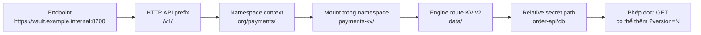
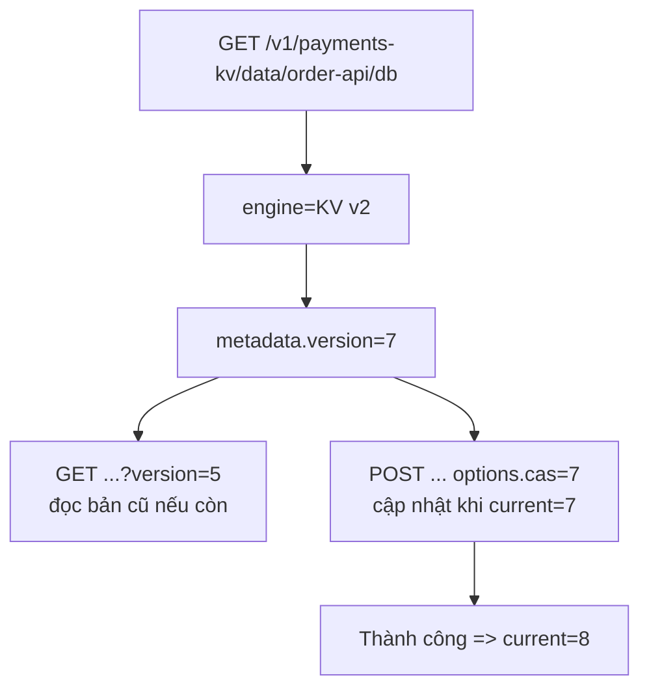

# Giữ đúng ý nghĩa đường dẫn, namespace và phiên bản engine khi nâng cấp Spring Vault

> **Chương:** Nâng cấp và tương thích  
> **Bài học:** Giữ đúng ý nghĩa đường dẫn, namespace và phiên bản engine  
> **Phạm vi:** Module **SPRING_VAULT** giúp ứng dụng Java truy cập HashiCorp Vault bằng `VaultTemplate`, xác thực theo workload và ACL; thực hành KV, token/lease, Transit encryption, PKI, xử lý lỗi và integration tests. Trong bài này, trọng tâm không phải chỉ là nâng phiên bản thư viện: **một chuỗi đường dẫn có thể đổi ý nghĩa khi thay mount, namespace, loại engine hoặc cách Spring Vault định tuyến request**.

**Nguyên tắc an toàn:** trước mọi nâng cấp, cố định rõ *Vault endpoint*, *namespace*, *mount path*, *engine type/version*, *đường dẫn tương đối trong engine*, *HTTP operation*, *ACL policy* và *định dạng response*. Chạy test bằng **workload identity thật của môi trường kiểm thử**, không chỉ kiểm tra bằng root token.

## 1. Mục tiêu học tập

Sau bài này, bạn có thể:

1. Phân tách một thao tác Vault thành **địa chỉ server → API prefix → namespace → mount → đường dẫn của engine → phiên bản/đối số**, tránh tự nối các khái niệm không cùng tầng.
2. Giải thích khác nhau giữa `/v1/` của Vault HTTP API, **KV v1/KV v2** ở mount `options.version` và **secret version N** trong KV v2.
3. Biết vì sao `vault kv get -mount=...`, `VaultTemplate.read(...)`, `opsForKeyValue(...)` và Spring Cloud Vault config có cách biểu diễn path khác nhau.
4. Xác định chính xác `X-Vault-Namespace` (Vault Enterprise), giới hạn namespace của token/policy và cách tránh nhân đôi namespace trong URI.
5. Lập kế hoạch chuyển KV v1 → v2 hoặc di chuyển mount mà không đổi nhầm ACL, response schema hoặc thứ tự xuất bản ứng dụng.
6. Kiểm thử tương thích giữa Java Spring Vault client, cấu hình Spring Cloud Vault, Vault server, secret engines và các plugin/version phụ thuộc.
7. Thiết kế smoke tests, negative tests, canary rollout và rollback có bằng chứng, đồng thời không làm lộ credential khi điều tra sự cố.

## 2. Mô hình sáu lớp để đọc một request Vault

Giả sử ứng dụng `order-api` thuộc namespace Enterprise `org/payments/`, có mount KV v2 tên `payments-kv/`, và secret tương đối `order-api/db`. API đọc là:

```http
GET /v1/payments-kv/data/order-api/db HTTP/1.1
Host: vault.example.internal
X-Vault-Namespace: org/payments/
X-Vault-Token: <workload-token>
```

Chỉ là **request minh họa**; khi triển khai thật, dùng HTTPS, cấu hình CA/TLS và truyền token qua client auth an toàn thay vì gõ thủ công hoặc ghi log.



Cấu trúc logic:

```text
VAULT_ADDR
  + "/v1/"
  + [Vault namespace context: HTTP header hoặc cách định tuyến được Vault hỗ trợ]
  + MOUNT_PATH
  + ENGINE_SPECIFIC_ROUTE
  + RELATIVE_SECRET_PATH
  + [query parameters / request body / HTTP method]
```

**Đừng coi đây là công thức ghép string bằng tay.** Namespace thường được truyền bằng header và được Vault xử lý ở tầng định tuyến. Thư viện Spring Vault có abstraction để xử lý `/v1`, encoding, session token và đường dẫn của từng engine.

### 2.1. Ma trận các khái niệm có tên gần giống nhau

| Thành phần | Ví dụ | Ý nghĩa | Lỗi thường gặp |
| --- | --- | --- | --- |
| Vault URL | `https://vault.example.internal:8200` | Địa chỉ cluster/listener | Nối `/v1` vào `VaultEndpoint` rồi thư viện thêm `/v1` lần nữa |
| Vault API prefix | `/v1/` | Phiên bản tuyến HTTP API | Nhầm `/v1/` nghĩa là KV v1 |
| Namespace | `org/payments/` | Không gian cô lập mount, auth, policy (Enterprise) | Cùng đặt trong URI và `X-Vault-Namespace`, khiến request vào namespace sai |
| Mount path | `payments-kv/` | Tên địa chỉ secrets engine **trong namespace** | Hardcode mặc định `secret/` khi mount thực là `payments-kv/` |
| Engine route | `data/`, `metadata/` ở KV v2 | Phân biệt dữ liệu với metadata/list | Dùng raw path KV v1 sau khi mount đã nâng lên KV v2 |
| Relative secret path | `order-api/db` | Tên key bên trong mount | Truyền `payments-kv/data/order-api/db` vào `opsForKeyValue` làm trùng prefix |
| KV engine version | `options.version="2"` | Semantics HTTP/storage của **mount KV** | Nhầm với version của secret |
| KV secret version | `metadata.version=7` | Phiên bản nội dung của **một key** | Gắn `version=7` vào cấu hình mount |
| Spring Vault version | Ví dụ release 3.x/4.x của thư viện | API Java, baseline JDK/Spring, dependency compatibility | Nâng thư viện mà không kiểm tra breaking changes |
| Vault server version | Phiên bản sản phẩm HashiCorp Vault | Khả năng API và giới hạn server/enterprise | Cho rằng thư viện mới có nghĩa server tự hỗ trợ mọi endpoint |

Một request có thể sai **chỉ một lớp** mà vẫn trả `403`, `404` hoặc dữ liệu ở một nơi khác có cùng tên key. Đừng mặc định `404 = secret chưa được tạo`.

## 3. Mount path không phải đường dẫn secret và không phải namespace

Vault có thể mount nhiều instance cùng loại engine ở các path khác nhau:

```text
root namespace:
  kv1-legacy/       -> KV v1
  shared-kv/        -> KV v2
  transit/          -> Transit
  pki-int/          -> PKI
  database/         -> Database

Enterprise namespace org/payments/:
  payments-kv/      -> KV v2
  crypto/           -> Transit
  certs/            -> PKI
  database/         -> Database
```

Hai mount tên `database/` ở hai namespace khác nhau là **hai cấu hình và phạm vi tài nguyên khác nhau**. Nếu namespace không đúng, cùng chuỗi `database/creds/read-only` có thể chỉ tới **một dynamic role khác**, hoặc không tồn tại.

**Không suy ra engine từ tên mount.** `secret/` có thể là KV v1/v2, `apps/` có thể là mount KV v2, `crypto/` có thể là Transit. `data/` có thể là một **tên folder trong KV v1** nhưng lại là **API route đặc biệt của KV v2**. Điều quyết định là cấu hình mount thực tế.

Người vận hành (không phải workload) xem mount bằng CLI:

```bash
# Cần token có quyền operator tương ứng trong namespace mục tiêu.
vault secrets list -detailed

# Trong Vault Enterprise, chọn đúng namespace trước:
VAULT_NAMESPACE=org/payments vault secrets list -detailed

# Kiểm tra thông tin một mount, nếu token cho phép:
VAULT_NAMESPACE=org/payments vault read sys/mounts/payments-kv/tune
```

Ví dụ dữ liệu mount quan trọng:

```json
{
  "path": "payments-kv/",
  "type": "kv",
  "options": {
    "version": "2"
  }
}
```

Đây là **minh họa các trường** từ thông tin mount, không phải JSON nguyên vẹn của từng endpoint. Dùng `vault secrets list -detailed -format=json` hoặc API `/v1/sys/mounts` để lấy dữ liệu thực; Vault thường hiển thị KV mount `type=kv` với `options.version=2`. Đừng đoán version từ tên key hoặc từ việc `vault kv get` trả dữ liệu.

### 3.1. Mount có thể được đặt ở đường dẫn nhiều cấp

Ví dụ mount tại `platform/apps/` và relative secret path là `order-api/db`. Với KV v2, API path là:

```text
/v1/platform/apps/data/order-api/db
    |-----------| |--| |----------|
        mount    API     key path
                 route
```

Ở API chuyên biệt, gọi `opsForKeyValue("platform/apps", KV_2).get("order-api/db")`. Không đặt `"platform/apps/data"` làm mount trừ khi **chính Vault thực sự mount engine tại path ấy**.

Việc mount path có ký tự `/` trong tên hiển thị không làm nó trở thành namespace: namespace là một cấu trúc riêng. Khi di chuyển mount, cần xem lại policy, template, app config, lease, secrets và đường routing; **không tự coi đổi mount tương đương rename folder**.

## 4. Ba chữ “version” quan trọng nhất

### 4.1. Vault HTTP API `/v1/`

Vault HTTP API dùng prefix `/v1/` cho các endpoint. Prefix này **không đổi** khi mount `kv` được cấu hình version 2, và không có nghĩa là phiên bản Vault server 1.x.

```http
GET /v1/kv1-legacy/order-api/db
GET /v1/payments-kv/data/order-api/db
GET /v1/transit/keys/customer-pii
```

Cả ba đều nằm dưới `/v1/`, dù engine và cách diễn giải path khác nhau.

### 4.2. KV engine version tại mount

`KV v1` và `KV v2` chỉ hai chế độ của KV secrets engine:

| Operation | KV v1 tại `kv1-legacy/` | KV v2 tại `payments-kv/` |
| --- | --- | --- |
| GET value | `GET kv1-legacy/order-api/db` | `GET payments-kv/data/order-api/db` |
| POST value | `POST kv1-legacy/order-api/db` | `POST payments-kv/data/order-api/db` |
| LIST folder | `LIST kv1-legacy/order-api` | `LIST payments-kv/metadata/order-api` |
| Read metadata | Không có metadata versioned tương đương | `GET payments-kv/metadata/order-api/db` |
| Soft-delete latest | Không có kiểu versioning v2 | `DELETE payments-kv/data/order-api/db` |
| Undelete/destroy | Không có API v2 tương đương | `POST payments-kv/undelete/...`, `POST payments-kv/destroy/...` |
| Ghi CAS | Không có CAS native | `options.cas` trong payload tới `data/...` |

Các path trong bảng **không** bao gồm `/v1/` để dễ nhìn phần routing. Khi gọi HTTP, thêm `/v1/`; khi dùng `VaultTemplate` hoặc KV abstractions của Spring Vault, **không** tự thêm `/v1/`.

### 4.3. Version của **một bản ghi** trong KV v2

KV v2 có `metadata.version` cho key hiện hành, ví dụ `7`; `GET /v1/payments-kv/data/order-api/db?version=5` đọc một phiên bản cũ nếu vẫn còn và được phép. `options.cas=7` của PUT chỉ cho phép cập nhật nếu **current secret version là 7**, và nếu thành công tạo version 8.

**Không nhầm:**
- `options.version="2"` trong mount metadata → KV engine **chế độ v2**.
- `metadata.version=7` trong response → key `order-api/db` đã ở **secret version 7**.
- `?version=5` của `GET data/...` → đọc **một nội dung lịch sử**.
- `options.cas=7` của POST → ghi **có điều kiện trên version hiện hành**.



Điểm cần nhớ khi nâng cấp: `?version=5` **không** làm engine chạy KV v5 và việc nâng Spring Vault library **không** thay đổi version dữ liệu của secret.

## 5. HTTP request và phản hồi: KV v1/v2 khác cả đường dẫn lẫn schema

### 5.1. KV v1: dữ liệu nằm trực tiếp dưới `data`

```http
GET /v1/kv1-legacy/order-api/db HTTP/1.1
X-Vault-Token: <workload-token>
```

Một phần response minh họa:

```json
{
  "data": {
    "username": "order_reader",
    "password": "example-only"
  }
}
```

Ở KV v1, thao tác `POST` ghi map trực tiếp vào body:

```json
{
  "username": "order_reader",
  "password": "changed-in-lab"
}
```

Ghi lại cùng path là **replace**, không có lịch sử version native của KV v2. Một ứng dụng từng gọi raw `VaultTemplate.read("kv1-legacy/order-api/db")` và lấy `response.getData().get("username")` sẽ cần chỉnh cả path và bóc response khi chuyển mount đó sang KV v2.

### 5.2. KV v2: tách `data` và `metadata`

```http
GET /v1/payments-kv/data/order-api/db HTTP/1.1
X-Vault-Namespace: org/payments/
X-Vault-Token: <workload-token>
```

Response minh họa:

```json
{
  "data": {
    "data": {
      "username": "order_reader",
      "password": "example-only"
    },
    "metadata": {
      "version": 7,
      "created_time": "2026-11-25T00:00:00Z",
      "deletion_time": "",
      "destroyed": false
    }
  }
}
```

Request ghi KV v2 có **payload bọc `data`**, tùy chọn CAS nằm trong `options`:

```http
POST /v1/payments-kv/data/order-api/db HTTP/1.1
Content-Type: application/json
X-Vault-Namespace: org/payments/
X-Vault-Token: <workload-token>

{
  "options": { "cas": 7 },
  "data": {
    "username": "order_reader",
    "password": "changed-in-lab"
  }
}
```

Đừng gửi body kiểu KV v1 vào KV v2 và đừng ghép `data` hai lần. Đường dẫn logic `payments-kv/data/...` chỉ là API của KV v2; **relative secret path** vẫn là `order-api/db`.

### 5.3. ACL phải theo API route thực tế

Policy tạo trong **namespace đích** `org/payments/`, giới hạn ứng dụng đọc KV v2:

```hcl
path "payments-kv/data/order-api/*" {
  capabilities = ["read"]
}
```

Muốn liệt kê, cần quyền `list` trên **metadata path** tương ứng (lưu ý pattern cần bao phủ folder được list):

```hcl
path "payments-kv/metadata/order-api" {
  capabilities = ["list"]
}

path "payments-kv/metadata/order-api/*" {
  capabilities = ["list"]
}
```

Muốn quản lý metadata key hoặc thay CAS requirement cần quyền riêng; workload đọc value không nên có `delete`, `destroy`, `update` trên metadata. Policy KV v1 cũ như `path "kv1-legacy/order-api/*"` **không tự áp dụng** cho mount KV v2 `payments-kv/data/order-api/*`.

Nếu policy nằm trong **namespace hiện hành**, path thường bắt đầu từ **mount bên trong namespace**. Không vô cớ chèn `org/payments/` vào policy path trong namespace đó. Quyền cross-namespace/admin có các quy tắc khác, cần thiết kế bởi Vault operator; không lấy một token thuộc namespace bất kỳ rồi kỳ vọng truy cập mọi namespace.
## 6. Namespace: không gian định tuyến, không phải prefix tùy tiện

**Vault Enterprise namespace** cô lập cấu hình, auth methods, secrets engines, policy và nhiều thành phần quản trị trong cùng một Vault cluster. Trong Vault Community/Open Source thông thường, không có Enterprise namespace theo cách này. Khi test trên Vault dev Community, **bỏ header namespace** thay vì kỳ vọng tính năng hoạt động.

### 6.1. Ba yêu cầu định tuyến namespace tương đương về đích

Giả sử Vault Enterprise đã tạo `org/payments/`, mount `payments-kv/` trong namespace đó. Theo tài liệu Vault, có nhiều cách để định tuyến cùng đích, ví dụ:

```http
GET /v1/org/payments/payments-kv/data/order-api/db
X-Vault-Token: <token-co-quyen>
```

```http
GET /v1/payments-kv/data/order-api/db
X-Vault-Namespace: org/payments/
X-Vault-Token: <token-co-quyen>
```

```http
GET /v1/payments/payments-kv/data/order-api/db
X-Vault-Namespace: org/
X-Vault-Token: <token-co-quyen>
```

**Trong ứng dụng, chọn một quy ước nhất quán:** dùng URI đến Vault server và **header `X-Vault-Namespace` chỉ định namespace mục tiêu**, còn path giữ tương đối theo mount. Không đồng thời thêm `org/payments/` vào raw path và header `org/payments/` để tránh trỏ sai namespace. Đường dẫn namespace tương đối/đích tuyệt đối còn phụ thuộc namespace của caller; người vận hành nên kiểm thử trên đúng tree/credential và ưu tiên định tuyến tuyệt đối rõ ràng.

```bash
# CLI trên Vault Enterprise. Chỉ dữ liệu giả trong lab.
export VAULT_ADDR="https://vault.example.internal:8200"
export VAULT_NAMESPACE="org/payments"

vault secrets list -detailed
vault kv get -mount=payments-kv order-api/db
```

Ở Windows PowerShell, có thể thiết lập `$env:VAULT_NAMESPACE = "org/payments"` trong terminal test. Ở Spring Cloud Vault, dùng property `spring.cloud.vault.namespace`, không trông chờ ứng dụng Java tự hiểu `VAULT_NAMESPACE` như CLI.

### 6.2. Quyền token và namespace là hai kiểm soát khác nhau

- `X-Vault-Namespace` chỉ **chọn ngữ cảnh định tuyến**; header không phải secret, không phải cơ chế nâng quyền.
- Token vẫn phải **hợp lệ** và được cấp quyền đến endpoint đích; một workload token của namespace A không tự nhận quyền của namespace B.
- Policy `path "payments-kv/data/*"` trong namespace đích khác với policy cùng tên ở namespace khác.
- `auth/kubernetes/login` hoặc `auth/approle/login` cũng phải được định tuyến đúng namespace/auth mount đã cấu hình; login thành công sai namespace có thể đưa về token không thấy mount ứng dụng.
- Audit cần ghi nhận namespace và mount mà không làm lộ token hoặc payload. Có thể kiểm tra `request.namespace`/metadata audit theo khả năng phiên bản; không lấy đường dẫn raw ở log rồi suy luận namespace từ tên prefix.
- Một số endpoint quản trị hệ thống có **giới hạn root namespace hoặc administrative namespace**; không mặc định mọi `/sys/` API đều dùng được từ namespace con.

### 6.3. Nhầm namespace dễ tạo lỗi giả

| Dấu hiệu | Có thể do | Phép thử khắc phục |
| --- | --- | --- |
| CLI có key nhưng Spring Vault trả 404 | CLI dùng `VAULT_NAMESPACE`, Spring thiếu `spring.cloud.vault.namespace` | In ra **namespace config không nhạy cảm**, so route và token được dùng |
| Cùng tên `payments-kv/` nhưng dữ liệu khác | Mount ở các namespace khác nhau | Kiểm tra namespace và mount accessor/ID qua operator |
| 403 chỉ ở một môi trường | Token gắn policy trong namespace khác, sai auth path | Test login và capability đúng namespace |
| Request bị nhân đôi namespace | Cấu hình header và URI cùng chứa namespace | Chọn một cách định tuyến, dùng capture URL đã che credential |
| Vault Community không nhận `X-Vault-Namespace` đúng như Enterprise | Chạy lab không có namespace feature | Bỏ namespace header; tách test Enterprise có giấy phép |
| KV path đúng mà health probe thành công vẫn không đọc được | Health endpoint không chứng minh quyền đọc một mount | Dùng workload token thử đúng API/path |

Đừng sửa bằng cách cho root token vào Java ứng dụng: thao tác đó có thể che lỗi cấu hình namespace và tạo lỗ hổng nghiêm trọng.

## 7. `vault kv` CLI, raw `VaultTemplate` và KV operations không dùng cùng chuỗi path

### 7.1. CLI chủ động phân biệt mount và key

```bash
# KV v2 mount tại payments-kv/ trong namespace hiện hành:
vault kv get -mount=payments-kv order-api/db

# Chỉ thao tác trong lab:
vault kv put -mount=payments-kv order-api/db \
  username=order_reader password=example-only
```

CLI `vault kv` tự xác định kiểu KV để gọi đúng endpoint; ở KV v2, request thực tới `payments-kv/data/order-api/db`. Nếu cùng key tương đối ở KV v1 mount `kv1-legacy/`, request thực là `kv1-legacy/order-api/db`.

Chú ý **không truyền** `payments-kv/data/order-api/db` làm key khi đã dùng `-mount=payments-kv`: như vậy phần `data/` của API có thể bị coi là **một phần tên key**.

### 7.2. Raw `VaultTemplate.read` cần engine API route

`VaultTemplate.read("...")` gửi yêu cầu **theo path HTTP API tương đối**; nó không tự suy ra rằng một mount KV nào đó là v1 hay v2 trong mỗi lệnh read.

```java
import org.springframework.vault.core.VaultTemplate;
import org.springframework.vault.support.VaultResponse;

class RawVaultReadExample {
    private final VaultTemplate vault;

    RawVaultReadExample(VaultTemplate vault) {
        this.vault = vault;
    }

    VaultResponse readLegacyKv1() {
        return vault.read("kv1-legacy/order-api/db");
    }

    VaultResponse readKv2() {
        return vault.read("payments-kv/data/order-api/db");
    }
}
```

Với raw `readKv2()`, `response.getData()` là map chứa **`data` và `metadata`**, còn dữ liệu nghiệp vụ nằm trong map con `response.getData().get("data")`. Với raw KV v1, `response.getData()` là map dữ liệu trực tiếp.

### 7.3. `opsForKeyValue` cho ứng dụng không cần tự điền `data/`

```java
import java.util.Map;

import org.springframework.stereotype.Service;
import org.springframework.vault.core.VaultKeyValueOperations;
import org.springframework.vault.core.VaultKeyValueOperationsSupport.KeyValueBackend;
import org.springframework.vault.core.VaultTemplate;
import org.springframework.vault.support.VaultResponse;

@Service
public final class OrderDbSecretReader {

    private final VaultKeyValueOperations legacy;
    private final VaultKeyValueOperations payments;

    public OrderDbSecretReader(VaultTemplate vault) {
        this.legacy = vault.opsForKeyValue(
                "kv1-legacy", KeyValueBackend.KV_1);
        this.payments = vault.opsForKeyValue(
                "payments-kv", KeyValueBackend.KV_2);
    }

    public String readLegacyUser() {
        return requiredUsername(legacy.get("order-api/db"));
    }

    public String readPaymentsUser() {
        return requiredUsername(payments.get("order-api/db"));
    }

    private static String requiredUsername(VaultResponse response) {
        if (response == null || response.getData() == null) {
            throw new IllegalStateException("KV secret not found");
        }

        Object value = response.getData().get("username");
        if (!(value instanceof String user) || user.isBlank()) {
            throw new IllegalStateException("KV username is missing");
        }
        return user;
    }
}
```

Điểm mấu chốt: với **KV abstraction** `opsForKeyValue("payments-kv", KV_2)`, `get("order-api/db")` được chuẩn hóa thành map dữ liệu KV, không cần code tự tháo JSON envelope hai lớp. Đối với **raw `VaultTemplate.read`**, vẫn phải xử lý lớp `data.data`.

Chỉ làm ví dụ dùng hai mount để **so sánh**, không dùng một workload production đọc đồng thời cả legacy và mount mới mà không có kế hoạch phân quyền/cutover rõ ràng.

### 7.4. API versioned dành cho CAS

```java
import java.util.Map;

import org.springframework.vault.core.VaultTemplate;
import org.springframework.vault.core.VaultVersionedKeyValueOperations;
import org.springframework.vault.support.Versioned;

class VersionedSnapshotReader {

    private final VaultVersionedKeyValueOperations kv2;

    VersionedSnapshotReader(VaultTemplate vault) {
        this.kv2 = vault.opsForVersionedKeyValue("payments-kv");
    }

    Versioned<Map<String, Object>> latest() {
        Versioned<Map<String, Object>> current =
                kv2.get("order-api/db");
        if (current == null) {
            throw new IllegalStateException("Missing versioned secret");
        }
        return current;
    }
}
```

`Versioned<Map<...>>` mang **secret data** và version đã đọc. Nếu cần optimistic concurrency, gửi **version thực sự quan sát** khi ghi CAS bằng API `Versioned`. Đừng dùng version của KV engine `2` làm CAS cho một key đang ở version `7`.

Một số phiên bản Spring Vault cung cấp overload `opsForKeyValue("mount")` tự phát hiện backend version qua Vault mount introspection; quá trình này có thể phụ thuộc API hỗ trợ và quyền truy cập mount. Với yêu cầu ổn định khi nâng cấp, có thể **khai báo `KeyValueBackend.KV_1` hoặc `KV_2` tường minh**, rồi xác minh nó khớp cấu hình Vault.

## 8. Spring Cloud Vault property source: đường dẫn logic khác đường dẫn HTTP

Nếu ứng dụng Spring Boot dùng Spring Cloud Vault Config, ví dụ cấu hình cho **Vault Enterprise**:

```yaml
spring:
  application:
    name: order-api
  config:
    import: "vault://"
  cloud:
    vault:
      uri: https://vault.example.internal:8200
      namespace: org/payments
      authentication: KUBERNETES
      kubernetes:
        kubernetes-path: kubernetes
        role: order-api
      kv:
        enabled: true
        backend: payments-kv
        backend-version: 2
        application-name: order-api
        default-context: application
```

Các điều kiện:
- **Namespace:** `spring.cloud.vault.namespace=org/payments` đặt `X-Vault-Namespace` cho các request do Spring Cloud Vault quản lý. **Bỏ property này** khi test trên Vault Community không hỗ trợ Enterprise namespaces.
- **Mount:** `spring.cloud.vault.kv.backend=payments-kv` là mount name trong namespace, **không phải `payments-kv/data`**.
- **Engine version:** `backend-version: 2` là **KV engine version**, **không phải version của bản ghi secret**.
- **App context:** `application-name=order-api` cùng các profile và `default-context` làm Spring Cloud Vault xác định path của property source, khác với raw `VaultTemplate.read`.
- **Auth mount:** `kubernetes-path: kubernetes` là path của **auth backend** (API login là `auth/kubernetes/login`), không phải secrets engine.
- **Bảo mật:** không đưa Vault token, Kubernetes service account JWT, password hay nội dung certificate vào file YAML hoặc log. Với Kubernetes Auth, Spring Vault phải chạy trong môi trường có workload identity và policy hợp lệ.

Khi đã cấu hình `vault://`, Spring Cloud Vault sẽ truy cập các context theo cấu hình, ví dụ `payments-kv/data/order-api` hoặc profile context tương ứng. **Không** nhập `payments-kv/data/` làm backend rồi tưởng Spring sẽ tự bỏ `data` đi. Cơ chế load property source và các quy tắc profile/precedence còn tùy phiên bản Spring Cloud Vault; kiểm chứng trong integration test.

Nếu ứng dụng **không dùng Spring Cloud Vault** mà tự tạo `VaultTemplate`, property `spring.cloud.vault.namespace` **không tự động** đi vào một client tự dựng khác config. Phải cấu hình namespace qua hạ tầng Spring Vault client (ví dụ `VaultClient`/headers hoặc client customizer được hỗ trợ) và kiểm thử request thật. Tránh chèn header trên từng lời gọi rời rạc khiến request login nằm ở namespace khác với request đọc secret.

## 9. Tương thích giữa các loại secrets engine khác KV

Một ứng dụng Spring Vault có thể dùng nhiều engine và nhiều mount tùy đặt tên. Bên dưới là các route minh họa **trong cùng một namespace**, không chứa `/v1/`:

| Engine | Mount minh họa | Operation | API path |
| --- | --- | --- | --- |
| KV v1 | `kv1-legacy/` | Đọc value | `kv1-legacy/order-api/db` |
| KV v2 | `payments-kv/` | Đọc value | `payments-kv/data/order-api/db` |
| KV v2 | `payments-kv/` | Đọc metadata | `payments-kv/metadata/order-api/db` |
| Transit | `crypto/` | Encrypt | `crypto/encrypt/customer-pii` |
| Transit | `crypto/` | Decrypt | `crypto/decrypt/customer-pii` |
| PKI | `certs/` | Issue certificate | `certs/issue/order-api` |
| Database | `database/` | Dynamic credentials | `database/creds/order-readonly` |
| Database | `database/` | Static credentials | `database/static-creds/order-service` |
| Token auth | `auth/token/` | Lookup self | `auth/token/lookup-self` |
| Kubernetes auth | `auth/kubernetes/` | Login role | `auth/kubernetes/login` |

**Bẫy khi di chuyển mount:** nếu Transit được mount tại `crypto/` chứ không phải `transit/`, gọi `vaultTemplate.opsForTransit()` mặc định có thể đi sai. Spring Vault có API `opsForTransit("crypto")` cho mount tùy chỉnh (tùy phiên bản). Tương tự `opsForPki("certs")` cho PKI mount khác `pki/`. **Không** sửa đường dẫn bằng cách thay luôn tên role/key: Transit key `customer-pii` và PKI role `order-api` là tên resource **bên trong** engine.

Tương thích còn phụ thuộc semantics:
- `database/creds/order-readonly` **sinh credential mới có lease** mỗi lần đọc; không gọi lệnh này làm health check.
- `database/static-creds/order-service` đọc password account cố định và rotation metadata; không coi rotation TTL là dynamic lease.
- PKI certificates, Transit key versions và response wrapping có vòng đời riêng; chúng không chia sẻ semantics `data/metadata` của KV v2.
- Không xem `auth/kubernetes/login` là đường dẫn secret KV; auth path có thể được operator mount tại tên khác, ví dụ `auth/k8s-prod/`.

Một migration Vault server hoặc plugin có thể thay đổi **schema và khả năng endpoint**, dù tên mount giữ nguyên. Vì vậy contract tests phải được viết cho từng engine mà ứng dụng thực sự gọi.
## 10. Quy trình nâng KV v1 lên KV v2 mà không làm sai đường dẫn

**Tình huống:** production đang có KV v1 mount `kv1-legacy/` và ứng dụng Java đọc `kv1-legacy/order-api/db`. Nhóm vận hành muốn dùng versioning/CAS, nên nâng **chính mount này** lên KV v2.

**Thay đổi thực tế:**

```text
Trước migration (KV v1):
  GET /v1/kv1-legacy/order-api/db
  ACL: path "kv1-legacy/order-api/*"
  JSON: response.data.username

Sau migration (KV v2, CÙNG mount):
  GET /v1/kv1-legacy/data/order-api/db
  ACL: path "kv1-legacy/data/order-api/*"
  JSON: response.data.data.username
  Metadata: response.data.metadata.version
```

Mount name **vẫn là `kv1-legacy`**, nhưng API bên trong đã thay đổi. Vì thế không đủ nếu chỉ giữ nguyên `VAULT_ADDR`, policy và tên key; phải đổi backend version mà client sử dụng, mọi raw API path, ACL và response parsing.

### 10.1. Kế hoạch theo giai đoạn

| Giai đoạn | Việc làm | Bằng chứng / điều kiện chuyển bước |
| --- | --- | --- |
| **Khảo sát** | Ghi inventory các namespace, mount KV v1, các path được đọc/ghi, client, policy, config Spring | Biết đầy đủ consumer và biến thể môi trường, không còn path ngầm |
| **Kiểm thử staging** | Clone dữ liệu **giả hoặc đã làm sạch**, nâng mount lab v1 → v2 | Có bằng chứng tính toàn vẹn dữ liệu và thay đổi path/ACL |
| **Chuẩn bị policy** | Cấp ACL KV v2 `.../data/...` và `.../metadata/...` nếu cần, theo nguyên tắc tối thiểu | Token test có quyền mong muốn, bị từ chối ở path ngoài phạm vi |
| **Chuẩn bị ứng dụng** | Client hỗ trợ cấu hình KV_1/KV_2, test schema và startup readiness, có feature flag/canary plan | Binary/Config mới chạy thành công với đúng backend trong staging |
| **Bảo trì có kiểm soát** | Dừng/đóng băng writes tới mount, lên lịch downtime/rolling cutover vì mount **tạm thời không sẵn sàng** trong quá trình upgrade | Không có writer ngoài kế hoạch và có backup/DR đã kiểm chứng |
| **Upgrade** | Operator chạy `vault kv enable-versioning kv1-legacy/` **một lần** đúng namespace | `options.version=2` thực tế, conversion hoàn tất |
| **Chuyển consumer** | Deploy config/code KV v2 và policy tương ứng; chuyển theo plan | Mọi consumer đọc đúng path `data/`, không còn raw read kiểu v1 |
| **Xác minh sau** | Đọc dữ liệu bằng workload token; kiểm tra version/CAS, auth, audit và số lỗi | Payload, quyền, version và nghiệp vụ đạt baseline |
| **Ổn định** | Theo dõi lỗi, secret freshness, hiệu năng và sự cố downstream | Không còn instance cũ dùng route v1; toàn bộ service đạt SLO |

**Không chạy upgrade** chỉ vì CLI đang báo secret đọc được bằng `vault kv get`: CLI tự xử lý version, trong khi raw Java client và policy vẫn có thể đang dùng cấu trúc v1.

### 10.2. Lệnh nâng tại mount test

```bash
# Trong lab, chạy với operator token và đúng namespace.
# Trước:
vault secrets list -detailed
vault kv get -mount=kv1-legacy order-api/db

# Thực hiện conversion KV v1 -> KV v2 (một lần; gây gián đoạn mount):
vault kv enable-versioning kv1-legacy/

# Sau:
vault secrets list -detailed
vault kv get -mount=kv1-legacy order-api/db
vault kv metadata get -mount=kv1-legacy order-api/db
```

Lệnh `vault kv enable-versioning` là thao tác **nâng engine tại mount**, khác với `vault kv metadata put` (điều chỉnh metadata một key). Nó có thể cần thời gian đáng kể tùy số lượng/bối cảnh dữ liệu và làm mount không phục vụ các request trong lúc conversion. **Không thử lại mù, không kill conversion, không xóa mount/storage để “sửa” lỗi**. Theo dõi log/trạng thái và làm theo runbook của phiên bản Vault đang chạy.

Ở bước chuẩn bị, xem xét quyền ACL và các client đang chạy. Lệnh migrate KV v1 → v2 không phải thao tác đổi phiên bản có thể rollback đơn giản bằng `options.version=1`; cần thiết kế backup/khôi phục và lối rẽ cutover riêng trước khi thực hiện.

### 10.3. Những gì cần thay ở ứng dụng Spring Vault

| Thành phần | Trước | Sau khi nâng mount |
| --- | --- | --- |
| Raw read | `vault.read("kv1-legacy/order-api/db")` | `vault.read("kv1-legacy/data/order-api/db")` |
| KV ops | `opsForKeyValue("kv1-legacy", KV_1)` | `opsForKeyValue("kv1-legacy", KV_2)` |
| KV versioned ops | Không dùng CAS native | `opsForVersionedKeyValue("kv1-legacy")` nếu cần CAS |
| Spring Cloud Vault backend | `kv.backend=kv1-legacy` | **Giữ nguyên mount name** |
| Spring Cloud Vault backend-version | `1` | `2` |
| Read ACL | `kv1-legacy/order-api/*` | `kv1-legacy/data/order-api/*` |
| List ACL | `kv1-legacy/order-api/*` | `kv1-legacy/metadata/order-api/*` |
| JSON parser raw response | `data.username` | `data.data.username` |
| Secret data version | Không có | Bắt đầu có metadata version của từng key |

**Cẩn trọng với đường dẫn `data/`:** sau nâng cấp, `opsForKeyValue(..., KV_2).get("order-api/db")` sẽ tự thêm đúng một lần. Không đổi **relative path** thành `data/order-api/db`.

### 10.4. Khi yêu cầu gần như không gián đoạn: chuyển song song sang mount mới

Một chiến lược khác là **giữ mount KV v1 cũ**, tạo mount KV v2 mới (ví dụ `payments-kv/`) rồi di chuyển theo từng consumer:

1. Operator tạo mount KV v2 mới trong namespace đích.
2. Chọn tập key cần chuyển, sử dụng công cụ migration được kiểm soát để đọc từ nguồn và ghi vào đích; không in payload secret ra console/CI log.
3. Đối chiếu số lượng key, schema, các giá trị **qua phép xác minh được bảo vệ**; metadata/version history giữa hai mount không tự tương đương.
4. Tạo policy đọc KV v2 cho token workload đích; không gộp quyền legacy rộng hơn cần thiết.
5. Canary một nhóm workload dùng mount mới, kiểm tra dữ liệu và chức năng thật.
6. Quản lý *writes trong giai đoạn chuyển đổi*: đóng băng, dual-write có đối soát hoặc dùng một nguồn sự thật duy nhất. Nếu không, dữ liệu nguồn/đích sẽ lệch.
7. Chuyển hết consumer, gỡ quyền đọc nguồn cũ và dọn legacy mount theo thủ tục quản trị sau khi hết cửa sổ rollback.

**Lợi ích:** có thể cắt chuyển theo từng ứng dụng mà không buộc tất cả client đổi API cùng thời điểm. **Chi phí:** phải xử lý tính nhất quán, quyền và bí mật xuất hiện tạm ở hai nơi; không mặc định copy secret từ v1 sang v2 cũng copy được lịch sử phiên bản.

### 10.5. Rollback thực tế là gì?

- **Rollback binary/config:** có thể quay lại phiên bản ứng dụng cũ **chỉ khi mount/API và dữ liệu cũ vẫn tương thích**. Nếu đã nâng in-place sang KV v2, binary chỉ biết raw KV v1 sẽ **không thể hoạt động chỉ nhờ deploy lại**.
- **Rollback dữ liệu KV v2:** đọc một version cũ còn tồn tại rồi ghi payload đó thành một **version mới** (ưu tiên CAS) là thao tác phục hồi có chủ ý, không thay đổi engine version.
- **Rollback mount/cluster:** cần backup/snapshot, quy trình DR và kế hoạch rủi ro riêng; không đơn giản là `enable-versioning` ngược.
- **Rollback khi chạy song song:** có thể chuyển app trở lại mount cũ nếu nguồn dữ liệu vẫn đầy đủ, được đồng bộ và quyền được kiểm soát; xác minh trước khi bật traffic.

**Quy tắc:** phải ghi rõ “rollback cái gì” — binary, config, secret content, mount hay Vault server — vì mỗi đối tượng có vòng đời và rủi ro khác nhau.

## 11. Nâng cấp Spring Vault/Vault server: kiểm chứng hợp đồng tương thích

Nâng **Spring Vault**, **Spring Cloud Vault**, **Spring Framework/Boot**, **JDK**, **HashiCorp Vault server** hoặc **plugin secrets engine** là các đợt thay đổi khác nhau. Một số khác biệt có thể là breaking changes dù URI `/v1/` không đổi.

### 11.1. Ma trận phụ thuộc cần ghi trong runbook

| Thành phần | Cần pin/kiểm tra | Vì sao |
| --- | --- | --- |
| Vault server | Phiên bản đã triển khai, edition, seal/HA/replication settings | API có thể thêm hành vi, giới hạn endpoint, namespace và auth |
| Secrets engine mount | Type, path, `options.version`, plugin/running version | Thay đổi routing/response, TTL, capabilities |
| Spring Vault | Artifact/release, JDK baseline, Spring Framework compatibility | Thay Java API và HTTP client, behavior của KV ops/session manager |
| Spring Cloud Vault | Release train/BOM tương thích Spring Boot | Property names, ConfigData, profile path, auth/session lifecycle |
| Auth plugin | Mount `auth/...`, role, token policies, namespace | Login endpoint khác secret path, token scope ảnh hưởng mọi request |
| PKI/Transit/Database | Mount/role/key paths, lease/rotation/algorithms | Response semantics ngoài KV có thể thay đổi |
| TLS và HTTP client | CA chain, hostname verification, proxy/sidecar behavior | Đường dẫn đúng nhưng client không kết nối/handshake được |

**Đọc release notes trên đúng cặp phiên bản nguồn và đích**; không áp dụng máy móc tài liệu “current” vào một hệ thống cũ. Dùng dependency BOM đã kiểm chứng thay vì tự trộn ngẫu nhiên các version Spring Vault/Spring Cloud Vault/Boot.

### 11.2. Contract test cần gắn với *behavior*, không chỉ với class compile

Một test compile được với thư viện mới không đảm bảo **runtime**:

- KV v1/v2 có đúng route theo mount thực, response parse chính xác.
- Token login dùng đúng namespace/auth role; renewal/re-auth không làm mất quyền.
- KV v2 CAS conflict từ chối stale writer, không tự retry làm lost update.
- Dynamic credentials vẫn có lease TTL/renew/revoke; thay DB user phải cập nhật connection pool.
- Static DB credential vẫn trả password hiện hành; rotation TTL không bị hiểu là lease.
- Transit encryption/decryption có đúng mount/key/version; PKI certificate có chain/SAN/expiry hợp lệ.
- URL path encoding, TLS, service mesh/proxy và HA redirects/standby đáp ứng cấu hình client.
- ConfigData/profiles có thứ tự ưu tiên phù hợp, không vô tình đọc default context khác.

Một số API thư viện có thể được thêm, đổi tên, deprecated hoặc thay default qua các release. Ví dụ Spring Vault mới có overload tự xác định KV version, nhưng ứng dụng cũ không nên phụ thuộc vào overload chưa tồn tại hoặc kết quả phát hiện mount khi token thiếu quyền. **Hãy test phiên bản thư viện hiện tại của dự án**, không chỉ sao chép ví dụ theo bản mới nhất.

## 12. Kịch bản kiểm thử tích hợp theo namespace và engine

### 12.1. Hai môi trường lab riêng

**Vault Community lab:** tạo `kv1-legacy/` v1 và `payments-kv/` v2 trong root namespace; dùng Testcontainers Vault dev để test engine routing, CAS và ACL. **Không thử Enterprise namespace** trên Community rồi kết luận namespace feature đã được kiểm chứng.

**Vault Enterprise staging:** tạo hai namespace cô lập (chẳng hạn `org/payments/` và `org/billing/`), mỗi nơi mount KV v2 có cùng tên `payments-kv/` nhưng dữ liệu giả khác nhau; auth role/policy riêng. Dùng workload identity đúng namespace và xác minh không đọc được key từ nơi kia.

### 12.2. Java integration test kiểm chứng đường dẫn

Ví dụ JUnit 5 giả định test harness đã dựng sẵn `VaultTemplate` **với auth và namespace đúng**, đồng thời provision hai mount bằng admin **test**. Đây là code assertion cốt lõi, có thể gắn vào Testcontainers/staging setup phù hợp:

```java
import java.util.Map;

import org.junit.jupiter.api.Test;
import org.springframework.vault.core.VaultKeyValueOperations;
import org.springframework.vault.core.VaultKeyValueOperationsSupport.KeyValueBackend;
import org.springframework.vault.core.VaultTemplate;
import org.springframework.vault.core.VaultVersionedKeyValueOperations;
import org.springframework.vault.support.VaultResponse;
import org.springframework.vault.support.Versioned;

import static org.junit.jupiter.api.Assertions.*;

final class VaultPathCompatibilityIT {

    private final VaultTemplate vault;

    VaultPathCompatibilityIT(VaultTemplate vault) {
        this.vault = vault;
    }

    @Test
    void bothMountsReturnExpectedSchema() {
        VaultKeyValueOperations oldOps = vault.opsForKeyValue(
                "kv1-legacy", KeyValueBackend.KV_1);
        VaultKeyValueOperations newOps = vault.opsForKeyValue(
                "payments-kv", KeyValueBackend.KV_2);

        VaultResponse oldValue = oldOps.get("order-api/db");
        VaultResponse newValue = newOps.get("order-api/db");

        assertNotNull(oldValue);
        assertNotNull(newValue);
        assertEquals("legacy-reader", oldValue.getData().get("username"));
        assertEquals("new-reader", newValue.getData().get("username"));

        VaultVersionedKeyValueOperations versioned =
                vault.opsForVersionedKeyValue("payments-kv");
        Versioned<Map<String, Object>> current =
                versioned.get("order-api/db");

        assertNotNull(current);
        assertTrue(current.getVersion().getVersion() >= 1);
        assertEquals("new-reader", current.getData().get("username"));
    }
}
```

**Giới hạn ví dụ:** JUnit không tự động inject `VaultTemplate` vào class trên. Trong dự án có thể dùng `@SpringBootTest` với Spring dependency injection, hoặc tự tạo client trong setup và truyền vào fixture. Hai giá trị `legacy-reader` và `new-reader` phải được operator lab provision trước. Không dùng root token của Vault dev để kết luận ACL hoặc Enterprise namespace đã đúng.

Ngoài positive test, cần một negative test dùng token reader chỉ được phép `payments-kv/data/order-api/*` và xác minh **không thể đọc** `payments-kv/data/billing-api/...`, các metadata/config nhạy cảm hay namespace khác.

### 12.3. Bảng test hồi quy

| ID | Thay đổi hoặc sai lệch được kiểm | Assertion bắt buộc |
| --- | --- | --- |
| **T01** | KV v1 đúng mount/path | `GET kv1-legacy/order-api/db` trả payload v1 chính xác |
| **T02** | KV v2 đúng mount/path | `GET payments-kv/data/order-api/db` trả `data.data` và metadata |
| **T03** | KV v2 sai raw path thiếu `data/` | Không có dữ liệu giả từ route khác; test bắt lỗi |
| **T04** | Truyền `data/order-api/db` vào KV abstraction | Không được lặng lẽ coi đó là key đúng |
| **T05** | So sánh `opsForKeyValue(KV_1/KV_2)` | Kết quả giống secret fixture tương ứng, không trộn namespace |
| **T06** | KV v2 read version N | Giá trị/metadata đúng N; current version không đổi |
| **T07** | KV v2 CAS với observed version cũ | Conflict, không mất dữ liệu của writer mới |
| **T08** | Read capability v1/v2 khác nhau | Policy cũ không tự đọc được KV v2 `data/...` nếu thiếu ACL |
| **T09** | LIST trên `metadata/...` | Token list được tên key nhưng không có quyền đọc nội dung nếu chưa cấp |
| **T10** | Namespace `org/payments/` | Token đúng namespace đọc payload payments |
| **T11** | Namespace `org/billing/` có cùng mount/key | Đọc payload billing khác; không rò dữ liệu payments |
| **T12** | Sai header hoặc nhân đôi namespace | Bị chặn/không định tuyến sai mà vẫn pass giả |
| **T13** | Spring Cloud Vault `backend-version: 1 → 2` | ConfigData lấy đúng key, thứ tự context/profile, không nhân đôi `data` |
| **T14** | Đổi Transit mount `transit/ → crypto/` | `opsForTransit("crypto")` hoạt động, không trỏ nhầm key |
| **T15** | PKI, Database mounts tùy chỉnh | `issue`, `creds`, `static-creds` đúng role và policy |
| **T16** | KV v1 → v2 in-place staging migration | Dữ liệu đối chiếu PASS, client v2 PASS, client v1 cũ FAIL có kiểm soát |
| **T17** | Phiên bản Spring Vault/Cloud Vault mới | Compile + auth + request schema + startup/lease lifecycle PASS |
| **T18** | 403 do policy và 404 do sai path | Phân loại được, không fallback sang root token |
| **T19** | Vault mạng gián đoạn sau upgrade | Retry/readiness theo SLO, không làm lộ secret hay ghi lặp |
| **T20** | Rollback canary/parallel mount | Dữ liệu và ACL hợp lệ, không đổi nhầm namespace |

**Chú ý:** không lấy chỉ `GET /sys/health=200` làm PASS: health không xác nhận token workload có quyền hay đang vào đúng namespace/engine.
## 13. Điều tra lỗi sau nâng cấp: xác định lớp sai trước khi sửa

| Triệu chứng | Lớp cần kiểm tra trước | Cách xác minh an toàn |
| --- | --- | --- |
| Java nhận 404, CLI `vault kv get` đọc được | CLI tự xử lý KV v2, raw Java vẫn dùng path v1 | So raw API route (`.../data/...`) và `KeyValueBackend` |
| Code báo field `username` bị thiếu | Parse JSON kiểu KV v1 trên response KV v2 | So `response.data.username` với `response.data.data.username`; dùng KV abstraction |
| Có dữ liệu nhưng sai môi trường/team | Namespace hoặc mount cùng tên ở hai nơi | Kiểm tra `X-Vault-Namespace`, token/auth role, mount accessor ở operator |
| 403 sau migration | ACL vẫn theo path v1 hoặc policy ở namespace sai | Kiểm tra ACL `.../data/...`, `.../metadata/...` bằng token workload |
| Secret không có dù path logic đúng | Mount bị move, disable, hoặc context/profile khác | Đối chiếu mount table, `spring.cloud.vault.kv.backend` và application context |
| Một client chạy, client khác lỗi | Chạy hai phiên bản app/spring config khác nhau trong rollout | Kiểm tra effective config từng instance và route/request được che dữ liệu |
| `vault kv get` thành công, `vault list` lỗi | `list` KV v2 cần route `metadata/` | Cấp capability đúng metadata folder, không cấp rộng `read` |
| CAS mismatch sau upgrade | Đã dùng secret version cũ hoặc coi KV engine version `2` là CAS | Đọc lại `metadata.version`, đánh giá conflict trước retry |
| Vault health tốt nhưng auth thất bại | Auth backend/namespace/token role sai | Kiểm tra đúng `auth/<mount>/login`, workload claims và policy |
| Spring Cloud Vault không thấy property | `spring.config.import`, app name, profile, default context hoặc namespace sai | Kiểm tra property source/precedence và path logic, **không** in giá trị |
| Transit/PKI/Database lỗi sau move | Đổi mount nhưng chưa đổi operation backend | Kiểm tra `crypto/encrypt/...`, `certs/issue/...`, `database/creds/...` |
| HTTP client TLS lỗi sau nâng cấp | CA chain, truststore, HTTP library hoặc proxy thay | Xác minh hostname, cert chain, mTLS; không tắt TLS verify |
| Retry liên tục tạo DB users | Dùng `GET database/creds` như health/polling | Dùng lease lifecycle và read-only smoke path an toàn |

**Thứ tự điều tra đề xuất:**

```text
1. Đúng Vault server/cluster/TLS?
2. Đúng namespace (nếu Enterprise)?
3. Đúng workload token, auth mount và policy?
4. Đúng secrets engine mount, type, engine version?
5. Đúng HTTP route và method?
6. Đúng relative path, query, payload và response schema?
7. Đúng secret version / lease / rotation lifecycle?
8. Consumer Java có thật sự dùng dữ liệu mới?
```

Đừng vội thêm `*` vào ACL hoặc đổi sang root token khi bước 4–6 mới là nguyên nhân. Nếu cần thu thập bằng chứng, chỉ log **namespace và mount/path mẫu đã làm sạch**, HTTP class, `request_id`, version metadata không nhạy cảm và kết quả test; không log token hoặc secret payload. Path cũng có thể chứa định danh nhạy cảm, nên cần redaction theo chính sách tổ chức.

## 14. Bài thực hành nâng cấp có kiểm chứng

**Đề bài:** Hệ thống đang có Vault KV v1 `kv1-legacy/` phục vụ Java `order-api`, muốn chuyển sang KV v2 và chuẩn bị chạy trong namespace Enterprise `org/payments/`. Yêu cầu không đổi ý nghĩa của `order-api/db`; không để người dùng `billing` đọc dữ liệu `payments`.

### Phần A — Xác định hợp đồng trước khi nâng

1. Dựng Vault **Community test** với hai mount `kv1-legacy/` v1 và `payments-kv/` v2, dữ liệu giả khác nhau cho cùng key `order-api/db`.
2. Ghi lại `type` và `options.version` từng mount từ nguồn quản trị; xác minh URI `/v1/` không cho biết engine version.
3. Dùng CLI `vault kv get -mount=...` đọc từng mount.
4. Dùng raw HTTP API và `VaultTemplate.read` đúng route v1/v2, so sánh schema response.
5. Dùng `opsForKeyValue(KV_1/KV_2)` đọc bằng **cùng relative key**, xác minh đúng dữ liệu và không thêm nhầm `data/`.
6. Dùng token chỉ `read` để thử `list`/`write` trái quyền; xác nhận policy tối thiểu.

### Phần B — Thử in-place migration trên mount riêng

1. Tạo mount KV v1 **chuyên cho test migration** (ví dụ `migration-lab/`), ghi nhiều secret giả và ghi nhận expected payload.
2. Viết và kiểm tra chính sách **trước/sau** với root operator; workload token có quyền đúng path tương ứng.
3. Đảm bảo không có writer đang cập nhật path test.
4. Thực hiện `vault kv enable-versioning migration-lab/` trong cửa sổ test.
5. Xác minh mount đã có `options.version=2`; raw read `migration-lab/data/...` hoạt động và phiên bản metadata xuất hiện.
6. Xác minh client cũ dùng raw `migration-lab/<key>` không còn tương thích; client đã chuyển sang KV_2 đọc thành công.
7. Ghi version mới với `options.cas` đúng phiên bản đọc được; thử stale CAS và kiểm tra không mất dữ liệu.
8. Thử lỗi không đủ quyền `metadata/` mà vẫn có `data/`, để thấy việc list và read tách ACL.

### Phần C — Kiểm thử namespace Enterprise độc lập

1. Trên **Vault Enterprise staging**, tạo `org/payments/` và `org/billing/`, cùng mount name `payments-kv/` nhưng giá trị giả khác nhau.
2. Tạo hai workload auth role, token/policy riêng và xác minh với header `X-Vault-Namespace` tương ứng.
3. Dùng Spring Cloud Vault `spring.cloud.vault.namespace=org/payments` và KV backend `payments-kv`, chạy smoke test.
4. Đổi sang token/namespace billing; xác minh đọc được **chỉ** fixture billing, không thể suy đoán/copy quyền để đọc payments.
5. Thử một cấu hình cố tình trùng namespace prefix để chứng minh test bắt lỗi định tuyến.
6. Ghi rõ giới hạn: các bước này **không áp dụng cho Community Vault**.

### Phần D — Kiểm thử thành phần phụ thuộc sau cutover

1. Java workload đọc đúng version/field cấu hình KV v2; readiness chỉ UP khi contract test pass.
2. Transit ở mount tùy chỉnh vẫn encrypt/decrypt test data với đúng policy.
3. PKI ở mount tùy chỉnh cấp certificate giả, kiểm tra SAN/chain/expiry.
4. Database dynamic/static credentials được đọc bằng đúng endpoint; kiểm tra lease/rotation và JDBC connection thực.
5. Mô phỏng Vault timeout trong cutover; ứng dụng không ghi plaintext hoặc dùng root token để bypass.
6. Canary và rollback **binary/config hoặc mount song song** theo kế hoạch; kiểm tra không quay lại dữ liệu stale.

**Tiêu chí nghiệm thu:** mọi request đúng namespace, đúng mount, đúng engine version và đúng dữ liệu; việc đổi path/ACL được chứng minh bằng negative tests; không còn Java client cũ dựa vào API v1 khi mount đã là v2; các thành phần downstream hoạt động với credential hợp lệ.

## 15. Checklist trước khi nâng cấp thực tế

- [ ] Có inventory **server URL, namespace, mount, engine type/version, secret relative path, HTTP method, schema** của mọi workload.
- [ ] Đã đối chiếu Vault mount thực với `options.version` và đánh giá mọi raw path hardcoded.
- [ ] Hiểu `/v1/` không phải KV v1, `options.version=2` không phải secret version, `metadata.version=N` không phải Java library version.
- [ ] CLI `vault kv`/Spring Vault KV ops/raw VaultTemplate dùng đúng representation của path, không nhân đôi `data/`.
- [ ] Khi dùng Enterprise namespace, cấu hình `X-Vault-Namespace` nhất quán; workload token/auth/policy cùng phạm vi mục tiêu.
- [ ] Không chèn namespace vào cả header và request path khi không có thiết kế định tuyến cụ thể.
- [ ] Mount path tùy chỉnh được cấu hình tường minh cho KV/Transit/PKI/Database; auth mount không bị nhầm với secret mount.
- [ ] KV v1 → v2 có thời gian bảo trì/quy trình nâng hoặc parallel-mount strategy, backup/DR và rollback rõ ràng.
- [ ] ACL được điều chỉnh từ KV v1 path sang KV v2 `data/` và `metadata/`; không cấp thêm quyền tùy tiện.
- [ ] Spring Vault/Spring Cloud Vault/Boot/JDK/Vault server versions đã được pin và so release notes của phiên bản nguồn–đích.
- [ ] Test bằng **workload identity**, bao gồm read/write/CAS khi cần, 403, 404, wrong namespace và wrong path.
- [ ] ConfigData `vault://`, application/profiles/default context có test; không đoán property source từ tên secret.
- [ ] Lease, token, PKI, Transit và database role lifecycle đã được kiểm tra riêng, không dùng generic “KV semantics” cho mọi engine.
- [ ] Canary/rolling rollout có readiness thực, error budget và quy trình quay lại binary/config phù hợp trạng thái mount.
- [ ] Logs, traces, metrics không chứa token, plaintext, private keys, password hoặc path nhạy cảm.
- [ ] Hệ thống đã có bằng chứng dữ liệu sau nâng cấp đúng schema và đúng **địa chỉ logic**, không chỉ health 200.

## 16. Tài liệu tham khảo

1. [HashiCorp Vault — HTTP API và prefix `/v1/`](https://developer.hashicorp.com/vault/api-docs)
2. [HashiCorp Vault — KV v1/v2, các route `data` và `metadata`](https://developer.hashicorp.com/vault/docs/secrets/kv)
3. [HashiCorp Vault — KV v2 HTTP API](https://developer.hashicorp.com/vault/api-docs/secret/kv/kv-v2)
4. [HashiCorp Vault — Upgrade KV v1 lên KV v2](https://developer.hashicorp.com/vault/docs/secrets/kv/kv-v2/upgrade)
5. [HashiCorp Vault — Namespace (Enterprise)](https://developer.hashicorp.com/vault/docs/enterprise/namespaces)
6. [HashiCorp Vault — Namespace structure và mount paths](https://developer.hashicorp.com/vault/docs/enterprise/namespaces/namespace-structure)
7. [HashiCorp Vault — System mounts API](https://developer.hashicorp.com/vault/api-docs/system/mounts)
8. [Spring Vault — Vault Client Access](https://docs.spring.io/spring-vault/reference/vault/vault-client.html)
9. [Spring Vault — `VaultKeyValueOperations`](https://docs.spring.io/spring-vault/reference/api/java/org/springframework/vault/core/VaultKeyValueOperations.html)
10. [Spring Vault — `VaultVersionedKeyValueOperations`](https://docs.spring.io/spring-vault/reference/api/java/org/springframework/vault/core/VaultVersionedKeyValueOperations.html)
11. [Spring Cloud Vault — Vault Enterprise Namespace Support](https://docs.spring.io/spring-cloud-vault/reference/advanced-topics.html)
12. [Spring Cloud Vault — Secret Backends và KV properties](https://docs.spring.io/spring-cloud-vault/reference/secret-backends.html)


