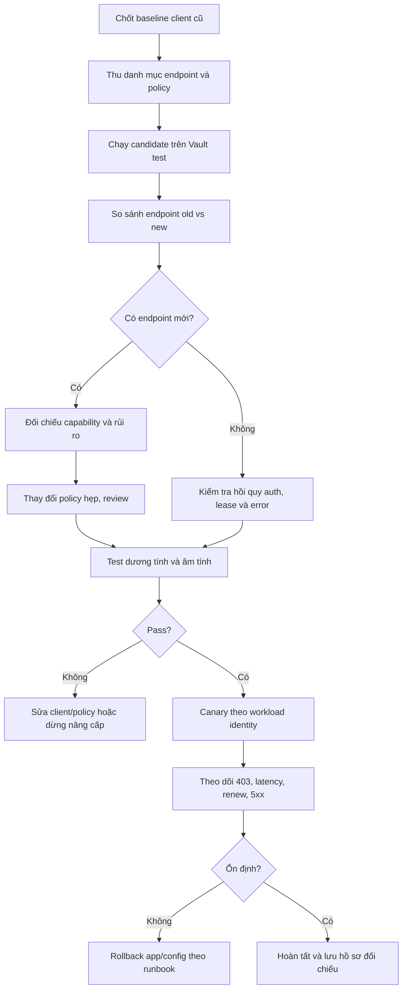

# Đối chiếu policy với các endpoint client mới gọi thêm khi nâng cấp Spring Vault

## 1. Bối cảnh: code chạy được trước nâng cấp, sau nâng cấp lại nhận 403

Trong **SPRING_VAULT**, một ứng dụng Java kết nối HashiCorp Vault qua `VaultTemplate`, `ReactiveVaultTemplate` hoặc API chuyên biệt để đọc KV secrets, xác thực theo workload, quản lý token/lease, gọi Transit encryption và PKI. Khi nâng cấp Spring Vault, Spring Cloud Vault, Spring Boot hoặc thay đổi luồng nghiệp vụ, **tập endpoint mà client gọi thực tế có thể thay đổi**. Một policy trước đây đủ quyền chưa chắc còn phù hợp với thao tác mới.

Ví dụ ứng dụng đã hoạt động ổn định với:

```text
GET /v1/kv/data/orders/config
```

Policy của workload:

```hcl
path "kv/data/orders/config" {
  capabilities = ["read"]
}
```

Sau nâng cấp hoặc refactor, một tính năng mới gọi thêm thao tác **liệt kê key** trong KV v2:

```text
LIST /v1/kv/metadata/orders
```

Request GET secret vẫn có thể thành công, nhưng LIST trả 403 vì `read` trên `kv/data/orders/config` **không cấp** `list` trên `kv/metadata/orders`.

**Điểm cốt lõi:** không suy luận rằng “nâng cấp làm Vault sai quyền” hoặc “chỉ cần thêm `sys/*`”. Cần xác định *request mới nào thực sự xuất hiện*, *đường dẫn Vault nào được ACL kiểm tra*, *capability nào endpoint yêu cầu* và *policy đang gắn với token nào*.

Bài này thuộc chương **Nâng cấp và tương thích**. Mục tiêu là xây một quy trình có thể lặp lại để đối chiếu **hợp đồng gọi API của client trước/sau nâng cấp** với ACL theo nguyên tắc đặc quyền tối thiểu, kèm kiểm thử âm tính, quan sát vận hành và phương án rollback.

## 2. Những thay đổi nào có thể làm phát sinh endpoint mới?

Không phải mọi lần nâng cấp thư viện đều tự động sinh thêm HTTP request. Nguồn phát sinh có thể nằm ở **hành vi được cấu hình**, **API được đổi cách sử dụng**, hoặc **version server/client**:

| Nguồn thay đổi | Ví dụ | Tác động cần xác minh |
| --- | --- | --- |
| Đổi API KV thô sang KV chuyên biệt | Từ `VaultTemplate.read(...)` sang `opsForKeyValue(...)` | Path KV v1/v2, metadata, dữ liệu, khả năng dò mount |
| Thêm nghiệp vụ | Từ đọc một secret sang LIST keys hoặc lấy metadata phiên bản | Cần capability `list` hoặc `read` trên nhánh khác |
| Thêm cơ chế phiên | Bật quản lý token/lease, renew hoặc lookup khi được cấu hình | Có thể gọi thêm endpoint token/lease |
| Đổi auth method hoặc mount auth | Từ token tĩnh sang Kubernetes/AppRole | Xuất hiện request `auth/<mount>/login` và ràng buộc role |
| Nâng cấp hoặc thay đổi cấu hình Spring Cloud Vault | Thay cách nạp property sources hoặc context profiles | Có thể đọc thêm những secret path lúc bootstrap |
| Thêm Transit/PKI | Encrypt, decrypt, sign, issue, revoke | Endpoint riêng, thường có tác dụng phụ |
| Thêm health/diagnostics | Kiểm tra Vault, mount, token metadata | Có thể phát sinh request hệ thống không có trong nghiệp vụ cũ |
| Đổi Vault namespace hoặc tên mount | Chuyển môi trường hoặc phân vùng Enterprise | Cùng path tương đối nhưng khác phạm vi ACL và dữ liệu |

**Không giả định endpoint từ tên method hay số phiên bản**. Spring Vault và Vault CLI có thể dùng chiến lược gọi API khác nhau; ứng dụng thực tế còn có custom client, actuator, property-source loader hoặc plugin. Vì vậy cần ghi lại **tập request quan sát được** ở cả bản cũ và bản mới, với cùng kịch bản nghiệp vụ.

### 2.1. Tách ba loại tương thích

1. **Tương thích API Java:** chữ ký method, kiểu dữ liệu, reactive/imperative, thay đổi dependency.
2. **Tương thích HTTP/API Vault:** endpoint, method, body/response, KV version, khả năng server hỗ trợ.
3. **Tương thích bảo mật:** auth role, token TTL, namespace và Vault ACL trên *logical path* thực gọi.

Unit test compile được chỉ xác nhận một phần loại (1). Request mới có thể bị 403 dù code đã compile và server Vault vẫn chạy bình thường. Muốn chắc chắn cần kiểm thử (2) và (3).

## 3. Hiểu đúng cách Vault đánh giá quyền

Vault áp dụng **ACL capabilities theo logical path**, không dựa trên tên class Java. Trong REST URL `/v1/kv/data/orders/config`, đường dẫn để viết policy là `kv/data/orders/config` — **không có `/v1/`**.

| Capability | Ý nghĩa cơ bản | Cần lưu ý |
| --- | --- | --- |
| `read` | Đọc giá trị/cấu hình | Thường gắn với GET |
| `list` | Liệt kê tên key/tài nguyên | LIST là thao tác riêng, không tự có từ `read` |
| `create` | Tạo mới | Xác nhận với contract endpoint |
| `update` | Ghi/thực hiện hành động | Một số POST ký chứng thư, mã hóa, renew cần `update` |
| `patch` | Cập nhật một phần khi endpoint hỗ trợ | Không phải mọi version hỗ trợ PATCH |
| `delete` | Xóa tài nguyên theo hợp đồng API | Không suy rằng mọi hành vi “xóa” đều dùng HTTP DELETE |
| `sudo` | Bổ sung cho endpoint root-protected | Không thay thế capability hành động tương ứng |
| `deny` | Từ chối tường minh | Có thể phủ quyết quyền cho phép |

**HTTP method chỉ là dấu hiệu ban đầu**: cùng HTTP POST có thể yêu cầu `create` hoặc `update`, tùy endpoint. Một thao tác xóa phiên bản KV v2 có thể là POST vào `kv/delete/...` và cần `update`, không phải `delete` trên `kv/data/...`. Hãy tra phần **Capabilities** của đúng HTTP API endpoint và phiên bản Vault đang chạy.

### 3.1. Mount, namespace và wildcard

- Mount `kv/` khác mount `secret/`. Nếu đổi mount mà không đổi policy tương ứng, token sẽ thiếu quyền trên path mới.
- KV v2 dùng nhánh `data/`, `metadata/`, `delete/`, `undelete/`, `destroy/` tùy thao tác; KV v1 không sử dụng cấu trúc tương tự.
- Namespace Vault Enterprise ảnh hưởng phạm vi token/policy. Cùng path `kv/data/orders/config` ở hai namespace không đồng nghĩa cùng secret hoặc cùng quyền.
- ACL wildcard `*` không tự được hiểu là mọi đường dẫn cha. Ví dụ policy chỉ cho `kv/metadata/orders/*` cần được kiểm tra xem có khớp chính request LIST tại `kv/metadata/orders` hoặc `kv/metadata/orders/` hay không.
- Không lấy `GET /v1/sys/health` làm bằng chứng token có quyền đọc KV: endpoint health có ngữ nghĩa và cơ chế truy cập riêng.

Khi gặp 403, xác định token có **thực sự hợp lệ** rồi mới kết luận thiếu ACL. Vault có thể trả 403 cho cả token hết hạn/bị thu hồi và token còn hợp lệ nhưng thiếu capability.

## 4. Lập bảng đối chiếu endpoint trước và sau nâng cấp

Một **endpoint inventory** có thể là bảng trong hồ sơ nâng cấp, không nhất thiết phải ghi thêm thông tin bí mật. Thu thập theo từng luồng: bootstrap, login, đọc secret, refresh token, renew lease, mã hóa, PKI, health.

| Giai đoạn | Client trước nâng cấp | Client sau nâng cấp | Kết luận |
| --- | --- | --- | --- |
| Bootstrap | GET `kv/data/orders/config` | Giữ nguyên GET | Policy `read` hiện tại có thể đủ |
| Tải danh sách cấu hình | Không gọi | LIST `kv/metadata/orders` | **Cần xem capability `list` trên path metadata** |
| Đọc metadata phiên bản | Không gọi | GET `kv/metadata/orders/config` | Có thể cần `read` tại path metadata |
| Token | Dùng token được cấp từ workload | Có thêm renew/lookup theo cấu hình | Kiểm tra endpoint/token role/ACL thực dùng |
| Monitoring | Không gọi Vault trực tiếp | Có health hoặc status probe | Phân biệt endpoint công khai với endpoint đặc quyền |

Bảng này là **tình huống minh họa**, không phải cam kết Spring Vault luôn phát sinh những request đó khi nâng một phiên bản cụ thể. Endpoint thật cần được xác minh bằng test và quan sát lưu lượng.

Với mỗi request quan sát, giữ tối thiểu các trường:

```text
flow                : config-bootstrap
client_release      : candidate
logical_path_group  : kv/metadata/orders
operation           : LIST
caller_identity     : orders-service
vault_namespace     : app-team
required_capability : list
policy_decision     : denied
evidence            : test+Vault audit đã được lọc
```

Các giá trị trên đều giả định. Không đưa Vault token, Secret ID, dữ liệu KV, body PKI/Transit hay lease ID thật vào bảng. Đường dẫn có ID khách hàng/tenant cần được **chuẩn hóa** để tránh lộ thông tin.

### 4.1. Lấy bằng chứng ở đâu?

1. **Danh sách API đã dùng trong source:** rà những lời gọi `VaultTemplate.read/write`, `VaultKeyValueOperations`, Transit/PKI, reactive clients và cấu hình Spring Cloud Vault. Đây chỉ là dự đoán; còn cần đo request.
2. **HTTP client observations:** lấy method, path nhóm, status và phiên bản client nhưng **không log header `X-Vault-Token` hoặc body**. Đặc biệt chú ý bootstrapping trước khi ứng dụng mở HTTP.
3. **Vault audit devices:** operator được ủy quyền kiểm tra request path, operation, namespace, error và caller trong audit log theo chính sách. Trường nào nhạy cảm phải được bảo vệ theo cơ chế audit và hạn chế truy cập.
4. **Integration test:** chạy cùng bộ use case ở release cũ và candidate trên Vault test giống nhau để so sánh. Thêm phép thử quyền bị từ chối, không chỉ phép thử thành công.

**Không kích hoạt raw wire logging hoặc TRACE body** chỉ để tìm endpoint mới; nó có thể ghi cả credential và secret. Nếu chỉ có log mức thấp, thiết lập biện pháp che dữ liệu, kiểm soát thời gian bật, quyền đọc và xóa sau khi hoàn thành điều tra.

## 5. Ma trận thường gặp: từ API ứng dụng sang policy Vault

Các ví dụ giả định mount tương ứng tồn tại và caller đã được xác thực. Tên mount, path và phiên bản engine phải được thay theo triển khai.

| Thao tác nghiệp vụ | Logical path ví dụ | Capability cần đối chiếu |
| --- | --- | --- |
| Đọc KV v1 | `secret/orders/config` | `read` |
| Đọc giá trị KV v2 | `kv/data/orders/config` | `read` |
| LIST key KV v2 | `kv/metadata/orders` | `list` |
| Đọc metadata/version KV v2 | `kv/metadata/orders/config` | `read` |
| Ghi KV v2 | `kv/data/orders/config` | `create`/`update` theo thao tác |
| Xóa mềm phiên bản KV v2 qua version API | `kv/delete/orders/config` | Thường `update` |
| Hủy vĩnh viễn version KV v2 | `kv/destroy/orders/config` | Thường `update`; tác động không khôi phục được |
| Lấy dynamic DB credentials | `database/creds/reporting` | `read` |
| Transit encrypt | `transit/encrypt/orders-key` | Thường `update` |
| Transit decrypt | `transit/decrypt/orders-key` | Thường `update`, cấp riêng với encrypt |
| Transit rotate key | `transit/keys/orders-key/rotate` | Thường `update`; quyền quản trị khóa |
| PKI sign CSR | `pki/sign/web-server` | Thường `update` |
| PKI issue certificate | `pki/issue/web-server` | Thường `update`, cân nhắc xử lý private key |
| PKI revoke certificate | `pki/revoke` | Thường `update`; quyền nhạy cảm |
| Lookup token hiện tại | `auth/token/lookup-self` | Theo contract token API |
| Renew token hiện tại | `auth/token/renew-self` | Theo contract token API và khả năng renewable |
| Renew dynamic lease | `sys/leases/renew` | Theo contract lease API và lease được phép |
| Revoke dynamic lease | `sys/leases/revoke` | Theo contract lease API, cần kiểm tra tác động |
| Liệt kê System mounts | `sys/mounts` | `read` và có thể `sudo` khi endpoint root-protected |

**Đừng tự cấp toàn bộ ma trận cho một token.** Mỗi workload chỉ cần những hàng tương ứng với hành vi thực tế. Đặc biệt, `Transit encrypt` không mặc nhiên phải có `decrypt`; ứng dụng chỉ ký CSR không cần `pki/issue` hoặc `pki/revoke`; ứng dụng đọc secret không cần `sys/mounts`.

Với **token/lease endpoints**, yêu cầu quyền và hành vi còn chịu tác động của loại token, quyền của caller, session lifecycle và phiên bản Vault. Phải xác nhận qua tài liệu endpoint và test với token do role thực cấp. Không mở quyền `sys/leases/*` rộng để làm một phép renew riêng lẻ hoạt động.

## 6. Tình huống chuyên sâu: thêm chức năng LIST KV v2 sau refactor

### 6.1. Bản cũ chỉ đọc một key

Trong ứng dụng hiện tại:

```java
import org.springframework.vault.core.VaultTemplate;
import org.springframework.vault.support.VaultResponse;

public class OrdersSecretsV1 {
    private final VaultTemplate vault;

    public OrdersSecretsV1(VaultTemplate vault) {
        this.vault = vault;
    }

    public VaultResponse readConfig() {
        return vault.read("kv/data/orders/config");
    }
}
```

Policy vừa đủ:

```hcl
path "kv/data/orders/config" {
  capabilities = ["read"]
}
```

### 6.2. Bản mới dùng API KV chuyên biệt và bổ sung LIST

Ví dụ Java 17+:

```java
import java.util.List;

import org.springframework.vault.core.VaultKeyValueOperations;
import org.springframework.vault.core.VaultKeyValueOperationsSupport.KeyValueBackend;
import org.springframework.vault.core.VaultTemplate;
import org.springframework.vault.support.VaultResponse;

public class OrdersSecretsV2 {
    private final VaultKeyValueOperations kv;

    public OrdersSecretsV2(VaultTemplate vault) {
        this.kv = vault.opsForKeyValue("kv", KeyValueBackend.KV_2);
    }

    public VaultResponse readConfig() {
        // Spring Vault chọn endpoint dữ liệu KV v2.
        return kv.get("orders/config");
    }

    public List<String> listKeys() {
        // Đây là thao tác LIST, không phải GET secret.
        return kv.list("orders");
    }
}
```

Ở đây `get("orders/config")` và `list("orders")` là **hai hành vi khác nhau**. Phương thức `list` có thể yêu cầu LIST ở `kv/metadata/orders`, trong khi `get` dùng đường dẫn dữ liệu. Không giả định thư viện sẽ tạo đúng một HTTP request cho mọi method/version/config; xác minh bằng trace đã lọc và audit khi cần.

Policy đề xuất theo đúng use case:

```hcl
# Giữ quyền đọc duy nhất secret cấu hình cần thiết.
path "kv/data/orders/config" {
  capabilities = ["read"]
}

# Cấp thêm LIST ngay tại prefix mà client dùng.
path "kv/metadata/orders" {
  capabilities = ["list"]
}

# Nếu app có nhu cầu liệt kê tiếp những thư mục con:
# path "kv/metadata/orders/*" {
#   capabilities = ["list"]
# }
```

**Lưu ý dấu `/` cuối path:** nếu audit chỉ ra endpoint thật là `kv/metadata/orders/` thay vì `kv/metadata/orders`, kiểm tra cách Vault chuẩn hóa route và ACL matching trong phiên bản đang chạy. Test với đúng path; không suy luận từ tên thư mục. Hạn chế wildcard hơn nữa nếu business chỉ cần một thư mục cụ thể.

Nếu ứng dụng cũng gọi GET `kv/metadata/orders/config` để xem phiên bản, nó cần **quyền đọc metadata** phù hợp; quyền LIST ở thư mục không tự cấp READ metadata của một key.

### 6.3. Vì sao không nên sửa bằng wildcard rộng?

Một cách xử lý dễ dãi:

```hcl
# KHÔNG NÊN: mở rộng quá mức chỉ để xử lý một lỗi LIST.
path "kv/*" {
  capabilities = ["create", "read", "update", "delete", "list"]
}
```

Policy này có thể cho phép đọc/ghi/xóa các secret ngoài nhánh orders, thao tác metadata và các đường dẫn có tác dụng phụ. Nó không phải giải pháp tương thích, mà là **mở rộng bề mặt tấn công**.

Trong review, ghi rõ: “Bản mới cần LIST dưới `orders` để tìm key; cấp `list` đúng prefix, không tăng `read` hoặc `update` trên secret khác”.

## 7. Đối chiếu quyền khi client gọi thêm auth, token và lease endpoints

Nâng cấp hoặc thay đổi cấu hình xác thực theo workload có thể khiến bạn nhìn thấy những request không xuất hiện trước đó:

```text
POST /v1/auth/kubernetes/login
GET  /v1/auth/token/lookup-self
POST /v1/auth/token/renew-self
POST /v1/sys/leases/renew
```

**Đây là ví dụ về các endpoint liên quan**, không phải chuỗi request bắt buộc mà Spring Vault luôn gọi. Tập request phụ thuộc auth method, lifecycle manager, Vault server và hoạt động có lease.

Phân biệt:

- **Login vào auth method:** Vault xét credential workload (JWT, Role ID/Secret ID, bound claims, role configuration). Không thể sửa login bị từ chối chỉ bằng cách thêm quyền `read` ở secrets engine.
- **Token lookup/renew:** thường liên quan token hiện tại và khả năng renew. Token có TTL, renewable và policy riêng; không phải mọi token đều được gia hạn.
- **Secret lease renew/revoke:** dùng các endpoint lease theo hợp đồng, liên quan `lease_id` được Vault phát hành khi dùng dynamic secret. Gia hạn token không tự động gia hạn mọi secret lease.
- **KV v2 secret tĩnh:** không đồng nghĩa một dynamic secret lease cần gia hạn.

Không sửa policy đoán mò khi thấy một POST vào `sys/leases/renew` trả 403. Trước tiên kiểm tra **token còn hợp lệ**, request lease thuộc workload nào, role có được phép renew không và API client đang dùng có đúng contract.

### 7.1. Đăng nhập thành công không đảm bảo các request mới được phép

Ví dụ role Kubernetes `orders-service` vẫn cấp token hợp lệ sau nâng cấp. Nếu startup mới đọc thêm `kv/data/orders/feature-flags`, Vault ACL vẫn kiểm tra đường dẫn này. Login thành công chỉ chứng minh auth method đã chấp nhận workload; nó không cấp mọi quyền nghiệp vụ.

Ngược lại, 403 ở `auth/kubernetes/login` do role hoặc JWT sai không phải bằng chứng `kv/data/orders/*` thiếu `read`. Phải tách hai lớp authn/authz khi ghi nhận kết quả kiểm thử.

## 8. Khi nào cần thay đổi chính sách cho Transit, PKI và System API?

Một lần nâng cấp thường đi kèm thay đổi logic nghiệp vụ hơn là riêng thư viện. Chẳng hạn:

| Trước | Sau | Cần cân nhắc |
| --- | --- | --- |
| Chỉ `transit/encrypt/orders-key` | Thêm `transit/decrypt/orders-key` | Có nên cho workload giải mã không? Tách danh tính nếu cần |
| Chỉ ký CSR qua `pki/sign/web-server` | Chuyển sang `pki/issue/web-server` | API issue có thể trả private key; xem lại threat model và nơi lưu khóa |
| Chỉ đọc credential DB | Thêm lease renewal | Đối chiếu quyền/TTL, không tự cấp revoke-prefix |
| Chỉ đọc KV | Thêm `sys/mounts` để “health check” | Có thực sự cần System API đặc quyền không? |
| Chỉ đọc cấu hình | Thêm ghi KV v2 có CAS | Phải xét `create/update`, logic version/CAS và quyền ghi tối thiểu |

Không phải mọi thay đổi đều nên giải quyết bằng **cấp thêm quyền**. Có khi đúng hơn là:

1. Loại bỏ request quản trị không cần thiết khỏi ứng dụng nghiệp vụ.
2. Chuyển thao tác nhạy cảm sang một service quản trị riêng, với token/role riêng.
3. Dùng API chuyên biệt của Spring Vault để tránh tự gọi nhầm endpoint.
4. Tách workload encrypt khỏi workload decrypt hoặc phân chia role PKI theo trách nhiệm.
5. Giữ endpoint health chỉ trả trạng thái tối thiểu, không gọi Vault để phát hành secret/lease mới.

**Đối chiếu policy là kiểm tra ranh giới tin cậy, không chỉ sửa lỗi 403.**

## 9. Kiểm tra quyền hiệu lực bằng Vault CLI

Trong Vault test hoặc môi trường chẩn đoán có phân quyền, sử dụng **token của workload cần kiểm tra**, không thay bằng root/admin token:

```bash
# Những lệnh này đọc quyền của token caller hiện hành.
vault token lookup -self

vault token capabilities -self kv/data/orders/config
vault token capabilities -self kv/metadata/orders
vault token capabilities -self kv/metadata/orders/config
vault token capabilities -self transit/encrypt/orders-key
vault token capabilities -self transit/decrypt/orders-key

# Đối chứng: path ngoài phạm vi orders phải không có quyền tùy tiện.
vault token capabilities -self kv/data/payments/config
```

Nếu token đã hết hạn, các lệnh `lookup -self` hoặc `capabilities -self` có thể không chạy được. Khi đó lỗi có thể nằm ở **token/session**, không nhất thiết là policy đã thiếu. Với Vault Enterprise, kiểm tra namespace và token scope trước khi so sánh.

Có thể dùng System API `sys/capabilities-self` để hỏi về quyền hiệu lực trên một hoặc nhiều path:

```http
POST /v1/sys/capabilities-self
X-Vault-Token: <WORKLOAD_TOKEN_IN_SECURE_CHANNEL>
Content-Type: application/json

{
  "paths": [
    "kv/data/orders/config",
    "kv/metadata/orders",
    "kv/data/payments/config"
  ]
}
```

Ví dụ phản hồi **minh họa**, không phải dữ liệu quan sát:

```json
{
  "data": {
    "kv/data/orders/config": ["read"],
    "kv/metadata/orders": ["list"],
    "kv/data/payments/config": ["deny"]
  }
}
```

Trong production, tránh truyền token thật qua chat, ticket, terminal history hoặc script debug tự ghi log. Dùng session xác thực phù hợp và lưu bằng chứng đã **ẩn ID/token/secret**.

### 9.1. Không nhầm capability-self với một lần gọi nghiệp vụ thành công

`capabilities-self` trả về quyền ACL trên path tại thời điểm kiểm tra. Nó không đảm bảo request mới thành công nếu mount không tồn tại, KV version sai, role chưa cấu hình, request body không hợp lệ, token hết hạn sau phép kiểm hoặc server không hỗ trợ API. Vì vậy cần **cả phép kiểm capability và test gọi endpoint thật**.

### 9.2. Quản lý policy được gắn vào token

Hãy kiểm tra từ role thực:

- Kubernetes auth: service account, namespace, audience và tên role được chọn khi login.
- AppRole: Role ID/Secret ID, auth mount, token policies và các ràng buộc khác.
- Token auth: token do đâu phát hành, có gắn policy và TTL nào.
- Identity policies: entity/group có thể bổ sung policy ngoài token policies; cần xem **quyền hiệu lực**.

Sửa một policy HCL **không đồng nghĩa** mọi token cũ ngay lập tức có cùng quyền mong muốn trong mọi cấu hình, nhất là khi thay **role-to-policy mapping** hoặc phát hành token mới. Kiểm tra bằng token thực của workload sau quy trình thay đổi.

## 10. Kiểm thử hồi quy bằng policy tối thiểu

### 10.1. Ma trận test dương tính và âm tính

| Tình huống | Token/role | Kết quả mong đợi |
| --- | --- | --- |
| Đọc `kv/data/orders/config` | Workload orders | Thành công nếu secret tồn tại |
| LIST `kv/metadata/orders` sau nâng cấp | Workload orders đã cấp `list` | Thành công |
| Đọc `kv/data/payments/config` | Workload orders | Bị từ chối |
| Ghi `kv/data/orders/config` | Workload chỉ đọc | Bị từ chối |
| Transit decrypt | Workload chỉ có encrypt | Bị từ chối |
| Gọi `sys/mounts/:path/tune` | Workload nghiệp vụ | Bị từ chối |
| Login bằng service account không phù hợp | Role Kubernetes orders | Bị từ chối ở auth method |
| Token hết hạn/bị revoke | Workload cũ | Session xử lý đúng, không vòng lặp retry |

**Âm tính là bắt buộc:** nếu test chỉ khẳng định thao tác LIST mới thành công, developer có thể vô tình cấp wildcard lớn mà không biết. Cần đồng thời assert workload vẫn **không** đọc, ghi hoặc quản trị tài nguyên ngoài phạm vi.

### 10.2. Kịch bản integration test

Trên Vault test cô lập (có thể dùng Testcontainers):

1. **Pin phiên bản** Vault image và bộ dependency Spring Vault tương ứng với ma trận cần hỗ trợ. Không lấy bản latest không kiểm soát cho CI.
2. Enable KV v2 tại `kv/`, tạo `orders/config` và một secret `payments/config` đối chứng.
3. Tạo role/policy chỉ đọc bản cũ, đăng nhập bằng credential test **không phải root token**.
4. Chạy code client cũ: xác nhận GET một secret thành công và không phát sinh request quản trị không mong muốn.
5. Chạy candidate client: bật tính năng LIST, ghi nhận request `kv/metadata/orders` bị từ chối khi chưa có quyền.
6. Cập nhật **chỉ** capability `list` trên prefix đã đo; chạy lại và xác nhận LIST thành công.
7. Chạy negative tests: không được đọc payments, ghi secrets hoặc gọi `sys/mounts`.
8. Nếu candidate có auth/session mới, thử token hết TTL, auth method fail, lease renew/revoke với **credential và lease test riêng**.
9. Với Transit/PKI, thử encrypt/decrypt, sign/issue đúng role và kiểm tra tác dụng phụ/cleanup.
10. Đọc audit và kiểm tra CI logs không chứa JWT, Vault token, mật khẩu, plaintext DEK hoặc private key.

Mỗi test cần biết **identity và namespace thực**. Kiểm thử bằng token root vô hiệu hóa mục tiêu kiểm chứng policy vì root token có quyền vượt xa workload.

### 10.3. Unit test và contract test vẫn hữu ích, nhưng chưa đủ

Mock `VaultOperations` / `ReactiveVaultOperations` giúp kiểm thử mapping response, xử lý lỗi và retry mà không tạo tài nguyên thật. Một HTTP stub có thể xác minh client gọi GET thay vì LIST hoặc path `data` thay vì `metadata`. Tuy nhiên **chỉ Vault thật với token/policy test** mới xác thực được ACL matching và kết quả 403 thực.

Với ứng dụng reactive, dùng `StepVerifier` để kiểm tra publisher trả kết quả hoặc lỗi; 403 hợp lệ phải dẫn tới xử lý fail-closed thay vì bị chuyển thành `Mono.empty()`. Với ứng dụng imperative, assert exception/status phù hợp và không retry vô hạn.

## 11. Triaging khi candidate nhận 403, 404 hoặc lỗi khác

| Quan sát | Kiểm tra đầu tiên | Không nên làm |
| --- | --- | --- |
| Login auth method bị từ chối | Role/JWT/Secret ID, mount auth và bound claims | Mở quyền `kv/*` để “sửa login” |
| GET KV cũ thành công, LIST mới 403 | ACL `list` trên `kv/metadata/...`, path thực | Cấp `create/update/delete` cho toàn mount |
| GET metadata 403 | `read` trên chính metadata key; token hiệu lực | Suy rằng LIST đã đủ cho mọi GET metadata |
| Vault token hiện tại không được chấp nhận | TTL, revoke, renew/relogin, namespace | Kết luận ngay policy thiếu quyền |
| 404 sau chuyển API KV | KV version/mount/path, data/metadata, secret tồn tại | Thay 404 bằng giá trị mặc định không kiểm soát |
| 403 tại `sys/mounts` | Nhu cầu thực sự của endpoint, ACL/sudo, identity operator | Cấp `sudo` cho tất cả microservice |
| 429/5xx hoặc timeout | Vault availability, rate limit, HTTP client | Retry không giới hạn hay bật TRACE body |
| Hành vi cũ vẫn lỗi sau rollback | Policy/role/namespace đã thay đổi bên ngoài client | Chỉ rollback jar mà không đối chiếu cấu hình |

Điều quan trọng là tách **lỗi authentication** khỏi **authorization**, và cả hai khỏi lỗi schema/configuration. HTTP 403 có thể biểu thị token invalid/expired hoặc ACL deny. Bằng chứng cần có là endpoint, token hợp lệ, capability trên path và trạng thái service.

## 12. Thiết kế rollback và triển khai an toàn

Một kế hoạch nâng cấp có thể theo thứ tự:



### 12.1. Checklist trước khi canary

- [ ] Có danh sách phiên bản **Spring Vault, Spring Boot/Spring Cloud Vault nếu dùng, Java và Vault server** đã thử nghiệm; tra release notes và compatibility matrix của phiên bản mục tiêu.
- [ ] Đã ghi lại mount path, auth mount, namespace, KV version và token policies thực gắn với role.
- [ ] Đã chạy cùng kịch bản khởi động và nghiệp vụ trên client cũ/candidate; so sánh logical paths và operation.
- [ ] Endpoint mới có lý do nghiệp vụ rõ ràng; nếu không cần, loại bỏ thay vì mở ACL.
- [ ] Policy mới chỉ cấp capability tối thiểu ở prefix chính xác; không mở rộng `sys/*` hoặc `kv/*`.
- [ ] Có test **negative authorization** và test token hết hạn/auth fail, không chỉ happy path.
- [ ] Đã xét retry/idempotency cho dynamic credentials, Transit, PKI và lease; timeout không tạo tài nguyên trùng.
- [ ] Audit/metrics đã được làm sạch dữ liệu nhạy cảm; có thể phân biệt login failure, 403 ACL, 404 path và 5xx.
- [ ] Có owner phê duyệt policy, quy trình rollback và kiểm tra lại sau triển khai.

### 12.2. Rollback phải bao gồm policy và cấu hình

Rollback code **không luôn** rollback được các thay đổi ở Vault: policy, role, mount, TTL và secret schema có thể đã được sửa độc lập. Tương tự, rollback policy ngay lập tức khi còn pod candidate đang gọi endpoint mới có thể gây hàng loạt 403.

Cách tiếp cận an toàn:

1. Dừng phát hành, xác định số workload candidate còn hoạt động.
2. Trở về client/config cũ và xác minh request cũ hoạt động.
3. Chỉ thu hồi capability mới sau khi không còn consumer cần endpoint đó.
4. Theo dõi 403, lỗi token renewal, 5xx và tác động tới lease/PKI/Transit.
5. Ghi lại thay đổi cho lần nâng cấp tiếp theo.

Thay đổi quyền không thay thế phương án rollback server hoặc khôi phục dữ liệu khi migration engine có tác động phá hủy.

## 13. Những sai lầm điển hình

**Sai lầm 1: “Đã dùng được VaultTemplate trước đây nên tất cả method mới phải hoạt động.”**  
Sai. `VaultTemplate` tái sử dụng kết nối và token, không tự nâng ACL. LIST metadata là operation và path khác với GET dữ liệu.

**Sai lầm 2: “Thấy 403 thì thêm quyền trên mount rộng nhất.”**  
Sai. Có thể token hết hạn, role sai, path khác hoặc chỉ thiếu `list`. Phải có bằng chứng từ token và request.

**Sai lầm 3: “Chỉ đọc source hoặc release notes là đủ biết request mới.”**  
Chưa đủ. Client có thể gọi thêm endpoint do cấu hình, profile, health probe hoặc session management. Cần đo request thực và test.

**Sai lầm 4: “Thêm `read` trên `kv/data/*` cũng cho phép LIST KV v2.”**  
Sai. LIST hoạt động trên `kv/metadata/...` với capability riêng. Hãy kiểm tra chính prefix được gọi.

**Sai lầm 5: “Gán quyền `sys/mounts` cho workload để API KV hoạt động.”**  
Không mặc nhiên đúng. Việc quản trị mount thường thuộc operator. Kiểm tra có request System API thật sự cần thiết hay không.

**Sai lầm 6: “Mock trả 200 là policy đúng.”**  
Sai. Mock xác minh logic ứng dụng nhưng không thực thi ACL của Vault.

**Sai lầm 7: “Rollback jar sẽ hoàn nguyên mọi thứ.”**  
Sai. Policy, auth role, cấu hình Vault và secret schema có thể vẫn ở trạng thái mới.

## 14. Tình huống tự kiểm tra

**Câu 1:** Bản cũ đọc `kv/data/orders/config`; bản mới bổ sung `list("orders")` và bị 403. Capability nào cần xét, ở đâu?

**Đáp án:** Kiểm tra `list` trên endpoint metadata KV v2 mà client thật sự gọi, chẳng hạn `kv/metadata/orders`. Xác nhận token hợp lệ và không mở quyền trên toàn mount.

**Câu 2:** Sau nâng cấp, client gửi `POST auth/kubernetes/login` nhưng bị từ chối. Thêm `read` ở `kv/data/orders/*` có khắc phục không?

**Đáp án:** Không. Đây là giai đoạn xác thực workload; cần kiểm tra role, JWT, service account, namespace, audience hoặc auth mount. ACL KV áp dụng sau khi nhận token hợp lệ.

**Câu 3:** Candidate chuyển từ Transit encrypt sang decrypt rồi nhận 403. Có nên cho cả hai capability trên một token không?

**Đáp án:** Chỉ khi nghiệp vụ thực sự cần decrypt và threat model cho phép. Nên cân nhắc tách token/role, và cấp đúng endpoint `transit/decrypt/:key` thay vì wildcard.

**Câu 4:** Test với root token cho thấy toàn bộ candidate chạy ổn định. Điều này chứng minh policy của service account đủ chưa?

**Đáp án:** Chưa. Root token không đại diện workload. Cần test với token/role thực cùng namespace và negative tests.

**Câu 5:** Sau rollback client, một số pod vẫn nhận 403. Nên kiểm tra gì?

**Đáp án:** Pod còn chạy candidate hay không, auth role/policy có thay đổi, namespace/mount có lệch, token mới/cũ có còn hiệu lực, và đường dẫn thực trong audit. Rollback code chưa chắc hoàn nguyên Vault.

## 15. Tổng kết

**Đối chiếu policy sau nâng cấp là so sánh các endpoint thực gọi với quyền hiệu lực của đúng workload.** Bắt đầu bằng baseline cũ, đo request candidate, chuẩn hóa logical path/operation, đối chiếu capability từ tài liệu API, xác minh bằng `capabilities-self` và **integration test dùng token hạn chế**, rồi mới thay policy trong phạm vi nhỏ.

Những endpoint thường bị bỏ sót gồm `kv/metadata/...` khi từ READ chuyển sang LIST, các request token/lease khi đổi lifecycle manager, endpoint decrypt/sign/issue/revoke khi bổ sung Transit/PKI, cùng System API phục vụ quản trị. Mọi thay đổi cần có test âm tính, giám sát 403/5xx và kế hoạch rollback cả ứng dụng lẫn cấu hình quyền — không dùng wildcard hoặc root token để làm nhanh.

### Tài liệu đối chiếu

- [Spring Vault — Reference Documentation](https://docs.spring.io/spring-vault/reference/)
- [Spring Vault — Key-Value Operations](https://docs.spring.io/spring-vault/reference/vault/vault-key-value.html)
- [HashiCorp Vault — ACL Policies](https://developer.hashicorp.com/vault/docs/concepts/policies)
- [HashiCorp Vault — KV Secrets Engine API](https://developer.hashicorp.com/vault/api-docs/secret/kv/kv-v2)
- [HashiCorp Vault — System API](https://developer.hashicorp.com/vault/api-docs/system)
- [HashiCorp Vault — Token Capabilities CLI](https://developer.hashicorp.com/vault/docs/commands/token/capabilities)
