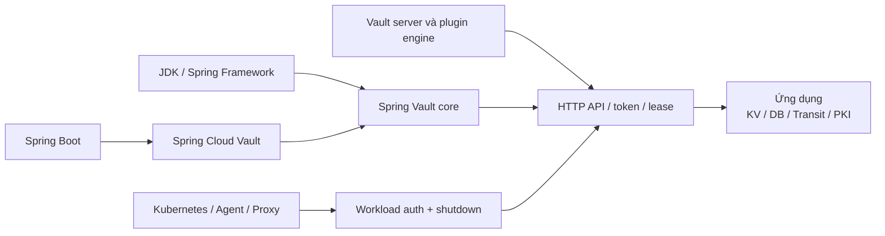
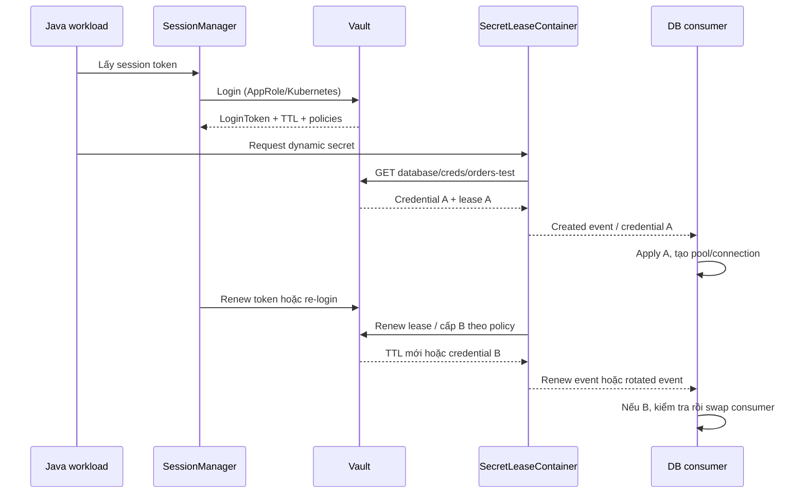
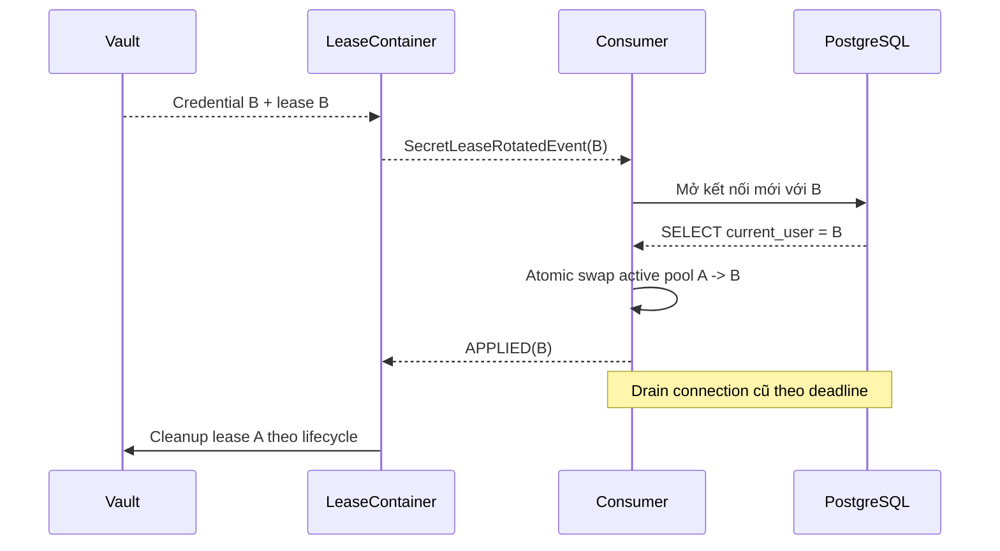
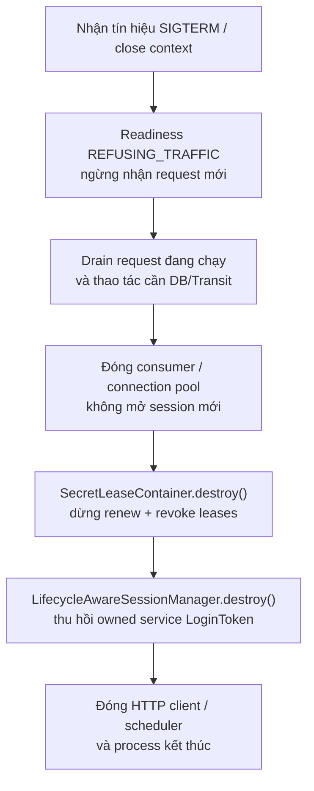
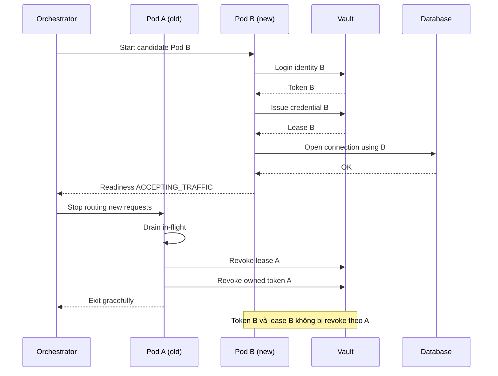

# Kiểm thử vòng đời token, lease và shutdown sau nâng cấp

**Chương:** Nâng cấp và tương thích  
**Module:** SPRING_VAULT

## 1. Vì sao nâng cấp thành công không chỉ là ứng dụng khởi động được?

Ứng dụng Java tích hợp **HashiCorp Vault** qua `VaultTemplate` / `VaultOperations` không chỉ cần gọi API thành công lúc khởi động. Nó còn phải duy trì phiên xác thực của workload, làm mới **Vault client token**, renew hoặc rotate **dynamic secrets**, xử lý token/lease hết hạn và **thu hồi tài nguyên đúng cách khi ứng dụng shutdown**. Sau khi nâng cấp Spring Vault, Spring Cloud Vault, Spring Boot, JDK hoặc Vault server, một ứng dụng có thể build và chạy bình thường nhưng âm thầm mất những hành vi sau:

- Token được cấp khi login nhưng **không renew**; sau vài giờ mới xuất hiện `403 permission denied`.
- Token đến giới hạn TTL nhưng **không re-login**, khiến mọi hoạt động KV/Transit/PKI ngừng.
- `SecretLeaseContainer` không được khởi động, listener đăng ký muộn hoặc bỏ lỡ sự kiện nhận credential.
- Lease được renew nhưng ứng dụng **không dùng credential mới** sau rotation.
- Shutdown chỉ gọi `stop()` chứ không gọi `destroy()`, để lease còn tồn tại tới khi hết hạn.
- Token được thu hồi trước khi xử lý lease; yêu cầu revoke lease thất bại trong quá trình đóng context.
- Graceful shutdown không đủ thời gian drain HTTP/DB connections hoặc bị `SIGKILL` trước khi cleanup.
- Một Pod cũ trong rolling upgrade thu hồi credential mà Pod mới **đang dùng chung**, gây lỗi giữa quá trình chuyển phiên bản.

Bài này tập trung vào **“Kiểm thử vòng đời token, lease và shutdown sau nâng cấp”** trong SPRING_VAULT, kết hợp những kiến thức module về xác thực theo workload và ACL, KV, token/lease, Transit, PKI, xử lý lỗi, giám sát và kiểm thử tích hợp.

**Định nghĩa đạt sau nâng cấp:** phiên bản mới phải giữ đúng contract xác thực, renew/re-login, cấp phát/rotate secret, quản lý quyền và cleanup; hệ thống vẫn đáp ứng các yêu cầu nghiệp vụ trong rollout và **không rò rỉ hoặc thu hồi nhầm tài nguyên**.

### Mục tiêu học tập

1. Xây dựng ma trận tương thích và “golden contract” cho token, lease và shutdown trước/sau nâng cấp.
2. Phân biệt `LifecycleAwareSessionManager`, `SecretLeaseContainer`, `ClientAuthentication` và nhiệm vụ của ứng dụng.
3. Xác minh token renew, re-login, revoke trên shutdown, kể cả loại token không tự revoke.
4. Kiểm thử lease renew/rotate/revoke và phát hiện khi consumer vẫn dùng giá trị cũ.
5. Kiểm tra thứ tự shutdown trong Spring Boot/Kubernetes, ứng xử khi mất mạng hoặc SIGKILL.
6. Thiết kế canary, rollback, fault injection và bằng chứng nghiệm thu không làm lộ secret.

## 2. Khoanh vùng thay đổi trước khi nâng cấp

Không nâng cấp riêng lẻ một version rồi mặc định mọi thành phần còn tương thích. Đường đi thực tế gồm:



### 2.1. Lập bảng phiên bản thực tế

| Thành phần | Thông tin cần chốt ở bản cũ | Thông tin cần chốt ở bản mới | Thay đổi dễ ảnh hưởng |
| --- | --- | --- | --- |
| JDK | Runtime và bytecode target | Runtime và target sau nâng cấp | TLS provider, trust store, scheduling, runtime compatibility |
| Spring Boot | Version, Actuator và graceful shutdown | Version đã chọn | Lifecycle của bean, readiness, timeout đóng context |
| Spring Cloud release train | BOM thực tế | BOM tương thích Spring Boot mới | Auto-config cho Vault, property sources, lease lifecycle |
| Spring Vault | `spring-vault-core` thực tế | Version qua BOM/dependency tree | SessionManager, listener, API, HTTP serialization |
| Jackson/HTTP stack | Jackson 2/3, RestTemplate/RestClient, HTTP client | Bộ dependency được resolve | Request/response mapping, lỗi HTTP, nullable behavior |
| Vault server | Version và topology HA | Version và topology sau nâng cấp | Endpoint token/lease, PKI issuer, KV/Transit, standby routing |
| Vault auth | AppRole/Kubernetes/IAM, token policy | Role, bind, policy tương ứng | Service/batch token, TTL, re-login, renewable |
| Secrets engines | Mount, version, role, TTL | Mount/plugin/config mới | KV v2 route, DB lease, PKI/Transit format |
| Runtime | Kubernetes termination grace, probes, Agent/Proxy | Điều kiện rollout mới | Đóng instance và thu hồi đúng thời điểm |

**Nguyên tắc:** nếu dự án dùng Spring Cloud Vault, ưu tiên **BOM Spring Cloud tương thích** với Spring Boot và để BOM quản lý dependency Spring Vault; không ép nâng riêng `spring-vault-core` trái với release train mà không có lý do và bài test đầy đủ.

Ví dụ tại thời điểm soạn nội dung (tháng 11/2026), Spring Cloud **2026.0.0** phát hành cùng Spring Cloud Vault **5.1.0**, tích hợp Spring Vault **4.1.0**; Spring Vault 4.x thuộc thế hệ Spring Framework **7** và sử dụng ngăn xếp JSON/HTTP có những thay đổi so với 3.x. Đây là **mốc tham khảo**, không phải yêu cầu tất cả dự án phải nâng lên đúng các version này. Phải kiểm tra bảng tương thích và dependency thực tế của **release đang được chọn** trước khi chạy test.

### 2.2. Những thay đổi cụ thể cần đưa vào regression test

- Interface/constructor, cấu hình `SessionManager`, `ClientAuthentication`, các sự kiện authentication.
- Kiểu token: `VaultToken`, `LoginToken`, service token và batch token; quyền lookup-self/renew-self.
- Event lease: `SecretLeaseCreatedEvent`, `AfterSecretLeaseRenewedEvent`, `SecretLeaseRotatedEvent`, `SecretLeaseErrorEvent`, `BeforeSecretLeaseRevocationEvent` và `AfterSecretLeaseRevocationEvent`.
- Ngưỡng renew/expire và scheduler. Ngưỡng cũ có thể khiến TTL test “vừa chạy đã rotate” khi nâng version.
- Cấu hình Spring Cloud Vault về `spring.config.import`, fail-fast, auth method, lease lifecycle và `VaultHealthIndicator`.
- Hành vi Spring Boot graceful shutdown, phases của `SmartLifecycle` và thời hạn `terminationGracePeriodSeconds` trong Kubernetes.
- Những endpoint KV v2, Transit, PKI/issuer và lease có thay đổi response hoặc HTTP status giữa Vault versions.

Thay vì chỉ so sánh API docs, cần có **bộ test chạy trên cả bản cũ và bản ứng viên**, sử dụng cùng fixture đủ ổn định để so sánh về hành vi.

## 3. Ba vòng đời độc lập nhưng có ảnh hưởng dây chuyền

| Đối tượng | Ai thường quản lý? | Hết hạn/đóng sẽ ảnh hưởng gì? |
| --- | --- | --- |
| **Login/client token** | `LifecycleAwareSessionManager`, Agent Auto-Auth hoặc Proxy tùy kiến trúc | Request Vault mới thất bại; token bị revoke có thể kéo theo lease/child token |
| **Dynamic secret lease** | `SecretLeaseContainer` / engine + consumer | Credential DB bị revoke/hết hạn; pool cần cấp lại và chuyển kết nối |
| **Ứng dụng và consumer** | Spring Boot, HTTP server, DataSource, TLS listener | Đóng HTTP/DB connections, ngừng nhận traffic, cleanup token/lease |
| **PKI certificate validity** | Certificate lifecycle / application TLS reload | Chứng thư hết hạn bất kể login token còn hạn hay không |
| **KV static secret** | KV version/freshness + ứng dụng | Không mặc định có lease động để renew; cần refresh/reload riêng |
| **Transit key** | Vault Transit engine | Rotation key nội bộ; ứng dụng dùng API, không tự giữ private key Transit |



**Không đồng nhất:**

- **Token renew** làm mới thời hạn session token, không nhất thiết đổi giá trị token.
- **Token re-login** nhận một token đăng nhập mới khi token cũ không còn renew được. Các lease gắn với phiên cũ có thể bị thu hồi khi phiên cũ hết hạn/bị revoke.
- **Lease renew** kéo dài thời gian tồn tại của chính lease, thường **không** thay username/password.
- **Secret rotation** cấp dữ liệu mới, thường kèm lease mới; chỉ thành công với ứng dụng khi consumer đã áp dụng.
- **Shutdown** có thể yêu cầu revoke token và lease theo quyền, nhưng **không thể bảo đảm cleanup nếu tiến trình bị kill đột ngột**.

## 4. Vòng đời token trong Spring Vault: kiểm tra điều gì?

`LifecycleAwareSessionManager` là thành phần quản lý token của Spring Vault cho phiên có lifecycle. Nó có thể lookup thông tin token, lập lịch renew, thực hiện re-login khi cần, phát authentication events và tham gia shutdown của Spring context.

### 4.1. `VaultToken` khác `LoginToken`

| Cách lấy token | Mô hình thường thấy | Hành vi test cần xác minh |
| --- | --- | --- |
| `TokenAuthentication` với token được cấp từ ngoài | Trả `VaultToken`; không mặc định thuộc quyền sở hữu ứng dụng | Có thể self-lookup và renew theo cấu hình; **không tự revoke** token ngoài khi đóng session |
| AppRole/Kubernetes/IAM login tạo token có lifecycle | Trả `LoginToken` | Renew/re-login; session manager **thu hồi token login thuộc quyền sở hữu** nếu loại token phù hợp khi shutdown |
| Batch token | Có giới hạn renewal/revocation khác service token | Không viết assertion “mọi token đều revoke được”; đọc type/TTL thực tế |
| Token gắn với Vault Agent/Proxy | Agent/Proxy quản lý xác thực/token | Kiểm thử shutdown ở **Agent/Proxy**, không gán nhầm trách nhiệm cho Spring `authentication=NONE` |

Theo Spring Vault Javadoc, `LifecycleAwareSessionManager` có `destroy()` và quản lý thu hồi `LoginToken` dạng **service token** do phương thức login phù hợp trả về. `VaultToken` lấy từ `TokenAuthentication` có thể được lookup/renew nhưng không bị session manager tự revoke như owned `LoginToken`. Vì thế, **không dùng token tĩnh** để chứng minh “shutdown thu hồi token thành công”, và không thử revoke token production chỉ vì test đóng context.

### 4.2. Kịch bản token bắt buộc sau nâng cấp

1. **Login:** dùng identity workload riêng, xác minh request KV/Transit/PKI được phép gọi sau login; một HTTP 200 của `/sys/health` không đủ.
2. **Renew:** với service token renewable, kiểm tra có request renew, TTL sau renew hợp lý và hoạt động nghiệp vụ tiếp tục. Không ép assert token value phải đổi sau mỗi renew.
3. **Terminal TTL / re-login:** khi token hết khả năng renew theo policy, kiểm tra có login token mới và client hoạt động; không chỉ quan sát scheduler tick.
4. **Mất kết nối lúc renew:** tạo timeout/503, xác nhận error event, backoff và phục hồi, không tạo hàng loạt token mới.
5. **403 do policy hoặc token revoke:** phân biệt lỗi thiếu quyền với network timeout; không retry vô hạn và không dùng root token fallback.
6. **Tắt context bình thường:** token login **do session manager sở hữu** được revoke khi tương thích loại token; không revoke token tĩnh do operator cung cấp.
7. **SIGKILL/crash:** không có bảo đảm `destroy()` chạy; token TTL/lease TTL và cơ chế cleanup ở Vault phải là tuyến bảo vệ dự phòng.

Một số version có `renewToken()` và `revoke()` trên `LifecycleAwareSessionManager`, nhưng **không nên gọi `revoke()` trong request nghiệp vụ** chỉ để buộc re-login. Nó có thể làm các lease liên quan bị vô hiệu và ảnh hưởng connection pool. Test cần xác định hành vi của version SDK thực tế thay vì thao tác trên token dùng chung.

## 5. Quan hệ token và lease: test phải thấy cả hai

Vault có mô hình quan hệ giữa token và những lease phát sinh dưới token đó. Khi **token bị revoke hoặc hết hạn**, các lease gắn với token có thể bị revoke theo cơ chế Vault. Với các token theo cây cha–con, revoke token cha mặc định có thể kéo theo token con và lease của chúng, trừ các trường hợp orphan/batch được cấu hình đặc thù.

**Hệ quả khi shutdown:** nếu phiên Java thu hồi login token **trước** khi `SecretLeaseContainer` hoàn tất cleanup, việc revoke lease riêng lẻ có thể gặp `403` hoặc nhận rằng lease không còn tồn tại. Điều đó không nhất thiết chứng minh rò lease, nhưng test cần phân biệt **lease đã bị cascade revoke** với **cleanup thất bại**.

**Hệ quả khi rolling deploy:** không được dùng một token cha chung rồi cho Pod cũ revoke nó khi tắt nếu Pod mới hoặc workload khác đang dựa vào cùng cây token/leases. Dùng danh tính và session độc lập theo Pod hoặc chiến lược cấp credential tách biệt, kiểm tra dependency thực tế.

### 5.1. Chọn bằng chứng kiểm thử thay vì log token

- **Token được phép kiểm tra:** sử dụng operator test identity có quyền lookup theo **accessor của token test** hoặc test endpoint được allowlist; không in token plaintext.
- **Lease được phép kiểm tra:** dùng lease ID chỉ phát sinh trong test và operator test có quyền `sys/leases/lookup`; không gọi revoke theo prefix trên môi trường chung.
- **Audit:** so khớp operation/timestamp/request correlation ID an toàn, không xuất `VaultResponse` có chứa secret.
- **Consumer:** sau revoke đúng lease test, thử mở **kết nối DB mới** với credential cũ, theo contract của plugin; connection đã mở có thể chưa bị đóng ngay.
- **Không thể có kết luận chắc chắn:** lỗi network trong lúc revoke có thể làm trạng thái chưa xác định; đối chiếu lại ở Vault thay vì mặc định “đã revoke”.

Chỉ so sánh `token TTL = 0` trong log không đủ: client có thể tự giữ bản copy cũ, token/lease có thể đã bị vô hiệu trước TTL, và API lookup có thể cần quyền khác.

## 6. SecretLeaseContainer: stop() khác destroy()

Đây là một trong những contract quan trọng nhất của bài test nâng cấp.

| Hành động | Theo hợp đồng Spring Vault | Điều phải kiểm thử |
| --- | --- | --- |
| `start()` | Bắt đầu lấy secret và lease, lập lịch renew/rotation; phát events | Listener được gắn trước khi khởi động để không bỏ lỡ sự kiện |
| `stop()` | **Ngừng renew/rotation và phát events**; **không làm hết hạn/revoke các lease còn active** | Sau stop, không còn scheduler/job; lease có thể vẫn tồn tại ở Vault |
| `destroy()` | Shutdown container, ngừng renewal và **revoke lease do container quản lý** | Vault ghi nhận revoke/lease không còn hiệu lực nếu endpoint/ACL reachable |
| `requestRenewableSecret(path)` | Đăng ký secret có thể renew | Có lease hợp lệ và không vô tình phát secret mới thay cho renew |
| `requestRotatingSecret(path)` | Đăng ký secret được rotate | Khi cần tạo B, event đã đến và **consumer đã dùng được B** |

**Không dùng `stop()` như từ đồng nghĩa của cleanup.** `stop()` hữu ích trong lifecycle tạm dừng, nhưng không thu hồi lease. `destroy()` được thiết kế để revoke lease; tuy vậy, **không bảo đảm server luôn nhận được revoke** nếu mạng/Vault bị lỗi hoặc tiến trình bị SIGKILL. Sau nâng cấp, test phải kiểm tra contract ở đúng phiên bản thư viện sử dụng.

### 6.1. Ngưỡng renew/expiry

Spring Vault `SecretLeaseContainer` có expiry threshold và minimum renewal. Theo tài liệu hiện hành, mặc định điển hình là **ngưỡng khoảng một phút trước expiry** và **minimum renewal khoảng 10 giây**, nhưng thiết lập có thể khác theo version/cấu hình. Với lease test TTL chỉ 10–15 giây, lịch renew có thể xảy ra sớm hoặc bị đánh giá hết hạn theo policy.

Khi nâng cấp, so sánh:

- Duration thực Vault trả, không chỉ TTL yêu cầu.
- Thời điểm renew/rotate thực tế theo `TaskScheduler` và ngưỡng được cấu hình.
- Có xảy ra **thundering herd** khi nhiều Pod cùng làm mới secret hay không.
- Event xử lý sai thứ tự hoặc event gấp đôi do hai container đăng ký cùng một path.
- Hiệu ứng khi auth token bị re-login: `SecretLeaseContainer` có tiếp tục làm việc đúng với phiên mới không?

Không viết integration test “sleep 60 giây rồi assert” nếu TTL/clock của test không cố định. Dùng polling có deadline và đặt thresholds phù hợp fixture.

## 7. Sự kiện lease: kiểm tra tín hiệu và kết quả cuối

Các sự kiện thường gặp:

| Event | Ý nghĩa | Assertion cần bổ sung |
| --- | --- | --- |
| `SecretLeaseCreatedEvent` | Secret đầu tiên được cấp | Consumer đã validate và apply dữ liệu ban đầu |
| `AfterSecretLeaseRenewedEvent` | Lease được renew | TTL mới hợp lệ, consumer vẫn hoạt động, không tự nhận là password mới |
| `SecretLeaseRotatedEvent` | Secret mới được cấp khi rotation | Candidate mới có thể mở DB connection, active consumer đã swap |
| `SecretLeaseErrorEvent` | Lỗi Vault/I/O trong lease handling | Không báo thành công giả, giữ readiness/fallback đúng policy |
| `BeforeSecretLeaseRevocationEvent` | Trước revoke | Consumer có kế hoạch drain/đóng tài nguyên theo giai đoạn |
| `AfterSecretLeaseRevocationEvent` | Revoke theo lifecycle được thực hiện | Kiểm tra backend revoke thật; không dựa duy nhất vào event |

`SecretLeaseRotatedEvent` là loại specialization của `SecretLeaseCreatedEvent`; code nhận event nên kiểm tra rotated trước created. Chỉ một dòng log “rotated” không chứng minh HikariCP hoặc HTTP client đã dùng secret mới.

**Ví dụ chuỗi nghiệm thu:**



Tại `T_applied`, test phải thử một request **qua chính pool/consumer đang phục vụ**, không chỉ dùng `DriverManager` riêng (nó chỉ chứng minh credential B hợp lệ, không chứng minh pool đã reload).

## 8. Chuẩn bị môi trường kiểm thử nâng cấp

Sử dụng **Vault dev/test riêng**, không test revoke token/lease trên hệ thống production hoặc Vault dùng chung giữa nhiều dịch vụ. Cấu trúc tối thiểu:

```text
JUnit/Testcontainers or isolated test environment
├─ Vault (version baseline hoặc target)
│  ├─ auth/approle hoặc auth/kubernetes (workload test)
│  ├─ database/creds/orders-test (dynamic lease)
│  ├─ secret/data/apps/orders (KV v2)
│  └─ transit/encrypt/payments-test (optional)
├─ PostgreSQL riêng cho test (Vault tạo DB users)
├─ Java app baseline và Java app candidate
└─ Operator test identity: lookup/revoke đúng token và lease test
```

**Tách ít nhất hai identity:**

1. **Operator/fixture identity**: enable engine, tạo role, điều chỉnh TTL, quan sát accessor và revoke **đúng tài nguyên thử nghiệm**.
2. **Workload identity**: chỉ có quyền trên các operation mà ứng dụng thật được phép sử dụng; không có `root`/`sudo` không cần thiết.

Policy minh họa:

```hcl
path "database/creds/orders-test" {
  capabilities = ["read"]
}

path "secret/data/apps/orders" {
  capabilities = ["read"]
}

path "transit/encrypt/payments-test" {
  capabilities = ["update"]
}

# Quyền cần để tự renew được quyết định theo auth method,
# lease endpoints và policy cụ thể của Vault đang kiểm thử.
# Không cấp wildcard sys/leases/* hoặc auth/token/* cho workload.
```

Để test shutdown **thu hồi login token**, dùng một auth method **cấp service LoginToken** thuộc quyền sở hữu riêng của ứng dụng test, có khả năng được xác minh bằng operator test. Nếu chỉ truyền token tĩnh vào `TokenAuthentication`, test phải kiểm tra rằng Spring Vault **không revoke token tĩnh đó**.

### 8.1. Những điều phải lưu trước khi close context

Test cần có dữ liệu đối chiếu an toàn, không đưa secret vào log:

- Mã phiên bản/build của app, phiên bản Spring Vault và Vault server.
- `token accessor` hoặc định danh kiểm tra do Vault cấp, chỉ lưu trong fixture được bảo vệ; **không** công bố raw token.
- `lease_id` của credential test, TTL thực, cờ renewable và mốc cấp/renew/rotate.
- Generation ID **do ứng dụng định nghĩa**, không chứa credential.
- Trạng thái consumer: đã mở connection mới chưa, principal DB thực tế, chứng thư đang được TLS listener phục vụ.
- Request/event timestamps, loại lỗi, thứ tự shutdown.
- Tên resource/role và path đã cố định; tránh path động, username/password hoặc dữ liệu bí mật trong metric labels.

Khi cần xác minh bằng Vault CLI, chạy **chỉ với operator test** trên tài nguyên thử nghiệm:

```bash
# ACCESSOR và LEASE_ID là placeholder của fixture test.
vault token lookup -accessor "<ACCESSOR>"
vault lease lookup "<LEASE_ID>"

# Sau shutdown của workload test: lookup phải phản ánh
# token/lease bị revoke hoặc không còn tồn tại tùy API/version.
```

Không in/đẩy `vault token lookup -format=json` vào log công khai nếu chưa lọc các trường nhạy cảm. Không thực hiện `vault token revoke -self` bằng token operator test, và **không** dùng `vault lease revoke -prefix database/`.

## 9. Ma trận regression test trước và sau nâng cấp

| ID | Tình huống | Bằng chứng cần thấy ở bản cũ và mới | Mức ưu tiên |
| --- | --- | --- | --- |
| **T01** | AppRole/Kubernetes login ban đầu | Workload nhận token hợp lệ, gọi API được cấp quyền | P0 |
| **T02** | Service token renew | TTL sau renew hợp lệ, không bị gián đoạn request ứng dụng | P0 |
| **T03** | Token đạt terminal TTL | Re-login thành công, consumer vẫn nhận secret hợp lệ | P0 |
| **T04** | Token bị revoke lúc runtime | Session nhận biết lỗi auth, xử lý re-login theo method, không retry vô hạn | P0 |
| **T05** | Token tĩnh từ bên ngoài | Không bị `LifecycleAwareSessionManager` tự revoke khi context đóng | P0 |
| **T06** | Service LoginToken do app sở hữu | Bị revoke lúc graceful shutdown nếu auth method/type hỗ trợ | P0 |
| **T07** | Dynamic secret initial issue | Có lease ID/TTL thực, consumer mở DB connection được | P0 |
| **T08** | Lease renew | TTL mới được xác minh; credential không bị đánh đồng với rotation | P0 |
| **T09** | Lease rotate | New credential B đã được consumer apply, request DB mới thành công | P0 |
| **T10** | `SecretLeaseContainer.stop()` | Không còn renew/rotation, **lease còn tồn tại** | P0 |
| **T11** | `SecretLeaseContainer.destroy()` | Cố gắng revoke đúng lease do container quản lý; xác nhận server/backend | P0 |
| **T12** | App close context | Consumer drain, lease cleanup, session cleanup đúng thứ tự quan sát | P0 |
| **T13** | Network timeout trong revoke/close | Trạng thái cleanup chưa xác định được phát hiện, không báo success giả | P0 |
| **T14** | SIGKILL hoặc hết termination grace | Không kỳ vọng @PreDestroy, giới hạn rủi ro bằng TTL và vận hành | P0 |
| **T15** | Rolling upgrade 2 instance | Pod cũ đóng không làm mất token/lease của Pod mới | P0 |
| **T16** | Spring Cloud Vault property source | Config/KV v2 vẫn có đúng data/version sau boot nâng cấp | P1 |
| **T17** | Transit/Pki API smoke | Operation đúng ACL/format; cert chain/ciphertext đúng contract | P1 |
| **T18** | Re-login khi Vault HA failover | Không tạo bão login/lease, phục hồi theo SLO | P1 |
| **T19** | Dừng khi DB pool còn in-flight | Request cũ hoàn tất hoặc timeout trong deadline, không mở request mới bằng credential bị revoke | P0 |
| **T20** | Rollback candidate về baseline | Không reuse token/lease đã revoke, rollback không gây lỗi hàng loạt | P0 |

Không nhất thiết mọi test chạy trong unit suite. Phân thành **unit contract**, **integration với Vault/DB**, **deployment rolling test** và **chaos/fault injection**. Nhiều lỗi shutdown chỉ xuất hiện khi Spring context đóng hoặc Pod nhận SIGTERM thật; test mock không đủ.

## 10. Test token lifecycle: quan sát hành vi thay vì chỉ gọi getSessionToken()

### 10.1. Kiểm thử renew/re-login

Với auth role test có TTL ngắn nhưng đủ cho scheduler hoạt động:

1. Khởi động ứng dụng với `LifecycleAwareSessionManager` và `ClientAuthentication` thực sự được cấu hình.
2. Đăng nhập lần đầu, ghi nhận **token accessor** và mốc TTL do Vault trả cho operator test; không ghi token value.
3. Dùng `VaultOperations` đọc một KV test với policy tối thiểu.
4. Chờ tới ngưỡng renew và kiểm tra **Vault audit/lookup TTL**, không chỉ đồng hồ giả ở Java.
5. Sau khi vượt giới hạn renew/max TTL trong kịch bản test phù hợp, quan sát re-login và khả năng tiếp tục gọi KV.
6. Mất kết nối Vault ngắn hạn trong lúc renew; xác minh error event và số lần login/retry không bùng nổ.
7. Khi shutdown, **đối chiếu token sở hữu riêng** có còn hợp lệ không theo loại token, và test không revoke nhầm operator token.

Không yêu cầu “mỗi renew phải trả token mới”. Một token renewable có thể giữ nguyên accessor/token value và tăng thời hạn; **re-login** mới có thể nhận token khác. Các giới hạn renewal/periodic token do Vault auth role quyết định.

### 10.2. Token static/batch: các trường hợp phủ định

Đặt test sử dụng `TokenAuthentication` với **một token tĩnh test** do fixture/operator cấp. Sau khi context đóng, xác minh token vẫn tồn tại **nếu chưa hết TTL hoặc bị operator revoke**. Đó là hành vi đúng, không phải leak, vì token này không thuộc sở hữu của session manager.

Với batch token, thử đúng các trường hợp renew/revoke/TTL mà Vault version và policy hỗ trợ, nhưng **đừng viết test** giả định batch token hành xử giống service token. Khi muốn kiểm chứng contract shutdown thu hồi token, nên dùng service LoginToken của một auth method tạo token owned theo docs.

### 10.3. Mất authentication listener khi nâng cấp

`SecretLeaseContainer` có `getAuthenticationListener()` và `getAuthenticationErrorListener()` để nối các sự kiện session với lease lifecycle ở các phiên bản hỗ trợ. Nếu dự án tự wiring `SessionManager`/`SecretLeaseContainer`, test phải xác minh wiring vẫn hoạt động sau upgrade, đặc biệt lúc re-login. Dùng Spring Cloud Vault auto-configuration phải tránh tạo song song một container tự quản lý cùng path gây renew/rotate hai lần.

**Chỉ đăng ký listener trước khi container bắt đầu**; sự kiện đầu có thể đến sớm hơn khi bean tạo xong trong `AbstractVaultConfiguration` hoặc Spring Cloud Vault auto-config.

## 11. Test lease lifecycle: renew, rotation, revoke và source of truth

### 11.1. Đọc dynamic credential và metadata một cách chính xác

```java
import java.util.Map;

import org.springframework.vault.core.VaultOperations;
import org.springframework.vault.support.VaultResponse;

public final class TestCredentialReader {

    private final VaultOperations vault;

    public TestCredentialReader(VaultOperations vault) {
        this.vault = vault;
    }

    public LeaseRecord obtain() {
        VaultResponse response =
            vault.read("database/creds/orders-test");

        if (response == null) {
            throw new IllegalStateException(
                "No test credential returned by Vault");
        }

        Map<String, Object> body = response.getRequiredData();
        Object username = body.get("username");
        Object password = body.get("password");

        if (!(username instanceof String u) || u.isBlank()
                || !(password instanceof String p) || p.isBlank()
                || response.getLeaseId() == null
                || response.getLeaseDuration() <= 0) {
            throw new IllegalStateException(
                "Unexpected dynamic secret response");
        }

        // Không log record hoặc đưa password vào assertion message.
        return new LeaseRecord(
            u, p,
            response.getLeaseId(),
            response.getLeaseDuration(),
            response.isRenewable());
    }

    public record LeaseRecord(
        String username,
        String password,
        String leaseId,
        long ttlSeconds,
        boolean renewable) {}
}
```

Yêu cầu Java 17+ cho `record` và pattern matching `instanceof`. `record` có `toString()` mặc định chứa password — **không in record**. Một lần gọi `GET database/creds/orders-test` có thể sinh **một tài khoản/lease mới**, do đó không polling endpoint này chỉ để xác minh Vault còn sống.

### 11.2. Renew không phải rotation

Nếu `renewable == true`, yêu cầu renew qua **lease manager của ứng dụng** hoặc operator test với đúng lease ID. Dùng `vault lease lookup` đối chiếu TTL; không assert “renew 60s thì TTL phải đúng 60” vì max TTL, clock và network delay.

Sau renew thành công:

- Username/password **không tự đổi** chỉ vì lease được kéo dài.
- Pool DB đang active phải vẫn có thể mở connection mới trong giới hạn lease.
- `AfterSecretLeaseRenewedEvent` không được xử lý như `SecretLeaseRotatedEvent`.
- Không kỳ vọng Spring event nếu renewal được **operator ngoài ứng dụng** thực hiện qua CLI. Spring event phản ánh thao tác mà container xử lý.

### 11.3. Rotation phải đạt consumer end-to-end

Đối với role test đã đặt TTL/max TTL sao cho có rotation trong deadline:

1. Lấy credential A và mở DB connection qua consumer.
2. Quan sát sự kiện rotation sang B; **không chỉ assert event**.
3. Xây dựng candidate connection pool/DB client B, tạo physical connection mới và kiểm tra `SELECT current_user`.
4. Atomic swap active consumer sau khi B pass, rồi kiểm tra endpoint nghiệp vụ đang dùng chính consumer đó.
5. Drain pool A theo deadline; không close trong transaction in-flight nếu chính sách cho phép.
6. Revoke đúng lease A (nếu có quyền và policy), kiểm tra login mới bằng A bị từ chối sau khi backend áp revoke.
7. Xác minh B vẫn hoạt động, không tạo lease thứ ba vì retry không kiểm soát.

**Chứng minh L1 → L2 → L3:** Vault cấp lease B → Spring nhận/công bố B → application consumer đã dùng B. Thực hiện test này ở **cả bản trước và sau nâng cấp**, so sánh latency và số lần rotate.

## 12. Test shutdown: dừng nhận traffic trước khi thu hồi credential

### 12.1. Thứ tự hợp lý về nghiệp vụ



Đây là **thứ tự mục tiêu của ứng dụng**, không phải cam kết Spring mặc định sẽ luôn gọi từng callback đúng thứ tự này. Framework có các phase `SmartLifecycle`, `DisposableBean` và tự động đóng context; thứ tự thực còn phụ thuộc cấu hình beans, dependencies, web server, scheduler, HTTP client và thời gian xử lý. Test phải **ghi nhận trace shutdown** và xác minh các tài nguyên quan trọng vẫn sẵn có cho bước cleanup của chúng.

**Vì sao lease trước token?** Khi token login bị revoke, Vault có thể thu hồi luôn leases đi kèm; đồng thời lời gọi cleanup lease bằng token đó có thể thất bại vì token đã mất quyền. Nếu cần revoke lease riêng, hãy giữ session có quyền cho đến khi bước đó kết thúc. Không được làm lệch sự thật: nếu token cascade revoke lease trước, chưa chắc có leak, nhưng trình tự quản trị/quan sát sẽ khác.

**Vì sao consumer trước lease?** Thu hồi credential DB khi pool còn nhận kết nối mới có thể khiến các request đang xử lý thất bại. Hệ thống nên dừng nhận traffic và drain trước, rồi mới thu hồi vật liệu. Nhưng shutdown timeout ngắn có thể buộc ưu tiên bảo mật hơn tính liên tục; chính sách này phải được định nghĩa và kiểm thử.

### 12.2. stop() và destroy() trong test teardown

Với **container do integration test tự tạo**:

```java
import org.springframework.vault.core.lease.SecretLeaseContainer;

// Snippet chỉ minh họa lifecycle và yêu cầu quyền Vault test.
void releaseManuallyOwnedContainer(
        SecretLeaseContainer container) throws Exception {

    // stop(): dừng lịch renew/rotation; KHÔNG tự revoke lease active.
    container.stop();

    // destroy(): dừng hẳn và thử revoke lease do container quản lý.
    container.destroy();
}
```

**Không gọi `destroy()` thủ công trên bean do Spring Context đã quản lý** chỉ vì thấy nó có trong Javadoc; điều này có thể tạo double cleanup hoặc thay đổi thứ tự bean callbacks. Với Spring-managed beans, test **`context.close()`** và xác minh Spring thực sự gọi cleanup đúng. Khi test sở hữu riêng container, có thể gọi `destroy()` trong `finally` để dọn test resources.

Tách hai test:
- `stopContract`: gọi `stop()` rồi dùng operator test kiểm tra lease vẫn active (nếu TTL chưa hết); không đồng nhất “not running” với “lease revoked”.
- `destroyContract`: gọi `destroy()` với Vault reachable và quyền phù hợp, đợi status lease bị revoke và database không nhận credential A cho **kết nối mới** theo backend contract.

### 12.3. Shutdown LifecycleAwareSessionManager

`LifecycleAwareSessionManager` triển khai `DisposableBean` và có `destroy()`. Khi được Spring quản lý, lifecycle của context sẽ kích hoạt destroy callback. Với **service `LoginToken` do app sở hữu**, session manager thu hồi token khi shutdown. Với **`VaultToken` tĩnh từ `TokenAuthentication`**, Spring Vault không tự thu hồi token đó.

Không sử dụng `token.getToken()` hoặc đưa token plaintext vào log để kiểm tra shutdown. Thay bằng **accessor** trong operator fixture riêng hoặc test endpoint có quyền đọc tình trạng token và lease.

Một test shutdown chỉ thành công khi quan sát cả:
1. **Consumer** không mở request/connections mới sau drain.
2. **Lease** được revoke nếu container có trách nhiệm cleanup và Vault reachable, hoặc được báo chưa xác định nếu kết nối lỗi.
3. **Owned service token** bị revoke khi session manager đóng; token tĩnh không bị revoke trái ý.
4. **Không còn** tác vụ renew/re-login/rotate chạy sau thời điểm đóng context.

## 13. Spring Boot graceful shutdown và Kubernetes termination

Với Spring Boot có cấu hình graceful shutdown, server ngừng nhận request mới và cho request đang xử lý hoàn tất trong một **grace period**. Spring Boot hiện đại sử dụng `spring.lifecycle.timeout-per-shutdown-phase` để giới hạn từng phase của `SmartLifecycle`; mặc định graceful shutdown phụ thuộc thế hệ/version, do đó nên kiểm tra và cấu hình tường minh khi nâng cấp:

```yaml
server:
  shutdown: graceful

spring:
  lifecycle:
    timeout-per-shutdown-phase: 20s

management:
  endpoint:
    health:
      probes:
        enabled: true
```

**Liveness** không nên bị đánh DOWN chỉ vì Vault tạm gián đoạn. **Readiness** phải ngừng nhận traffic khi Pod đang shutdown và khi workload không thể phục vụ chức năng thiết yếu. Spring Boot availability/readiness có trạng thái `REFUSING_TRAFFIC` khi graceful shutdown bắt đầu; cách hiển thị qua HTTP probe có thể bị ảnh hưởng bởi web server đang ngừng nhận kết nối.

Ví dụ Kubernetes:

```yaml
apiVersion: apps/v1
kind: Deployment
metadata:
  name: orders-api
spec:
  replicas: 2
  selector:
    matchLabels: { app: orders-api }
  template:
    metadata:
      labels: { app: orders-api }
    spec:
      terminationGracePeriodSeconds: 60
      containers:
        - name: orders-api
          image: registry.example.internal/orders-api:candidate
          ports:
            - containerPort: 8080
          readinessProbe:
            httpGet:
              path: /actuator/health/readiness
              port: 8080
            periodSeconds: 5
          livenessProbe:
            httpGet:
              path: /actuator/health/liveness
              port: 8080
            periodSeconds: 10
```

**`terminationGracePeriodSeconds` phải đủ cho tổng thời gian preStop + graceful drain + cleanup + khoảng dự phòng.** Kubernetes gửi SIGTERM khi đến bước đóng container, rồi SIGKILL nếu hết grace period; `SIGKILL` không chạy Java shutdown hook. Với traffic qua Service/LB, vẫn có một khoảng truyền lan trước khi Pod thực sự bị rút khỏi endpoints. Có thể dùng `preStop` hợp lý nếu cần, nhưng không thêm sleep tùy tiện mà không đo đường đi thực tế.

Nếu graceful drain chiếm toàn bộ grace period và **không còn thời gian** cho lease/token revoke, test nâng cấp phải phát hiện và điều chỉnh cấu hình; không được xem “HTTP 200 trước shutdown” là đủ.

### Một timeline đo được

```text
T0  : SIGTERM / rolling shutdown bắt đầu
T1  : readiness REFUSING_TRAFFIC, không nhận request mới
T2  : request in-flight cuối hoàn tất / timeout có kiểm soát
T3  : DataSource/consumer ngừng mở kết nối mới
T4  : lease container destroy + revoke thành công
T5  : session manager destroy + token revoke thành công
T6  : process exit 0 (trước khi hết grace period)
```

**Bằng chứng:** timeline ghi timestamp/correlation ID **không nhạy cảm**; lookup token/lease qua operator test; DB test không nhận credential cũ cho connection mới; không có thread/task phụ tiếp tục nhận secret sau T6.

## 14. Unit test thứ tự cleanup: dễ viết, nhưng chưa thay integration test

Đặt một lớp orchestration nhỏ kiểm tra logic **đã drain consumer trước khi revoke credentials**, tách khỏi Spring Vault implementation cụ thể. Đây là test thứ tự ở tầng ứng dụng, không chứng minh Vault đã xử lý revoke thật.

```java
import java.util.Objects;

public final class ShutdownWorkflow {

    private final Runnable refuseNewTraffic;
    private final Runnable drainConsumers;
    private final Runnable revokeLeases;
    private final Runnable releaseOwnedSession;

    public ShutdownWorkflow(
            Runnable refuseNewTraffic,
            Runnable drainConsumers,
            Runnable revokeLeases,
            Runnable releaseOwnedSession) {

        this.refuseNewTraffic =
            Objects.requireNonNull(refuseNewTraffic);
        this.drainConsumers =
            Objects.requireNonNull(drainConsumers);
        this.revokeLeases =
            Objects.requireNonNull(revokeLeases);
        this.releaseOwnedSession =
            Objects.requireNonNull(releaseOwnedSession);
    }

    public void execute() {
        refuseNewTraffic.run();
        drainConsumers.run();
        try {
            revokeLeases.run();
        } finally {
            releaseOwnedSession.run();
        }
    }
}
```

JUnit 5:

```java
import static org.junit.jupiter.api.Assertions.*;

import java.util.ArrayList;
import java.util.List;
import org.junit.jupiter.api.Test;

class ShutdownWorkflowTest {

    @Test
    void cleansLeasesBeforeReleasingSession() {
        List<String> steps = new ArrayList<>();

        ShutdownWorkflow flow = new ShutdownWorkflow(
            () -> steps.add("not-ready"),
            () -> steps.add("drained"),
            () -> steps.add("lease-revoked"),
            () -> steps.add("session-released"));

        flow.execute();

        assertEquals(
            List.of("not-ready", "drained",
                "lease-revoked", "session-released"),
            steps);
    }

    @Test
    void stillReleasesSessionIfLeaseCleanupFails() {
        List<String> steps = new ArrayList<>();

        ShutdownWorkflow flow = new ShutdownWorkflow(
            () -> steps.add("not-ready"),
            () -> steps.add("drained"),
            () -> {
                throw new IllegalStateException("Vault unavailable");
            },
            () -> steps.add("session-released"));

        assertThrows(IllegalStateException.class, flow::execute);
        assertEquals(
            List.of("not-ready", "drained", "session-released"),
            steps);
    }
}
```

**Giới hạn:** bốn `Runnable` chỉ là **orchestration minh họa**. Spring-managed `SecretLeaseContainer` và `LifecycleAwareSessionManager` có lifecycle riêng; không thêm bean tự gọi destroy hai lần vào dự án. Muốn chứng minh thứ tự shutdown thật, test context/Pod thực tế và trace event/operation; khi cần thay đổi thứ tự, thiết kế `SmartLifecycle` phase, dependencies, resource ownership theo version Spring đang dùng.

## 15. Integration test đóng context: thử với Vault/DB thật

Một bài test end-to-end cần:

1. Dùng một **context test riêng** tạo `ClientAuthentication` theo auth role test, `LifecycleAwareSessionManager` và một `SecretLeaseContainer` do context quản lý.
2. Lấy credential DB A có lease ID thực; mở kết nối thông qua consumer ứng dụng.
3. Dùng operator test ghi nhận accessor của **owned service token** và lease ID A trong bộ nhớ test.
4. Cho ứng dụng sẵn sàng, thực hiện một request DB nhỏ để xác minh A đang được dùng.
5. Đóng `ConfigurableApplicationContext.close()` hoặc gửi SIGTERM đến process test; **không** tự gọi cả `destroy()` thủ công lẫn context.close.
6. Đợi bằng polling có deadline, kiểm tra không còn renew/rotate; xác minh lease và token đã bị thu hồi đúng contract khi Vault reachable.
7. Dùng credential A thử kết nối **mới** đến database test: kiểm tra trạng thái revoke từ backend theo độ trễ thực tế.
8. Kiểm tra không revoke nhầm token operator test, lease của Pod B hay resources khác.

### 15.1. Khung JUnit cho context do test tạo riêng

```java
import static org.junit.jupiter.api.Assertions.*;

import java.time.Duration;
import org.junit.jupiter.api.Test;
import org.awaitility.Awaitility;
import org.springframework.context.ConfigurableApplicationContext;

class VaultShutdownIT {

    @Test
    void closeMustCleanupOnlyItsOwnedResources() {
        // Fixture test phải tự khởi động Vault + PostgreSQL và AppContext.
        // Những helper sau thuộc test harness của dự án, không phải API
        // được cung cấp sẵn bởi Spring Vault:
        TestEnvironment env = TestEnvironment.startIsolated();

        try {
            ConfigurableApplicationContext app = env.startWorkload();

            String tokenAccessor = env.ownedTokenAccessor(app);
            String leaseId = env.issuedLeaseId(app);

            env.assertConsumerCanOpenDatabaseConnection(app);

            app.close(); // Spring thực hiện lifecycle bean.

            Awaitility.await().atMost(Duration.ofSeconds(20))
                .untilAsserted(() -> {
                    assertFalse(env.operatorTokenExists(tokenAccessor));
                    assertFalse(env.operatorLeaseExists(leaseId));
                });

            env.assertUnrelatedWorkloadStillWorks();
        } finally {
            env.close(); // Dọn fixture theo tài nguyên test.
        }
    }

    // TestEnvironment là abstraction cần triển khai trong test suite.
}
```

**Không copy đoạn này rồi kỳ vọng biên dịch ngay**: `TestEnvironment` là **tên fixture minh họa**, yêu cầu người thực hành triển khai Vault/container DB, helper operator và cách inject bean. Nó làm rõ **tiêu chí test thực**, không phải một thư viện có sẵn. Khi dùng Spring Cloud Vault auto-config, đừng khởi tạo thêm `SecretLeaseContainer` song song chỉ để test; hãy lấy chính bean đang quản lý secret.

Nếu test gọi `app.close()` nhưng không có owned service token, phải sửa fixture chứ không biến test revoke thành green bằng cách dùng static token/root. Nếu cleanup bị timeout, ghi **UNKNOWN_CLEANUP** và đối chiếu lại với operator; không khẳng định success giả.

### 15.2. Test token tĩnh phải có assertion ngược

Một integration test thứ hai khởi tạo app bằng token tĩnh **thuộc operator test** theo `TokenAuthentication`. Sau `app.close()`, token phải còn dùng được **nếu TTL chưa hết và không bị bên ngoài revoke**. Không biến hai loại token thành cùng một điều kiện “tất cả bị revoke”.

### 15.3. Test stop() khác destroy() riêng

Tạo `SecretLeaseContainer` **do chính test sở hữu**, không Spring-managed:

- Đăng ký `requestRotatingSecret("database/creds/orders-test")`.
- Gắn listener **trước** `start()`, nhận lease ID.
- Gọi `stop()`; xác minh không còn job renew/rotation và lease vẫn tồn tại.
- Gọi `destroy()` khi Vault reachable; xác minh lease không còn ở server và DB chặn connection mới của A theo hợp đồng.
- Dọn mọi fixture trong `finally`, không reuse container đã destroyed.

Bước xác minh phải qua operator test, không chỉ assert `isRunning() == false`. Những test này đo contract quan trọng nhất giữa `stop` và `destroy` sau upgrade.

## 16. Fault injection: shutdown khi Vault/DB không đáp ứng

| Lỗi kích hoạt | Bằng chứng cần thu |
| --- | --- |
| Vault 503/sealed trong lúc renew token | Client báo lỗi, không tạo token mới vô hạn; lộ trình phục hồi rõ |
| Network partition lúc re-login | Không cho rằng login thất bại tuyệt đối nếu response mất; kiểm tra audit và token tạo dư |
| Lỗi `403` do thay policy | Phân biệt auth/ACL với network timeout, không retry bừa |
| Vault unreachable khi `SecretLeaseContainer.destroy()` | Không báo revoke thành công giả; TTL/cleanup operator là tuyến dự phòng |
| Response của revoke lease bị cắt sau khi Vault xử lý | Trạng thái không xác định; operator lookup thay vì revoke-prefix |
| Token bị revoke trước lease cleanup | Quan sát cascade revoke hoặc lỗi 403; không kết luận rò lease mà thiếu đối chiếu |
| DB đang xử lý transaction khi SIGTERM | Request drain đúng deadline; không mở connection mới bằng credential bị revoke |
| `SIGKILL` trước destroy callbacks | Không kỳ vọng Java cleanup; token/lease tồn tại tới TTL/revoke bên ngoài |
| Candidate Pod mới login thành công nhưng Pod cũ shutdown | Token/lease Pod mới không bị thu hồi theo token tree của Pod cũ |
| Lease rotate trong lúc context closing | Không publish generation mới khi consumer đã đóng hoặc nhận sự kiện sau close |
| Vault HA failover khi rolling deploy | Retry có giới hạn, tách lỗi node health với auth, tránh bão login |
| Scheduler task còn chạy sau context.close | Test fail nếu còn gọi Vault/rotate/reopen pool sau shutdown |

**Không dùng lệnh phá hoại hoặc revoke-prefix trên Vault shared/production** để tạo fault. Dùng network proxy mô phỏng (trong test), Vault dev/test cô lập, test database và các auth policies chỉ có hiệu lực trong fixture.

**Không tự động retry các endpoint có side effect** như `GET database/creds/:role` (có thể cấp credential mới), `POST pki/issue/:role`, `POST auth/token/create` hoặc `POST sys/wrapping/unwrap`. Một timeout sau khi Vault đã xử lý có thể khiến client không biết kết quả; test phải ghi **UNKNOWN_RESULT**, không âm thầm gửi lại.

## 17. Rolling upgrade và rollback: hai phiên ứng dụng phải độc lập



### Điều kiện kiểm thử P0 cho rolling upgrade

1. Pod B phải xác thực bằng **identity/session sở hữu riêng**, không dùng token vừa được Pod A cấp với quan hệ parent chung có thể bị thu hồi khi Pod A tắt.
2. Pod B phải có credential DB B và **kết nối mới thành công** trước khi traffic thật được chuyển.
3. Pod A phải ngừng nhận request mới, drain trước revoke.
4. Sau A shutdown, Pod B vẫn có token và lease hợp lệ, Transit/KV/DB operations tiếp tục.
5. Nếu B không healthy, rollback không được đòi dùng lại token/lease A **đã revoke**; phải tạo phiên và credential mới theo quy trình.
6. Một secret tĩnh KV dùng chung có thể không liên quan lease; nhưng phải kiểm tra version/schema trước khi A/B cùng chạy.
7. Không đồng nhất readiness với `GET /sys/health` của Vault: Vault 200 không chứng minh Pod B có đúng ACL/credentials.
8. Xác minh không còn task renew/rotate từ A sau khi Pod đã đóng.

### Khi rollback không đồng nghĩa “quay lại thế giới trước”

Revoke và rotate có thể là thao tác **không đảo ngược**: DB password/user cũ bị thu hồi, token cũ đã mất hiệu lực, PKI cert đã cấp hoặc revoked không quay lại như cũ. Quy trình rollback an toàn phải **re-authenticate, nhận lại credential theo version cũ nếu vẫn tương thích, apply vào consumer**, không thử lưu token cũ để dùng lại.

## 18. Cách phân loại lỗi sau nâng cấp

| Triệu chứng | Có thể do | Hướng kiểm tra |
| --- | --- | --- |
| App start tốt rồi 403 sau vài giờ | Token renewal/re-login không hoạt động | SessionManager, auth role TTL, token type, lookup-self, auth listeners |
| Renew thành công nhưng DB login lỗi | Secret lease đã hết hoặc consumer chưa apply credential mới | Lease TTL, rotate event, active DataSource và DB principal |
| Token static bị revoke khi context.close | Cấu hình sai trách nhiệm hoặc code tự revoke | `TokenAuthentication` vs owned `LoginToken`, shutdown hooks tùy biến |
| `stop()` xong lease vẫn còn | Đúng hợp đồng của `SecretLeaseContainer.stop()` | Chỉ `destroy()`/token revoke/TTL làm cleanup theo cơ chế |
| Close app nhận 403 khi revoke lease | Token đã bị revoke trước, thiếu ACL, hoặc lease đã cascade revoke | Thứ tự teardown và operator lookup |
| Graceful shutdown quá lâu | Drain/DB pool/renew callback chặn, network timeout lớn | JVM thread dump an toàn, deadline, `terminationGracePeriodSeconds` |
| Pod B lỗi sau khi Pod A tắt | Chia sẻ token/child relationship hoặc resource/lease DB không độc lập | Token tree/accessor, lease, workload identity |
| Nhiều lease tăng bất thường khi test | Poll `database/creds` hay retry GET không idempotent | Audit requests, lease inventory test, retry policy |
| Listener không nhận secret ban đầu | Đăng ký sau `start()` hoặc thứ tự bean lifecycle thay đổi | Listener ordering/auto-config của version mới |
| Rotation event đã đến nhưng client dùng A | DataSource/SSLContext/HTTP client chưa reload | Test endpoint thực + principal/cert đang phục vụ |
| Shutdown bằng SIGKILL không có cleanup | Java hooks không chạy | TTL, cleanup operator, không dựa vào shutdown hooks tuyệt đối |
| TLS/KV/Transit smoke fail sau upgrade | HTTP client/Jackson/mount path/ACL thay đổi | Dependency tree, raw HTTP contract, log an toàn |

Đặc biệt, lỗi **read timeout trong revoke** không chứng minh lease chưa bị thu hồi. Phải đối chiếu trạng thái bên Vault; nếu không đủ dữ liệu, ghi `UNKNOWN_CLEANUP` và chuyển vào quy trình vận hành có kiểm soát.

## 19. Observability: đo vòng đời chứ không log secret

Các metric gợi ý (không nhất thiết là tên có sẵn trong thư viện):

| Metric/signal | Giúp quan sát |
| --- | --- |
| `vault_login_success_total` / `vault_login_failure_total` | Tỷ lệ xác thực và lỗi re-login |
| `vault_token_renew_success_total` / `failure_total` | Scheduler/session renewal sau nâng cấp |
| `vault_token_seconds_remaining` | Token sắp hết TTL; không đưa token ID vào metric |
| `vault_lease_renew_success_total` | Lease manager renew được lease |
| `vault_lease_rotation_total` | Secret mới được cấp sau rotate |
| `secret_consumer_apply_success_total` | Consumer thật đã apply credential/cert mới |
| `secret_consumer_apply_latency_seconds` | Trễ từ Vault cấp đến khi consumer dùng được |
| `vault_shutdown_lease_cleanup_total{outcome}` | Revoke lease thành công/thất bại/unknown |
| `vault_shutdown_owned_token_cleanup_total{outcome}` | Thu hồi owned token ở close context |
| `application_shutdown_duration_seconds` | Thời gian drain + cleanup so với grace period |
| `vault_unknown_cleanup_pending` | Tồn đọng tài nguyên test/operation cần operator đối chiếu |
| `db_new_connection_failure_total` | Pool hiện tại không mở kết nối được |
| `pki_certificate_served_seconds_until_expiry` | Cert mà TLS listener đang phục vụ còn hạn bao lâu |

**Không đưa vào log/metrics/tracing:** raw token, AppRole SecretID, wrapping token, DB password, private key, toàn bộ `VaultResponse`, JSON token response, lease ID hay token accessor làm label có cardinality cao. Nếu cần đối chiếu exact lease ID/accessor trong test, giữ trong bộ nhớ fixture riêng được bảo vệ và sử dụng operator lookup; log công khai chỉ chứa operation ID an toàn.

Theo dõi riêng ba mốc: **L1** Vault cấp/renew, **L2** Spring nhận event, **L3** consumer applied. Sau nâng cấp, một hệ thống có thể L1/L2 đều xanh nhưng L3 bị chậm hoặc không bao giờ xảy ra.

## 20. Checklist go/no-go sau nâng cấp

- [ ] Dependency tree/BOM của Spring Boot, Spring Cloud Vault, Spring Vault, Spring Framework, Jackson, JDK được xác minh tương thích.
- [ ] Vault server/auth/plugin versions, mount path, KV version và namespace đã được đối chiếu.
- [ ] Workload auth với policy tối thiểu thành công, không dùng root token cho ứng dụng.
- [ ] **Service LoginToken** có thể renew/re-login và được revoke khi shutdown trong fixture phù hợp.
- [ ] **Static VaultToken** không bị app tự revoke sai quyền sở hữu.
- [ ] Token TTL và lease TTL được đo **thực từ Vault**, không giả định đồng nhất.
- [ ] Lease renew kéo dài TTL đúng contract; rotation nhận credential mới và consumer **thực sự dùng được** credential mới.
- [ ] `SecretLeaseContainer.stop()` và `destroy()` được kiểm tra **khác nhau**.
- [ ] Container/session lifecycle không bị duplicate, listener được đăng ký đúng thời điểm.
- [ ] Normal shutdown drain thành công, lease cleanup và owned token cleanup theo bằng chứng Vault.
- [ ] Shutdown khi Vault unreachable/SIGKILL được xử lý qua TTL, operator reconciliation và cảnh báo.
- [ ] Rolling deploy Pod A→B không revoke nhầm token/lease của B.
- [ ] Rollback tái xác thực và cấp credential mới nếu token/lease cũ đã mất.
- [ ] KV/Transit/PKI smoke tests không có regression về JSON, ACL, SSL/TLS và lease semantics.
- [ ] Không có leak secret qua logs, assertions, metrics, traces hay CI artifacts.
- [ ] SLO startup, shutdown, renew/rotate và recovery được đo trước/sau upgrade.
- [ ] Có plan canary, ngưỡng dừng rollout và hành động khôi phục khi **UNKNOWN_CLEANUP** tăng.

**Quyết định:** chỉ nâng dần traffic khi P0 pass, nhất là test **chạy xuyên qua token TTL/lease TTL**, không chỉ test 30 giây đầu sau deploy. Những lỗi vòng đời thường xuất hiện **sau một thời gian**, nên soak test với TTL test rút ngắn hợp lý là cần thiết.

## 21. Câu hỏi tự đánh giá

1. Vì sao ứng dụng “start thành công” chưa bảo đảm không bị 403 sau vài giờ?
2. `VaultToken` từ `TokenAuthentication` khác `LoginToken` do phương thức login tạo ở hành vi shutdown như thế nào?
3. Vì sao `LifecycleAwareSessionManager` không nên revoke token operator tĩnh?
4. `SecretLeaseContainer.stop()` có thu hồi lease active hay không? `destroy()` khác gì?
5. Vì sao renew token không đồng nghĩa renew database credential?
6. Vì sao renew lease không đồng nghĩa cấp username/password mới?
7. Trong trường hợp response của lệnh revoke bị mất, có được kết luận cleanup thất bại không?
8. Vì sao re-login có thể làm các lease của phiên cũ bị ảnh hưởng?
9. Trong rolling upgrade, điều gì xảy ra nếu Pod B dùng token con do Pod A cấp và A revoke token cha?
10. Vì sao một event rotation chưa chứng minh HikariCP dùng credential mới?
11. Muốn kiểm tra TLS certificate đã rotate, cần quan sát điều gì trên một kết nối mới?
12. Vì sao test dùng `SIGKILL` cần có tiêu chí khác shutdown bằng SIGTERM?
13. Khi Vault unreachable trong lúc context.close, đâu là tuyến cleanup dự phòng?
14. Vì sao phải đo đúng thứ tự drain consumers → lease cleanup → owned token cleanup?
15. Tại sao lại không retry mù endpoint `GET database/creds/:role` khi timeout?
16. Nếu bản ứng viên fail và rollback, có nên tiếp tục sử dụng token/lease phiên bản cũ đã revoke không?
17. Vì sao cần tách quyền operator test và workload test?
18. Khi nâng Spring Cloud Vault, vì sao BOM/dependency tree quan trọng hơn việc nâng `spring-vault-core` riêng lẻ?
19. Nêu ba lớp bằng chứng: Vault đã xử lý, Spring đã nhận event, consumer đã apply.
20. Hãy lập một ma trận test tối thiểu cho login, renew, rotate, stop, destroy, SIGTERM và rolling deploy.

**Gợi ý:** (1) lỗi token renew/re-login chỉ xuất hiện sau TTL; (2) owned service LoginToken có thể revoke tự động, token tĩnh không; (3) quyền sở hữu khác nhau; (4) stop không revoke, destroy có cleanup; (5) hai vòng đời riêng; (6) renew chỉ kéo thời hạn; (7) không, phải lookup/đối chiếu; (8) Vault có thể cascade revoke lease/token con; (9) Pod B có thể bị revoke theo cha; (10) phải mở connection mới qua active pool; (11) TLS handshake mới thấy serial/cert mới; (12) không chạy shutdown callbacks; (13) TTL + operator reconciliation; (14) tránh revoke credential trước khi request hoàn tất; (15) GET có thể sinh credential/lease mới; (16) không, phải re-login/re-issue; (17) tránh root che lỗi và revoke nhầm; (18) version matrix; (19) L1/L2/L3; (20) P0 contract và test trên Vault/DB fixture.

## Tài liệu tham khảo

- [Spring Vault — Authentication Methods và Token Lifecycle](https://docs.spring.io/spring-vault/reference/vault/authentication.html): `ClientAuthentication`, `VaultToken`, `LoginToken`, `LifecycleAwareSessionManager` và hành vi revoke lúc shutdown.
- [Spring Vault — LifecycleAwareSessionManager Javadoc](https://docs.spring.io/spring-vault/reference/api/java/org/springframework/vault/authentication/LifecycleAwareSessionManager.html): `destroy()`, `renewToken()`, `revoke()`, session events.
- [Spring Vault — Credentials Rotation](https://docs.spring.io/spring-vault/reference/vault/credential-rotation.html): `SecretLeaseContainer`, token/lease interaction, renew/rotation và events.
- [Spring Vault — SecretLeaseContainer Javadoc](https://docs.spring.io/spring-vault/reference/api/java/org/springframework/vault/core/lease/SecretLeaseContainer.html): hợp đồng `stop()` (không revoke lease) và `destroy()` (revoke lease).
- [Spring Vault — Dependencies](https://docs.spring.io/spring-vault/reference/introduction/dependencies.html): phụ thuộc Spring Framework/Jackson và vấn đề tương thích SDK.
- [Spring Cloud — Release Train Compatibility](https://spring.io/projects/spring-cloud/): lựa chọn BOM theo Spring Boot.
- [Spring Cloud 2026.0.0 Release](https://spring.io/blog/2026/11/20/spring-cloud-2026-0-0-has-been-released/): mốc tham khảo Spring Cloud Vault và Spring Vault của bản phát hành.
- [Spring Cloud Vault — Reference Documentation](https://docs.spring.io/spring-cloud-vault/reference/): Property Sources, authentication và lease lifecycle.
- [Spring Boot — Graceful Shutdown](https://docs.spring.io/spring-boot/reference/web/graceful-shutdown.html): `server.shutdown` và `spring.lifecycle.timeout-per-shutdown-phase`.
- [Spring Boot — Kubernetes Container Lifecycle](https://docs.spring.io/spring-boot/how-to/deployment/cloud.html): preStop, SIGTERM, termination grace period và lỗi định tuyến trong shutdown.
- [HashiCorp Vault — Tokens](https://developer.hashicorp.com/vault/docs/concepts/tokens): token tree, orphan, batch/service token và cascade revoke.
- [HashiCorp Vault — Lease, Renew, Revoke](https://developer.hashicorp.com/vault/docs/concepts/lease): TTL và vòng đời dynamic secret.
- [HashiCorp Vault — System Leases HTTP API](https://developer.hashicorp.com/vault/api-docs/system/leases): lookup/renew/revoke theo lease ID.
- [HashiCorp Vault — Auth Token API](https://developer.hashicorp.com/vault/api-docs/auth/token): lookup theo accessor, renew và revoke token.
- [Testcontainers Java](https://java.testcontainers.org/): xây dựng Vault/database test environment tách biệt.
- [Awaitility](https://github.com/awaitility/awaitility): chờ trạng thái bất đồng bộ có deadline.
