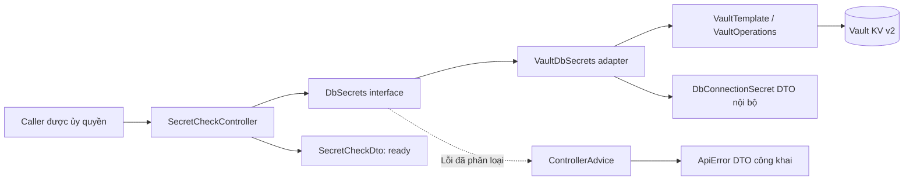

# Xây dựng dịch vụ truy cập secret với DTO và hợp đồng lỗi

Một ứng dụng Java sử dụng **Spring Vault** thường đọc secret từ **HashiCorp Vault** để kết nối database, gọi API nội bộ hoặc tạo cấu hình bảo mật. Gọi `VaultTemplate` thành công mới chỉ là bước đầu: ứng dụng còn phải kiểm tra schema, tạo **DTO nội bộ**, phân loại lỗi quyền/cấu hình/hạ tầng, định nghĩa **hợp đồng lỗi HTTP** nhất quán và bảo đảm không lộ dữ liệu nhạy cảm.

Bài thực hành tổng hợp trong module `SPRING_VAULT` xây dựng một dịch vụ đọc **KV v2** qua `VaultOperations`, với ba kết quả kiểm chứng: dữ liệu hợp lệ được ánh xạ đúng; lỗi được xử lý theo mã ổn định; và giá trị bí mật **không xuất hiện trong response API, log hoặc thông điệp lỗi**. Các nguyên tắc có thể mở rộng cho Transit, PKI và credential có lease nhưng không áp dụng chung quy tắc retry hay TTL cho mọi backend.

## 1. Bài toán và tiêu chí nghiệm thu

Giả định `order-api` cần đọc cấu hình database từ KV v2: mount `config`, path `app/runtime`, bốn field `db-host`, `db-port`, `db-username`, `db-password`. Ứng dụng đăng nhập Vault bằng danh tính workload có quyền đọc đúng path; không dùng root token.

Yêu cầu:

1. `DbSecrets.read()` trả **`DbConnectionSecret` nội bộ** sau khi kiểm tra đầy đủ các trường và port thuộc `[1, 65535]`.
2. Adapter chỉ gọi `opsForKeyValue("config", KV_2).get("app/runtime")`; không lặp lại `/data/` trong typed API.
3. Lỗi thiếu secret, thiếu trường, HTTP 403 hoặc lỗi mạng được phân loại; không biến mọi exception thành “secret không tồn tại”.
4. Controller minh họa chỉ trả `{"status":"ready"}`; **không xuất credential**.
5. HTTP lỗi trả `code`, `message`, `requestId` đã kiểm soát, không chứa token, Vault path, exception message hoặc raw body.
6. Có unit test, test hợp đồng API bằng MockMvc và ca thử với Vault thật, bao gồm token không có quyền.



**Phân tách đặc biệt quan trọng:** DTO chứa mật khẩu chỉ được đi vào những thành phần nội bộ có nhu cầu; DTO public là một **tập field cho phép**. DTO bất biến hoặc `record` không mặc nhiên an toàn để trả qua HTTP.

## 2. Chuẩn bị KV v2 và quyền truy cập

Ví dụ Bash với Vault lab riêng, quyền provisioning do quản trị viên test cấp. Mọi credential trong tài liệu đều là dữ liệu giả:

```bash
# Bật KV v2 nếu mount chưa tồn tại.
vault secrets enable -path=config -version=2 kv

vault kv put -mount=config app/runtime \
  db-host=db.test.internal db-port=5432 \
  db-username=demo_order db-password=example-only

# Đọc xác nhận bằng tài khoản provisioning ở môi trường lab.
vault kv get -mount=config app/runtime
```

Với KV v2, đừng nhầm ba dạng path:

| Thành phần | Ví dụ |
| --- | --- |
| Vault CLI | `vault kv get -mount=config app/runtime` |
| HTTP API | `GET /v1/config/data/app/runtime` |
| Policy HCL | `path "config/data/app/runtime"` |
| Spring Vault typed API | `opsForKeyValue("config", KV_2).get("app/runtime")` |

Policy chỉ cho phép workload đọc secret:

```hcl
path "config/data/app/runtime" {
  capabilities = ["read"]
}
```

Gắn policy này vào role **Kubernetes auth/AppRole** hoặc phương thức xác thực workload phù hợp; không dùng root token trong `order-api`. Với Vault Enterprise namespaces, cả policy, auth mount và request phải nằm trong **namespace đúng**. Namespace, mount và token là các chiều độc lập: path giống nhau trong hai namespace không nhất thiết là cùng secret.

Một cấu hình Spring Cloud Vault mẫu cho Kubernetes, khi ứng dụng có starter và auto-configuration tương ứng:

```yaml
spring:
  cloud:
    vault:
      uri: ${VAULT_ADDR}
      authentication: KUBERNETES
      kubernetes:
        role: order-api
        kubernetes-path: kubernetes
```

Cấu hình trên minh họa **cơ chế xác thực**, chưa bao gồm trust store, token reviewer/JWT audience, role binding hoặc network policy. Với `VaultTemplate` cấu hình thủ công, hãy dùng `ClientAuthentication` và `SessionManager` phù hợp; không commit token vào `application.yml`. Tránh bật log raw request/response của HTTP client.

## 3. Thiết kế ba DTO và mã lỗi nội bộ

Dịch vụ cần ba lớp dữ liệu khác nhau:

| Kiểu | Có bí mật? | Đối tượng sử dụng |
| --- | --- | --- |
| `DbConnectionSecret` | Có (`password`, có thể cả username) | Adapter/cấu hình database **nội bộ**. |
| `SecretCheckDto` | Không | HTTP thành công, chỉ xác nhận trạng thái. |
| `ApiError` | Không | HTTP thất bại theo contract ổn định. |

Ví dụ Java 17, đặt mỗi kiểu public trong file Java tương ứng:

```java
public record DbConnectionSecret(
        String host, int port, String username, String password) {
    @Override
    public String toString() {
        return "DbConnectionSecret[REDACTED]";
    }
}

public record SecretCheckDto(String status) {}

public record ApiError(String code, String message, String requestId) {}
```

Record mặc định in toàn bộ components trong `toString()`, nên cần override để giảm lỗi debug. **Tuy nhiên Jackson vẫn có thể serialize `password` khi controller trả record này**; `toString()` che giá trị không phải ranh giới bảo mật. Không dùng `DbConnectionSecret` làm REST DTO, log argument, MDC hoặc metric label. Kiểu `String` cũng có thể còn trong heap đến GC, vì vậy giới hạn nơi và thời gian giữ secret.

Thiết kế enum và exception nội bộ **không chứa raw cause** để tầng API không thể vô tình serialize Vault exception:

```java
public enum SecretFailure {
    SECRET_MISSING,
    SECRET_INVALID,
    VAULT_PERMISSION_FAILURE,
    VAULT_CONTRACT_FAILURE,
    VAULT_UNAVAILABLE
}

public final class SecretAccessException extends RuntimeException {
    private final SecretFailure failure;

    public SecretAccessException(SecretFailure failure) {
        super(failure.name());
        this.failure = failure;
    }

    public SecretFailure failure() {
        return failure;
    }
}

public interface DbSecrets {
    DbConnectionSecret read();
}
```

`failure` là mã vận hành nội bộ; các mã này **không cần lộ nguyên xi** cho caller HTTP. Nếu tổ chức có quy trình theo dõi exception cause bảo mật riêng, có thể giữ cause trong kênh tin cậy đã rà soát; ví dụ này ưu tiên ngăn rò rỉ khi framework tự log/serialize exception.

## 4. Bảng hợp đồng lỗi: nội bộ khác HTTP công khai

| Lỗi nội bộ | Tình huống | HTTP public đề xuất | Hành vi |
| --- | --- | --- | --- |
| `SECRET_MISSING` | `get()` không có secret/response | `500 INTERNAL_CONFIGURATION_ERROR` | Sửa dữ liệu/provisioning. |
| `SECRET_INVALID` | Thiếu field, port sai, loại dữ liệu sai | `500 INTERNAL_CONFIGURATION_ERROR` | Fail fast, không dùng DTO lỗi. |
| `VAULT_PERMISSION_FAILURE` | Workload token không có quyền (401/403 từ Vault) | `500 INTERNAL_CONFIGURATION_ERROR` | Sửa ACL/auth, không nâng quyền tự động. |
| `VAULT_CONTRACT_FAILURE` | Sai path/mount/API, request 400/404 khác | `500 INTERNAL_CONFIGURATION_ERROR` | Kiểm tra cấu hình và API version. |
| `VAULT_UNAVAILABLE` | Timeout, quota 429, upstream 5xx | `503 DEPENDENCY_UNAVAILABLE` | Bounded retry với read nếu còn deadline. |

Đây là **một lựa chọn contract mẫu**: có thể đổi public status cho phù hợp API thật, nhưng giữ tính nhất quán và không lộ secret. Không gửi HTTP `403` của **Vault ACL** thành HTTP 403 cho caller như thể principal của caller bị cấm; hai lớp quyền khác nhau.

Ví dụ lỗi cho client:

```json
{
  "code": "DEPENDENCY_UNAVAILABLE",
  "message": "Không thể hoàn tất thao tác lúc này",
  "requestId": "e8826337-a6e2-489e-b4b7-1d5ff3b5e744"
}
```

Không đưa `ex.getMessage()`, `X-Vault-Token`, `VaultResponse.getData()` hoặc path chứa tenant vào `ApiError`. `requestId` phải do server/gateway sinh và không chứa giá trị người dùng hay token.

## 5. Adapter truy cập Vault và ánh xạ DTO

`VaultDbSecrets` là **adapter duy nhất** phụ trách Vault KV, giới hạn log ở event code và scope alias cố định:

```java
import java.util.Map;
import org.slf4j.Logger;
import org.slf4j.LoggerFactory;
import org.springframework.stereotype.Service;
import org.springframework.vault.VaultException;
import org.springframework.vault.core.VaultOperations;
import org.springframework.vault.core.VaultKeyValueOperationsSupport.KeyValueBackend;
import org.springframework.vault.support.VaultResponse;
import org.springframework.web.client.RestClientException;
import org.springframework.web.client.RestClientResponseException;

@Service
public final class VaultDbSecrets implements DbSecrets {

    private static final Logger log =
            LoggerFactory.getLogger(VaultDbSecrets.class);
    private static final String SCOPE = "orders-config";
    private final VaultOperations vault;

    public VaultDbSecrets(VaultOperations vault) {
        this.vault = vault;
    }

    @Override
    public DbConnectionSecret read() {
        VaultResponse response;
        try {
            response = vault.opsForKeyValue("config", KeyValueBackend.KV_2)
                    .get("app/runtime");
        } catch (RuntimeException ex) {
            // Chỉ dịch lỗi từ Vault/HTTP, không nuốt mọi lỗi lập trình.
            if (!(ex instanceof VaultException)
                    && !(ex instanceof RestClientException)) {
                throw ex;
            }
            SecretFailure kind = classifyVaultFailure(ex);
            log.warn("event=vault_read_failed scope={} kind={}",
                    SCOPE, kind.name());
            throw new SecretAccessException(kind);
        }

        if (response == null || response.getData() == null) {
            return fail(SecretFailure.SECRET_MISSING);
        }

        try {
            Map<String, Object> data = response.getData();
            String host = require(data, "db-host");
            String username = require(data, "db-username");
            String password = require(data, "db-password");
            int port = Integer.parseInt(require(data, "db-port"));
            if (port < 1 || port > 65535) {
                return fail(SecretFailure.SECRET_INVALID);
            }

            log.info("event=vault_read_ok scope={}", SCOPE);
            return new DbConnectionSecret(host, port, username, password);
        } catch (IllegalArgumentException ex) {
            // Không ghi ex.getMessage() hoặc giá trị các field.
            return fail(SecretFailure.SECRET_INVALID);
        }
    }

    private static String require(Map<String, Object> data, String key) {
        Object value = data.get(key);
        if (!(value instanceof String text) || text.isBlank()) {
            throw new IllegalArgumentException("Invalid secret field");
        }
        return text;
    }

    private static SecretFailure classifyVaultFailure(Throwable error) {
        for (Throwable cause = error; cause != null;
                cause = cause.getCause()) {
            if (cause instanceof RestClientResponseException http) {
                int status = http.getStatusCode().value();
                if (status == 401 || status == 403) {
                    return SecretFailure.VAULT_PERMISSION_FAILURE;
                }
                if (status == 400 || status == 404) {
                    return SecretFailure.VAULT_CONTRACT_FAILURE;
                }
                if (status == 429 || status >= 500) {
                    return SecretFailure.VAULT_UNAVAILABLE;
                }
                return SecretFailure.VAULT_CONTRACT_FAILURE;
            }
        }
        return SecretFailure.VAULT_UNAVAILABLE;
    }

    private static <T> T fail(SecretFailure kind) {
        log.warn("event=vault_data_rejected scope={} kind={}",
                SCOPE, kind.name());
        throw new SecretAccessException(kind);
    }
}
```

Phần code xử lý rõ ràng các bước:

1. Dùng `VaultOperations` lâu dài; không tạo client/login lại mỗi lần gọi.
2. Typed KV v2 tự xử lý prefix `/data/`; key `"app/runtime"` là path tương đối.
3. Trường hợp `null` được phân biệt với Map sai schema.
4. Parse `db-port` từ chuỗi: dữ liệu provisioning của ví dụ được viết bằng Vault CLI. Nếu schema khác cho port kiểu `Number`, phải có parser cho phép kiểu đó rõ ràng.
5. Chỉ bắt `RuntimeException` quanh **lời gọi Vault** và nhận diện lỗi `VaultException`/`RestClientException`; lỗi Java khác không bị biến thành “Vault không sẵn sàng”.
6. `classifyVaultFailure` kiểm tra cause chain vì các bản Spring Vault/HTTP client có thể wrap exception khác nhau; không dựa vào chuỗi trong message.
7. Mọi log chỉ ghi `event`, `scope` và `kind`; không in `VaultResponse`, request headers, token hoặc password.

**Giới hạn của ví dụ:** nếu Spring Vault chuyển đổi exception HTTP mà không giữ mã status trong cause chain, một số lỗi sẽ được phân loại thành `VAULT_UNAVAILABLE`. Hãy kiểm tra exception thật từ phiên bản đang dùng và điều chỉnh adapter. Không coi `assertThrows(Exception.class)` là bằng chứng phân loại đúng.

## 6. Controller chỉ dùng service, không expose secret

Controller minh họa trả `SecretCheckDto`, **không có method trả `DbConnectionSecret`**:

```java
import org.springframework.web.bind.annotation.GetMapping;
import org.springframework.web.bind.annotation.RestController;

@RestController
public final class SecretCheckController {

    private final DbSecrets dbSecrets;

    public SecretCheckController(DbSecrets dbSecrets) {
        this.dbSecrets = dbSecrets;
    }

    @GetMapping("/internal/secret-check")
    public SecretCheckDto check() {
        dbSecrets.read(); // Không log hoặc serialize DTO nhạy cảm.
        return new SecretCheckDto("ready");
    }
}
```

Đây là endpoint demo nội bộ để kiểm chứng contract, cần Spring Security/network ACL nếu triển khai. Không gọi trực tiếp Vault trên mọi liveness/readiness probe ở production: nhiều pod có thể cùng tạo tải và tự restart liên tục khi Vault tạm lỗi. Với nghiệp vụ thật, DTO được truyền tới adapter kết nối DB nội bộ, có quản lý vòng đời credential/rotation và không xuất qua HTTP.

Nếu controller nhận namespace/mount/path từ caller, **phải có allowlist và authorization**; không ghép tùy ý giá trị của client để gọi Vault bằng token của `order-api`.

## 7. `@RestControllerAdvice`: một nơi quản lý lỗi API

```java
import java.util.UUID;
import org.springframework.http.HttpStatus;
import org.springframework.http.ResponseEntity;
import org.springframework.web.bind.annotation.ExceptionHandler;
import org.springframework.web.bind.annotation.RestControllerAdvice;

@RestControllerAdvice
public class SecretApiErrorAdvice {

    @ExceptionHandler(SecretAccessException.class)
    public ResponseEntity<ApiError> onSecretFailure(
            SecretAccessException exception) {

        boolean temporary =
                exception.failure() == SecretFailure.VAULT_UNAVAILABLE;

        HttpStatus httpStatus = temporary
                ? HttpStatus.SERVICE_UNAVAILABLE
                : HttpStatus.INTERNAL_SERVER_ERROR;
        String publicCode = temporary
                ? "DEPENDENCY_UNAVAILABLE"
                : "INTERNAL_CONFIGURATION_ERROR";

        return ResponseEntity.status(httpStatus).body(
                new ApiError(
                        publicCode,
                        "Không thể hoàn tất thao tác lúc này",
                        UUID.randomUUID().toString()));
    }
}
```

Không chuyển nguyên error body từ Vault sang client. Nếu một `VaultException` có message chứa path, SecretID hoặc token, tầng API vẫn chỉ nhìn thấy `SecretAccessException` với mã không nhạy cảm.

Trong hệ thống có distributed tracing, nên dùng **correlation ID hợp lệ** từ middleware thay vì tạo UUID mới ở nhiều tầng; kiểm tra độ dài/ký tự của ID do client gửi và không dùng token làm request ID. Nên có handler chung cho các exception khác, tắt stack trace mặc định trong REST error response, đồng thời bảo đảm lỗi xác thực/ủy quyền của người gọi được Spring Security xử lý độc lập.

## 8. Unit test DTO bằng Mockito và canary

Bộ test tạo password **giả** có dấu nhận diện `CANARY-...`. Dùng JUnit 5 và `OutputCaptureExtension` của Spring Boot Test để kiểm tra ứng dụng **vẫn log event an toàn** nhưng không log password.

```java
import static org.junit.jupiter.api.Assertions.*;
import static org.mockito.Mockito.*;

import java.util.Map;
import org.junit.jupiter.api.Test;
import org.junit.jupiter.api.extension.ExtendWith;
import org.springframework.boot.test.system.CapturedOutput;
import org.springframework.boot.test.system.OutputCaptureExtension;
import org.springframework.vault.core.VaultKeyValueOperations;
import org.springframework.vault.core.VaultOperations;
import org.springframework.vault.core.VaultKeyValueOperationsSupport.KeyValueBackend;
import org.springframework.vault.support.VaultResponse;

@ExtendWith(OutputCaptureExtension.class)
class VaultDbSecretsTest {

    private static final String CANARY = "CANARY-PASSWORD-DO-NOT-LOG";

    @Test
    void validKvMapsToDtoWithoutLeaking(CapturedOutput output) {
        VaultOperations vault = mock(VaultOperations.class);
        VaultKeyValueOperations kv = mock(VaultKeyValueOperations.class);
        VaultResponse response = mock(VaultResponse.class);

        when(vault.opsForKeyValue("config", KeyValueBackend.KV_2))
                .thenReturn(kv);
        when(kv.get("app/runtime")).thenReturn(response);
        when(response.getData()).thenReturn(Map.of(
                "db-host", "db.test.internal",
                "db-port", "5432",
                "db-username", "demo",
                "db-password", CANARY));

        DbConnectionSecret result = new VaultDbSecrets(vault).read();

        assertEquals("db.test.internal", result.host());
        assertEquals(5432, result.port());
        assertEquals(CANARY, result.password());
        assertFalse(result.toString().contains(CANARY));
        assertTrue(output.getAll().contains("event=vault_read_ok"));
        assertFalse(output.getAll().contains(CANARY));
        verify(kv).get("app/runtime");
    }

    @Test
    void invalidPortBecomesSafeError(CapturedOutput output) {
        VaultOperations vault = mock(VaultOperations.class);
        VaultKeyValueOperations kv = mock(VaultKeyValueOperations.class);
        VaultResponse response = mock(VaultResponse.class);

        when(vault.opsForKeyValue("config", KeyValueBackend.KV_2))
                .thenReturn(kv);
        when(kv.get("app/runtime")).thenReturn(response);
        when(response.getData()).thenReturn(Map.of(
                "db-host", "db.test.internal",
                "db-port", "99999",
                "db-username", "demo",
                "db-password", CANARY));

        SecretAccessException error = assertThrows(
                SecretAccessException.class,
                () -> new VaultDbSecrets(vault).read());

        assertEquals(SecretFailure.SECRET_INVALID, error.failure());
        assertNull(error.getCause());
        assertTrue(output.getAll().contains("event=vault_data_rejected"));
        assertFalse(output.getAll().contains(CANARY));
    }
}
```

Đừng chỉ kiểm tra `assertFalse(log.contains(CANARY))`: nếu nhánh đọc không chạy hoặc logger bị tắt, test vẫn có thể PASS giả. Cần **positive control** như `verify(kv).get(...)` và `event=vault_read_ok`. Với logging JSON/Logback tùy biến, kiểm tra cả formatted message, throwable và MDC sau khi serialize, không chỉ stdout.

## 9. Test hợp đồng HTTP bằng MockMvc

```java
import static org.junit.jupiter.api.Assertions.*;
import static org.mockito.Mockito.*;
import static org.springframework.test.web.servlet.request.MockMvcRequestBuilders.get;
import static org.springframework.test.web.servlet.result.MockMvcResultMatchers.*;

import org.junit.jupiter.api.Test;
import org.springframework.test.web.servlet.MockMvc;
import org.springframework.test.web.servlet.setup.MockMvcBuilders;

class SecretApiContractTest {

    @Test
    void successDoesNotReturnPassword() throws Exception {
        DbSecrets secrets = mock(DbSecrets.class);
        when(secrets.read()).thenReturn(
                new DbConnectionSecret("db.test", 5432, "demo",
                        "CANARY-PASSWORD-API-TEST"));

        MockMvc mvc = MockMvcBuilders
                .standaloneSetup(new SecretCheckController(secrets))
                .setControllerAdvice(new SecretApiErrorAdvice())
                .build();

        String body = mvc.perform(get("/internal/secret-check"))
                .andExpect(status().isOk())
                .andExpect(jsonPath("$.status").value("ready"))
                .andReturn().getResponse().getContentAsString();

        assertFalse(body.contains("CANARY-PASSWORD-API-TEST"));
        assertFalse(body.contains("db.test"));
        verify(secrets).read();
    }

    @Test
    void dependencyFailureHasStableErrorContract() throws Exception {
        DbSecrets secrets = mock(DbSecrets.class);
        when(secrets.read()).thenThrow(
                new SecretAccessException(SecretFailure.VAULT_UNAVAILABLE));

        MockMvc mvc = MockMvcBuilders
                .standaloneSetup(new SecretCheckController(secrets))
                .setControllerAdvice(new SecretApiErrorAdvice())
                .build();

        String body = mvc.perform(get("/internal/secret-check"))
                .andExpect(status().isServiceUnavailable())
                .andExpect(jsonPath("$.code")
                        .value("DEPENDENCY_UNAVAILABLE"))
                .andExpect(jsonPath("$.requestId").isNotEmpty())
                .andReturn().getResponse().getContentAsString();

        assertFalse(body.contains("X-Vault-Token"));
        assertFalse(body.contains("config/data/app/runtime"));
        assertFalse(body.contains("VaultException"));
    }
}
```

Bổ sung test cho `SECRET_MISSING` và `SECRET_INVALID` trả HTTP 500 với `INTERNAL_CONFIGURATION_ERROR`, có đúng field cho phép. `MockMvcBuilders.standaloneSetup` **không tự bật Spring Security**, nên cần test riêng với filter chain thật để xác nhận endpoint nội bộ bị từ chối khi caller không có quyền.

## 10. Integration test trên Vault test thật

Unit test có mock không thể xác nhận `VaultTemplate`, TLS, authentication hoặc chính sách thật hoạt động. Chuẩn bị Vault dev/Testcontainers hoặc cụm thử nghiệm biệt lập, cùng hai danh tính:

- **Reader:** có policy `read` trên `config/data/app/runtime`.
- **Denied:** không có quyền `read` trên path đó, nhưng vẫn đăng nhập thành công.

Không sử dụng root token để chạy ca 403. Các bước: provision KV, chạy reader thành công, đổi field để test validation, chạy denied, thử sai path/mount, mô phỏng timeout rồi khôi phục và chạy lại positive control. Không đưa token hoặc password thật vào log/CI.

| Test | Hành động | Kỳ vọng |
| --- | --- | --- |
| I01 | Reader đọc KV đúng schema | DTO đúng, không có secret trong application log. |
| I02 | KV không tồn tại | `SECRET_MISSING` hoặc lỗi contract theo hành vi thư viện được xác minh. |
| I03 | Thiếu password | `SECRET_INVALID`; không tạo DTO. |
| I04 | Port `0`, `65536`, không phải số | `SECRET_INVALID`. |
| I05 | Denied identity gọi path hợp lệ | Bị từ chối do ACL, không phải vì mạng lỗi. |
| I06 | Sai KV v1/v2 hoặc mount | Không fallback sang mount khác. |
| I07 | Vault trả 429/5xx hoặc timeout | Lỗi dependency; retry read có giới hạn nếu được triển khai. |
| I08 | Token hết hạn/renewal lỗi | Phân biệt session lifecycle và dữ liệu KV thiếu. |
| I09 | API thành công | Chỉ có `status`; không có `password`. |
| I10 | API lỗi | Chỉ có `code`, `message`, `requestId` đã duyệt. |
| I11 | Logs và CI output | Không có canary thô, Base64 hay raw body. |
| I12 | Nhiều namespace/identity | Không trộn token, cache hoặc DTO từ miền khác. |

**Sai lầm thường gặp:** test âm PASS vì có bất kỳ exception nào. Nếu request chưa tới Vault do DNS/TLS lỗi, không thể kết luận ACL đã từ chối. Mỗi ca âm cần một **positive control** chứng minh đúng endpoint/client và danh tính test hoạt động.

## 11. Xử lý retry, rotation và các secrets engine khác

Đối với thao tác **đọc KV**, có thể retry có giới hạn cho lỗi mạng/5xx/429 với exponential backoff + jitter, timeout từng request và tổng deadline. Với `400`, `403`, thiếu field hoặc path sai, retry vô hạn chỉ tăng tải mà không sửa được cấu hình. `429` của `/sys/health` có nghĩa standby mặc định, không nên áp quy tắc quota cho mọi endpoint.

Dịch vụ trong bài **không tự cache/rotate credential**. Nếu database password thay đổi, object đã đưa vào connection pool vẫn có thể chứa giá trị cũ; cần cơ chế làm mới pool và triển khai rotation an toàn. Nếu chuyển sang **dynamic database credential**, phải quản lý `lease_id`, TTL, renew/revoke qua cơ chế phù hợp; DTO không được dùng quá hiệu lực của credential.

Phần mở rộng theo backend:

| Backend | Kiểu dữ liệu nội bộ | Lưu ý đặc thù |
| --- | --- | --- |
| KV v2 | DTO đã validate | Path `/data/`, version, deleted/destroyed, quyền read. |
| Transit | Ciphertext/đầu vào Base64 | `context`, derived key, không log plaintext; lỗi sai key không retry mù. |
| PKI | Certificate/key material DTO | `notAfter`, private key, role policy, reload TLS và renewal. |
| Database dynamic secrets | Credential + lease metadata | Lease TTL, revoke, consumer update. |
| Response wrapping | One-time wrapped response | `unwrap` tiêu thụ token; timeout không đồng nghĩa an toàn retry. |

Đừng mở rộng adapter bằng cách nhận `mount`, `namespace`, `path` từ HTTP client rồi gọi Vault bằng token quyền rộng. Thay vào đó ánh xạ **một nghiệp vụ đã ủy quyền → một Vault scope cố định**.

## 12. Quan sát và bảo vệ dữ liệu

Một event nội bộ hợp lý:

```text
event=vault_read_failed
scope=orders-config
kind=VAULT_PERMISSION_FAILURE
operation=kv_v2_read
duration_ms=42
request_id=req-generated-42
```

Các giá trị này là metadata có kiểm soát, không chứa `ex.getMessage()` hoặc response. Với structured logging/APM, kiểm tra cả MDC và span attributes. Không đưa password, `X-Vault-Token`, SecretID, ciphertext, `VaultResponse`, lease credential hoặc path chứa PII vào log/metrics.

Bảo vệ theo nhiều lớp: xác thực workload + Vault ACL tối thiểu, HTTPS/TLS xác minh CA, Spring Security cho endpoint, DTO nội bộ không serialize, HTTP error schema allowlist, timeout/retry có giới hạn và retention/đường truy cập log được kiểm soát. Kiểm thử endpoint Actuator và proxy tracing vì rò rỉ có thể xảy ra ngoài logger của service.

## 13. Checklist hoàn thành

- [ ] Mount/namespace/auth role/policy được provision đúng; workload đọc được nhưng token thử không có quyền bị từ chối.
- [ ] Adapter dùng typed KV v2 và trả DTO sau kiểm tra field/port; không truyền raw Map ra controller.
- [ ] DTO chứa credential được dùng nội bộ, `toString` đã che và API không serialize DTO đó.
- [ ] Error contract HTTP có `code/message/requestId` ổn định, không có Vault payload hoặc stack trace.
- [ ] Phân biệt thiếu/sai dữ liệu, thiếu quyền Vault và lỗi tạm thời; không tự nâng quyền hoặc thử path khác.
- [ ] JUnit/Mockito/MockMvc và integration test có positive control; canary không xuất trong log/response.
- [ ] Token/lease lifecycle, ACL, TTL, rotation và readiness được đánh giá trước khi dùng trong production.

**Câu hỏi ôn tập:** Vì sao DTO chứa password không được trả HTTP dù `toString` redacted? KV v2 có sự khác nhau nào giữa CLI path, API path và typed Spring Vault path? Vì sao HTTP 403 của Vault không nhất thiết là 403 của caller? Khi `read()` trả null, thiếu `db-password` hoặc gặp timeout thì service phải xử lý ra sao? Khi quyền Vault bị thu hồi, cache hoặc connection pool đã giữ secret cũ có tự cập nhật không?

**Tiêu chí đạt:** có thể thiết kế dịch vụ truy cập KV với DTO nội bộ an toàn, phân loại lỗi thành hợp đồng HTTP, kiểm thử bằng dữ liệu giả và xác minh **không lộ secret** trên cả đường thành công lẫn đường thất bại.

## Tài liệu tham khảo

- Spring Vault — [VaultTemplate](https://docs.spring.io/spring-vault/reference/vault/imperative-template.html), [KV Secrets](https://docs.spring.io/spring-vault/reference/vault/vault-key-value.html) và [Authentication](https://docs.spring.io/spring-vault/reference/vault/authentication.html).
- HashiCorp Vault — [KV v2 API](https://developer.hashicorp.com/vault/api-docs/secret/kv/kv-v2), [Policies](https://developer.hashicorp.com/vault/docs/concepts/policies).
- Spring Framework — [MockMvc](https://docs.spring.io/spring-framework/reference/testing/mockmvc.html) và [Exception Handling](https://docs.spring.io/spring-framework/reference/web/webmvc/mvc-controller/ann-exceptionhandler.html).
- Spring Boot — [OutputCaptureExtension](https://docs.spring.io/spring-boot/api/java/org/springframework/boot/test/system/OutputCaptureExtension.html).
