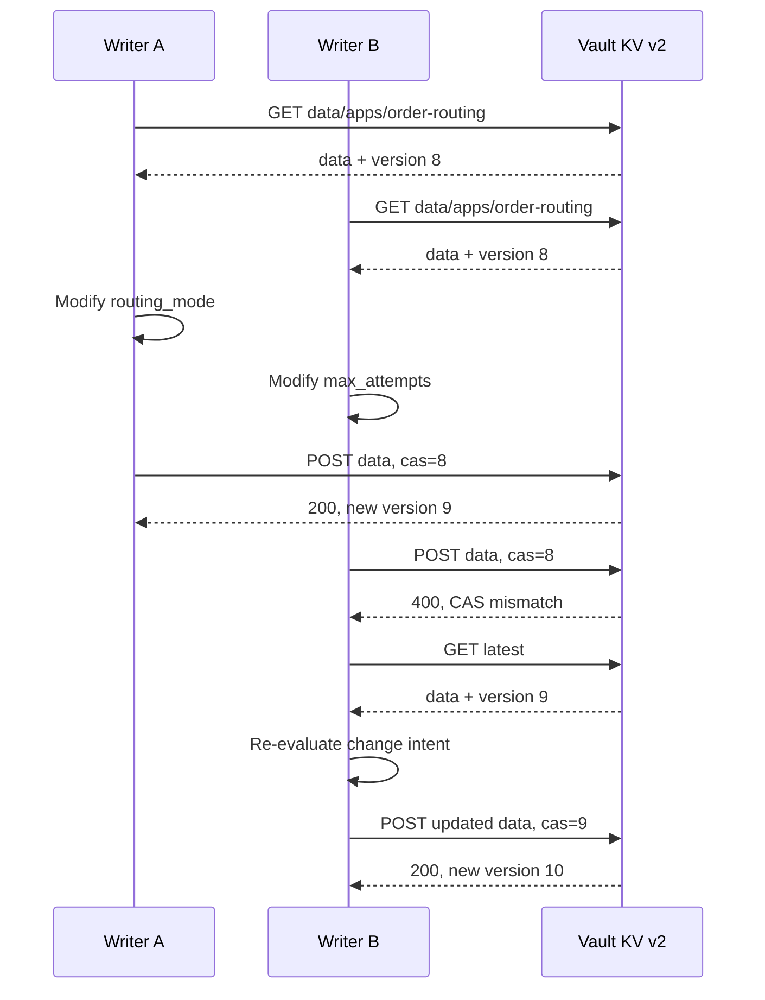

# Quản lý KV có phiên bản cùng cập nhật cạnh tranh

Giả sử hai instance của một ứng dụng Spring Boot cùng sửa cấu hình trong HashiCorp Vault. Instance A đọc cấu hình hiện tại rồi đổi `routing_mode` sang `safe`; instance B cũng đọc cùng bản cấu hình đó nhưng đổi `max_attempts` từ `3` thành `5`. Nếu cả hai ghi lại toàn bộ tài liệu mà không kiểm tra version, lần ghi sau có thể **vô tình xóa thay đổi của lần ghi trước**. Đây là lỗi *lost update* điển hình.

Trong chương **Thực hành tổng hợp** của module `SPRING_VAULT`, bài thực hành này sử dụng **Spring Vault**, `VaultTemplate`/`VaultOperations` và **KV secrets engine phiên bản 2 (KV v2)** để triển khai cơ chế **optimistic concurrency control bằng Check-and-Set (CAS)**. Bài cũng thực hành đọc lịch sử version, xử lý xung đột, kiểm tra quyền Vault, vận hành token và quan sát lỗi mà không cần đưa bí mật thật vào code hoặc log.

> **Kết quả cần đạt:** Mỗi lần cập nhật dữ liệu đang tồn tại phải dựa trên **version hiện hành mà client đã đọc**. Nếu có client khác đã ghi trong lúc chờ, Vault từ chối cập nhật cũ; ứng dụng không được lặng lẽ ghi đè dữ liệu của người khác.

Các giá trị trong bài như `routing_mode`, `max_attempts`, `FAKE_ONLY_...` đều là dữ liệu thử nghiệm. Chỉ thao tác trên Vault dev/lab, mount và token riêng; **không chạy lệnh đổi metadata/overwrite/destroy trên Vault production**.

## 1. Bài toán: hai người sửa cùng một KV key

Ứng dụng `order-router` quản lý một document tại KV v2:

```text
Vault mount: secret/                 (KV v2)
Relative key: apps/order-routing
HTTP endpoint: /v1/secret/data/apps/order-routing
```

Payload ban đầu:

```json
{
  "routing_mode": "normal",
  "max_attempts": 3,
  "owner": "orders-team",
  "audit_note": "FAKE_ONLY_INITIAL_CONFIGURATION"
}
```

Đây là **một document có nhiều field** chứ không phải một giá trị đơn. Tại version `8`, hai tiến trình làm việc đồng thời:

| Thời điểm | Writer A | Writer B | Vault |
|---|---|---|---|
| t0 | Đọc version 8 | Đọc version 8 | `routing_mode=normal`, `max_attempts=3` |
| t1 | Thay `routing_mode=safe` ở bản local | Thay `max_attempts=5` ở bản local | Version vẫn 8 |
| t2 | Ghi toàn bộ document dựa trên version 8 | — | Tạo version 9 |
| t3 | — | Ghi toàn bộ document dựa trên version 8 | **Từ chối do CAS không khớp** |
| t4 | — | Đọc lại version 9, tính thay đổi phù hợp | Chưa có version 10 |
| t5 | — | Ghi lại với CAS version 9 | Tạo version 10, giữ được cả hai thay đổi |

Không có CAS, ở t3 B có thể ghi một document chứa `routing_mode=normal` từ bản đọc cũ, khiến thay đổi `safe` của A bị mất dù B chỉ muốn sửa `max_attempts`.

### Vì sao KV v2 phù hợp?

KV v2 có hai tính năng liên quan nhưng **không đồng nghĩa**:

- **Versioning:** mỗi lần ghi thành công tạo một version mới; có thể xem metadata và đọc version cũ nếu version đó còn được giữ lại, chưa bị destroy hoặc xóa theo chính sách lưu trữ.
- **CAS (Check-and-Set):** chỉ chấp nhận yêu cầu ghi nếu số version trong yêu cầu **khớp current version ở server**. Đây là cơ chế phòng ngừa xung đột trước khi mất dữ liệu.

**Version history không tự ngăn lost update.** Nếu không bật và sử dụng CAS, lịch sử có thể ghi nhận cả các bản bị ghi đè nhầm. Muốn ngăn ngay tại thời điểm ghi, client phải gửi điều kiện CAS.

## 2. Hiểu chính xác quy tắc `cas` của Vault KV v2

API ghi của KV v2:

```http
POST /v1/secret/data/apps/order-routing
X-Vault-Token: <workload-token>
Content-Type: application/json

{
  "options": { "cas": 8 },
  "data": {
    "routing_mode": "safe",
    "max_attempts": 3,
    "owner": "orders-team",
    "audit_note": "FAKE_ONLY_CHANGE_A"
  }
}
```

`options.cas` là **version mong đợi tại thời điểm ghi**. Nó không phải version bạn muốn Vault tạo.

| Giá trị `cas` | Vault kiểm tra | Tình huống |
|---|---|---|
| `0` | Key **chưa có version nào** | Tạo key mới theo kiểu *create-only* |
| `N > 0` | Current version của key đúng bằng `N` | Cập nhật theo snapshot đã đọc |
| Không gửi `cas` | Ghi không có kiểm tra version **nếu** CAS không bị bắt buộc | Nguy cơ lost update |
| Không gửi `cas` khi `cas_required=true` | Vault từ chối write | Ép tất cả writer tuân thủ CAS |
| Gửi `cas` cũ | Vault từ chối write, thường HTTP `400` với thông điệp CAS mismatch | Bắt conflict, đọc lại và xử lý |

**Không nhầm:**

1. `cas=0` có nghĩa **chỉ ghi nếu key chưa từng có version**, không có nghĩa "hãy ghi đè bất kỳ version nào".
2. Khi current version là `9`, writer đọc bản cũ version `8` phải gửi `cas=8` và sẽ bị từ chối. Không được tự tăng `cas=9` nếu chưa đọc lại document tương ứng.
3. Soft delete **không xóa metadata/version counter**. Một key có latest version bị soft delete có thể đọc như "không thấy dữ liệu", nhưng `cas=0` vẫn không hợp lệ vì key đã có lịch sử.
4. `cas_required` có thể cấu hình ở **mount** hoặc **từng key**, nên không nên mặc định mọi môi trường cho phép write không CAS.
5. CAS của KV v2 kiểm soát **một key**, không tạo transaction nguyên tử trên nhiều KV keys hay qua database/API bên ngoài.

Theo API, `POST /data/...` ghi **toàn bộ map `data` của version mới**. Không coi lệnh `put` như JSON Merge Patch chỉ cập nhật vài field. Nếu chỉ gửi `max_attempts`, những field cũ khác có thể không còn trong version mới.

## 3. Mô hình luồng đọc–sửa–ghi an toàn



Nếu sau khi B đọc lại version 9, người dùng thực ra muốn **thay thế toàn bộ cấu hình** chứ không phải đổi riêng `max_attempts`, không được merge tự động. Hãy trả về conflict cho client hoặc yêu cầu xác nhận lại. Trong bài lab, mục đích thay đổi của A/B nằm trên **các field độc lập**, nên B có thể merge theo quy tắc nghiệp vụ đã định.

**CAS là biện pháp bảo vệ cuối cùng ở server.** Bất cứ xử lý nghiệp vụ nào diễn ra trước lệnh ghi (đọc, validate, tính payload) vẫn cần đủ tính nhất quán và không tự ý dùng dữ liệu đã stale.

## 4. Chuẩn bị Vault thử nghiệm

Các bước bên dưới giả định:

- Có một **Vault dev/test** với KV v2 mount tại `secret/`.
- Có quyền phù hợp để tạo dữ liệu và thay metadata trong môi trường lab.
- CLI `vault` đã trỏ vào đúng `VAULT_ADDR` lab và xác thực bằng token test.
- Key `apps/order-routing` **chưa tồn tại**; nếu trùng, chọn một path lab mới thay vì xóa metadata của người khác.
- Máy chạy lệnh không ghi stdout chứa secret thật lên artifact dùng chung.

### 4.1. Kiểm tra mount và cấu hình KV v2

Operator trên Vault lab có thể kiểm tra:

```bash
# Xem mount hiện tại; tránh in chi tiết cấu hình auth nhạy cảm.
vault secrets list -detailed

# Trên KV v2, đây là cấu hình engine.
vault read secret/config
```

Với mount `secret`, Vault phải báo type `kv` và version `2`. Nếu là KV v1, API `data/`, `metadata/` và CAS **không áp dụng** như bài này. Không tự chuyển KV v1 production sang v2 khi không có kế hoạch migration.

### 4.2. Bật yêu cầu CAS ở **key lab**

Trong môi trường thử nghiệm, tránh thay đổi `secret/config` toàn mount nếu những team khác đang dùng:

```bash
# Tạo/cập nhật metadata chỉ cho key demo, yêu cầu mọi write gửi cas.
vault kv metadata put -mount=secret \
  -cas-required=true \
  apps/order-routing

# Đối chiếu current_version và cas_required.
vault kv metadata get -mount=secret apps/order-routing
```

`vault kv metadata put` có thể **tạo metadata ngay cả khi chưa có data version**. Đây vẫn là một key mới ở góc độ dữ liệu; khi lần đầu tạo version 1, sử dụng CAS 0. Điều kiện CAS được cấu hình ở server để cả lệnh của người vận hành và mọi ứng dụng đều phải tôn trọng.

### 4.3. Tạo version đầu bằng `cas=0`

```bash
vault kv put -mount=secret -cas=0 apps/order-routing \
  routing_mode=normal \
  max_attempts=3 \
  owner=orders-team \
  audit_note=FAKE_ONLY_INITIAL_CONFIGURATION

vault kv get -mount=secret apps/order-routing
```

Kết quả mong đợi: version `1`, đầy đủ các field. **CLI `vault kv put` thường chuyển giá trị nhập từ tham số thành chuỗi**, nên `max_attempts=3` có thể được lưu thành JSON string `"3"` thay vì integer `3`. Các ví dụ Java sau đây sử dụng số nguyên thật; muốn lab nhất quán về kiểu dữ liệu, có thể ghi bằng JSON qua HTTP API/Spring Vault thay cho CLI hoặc dùng cấu trúc thích hợp.

Gửi lại đúng lệnh `-cas=0` khi key đã có version phải bị từ chối. Đây là kiểm tra đơn giản nhất chứng minh điều kiện *create-only* hoạt động.

### 4.4. Đọc dữ liệu và lịch sử

```bash
vault kv get -mount=secret apps/order-routing

# Chỉ định version, thay số 1 bằng version đã tồn tại.
vault kv get -mount=secret -version=1 apps/order-routing

vault kv metadata get -mount=secret apps/order-routing
```

Đối chiếu `current_version`, `oldest_version`, `max_versions`, `cas_required` và trạng thái các version. Nếu cấu hình giới hạn số version giữ lại, những bản cũ có thể đã bị dọn khỏi lưu trữ; **versioning không có nghĩa giữ vô hạn**.

## 5. Thử xung đột cạnh tranh bằng hai terminal

Sau bước 4, giả định key ở version `1`. Nếu khác, đọc version mới và thay các số CAS cho đúng.

**Terminal A** và **Terminal B** đều đọc version 1:

```bash
# Thực hiện trong cả hai terminal trước khi có writer nào ghi.
vault kv get -mount=secret apps/order-routing
```

Ở A, cập nhật `routing_mode` và gửi **đầy đủ dữ liệu**:

```bash
# Terminal A: thành công nếu current_version vẫn là 1.
vault kv put -mount=secret -cas=1 apps/order-routing \
  routing_mode=safe \
  max_attempts=3 \
  owner=orders-team \
  audit_note=FAKE_ONLY_CHANGE_A
```

Vault tạo version `2`. B cũng dùng snapshot cũ version 1, chỉ muốn tăng `max_attempts`:

```bash
# Terminal B: phải thất bại do -cas=1 đã stale.
vault kv put -mount=secret -cas=1 apps/order-routing \
  routing_mode=normal \
  max_attempts=5 \
  owner=orders-team \
  audit_note=FAKE_ONLY_CHANGE_B
```

**Kết quả B mong đợi:** Vault trả lỗi không khớp CAS (thường HTTP `400`). Phiên bản mới **không** được tạo từ lần ghi thất bại. Kiểm tra lại:

```bash
vault kv get -mount=secret apps/order-routing
vault kv metadata get -mount=secret apps/order-routing
```

Current version vẫn là `2`, `routing_mode=safe`. B đọc lại version 2 rồi kết hợp hai thay đổi theo nghiệp vụ, dùng CAS 2:

```bash
# Terminal B sau khi đọc lại và quyết định merge hợp lệ.
vault kv put -mount=secret -cas=2 apps/order-routing \
  routing_mode=safe \
  max_attempts=5 \
  owner=orders-team \
  audit_note=FAKE_ONLY_MERGED_CHANGE
```

Vault tạo version `3`. Bây giờ có thể đọc `-version=1`, `-version=2`, `-version=3` để đối chiếu nội dung, nếu retention cho phép.

**Kết luận thí nghiệm:** CAS **không tự merge**. Nó chỉ ngăn ghi đè khi version đã thay đổi. Chính ứng dụng phải xác định điều gì được merge, điều gì phải trả conflict và thời điểm nào cần người dùng xác nhận lại.

## 6. Spring Vault: chọn đúng operations cho KV v2

Không cần tự ghép JSON `data.data` khi đã có `VaultVersionedKeyValueOperations`:

```java
import org.springframework.vault.core.VaultOperations;
import org.springframework.vault.core.VaultVersionedKeyValueOperations;

// VaultOperations bean đã được cấu hình xác thực theo workload.
VaultVersionedKeyValueOperations kv =
        vaultOperations.opsForVersionedKeyValue("secret");
```

Path của operations này là **tương đối với mount**, ví dụ `apps/order-routing`. Spring Vault thêm `data/`/`metadata/` tương ứng endpoint KV v2. Không truyền `secret/data/apps/order-routing` vào `kv.get(...)`: làm vậy sẽ nhân đôi path và sai kết quả.

### 6.1. Ba kiểu dữ liệu Spring Vault dùng

| Kiểu Java | Ý nghĩa | API |
|---|---|---|
| `Versioned<T>` | Data `T` cộng version/metadata gắn với bản secret | `kv.get(path, T.class)` hoặc `Versioned.create(...)` |
| `Versioned.Version` | Số version, ví dụ `Version.from(8)` | `getVersion()`; dùng làm kỳ vọng CAS |
| `Versioned.Metadata` | Metadata của version đọc/ghi, có version, timestamps/trạng thái | `kv.put(path, ...)` trả về |
| `VaultVersionedKeyValueOperations` | API KV v2 đọc, ghi, delete/undelete/destroy có version | `vault.opsForVersionedKeyValue(mount)` |
| `VaultKeyValueMetadataOperations` | API metadata của key, retention và cấu hình CAS | `kv.opsForKeyValueMetadata()` |

**Chú ý:** `VaultKeyValueOperations` có thể thao tác KV v2 nhưng **không cung cấp CAS theo cách `VaultVersionedKeyValueOperations` hỗ trợ**. Để bảo vệ read-modify-write, chọn interface versioned và truyền `Versioned<T>` cho lệnh `put`.

### 6.2. Đọc current version qua API Java

```java
import java.util.Map;
import java.util.Objects;

import org.springframework.vault.core.VaultOperations;
import org.springframework.vault.core.VaultVersionedKeyValueOperations;
import org.springframework.vault.support.Versioned;

class KvVersionReader {
    private final VaultVersionedKeyValueOperations kv;

    KvVersionReader(VaultOperations vault) {
        this.kv = vault.opsForVersionedKeyValue("secret");
    }

    Versioned<Map<String, Object>> readLatest() {
        Versioned<Map<String, Object>> current =
                Objects.requireNonNull(
                        kv.get("apps/order-routing"),
                        "KV v2 secret is absent or unreadable"
                );
        Objects.requireNonNull(
                current.getData(), "KV v2 version has no readable data"
        );
        return current;
    }
}
```

Khi key chưa tồn tại, hoặc version mới nhất đã soft delete/destroy, `get` có thể không trả data đọc được. Không coi điều này đồng nghĩa chắc chắn `current_version=0`; phải phân biệt "key chưa bao giờ được tạo" với "key có metadata nhưng latest đã bị xóa".

## 7. Code Java: cập nhật cạnh tranh an toàn bằng CAS

Giả sử yêu cầu nghiệp vụ chỉ thay đổi **`routing_mode`**, giữ nguyên các field khác, và caller gửi `expectedMode` là giá trị client nghĩ đang hiện hành. Adapter sẽ:

1. Đọc phiên bản mới nhất.
2. Xác minh payload là document hợp lệ.
3. Kiểm tra `routing_mode` hiện tại đúng bằng `expectedMode`.
4. Sao chép toàn bộ map và chỉ thay `routing_mode`.
5. Ghi bằng `Versioned.create(newData, current.getVersion())`.
6. Nhận metadata của version mới nếu Vault chấp nhận.

```java
import java.util.LinkedHashMap;
import java.util.Map;
import java.util.Objects;
import java.util.Set;

import org.springframework.vault.core.VaultOperations;
import org.springframework.vault.core.VaultVersionedKeyValueOperations;
import org.springframework.vault.support.Versioned;

public final class OrderRoutingConfigService {

    static final String KEY = "apps/order-routing";
    private static final Set<String> ALLOWED_MODES =
            Set.of("normal", "safe", "disabled");

    private final VaultVersionedKeyValueOperations kv;

    public OrderRoutingConfigService(VaultOperations vault) {
        this.kv = vault.opsForVersionedKeyValue("secret");
    }

    public int changeRoutingMode(
            String expectedMode, String requestedMode) {

        if (!ALLOWED_MODES.contains(requestedMode)) {
            throw new IllegalArgumentException("Unsupported routing mode");
        }

        Versioned<Map<String, Object>> current =
                Objects.requireNonNull(
                        kv.get(KEY), "Routing configuration unavailable"
                );
        Map<String, Object> oldData = Objects.requireNonNull(
                current.getData(), "Current KV version has no data"
        );

        Object mode = oldData.get("routing_mode");
        if (!(mode instanceof String actualMode)) {
            throw new IllegalStateException(
                    "Invalid routing configuration schema"
            );
        }
        if (!Objects.equals(actualMode, expectedMode)) {
            throw new IllegalStateException(
                    "Business precondition no longer holds"
            );
        }

        // PUT tạo document version mới: phải giữ các field chưa sửa.
        Map<String, Object> updated = new LinkedHashMap<>(oldData);
        updated.put("routing_mode", requestedMode);
        updated.put("audit_note", "FAKE_ONLY_CHANGE_FROM_APP");

        // Bước quan trọng: gửi expected KV version, không gửi plain Map.
        Versioned<Map<String, Object>> writeWithCas =
                Versioned.create(updated, current.getVersion());

        Versioned.Metadata written = kv.put(KEY, writeWithCas);
        return written.getVersion().getVersion();
    }
}
```

Giả sử lời gọi đọc version `8`:

```java
Versioned<Map<String, Object>> current = kv.get("apps/order-routing");
int expectedVersion = current.getVersion().getVersion(); // 8

Map<String, Object> updated = new LinkedHashMap<>(current.getData());
updated.put("routing_mode", "safe");

// Đúng: nhúng expected version trong Versioned.
kv.put("apps/order-routing",
    Versioned.create(updated, current.getVersion()));
```

Trong hai đoạn trên, lệnh `put` **không phải một transaction của database ứng dụng**. Nó chỉ bảo đảm atomic version check + write trên **một** KV key tại Vault. Nếu trước khi gọi `put` bạn đã thanh toán, gửi email hoặc ghi database, một CAS conflict xảy ra sau đó không tự rollback các thao tác ngoài Vault.

### 7.1. Các cách viết sai nguy hiểm

```java
// SAI với yêu cầu tránh lost update:
kv.put("apps/order-routing", updated);     // Không kèm expected version.

// SAI: tự đoán currentVersion đã tăng mà chưa đọc lại payload.
kv.put("apps/order-routing",
    Versioned.create(updated, Versioned.Version.from(9)));

// SAI: ghi partial map bằng PUT có thể đánh mất field khác.
kv.put("apps/order-routing", Map.of("max_attempts", 5));
```

Nếu `cas_required=true`, hai lệnh plain Map có thể **bị Vault từ chối** thay vì ghi đè. Đó là ưu điểm của policy engine. Tuy nhiên code vẫn sai về ý định concurrency và sẽ không hoạt động trong môi trường bật CAS.

### 7.2. Khi nghiệp vụ cần người dùng tự giải quyết xung đột

Mỗi editor đọc data/version ở thời điểm riêng. Nếu cả hai muốn sửa **cùng field**, automatic merge có thể làm mất ý định của một người. API ứng dụng có thể nhận request như:

```json
{
  "expectedVersion": 8,
  "change": {
    "routing_mode": "safe"
  }
}
```

Nếu server phát hiện version hiện tại không còn là `8`, trả **HTTP 409 Conflict** từ API nghiệp vụ với mã lỗi cố định, ví dụ `CONFIG_VERSION_CONFLICT`. Không trả response Vault thô hoặc secret data/metadata toàn phần cho caller.

**Phân biệt HTTP status:** Vault KV v2 có thể phản hồi **HTTP 400** cho CAS mismatch; lớp API của ứng dụng **có thể ánh xạ riêng** tình huống này sang HTTP 409. Không tuyên bố Vault bản thân luôn dùng HTTP 409.

## 8. Khởi tạo key mới bằng CAS 0

Muốn bảo đảm thao tác *create-if-absent* không ghi đè key của một instance khác:

```java
import java.util.LinkedHashMap;
import java.util.Map;
import org.springframework.vault.support.Versioned;

Map<String, Object> initial = new LinkedHashMap<>();
initial.put("routing_mode", "normal");
initial.put("max_attempts", 3);
initial.put("owner", "orders-team");
initial.put("audit_note", "FAKE_ONLY_CREATED_FROM_APP");

Versioned<Map<String, Object>> createOnly =
        Versioned.create(initial, Versioned.Version.from(0));

Versioned.Metadata result =
        kv.put("apps/order-routing", createOnly);
```

Ở đây `Versioned.Version.from(0)` biểu thị **CAS 0 trong thao tác ghi**. Nếu key đã có version, Vault từ chối. Đừng thay `Versioned.Version.from(0)` bằng `Versioned.create(initial)` rồi kết luận server sẽ tự hiểu *create-only*: dạng không kèm version có semantics khác và có thể bị từ chối khi bật CAS required.

**Một chi tiết quan trọng:** Nếu key đã tồn tại, latest version đã bị soft delete và `kv.get(path)` trả thiếu data, không được lập tức gọi create-only. Hãy kiểm tra metadata hiện hữu theo quyền cho phép hoặc xử lý như trường hợp xóa có chủ đích; CAS 0 không phải công cụ hồi sinh key cũ.

## 9. Đọc một version cụ thể và quản lý lịch sử

Spring Vault cho phép chọn version cụ thể để xem lại thay đổi:

```java
import java.util.Map;
import org.springframework.vault.support.Versioned;

Versioned<Map<String, Object>> oldSnapshot = kv.get(
    "apps/order-routing",
    Versioned.Version.from(2)
);

if (oldSnapshot == null || oldSnapshot.getData() == null) {
    throw new IllegalStateException(
        "Requested historical version cannot be read"
    );
}
```

Đọc bản cũ phù hợp cho **audit/đối chiếu và hỗ trợ vận hành**, nếu policy và retention cho phép. Tuy nhiên, không dùng version cũ làm CAS cho một lệnh cập nhật nếu current version đã cao hơn.

Muốn tạo một version mới mang nội dung cũ (*restore by copying*) phải:

1. Đọc historical version muốn phục hồi.
2. Đọc **current version thật** và kiểm tra tình trạng deleted/destroyed.
3. Được operator/owner phê duyệt việc thay đổi.
4. Ghi lại nội dung cũ như một **version mới**, sử dụng **CAS current version**.

Việc này khác với **`undelete`**: `undelete` chỉ bỏ dấu soft delete của version được chỉ định, không tự biến version cũ thành latest hoặc đảo ngược lịch sử các version mới hơn.

### 9.1. Soft delete, undelete và destroy

| Thao tác | Hành vi KV v2 | Có thể phục hồi? |
|---|---|---|
| `delete(path, version)` | Đánh dấu một version bị xóa logic | Thường có thể `undelete` trước khi destroy/prune |
| `undelete(path, version)` | Bỏ dấu đã xóa cho version đó | Phục hồi khả năng đọc version; không tạo version mới |
| `destroy(path, version)` | Xóa vĩnh viễn dữ liệu của version | **Không** |
| Delete metadata toàn key | Xóa metadata và toàn bộ lịch sử version của key | Không coi như xóa mềm |
| Ghi version mới với CAS | Tạo một bản ghi mới có nội dung cập nhật | Các bản cũ vẫn theo retention |

Ví dụ API Java **chỉ đọc để hiểu**, không tự thực thi trên production:

```java
import org.springframework.vault.support.Versioned;

// Các thao tác sau chỉ nên chạy trong Vault lab.
kv.delete("apps/order-routing", Versioned.Version.from(2));
kv.undelete("apps/order-routing", Versioned.Version.from(2));

// Hủy dữ liệu phiên bản: không thể khôi phục.
// kv.destroy("apps/order-routing", Versioned.Version.from(2));
```

Không nhầm xóa version với xóa key metadata. Nếu một version cũ đã bị destroy/prune, đọc historical version không còn khả dụng cho dù metadata lịch sử có thể hiển thị một phần trạng thái.

## 10. CAS conflict: xử lý lỗi và retry đúng semantics

Khi hai writer cùng dùng `cas=8`, writer ghi sau nhận lỗi. Quan trọng là **không biến mọi lỗi Vault thành CAS conflict**.

| Kết quả | Ý nghĩa có thể có | Xử lý |
|---|---|---|
| HTTP `400` có thông tin `check-and-set` mismatch | Dữ liệu stale, current version đã thay | Phân loại conflict, reload, merge theo nghiệp vụ hoặc trả 409 |
| HTTP `400` do schema/field sai | Payload không hợp lệ | Sửa input; **không** retry như CAS |
| HTTP `403` | Token thiếu `create/update/read` | Kiểm tra ACL, role, namespace; không tăng quyền bừa bãi |
| HTTP `404` khi GET | Key chưa có, sai mount/path, latest deleted | Kiểm tra metadata và lịch sử; không tự quyết CAS 0 |
| HTTP `429`/`5xx` hoặc network timeout | Vault/transport tạm lỗi | Retry có giới hạn; với write timeout cần xác minh commit trước khi lặp |
| `put` thành công có new version | CAS đã được thỏa tại thời điểm ghi | Trả version mới; không kết luận các phiên bản khác đã được cập nhật |

Trên Spring Vault, request CAS mismatch có thể được chuyển thành exception ở tầng Vault/HTTP client. **Không bắt mọi `RuntimeException` rồi trả HTTP 409**; phải phân biệt theo status và thông tin lỗi an toàn được connector/adapter phơi lộ. Các phiên bản Spring Vault có thể khác nhau về exception class; nên viết adapter dịch lỗi và integration test cho dependency cụ thể.

### 10.1. Chiến lược retry có giới hạn

Với thao tác có thể merge tự động và thuần túy:

```text
attempt = 1
while attempt <= MAX_RETRIES:
    current = readLatest()
    if current unavailable / deleted: fail safely
    next = applyBusinessIntent(current.data)
    try:
        put(next, cas = current.version)
        return newVersion
    catch CAS_CONFLICT:
        if attempt == MAX_RETRIES: return CONFLICT
        wait(backoff_with_jitter(attempt))
        attempt += 1

// Đây là pseudocode. Không retry với dữ liệu stale mà thiếu bước read lại.
```

Chỉ retry nếu:

- Tác vụ transform lại có tính xác định và không phát sinh side effect ngoài Vault.
- Khi đọc lại có thể tái đánh giá điều kiện nghiệp vụ.
- Có **giới hạn số lần** (ví dụ 2–3 lần ở lab), backoff/jitter và timeout.
- Có phân biệt CAS conflict với permission denied/invalid payload/timeout không xác định.
- Có metric theo dõi conflict/retry, không retry vòng kín làm nghẽn Vault.

**Đặc biệt với network timeout sau POST:** client có thể không biết Vault đã commit version mới hay chưa. Không tự động gửi một document mới không CAS; đọc lại trạng thái, đối chiếu thay đổi mong đợi và version trước khi quyết định thử tiếp. CAS giúp tránh ghi đè, nhưng không tự cấp đảm bảo exactly-once cho một workflow có nhiều hệ thống.

### 10.2. Đừng lạm dụng `@Transactional` để giải quyết

`@Transactional` của Spring thường điều phối transaction cho một resource như database. Nó **không biến thao tác KV v2 qua HTTP thành một phần của transaction database**. Ví dụ một DB UPDATE thành công nhưng KV CAS sau đó thất bại không được Vault tự rollback hay ngược lại.

Với luồng cần kết hợp Vault + database/API, dùng pattern rõ ràng như outbox, saga, idempotent command hoặc cơ chế reconciliation. CAS bảo đảm tranh chấp trên từng KV key, còn tính nhất quán liên hệ giữa nhiều hệ thống phải được thiết kế riêng.

## 11. Phân quyền Vault theo nhiệm vụ

Giả sử runtime `order-router` chỉ đọc key, còn provisioner đã được phê duyệt mới có quyền ghi:

```hcl
# Runtime: chỉ đọc một key của KV v2.
path "secret/data/apps/order-routing" {
  capabilities = ["read"]
}
```

Policy cho writer lab (cần vừa tạo key mới, vừa sửa key đã tồn tại):

```hcl
path "secret/data/apps/order-routing" {
  capabilities = ["create", "read", "update"]
}
```

Nếu một operator/tool cần xem hoặc thay metadata của key, cấp riêng theo phạm vi cần thiết:

```hcl
path "secret/metadata/apps/order-routing" {
  capabilities = ["read"]
}
```

Ghi chú ACL:

- `create`: yêu cầu khi tạo key chưa có data.
- `update`: yêu cầu khi cập nhật key đã tồn tại.
- `read` trên `secret/data/...`: đọc secret để lấy data và version cần cho CAS.
- `read` trên `secret/metadata/...`: quan sát metadata, không tự cấp quyền đọc data.
- `update` trên `secret/metadata/...`, `delete` trên các endpoint delete/destroy/metadata: chỉ cấp cho công cụ quản trị phù hợp; **không cấp cho writer thường**.
- Đừng dùng wildcard `secret/*` hay token root chỉ để chạy lab CAS.

Không đưa client token, `VAULT_TOKEN`, AppRole SecretID hoặc JWT vào source, log và metrics. Workload nên xác thực theo Kubernetes/JWT/AppRole hoặc phương thức phù hợp, còn `SessionManager` duy trì vòng đời token cho `VaultTemplate`.

### 11.1. KV v2 path cần đúng hậu tố

| Mục tiêu | Vault API path | Capability phổ biến |
|---|---|---|
| Đọc KV data | `secret/data/apps/order-routing` | `read` |
| Tạo KV data | `secret/data/apps/order-routing` | `create` |
| Cập nhật KV data | `secret/data/apps/order-routing` | `update` |
| Đọc metadata/version list | `secret/metadata/apps/order-routing` | `read` |
| Soft delete version chỉ định | `secret/delete/apps/order-routing` | `update` |
| Undelete version | `secret/undelete/apps/order-routing` | `update` |
| Destroy version | `secret/destroy/apps/order-routing` | `update` |
| Xóa toàn metadata key | `secret/metadata/apps/order-routing` | `delete` |

Đây là những endpoint KV v2 khác nhau; mount `secret/` chỉ là ví dụ. Điều chỉnh policy và test theo mount, namespace thực tế và quyền tối thiểu của từng workload.

## 12. Kiểm thử đơn vị: xác minh adapter luôn gửi expected version

Với JUnit 5 và Mockito, có thể kiểm tra cách gọi **mà không cần Vault server**:

```java
import java.util.Map;

import org.junit.jupiter.api.Test;
import org.mockito.ArgumentCaptor;
import org.springframework.vault.core.VaultOperations;
import org.springframework.vault.core.VaultVersionedKeyValueOperations;
import org.springframework.vault.support.Versioned;

import static org.junit.jupiter.api.Assertions.*;
import static org.mockito.ArgumentMatchers.*;
import static org.mockito.Mockito.*;

class OrderRoutingConfigServiceTest {

    @Test
    void updateUsesPreviouslyReadVersionForCas() {
        VaultOperations vault = mock(VaultOperations.class);
        VaultVersionedKeyValueOperations kv =
                mock(VaultVersionedKeyValueOperations.class);
        when(vault.opsForVersionedKeyValue("secret")).thenReturn(kv);

        Versioned<Map<String, Object>> existing = Versioned.create(
                Map.of("routing_mode", "normal", "max_attempts", 3,
                       "owner", "orders-team"),
                Versioned.Version.from(4));
        when(kv.get("apps/order-routing")).thenReturn(existing);

        Versioned.Metadata metadata = mock(Versioned.Metadata.class);
        when(metadata.getVersion()).thenReturn(Versioned.Version.from(5));
        when(kv.put(eq("apps/order-routing"), any())).thenReturn(metadata);

        OrderRoutingConfigService service =
                new OrderRoutingConfigService(vault);
        int writtenVersion = service.changeRoutingMode("normal", "safe");

        assertEquals(5, writtenVersion);

        ArgumentCaptor<Object> body = ArgumentCaptor.forClass(Object.class);
        verify(kv).put(eq("apps/order-routing"), body.capture());

        assertInstanceOf(Versioned.class, body.getValue());
        Versioned<?> submitted = (Versioned<?>) body.getValue();
        assertEquals(4, submitted.getVersion().getVersion()); // CAS=4

        Map<?, ?> data = (Map<?, ?>) submitted.getData();
        assertEquals("safe", data.get("routing_mode"));
        assertEquals(3, data.get("max_attempts"));  // Không mất field khác.
        assertEquals("orders-team", data.get("owner"));
    }
}
```

Test này chứng minh **adapter gửi `Versioned` với version 4**, và payload mới giữ các field không sửa. Nó **chưa chứng minh Vault thực sự kiểm tra CAS** vì mock `kv.put(...)` luôn trả metadata giả. Điều đó cần một integration test dùng Vault lab.

### Unit test âm tính quan trọng

| Trường hợp | Kết quả mong đợi |
|---|---|
| `kv.get(KEY)` trả `null` | Không gọi `put`; báo key không đọc được |
| `getData()` là `null` | Không coi như document rỗng để ghi CAS 0 |
| `routing_mode` thiếu hoặc không phải `String` | Từ chối schema sai |
| `requestedMode` không thuộc enum cho phép | Không gọi Vault write |
| `expectedMode` không trùng current data | Lỗi nghiệp vụ, không gọi `put` |
| `kv.put` ném lỗi CAS | Không thử lại bằng plain Map |
| `kv.put` ném `403` | Không suy diễn là conflict và tự nâng quyền |
| Trong payload có marker secret giả | Log/exception không chứa marker đó |

Khi thiết kế test production, có thể dùng một adapter `CasConflictClassifier` tách riêng để ánh xạ ngoại lệ Vault theo loại, thay vì để controller đọc chuỗi raw error của Vault. Không nhúng token hoặc raw payload vào exception.

## 13. Integration test: hai writer cùng một version, chỉ một ghi được

Dùng Vault dev/test cô lập, role chỉ được phép key thử nghiệm, và tạo dữ liệu tổng hợp. Mục tiêu là chứng minh **CAS được thực thi phía Vault**, không chỉ assertion Mockito.

### 13.1. Test có thể lặp lại bằng Java

Nguyên lý:

1. Tạo key mới bằng CAS 0 (sử dụng key ngẫu nhiên trong namespace lab riêng).
2. Cả hai writer lấy **cùng một snapshot** (ví dụ version 1).
3. Hai worker cùng gửi `kv.put(PATH, Versioned.create(newData, snapshot.getVersion()))`.
4. Đếm đúng **một** kết quả thành công và **một** yêu cầu bị từ chối vì version cũ.
5. Đọc lại latest và xác minh version 2, đúng nội dung của writer thắng.
6. Sau khi thí nghiệm, cleanup dữ liệu test qua công cụ có quyền thích hợp.

Ví dụ JUnit dưới đây là **khung tích hợp**; `kv` phải là instance thật đã kết nối đến Vault lab:

```java
import java.util.Map;
import java.util.concurrent.Callable;
import java.util.concurrent.CountDownLatch;
import java.util.concurrent.ExecutorService;
import java.util.concurrent.Executors;
import java.util.concurrent.Future;

import org.junit.jupiter.api.Test;
import org.springframework.vault.core.VaultVersionedKeyValueOperations;
import org.springframework.vault.support.Versioned;

import static org.junit.jupiter.api.Assertions.*;

class CasAgainstVaultLabTest {

    private final VaultVersionedKeyValueOperations kv;

    CasAgainstVaultLabTest(VaultVersionedKeyValueOperations kv) {
        this.kv = kv; // Được inject từ test context của Vault lab.
    }

    @Test
    void twoWritersCannotBothOverwriteSameSnapshot() throws Exception {
        String key = "lab/order-routing-" + java.util.UUID.randomUUID();
        kv.put(key, Versioned.create(
                Map.of("routing_mode", "normal"),
                Versioned.Version.from(0)));

        Versioned<Map<String, Object>> snapshot = kv.get(key);
        assertNotNull(snapshot);

        CountDownLatch start = new CountDownLatch(1);
        ExecutorService executor = Executors.newFixedThreadPool(2);
        try {
            Callable<Boolean> writerA = () -> {
                start.await();
                kv.put(key, Versioned.create(
                        Map.of("routing_mode", "safe"),
                        snapshot.getVersion()));
                return true;
            };
            Callable<Boolean> writerB = () -> {
                start.await();
                kv.put(key, Versioned.create(
                        Map.of("routing_mode", "disabled"),
                        snapshot.getVersion()));
                return true;
            };

            Future<Boolean> a = executor.submit(writerA);
            Future<Boolean> b = executor.submit(writerB);
            start.countDown();

            int succeeded = 0;
            int failed = 0;
            for (Future<Boolean> future : java.util.List.of(a, b)) {
                try {
                    if (future.get()) succeeded++;
                } catch (java.util.concurrent.ExecutionException ex) {
                    failed++;
                    // Trong test thật: assert cause là CAS mismatch,
                    // không phải permission, network hoặc timeout.
                }
            }
            assertEquals(1, succeeded);
            assertEquals(1, failed);

            Versioned<Map<String, Object>> latest = kv.get(key);
            assertNotNull(latest);
            assertEquals(snapshot.getVersion().getVersion() + 1,
                    latest.getVersion().getVersion());
        } finally {
            executor.shutdownNow();
            // Cleanup metadata bằng một test-admin identity riêng.
            // Không xóa key của người dùng khác hoặc của production.
        }
    }
}
```

Lưu ý về test setup: `CasAgainstVaultLabTest` trên **không** tự khởi tạo Vault hoặc đăng ký bean; suite thực tế cần cấu hình JUnit/Spring Test để inject đúng `kv`. Nếu muốn chạy cô lập, đặt test trong context chuyên dụng của Vault test container cùng auth/role tối thiểu. Key nên có prefix/tên ngẫu nhiên để tránh đụng workload khác.

Assertion `failed=1` **chưa đủ nếu lỗi có thể do network**: test thật phải xác nhận exception có mã/phân loại *CAS mismatch* và kiểm tra Vault audit log an toàn khi cần. Không dùng một lỗi `403` do thiếu policy làm bằng chứng CAS đã hoạt động.

### 13.2. Kiểm thử tình huống tranh chấp tần suất cao

Có thể mở rộng từ hai writer sang N writer cùng đọc version ban đầu. Trong mô hình CAS một lần, **chỉ một** request được Vault chấp nhận cho mỗi expected version. Khi có retry hợp lệ, các writer sẽ phải đọc lại latest và tạo version tuần tự, nhưng **không có đảm bảo công bằng** hoặc thứ tự winner.

Đo:

- Tỷ lệ `CAS_CONFLICT` trên tổng số lần cập nhật.
- Số lần retry và thời gian chờ backoff.
- Độ trễ `kv.get` và `kv.put`, p95/p99 theo operation.
- Số lượt `403`, `404`, `429`, timeout — **không** gộp vào CAS conflicts.
- Tỷ lệ yêu cầu hoàn thành với đúng ý định nghiệp vụ.

Không đưa secret value, token, lease ID, tên tenant/customer hoặc nội dung document vào metric labels. Nên phân loại theo enum như `operation=kv_cas_update`, `outcome=success/conflict/permission/error`.

## 14. Khi nào dùng `PATCH` thay cho `PUT`?

KV v2 cung cấp HTTP `PATCH /data/<path>` với JSON Merge Patch ở những phiên bản Vault hỗ trợ. Nó thay đổi một số field thay vì thay nguyên document. Tuy nhiên:

- PATCH **không thay thế CAS** khi cần bảo vệ cạnh tranh. Nếu có nhiều writer sửa **cùng field**, bạn vẫn phải xác định policy conflict.
- Với cấu hình `cas_required=true`, PATCH phải cung cấp `options.cas` phù hợp với **current version**, và key phải tồn tại.
- PATCH có quy tắc JSON Merge Patch (ví dụ `null` có thể mang ý nghĩa xóa key), không giống Java `Map.put(...)`.
- Spring Vault `VaultVersionedKeyValueOperations.put(...)` dùng **PUT logic của API Spring** để ghi toàn bộ document qua endpoint ghi Vault, **không** ngầm tạo JSON Merge Patch.

Ví dụ raw HTTP chỉ để minh họa:

```http
PATCH /v1/secret/data/apps/order-routing
X-Vault-Token: <authorized-lab-token>
Content-Type: application/merge-patch+json

{
  "options": {"cas": 9},
  "data": {"max_attempts": 5}
}
```

Với ứng dụng dùng Spring Vault, ưu tiên API versioned đang có và kiểm soát toàn bộ snapshot, trừ khi dự án đã chủ động xây adapter PATCH có contract/test đầy đủ. Không trộn việc cập nhật một field bằng PATCH với một writer PUT không CAS rồi kỳ vọng được nhất quán.

## 15. Tính an toàn của dữ liệu, token và version lifecycle

### 15.1. Secret value vẫn là bí mật dù có version

Version number như `3`, `8`, `9` không trực tiếp là token đăng nhập, nhưng đường dẫn KV có thể tiết lộ tên hệ thống/tenant. Không log raw `Versioned<Map<String,Object>>` hoặc `kv.get(...).getData()`; có thể ghi operation, version mới, Vault request correlation ID và error category nếu chính sách cho phép.

### 15.2. KV version không phải Vault lease

KV v2 lưu version nhưng **không cấp dynamic lease cho từng KV secret** như Database secrets engine. Không suy từ `version=10` thành "TTL còn 10 giây" hoặc coi `lease_duration=0` là thiếu thông tin của một KV static secret.

Vòng đời token xác thực là chuyện khác: client cần token còn hạn/đủ quyền để gọi `kv.get/put`; `LifecycleAwareSessionManager` có thể renew/reauth khi cấu hình phù hợp. Một CAS conflict do stale version không nên được giải quyết bằng cách xin token root hoặc thay auth role.

### 15.3. Version retention và khả năng rollback

`max_versions` giới hạn lịch sử KV có thể giữ. Khi các version cũ bị prune hoặc destroy, không còn đủ dữ liệu để hồi phục chính xác snapshot cũ. Nếu dữ liệu có yêu cầu audit/rollback dài hạn, cần cơ chế sao lưu, retention và quyền truy cập được phê duyệt; KV v2 versioning không tự đáp ứng mọi mục tiêu backup.

### 15.4. Policy phải bảo vệ mọi writer

Nếu chỉ ứng dụng A dùng CAS nhưng ứng dụng B hoặc công cụ vận hành vẫn được phép ghi **không CAS**, B vẫn có thể overwrite làm mất thay đổi. Vì vậy bật `cas_required=true` tại key hoặc mount là **hàng rào server-side** hữu ích, và các script vận hành cũng phải truyền CAS. Không chỉ tin rằng mọi developer sẽ nhớ gọi đúng overload Java.

## 16. Ma trận lỗi và quyết định vận hành

| Trường hợp | Mục tiêu đúng | Không được làm |
|---|---|---|
| A/B cùng sửa hai field độc lập | Writer thua reload, merge theo quy tắc, ghi CAS latest | Đổi thành plain Map `put` |
| A/B cùng sửa `routing_mode` khác nhau | Báo conflict để owner quyết định | Auto chọn writer cuối cùng vô điều kiện |
| Key chưa tồn tại | Tạo bằng CAS 0 (quyền `create`) | Ghi thiếu CAS khi engine yêu cầu |
| Key soft deleted | Đọc metadata và quy trình hồi phục được phê duyệt | Coi như key chưa từng tồn tại rồi CAS 0 |
| Write bị `403` | Kiểm tra auth/policy đúng path | Dùng token root để “qua lỗi” |
| Write timeout sau POST | Readback an toàn, đối chiếu trạng thái/intent | Retry mù không CAS |
| Historical version đã destroy | Báo dữ liệu không phục hồi từ KV | Khẳng định có thể undelete |
| Cần cập nhật hai KV keys nguyên tử | Thiết kế lưu chung một document hoặc coordination khác | Gọi hai lần CAS rồi tuyên bố ACID transaction |
| Nhiều process cùng retry | Backoff và giới hạn attempts, tính lại intent | Busy loop không sleep |
| Audit metrics | Label operation/outcome/version nếu được phép | Log secret, token, raw response |

## 17. Checklist hoàn tất bài thực hành

- [ ] Vault lab đã có mount **KV v2**, đúng namespace và auth method.
- [ ] Key test có `cas_required=true`; không thay mount production.
- [ ] Tạo version đầu bằng CAS 0, thử tạo lại bằng CAS 0 và thấy bị từ chối.
- [ ] Hai writer đọc cùng một version; chỉ một request CAS cũ được chấp nhận.
- [ ] Writer thua đọc lại version mới, xác nhận ý định rồi mới merge.
- [ ] Sau merge, latest payload giữ thay đổi hợp lệ của cả hai writer.
- [ ] Java dùng `opsForVersionedKeyValue("secret")` với path tương đối.
- [ ] Lệnh `put` truyền `Versioned.create(updated, current.getVersion())`.
- [ ] Không nhầm version KV với token TTL/lease hoặc version khóa Transit.
- [ ] Phân biệt CAS mismatch, `403`, `404`, validation error và network timeout.
- [ ] Không commit token/secret thật vào code, CLI history, fixture hoặc log.
- [ ] Test Mockito xác minh version gửi vào `put`; integration test xác minh Vault kiểm tra CAS.
- [ ] Có giới hạn retry và backoff; không retry side effect ngoài Vault.
- [ ] Có phương án xử lý deleted/destroyed version và retention.
- [ ] Quyền `metadata/delete/destroy` chỉ nằm trong vai trò quản trị chuyên biệt.

## 18. Câu hỏi tự kiểm tra

1. KV v2 có version history rồi, tại sao vẫn cần CAS để ngăn lost update?
2. Trong `POST /v1/secret/data/apps/order-routing`, `options.cas=8` biểu thị version cũ đã đọc hay version mới mong muốn?
3. Nếu hai writer cùng đọc version 4 và gửi `cas=4`, Vault sẽ chấp nhận mấy bản ghi?
4. Vì sao không nên dùng `kv.put(path, plainMap)` khi ứng dụng cần bảo vệ cạnh tranh?
5. `Versioned.create(data, Versioned.Version.from(0))` được dùng trong tình huống nào?
6. Key có metadata lịch sử nhưng latest version soft deleted: có được coi là chưa từng có key để dùng CAS 0 không?
7. Nếu chỉ muốn sửa một field bằng `put`, tại sao cần copy các field khác từ snapshot?
8. Vì sao không được tự tăng CAS từ 8 lên 9 sau khi nhận lỗi mà chưa đọc lại version 9?
9. Vault báo HTTP `400`: những loại lỗi nào khác CAS mismatch có thể nằm trong nhóm này?
10. Một API nghiệp vụ trả HTTP `409 Conflict` có nghĩa Vault backend bắt buộc cũng trả `409` không?
11. `undelete` khác gì so với đọc version cũ rồi ghi nó thành một version mới?
12. Dùng `@Transactional` của Spring có khiến hai thao tác ghi KV + database trở thành transaction nguyên tử không?
13. Vì sao bật `cas_required` trên server có thể quan trọng hơn chỉ viết code CAS ở một ứng dụng?
14. Nếu một write timeout sau khi gửi, làm thế nào đánh giá nó đã commit hay chưa trước khi retry?
15. Chỉ dùng Mockito có thể chứng minh Vault thực sự ngăn hai writer cùng ghi stale version không?

**Ghi nhớ:** KV v2 **versioning** lưu lại lịch sử, còn **CAS** bảo vệ giá trị hiện hành khỏi ghi đè bởi một writer có dữ liệu stale. Luồng đúng luôn là **đọc current version → tính document mới → ghi với expected version → xử lý xung đột có chủ đích**, và các writer phải tuân thủ chính sách CAS ngay tại Vault.

## Tài liệu chính thức

- [Spring Vault — VaultVersionedKeyValueOperations Javadoc](https://docs.spring.io/spring-vault/reference/api/java/org/springframework/vault/core/VaultVersionedKeyValueOperations.html)
- [Spring Vault — Versioned<T> Javadoc](https://docs.spring.io/spring-vault/reference/api/java/org/springframework/vault/support/Versioned.html)
- [Spring Vault — Versioned.Version Javadoc](https://docs.spring.io/spring-vault/reference/api/java/org/springframework/vault/support/Versioned.Version.html)
- [Spring Vault — VaultKeyValueMetadataOperations Javadoc](https://docs.spring.io/spring-vault/reference/api/java/org/springframework/vault/core/VaultKeyValueMetadataOperations.html)
- [Spring Vault — Versioned Key/Value secrets engine](https://docs.spring.io/spring-vault/reference/vault/vault-secret-engines.html)
- [Spring Vault — Hands on with Spring Vault 2.1: KV versioning và CAS](https://spring.io/blog/2018/09/24/hands-on-with-spring-vault-2-1/)
- [HashiCorp Vault — KV v2 API](https://developer.hashicorp.com/vault/api-docs/secret/kv/kv-v2)
- [HashiCorp Vault — Quản lý versioned KV secrets](https://developer.hashicorp.com/vault/tutorials/secrets-management/versioned-kv)
- [HashiCorp Vault — kv put CLI, tham số -cas](https://developer.hashicorp.com/vault/docs/commands/kv/put)
- [HashiCorp Vault — kv metadata CLI, cas-required](https://developer.hashicorp.com/vault/docs/commands/kv/metadata)
- [HashiCorp Vault — KV v2 lifecycle và xóa version](https://developer.hashicorp.com/vault/docs/secrets/kv/kv-v2/cookbook/destroy-data)
