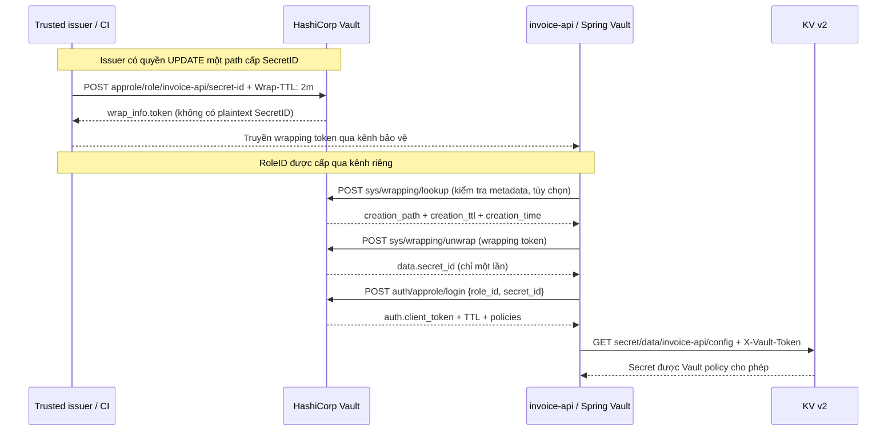

# Đăng nhập AppRole bằng SecretID được response-wrap trong Spring Vault

## 1. Bài thực hành giải quyết vấn đề gì?

Trong module **SPRING_VAULT**, một ứng dụng Java dùng `VaultTemplate`/`VaultOperations` để đọc KV secrets, gọi Transit encryption, PKI, quản lý token và dynamic secret leases. Trước khi làm những việc đó, ứng dụng cần **đăng nhập vào HashiCorp Vault** với danh tính workload và quyền hạn tối thiểu.

Giả sử service `invoice-api` được triển khai bởi một hệ thống CI/CD. Nếu pipeline đặt thẳng `secret_id` của AppRole vào log, biến môi trường được lưu lâu dài hoặc file cấu hình, người có quyền đọc các nguồn đó có thể đăng nhập Vault. **Response wrapping** thay đổi bước bàn giao này: pipeline chỉ nhận **wrapping token** ngắn hạn, chuyển nó cho đúng instance ứng dụng; ứng dụng gọi Vault **unwrap một lần** để lấy SecretID rồi đăng nhập bằng `role_id + secret_id`.

Đề bài thực hành:

1. Quản trị viên tạo AppRole `invoice-api`, policy chỉ cho đọc một KV v2 secret và giới hạn thời hạn/số lượt dùng của SecretID.
2. Issuer được ủy quyền tạo SecretID nhưng **chỉ nhận response đã wrap**, không xem giá trị SecretID.
3. Workload nhận RoleID và wrapping token qua các kênh được kiểm soát, kiểm tra nguồn gốc wrapping token, sau đó dùng Spring Vault để tự unwrap và login.
4. Ứng dụng đọc được secret theo policy, bị từ chối khi truy cập path ngoài phạm vi; xử lý đúng token TTL, wrap TTL, lỗi unwrap và tái đăng nhập.

**Phạm vi:** ví dụ dùng Vault dev/test; dữ liệu, RoleID, token và đường dẫn đều chỉ minh họa. Không chạy lệnh quản trị này trên production khi chưa có quy trình phê duyệt.

## 2. Bốn giá trị dễ bị nhầm lẫn

| Giá trị | Được tạo ở đâu? | Dùng để làm gì? | Vòng đời |
| --- | --- | --- | --- |
| **RoleID** | `auth/approle/role/invoice-api/role-id` | Xác định AppRole khi login | Theo cấu hình/rotation của role; **không** phải Vault login token |
| **SecretID** | `auth/approle/role/invoice-api/secret-id` | Bằng chứng bổ sung cho AppRole, kết hợp RoleID | `secret_id_ttl`, `secret_id_num_uses`, CIDR restrictions |
| **Wrapping token** | Vault tạo khi issuer yêu cầu `X-Vault-Wrap-TTL` | Mở đúng **một** response đã giấu trong Vault cubbyhole | **Single-use**, có TTL độc lập, không dùng để đọc KV |
| **Vault login token** | `POST auth/approle/login` | Đọc KV, Transit, PKI... theo policy sau khi đăng nhập | `token_ttl`, `token_max_ttl`, renewable và quan hệ lease |

Một số nhận định cần chính xác:

- **Wrapping token không phải SecretID đã mã hóa dưới dạng Base64.** Nội dung bí mật được Vault giữ trong cubbyhole; bên giao chỉ thấy token đại diện cho response.
- **Wrapping token không phải token đăng nhập ứng dụng.** Quyền của nó tập trung vào unwrap/lookup response tương ứng, không đọc KV `invoice-api/config`.
- **Unwrap không có nghĩa SecretID đã được dùng để login.** Một SecretID có `num_uses=1` sẽ mất lượt khi login AppRole thành công, không phải vì wrapping token được unwrap.
- **TTL của wrapping token không bằng TTL của SecretID hoặc token đăng nhập.** Ví dụ wrapper sống 2 phút, SecretID sống 20 phút, Vault login token ban đầu sống 15 phút.

### Cách response wrapping chống lộ bí mật trong lúc bàn giao

Khi issuer gọi Vault API với `X-Vault-Wrap-TTL: 2m`, Vault tạo response chứa `secret_id` như bình thường nhưng **thay response trả cho issuer** bằng metadata `wrap_info` và một wrapping token. Vault cất response gốc phía server, gắn quyền đọc một lần với token ngắn hạn đó.

Nếu bên trung gian nhìn thấy response từ request phát hành SecretID, họ không thấy plaintext SecretID. Tuy nhiên, **wrapping token vẫn là bearer credential nhạy cảm**: người lấy được token có thể unwrap trước workload hợp lệ. Single-use giúp phát hiện hành vi đáng ngờ khi workload đến sau không unwrap được, **nhưng không tự chứng minh người nào đã sử dụng token hoặc mọi lần lỗi đều do bị đánh cắp**.

## 3. Kiến trúc và đường đi của credential



**Hai danh tính độc lập:** issuer có quyền tạo SecretID nhưng không cần quyền đọc KV của `invoice-api`; ứng dụng nhận token đăng nhập chỉ có policy đọc KV được chỉ định, không cần quyền tạo SecretID cho chính nó. Quyền quản trị AppRole và quyền dùng secret phải tách biệt.

**Kênh cấp RoleID và wrapping token:** theo thiết kế secure introduction, nên phân phối qua các kênh tin cậy **khác nhau** hoặc biện pháp kiểm soát độc lập. Ví dụ RoleID nằm trong metadata được cấu hình bởi nền tảng, còn wrapper được broker gửi vào một file tạm có permission chặt/volume riêng dành cho đúng instance. Đừng chuyển cả hai trong cùng một email, chat, URL hay artifact CI dễ bị lộ.

## 4. Chuẩn bị Vault sandbox và policy tối thiểu

Giả định bạn có Vault dev/test đã **initialized, unsealed** và một tài khoản quản trị lab; CLI `vault` đang trỏ tới đúng `VAULT_ADDR` và đã đăng nhập. Với môi trường thật, thay tên role, mount và cấu hình CIDR phù hợp. Không dùng root token trong ứng dụng Java.

### 4.1. Bật AppRole auth và KV v2 nếu chưa tồn tại

```bash
# Thực hiện một lần trong sandbox; không chạy lặp nếu mount đã tồn tại.
vault auth enable approle
vault secrets enable -path=secret -version=2 kv

# Dữ liệu kiểm thử giả, tuyệt đối không sử dụng mật khẩu production.
vault kv put -mount=secret invoice-api/config mode=sandbox
```

Nếu Vault dev đã có mount `secret/`, **không bật lại**; xác nhận nó là KV v2 trước khi tiếp tục. Nếu AppRole auth được mount ở một path khác (ví dụ `machine-auth`) thì mọi đường dẫn `auth/approle/...` và cấu hình Spring Vault phải đổi tương ứng.

### 4.2. Policy của token ứng dụng

```bash
vault policy write invoice-reader - <<'HCL'
path "secret/data/invoice-api/config" {
  capabilities = ["read"]
}
HCL
```

Không cấp wildcard `secret/data/*` chỉ để ví dụ đọc được. Với KV v2, path **HTTP và ACL** cho dữ liệu có segment `data`; một policy nhắm `secret/invoice-api/config` có thể không cho phép đọc thông qua API v2.

### 4.3. Cấu hình AppRole

```bash
vault write auth/approle/role/invoice-api \
  bind_secret_id=true \
  token_policies="invoice-reader" \
  token_type="service" \
  token_ttl="15m" \
  token_max_ttl="1h" \
  token_num_uses=0 \
  secret_id_ttl="20m" \
  secret_id_num_uses=1
```

Giải thích:

| Thuộc tính | Giá trị lab | Ý nghĩa |
| --- | --- | --- |
| `bind_secret_id` | `true` | Bắt buộc trình SecretID cùng RoleID |
| `token_policies` | `invoice-reader` | Quyền của **Vault login token** sau xác thực |
| `token_type` | `service` | Service token có lifecycle/renew; thích hợp quan sát trong bài |
| `token_ttl` | `15m` | TTL ban đầu của login token (còn chịu giới hạn hệ thống) |
| `token_max_ttl` | `1h` | Giới hạn renew theo role/config; không thể gia hạn mãi |
| `token_num_uses` | `0` | Token login có thể gọi KV nhiều lần trong TTL |
| `secret_id_ttl` | `20m` | Một SecretID hết hạn nếu chưa dùng đúng thời điểm |
| `secret_id_num_uses` | `1` | SecretID chỉ dùng cho **một** lần login hợp lệ |

**Cần hiểu hệ quả:** `secret_id_num_uses=1` và wrapper single-use là **hai giới hạn riêng**. Sau khi AppRole login thành công, SecretID lab không còn dùng lại được. Khi Vault login token đến `token_max_ttl`, ứng dụng **không thể login lại** với cùng SecretID/wrapper; phải được cấp **SecretID mới** trong response wrapping mới. Đây là chủ đề quan trọng ở phần 9.

Trong production cân nhắc `secret_id_bound_cidrs`, `token_bound_cidrs` và `token_explicit_max_ttl`; đừng đặt `0.0.0.0/0` chỉ vì dễ cấu hình. Với Kubernetes/NAT, phải tính đúng địa chỉ nguồn Vault nhìn thấy; cấu hình CIDR sai dẫn đến login `403`.

### 4.4. RoleID và quyền của issuer

Quản trị viên lấy RoleID qua:

```bash
vault read -field=role_id auth/approle/role/invoice-api/role-id
```

Không đưa RoleID hoặc SecretID vào Git, container image và CI job logs. Dù RoleID chủ yếu định danh role, tách kênh phân phối RoleID khỏi kênh phân phối SecretID/wrapping token vẫn giảm rủi ro của toàn bộ cặp credential.

Issuer chỉ cần quyền phát hành một SecretID:

```hcl
# Policy của trusted issuer; KHÔNG phải policy invoice-reader.
path "auth/approle/role/invoice-api/secret-id" {
  capabilities = ["update"]

  # Cả hai giới hạn áp dụng cho wrapping TTL được yêu cầu.
  # min > 0 khiến response wrapping trở thành bắt buộc tại path này.
  min_wrapping_ttl = "30s"
  max_wrapping_ttl = "3m"
}
```

Chính sách này **ngăn issuer nhận response SecretID trực tiếp** nếu yêu cầu không có wrapping TTL phù hợp. Không cấp quyền sửa role, quản lý policies khác hoặc đọc KV cho issuer chỉ vì nó cần phát hành SecretID. Trong production, dùng Terraform/policy-as-code hoặc quy trình đã phê duyệt để áp policy.

## 5. Issuer tạo SecretID được response-wrap

Trusted issuer đã đăng nhập Vault với policy phần 4.4, gọi:

```bash
# Chạy trong terminal/broker tin cậy. TTL 2m nằm giữa min=30s và max=3m.
vault write -wrap-ttl=2m -f auth/approle/role/invoice-api/secret-id
```

Dữ liệu mẫu từ **request phát hành**, đã thay giá trị nhạy cảm bằng placeholder:

```text
Key                              Value
---                              -----
wrapping_token                   <one-time-wrapping-token>
wrapping_accessor                <opaque-accessor>
wrapping_token_ttl               2m
wrapping_token_creation_time     <timestamp>
wrapping_token_creation_path     auth/approle/role/invoice-api/secret-id
```

Không xuất hiện plaintext `secret_id` trong response trên. Ở HTTP API, cách yêu cầu tương đương là:

```http
POST /v1/auth/approle/role/invoice-api/secret-id
X-Vault-Token: <issuer-vault-token>
X-Vault-Wrap-TTL: 2m
Content-Type: application/json

{}
```

Response minh họa có `wrap_info`:

```json
{
  "wrap_info": {
    "token": "<one-time-wrapping-token>",
    "ttl": 120,
    "creation_path": "auth/approle/role/invoice-api/secret-id",
    "creation_time": "<creation-timestamp>"
  },
  "data": null,
  "auth": null
}
```

**Đừng nhầm `wrap_info.token` với `auth.client_token`.** Wrapping token là giấy nhận hàng một lần, không có quyền sử dụng bí mật KV của ứng dụng.

### 5.1. Bàn giao cho workload

Issuer chuyển `wrap_info.token` qua một kênh tin cậy để **chỉ đúng instance** `invoice-api` nhận được. Các lựa chọn trong kiến trúc có thể là broker cấp credential, projected volume tạm có ACL, channel mTLS tới agent của workload hoặc một cơ chế secure delivery được nền tảng quản lý.

Tránh:

- In wrapping token vào pipeline log, xuất thành CI artifact dùng chung hoặc ghi vào ticket.
- Gắn wrapping token trong URL query, command line của process hoặc tên file.
- Chia sẻ một wrapping token giữa nhiều replica đang khởi động **đồng thời**: replica đầu tiên unwrap thành công, các replica còn lại thất bại.
- Gắn wrapping token vào Docker image, `application.yml` đã commit, ConfigMap hoặc file tồn tại lâu.
- Gửi RoleID và wrapping token vào cùng một kênh không được bảo vệ.

Nếu dùng tệp tạm, nên đặt trong filesystem tạm/volume chỉ được service account ứng dụng đọc, permission chặt, retention ngắn và xóa sau khi nhận xác nhận hoàn thành. Biến môi trường cũng có rủi ro bị đọc từ tiến trình, dump hoặc công cụ chẩn đoán; không tự coi env var là kho bí mật an toàn tuyệt đối.

## 6. Workload xác minh nguồn gốc và unwrap đúng một lần

### 6.1. Kiểm tra nguồn tạo trước khi dùng

Vault cung cấp `POST /v1/sys/wrapping/lookup` để xem metadata của wrapping token **không tiêu thụ lượt unwrap**. Bên nhận nên kiểm tra ít nhất:

1. `creation_path` có đúng `auth/approle/role/invoice-api/secret-id` (hoặc mount tùy chỉnh được duyệt) không?
2. `creation_time` có nằm trong khoảng thời gian triển khai hợp lý không?
3. `creation_ttl`/`ttl` còn đủ thời gian để tiến hành bootstrap không?
4. TLS endpoint/namespace có đúng Vault cluster và phạm vi tin cậy đã định không?

Mẫu HTTP contract:

```http
POST /v1/sys/wrapping/lookup
Content-Type: application/json

{ "token": "<one-time-wrapping-token>" }
```

Phản hồi dữ liệu có các trường như `data.creation_path`, `data.creation_time`, `data.creation_ttl`. Việc lookup **không chứng minh** token thuộc đúng workload chỉ vì creation path hợp lệ; phải xác thực người gửi, Vault server, môi trường và mối liên hệ job/instance qua cơ chế orchestration đã thiết kế.

### 6.2. Unwrap với chính wrapping token

API unwrap:

```http
POST /v1/sys/wrapping/unwrap
X-Vault-Token: <one-time-wrapping-token>
```

Ở chế độ này **không gửi token đó lần nữa trong body**. API cũng cho phép caller có token khác và quyền phù hợp truyền wrapping token qua field `token`, nhưng phải chọn **một trong hai** cơ chế. Đặt cùng wrapping token ở header **và** body có thể tiêu thụ token không đúng cách và làm mất response.

Response sau unwrap (chỉ để hiểu schema, tuyệt đối không log ngoài lab cô lập):

```json
{
  "data": {
    "secret_id": "<app-role-secret-id>",
    "secret_id_accessor": "<secret-id-accessor>",
    "secret_id_ttl": 1200,
    "secret_id_num_uses": 1
  }
}
```

Sau unwrap, wrapping token **không còn sử dụng được**. Nếu unwrap thất bại do token hết hạn, đã dùng, sai namespace hoặc bị revoke, không tiếp tục đoán SecretID và không gửi cùng token đó nhiều lần vô hạn. Cần quy trình báo issuer phát hành SecretID/wrapping token mới, đồng thời điều tra khả năng token bị lộ.

### 6.3. Đăng nhập AppRole sau khi unwrap

Vault AppRole login không yêu cầu caller đã có Vault login token; request chứa cặp RoleID + SecretID:

```http
POST /v1/auth/approle/login
Content-Type: application/json

{
  "role_id": "<role-id>",
  "secret_id": "<unwrapped-secret-id>"
}
```

Response login có cấu trúc `auth`:

```json
{
  "auth": {
    "client_token": "<new-vault-login-token>",
    "lease_duration": 900,
    "renewable": true,
    "policies": ["default", "invoice-reader"]
  }
}
```

Chỉ **`auth.client_token`** sau login mới được dùng làm `X-Vault-Token` trong các request đọc KV, Transit, PKI... Token này có policy/TTL riêng và có thể được Spring Vault session manager renew. Với role `secret_id_num_uses=1`, SecretID đã dùng xong một lần sẽ không thể dùng để login lại.

### 6.4. Hai cách thực hành, chỉ chọn một

Có **hai luồng thay thế nhau**, không được chạy cả hai trên cùng wrapping token:

- **Nhánh A — kiểm tra thủ công bằng CLI:** trong một shell sandbox cô lập, dùng wrapping token để gọi `vault unwrap`, sau đó login AppRole qua CLI và xác minh policy. Nhánh này giúp thấy rõ cấu trúc response, nhưng có nguy cơ lộ SecretID/token qua terminal, process arguments, history và debug logs; không dùng làm cơ chế giao nhận production.
- **Nhánh B — Spring Vault unwrap tự động:** chuyển **wrapping token chưa sử dụng** vào cấu hình `SecretId.wrapped(...)` của `AppRoleAuthentication`. Spring Vault tự gọi unwrap và login; **không gọi `vault unwrap` trước**.

Phần tiếp theo dùng **nhánh B**. Nếu bạn đã unwrap token ở nhánh A thì **phải yêu cầu issuer tạo wrapping token mới** trước khi chạy ví dụ Java.

## 7. Java Spring Vault: SecretId.wrapped(...) và AppRoleAuthentication

Spring Vault hỗ trợ `AppRoleAuthenticationOptions.SecretId.wrapped(VaultToken.of(...))` để lấy SecretID từ response wrapping. Đây là API khác với `SecretId.provided(... )` (đã có plaintext SecretID) và `SecretId.pull(... )` (có initial Vault token quyền tạo SecretID).

### 7.1. Cấu hình Spring Vault 4.1.x

Ví dụ dùng Java 17, Spring Vault 4.1.x và `AbstractVaultConfiguration`. Workload nhận hai file ngắn hạn từ môi trường triển khai:

- `/run/secure-introduction/role-id`: chứa RoleID được cấp qua kênh riêng.
- `/run/secure-introduction/wrap-token`: chứa **wrapping token mới, chưa unwrap**.

Các file có quyền đọc giới hạn cho workload, không được commit hay đóng gói vào image. Giá trị hostname/port chỉ là ví dụ; phải dùng TLS hợp lệ.

```java
import java.io.IOException;
import java.nio.charset.StandardCharsets;
import java.nio.file.Files;
import java.nio.file.Path;

import org.springframework.context.annotation.Configuration;
import org.springframework.vault.authentication.AppRoleAuthentication;
import org.springframework.vault.authentication.AppRoleAuthenticationOptions;
import org.springframework.vault.authentication.AppRoleAuthenticationOptions.RoleId;
import org.springframework.vault.authentication.AppRoleAuthenticationOptions.SecretId;
import org.springframework.vault.authentication.ClientAuthentication;
import org.springframework.vault.client.VaultEndpoint;
import org.springframework.vault.config.AbstractVaultConfiguration;
import org.springframework.vault.support.VaultToken;

@Configuration
public class InvoiceVaultConfiguration extends AbstractVaultConfiguration {

    @Override
    public VaultEndpoint vaultEndpoint() {
        VaultEndpoint endpoint =
                VaultEndpoint.create("vault.internal.example", 8200);
        endpoint.setScheme("https");
        return endpoint;
    }

    @Override
    public ClientAuthentication clientAuthentication() {
        String roleId = readCredential(
                Path.of("/run/secure-introduction/role-id"));

        String wrappingToken = readCredential(
                Path.of("/run/secure-introduction/wrap-token"));

        AppRoleAuthenticationOptions options =
                AppRoleAuthenticationOptions.builder()
                        .roleId(RoleId.provided(roleId))
                        .secretId(
                                SecretId.wrapped(VaultToken.of(wrappingToken)))
                        .build();

        // Spring Vault 4.1+: dùng VaultClient cho auth endpoint.
        // AbstractVaultConfiguration quản lý VaultTemplate/SessionManager.
        return new AppRoleAuthentication(options, vaultClient());
    }

    private static String readCredential(Path file) {
        try {
            String value = Files.readString(
                    file, StandardCharsets.UTF_8).trim();
            if (value.isEmpty()) {
                throw new IllegalStateException("Empty bootstrap credential");
            }
            return value;
        } catch (IOException e) {
            // Không đưa nội dung file hoặc token vào message/cause log chung.
            throw new IllegalStateException(
                    "Cannot read secure introduction credential");
        }
    }
}
```

**Giải thích các bước Spring Vault thực hiện khi login đầu tiên:**

1. Đọc RoleID từ cấu hình đã được cấp.
2. Dùng **wrapping token** trong `SecretId.wrapped(...)` để gọi `sys/wrapping/unwrap`.
3. Lấy `data.secret_id` bên trong response.
4. Gửi `role_id` và `secret_id` đến `auth/approle/login`.
5. Nhận `LoginToken` có TTL/renewable, rồi sử dụng trong `VaultTemplate` thông qua session manager.

Spring Vault **không cần issuer token** ở bước login này; issuer token không được đưa vào cấu hình ứng dụng. Đường dẫn auth mặc định là `approle`; nếu mount auth là `machine-auth`, đặt đúng `.path("machine-auth")` trong builder và cập nhật expected creation path.

Các ví dụ dùng `vaultClient()` phù hợp **Spring Vault 4.1+**. Ở Spring Vault 4.0 có constructor nhận `RestClient`; ở 3.x có constructor nhận `RestOperations`. Không trộn import/construction API giữa các dòng. Nếu đang dùng **Spring Cloud Vault auto-configuration**, nên cấu hình cơ chế authentication trong framework hiện có thay vì vô tình tạo một `AbstractVaultConfiguration` thứ hai với session manager trùng lặp.

**Bảo mật:** wrapping token đã được đọc vào `String` trong JVM theo yêu cầu API; JVM string không cho phép zeroize bảo đảm. Giữ token trong bộ nhớ càng ngắn càng tốt, tránh heap dump/debug, không log constructor args; xóa tệp bàn giao qua cơ chế xác nhận của orchestrator sau khi unwrap/login thành công. Không xóa file trước khi consumer xác nhận vì có thể mất khả năng phục hồi nếu khởi động bị gián đoạn.

### 7.2. Thao tác nghiệp vụ sau khi AppRole login

Ứng dụng nhận `VaultOperations` được cấu hình và đọc KV v2, không cần tự ghép `X-Vault-Token`:

```java
import java.util.Map;

import org.springframework.stereotype.Service;
import org.springframework.vault.core.VaultOperations;
import org.springframework.vault.support.VaultResponse;

@Service
public class InvoiceConfigService {

    private final VaultOperations vault;

    public InvoiceConfigService(VaultOperations vault) {
        this.vault = vault;
    }

    public String getMode() {
        // Raw KV v2 path phải có segment "data".
        VaultResponse response =
                vault.read("secret/data/invoice-api/config");

        if (response == null || response.getData() == null) {
            throw new IllegalStateException("Required KV secret is absent");
        }

        // Raw KV v2 response envelope: data.data.<key>
        Object nested = response.getData().get("data");
        if (!(nested instanceof Map<?, ?> fields)) {
            throw new IllegalStateException("Unexpected KV v2 response");
        }

        Object mode = fields.get("mode");
        if (!(mode instanceof String value) || value.isBlank()) {
            throw new IllegalStateException("Missing config field: mode");
        }
        return value;
    }
}
```

Với policy ở phần 4.2, `invoice-api` chỉ được đọc `secret/data/invoice-api/config`; thử đọc `secret/data/payments/production` phải bị Vault từ chối. Khi gặp `403`, không dùng root token để “sửa” test, mà kiểm tra role, token policy, mount, KV version và namespace.

## 8. Vòng đời khi chạy lâu: vấn đề lớn nhất của one-time wrapper

`AppRoleAuthenticationOptions.SecretId.wrapped(VaultToken.of(wrap))` là lựa chọn rất phù hợp cho **bootstrap lần đầu**, nhưng không đồng nghĩa wrapper có thể sử dụng mãi.

Xét cấu hình lab:

```text
Wrapping token:       TTL 2m, chỉ unwrap 1 lần
SecretID:              TTL 20m, cho phép AppRole login 1 lần
Vault login token:     TTL ban đầu 15m, max TTL 1h
Instance invoice-api:  có thể chạy nhiều ngày
```

Dòng thời gian:

1. `T+0`: ứng dụng unwrap wrapper và login thành công.
2. `T+15m`: session manager có thể renew Vault login token theo contract.
3. `T+1h` hoặc khi token bị revoke/hết khả năng renew: session manager cần **login mới**.
4. Nếu `ClientAuthentication` vẫn giữ cùng `SecretId.wrapped(wrapTokenBanĐầu)`, nó sẽ thử unwrap **lần thứ hai** và thất bại. SecretID cũ cũng đã hết lượt dùng. Một token gia hạn thành công trước đó không khắc phục được bước 4.

**Quy tắc bắt buộc:** Thiết kế **nguồn credential cấp lại** cho re-login *trước* khi đưa ứng dụng chạy dài vào production. Một số lựa chọn:

| Phương án | Khi phù hợp | Rủi ro/giới hạn |
| --- | --- | --- |
| **Mỗi lần login nhận wrapper mới từ issuer** | Workload cần AppRole với SecretID một lượt | Phải có broker tin cậy, giao nhận đúng instance và xử lý lỗi bootstrap |
| Vault Agent quản lý AppRole auto-auth | Nền tảng có thể triển khai agent/sidecar đúng quy trình | Agent phải sở hữu file SecretID/wrapped SecretID và lifecycle; app không tự unwrap lần nữa |
| AppRole SecretID nhiều lượt và TTL phù hợp, unwrap một lần rồi giữ an toàn | Ứng dụng không có issuer online ở mỗi re-login | SecretID tồn tại lâu hơn, tăng bề mặt rủi ro; không sử dụng lại wrapper |
| Auth theo workload identity như Kubernetes/JWT/AWS IAM | Workload chạy trên nền tảng có identity đáng tin cậy | Tránh bài toán phân phối SecretID; cần cấu hình trust/role phù hợp |

### 8.1. Mẫu thiết kế broker cung cấp wrapper mới

Ví dụ sau **minh họa hợp đồng** cho service đã có một broker an toàn. `WrappedSecretIdSupplier` phải gọi issuer bằng danh tính workload và nhận **wrapping token mới mỗi lần**, không cache wrapper cũ hoặc dùng cùng một token cho nhiều instance.

```java
import java.util.Objects;

import org.springframework.vault.authentication.AppRoleAuthentication;
import org.springframework.vault.authentication.AppRoleAuthenticationOptions;
import org.springframework.vault.authentication.AppRoleAuthenticationOptions.RoleId;
import org.springframework.vault.authentication.AppRoleAuthenticationOptions.SecretId;
import org.springframework.vault.authentication.ClientAuthentication;
import org.springframework.vault.client.VaultClient;
import org.springframework.vault.support.VaultToken;

// Interface cần được hiện thực bởi broker an toàn của tổ chức.
// Không phải API có sẵn của Spring Vault.
@FunctionalInterface
interface WrappedSecretIdSupplier {
    VaultToken nextSingleUseWrapper();
}

final class ReprovisioningAppRoleAuthentication
        implements ClientAuthentication {

    private final String roleId;
    private final VaultClient vaultClient;
    private final WrappedSecretIdSupplier issuer;

    ReprovisioningAppRoleAuthentication(
            String roleId,
            VaultClient vaultClient,
            WrappedSecretIdSupplier issuer) {

        this.roleId = Objects.requireNonNull(roleId);
        this.vaultClient = Objects.requireNonNull(vaultClient);
        this.issuer = Objects.requireNonNull(issuer);
    }

    @Override
    public VaultToken login() {
        // Mỗi lượt login cần một wrapping token CHƯA từng unwrap.
        VaultToken freshWrapper =
                Objects.requireNonNull(issuer.nextSingleUseWrapper());

        AppRoleAuthenticationOptions options =
                AppRoleAuthenticationOptions.builder()
                        .roleId(RoleId.provided(roleId))
                        .secretId(SecretId.wrapped(freshWrapper))
                        .build();

        return new AppRoleAuthentication(options, vaultClient).login();
    }
}
```

Lớp này không tự giải quyết secure introduction; **broker phải xác thực instance**, authorize đúng AppRole, kiểm tra wrap metadata/TTL và chống cấp trùng. Khi unwrap thành công nhưng response login bị mất do timeout, **không lặp lại bằng wrapper cũ**; job điều phối cần xác minh/trả lời theo contract rồi cấp wrapper mới nếu thực sự cần. Gọi `nextSingleUseWrapper()` cho mọi lỗi tạm thời mà không giới hạn có thể tạo quá nhiều SecretID; cần retry budget và theo dõi issuance.

Nếu dùng `LifecycleAwareSessionManager`, hãy kiểm tra nó có thể gọi `ClientAuthentication.login()` khi cần re-login; việc rotate wrapper không tự cập nhật những leases cũ nếu Vault login token cha bị thu hồi. Dynamic secrets có lease phải được theo dõi/rotate độc lập (ví dụ bằng `SecretLeaseContainer` hoặc `SessionLeaseContainer` theo cấu hình).

## 9. Phân quyền, TTL và quy trình ứng phó rò rỉ

### 9.1. Ma trận quyền tối thiểu

| Danh tính | Được phép | Không nên được phép |
| --- | --- | --- |
| Quản trị Vault | Cấu hình auth mount, role, policy; kiểm toán và thu hồi khi cần | Không dùng root token cho request nghiệp vụ |
| **Trusted issuer** | `update` đúng `auth/approle/role/invoice-api/secret-id` với wrap TTL bắt buộc | Đọc secrets KV của ứng dụng; sửa role/policy khác; xuất plaintext SecretID |
| **Ứng dụng trước login** | Có RoleID và wrapping token chỉ cho phép unwrap response của nó | Dùng issuer token, quản trị AppRole, đọc KV bằng wrapping token |
| **Ứng dụng sau login** | Đọc `secret/data/invoice-api/config` | Đọc key không thuộc policy, tự phát hành SecretID, tự nâng quyền |
| **Operator kiểm toán** | Audit/lookup/revoke theo quy trình và phạm vi được duyệt | Lưu plaintext token/SecretID trên dashboard |

### 9.2. Giới hạn thời gian

Một thiết kế hoạt động phải thỏa hai điều kiện riêng:

```text
delivery + scheduling + startup + lookup + unwrap < wrapping_token_ttl
appRoleLoginOccursBeforeSecretIdExpiry = true
```

TTL wrapper quá ngắn dẫn tới race trong triển khai/rolling update; quá dài làm tăng thời gian bearer token có thể bị chiếm dụng. Giới hạn `min_wrapping_ttl` và `max_wrapping_ttl` ở issuer policy, đo thời gian giao nhận, chọn biên an toàn và phát cảnh báo khi phần TTL còn lại không đủ cho bootstrapping.

SecretID TTL được tính theo **lúc SecretID được tạo**, không phải từ lúc ứng dụng unwrap. Do đó wrapping token còn hạn **không đảm bảo** SecretID chắc chắn còn hạn nếu issuer/request config sai. Tương tự, Vault login token có `token_ttl` riêng và có thể bị revoke trước hạn.

### 9.3. Khi một wrapper được dùng không rõ nguồn

Nếu ứng dụng nhận lỗi unwrap rằng token đã hết hạn/không hợp lệ:

1. **Không** thử đoán SecretID, log wrapper hoặc dùng root token.
2. Xác định wrapper được cấp lúc nào, có đúng `creation_path` và expected namespace không.
3. Kiểm tra delivery channel, deployment ID, instance ID, thời điểm restart và audit log của Vault.
4. Phân biệt wrapper hết TTL, bị revoke, bị unwrap hợp lệ trước đó, bị unwrap nhầm bởi chính test hoặc khả năng bị kẻ khác sử dụng.
5. Nếu nghi ngờ rò rỉ, thu hồi/rotate **SecretID qua accessor** nếu có, đánh giá token đã cấp và xử lý sự cố theo playbook; cấp SecretID mới và wrapping token mới khi an toàn.
6. Cập nhật sự kiện kiểm toán theo correlation ID/role alias, **không** giữ raw secret/token trong log.

**Bảo vệ cả token sau login:** wrap chỉ bảo vệ **giao nhận SecretID**. Nó không thay thế TLS, Vault ACL, audit, policy KV, token renewal/revocation hoặc phân quyền trên các secret engine.

## 10. Lỗi thường gặp: phân loại trước khi retry

| Dấu hiệu | Nguyên nhân có thể | Cách xử lý |
| --- | --- | --- |
| Issuer nhận `403` khi tạo SecretID | Thiếu `update` trên đúng path hoặc wrap TTL không đáp ứng policy | Kiểm tra issuer ACL, `min/max_wrapping_ttl`, mount và role |
| Issuer nhận plaintext SecretID | Quên `-wrap-ttl` hoặc chưa áp bắt buộc wrapping | Dừng phát hành, áp policy wrapping; điều tra khả năng bị lộ |
| Lookup wrapper sai `creation_path` | Wrapper đến từ role/mount khác, gửi nhầm instance hoặc bị tráo | **Không unwrap**, từ chối và yêu cầu issuer xác minh |
| Unwrap fail do token đã dùng | Worker khác/test/attacker đã unwrap, hoặc client retry cùng token | Ngừng dùng, audit, cấp wrapper mới theo quy trình |
| Unwrap fail do TTL hết | Giao nhận chậm, pod không lên kịp, queue lâu | Đo latency và issuance time, điều chỉnh TTL có giới hạn |
| `403` AppRole login | RoleID/SecretID không khớp, SecretID hết hạn/uses, CIDR sai | Xác minh vai trò, ràng buộc CIDR, cấp SecretID mới nếu cần |
| Login thành công nhưng KV `403` | `invoice-reader` policy sai hoặc namespace/KV mount sai | Kiểm tra policy, không tự tăng quyền |
| KV `404` | Không có key, nhầm KV v1/v2, thiếu segment `data` | Đối chiếu mount và path |
| Restart app với wrapper cũ | Wrapping token đã tiêu thụ ở lần chạy trước | Broker cấp wrapper mới mỗi instance/login |
| Token Spring Vault hết max TTL | Session manager cần re-login nhưng wrapped SecretID không tái sử dụng | Thiết kế rotation/reprovision, tránh retry vô hạn |
| Login response timeout | Không chắc login đã tiêu thụ SecretID hay chưa | Không mặc định retry cùng SecretID; xác minh/nhận credential mới theo contract |
| Hai replica dùng cùng wrapper | Chỉ replica đầu unwrap được | Phân phối wrapper riêng cho từng replica |
| Vault HTTP `5xx` trong unwrap | Có thể lỗi Vault/network, hoặc đã consume rồi mất response | Không mặc định unwrap lại bằng token cũ; điều tra trước khi cấp lại |

Nhiều lỗi trên xuất hiện dưới dạng `VaultLoginException` hoặc `VaultException` trong Spring Vault. Mã lỗi HTTP phụ thuộc Vault, client và thời điểm thất bại. Không suy luận “token bị đánh cắp” chỉ từ một status cụ thể; dùng audit + correlation ID và trạng thái issuer để kết luận.

## 11. Giám sát và kiểm thử tích hợp

Một test đúng cho bài này cần kết hợp **HTTP contract test** và **Vault thật trong sandbox**. WireMock/MockWebServer giúp xác minh thứ tự request nhưng không mô phỏng đầy đủ single-use, TTL, AppRole CIDR và Vault policy.

### 11.1. HTTP contract khi Spring Vault login

Kiểm tra request phát sinh từ cấu hình `SecretId.wrapped(... )`:

| Bước | Request kỳ vọng | Điều cần assert |
| --- | --- | --- |
| Unwrap | `POST /v1/sys/wrapping/unwrap` | Header `X-Vault-Token` chứa **wrapping token giả**, không chứa RoleID/issuer token |
| AppRole login | `POST /v1/auth/approle/login` | JSON body có `role_id`, `secret_id`; không gửi wrapping token làm SecretID |
| Đọc KV | `GET /v1/secret/data/invoice-api/config` | Header `X-Vault-Token` là **auth.client_token của login**, không phải wrapping token |
| Xác thực bị lỗi | HTTP lỗi ở unwrap/login | Không gọi endpoint KV tiếp theo, error đã lọc an toàn |
| Re-login | Yêu cầu mới sau max TTL | Nhận wrapper mới từ broker, không reuse wrapper đã tiêu thụ |

Fixture giả để mock unwrap:

```json
{
  "data": {
    "secret_id": "FAKE_SECRET_ID",
    "secret_id_accessor": "FAKE_ACCESSOR",
    "secret_id_ttl": 1200,
    "secret_id_num_uses": 1
  }
}
```

Fixture giả để mock login:

```json
{
  "auth": {
    "client_token": "FAKE_LOGIN_TOKEN",
    "lease_duration": 900,
    "renewable": true,
    "policies": ["invoice-reader"]
  }
}
```

Không dùng dữ liệu production trong stub. Assert **trình tự** của HTTP request, nhất là wrapping token **chỉ xuất hiện ở request unwrap** và không xuất hiện trong request KV. Thêm test bảo đảm mọi lỗi không in raw header/body vào CI logs.

### 11.2. Các ca end-to-end bắt buộc

| Tình huống | Kỳ vọng |
| --- | --- |
| Issuer dùng `-wrap-ttl=2m` đúng policy | Response có `wrapping_token`, không có `secret_id` plaintext |
| Issuer bỏ wrap TTL | Vault từ chối theo `min_wrapping_ttl` |
| Workload lookup đúng wrapper | `creation_path`, `creation_ttl` và thời gian hợp lệ |
| Workload unwrap một lần | Có SecretID, wrapper không dùng lại được |
| Workload unwrap lần thứ hai | Bị từ chối, không sinh một SecretID thứ hai |
| AppRole login với SecretID mới | Nhận Vault login token có TTL/policies như role |
| Dùng SecretID lần thứ hai khi `num_uses=1` | Login bị từ chối |
| Token đăng nhập đọc KV đúng path | Đọc được `mode=sandbox` |
| Token đọc path ngoài policy | Vault từ chối, không rò dữ liệu |
| Wrapper hết hạn trước unwrap | Không login; cần wrapper mới |
| Sai RoleID/CIDR/namespace | Login thất bại đúng phạm vi, không fallback sang root |
| Token login max TTL hoặc bị revoke | Không tự re-login bằng wrapper cũ; broker cấp wrapper mới |
| Nhiều replica được khởi động đồng thời | Mỗi replica có wrapper riêng, không tranh lượt unwrap |
| Broker từ chối cấp wrapper | Ứng dụng fail closed, không đọc bằng credential đã quá hạn |

### 11.3. Đo lường và audit

Metric nên theo dõi theo **role alias, environment và outcome**, không dùng token làm label:

- `vault_approle_wrapped_issued_total`: số lần issuer tạo wrapped SecretID thành công/thất bại.
- `vault_approle_unwrap_total{outcome}`: số lượt unwrap thành công, hết TTL, bị từ chối.
- `vault_approle_login_total{outcome}`: login thành công/thất bại.
- `vault_approle_bootstrap_duration_seconds`: thời gian từ phát hành đến login thành công.
- `vault_approle_relogin_failures_total`: lỗi khi token cần login mới.
- `vault_approle_wrapper_ttl_remaining_seconds`: gauge TTL ước lượng nếu có metadata đáng tin.

Đây là **tên metric tự thiết kế**, không phải metric mặc định Spring Vault xuất ra. Không log `wrap_info.token`, `secret_id`, `auth.client_token`, bearer header, exception body chưa lọc hoặc filename chứa token. Vault audit log có thể hỗ trợ đối chiếu ai đã tạo và dùng wrapper, nhưng phải giới hạn quyền xem/retention và tránh suy luận danh tính thủ phạm chỉ từ một lỗi đơn lẻ.

## 12. Quy trình vận hành và checklist trước production

Một runbook đơn giản cho lần triển khai đầu:

1. **Platform** xác nhận auth mount, role, policy, KV path và cấu hình TTL/use count đã được phê duyệt.
2. **Issuer** xác thực bằng identity quản trị được ủy quyền, yêu cầu **wrapped SecretID** và kiểm tra response có `wrap_info`.
3. **Broker** ràng buộc wrapper với deployment/instance cụ thể, bàn giao an toàn và ghi nhận thời điểm cấp, nhưng **không ghi raw token**.
4. **Workload** kiểm tra Vault endpoint/TLS, namespace, RoleID và metadata wrapping token (nếu triển khai lookup).
5. **Spring Vault** unwrap đúng một lần, login AppRole, nhận `LoginToken` và tạo `VaultOperations` phục vụ nghiệp vụ.
6. **Kiểm tra quyền**: đọc được `invoice-api/config` và không đọc được secret ngoài role.
7. **Vận hành**: giám sát thời hạn token, các sự kiện renew/re-login và tính hợp lệ của dynamic lease/credential.
8. **Tái cấp**: trước khi cần đăng nhập lại, broker chuẩn bị wrapper mới; không reuse wrapper hoặc SecretID lab đã hết lượt.
9. **Thu hồi/cleanup**: khi job kết thúc, xử lý token/SecretID/accessor theo owner và chính sách; dọn tệp bootstrap, kiểm tra audit.
10. **Ứng cứu**: unwrap thất bại hoặc creation path không khớp phải kích hoạt điều tra, không tự “fix” bằng root token.

### Tự kiểm tra kiến thức

1. Vì sao wrapper có TTL 2 phút **không** đồng nghĩa login token chỉ sống 2 phút?
2. `SecretId.wrapped(VaultToken.of(...))` thực hiện bước nào trước khi gọi `auth/approle/login`?
3. Nếu một instance đã unwrap thành công nhưng pipeline khởi động thêm replica với cùng wrapper, điều gì xảy ra?
4. Vì sao ứng dụng chạy nhiều ngày cần thiết kế re-login mới khi SecretID được giới hạn một lần?
5. `min_wrapping_ttl` bảo vệ đường phát hành SecretID theo cách nào?
6. Khi lookup thấy `creation_path` khác với path dự kiến, ứng dụng nên tiếp tục unwrap hay dừng?
7. Vì sao cần một test dùng Vault thật, chứ không chỉ stub `200` cho `sys/wrapping/unwrap`?

## Tài liệu tham khảo

- [Spring Vault — Authentication Methods / AppRole](https://docs.spring.io/spring-vault/reference/vault/authentication.html): `AppRoleAuthentication`, `RoleId.provided`, `SecretId.wrapped`, token lifecycle.
- [Spring Vault — AppRoleAuthenticationOptions.SecretId Javadoc](https://docs.spring.io/spring-vault/reference/api/java/org/springframework/vault/authentication/AppRoleAuthenticationOptions.SecretId.html): các chế độ `provided`, `pull` và `wrapped`.
- [Spring Vault — AppRoleAuthentication Javadoc](https://docs.spring.io/spring-vault/reference/api/java/org/springframework/vault/authentication/AppRoleAuthentication.html): quy trình unwrap/login và constructor theo version.
- [Spring Vault — AbstractVaultConfiguration](https://docs.spring.io/spring-vault/reference/api/java/org/springframework/vault/config/AbstractVaultConfiguration.html): cấu hình `vaultClient()`, `VaultTemplate` và `SessionManager`.
- [HashiCorp Vault — AppRole Auth Method API](https://developer.hashicorp.com/vault/api-docs/auth/approle): role/SecretID generation, CIDR, TTL, number of uses và login.
- [HashiCorp Vault — Response Wrapping](https://developer.hashicorp.com/vault/docs/concepts/response-wrapping): single-use wrapping token, Cubbyhole, lookup/unwrap và security properties.
- [HashiCorp Vault — Wrapping Lookup API](https://developer.hashicorp.com/vault/api-docs/system/wrapping-lookup): kiểm tra creation path/time/TTL trước khi unwrap.
- [HashiCorp Vault — Wrapping Unwrap API](https://developer.hashicorp.com/vault/api-docs/system/wrapping-unwrap): sử dụng header token **hoặc** body token, không dùng cả hai.
- [HashiCorp Vault — Policies / Wrapping TTL](https://developer.hashicorp.com/vault/docs/concepts/policies): `min_wrapping_ttl`, `max_wrapping_ttl` và capability.
- [HashiCorp Vault — AppRole Best Practices](https://developer.hashicorp.com/vault/docs/auth/approle/approle-pattern): secure introduction và response wrapping.
- [HashiCorp Vault — Authentication for Applications](https://developer.hashicorp.com/validated-designs/vault/administration-guide/authentication-for-applications): kênh cấp RoleID/SecretID và broker/agent.

**Kết luận:** Đăng nhập AppRole bằng SecretID được response-wrap là chuỗi **issuer cấp wrapped SecretID → workload xác minh nguồn gốc → unwrap một lần → AppRole login → Vault token được quản lý theo TTL/policy**. Response wrapping bảo vệ bước giao nhận ban đầu, nhưng hệ thống vẫn cần TLS, ACL, TTL phù hợp, audit và **cơ chế cấp wrapper mới khi phải re-login**.
