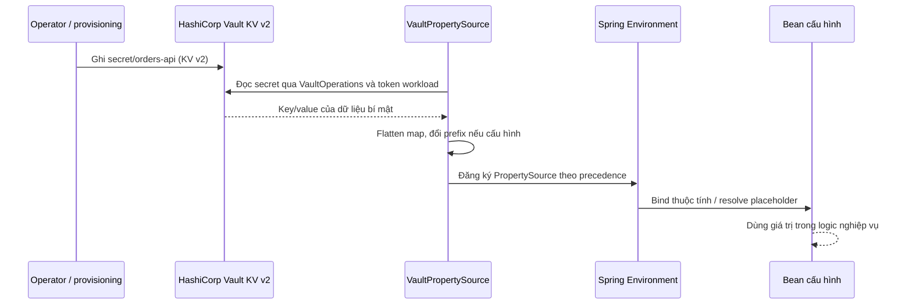

# Nạp cấu hình bằng VaultPropertySource

## 1. Mục tiêu và tình huống thực hành

Trong một ứng dụng Java dùng **Spring Vault**, một số giá trị cấu hình cần lấy từ **HashiCorp Vault** thay vì đặt trong `application.yml`, biến môi trường dùng chung hoặc source code. Ví dụ, dịch vụ `orders-api` cần khóa API của cổng thanh toán, timeout kết nối và cờ bật một tính năng. Nhóm giá trị này có thể được lưu tại một đường dẫn KV được cấp quyền đọc cho đúng workload.

Spring Framework dùng khái niệm **`PropertySource`** để gom các nguồn thuộc tính vào **`Environment`**. Spring Vault cung cấp lớp **`org.springframework.vault.core.env.VaultPropertySource`** để đọc dữ liệu từ Vault bằng `VaultOperations`/`VaultTemplate` rồi hiển thị các khóa như thuộc tính Spring thông thường. Nhờ đó, code có thể lấy giá trị qua `Environment`, placeholder hoặc binding `@ConfigurationProperties`.

Bài **“Nạp cấu hình bằng VaultPropertySource”** thuộc chương **Thực hành tổng hợp** của module **SPRING_VAULT**. Bên cạnh nhu cầu tải cấu hình, module còn học xác thực workload, phân quyền policy, KV secrets, vòng đời token/lease, Transit encryption, PKI, xử lý lỗi, giám sát và kiểm thử tích hợp. Bài tập này chọn **KV v2** để minh họa quy trình nạp cấu hình và phân biệt rõ nó với những thao tác động như Transit/PKI.

**Kết quả mong đợi:** Một Java service nhìn thấy dữ liệu KV v2 ở `secret/orders-api` dưới các property `orders.payment.gateway.api-key` và `orders.payment.gateway.timeout`; trường bắt buộc thiếu thì ứng dụng không nhận lưu lượng, đồng thời token thật không được đưa vào code hoặc log.

Sau bài học, bạn sẽ:

- Giải thích khác biệt giữa **Vault KV**, **VaultPropertySource**, **Spring Environment**, **`VaultTemplate`** và **Spring Cloud Vault Config Data**.
- Tạo và đọc một KV v2 path với Vault CLI, cấp ACL tối thiểu cho workload.
- Nạp cấu hình bằng `@VaultPropertySource` hoặc tạo `VaultPropertySource` bằng code, chọn mức ưu tiên với `MutablePropertySources`.
- Hiểu constructor nạp secret ngay, path KV v2 **không** thêm `data/` và cơ chế tra cứu mount.
- Binding property có kiểu, kiểm tra trường bắt buộc, xử lý lỗi và tránh rò rỉ dữ liệu.
- Phân biệt property source tĩnh với `LeaseAwareVaultPropertySource` cho dynamic secrets và lập kế hoạch kiểm thử thực tế.

## 2. Luồng dữ liệu từ Vault tới Spring Environment



Đây là bốn lớp khác nhau:

| Thành phần | Trách nhiệm | Không nên nhầm |
| --- | --- | --- |
| **KV v2 secrets engine** | Lưu phiên bản bí mật và bảo vệ bằng policy/ACL Vault. | Không tự trở thành `Environment` của Spring. |
| **`VaultOperations`** | Gửi request Vault với kết nối TLS và token có quyền thích hợp. | Không tự quyết định thứ tự ưu tiên của các thuộc tính trong Spring. |
| **`VaultPropertySource`** | Tải secret từ một path và biến thành map thuộc tính. | Không phải dynamic polling service hoặc cơ chế auto-refresh mọi bean. |
| **`MutablePropertySources` / `Environment`** | Giữ danh sách nguồn và tìm property theo thứ tự ưu tiên. | Không chứng minh rằng secret còn hiệu lực/đã được xoay. |

Một `VaultPropertySource` thông thường **đọc secret ngay tại thời điểm constructor chạy**. Nếu kết nối Vault không khả dụng hoặc token thiếu quyền, thời điểm đó sẽ phát sinh vấn đề tải cấu hình. Điều này ảnh hưởng cách bố trí nó trong startup và thứ tự xây dựng beans. Trong `@VaultPropertySource`, Spring xử lý đăng ký trước khi ứng dụng sử dụng các thuộc tính đó ở giai đoạn cấu hình. <sup>Tham khảo Javadoc ở cuối bài.</sup>

### 2.1. Những gì PropertySource giải quyết và không giải quyết

`VaultPropertySource` giúp Spring nhìn thấy key/value từ Vault nhưng **không tự động**:

- Tạo Vault client, cấp policy hay cấu hình Kubernetes/AppRole authentication.
- Bảo đảm TLS/hostname verification khi `VaultOperations` chưa được cấu hình đúng.
- Lập lịch đọc lại KV mỗi khi operator chạy `vault kv put`.
- Đổi ngay password trong datasource/HTTP client đã khởi tạo.
- Thực thi các thao tác Transit encrypt, PKI issue/sign hay gia hạn token/lease thay code nghiệp vụ.

Phải ghép nó với hạ tầng kết nối, xác thực theo workload và các cơ chế vòng đời tương ứng.

## 3. Chuẩn bị Vault KV v2 cho bài lab

Giả sử đã có Vault test chạy qua HTTPS, người quản trị lab có quyền bật KV và tạo policy. Dùng các giá trị dưới đây **chỉ làm fixture kiểm thử**; không đưa khóa thật vào command history hoặc bản commit.

### 3.1. Mount KV v2 và ghi cấu hình

```bash
# Chỉ chạy nếu mount secret/ chưa tồn tại.
vault secrets enable -path=secret kv-v2

# Dữ liệu mẫu. "demo-only-not-a-secret" KHÔNG phải credential production.
vault kv put secret/orders-api \
  payment.gateway.api-key=demo-only-not-a-secret \
  payment.gateway.timeout=2s \
  feature.invoices.enabled=true

# Đọc lại bằng một identity được phép, trong lab.
vault kv get secret/orders-api
```

Dữ liệu logic ở KV có thể hình dung là:

```json
{
  "payment.gateway.api-key": "demo-only-not-a-secret",
  "payment.gateway.timeout": "2s",
  "feature.invoices.enabled": "true"
}
```

Nếu dùng cấu trúc JSON lồng thay vì key có dấu chấm, `VaultPropertySource` có cơ chế **flatten map** thành tên property theo đường dẫn lồng. Trong bài này dùng key phẳng để dễ theo dõi từ CLI đến Spring.

### 3.2. Phân biệt path dùng trong CLI, PropertySource và Vault HTTP API

| Ngữ cảnh | Đường dẫn cho ví dụ | Ý nghĩa |
| --- | --- | --- |
| CLI KV | `vault kv get secret/orders-api` | Lệnh KV tự nhận dạng backend. |
| `@VaultPropertySource` | `secret/orders-api` | Path logic của secret, **không có `data/`**. |
| `new VaultPropertySource(...)` | `secret/orders-api` | Path logic giống annotation. |
| HTTP API KV v2 | `GET /v1/secret/data/orders-api` | Đường dẫn cấp thấp, `data/` do giao thức KV v2 dùng. |
| ACL read KV v2 | `secret/data/orders-api` | Path mà Vault kiểm tra capability `read`. |

**Sai lầm thường gặp:** Đưa `secret/data/orders-api` vào `@VaultPropertySource` vì nhìn thấy nó trong curl. Spring Vault PropertySource có hỗ trợ nhận biết mount/backend để tìm version phù hợp; với KV v2, tài liệu yêu cầu **không thêm `data/`** trong path khai báo.

Khi nhận biết mount, Spring Vault có thể gọi API **`sys/internal/ui/mounts/...`**. Nếu workload thiếu quyền/khả năng truy cập thông tin mount trong phiên bản Vault đang chạy, quá trình tải property source có thể lỗi dù ACL đọc KV dường như đúng. Cần kiểm tra hành vi mount lookup và policy của môi trường; không xử lý bằng cách cấp `root` hoặc `sudo` cho ứng dụng. Đường dẫn ở bảng phải điều chỉnh khi mount KV khác `secret/`.

### 3.3. Policy chỉ đọc và xác thực workload

Policy HCL tối thiểu cho riêng dữ liệu đang cần:

```hcl
path "secret/data/orders-api" {
  capabilities = ["read"]
}
```

Đây là policy KV v2 **cho nội dung secret**. Các quyền cần thiết cho xác thực và mount lookup phải được đánh giá theo phiên bản Vault, cách mount và auth method của hệ thống. Không dùng `secret/data/*` cho ứng dụng chỉ cần một path; không cấp `list`, `update`, `delete` hoặc quyền admin nếu luồng chỉ đọc cấu hình.

Trong Kubernetes, role Vault nên ràng buộc đúng **service account** và **namespace** của `orders-api`. Ứng dụng dùng `ClientAuthentication` và `SessionManager` được cấu hình sẵn để nhận hoặc gia hạn token; không lưu Vault token dài hạn trong Java source/`application.yml`. Nếu dùng AppRole, cung cấp `role_id`/`secret_id` qua cơ chế cấp phát có bảo vệ, ví dụ response wrapping cho SecretID.

## 4. Lựa chọn 1: dùng annotation @VaultPropertySource

Đây là cách ngắn gọn khi ứng dụng dùng **Spring Vault Core** và đã đăng ký bean `VaultTemplate` có tên `vaultTemplate`. Annotation cần import từ `org.springframework.vault.annotation.VaultPropertySource`, **khác package** với lớp `org.springframework.vault.core.env.VaultPropertySource`.

```java
import org.springframework.context.annotation.Configuration;
import org.springframework.vault.annotation.VaultPropertySource;

@Configuration(proxyBeanMethods = false)
@VaultPropertySource(
        value = "secret/orders-api",
        propertyNamePrefix = "orders.",
        ignoreSecretNotFound = false)
public class VaultBackedPropertiesConfiguration {
    // Không cần tự gọi vault.read(...) ở đây.
}
```

**Giải thích:**

- `value`: đường dẫn logic trong Vault, ví dụ `secret/orders-api` cho KV v2.
- `propertyNamePrefix="orders."`: thêm tiền tố `orders.` vào **từng key**, ví dụ `payment.gateway.timeout` thành `orders.payment.gateway.timeout`. Dấu chấm cuối là chủ ý.
- `ignoreSecretNotFound=false`: một context bắt buộc phải tồn tại; đừng lặng lẽ coi một secret thiết yếu là tùy chọn.
- `vaultTemplateRef`: tên bean `VaultTemplate` để annotation sử dụng, mặc định là `vaultTemplate`. Nếu dự án có bean được đặt tên khác, truyền tên đó một cách tường minh.
- `renewal`: mặc định `Renewal.OFF`; ở đây nạp cấu hình KV như một nguồn thuộc tính thông thường, **không bật cơ chế lease/rotation**.

Một số phiên bản `@VaultPropertySource` có `ignoreSecretNotFound` mặc định là **`true`**. Vì thế khi dữ liệu là cấu hình bắt buộc, đặt `false` và thêm validation là cần thiết. Cờ này chỉ liên quan việc **secret không tồn tại**, không được hiểu là cơ chế bỏ qua mọi lỗi 403, timeout, TLS, token hoặc sai dữ liệu.

### 4.1. Binding key/value vào bean có kiểu

Với Java 17+ và Spring Boot có `@ConfigurationPropertiesScan`, tạo lớp cấu hình:

```java
import java.time.Duration;

import org.springframework.boot.context.properties.ConfigurationProperties;

@ConfigurationProperties(prefix = "orders.payment.gateway")
public record PaymentGatewayProperties(
        String apiKey,
        Duration timeout) {

    public PaymentGatewayProperties {
        if (apiKey == null || apiKey.isBlank()) {
            throw new IllegalArgumentException(
                "Gateway API key must be configured");
        }
        if (timeout == null || timeout.isNegative()
                || timeout.isZero()) {
            throw new IllegalArgumentException(
                "Gateway timeout must be positive");
        }
    }

    @Override
    public String toString() {
        return "PaymentGatewayProperties[REDACTED]";
    }
}
```

Đăng ký quét cấu hình:

```java
import org.springframework.boot.SpringApplication;
import org.springframework.boot.autoconfigure.SpringBootApplication;
import org.springframework.boot.context.properties.ConfigurationPropertiesScan;

@SpringBootApplication
@ConfigurationPropertiesScan
public class OrdersApiApplication {
    public static void main(String[] args) {
        SpringApplication.run(OrdersApiApplication.class, args);
    }
}
```

Nhờ tiền tố `orders.`, Spring bind:

| Key lưu trong Vault | Key thấy trong Spring `Environment` | Field record |
| --- | --- | --- |
| `payment.gateway.api-key` | `orders.payment.gateway.api-key` | `apiKey` |
| `payment.gateway.timeout` | `orders.payment.gateway.timeout` | `timeout` |
| `feature.invoices.enabled` | `orders.feature.invoices.enabled` | Không thuộc bean trên; có thể bind trong bean khác. |

Bước binding biến chuỗi `2s` thành `Duration`; nếu key bắt buộc thiếu hoặc dữ liệu sai kiểu, constructor kiểm tra giúp **fail startup** thay vì tạo HTTP client cấu hình sai. Để tích hợp Bean Validation, có thể dùng `@Validated` và Jakarta Validation khi dự án có starter validation tương thích.

Cẩn thận với `toString()` tự động của record: mặc định sẽ chứa **`apiKey`**, vì vậy ví dụ chủ động ghi đè để redaction. Không ghi `Environment`, `PaymentGatewayProperties` hoặc toàn bộ HTTP request headers chứa key vào log.

### 4.2. Tên bean VaultTemplate và thứ tự khởi tạo

`@VaultPropertySource` được xử lý ở giai đoạn cấu hình Spring. Bean `vaultTemplate` phải đã có thể tạo bằng **các giá trị bootstrap có sẵn trước khi đọc Vault** như URL, TLS trust và workload auth. Nếu tự tạo một vòng phụ thuộc kiểu “đọc Vault URI từ VaultPropertySource rồi dùng URI đó tạo VaultTemplate”, ứng dụng không thể bootstrap.

Với một cấu hình khai báo hạ tầng Spring Vault, hãy dùng các cơ chế như `AbstractVaultConfiguration` hoặc auto-configuration đang được dự án hỗ trợ và xác nhận chúng đã tạo `VaultTemplate`. **Không tạo hai bean client độc lập** vô tình dùng hai token, hai namespace hay hai truststore khác nhau.

Nếu dùng `@VaultPropertySource` trên nhiều `@Configuration` được component-scan, thứ tự đăng ký property sources có thể khó dự đoán. Khi cần precedence có tính quyết định, dùng cách lập trình ở mục tiếp theo.

## 5. Lựa chọn 2: tạo VaultPropertySource bằng Java

Cách lập trình giúp bạn chỉ định **tên**, **path**, **transformer**, cách xử lý context thiếu và **vị trí trong chuỗi PropertySource**. API của Spring Vault có constructor:

```java
new VaultPropertySource(
    String name,
    VaultOperations vaultOperations,
    String path,
    PropertyTransformer propertyTransformer,
    boolean ignoreSecretNotFound);
```

Ví dụ một helper chỉ nhận `VaultOperations` **đã được cấu hình hợp lệ trước khi context refresh**:

```java
import org.springframework.context.support.GenericApplicationContext;
import org.springframework.core.env.MutablePropertySources;
import org.springframework.vault.core.VaultOperations;
import org.springframework.vault.core.env.VaultPropertySource;
import org.springframework.vault.core.util.PropertyTransformers;

public final class VaultPropertySourceRegistration {

    private VaultPropertySourceRegistration() {}

    public static void registerBeforeRefresh(
            GenericApplicationContext context,
            VaultOperations readyVaultOperations) {

        VaultPropertySource source = new VaultPropertySource(
                "vault:orders-api",
                readyVaultOperations,
                "secret/orders-api",
                PropertyTransformers.propertyNamePrefix("orders."),
                false);

        MutablePropertySources sources =
                context.getEnvironment().getPropertySources();

        // Ưu tiên cao nhất: key của Vault sẽ đứng trước
        // các property sources khác trong cùng Environment.
        sources.addFirst(source);
    }
}
```

Tại điểm sử dụng, giả sử `readyVaultOperations` đã được khởi tạo ngoài context và không cần đọc các property sắp thêm:

```java
GenericApplicationContext context = new GenericApplicationContext();
VaultPropertySourceRegistration.registerBeforeRefresh(
        context, readyVaultOperations);
context.refresh();

String timeout = context.getEnvironment()
        .getRequiredProperty("orders.payment.gateway.timeout");

// Kiểm tra timeout trong lab; không in API key thật.
context.close();
```

**Đây là ví dụ học cách đăng ký API**, không phải template thay thế trực tiếp cho toàn bộ lifecycle của một Spring Boot app. Với Spring Boot, cần tích hợp việc thêm `PropertySource` vào giai đoạn khởi tạo `Environment` **trước khi** các bean phụ thuộc được tạo. Không nên đặt `new VaultPropertySource(...)` trong `@PostConstruct` của một service rồi kỳ vọng mọi `@ConfigurationProperties` đã bind sẽ tự cập nhật.

### 5.1. Chọn precedence theo mục đích

`MutablePropertySources` có các phương thức:

| Phương thức | Ý nghĩa | Khi nên dùng |
| --- | --- | --- |
| `addFirst(source)` | Đưa source lên đầu danh sách, mức ưu tiên cao nhất tại thời điểm thêm. | Muốn cấu hình từ Vault ghi đè các key trùng ở các nguồn hiện có. |
| `addLast(source)` | Đưa source cuối danh sách, mức ưu tiên thấp. | Dùng Vault làm nguồn fallback đã có chủ đích. |
| `addBefore(name, source)` | Chèn trước source được chỉ định. | Muốn precedence tường minh với một nguồn có tên đã biết. |
| `addAfter(name, source)` | Chèn sau source được chỉ định. | Muốn ưu tiên cấu hình khởi động khác hơn Vault. |

Ví dụ nếu `application.yml` có `orders.payment.gateway.timeout=5s`, Vault có `2s` và `VaultPropertySource` được `addFirst`, `Environment` thường lấy `2s`. Tuy nhiên **Spring Boot còn nhiều nguồn ưu tiên cao** như command-line arguments, system properties, profile/config imports; thứ tự cuối cùng phụ thuộc *thời điểm* thêm PropertySource và các bước xử lý sau đó. Hãy kiểm chứng kết quả thực tế thay vì giả định Vault luôn thắng ở mọi cấu hình.

Khi có nhiều context cùng chứa key `payment.gateway.timeout`, việc đặt `propertyNamePrefix` giúp tránh ghi đè bất ngờ. Quy định rõ nguồn nào chứa config dùng chung, config theo môi trường và config đặc thù service; không đưa mọi secret vào một namespace key phẳng.

### 5.2. PropertyTransformer và dữ liệu lồng nhau

`VaultPropertySource` có hỗ trợ **`PropertyTransformer`**, và Spring Vault cung cấp các hàm tiện ích `PropertyTransformers.propertyNamePrefix(...)`, `noop()` và `removeNullProperties()`. Một transformer có thể sửa tên key, loại giá trị null hoặc tạo một map đã chuẩn hóa theo hợp đồng. Tùy biến nên được giữ đơn giản và có unit test; đặc biệt tránh vô tình đổi tên hai key khác nhau thành cùng một tên.

Với dữ liệu KV ở dạng JSON lồng:

```json
{
  "payment": {
    "gateway": {
      "timeout": "2s"
    }
  }
}
```

PropertySource hỗ trợ làm phẳng map để các key lồng có thể truy cập dưới dạng đường dẫn dấu chấm như `payment.gateway.timeout`. Nếu thêm prefix `orders.`, key ứng dụng là `orders.payment.gateway.timeout`.

Không biến transformer thành nơi giải mã, in hoặc gửi secrets tới một logging service. Nếu cần xử lý mật mã, sử dụng engine Transit và quyền riêng tại thời điểm nghiệp vụ.

## 6. Kiểm thử sau khi nạp: thấy đúng giá trị nhưng không lộ bí mật

Sau khi ứng dụng khởi động và source đã được đăng ký, bạn có thể kiểm tra **key không nhạy cảm**:

```java
import org.springframework.core.env.Environment;
import org.springframework.stereotype.Component;

@Component
public final class LoadedConfigurationVerifier {
    private final Environment environment;

    public LoadedConfigurationVerifier(Environment environment) {
        this.environment = environment;
    }

    public void verify() {
        String timeout = environment.getRequiredProperty(
                "orders.payment.gateway.timeout");

        if (timeout.isBlank()) {
            throw new IllegalStateException(
                    "Required timeout is missing");
        }

        // Không log orders.payment.gateway.api-key.
        // Các giá trị bắt buộc nên được bind/validate tại startup.
    }
}
```

`Environment.getRequiredProperty(...)` kiểm tra sự tồn tại, nhưng **không bảo đảm** chuỗi có định dạng đúng hoặc thuộc môi trường an toàn. Với `Duration`, URL, boolean, số và secret phải có yêu cầu định dạng riêng; ưu tiên binding có kiểu bằng `@ConfigurationProperties`.

Trong môi trường lab, có thể kiểm tra name/precedence mà không in value:

```java
import org.springframework.core.env.ConfigurableEnvironment;
import org.springframework.core.env.PropertySource;

for (PropertySource<?> source :
        configurableEnvironment.getPropertySources()) {

    // Chỉ in tên nguồn trong môi trường lab được phép.
    System.out.println(source.getName());
}
```

Đoạn trên giả định `configurableEnvironment` là một biến được tiêm/cung cấp trong đoạn code thực tế. Trong production, hạn chế in toàn bộ danh sách nếu tên source chứa path hoặc thông tin về tenant. Không liệt kê rồi in `getPropertyNames()` cộng `getProperty(key)` vì có thể đưa secret lên log.

## 7. Khi nào phải chọn @VaultPropertySource, VaultPropertySource hay Config Data?

| Phương án | Phù hợp khi | Điểm cần kiểm soát |
| --- | --- | --- |
| **`@VaultPropertySource`** | Ứng dụng Spring Vault Core có vài path ổn định, muốn khai báo declarative tại `@Configuration`. | Bean `VaultTemplate` sẵn sàng, annotation order, ignore-not-found, vòng đời config. |
| **`new VaultPropertySource(...)`** | Cần tự đặt tên, transformer, thứ tự ưu tiên, hoặc tích hợp vào một context tùy chỉnh. | Đọc ngay trong constructor, bootstrap, `addFirst/addAfter`, không tự hot reload. |
| **Spring Cloud Vault Config Data** | Ứng dụng Spring Boot hiện đại muốn nạp nhiều KV/context/profile từ `spring.config.import=vault://` hoặc contextual location. | Starter/BOM, profile precedence, authentication, startup failure policy. |
| **`VaultOperations` runtime** | Lấy KV khi cần, thao tác Transit, PKI, cấp dynamic secret hoặc xử lý cập nhật theo request. | Timeout, retry/idempotency, kiểm tra response và ACL từng endpoint. |
| **`LeaseAwareVaultPropertySource`** | Cần đưa secret có lease/rotation vào `Environment` theo lifecycle. | `SecretLeaseContainer`, renewal/rotate events, ứng dụng phải phản ứng với thay đổi. |

Đừng vừa khai báo cùng path ở `spring.config.import=vault://` vừa thêm `@VaultPropertySource` mà không có lý do rõ ràng. Hai nguồn trùng key có thể làm ứng dụng lấy giá trị từ nguồn không mong đợi hoặc gọi Vault hai lần khi startup.

**Phân biệt hai chữ giống nhau:** annotation `@VaultPropertySource` và lớp Java `VaultPropertySource` là hai API liên quan nhưng nằm ở **hai package khác nhau**. Annotation có thể đăng ký một hoặc nhiều property source; lớp Java có thể được tạo và chèn bằng code.

## 8. Dữ liệu bắt buộc, dữ liệu tùy chọn và lỗi khi tải

Không phải mọi secret cần ở startup. Phân loại theo rủi ro nghiệp vụ:

| Tình huống | Đề xuất | Không nên làm |
| --- | --- | --- |
| API key bắt buộc để ứng dụng nhận giao dịch | `ignoreSecretNotFound=false` và validation trước READY. | Dùng chuỗi demo nếu secret thật thiếu. |
| Cờ của một tính năng có thể tắt | Có thể dùng default an toàn theo hợp đồng; dùng path tùy chọn khi cần. | Tắt/bật không kiểm soát vì 403 hoặc TLS lỗi. |
| Webhook token phụ chưa sẵn sàng | Nạp lazy bằng `VaultOperations` và defer/outbox riêng nếu nghiệp vụ cho phép. | Buộc mọi startup lỗi hoặc báo “đã gửi” khi không gửi. |
| Token/KV bị thiếu quyền | Sửa workload role, namespace và ACL chính xác. | Dùng root token hoặc catch mọi exception rồi tiếp tục. |
| Vault không kết nối được | Fail startup với secret bắt buộc; retry có giới hạn theo SLO. | Bỏ qua TLS verification, retry vô hạn. |

Một `VaultPropertySource` được khởi tạo trong khi Vault mất kết nối có thể **ngăn khởi động**. Đây là hành vi thích hợp khi secret là điều kiện bắt buộc, nhưng không nên biến một cấu hình tùy chọn thành điều kiện startup do cách đặt annotation/constructor thiếu suy nghĩ.

Cờ `ignoreSecretNotFound=true` chỉ cho phép bỏ qua **trường hợp path không có secret** mà API hỗ trợ; nó không biến kết nối, auth hoặc permission lỗi thành fallback an toàn. Với lỗi thiếu key bên trong một secret tồn tại, constructor có thể vẫn tạo PropertySource; lớp binding/validation phải chịu trách nhiệm phát hiện.

### 8.1. Ranh giới giữa tải cấu hình và xác thực workload

Hạ tầng Vault cần `VaultEndpoint`, CA trust, client authentication và `SessionManager` trước khi tải dữ liệu. Lỗi 401/403 có thể do JWT Kubernetes sai audience, Vault AppRole không có policy, mount không phù hợp hoặc token hết hạn. Không suy rằng dữ liệu không tồn tại chỉ vì client không thể đọc.

Nếu dùng Vault namespace, xác nhận namespace của workload và path tương ứng trước khi phán đoán ACL. Các lỗi này phải xuất hiện dưới dạng trạng thái khởi động hoặc cảnh báo đã lọc, **không để lộ token hoặc response body nhạy cảm**.

## 9. KV v2 được sửa sau khi khởi động: PropertySource có tự đổi không?

**Không mặc định.** `VaultPropertySource` thông thường nạp key/value tại thời điểm nó được khởi tạo. Nếu operator cập nhật `secret/orders-api` bằng một phiên bản KV v2 mới, các property đã nạp không tự đổi chỉ vì Vault lưu một version mới. Cũng không có bảo đảm rằng `@Value` hoặc một singleton `@ConfigurationProperties` sẽ tự bind lại.

Có ba lựa chọn tuỳ yêu cầu:

1. **Restart/rollout có kiểm soát** để nạp giá trị mới trong startup, thường phù hợp static bootstrap config.
2. **Cơ chế refresh/rebind được thiết kế riêng**, có kiểm thử ứng dụng và tránh cạnh tranh giữa giá trị cũ/mới; không giả định chỉ thay một `PropertySource` là cập nhật mọi bean.
3. **Đọc KV khi runtime** qua `VaultKeyValueOperations` nếu nghiệp vụ cần giá trị mới nhất theo từng thao tác, có cache TTL hợp lệ và xử lý lỗi.

Với secret bị thu hồi, không sử dụng "last known good" vô thời hạn. Khả năng còn đọc được chuỗi cũ trong JVM không chứng minh credential vẫn hợp lệ hoặc vẫn được phép sử dụng.

### 9.1. Dynamic credentials: dùng LeaseAwareVaultPropertySource

Nếu secret đến từ `database/creds/orders-readonly` và có **lease**, bạn không nên coi nó giống một KV static secret. Spring Vault có **`LeaseAwareVaultPropertySource`**, dùng `SecretLeaseContainer` để lấy secret có lease, renew hoặc rotate và cập nhật dữ liệu PropertySource theo event. Khi lease hết hạn hoặc bị revoke, các property có thể bị loại bỏ.

Annotation hỗ trợ chỉ định cơ chế renewal:

```java
import org.springframework.context.annotation.Configuration;
import org.springframework.vault.annotation.VaultPropertySource;
import org.springframework.vault.annotation.VaultPropertySource.Renewal;

@Configuration(proxyBeanMethods = false)
@VaultPropertySource(
        value = "database/creds/orders-readonly",
        propertyNamePrefix = "orders.db.",
        renewal = Renewal.ROTATE,
        ignoreSecretNotFound = false)
public class DatabaseCredentialsFromVaultConfiguration {
}
```

Ở ví dụ trên, các field như `username` và `password` của credential động được expose dưới prefix `orders.db.`, và Spring Vault có thể yêu cầu credential mới theo cơ chế lease. Tuy nhiên **một JDBC datasource đã tạo với username/password ban đầu sẽ không tự đổi credential chỉ vì PropertySource thay đổi**. Cần listener/rotation strategy cho pool kết nối, kiểm tra lease TTL, xử lý thu hồi và lifecycle của token ứng dụng. Nếu có Spring Cloud Vault và giải pháp quản lý database credentials tự động, tránh dựng hai bộ lifecycle cạnh tranh nhau.

**Không nhầm**: `SessionManager` gia hạn hoặc xác thực lại **Vault client token**; `SecretLeaseContainer` quản lý vòng đời **dynamic secret lease**; thay giá trị KV trong Vault không tự phát ra sự kiện làm mới mọi bean.

## 10. Quan sát, audit và quản lý secrets trong Environment

Sau khi tải thành công, secret đã nằm trong vùng nhớ của tiến trình Java và trong **Spring `Environment`**. Cần bảo vệ tầng ứng dụng chứ không chỉ giới hạn policy Vault.

- Không ghi toàn bộ `Environment`, `PropertySource` hay object `@ConfigurationProperties` chứa secret vào log.
- Bảo vệ Actuator `/env`, `/configprops`, `/heapdump` và các endpoint quản trị; cơ chế che giá trị mặc định không thay thế authorization.
- Không gửi giá trị secret qua health endpoint, exception, metrics tag hoặc trace attributes.
- Ghi chỉ số **số lần tải thành công/thất bại**, loại lỗi 403/404/network, thời gian tải và tên path logic khi chính sách cho phép; **không** ghi response body và Vault token.
- Phân tách service account/role giữa `orders-api` và các dịch vụ khác; policy chỉ cấp `read` path cần thiết.
- Với credential có TTL/lease, theo dõi lần rotate/renew gần nhất, lỗi thay credential và trạng thái pool.
- Khi xử lý sự cố, dùng Vault audit log và correlation ID để đối chiếu danh tính workload, mount, operation và thời gian mà không sao chép dữ liệu nhạy cảm.

Lưu ý `VaultPropertySource.getPropertyNames()` có thể liệt kê tên key; tên key thường không phải secret nhưng có thể tiết lộ cấu trúc hệ thống, tenant hoặc loại credential. Hạn chế phát tán danh sách này ra hệ thống log công khai.

## 11. Kiểm thử tích hợp toàn bộ luồng

Unit test có thể kiểm tra `PaymentGatewayProperties` bằng các giá trị giả, nhưng để chứng minh **`VaultPropertySource` đọc đúng KV v2, nhận diện mount và sử dụng token/ACL**, cần kiểm thử với Vault thật trong môi trường tách biệt. Vault dev hoặc Testcontainers Vault phù hợp cho KV v2 cơ bản. Không dùng root token ở ứng dụng production; trong CI có thể dùng test token có scope hẹp.

### 11.1. Các ca cần kiểm thử

| Trường hợp | Setup | Kỳ vọng |
| --- | --- | --- |
| **KV v2 hợp lệ** | Mount `secret/`, tạo `secret/orders-api`, cấp quyền read. | `@VaultPropertySource` đăng ký property; `orders.payment.gateway.timeout` được bind thành `Duration`. |
| **Path không tồn tại, bắt buộc** | `ignoreSecretNotFound=false`, xóa context. | Startup/đăng ký báo lỗi, không dùng giá trị giả làm secret. |
| **Path không tồn tại, tùy chọn** | Dùng `ignoreSecretNotFound=true`, không có context. | Có thể không nhận giá trị từ source; tính năng phải có fallback an toàn riêng. |
| **Thiếu key trong context** | Context tồn tại nhưng thiếu API key. | Binding validator từ chối; không xem đó là secret hợp lệ. |
| **Thiếu ACL** | Token không có read hoặc mount lookup bị từ chối. | Lỗi được phân biệt với path không tồn tại, không tự cấp quyền rộng. |
| **Sai đường dẫn KV v2** | Thử `secret/data/orders-api` như path PropertySource. | Test phát hiện mapping không đúng theo contract version. |
| **Precedence** | Cùng key ở Vault và một nguồn khác. | Giá trị được chọn khớp thứ tự `addFirst`/`addAfter` đã thiết kế. |
| **Prefix transformer** | `propertyNamePrefix="orders."` | Các key mang prefix đúng, không rò sang namespace key không mong muốn. |
| **Mount profile khác** | Đổi mount/namespace của workload. | Không thể đọc sai môi trường; config đúng phải bind ở context dự kiến. |
| **Vault mất kết nối khi startup** | Tắt Vault hoặc chặn endpoint trước khi tạo PropertySource. | Chính sách fail-fast/degraded được thực thi theo nhóm dữ liệu. |
| **Thay KV sau startup** | `vault kv put` phiên bản mới sau khi beans đã tạo. | Giá trị đã bind không mặc nhiên cập nhật nếu chưa có refresh/restart. |
| **Dynamic credentials** | Tạo lease trên backend test phù hợp. | Cơ chế renewal/rotation và cập nhật pool được thử riêng. |
| **Log redaction** | Tạo lỗi binding/HTTP và mở log test. | Không xuất hiện Vault token, API key thật hay response body. |

### 11.2. Unit test binding không cần Vault

Để kiểm tra **mapping tên key và validation** của một `@ConfigurationProperties`, không cần luôn dựng Vault:

```java
import static org.junit.jupiter.api.Assertions.*;

import java.time.Duration;
import java.util.Map;

import org.junit.jupiter.api.Test;
import org.springframework.boot.context.properties.bind.Binder;
import org.springframework.boot.context.properties.source.MapConfigurationPropertySource;

class PaymentGatewayPropertiesBindingTest {

    @Test
    void bindsPrefixedSettings() {
        MapConfigurationPropertySource properties =
                new MapConfigurationPropertySource(Map.of(
                    "orders.payment.gateway.api-key", "fake-test-key",
                    "orders.payment.gateway.timeout", "2s"));

        PaymentGatewayProperties actual = new Binder(properties)
                .bind("orders.payment.gateway",
                      PaymentGatewayProperties.class)
                .orElseThrow();

        assertEquals("fake-test-key", actual.apiKey());
        assertEquals(Duration.ofSeconds(2), actual.timeout());
    }
}
```

Test trên xác minh binding/validation của record, **không** chứng minh quyền Vault hay hành vi `VaultPropertySource`. Nó nên chạy nhanh trong mọi commit. Integration test với Vault thật cần được dùng để xác nhận URL, TLS, auth workload, KV v2, mount discovery và cách Spring đăng ký PropertySource.

### 11.3. Bài tập thực hành

Thiết kế `orders-api` sử dụng hai context:

```text
secret/orders-api/common
secret/orders-api/dev
```

Yêu cầu:

1. Ghi các key `payment.gateway.timeout`, `payment.gateway.api-key` vào context `common`, một giá trị override an toàn trong `dev`.
2. Dùng **hai `VaultPropertySource`** với tên riêng và `propertyNamePrefix="orders."`.
3. Xác định thứ tự `addFirst`/`addAfter` sao cho khi chạy dev, config dev có ưu tiên hơn common, và chứng minh bằng test.
4. Cho workload chỉ đọc hai path KV v2 tương ứng, phân biệt path ACL với path PropertySource.
5. Thử thiếu key bắt buộc, Vault HTTP 403 và Vault mất kết nối; mô tả startup failure policy.
6. Cập nhật KV sau startup, giải thích vì sao giá trị binding cũ không tự đổi.
7. So sánh cách cấu hình trên với `spring.config.import=vault://` khi ứng dụng đã dùng Spring Cloud Vault.

**Tiêu chí đạt:** Nêu đúng đường dẫn KV v2, code đăng ký property source/annotation, policy tối thiểu, kết quả binding có kiểu và trường hợp lỗi bảo mật. Không chỉ chứng minh ứng dụng có thể đọc secret với token root của lab.

## 12. Những lỗi triển khai hay gặp

| Lỗi | Nguyên nhân | Cách sửa |
| --- | --- | --- |
| `VaultPropertySource` không tìm thấy path | Sai mount, thêm `data/` không cần thiết, secret chưa có hoặc sai namespace. | Kiểm tra đường dẫn logic `secret/orders-api` và KV version. |
| 403 dù CLI đọc được | CLI dùng token quản trị khác với workload token, policy KV v2 thiếu hoặc mount lookup bị chặn. | So sánh identity/policy thực và sys/internal/ui/mounts nếu cần. |
| `@VaultPropertySource` không hoạt động | Chưa có bean `vaultTemplate`, cấu hình import chưa được scan hoặc bean tạo sai thời điểm. | Đăng ký Vault infrastructure trước, kiểm tra `vaultTemplateRef`. |
| Thuộc tính ở `Environment` nhưng bean nhận null | PropertySource thêm sau binding, sai prefix hoặc key name. | Nạp trước khi bean khởi tạo; kiểm tra binding prefix và precedence. |
| Giá trị Vault bị nguồn khác ghi đè | Thứ tự PropertySource khác dự kiến. | Dùng `MutablePropertySources` với thứ tự rõ và test. |
| Secret thiếu nhưng ứng dụng vẫn startup | Annotation mặc định bỏ qua secret not found hoặc bean không validate key. | Đặt `ignoreSecretNotFound=false` cho path bắt buộc; validate từng key. |
| Ứng dụng startup lỗi khi Vault gián đoạn | PropertySource đọc ngay khi tạo, secret được xem là bắt buộc. | Thiết kế HA/timeout hoặc chuyển dữ liệu tùy chọn sang lazy loading. |
| KV đã rotate nhưng HTTP client vẫn dùng key cũ | PropertySource tĩnh và bean không tự refresh. | Restart/rebind có kiểm soát, hoặc đọc runtime theo hợp đồng. |
| Database password mới nhưng pool không đổi | PropertySource update không cập nhật JDBC pool. | Tích hợp listener/rotation của lease container với datasource. |
| Secret xuất hiện trong Actuator/log | `Environment`, record `toString()` hoặc debug logging bị expose. | Giới hạn endpoint, redact, chỉ ghi metadata an toàn. |

## 13. Checklist triển khai production

- [ ] Có quyết định rõ dữ liệu nào bắt buộc lúc startup và dữ liệu nào được phép nạp muộn.
- [ ] Vault chạy qua HTTPS, CA/hostname được xác minh, client auth theo workload và có token lifecycle phù hợp.
- [ ] KV v2 được mount đúng path; giá trị đưa vào `VaultPropertySource` **không** chèn `data/`.
- [ ] Workload chỉ có capability `read` cho `secret/data/<context>`; mount discovery được kiểm tra.
- [ ] Có bean `VaultTemplate` phù hợp và không tự tạo nhiều client với TLS/namespace khác nhau.
- [ ] Annotation hoặc programmatic registration được chọn theo nhu cầu thứ tự ưu tiên và bootstrap.
- [ ] Key bắt buộc có validation; `ignoreSecretNotFound` được đặt có chủ đích.
- [ ] Tránh trùng nguồn nếu đã dùng Spring Cloud Vault Config Data cho cùng các property.
- [ ] Property names/prefix và profile được kiểm thử để không lấy secret sai môi trường.
- [ ] Rotation của KV/dynamic lease có cơ chế refresh/restart hoặc listener thực sự áp dụng cho beans.
- [ ] Secret/token không xuất hiện trong logs, Actuator, metrics, exception hay test fixtures.
- [ ] Có unit test binding, integration test KV v2/ACL và kịch bản Vault không khả dụng.

**Ghi nhớ:** `VaultPropertySource` giúp **đưa dữ liệu Vault vào `Environment` của Spring**, không biến mọi hoạt động Vault thành property tĩnh. Thành công trong thực hành là: **đọc đúng path logic, nhận diện đúng KV v2, áp đúng ACL theo workload, thêm PropertySource đúng thời điểm/thứ tự, bind và validate dữ liệu, đồng thời quản lý việc làm mới secret theo vòng đời thực tế.**

### Tài liệu tham khảo chính thức

- Spring Vault — Property Sources: https://docs.spring.io/spring-vault/reference/vault/propertysource.html
- Spring Vault — `VaultPropertySource` Javadoc: https://docs.spring.io/spring-vault/reference/api/java/org/springframework/vault/core/env/VaultPropertySource.html
- Spring Vault — `@VaultPropertySource` Javadoc: https://docs.spring.io/spring-vault/reference/api/java/org/springframework/vault/annotation/VaultPropertySource.html
- Spring Vault — `LeaseAwareVaultPropertySource` Javadoc: https://docs.spring.io/spring-vault/reference/api/java/org/springframework/vault/core/env/LeaseAwareVaultPropertySource.html
- Spring Vault — `PropertyTransformers` Javadoc: https://docs.spring.io/spring-vault/reference/api/java/org/springframework/vault/core/util/PropertyTransformers.html
- Spring Vault — Authentication: https://docs.spring.io/spring-vault/reference/vault/authentication.html
- Spring Cloud Vault — Config Data: https://docs.spring.io/spring-cloud-vault/reference/config-data.html
