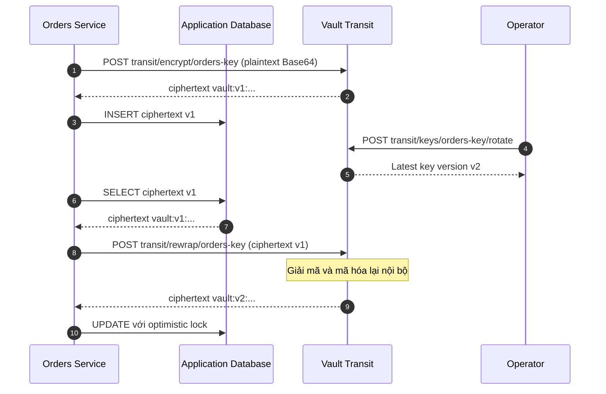

# Thực hành tổng hợp: Mã hóa dữ liệu bằng Transit và thực hiện rewrap trong Spring Vault

## 1. Mục tiêu và bài toán thực tế

Trong một ứng dụng Java sử dụng **SPRING_VAULT**, bạn cần bảo vệ trường dữ liệu nhạy cảm của đơn hàng trước khi ghi vào cơ sở dữ liệu. Khóa mã hóa phải được quản lý tập trung trong HashiCorp Vault, ứng dụng xác thực theo workload và chỉ nhận những quyền ACL thật sự cần thiết. Sau một thời gian, nhóm bảo mật muốn **rotate khóa Transit** và chuyển những ciphertext đã lưu sang phiên bản khóa mới mà **không đưa plaintext về ứng dụng**.

Bài thực hành kết hợp bốn thao tác nhưng phân tách rõ trách nhiệm:

1. **Enable Transit và tạo khóa**: thao tác chuẩn bị của operator, không phải quyền mặc định của service nghiệp vụ.
2. **Encrypt**: ứng dụng gửi plaintext mã hóa Base64 qua kênh TLS đến Vault Transit và nhận ciphertext dạng `vault:vN:...`.
3. **Rotate**: operator tạo một phiên bản khóa mới; ciphertext cũ không tự thay đổi.
4. **Rewrap**: ứng dụng hoặc job được cấp quyền riêng gửi ciphertext cũ đến `transit/rewrap/:name` và nhận ciphertext dùng phiên bản khóa mới mà không nhận plaintext.

Kết quả mong đợi: ứng dụng lưu ciphertext mới, kiểm tra bản ghi bằng cơ chế cập nhật có điều kiện, không phải cấp quyền `decrypt` cho job rewrap, không ghi token/secret vào log và có bài test tích hợp xác minh dữ liệu được bảo toàn.

> **Phạm vi:** các lệnh và dữ liệu đều phục vụ lab cô lập. Không chạy thao tác tạo/rotate khóa, sửa policy hoặc rewrap hàng loạt trên Vault production nếu chưa có quy trình thay đổi, backup và xác định tác động.

## 2. Hiểu đúng Transit, key version và rewrap

**Transit secrets engine** cung cấp các chức năng mật mã như encrypt, decrypt, ký và quản lý phiên bản khóa. Với ca sử dụng mã hóa đối xứng thông dụng, Vault giữ key material ở phía server; ứng dụng đưa dữ liệu vào API, nhận ciphertext và có thể lưu ciphertext ở cơ sở dữ liệu ngoài Vault.

| Khái niệm | Ví dụ | Ý nghĩa |
| --- | --- | --- |
| Transit mount | `transit/` | Đường dẫn gắn engine |
| Key name | `orders-key` | Tên khóa được quản lý dưới mount |
| Encrypt endpoint | `transit/encrypt/orders-key` | Tạo ciphertext từ plaintext được mã hóa Base64 |
| Rotate endpoint | `transit/keys/orders-key/rotate` | Tạo phiên bản key mới cho các thao tác mã hóa tiếp theo |
| Rewrap endpoint | `transit/rewrap/orders-key` | Chuyển ciphertext hiện có sang phiên bản khóa mã hóa mới hơn |
| Ciphertext | `vault:v1:...`, `vault:v2:...` | Kết quả Transit có đánh dấu phiên bản khóa; không phải plaintext |

### 2.1. Rewrap khác rotate như thế nào?

Giả sử một khóa Transit có phiên bản mới nhất là **v1**:

1. Encrypt bản ghi A → nhận `vault:v1:...`.
2. Operator rotate → khóa có phiên bản mới nhất là **v2**.
3. Encrypt bản ghi B sau rotate → thường nhận `vault:v2:...`.
4. **Bản ghi A vẫn chứa ciphertext v1** trong cơ sở dữ liệu cho tới khi được xử lý.
5. Rewrap bản ghi A bằng **cùng key** → Vault sử dụng phiên bản phù hợp để giải mã **bên trong Vault**, rồi mã hóa lại với phiên bản mới nhất; trả một ciphertext v2 về client.

**Rewrap không phải thao tác rotate** và **không tự cập nhật cơ sở dữ liệu của ứng dụng**. Nó chỉ tạo ciphertext mới; client hoặc job phải ghi kết quả vào hệ thống lưu trữ sau khi kiểm tra thành công.

Rewrap **không chuyển sang một key name khác**. Với mục tiêu thay key hoàn toàn, cần thiết kế migration riêng và xác định khả năng/giới hạn của engine. Rewrap thông thường dùng **cùng tên khóa Transit**, thay đổi **phiên bản của khóa đó**.

### 2.2. Ranh giới dữ liệu



Điểm mạnh của rewrap là **plaintext không được trả về cho client rewrap**. Điều đó không loại bỏ nghĩa vụ bảo vệ ciphertext, kiểm soát khóa, TLS, quyền truy cập database và audit. Ở bước encrypt, plaintext ban đầu vẫn đi từ ứng dụng tới Vault qua kênh kết nối; nếu dữ liệu có mức nhạy cảm rất cao, cần đánh giá threat model và biện pháp bảo vệ bổ sung.

## 3. Chuẩn bị môi trường thực hành

Giả định:

- Vault dev/test được khởi động và truy cập qua `VAULT_ADDR` đã cấu hình; TLS được cấu hình phù hợp môi trường.
- Người vận hành có quyền enable secrets engine, tạo/rotate khóa và quản lý policy.
- Ứng dụng Java 17+ có Spring Vault, một `VaultTemplate` được cấu hình qua endpoint, TLS và cơ chế xác thực theo workload (ví dụ AppRole hoặc Kubernetes auth).
- Database test có thể lưu ciphertext theo ID bản ghi và phiên bản hàng để thử optimistic locking.
- Test chạy với dữ liệu giả. **Không dùng token root hoặc token operator trong ứng dụng nghiệp vụ.**

Kiểm tra Vault và danh sách mount:

```bash
vault status
vault secrets list
```

Nếu Transit **chưa** được mount ở `transit/`, operator có thể enable trong môi trường test:

```bash
vault secrets enable -path=transit transit
```

Không chạy lệnh enable lặp lại khi mount đã tồn tại. Nếu tổ chức mount Transit tại `crypto/`, mọi endpoint, policy và Java path trong bài phải đổi từ `transit/...` sang `crypto/...`.

### 3.1. Tạo một khóa phục vụ lab

```bash
# Chỉ operator thực hiện, trên Vault test.
vault write -f transit/keys/orders-key

# Xem metadata của khóa; không xuất key material.
vault read transit/keys/orders-key
```

Khi tạo mới, Transit thường sử dụng loại khóa đối xứng mặc định phù hợp với encrypt/decrypt, chẳng hạn AES-256-GCM. Trong lab có thể khai báo rõ loại:

```bash
# Chỉ dùng nếu orders-key CHƯA tồn tại.
vault write transit/keys/orders-key type=aes256-gcm96
```

Hai lệnh tạo khóa ở trên là **hai cách thay thế nhau**, không phải hai bước cần chạy liên tiếp. Dùng một cách theo cấu hình Vault test. Với khóa đã tồn tại, không tự đổi type bằng cách gọi lại endpoint create; loại khóa và các ràng buộc có thể không thay đổi được sau khi tạo.

## 4. Phân tách quyền Vault theo workload

Một nguyên tắc quan trọng của thực hành tổng hợp là **mã hóa không đồng nghĩa với giải mã**. Job rewrap có thể được cấp đúng endpoint rewrap mà **không cần `decrypt`**.

### 4.1. Policy cho service chỉ mã hóa

```hcl
# orders-encrypt.hcl
path "transit/encrypt/orders-key" {
  capabilities = ["update"]
}
```

### 4.2. Policy cho job chỉ rewrap

```hcl
# orders-rewrap.hcl
path "transit/rewrap/orders-key" {
  capabilities = ["update"]
}
```

### 4.3. Policy cho operator quản lý phiên bản khóa

```hcl
# orders-key-operator.hcl
path "transit/keys/orders-key" {
  capabilities = ["read"]
}

path "transit/keys/orders-key/rotate" {
  capabilities = ["update"]
}
```

Nếu cần tạo khóa, operator cần quyền riêng trên endpoint tạo key, theo hợp đồng API và quy trình provisioning. **Không mở `transit/keys/*`, `transit/decrypt/*` hoặc `sys/*` cho tất cả ứng dụng** chỉ để một ví dụ chạy thành công.

Lệnh nạp policy dành cho operator trong Vault test:

```bash
vault policy write orders-encrypt orders-encrypt.hcl
vault policy write orders-rewrap orders-rewrap.hcl
vault policy write orders-key-operator orders-key-operator.hcl
```

Các file HCL trên chỉ thể hiện nội dung ví dụ; cần tạo/cấp chúng trong hạ tầng test theo quy trình riêng. Sau đó gắn policy vào **đúng AppRole/Kubernetes role** để cấp token ngắn hạn cho workload. Không sử dụng một token có cả encrypt, decrypt, rotate và rewrap cho mọi service.

**Trường hợp kiểm thử decrypt:** có thể cấp policy test riêng cho `transit/decrypt/orders-key` để chứng minh plaintext không đổi; tuyệt đối không dùng token đó cho job rewrap ở production.

## 5. Thử encrypt, rotate và rewrap bằng Vault CLI

Trước tiên mã hóa một chuỗi mẫu *không phải dữ liệu thật*. Transit yêu cầu trường `plaintext` được mã hóa **Base64** trước khi gửi:

```bash
# Chạy trong shell lab; dữ liệu minh họa hoàn toàn giả.
PLAINTEXT_B64="$(printf '%s' 'order-demo|100' | base64 | tr -d '\n')"
vault write -format=json transit/encrypt/orders-key \
  plaintext="$PLAINTEXT_B64"
```

Từ phản hồi, ghi nhận **trường `data.ciphertext`**, ví dụ có dạng `vault:v1:<CIPHERTEXT_BYTES>`. Không tự dựng một chuỗi có vẻ giống ciphertext để gọi API thật; chuỗi đó phải là kết quả Vault đã phát hành.

Operator tạo phiên bản khóa mới:

```bash
vault write -f transit/keys/orders-key/rotate
vault read transit/keys/orders-key
```

Đọc metadata khóa để kiểm tra `latest_version`. Nếu khóa mới tạo ban đầu có version 1, sau một lần rotate thành công, version mới nhất là 2.

Sau đó job dùng ciphertext trả về từ bước encrypt:

```bash
# Thay placeholder bằng ciphertext thực do Transit trả về ở bước trước.
vault write -format=json transit/rewrap/orders-key \
  ciphertext="<CIPHERTEXT_FROM_ENCRYPT>"
```

Response rewrap có trường `data.ciphertext` mới. Nếu rotation đã thành công và không có giới hạn khác, tiền tố phiên bản có thể chuyển từ `vault:v1:...` sang `vault:v2:...`. Phần payload có thể thay đổi ngay cả khi plaintext không đổi; **không so sánh ciphertext để kết luận hai plaintext khác nhau**.

### 5.1. Hợp đồng HTTP cần biết

| Thao tác | Endpoint | Body chính | Response hữu ích |
| --- | --- | --- | --- |
| Encrypt | POST `/v1/transit/encrypt/orders-key` | `{"plaintext":"<BASE64>"}` | `data.ciphertext` |
| Rotate key | POST `/v1/transit/keys/orders-key/rotate` | Không cần plaintext | Kiểm tra `latest_version` qua đọc metadata key |
| Rewrap | POST `/v1/transit/rewrap/orders-key` | `{"ciphertext":"vault:v1:..."}` | `data.ciphertext` |
| Decrypt (chỉ trong test được cấp quyền) | POST `/v1/transit/decrypt/orders-key` | `{"ciphertext":"..."}` | `data.plaintext` dạng Base64 |

Đây là bốn **hợp đồng riêng**. Không gửi plaintext tới rewrap, không gửi ciphertext cũ tới encrypt và không cho phép job rewrap gọi decrypt như một bước trung gian.

## 6. Triển khai Java bằng VaultTemplate

Spring Vault có các API chuyên biệt cho Transit, nhưng để thấy rõ hợp đồng `encrypt/rewrap`, bài thực hành sử dụng `VaultTemplate.write(path, body)`. Phương thức này thực hiện POST tới Vault với token/SSL/session đã được cấu hình.

Ví dụ Java 17+ có thể đặt trong Spring Boot application:

```java
import java.nio.charset.StandardCharsets;
import java.util.Base64;
import java.util.Map;
import java.util.Objects;

import org.springframework.stereotype.Service;
import org.springframework.vault.core.VaultOperations;
import org.springframework.vault.support.VaultResponse;

@Service
public class OrdersTransitCrypto {

    private static final String ENCRYPT_PATH =
            "transit/encrypt/orders-key";
    private static final String REWRAP_PATH =
            "transit/rewrap/orders-key";

    private final VaultOperations vault;

    public OrdersTransitCrypto(VaultOperations vault) {
        this.vault = vault;
    }

    public String encrypt(String plaintext) {
        Objects.requireNonNull(plaintext, "plaintext");

        String encoded = Base64.getEncoder().encodeToString(
                plaintext.getBytes(StandardCharsets.UTF_8));
        VaultResponse response = vault.write(
                ENCRYPT_PATH,
                Map.of("plaintext", encoded));

        return extractCiphertext(response);
    }

    public String rewrap(String oldCiphertext) {
        if (oldCiphertext == null || oldCiphertext.isBlank()) {
            throw new IllegalArgumentException("Ciphertext is required");
        }

        VaultResponse response = vault.write(
                REWRAP_PATH,
                Map.of("ciphertext", oldCiphertext));

        return extractCiphertext(response);
    }

    private static String extractCiphertext(VaultResponse response) {
        if (response == null || response.getData() == null) {
            throw new IllegalStateException("Vault returned no ciphertext");
        }
        Object raw = response.getData().get("ciphertext");
        if (!(raw instanceof String ciphertext)
                || !ciphertext.startsWith("vault:v")) {
            throw new IllegalStateException("Invalid Transit response");
        }
        return ciphertext;
    }
}
```

Điểm cần chú ý:

- `VaultOperations` cho phép mock hoặc thay implementation trong unit test; `VaultTemplate` thường là bean triển khai.
- `encrypt` gửi **Base64(UTF-8(plaintext))** theo hợp đồng Transit; kết quả trả về là ciphertext, không phải JSON chứa key material.
- `rewrap` chỉ gửi ciphertext cũ, không cần plaintext và không gọi endpoint decrypt.
- Cả hai đều cần kiểm tra `response.getData()`; lỗi Vault 403/400/5xx sẽ do Spring Vault báo tương ứng, không được âm thầm đổi thành chuỗi rỗng.
- Ví dụ sử dụng `String` để đơn giản hóa bài học. Với dữ liệu nhạy cảm thật, đánh giá việc giữ plaintext trong bộ nhớ JVM, logging, heap dump và thời gian tồn tại của byte array; tuyệt đối không ghi đối tượng request thô ra log.

**Bảo mật cấu hình:** token không được hard-code trong class. Với workload thực, cấu hình Kubernetes auth, AppRole hoặc cơ chế tương ứng và policy riêng. Kiểm tra cả Vault endpoint, CA/TLS và namespace khi triển khai Enterprise.

### 6.1. Dùng kết quả trong ứng dụng

```java
String ciphertextV1 = ordersTransitCrypto.encrypt("order-demo|100");
// Lưu ciphertextV1 vào cột ciphertext của DB test.

// Sau khi operator đã rotate orders-key:
String ciphertextLatest = ordersTransitCrypto.rewrap(ciphertextV1);
// Chỉ ghi vào DB khi chắc chắn bản ghi chưa đổi kể từ lúc đọc.
```

**Không log giá trị plaintext, ciphertext hoặc token** vào output của API quản trị/trace thông thường. Ciphertext không phải plaintext nhưng vẫn là dữ liệu nghiệp vụ gắn với ID/tenant và có thể bị phân tích hoặc dùng để thử quyền decrypt.

## 7. Xử lý khóa derived và context đúng cách

Trong một số thiết kế đa tenant, Transit key có thể được tạo với `derived=true`. Khi đó yêu cầu encrypt/decrypt/rewrap phải mang **`context` được Base64-encode** theo cùng quy tắc của khóa.

Ví dụ chỉ mang tính minh họa cho một khóa **được tạo và cấu hình có derivation**:

```java
String context = Base64.getEncoder().encodeToString(
        "tenant-demo".getBytes(StandardCharsets.UTF_8));
String plaintext = Base64.getEncoder().encodeToString(
        "order-demo|100".getBytes(StandardCharsets.UTF_8));

VaultResponse encrypted = vault.write(
        "transit/encrypt/tenant-orders-key",
        Map.of("plaintext", plaintext, "context", context));

String ciphertext = (String) encrypted.getData().get("ciphertext");

VaultResponse rewrapped = vault.write(
        "transit/rewrap/tenant-orders-key",
        Map.of("ciphertext", ciphertext, "context", context));
```

Mẫu này giả định khóa `tenant-orders-key` có thuộc tính tương thích với derived context. Cần kiểm tra null/schema như helper ở mục 6 trong code production.

Các nguyên tắc:

1. **Dùng cùng context khi encrypt và rewrap**; context sai hoặc thiếu có thể khiến Vault không giải mã được bản ciphertext cũ.
2. Lưu context ổn định hoặc có cách tái tạo nhất quán theo record/tenant. Nó phải trùng chính xác ở mức **byte**, không chỉ trông giống nhau ở giao diện.
3. Context không mặc nhiên là một mật khẩu; không dùng context làm cơ chế xác thực tenant. Ứng dụng phải **kiểm tra quyền tenant** trước khi gọi Transit.
4. Không dùng lại key name/derived context tùy tiện để “chuyển tenant”. Thay đổi context có thể làm dữ liệu cũ không còn giải mã/rewrap được.
5. Với khóa không derived, chỉ gửi những trường mà hợp đồng API của khóa yêu cầu. Không sao chép `context` từ ví dụ multi-tenant vào mọi request nếu không hiểu cấu hình khóa.

## 8. Lưu ciphertext và rewrap hàng loạt an toàn

Phần API chỉ là một nửa bài toán. Khi mã hóa để lưu DB, cần thiết kế **vòng đời bản ghi**.

Ví dụ bảng:

```sql
CREATE TABLE protected_orders (
    id          BIGINT PRIMARY KEY,
    ciphertext  TEXT NOT NULL,
    row_version BIGINT NOT NULL DEFAULT 0
);
```

Job rewrap đọc từng nhóm nhỏ:

1. Lấy `id`, `ciphertext` và `row_version` của bản ghi từ database; không tải tất cả bản ghi vào bộ nhớ.
2. Gọi `transit/rewrap/orders-key` với ciphertext đã đọc.
3. Kiểm tra response hợp lệ và xác định liệu phiên bản khóa đã đáp ứng mục tiêu hay chưa.
4. Ghi ciphertext mới bằng **optimistic locking** để không ghi đè thay đổi đồng thời.
5. Nếu update không ảnh hưởng dòng nào, tải lại bản ghi và xử lý sau; **không ép ghi** ciphertext cũ.
6. Lưu checkpoint/progress không chứa plaintext, metrics tổng hợp và retry có giới hạn.

Ví dụ SQL cập nhật có điều kiện (tham số phải được bind qua JDBC/JPA, không nối chuỗi):

```sql
UPDATE protected_orders
SET ciphertext = :new_ciphertext,
    row_version = row_version + 1
WHERE id = :id
  AND row_version = :old_row_version
  AND ciphertext = :old_ciphertext;
```

Nếu số dòng cập nhật bằng 0, có thể một nghiệp vụ khác đã ghi dữ liệu mới hoặc job khác vừa rewrap cùng record. Không cập nhật lại dựa trên snapshot cũ vì sẽ **ghi đè ciphertext đúng của nghiệp vụ mới**.

### 8.1. Có nên so sánh chuỗi ciphertext sau rewrap?

Không nên dùng `oldCiphertext.equals(newCiphertext)` làm điều kiện chứng minh plaintext đã đổi hoặc không đổi. Mã hóa hiện đại thường có nonce/ngẫu nhiên; hai ciphertext khác nhau vẫn có thể biểu diễn cùng plaintext.

Bạn có thể dùng tiền tố phiên bản (ví dụ `vault:v2:...`) để **theo dõi tiến độ** một cách thận trọng, nhưng **không tự tạo/sửa tiền tố** và không coi việc parse phiên bản thay thế được kiểm tra API, chính sách khóa hoặc test decrypt được cấp quyền. Nội dung ciphertext là opaque: để nguyên khi lưu/truyền.

### 8.2. Cập nhật trạng thái sau khi rotate

Rotate làm tăng `latest_version` của key và ảnh hưởng encrypt mới; **không tự nâng cấp ciphertext đang lưu**. Trong thời gian chạy migration có thể đồng thời tồn tại bản ghi `vault:v1:...` và `vault:v2:...`, miễn khóa còn cho phép decrypt các phiên bản cũ.

Trước khi tăng `min_decryption_version` hoặc vô hiệu khả năng dùng key version cũ, phải xác minh mọi ciphertext cần thiết đã được rewrap/di trú và test được. Nếu phiên bản khóa dùng để giải mã ciphertext cũ không còn được Vault cho phép, **rewrap cũng có thể thất bại**. Rewrap không phải lối thoát khi đã vô hiệu hóa sớm phiên bản khóa cũ.

Không xóa khóa Transit hoặc mất bản backup/key material nếu vẫn có ciphertext cần giải mã. Thao tác quản trị khóa cần quy trình độc lập với job ứng dụng.

## 9. Phân biệt token TTL, key version và dữ liệu ứng dụng

| Vòng đời | Đối tượng | Điều gì xảy ra khi hết hạn/thay đổi? |
| --- | --- | --- |
| Token TTL | Token mà Spring Vault dùng để gọi API | Token có thể hết hạn/renew/relogin; request mã hóa/rewrap có thể bị từ chối |
| Transit key version | Phiên bản key được Vault dùng để mã hóa | Rotate tạo version mới; ciphertext cũ giữ version cũ cho tới rewrap |
| Secret lease | Dynamic credentials như DB | Có `lease_id`, `lease_duration`, renew/revoke theo backend |
| Ciphertext trong DB | Dữ liệu đã mã hóa của application | Tồn tại tới khi ứng dụng thay/xóa; không tự hết hạn theo token TTL |
| Certificate X.509 | Chứng thư cấp bởi PKI | Hết hạn theo `notAfter`; không liên quan trực tiếp đến Transit key version |

Không nhầm rewrap với lease renewal. Transit ciphertext không phải dynamic secret lease; không có chuyện renew lease để chuyển `vault:v1` thành `vault:v2`. Ngược lại, rotate Transit key không làm token của workload có quyền mới.

## 10. Lỗi thường gặp và hành vi phục hồi

| Hiện tượng | Nguyên nhân khả dĩ | Cách xử lý |
| --- | --- | --- |
| HTTP 403 ở encrypt | Token invalid/expired hoặc thiếu `update` trên encrypt path | Kiểm tra workload auth, TTL, ACL đúng path; không tự cấp root |
| HTTP 403 ở rewrap | Job thiếu `update` trên `transit/rewrap/orders-key` | Cấp policy đúng endpoint cho job, không cấp decrypt |
| HTTP 403/400 ở rotate | Danh tính không có quyền quản trị khóa hoặc request sai | Tách operator role, xác minh endpoint/key |
| HTTP 400 về plaintext | Không Base64 hoặc body không hợp lệ | Encode byte UTF-8 thành Base64; kiểm tra serializer |
| Rewrap thất bại khi key đã rotate | Sai key name/context hoặc key version cũ không được decrypt | Kiểm tra cùng key/context, `min_decryption_version` và metadata khóa |
| DB lưu ciphertext cũ sau job | Chưa update hoặc optimistic lock không thành công | Kiểm tra số row affected/checkpoint; chạy lại có kiểm soát |
| Vault 429/5xx, timeout | Rate limit, lỗi Vault/network hoặc client quá tải | Retry có giới hạn, backoff/jitter, kiểm tra circuit breaker |
| Ciphertext đổi nhưng plaintext test không đổi | Đây là hành vi mong đợi của rewrap | Kiểm tra version và test decrypt theo quyền test |
| Ciphertext vẫn v1 | Rotate chưa xảy ra, job dùng sai mount/key hoặc ghi DB lỗi | Xác minh latest_version, response và bản ghi đã cập nhật |

**Không retry mù mọi POST**: encrypt và rewrap có thể trả ciphertext khác nhau khi thực hiện nhiều lần, và timeout sau khi Vault đã xử lý có thể khiến client không biết kết quả đã hoàn tất. Với job DB, retry dựa trên trạng thái bản ghi hiện tại và phép update có điều kiện. Với lỗi ACL 403 do thiếu quyền, retry không giải quyết được policy.

### 10.1. Kết nối và session Spring Vault

Ứng dụng phải xử lý timeout kết nối/đọc, TLS trust, xác thực theo workload và token lifecycle. Thay đổi token/lease hoặc policy trong lúc job chạy có thể làm một phần batch thành công, phần còn lại thất bại. Job nên có checkpoint, báo lỗi rõ ràng và tiếp tục từ trạng thái bền vững, không giữ plaintext trong queue lâu dài.

Không log `VaultResponse.getData()`, request body encrypt, Vault token, JWT, AppRole Secret ID, plaintext, key material hoặc ciphertext thô trong dashboard. Thay vào đó, ghi operation group, HTTP status nhóm, số bản ghi đã xử lý, version mục tiêu và thời gian xử lý.

## 11. Unit test mã Java

Với JUnit 5 và Mockito, có thể giả lập `VaultOperations` để kiểm tra **đúng endpoint, Base64 request và ciphertext response** mà không cần Vault thật.

```java
import static org.junit.jupiter.api.Assertions.assertEquals;
import static org.mockito.ArgumentMatchers.any;
import static org.mockito.ArgumentMatchers.eq;
import static org.mockito.Mockito.mock;
import static org.mockito.Mockito.never;
import static org.mockito.Mockito.verify;
import static org.mockito.Mockito.when;

import java.nio.charset.StandardCharsets;
import java.util.Base64;
import java.util.Map;

import org.junit.jupiter.api.Test;
import org.mockito.ArgumentCaptor;
import org.springframework.vault.core.VaultOperations;
import org.springframework.vault.support.VaultResponse;

class OrdersTransitCryptoTest {

    private final VaultOperations vault = mock(VaultOperations.class);
    private final OrdersTransitCrypto crypto = new OrdersTransitCrypto(vault);

    private static VaultResponse response(String ciphertext) {
        VaultResponse result = new VaultResponse();
        result.setData(Map.of("ciphertext", ciphertext));
        return result;
    }

    @Test
    void encryptSendsBase64Utf8Plaintext() {
        when(vault.write(eq("transit/encrypt/orders-key"), any()))
                .thenReturn(response("vault:v1:fake-test-ciphertext"));

        String result = crypto.encrypt("đơn-hàng-demo");
        assertEquals("vault:v1:fake-test-ciphertext", result);

        @SuppressWarnings("unchecked")
        ArgumentCaptor<Map<String, Object>> captor =
                ArgumentCaptor.forClass(Map.class);
        verify(vault).write(eq("transit/encrypt/orders-key"), captor.capture());

        String encoded = (String) captor.getValue().get("plaintext");
        String decoded = new String(
                Base64.getDecoder().decode(encoded), StandardCharsets.UTF_8);
        assertEquals("đơn-hàng-demo", decoded);
    }

    @Test
    void rewrapNeverCallsDecrypt() {
        when(vault.write(eq("transit/rewrap/orders-key"), any()))
                .thenReturn(response("vault:v2:fake-test-ciphertext"));

        String result = crypto.rewrap("vault:v1:old-test-value");
        assertEquals("vault:v2:fake-test-ciphertext", result);

        verify(vault).write(
                eq("transit/rewrap/orders-key"),
                eq(Map.of("ciphertext", "vault:v1:old-test-value")));
        verify(vault, never()).write(eq("transit/decrypt/orders-key"), any());
    }
}
```

Ở đây `fake-test-ciphertext` chỉ là **chuỗi mock dùng trong unit test**, không phải ciphertext Transit hợp lệ để gửi tới Vault. Test xác minh mã Java gọi đúng API; nó không chứng minh Vault thực sự có thể rewrap một ciphertext hoặc policy đã được cấu hình đúng. Những vấn đề đó phải kiểm tra tích hợp.

## 12. Kiểm thử tích hợp với Vault thật

Trong Vault test cô lập (có thể dùng Testcontainers), một chuỗi integration test nên thực hiện:

1. Operator tạo mount Transit và khóa `orders-key` mới ở version 1.
2. Service với policy `orders-encrypt` mã hóa plaintext giả; assert response có ciphertext hợp lệ và không trả key material.
3. Token chỉ có `encrypt` thử gọi `rewrap` hoặc `decrypt`: phải bị Vault ACL từ chối.
4. Operator rotate key thành version 2; assert metadata `latest_version` đã thay đổi.
5. Job với policy `orders-rewrap` rewrap ciphertext v1; assert ciphertext trả về có version mong đợi và không có trường plaintext.
6. Dùng **test identity riêng có quyền decrypt** để giải mã cả ciphertext v1 và v2, decode Base64 và kiểm tra byte plaintext bằng nhau; không cấp decrypt cho job production.
7. Lưu ciphertext mới vào DB test bằng optimistic locking; thử cập nhật đồng thời và xác nhận không ghi đè bản ghi vừa được nghiệp vụ thay đổi.
8. Thử cùng ciphertext với key name/context sai để xác minh hệ thống không tự fallback sang đường dẫn giải mã kém an toàn.
9. Mô phỏng token hết hạn, HTTP 403, 429, 5xx và timeout; xác nhận retry có giới hạn, checkpoint và log không chứa secret.
10. Nếu tăng `min_decryption_version`, chỉ thực hiện **sau khi** toàn bộ bản ghi test đã chuyển sang version mới; xác nhận thao tác với ciphertext cũ bị giới hạn như kỳ vọng.

Khi integration test có dữ liệu nhạy cảm giả, vẫn không dump request/response vào CI logs. Dọn key, mount, policy, token và test DB trong quá trình teardown ở môi trường cô lập, tránh ảnh hưởng tài nguyên dùng chung.

### 12.1. Ma trận quyền nên kiểm thử

| Danh tính | Encrypt | Rewrap | Decrypt | Rotate |
| --- | --- | --- | --- | --- |
| `orders-encrypt` | Cho phép | Từ chối | Từ chối | Từ chối |
| `orders-rewrap` | Từ chối | Cho phép | Từ chối | Từ chối |
| `orders-key-operator` | Theo policy riêng; không cần mặc định | Không cần mặc định | Không cần mặc định | Cho phép |
| `orders-test-decrypt` | Theo policy test | Theo policy test | Cho phép | Từ chối |

Nếu test chạy bằng root token, kết quả ACL âm tính sẽ vô nghĩa. Phải cấp **token hạn chế đúng theo role** cho từng nhóm và chạy request với những token đó. Khi Vault trả 403, phân biệt lỗi token hết hạn với ACL deny bằng cách kiểm tra token hiệu lực, role và capability đúng path.

## 13. Quan sát và hiệu năng của job rewrap

Một job rewrap hàng triệu bản ghi cần được vận hành như một **migration có checkpoint**, không phải một vòng lặp không giới hạn gọi Vault:

- **Batch size và concurrency:** bắt đầu nhỏ, điều chỉnh theo độ trễ, lỗi 429/5xx, tài nguyên Vault và giới hạn database. Không giả định API có server-side backpressure.
- **Progress:** số bản ghi xét, đã rewrap, bỏ qua, cập nhật bị xung đột và thất bại theo loại lỗi; tránh label theo ID bản ghi.
- **Idempotency ở tầng DB:** job có thể chạy lại mà không ghi đè dữ liệu mới; version mismatch được xử lý bằng reread/reconcile.
- **Retry:** exponential backoff và jitter cho lỗi tạm thời; dừng/báo nếu auth/policy không phù hợp; tránh tạo hàng loạt phiên bản ciphertext vô ích.
- **Deadline và rollback:** theo dõi mục tiêu version, giữ khả năng decrypt cũ trong giai đoạn chuyển đổi, có khả năng tạm dừng an toàn.
- **Bảo mật:** TLS, session workload, không xuất token, context nhạy cảm, ciphertext thô hoặc plaintext qua endpoint quản trị.

Ví dụ metric dạng tổng hợp **do ứng dụng tự định nghĩa**:

```text
vault_rewrap_records_total{outcome="updated",key_group="orders"} 4800
vault_rewrap_records_total{outcome="conflict",key_group="orders"} 16
vault_rewrap_records_total{outcome="failed",key_group="orders"} 4
```

Không gắn `lease_id`, `token`, `ciphertext`, ID người dùng hay toàn bộ path vào label. Nếu cần chẩn đoán bản ghi lỗi, dùng một hệ thống audit/job journal có kiểm soát quyền và không lưu plaintext.

## 14. Bài tập mở rộng

**Bài 1 — Phân quyền:** Vì sao job rewrap không cần quyền decrypt dù Vault phải giải mã ciphertext trong quá trình xử lý?

**Gợi ý:** Transit thực hiện giải mã và mã hóa lại bên trong Vault. Endpoint rewrap chỉ trả ciphertext mới cho caller. ACL trên `transit/rewrap/orders-key` cho phép công việc đó mà không cấp quyền `transit/decrypt/orders-key`.

**Bài 2 — Key version:** Operator rotate khóa từ v1 sang v2, nhưng DB vẫn chứa ciphertext v1. Có phải rotate thất bại?

**Đáp án:** Không. Rotate chỉ tạo version khóa mới. Cần chạy rewrap và cập nhật các bản ghi DB, có kiểm soát concurrency.

**Bài 3 — Context:** Ciphertext được encrypt với context Base64 của tenant A nhưng job rewrap dùng context tenant B. Điều gì cần kiểm tra?

**Đáp án:** Context phải khớp byte với bản gốc khi key dùng derivation; sai context có thể gây lỗi. Kiểm tra metadata tenant và không dùng lỗi này làm lý do mở quyền decrypt cho job.

**Bài 4 — Concurrent write:** Trong lúc job rewrap, một request mới thay ciphertext của cùng đơn hàng. Job nên làm gì?

**Đáp án:** UPDATE có điều kiện với `row_version` và giá trị ciphertext gốc. Nếu xung đột, bỏ ghi cũ, tải lại record và xử lý theo trạng thái hiện tại.

**Bài 5 — Lỗi sau khi vô hiệu phiên bản cũ:** Job chưa rewrap hết v1 nhưng operator tăng `min_decryption_version` lên 2. Tại sao các bản ghi còn lại có thể không migrate được?

**Đáp án:** Vault không còn cho phép dùng phiên bản v1 để giải mã ciphertext cũ, trong khi rewrap cần đọc phiên bản cũ ở phía Vault trước khi mã hóa lại. Phải bảo đảm migration hoàn tất trước khi loại bỏ khả năng decrypt v1.

## 15. Checklist trước khi chuyển lên môi trường thật

- [ ] Transit mount/key và key type đúng; biết `latest_version` và chính sách phiên bản có thể decrypt.
- [ ] Tách operator rotate, service encrypt, job rewrap và test decrypt; không dùng root token trong workload.
- [ ] Đã xác thực đúng mount, path, TLS, namespace và workload auth.
- [ ] Plaintext được chuyển sang Base64 đúng byte/UTF-8; ciphertext được lưu opaque, không tự sửa prefix.
- [ ] Nếu khóa derived, context được lưu/tái tạo nhất quán khi encrypt và rewrap.
- [ ] Có backup DB, checkpoint, optimistic locking và quy trình xử lý bản ghi xung đột.
- [ ] Không tăng `min_decryption_version` trước khi thống kê/kiểm tra toàn bộ ciphertext cũ.
- [ ] Đã chạy integration test với Vault, key rotate, rewrap, verify plaintext dưới danh tính test riêng.
- [ ] Retry và concurrency có giới hạn; có kế hoạch dừng/khôi phục migration.
- [ ] Log, metric, endpoint quản trị và báo cáo CI không làm lộ plaintext, token hoặc private key.

## 16. Tổng kết

Trong Spring Vault, **Transit encrypt** bảo vệ dữ liệu ứng dụng bằng khóa do Vault quản lý; **rotate** tạo phiên bản khóa mới; **rewrap** biến ciphertext cũ thành ciphertext dùng phiên bản mới mà **không trả plaintext cho job**. Một bài thực hành hoàn chỉnh phải có nhiều hơn lời gọi API: phân quyền chính xác, xác thực theo workload, lưu dữ liệu có kiểm soát đồng thời, quản lý key version, xử lý lỗi và kiểm thử tích hợp.

Nguyên tắc quan trọng nhất: **giữ plaintext trong ranh giới được phép, không cấp decrypt cho job chỉ cần rewrap, và không vô hiệu khả năng giải mã phiên bản cũ trước khi migration kết thúc**.

### Tài liệu tham khảo

- [HashiCorp Vault — Transit Secrets Engine](https://developer.hashicorp.com/vault/docs/secrets/transit)
- [HashiCorp Vault — Transit HTTP API](https://developer.hashicorp.com/vault/api-docs/secret/transit)
- [Spring Vault — VaultTemplate](https://docs.spring.io/spring-vault/reference/vault/imperative-template.html)
- [Spring Vault — Transit Operations](https://docs.spring.io/spring-vault/reference/vault/vault-transit.html)
- [HashiCorp Vault — ACL Policies](https://developer.hashicorp.com/vault/docs/concepts/policies)
