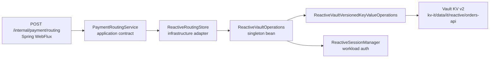
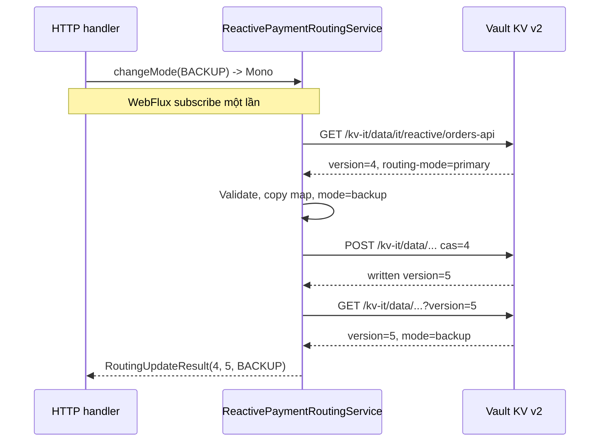
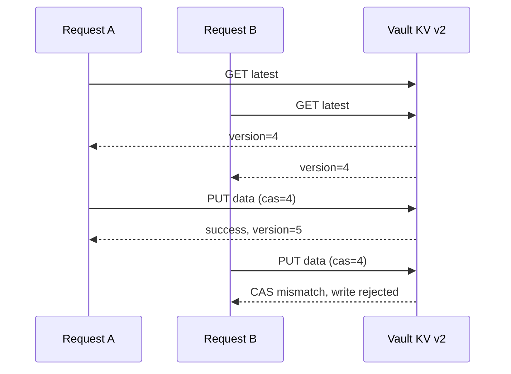

# Thực hiện chuỗi đọc và cập nhật bằng API reactive

> **Spring Vault — Thực hành tổng hợp.** Bài lab kết nối một ứng dụng Java/Spring WebFlux với HashiCorp Vault bằng **ReactiveVaultOperations**. Ứng dụng đọc cấu hình được bảo vệ trong KV v2, xác thực dữ liệu theo hợp đồng nghiệp vụ, tạo phiên bản mới bằng **compare-and-set (CAS)** để tránh ghi đè cập nhật đồng thời, rồi đọc lại phiên bản vừa ghi để kiểm chứng. Tất cả các bước được nối bằng Reactor **Mono** và không gọi `block()` hoặc `subscribe()` tùy tiện trong đường xử lý HTTP. Bên cạnh đường thành công, chúng ta kiểm tra lỗi secret thiếu, 403, CAS conflict, timeout và cơ chế vận hành an toàn.

## 1. Bối cảnh và kết quả cần đạt

Dịch vụ `orders-api` có một cấu hình định tuyến thanh toán được quản lý qua Vault KV v2. Ví dụ dùng **dữ liệu giả** tại mount `kv-it/`, key tương đối `it/reactive/orders-api`:

```json
{
  "routing-mode": "primary",
  "retry-limit": 2,
  "marker": "synthetic-only"
}
```

Ứng dụng cung cấp thao tác nội bộ đổi `routing-mode` từ `primary` sang `backup`, nhưng phải **giữ nguyên** `retry-limit` và các field khác, đồng thời không ghi đè một cập nhật vừa được thread/instance khác thực hiện.

Sau lab, bạn sẽ:

1. Phân biệt API imperative `VaultOperations` và API reactive `ReactiveVaultOperations`.
2. Xác định chính xác mount KV v2 và đường dẫn tương đối; tránh tự ghép `data/` hai lần.
3. Xây dựng luồng **đọc → kiểm tra → tạo bản sửa → put có CAS → đọc lại version mới**.
4. Hiểu vì sao `flatMap` dùng để nối các thao tác bất đồng bộ, còn `map` cho biến đổi đồng bộ dữ liệu đã có.
5. Phân biệt `Mono.empty()`, `Mono.error(...)` và kết quả giá trị thành công.
6. Chứng minh phiên bản mới được tạo, dữ liệu cũ còn trong history và thao tác CAS ngăn lost update.
7. Thiết kế ACL, workload authentication, timeout, retry và giám sát.
8. Viết JUnit 5 + Reactor `StepVerifier` kết nối tới Vault thử nghiệm, có guard và cleanup theo key riêng.

**Giới hạn thực hành:** tuyệt đối không chạy update trên secret thật hoặc mount production. Các ví dụ giả định Vault lab có mount `kv-it/` **KV version 2** và key thuộc namespace/keyspace thử nghiệm đã được cấp phép. Không dùng Vault root token trong ứng dụng.

## 2. Kiến trúc: ai biết Vault, ai biết nghiệp vụ?

Một cách tổ chức dễ kiểm thử:



| Tầng | Biết gì? | Không nên biết gì? |
|---|---|---|
| **Controller** | HTTP request/authorization/validation mức API | Vault token, `kv-it/data/`, raw response |
| **Application service** | Chuyển route sang một giá trị được phép, kết quả thay đổi | Cấu trúc HTTP của Vault |
| **Infrastructure adapter** | KV v2 mount, relative path, CAS và mapping field | Quyền quyết định request người dùng nào được phép |
| **Reactive Vault client** | Session token, HTTP connector, serializing Vault API | Quy tắc kinh doanh riêng của payment |
| **Vault server** | Key versions, CAS, policy trên đường dẫn | Cách ứng dụng trả thông báo REST |

Một bean `ReactiveVaultOperations` được chia sẻ trong Spring ApplicationContext, không tạo `new ReactiveVaultTemplate` theo mỗi request. Khi tách workloads có policy khác nhau, có thể cần bean/session riêng theo identity; **không** gộp quyền chỉ để giảm login.

## 3. Điều kiện phiên bản: dùng API thực sự reactive

Spring Vault **3.1+** cung cấp:

- `ReactiveVaultOperations`, thường do `ReactiveVaultTemplate` triển khai.
- `ReactiveVaultKeyValueOperations` cho thao tác KV v1/v2 cơ bản.
- `ReactiveVaultVersionedKeyValueOperations` cho KV v2 với version metadata, CAS, delete/undelete/destroy.
- `ReactiveVaultKeyValueMetadataOperations` cho KV v2 metadata, riêng với data.
- `ReactiveSessionManager` quản lý phiên Vault token trên reactive infrastructure.

Trong bài sử dụng `ReactiveVaultVersionedKeyValueOperations` vì cần CAS. API thông thường:

```java
ReactiveVaultVersionedKeyValueOperations kv =
        reactiveVaultOperations.opsForVersionedKeyValue("kv-it");
```

Với KV v2, tham số `"kv-it"` là **mount**, còn `kv.get("it/reactive/orders-api")` chỉ nhận **path tương đối**, không có tiền tố `kv-it/data/`.

### 3.1. So sánh API imperative và reactive

| Tình huống | Imperative | Reactive |
|---|---|---|
| Entry point | `VaultOperations` / `VaultTemplate` | `ReactiveVaultOperations` / `ReactiveVaultTemplate` |
| Đọc version mới nhất | `Versioned<Map<...>>` | `Mono<Versioned<Map<...>>>` |
| Ghi bằng CAS | `Versioned.Metadata` | `Mono<Versioned.Metadata>` |
| Hợp luồng | Lệnh tuần tự trong một thread | `map`, `flatMap`, `switchIfEmpty` và error signals |
| Blocking | Kết quả trực tiếp | Không cần chặn thread để lấy kết quả |
| Subscription | Không áp dụng | Publisher lạnh thường chạy khi có subscription |
| Phù hợp | MVC/blocking service, batch jobs | WebFlux/reactive pipeline, I/O concurrency |

**Không tạo một reactive API giả** bằng cách bọc `vaultOperations.read(...)` blocking bên trong `Mono.just(...)`. Cách này thực hiện I/O ngay ở nơi xây publisher. `Mono.fromCallable(...)` kèm scheduler riêng có thể là cầu nối tạm với blocking API, nhưng không biến backend thành non-blocking và cần giới hạn thread pool; trong lab hãy dùng **Spring Vault reactive client thật**.

### 3.2. Cấu hình auth reactive cũng phải tương thích

`AbstractReactiveVaultConfiguration` tạo `ReactiveVaultTemplate`/`ReactiveSessionManager`. Authentication do cấu hình cung cấp phải hỗ trợ `AuthenticationStepsFactory` để tạo luồng reactive authentication tương ứng. Không phải **mọi** implementation cloud/auth imperative đều có reactive counterpart. Ví dụ GCP IAM Credentials synchronous API có hạn chế với reactive authentication steps; phải xác minh theo auth method và phiên bản Spring Vault đang chạy.

Trên Spring Vault 4.1+, transport dưới `ReactiveVaultTemplate` sử dụng `ReactiveVaultClient`/reactive connector; trên bản khác, constructor/configuration có thể khác. **Không copy constructor của một phiên bản vào phiên bản khác** khi chưa đối chiếu Javadoc và dependency tree.

Bài giả định Spring context đã có bean `ReactiveVaultOperations` kết nối tới Vault test với TLS và workload identity phù hợp; phần ứng dụng sẽ không cấu hình lại login cho từng lời gọi.

## 4. Chuẩn bị Vault test an toàn

Giả sử operator được phép tạo mount KV v2 riêng. Chỉ chạy các lệnh dưới trên **Vault development/test**, không dùng key production.

```bash
# Trên Vault lab với VAULT_ADDR và operator identity đúng môi trường.
vault status

# Chỉ bật nếu kv-it chưa tồn tại; nếu đã tồn tại, xác nhận version.
vault secrets enable -path=kv-it -version=2 kv

vault secrets list -detailed
```

Đối với test cụ thể, sử dụng đường dẫn đã được sở hữu:

```bash
TEST_KEY="it/reactive/orders-api"

vault kv put -mount=kv-it "$TEST_KEY" \
  routing-mode=primary \
  retry-limit=2 \
  marker=synthetic-only

vault kv get -mount=kv-it "$TEST_KEY"
vault kv metadata get -mount=kv-it "$TEST_KEY"
```

**Chú ý kiểu dữ liệu:** giá trị `retry-limit=2` đưa qua CLI có thể được parse theo cách của lệnh và trở thành chuỗi; ví dụ Java phải chấp nhận schema đã thống nhất hoặc dùng JSON để ghi giá trị number rõ ràng. Với lab xuyên suốt, chỉ cần update `routing-mode` là String và **giữ nguyên field khác**. Không dùng dữ liệu thực.

Trong CI chạy song song, **không dùng key cố định**. Test code sẽ tạo `it/reactive/<UUID>`, tạo dữ liệu bằng reactive API và cleanup đúng key mà test sở hữu.

### 4.1. CAS ở KV v2

Vault KV v2 tạo version mới mỗi khi POST thành công vào:

```text
POST /v1/kv-it/data/it/reactive/orders-api
```

Body raw HTTP có thể là:

```json
{
  "options": {
    "cas": 3
  },
  "data": {
    "routing-mode": "backup",
    "retry-limit": 2,
    "marker": "synthetic-only"
  }
}
```

CAS yêu cầu **version hiện tại đúng bằng số truyền vào**:

- `cas=0`: chỉ ghi nếu key **chưa tồn tại** (tạo mới theo điều kiện).
- `cas=N` (N dương): chỉ ghi nếu version hiện hành là N.
- Nếu hiện tại đã chuyển sang N+1 bởi writer khác, yêu cầu mang CAS=N phải **thất bại**, không tạo một version đè lên thay đổi vừa xảy ra.
- Nếu `cas_required=true` ở engine/key, mọi write phải có CAS hợp lệ; kể cả khi không bắt buộc, dùng CAS trong luồng read-modify-write là lựa chọn tốt để tránh lost update.

CAS là kiểm tra **nguyên tử tại thời điểm write** trên một key. Chuỗi **GET → POST → GET** không phải một giao dịch ACID kéo dài qua nhiều HTTP requests.

## 5. Domain contract cho thao tác cập nhật

Không mở endpoint kiểu `updateSecret(String arbitraryVaultPath, Map payload)` cho client. Thay vào đó, tạo contract theo nghiệp vụ chỉ đổi giá trị trong allowlist.

```java
// RoutingMode.java
public enum RoutingMode {
    PRIMARY, BACKUP
}
```

```java
// RoutingUpdateResult.java
public record RoutingUpdateResult(
        int previousVersion,
        int writtenVersion,
        RoutingMode appliedMode) {
}
```

```java
// PaymentRoutingService.java
import reactor.core.publisher.Mono;

public interface PaymentRoutingService {

    /**
     * Đổi routing mode của cấu hình được cho phép.
     * Kết quả chỉ chứa metadata không nhạy cảm; không trả raw Vault map.
     */
    Mono<RoutingUpdateResult> changeMode(RoutingMode mode);
}
```

`RoutingMode` và version number có thể log theo chính sách; **không đưa API key/PII/secret body vào result**, dù KV path trong lab hiện chỉ chứa dummy config. Endpoint update phải có authentication/authorization doanh nghiệp riêng và audit.

Các loại exception do application tự định nghĩa:

```java
// Application exceptions, mỗi public class ở một file riêng.
public final class RoutingConfigurationMissing extends RuntimeException {
    public RoutingConfigurationMissing() {
        super("Required routing configuration is missing");
    }
}

public final class RoutingConfigurationInvalid extends RuntimeException {
    public RoutingConfigurationInvalid() {
        super("Routing configuration schema invalid");
    }
}

public final class RoutingVerificationFailed extends RuntimeException {
    public RoutingVerificationFailed() {
        super("Vault write could not be verified");
    }
}
```

Chúng không chứa giá trị bí mật. Lỗi hạ tầng/ACL/CAS vẫn cần được phân loại từ exception của client ở tầng xử lý lỗi riêng; không convert tất cả thành `RoutingConfigurationMissing`.

## 6. Cài đặt chuỗi reactive đọc → CAS write → readback

Đây là implementation chính của bài lab. **Code dùng Java 17+, Spring Vault 3.1+ và Reactor**. Cấu hình `ReactiveVaultOperations` đã được cung cấp sẵn.

```java
import java.util.HashMap;
import java.util.Map;
import java.util.Objects;

import org.springframework.stereotype.Service;
import org.springframework.vault.core.ReactiveVaultOperations;
import org.springframework.vault.core.ReactiveVaultVersionedKeyValueOperations;
import org.springframework.vault.support.Versioned;

import reactor.core.publisher.Mono;

@Service
public final class ReactivePaymentRoutingService
        implements PaymentRoutingService {

    // Chỉ key cụ thể được owner của dịch vụ cho phép cập nhật.
    private static final String KEY = "it/reactive/orders-api";

    private final ReactiveVaultVersionedKeyValueOperations kv;

    public ReactivePaymentRoutingService(
            ReactiveVaultOperations vaultOperations) {
        this.kv = vaultOperations.opsForVersionedKeyValue("kv-it");
    }

    @Override
    public Mono<RoutingUpdateResult> changeMode(RoutingMode mode) {
        Objects.requireNonNull(mode, "mode");

        // defer: mỗi subscription tạo một chuỗi đọc mới.
        // Không đặt put trong map: put trả về Mono bất đồng bộ.
        return Mono.defer(() -> kv.get(KEY)
                .switchIfEmpty(
                        Mono.error(new RoutingConfigurationMissing()))
                .flatMap(current -> updateUsingVersion(current, mode)));
    }

    private Mono<RoutingUpdateResult> updateUsingVersion(
            Versioned<Map<String, Object>> current,
            RoutingMode mode) {

        Map<String, Object> previous = current.getData();

        if (previous == null ||
                !(previous.get("routing-mode") instanceof String) ||
                !previous.containsKey("retry-limit")) {
            return Mono.error(new RoutingConfigurationInvalid());
        }

        // KV v2 PUT ghi toàn bộ document phiên bản mới.
        // Copy toàn bộ map để giữ các field không được chỉnh.
        Map<String, Object> updated = new HashMap<>(previous);
        updated.put("routing-mode", mode.name().toLowerCase(
                java.util.Locale.ROOT));

        int oldVersion = current.getVersion().getVersion();

        // Versioned.create(..., currentVersion) biến version thành CAS.
        Versioned<Map<String, Object>> guardedWrite =
                Versioned.create(updated, current.getVersion());

        return kv.put(KEY, guardedWrite)
                .flatMap(writeMetadata -> {
                    int writtenVersion =
                            writeMetadata.getVersion().getVersion();

                    // Đọc ĐÚNG version vừa ghi, không nhầm với latest
                    // nếu writer khác đã ghi tiếp ngay sau đó.
                    return kv.<Map<String, Object>>get(
                                    KEY, writeMetadata.getVersion())
                            .switchIfEmpty(Mono.error(
                                    new RoutingVerificationFailed()))
                            .map(readback -> {
                                Map<String, Object> actual =
                                        readback.getData();

                                if (actual == null ||
                                        !updated.equals(actual)) {
                                    throw new RoutingVerificationFailed();
                                }

                                return new RoutingUpdateResult(
                                        oldVersion, writtenVersion, mode);
                            });
                });
    }
}
```

**Chú ý:** `Map` được lấy từ Vault có thể chứa nhiều field nhạy cảm. Đoạn code giữ field trong memory để bảo toàn schema nhưng không log/serialize map. Nếu một vài field không còn được chấp nhận, adapter nên validate schema có chủ đích, không lặng lẽ xóa các trường chưa biết.

### 6.1. Tại sao `flatMap` chứ không phải `map`?

Reactor `map` chuyển giá trị `T -> R` **đồng bộ**, phù hợp cho kiểm tra/dựng object kết quả. `flatMap` hợp nhất một tác vụ trả về `Mono<R>`.

Sai:

```java
Mono<Mono<Versioned.Metadata>> nested = kv.get(KEY)
        .map(current -> kv.put(KEY, someVersionedPayload(current)));
// Kết quả là một Mono chứa Mono; write không được nối đúng luồng.
```

Đúng:

```java
Mono<Versioned.Metadata> flat = kv.get(KEY)
        .flatMap(current -> kv.put(KEY, someVersionedPayload(current)));
```

`someVersionedPayload` là helper giả định tạo payload CAS, không phải API Spring Vault. Ở implementation chính, toàn bộ helper đã được trình bày, nên không cần method giả này khi chạy code.

### 6.2. Vì sao có `Mono.defer`?

Một `Mono` đại diện **công thức thao tác**, không phải dữ liệu đã được lấy ngay lúc khai báo. Dùng `Mono.defer` làm rõ mỗi subscription phải **đọc version mới** trước khi ghi. Nếu nhiều subscriber subscribe cùng publisher, mỗi subscription sẽ lặp chuỗi đọc và có thể tạo một update riêng. Vì vậy controller phải trả publisher cho WebFlux quản lý, không tự `subscribe()` rồi trả publisher đó ra ngoài.

**Một subscription có thể tạo side effect một lần; nhiều subscription có thể tạo nhiều lần.** Với write endpoint, phải thiết kế idempotency theo business command, không nghĩ reactive tự động chống lặp thao tác.

## 7. Ví dụ chuỗi tín hiệu qua từng bước

Giả sử `current_version=4`, routing-mode đang là `primary`. Một request `changeMode(BACKUP)` đi qua:



Ở điểm cuối, ứng dụng **đã xác nhận version 5 chứa bản cập nhật do mình ghi**, nhưng không có gì bảo đảm version 5 vẫn là latest mãi mãi. Nếu writer khác tạo version 6 sau đó, ứng dụng có thể đọc được version 5 theo số nhưng latest là version 6. Nếu contract cần "đang là trạng thái hiện tại ngay khi trả response", cần một thiết kế consistency bổ sung, không suy luận từ readback của version cụ thể.

Đầu ra HTTP gợi ý, **không chứa secret gốc**:

```json
{
  "previousVersion": 4,
  "writtenVersion": 5,
  "appliedMode": "BACKUP"
}
```

## 8. Tích hợp WebFlux controller an toàn

Ví dụ endpoint nội bộ chỉ nhận giá trị trong enum `RoutingMode`. Authentication, authorization/role check, rate limiting và audit phải được cấu hình ở tầng API trước khi gọi service.

```java
import org.springframework.http.ResponseEntity;
import org.springframework.web.bind.annotation.PutMapping;
import org.springframework.web.bind.annotation.RequestBody;
import org.springframework.web.bind.annotation.RequestMapping;
import org.springframework.web.bind.annotation.RestController;

import reactor.core.publisher.Mono;

@RestController
@RequestMapping("/internal/payment")
public final class RoutingController {

    private final PaymentRoutingService routing;

    public RoutingController(PaymentRoutingService routing) {
        this.routing = routing;
    }

    @PutMapping("/routing")
    public Mono<ResponseEntity<RoutingUpdateResult>> update(
            @RequestBody Mono<RoutingModeRequest> request) {

        return request.flatMap(body ->
                routing.changeMode(body.mode())
                        .map(ResponseEntity::ok));
    }

    public record RoutingModeRequest(RoutingMode mode) {
    }
}
```

**Cần cấu hình reactive security** (chẳng hạn Spring Security WebFlux) để chỉ actor quản trị nội bộ được gọi endpoint. Không cho phép caller chỉ định `mount`, `path` hay `cas` bất kỳ. Nếu dùng annotation method security, xác nhận đã bật cơ chế tương ứng và test quyền âm. WebFlux không tự có authentication chỉ vì controller nằm dưới `/internal/`.

### 8.1. Xử lý HTTP errors

| Nguồn lỗi | Xử lý ở API | Điều không nên làm |
|---|---|---|
| Secret thiếu | Trả lỗi phụ thuộc cấu hình/503 theo contract | Tạo secret mặc định từ user input |
| Schema sai | Lỗi vận hành/500 hoặc readiness FAIL | Trả raw Vault data |
| CAS conflict | 409 Conflict, yêu cầu đọc lại trạng thái | Coi như update đã thành công |
| Workload Vault token/policy 403 | 502/503 nội bộ theo phân loại và alert | Trả exception chứa token/path ra public |
| Vault tạm 5xx/timeout | 503 với bounded retry theo operation | Retry write mù sau timeout |
| Request enum không hợp lệ | 400 | Ép sang mode mặc định không kiểm tra |
| Người dùng không được phép | 403 ở API application | Để tới Vault mới kiểm tra user permission |

Vault không tự phân biệt người dùng cuối của ứng dụng; nó kiểm tra **workload token**. Controller/service phải kiểm tra quyền nghiệp vụ của người dùng, không thể dựa hoàn toàn vào ACL Vault.

## 9. Cập nhật đồng thời: CAS ngăn lost update

Nếu hai request A và B cùng đọc version 4:



Vault KV v2 kiểm tra CAS bằng current version. Không có CAS, B có thể ghi đè thay đổi của A mà không hay biết.

Đặc biệt:

- Trường `Versioned.create(updated, current.getVersion())` mang **version dùng để so khớp** đến `put`.
- `kv.put(KEY, updated)` với map trần **không tự bảo đảm CAS** khi backend cho phép writes không CAS.
- Khi `cas_required=true`, không có CAS phù hợp sẽ bị backend từ chối.
- CAS = 0 dùng cho **create-if-absent**; không được dùng cho read-modify-write trên key đã tồn tại.
- CAS mismatch thường được Vault phản ánh bằng HTTP lỗi (có thể 400). Đừng gộp mọi 400 thành CAS conflict: có thể do JSON, request schema hoặc mount sai.

### 9.1. Cách xử lý conflict đúng

Một quyết định hợp lệ cho thao tác quản trị là **trả 409 và yêu cầu người dùng thực hiện lại**. Nếu muốn retry tự động, phải:

1. Phân loại chắc chắn lỗi **CAS mismatch**, không phải 403/400 khác.
2. **Đọc lại latest** ở subscription/retry mới.
3. Tính lại update dựa trên state mới (cân nhắc logic merge).
4. Ghi bằng CAS mới.
5. Giới hạn số lần retry và tổng deadline; ghi metric conflict.
6. Nếu có vấn đề đặt lệnh nhiều lần, bảo đảm business command có idempotency.

Không viết `retryWhen(Retry.max(3))` lên **riêng `kv.put(KEY, previouslyBuiltVersioned)`** vì nó lặp lại cùng stale CAS; sẽ fail tiếp mà không cập nhật trạng thái.

## 10. Failure modes và quy tắc phục hồi

Reactive không làm cho network/Vault không thể lỗi. Tín hiệu của `Mono` phải được truyền hoặc mapping tường minh:

| Tình huống | Reactor signal | Phản ứng đúng |
|---|---|---|
| `kv.get(KEY)` không tìm thấy dữ liệu | `Mono.empty()` hoặc lỗi tùy endpoint/client | `switchIfEmpty(Mono.error(...))`, không tự tạo key |
| Field sai type/null | Error từ validation | Fail closed; sửa schema |
| CAS mismatch | Error từ `kv.put` | Trả conflict hoặc re-read bounded |
| Vault 403 | Error từ HTTP/client | Điều tra ACL/workload auth, không retry vô hạn |
| Vault 429/5xx tạm thời | Error | Backoff/jitter có giới hạn tùy loại operation |
| Timeout **trước** write | Error, không thay trạng thái nếu chắc chắn request chưa gửi | Có thể retry sau khi đánh giá |
| Timeout **sau** POST write | Error nhưng Vault **có thể đã ghi** | Đọc metadata/version để reconcile trước retry |
| Readback lỗi dù write đã thành công | Error ở bước verify; dữ liệu có thể đã thay | Không báo "chắc chắn chưa ghi"; kiểm tra version từ audit |
| Token hết TTL | Auth/session error | Reactive session manager re-login theo capability; không dùng root token |

**Tuyệt đối tránh:**

```java
// Sai: nuốt mọi lỗi rồi hoàn thành như thể update thành công.
return routingService.changeMode(mode)
        .onErrorResume(e -> Mono.empty());

// Sai trong WebFlux event loop: chặn thread và mất cancellation.
RoutingUpdateResult value = routingService.changeMode(mode).block();

// Sai: fire-and-forget, HTTP handler không biết kết quả write.
routingService.changeMode(mode).subscribe();
```

Nếu dùng `onErrorMap`, chỉ map những loại lỗi có thể phân loại chắc chắn. Với HTTP client khác nhau, Spring Vault có thể phát lỗi qua `VaultException` hoặc lớp exception WebClient tương ứng; đọc cause/status trong integration test đúng version của thư viện.

### 10.1. Ranh giới "atomic" cần nói rõ

CAS bảo vệ **một lần ghi trên một KV key**. Nó không tạo transaction bao trùm ba requests. Một lệnh update thành công rồi đọc lại thất bại **không rollback** phiên bản đã ghi; bù trừ cũng là một ghi mới có version/CAS riêng.

Nếu cần thay đổi đồng thời hai keys, KV v2 không tự cấp transaction nhiều key. Cần thiết kế consistency, idempotency hoặc orchestration riêng; không ghép hai `Mono` rồi giả định `Mono.when(...)` tương đương transaction.

## 11. Hợp đồng security cho luồng đọc/cập nhật

Vault ACL với KV v2 phải dùng route `data/`:

```hcl
# Workload được phép đọc và cập nhật duy nhất key lab.
path "kv-it/data/it/reactive/orders-api" {
  capabilities = ["read", "update"]
}
```

Nếu luồng thực sự cần **tạo key mới** thì identity khác/provisioner cần `create` trên path đúng. Quyền `read` không tự cho quyền `update`; `update` không đồng nghĩa được xem lịch sử metadata.

Policy dành cho **fixture CI** có thể rộng hơn trong đúng prefix test:

```hcl
path "kv-it/data/it/reactive/*" {
  capabilities = ["create", "read", "update"]
}

# Chỉ dành cho cleanup fixture do test sở hữu.
path "kv-it/metadata/it/reactive/*" {
  capabilities = ["read", "delete"]
}
```

**Không cấp metadata delete cho ứng dụng nghiệp vụ.** Endpoint `DELETE /kv-it/metadata/<key>` xóa vĩnh viễn cả metadata/version history, không phải một cách cập nhật thông thường.

Thêm các biện pháp:

- Auth bằng workload identity phù hợp (Kubernetes/JWT/AppRole/IAM) với policy/path tối thiểu.
- TLS xác thực hostname và CA của Vault, không tắt certificate verification.
- Controller có RBAC/business authorization, audit người thực hiện và request ID.
- Không log secret map, token, JWT, SecretID, response body, raw API key hoặc PII.
- Không để tên mount/path được lấy trực tiếp từ user request; chỉ allowlist hoặc cố định.
- Dùng cùng `ReactiveVaultOperations` được Spring quản lý, không login mỗi request.
- Nếu có timeout, xác minh write state trước khi tạo lại command; metrics phải phân biệt read, put, readback.

## 12. Chạy thử chuỗi bằng HTTP và Vault CLI

Sau khi setup key lab tại mục 4, kiểm tra version trước:

```bash
vault kv metadata get -mount=kv-it it/reactive/orders-api
vault kv get -mount=kv-it it/reactive/orders-api
```

Gửi request nội bộ (API ví dụ, phải có user auth theo môi trường):

```http
PUT /internal/payment/routing HTTP/1.1
Host: orders-api.test.internal
Content-Type: application/json
Authorization: Bearer <application-user-token>

{"mode":"BACKUP"}
```

Response thành công minh họa:

```json
{
  "previousVersion": 1,
  "writtenVersion": 2,
  "appliedMode": "BACKUP"
}
```

Giá trị version cụ thể phụ thuộc trạng thái fixture; **không assert luôn 1 → 2** nếu key đã có lịch sử. Sau đó xác minh phiên bản mới bằng Vault CLI:

```bash
vault kv metadata get -mount=kv-it it/reactive/orders-api

# Dùng số version thực tế vừa được response trả về:
vault kv get -mount=kv-it -version=2 it/reactive/orders-api
```

Nếu version là 2, kết quả mong đợi `routing-mode=backup`, `retry-limit` và `marker` vẫn không đổi. Một update tạo version mới chứ không chỉnh sửa in-place lịch sử của version 1.

### 12.1. Thử gây CAS conflict

Dùng hai client test có quyền cập nhật cùng key trong **Vault lab**:

1. Client A và B cùng đọc latest version N.
2. Client A ghi dữ liệu mới với `cas=N`, nhận N+1.
3. Client B cố ghi dữ liệu khác bằng `cas=N`, Vault phải từ chối.
4. Kiểm tra latest version và payload: chỉ có một bản ghi từ CAS=N thành công.
5. Client B có thể trả 409 hoặc đọc lại latest rồi lập một cập nhật khác bằng `cas=N+1`, tùy business rule.

Điều quan trọng: **không tạo test bằng cách ép toàn ứng dụng thực tế vào một race**. Sử dụng fixture/key thử nghiệm độc lập và đặt assert chính xác.

## 13. Kiểm thử Java với Reactor StepVerifier

Một bộ unit test có thể mock `ReactiveVaultVersionedKeyValueOperations`; integration test phải chạy **Vault KV v2 thật** để chứng minh CAS và quyền. Mục này sử dụng Spring Boot test context và `reactor-test`.

### 13.1. Unit test đơn giản cho luồng đọc thiếu

Trong code production, store path là một constant; có thể test riêng behavior xử lý error bằng cách mock interface reactive operations:

```java
import static org.mockito.Mockito.*;

import org.junit.jupiter.api.Test;
import org.springframework.vault.core.ReactiveVaultOperations;
import org.springframework.vault.core.ReactiveVaultVersionedKeyValueOperations;
import reactor.core.publisher.Mono;
import reactor.test.StepVerifier;

class ReactivePaymentRoutingServiceTest {

    @Test
    void missingConfigIsNotSilentlyCreated() {
        ReactiveVaultOperations vault = mock(ReactiveVaultOperations.class);
        ReactiveVaultVersionedKeyValueOperations kv =
                mock(ReactiveVaultVersionedKeyValueOperations.class);

        when(vault.opsForVersionedKeyValue("kv-it")).thenReturn(kv);
        when(kv.get("it/reactive/orders-api")).thenReturn(Mono.empty());

        var service = new ReactivePaymentRoutingService(vault);

        StepVerifier.create(service.changeMode(RoutingMode.BACKUP))
                .expectError(RoutingConfigurationMissing.class)
                .verify();

        verify(kv, never()).put(
                anyString(), any());
    }
}
```

Đây là **unit test hợp đồng**, không chứng minh Vault server có KV v2 hay policy phù hợp. Kiểm tra `subscribe()` một lần qua StepVerifier; không viết test gọi `service.changeMode(...)` rồi bỏ publisher mà kỳ vọng database đã đổi.

### 13.2. Integration test tạo key UUID riêng

Để không sửa path của người khác, test tích hợp sử dụng logic helper trực tiếp với key ngẫu nhiên. Cần Vault test riêng, mount `kv-it` KV v2, identity được cấp quyền write trong `it/reactive/*` và cleanup chính key do test tạo.

```java
import static org.junit.jupiter.api.Assertions.*;

import java.time.Duration;
import java.util.HashMap;
import java.util.Map;
import java.util.UUID;

import org.junit.jupiter.api.Assumptions;
import org.junit.jupiter.api.Test;
import org.springframework.beans.factory.annotation.Autowired;
import org.springframework.boot.test.context.SpringBootTest;
import org.springframework.vault.core.ReactiveVaultOperations;
import org.springframework.vault.core.ReactiveVaultVersionedKeyValueOperations;
import org.springframework.vault.support.Versioned;

import reactor.core.publisher.Mono;
import reactor.test.StepVerifier;

@SpringBootTest
class ReactiveKvCasIT {

    @Autowired ReactiveVaultOperations vault;

    @Test
    void readThenCasUpdateAndVerifyExactVersion() {
        Assumptions.assumeTrue(Boolean.getBoolean("vault.reactive.it"),
                "Needs isolated Vault KV v2 test environment");

        var kv = vault.opsForVersionedKeyValue("kv-it");
        String path = "it/reactive/" + UUID.randomUUID();

        // block CHỈ trong setup/teardown JUnit, KHÔNG trong WebFlux.
        try {
            Versioned.Metadata initial = kv.put(path,
                    Map.of("routing-mode", "primary",
                           "retry-limit", 2,
                           "marker", "synthetic-only"))
                    .block(Duration.ofSeconds(5));
            assertNotNull(initial);

            Mono<Versioned.Metadata> update =
                    kv.get(path)
                        .switchIfEmpty(Mono.error(
                                new IllegalStateException("Fixture missing")))
                        .flatMap(found -> {
                            Map<String, Object> copy =
                                    new HashMap<>(found.getRequiredData());
                            copy.put("routing-mode", "backup");

                            return kv.put(path, Versioned.create(
                                    copy, found.getVersion()));
                        });

            StepVerifier.create(update)
                    .assertNext(written -> {
                        assertTrue(written.getVersion().getVersion() >
                                initial.getVersion().getVersion());
                    })
                    .verifyComplete();

            StepVerifier.create(kv.get(path))
                    .assertNext(latest -> {
                        assertEquals("backup",
                                latest.getRequiredData().get("routing-mode"));
                        assertEquals("synthetic-only",
                                latest.getRequiredData().get("marker"));
                    })
                    .verifyComplete();
        } finally {
            // KHÔNG chạy cleanup ngoài key UUID của test trên mount lab.
            kv.opsForKeyValueMetadata()
                    .delete(path)
                    .block(Duration.ofSeconds(5));
        }
    }
}
```

**Giới hạn test:** helper này chứng minh *read → CAS put → get*, chưa kiểm tra hai writer tranh chấp cùng version hoặc readback sau write dưới tải. Để đo production-like behavior, bổ sung integration test concurrency và sử dụng mock cho các lỗi 403/timeout. Nếu cleanup thất bại, test phải FAIL và ghi **test path** để operator dọn an toàn; không xóa mount hoặc key khác.

### 13.3. Ma trận integration tests

| ID | Setup | Kỳ vọng |
|---|---|---|
| R01 | Key KV v2 mới, latest version N | `kv.get` trả data + version N |
| R02 | `kv.put` với `Versioned.create(data, Version.from(N))` | Ghi N+1, dữ liệu hợp lệ |
| R03 | Đọc lại đúng version do put trả | Nội dung bằng payload đã submit |
| R04 | Hai writers cùng CAS=N | Tối đa một put thành công, không lost update |
| R05 | Key không tồn tại | `switchIfEmpty` tạo lỗi, không âm thầm put |
| R06 | Schema field `routing-mode` sai type | Lỗi validation, không write |
| R07 | Identity thiếu quyền `update` | Vault 403/exception, không có version mới |
| R08 | Mount KV v1 nhưng client chọn versioned KV v2 | Fail, không fallback sang path khác |
| R09 | Latest version soft-deleted | Không tự khôi phục/đọc cũ ngoài hợp đồng |
| R10 | Vault timeout trước GET | Không có write, retry read theo SLA |
| R11 | Timeout sau POST đã xử lý | Reconcile actual version, không ghi lặp mù |
| R12 | Concurrent subscriptions của cùng Mono | Mỗi subscription có thể thực hiện write; cần idempotency |
| R13 | Cancellation giữa write và readback | Không suy luận đã rollback write |
| R14 | Không có authentication phù hợp | Error truyền tới caller; không cố dùng token root |
| R15 | Cleanup key UUID | Không còn metadata của test; key khác không đổi |

### 13.4. Kiểm thử CAS conflict có thể dự đoán

Thay vì dựa vào hai thread "chắc chắn cùng race", trong lab có thể:

1. Tạo version N.
2. Ghi version N+1 bằng một CAS=N hợp lệ.
3. Tạo payload khác có CAS=N **đã stale** và gửi.
4. Assert error từ Vault và latest vẫn bằng N+1.

Test này deterministic hơn hai subscription chạy đồng thời. Khi assert lỗi, đừng chỉ viết `expectError()` mà không xác minh **lỗi thật sự thuộc CAS mismatch**: nên kiểm tra HTTP status/operation và message an toàn theo server version, đồng thời test các trường hợp 403/mount sai riêng biệt.

## 14. Observability và hiệu năng reactive

Với reactive pipeline, đo phải phân biệt:

| Metric | Ý nghĩa |
|---|---|
| `vault.kv.read.duration` | Độ trễ GET latest và GET version xác minh |
| `vault.kv.write.duration` | Độ trễ POST CAS |
| `vault.kv.cas.conflict` | Số lần write bị Vault từ chối vì stale version |
| `vault.kv.update.success` | Số lần **cả write và readback** thành công |
| `vault.kv.update.ambiguous` | Write có thể đã thành công nhưng readback/timeout lỗi |
| `vault.auth.login/renew.failure` | Vấn đề auth/session, không phải schema |
| `vault.http.inflight` | Số request in flight, pressure lên connector/pool |
| `vault.kv.retry.count` | Số retry phân loại theo operation |

Những tên trên là **đề xuất metrics**, không khẳng định Spring Vault tự xuất đầy đủ. Có thể dùng Micrometer, HTTP connector instrumentation và Vault audit/telemetry có phân quyền. Không dùng token hoặc nội dung secret làm tag; chỉ các label hằng số như `engine=kv`, `operation=cas_put`, `result=conflict`.

Tối ưu:

- Dùng chung `ReactiveVaultOperations`/reactive session, không login mỗi subscription khi token còn hợp lệ.
- Giới hạn concurrency nếu lượng request ghi lớn; `flatMap` không tự bảo đảm toàn ứng dụng chỉ có một request.
- Không tăng HTTP pool size vô hạn; đo latencies, pending waits, 429/5xx và backpressure upstream.
- Thiết lập timeout/deadline riêng cho **read**, **write** và **verify**; phân biệt error đến trước hay sau khi Vault có thể commit.
- Tránh logging toàn bộ `Versioned<Map<...>>` hoặc `VaultResponse`.
- Đảm bảo policy token không quá rộng, truststore và Vault address đúng môi trường.
- Reactive giúp sử dụng thread hiệu quả hơn khi chờ I/O; **không có nghĩa Vault server xử lý write nhanh hơn hay CAS không thể conflict**.

## 15. Những sai lầm thường gặp và cách sửa

| Anti-pattern | Hậu quả | Giải pháp |
|---|---|---|
| `VaultTemplate` blocking trong WebFlux event loop | Chặn I/O thread, nghẽn request | `ReactiveVaultOperations` thực sự non-blocking |
| `block()` trong controller | Blocking, timeout/cancellation khó kiểm soát | Trả `Mono<ResponseEntity<...>>` |
| `subscribe()` ngay trong service | Fire-and-forget, mất error/trace lifecycle | Trả publisher cho caller/WebFlux subscribe |
| `kv.put(path, Map)` cho read-modify-write | Có thể lost update | Dùng `Versioned.create(..., currentVersion)` |
| Ghép `kv-it/data/` trong relative path | Route sai/lặp segment | Chỉ dùng `it/reactive/...` |
| `map` trả nested Mono | Chưa tạo chuỗi bất đồng bộ đúng | Dùng `flatMap` khi hàm trả Publisher |
| `onErrorResume(e -> Mono.empty())` | Có thể báo hoàn tất dù write thất bại | Error mapping rõ ràng, fail closed |
| Retry toàn bộ POST khi timeout | Ghi nhiều version không rõ trạng thái | Reconcile status/version trước retry |
| Retry stale CAS cùng payload/version | Tiếp tục conflict, tăng tải | Đọc latest, tính lại với version mới |
| Trả raw map của Vault qua API | Lộ secret/PII | DTO kết quả chỉ có version/status |
| Tạo Vault client mỗi request | Login và connection overhead | Singleton bean/session manager dùng chung |
| Dùng root token để test quyền | Test xanh giả, che lỗi ACL | Workload identity scope hẹp, test deny riêng |
| Cleanup metadata của key chung | Xóa toàn bộ history của người khác | Key UUID riêng, exact-path delete trong Vault test |
| Giả định GET→PUT→GET là transaction | Bỏ qua race/partial success | CAS tại PUT + reconciliation/readback |

## 16. Bài tập tự thực hành

1. Với version N=3, hãy viết raw HTTP JSON update mang CAS=3 và giải thích vì sao CAS=0 không phù hợp.
2. Một `Mono<Versioned<...>>` đọc Vault trả empty. Nên sử dụng `switchIfEmpty`, `map` hay `onErrorResume(Mono.empty())` để báo secret bắt buộc thiếu?
3. Giả sử request A và B cùng đọc version 3; A cập nhật thành 4. B có được tạo version 5 bằng CAS=3 không?
4. Tại sao sau khi `kv.put` trả version 4, code verify nên gọi `kv.get(path, Version.from(4))` thay vì luôn gọi latest?
5. Nếu một PUT thành công nhưng GET readback timeout, ứng dụng có thể thông báo "write chắc chắn thất bại" không?
6. Vì sao `kv.put(path, plainMap)` không phải CAS-read-modify-write an toàn?
7. Điểm khác nhau về trách nhiệm của `map` và `flatMap` là gì?
8. Điều gì xảy ra nếu controller vừa `subscribe()` vừa trả chính Mono đó cho WebFlux?
9. Test `StepVerifier` có chứng minh policy Vault đúng khi tất cả operations đều mock không?
10. Tại sao không cho client HTTP chọn raw Vault path và mount trong request?
11. `ReactiveVaultOperations` có tự hỗ trợ mọi auth method kiểu cloud imperative không? Cần xác minh khả năng nào?
12. Một reactive chain ghi hai keys bằng `Mono.when(kv.put(a,...), kv.put(b,...))` có được đảm bảo atomic không?
13. Nếu runtime dùng token Vault từ workload identity và token hết TTL, cấu phần nào chịu trách nhiệm tái xác thực?
14. Vì sao một test create/update/delete trong Vault lab cần key UUID riêng và quyền cleanup tách biệt?

**Gợi ý:** (1) body `{"options":{"cas":3},"data":{...}}`; (2) `switchIfEmpty(Mono.error(...))`; (3) không, phải CAS mới bằng version 4; (4) đọc đúng dữ liệu mình vừa ghi, tránh nhầm version khác; (5) không, write có thể đã commit; (6) thiếu điều kiện so khớp; (7) `map` đồng bộ, `flatMap` gộp Publisher; (8) có thể ghi lặp; (9) không; (10) least privilege + SSRF/route risk; (11) cần reactive authentication steps/support; (12) không; (13) reactive session manager theo auth capability; (14) tránh xóa dữ liệu ngoài phạm vi.

## 17. Tài liệu chính thức

- [Spring Vault — ReactiveVaultOperations](https://docs.spring.io/spring-vault/reference/api/java/org/springframework/vault/core/ReactiveVaultOperations.html): entry point, `opsForVersionedKeyValue`, `read/write` và Reactor API.
- [Spring Vault — ReactiveVaultVersionedKeyValueOperations](https://docs.spring.io/spring-vault/reference/api/java/org/springframework/vault/core/ReactiveVaultVersionedKeyValueOperations.html): `Mono<Versioned<...>>`, `put`, CAS, versioned get, delete/undelete/destroy.
- [Spring Vault — ReactiveVaultKeyValueOperations](https://docs.spring.io/spring-vault/reference/api/java/org/springframework/vault/core/ReactiveVaultKeyValueOperations.html): cơ bản KV v1/v2, giới hạn khi cần CAS.
- [Spring Vault — Versioned](https://docs.spring.io/spring-vault/reference/api/java/org/springframework/vault/support/Versioned.html): `Versioned.create(data, version)`, `getData` và `getVersion`.
- [Spring Vault — Versioned.Version](https://docs.spring.io/spring-vault/reference/api/java/org/springframework/vault/support/Versioned.Version.html): `Version.from(n)`.
- [Spring Vault — AbstractReactiveVaultConfiguration](https://docs.spring.io/spring-vault/reference/api/java/org/springframework/vault/config/AbstractReactiveVaultConfiguration.html): bean reactive template, reactive session manager và xác thực.
- [HashiCorp Vault — KV v2 HTTP API](https://developer.hashicorp.com/vault/api-docs/secret/kv/kv-v2): `data/`, `options.cas`, versioned read/write, status và lifecycle.
- [HashiCorp Vault — KV versioning and CAS](https://developer.hashicorp.com/vault/tutorials/secrets-management/versioned-kv): tạo version và compare-and-set.
- [Project Reactor — Mono](https://projectreactor.io/docs/core/release/api/reactor/core/publisher/Mono.html): `map`, `flatMap`, `switchIfEmpty`, `defer`.
- [Project Reactor — StepVerifier](https://projectreactor.io/docs/test/release/api/reactor/test/StepVerifier.html): kiểm thử publisher signals.
- [Spring Framework — WebFlux](https://docs.spring.io/spring-framework/reference/web/webflux.html): reactive request handling, non-blocking I/O và error flows.
- [HashiCorp Vault — Policies](https://developer.hashicorp.com/vault/docs/concepts/policies): least privilege cho `kv-it/data/...` và `kv-it/metadata/...`.

> **Ghi nhớ:** chuỗi reactive chuẩn là **GET latest → kiểm tra schema → tạo bản copy → PUT bằng CAS=currentVersion → GET đúng writtenVersion → trả metadata an toàn**. `ReactiveVaultOperations` tránh chặn thread ở I/O, còn CAS bảo vệ khỏi lost update **tại thời điểm ghi**. Không coi nhiều request là transaction, không retry write mù khi timeout, không log secret và chỉ thực hành trên **Vault test với keyspace được cô lập**.

