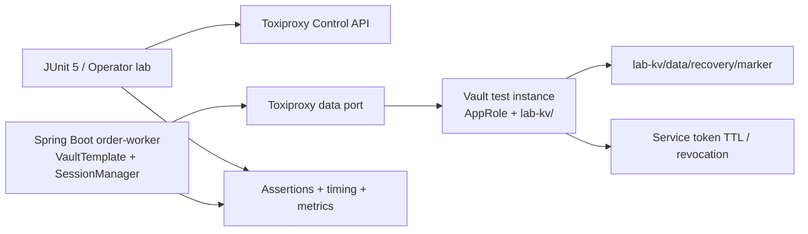
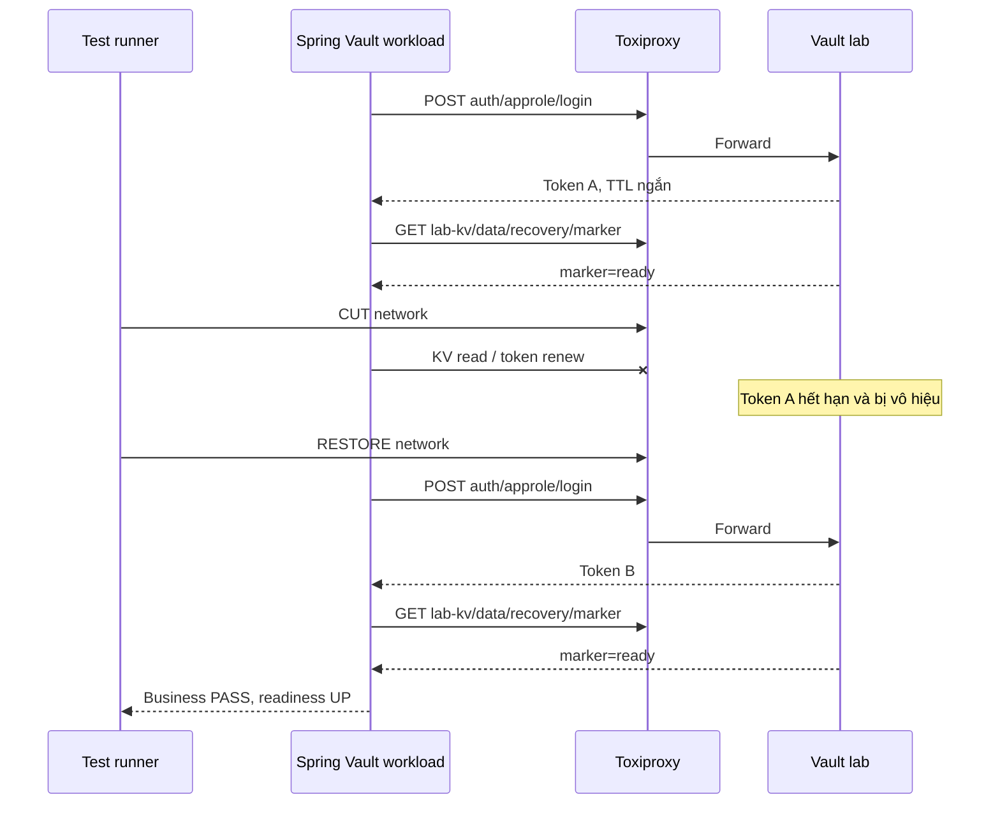
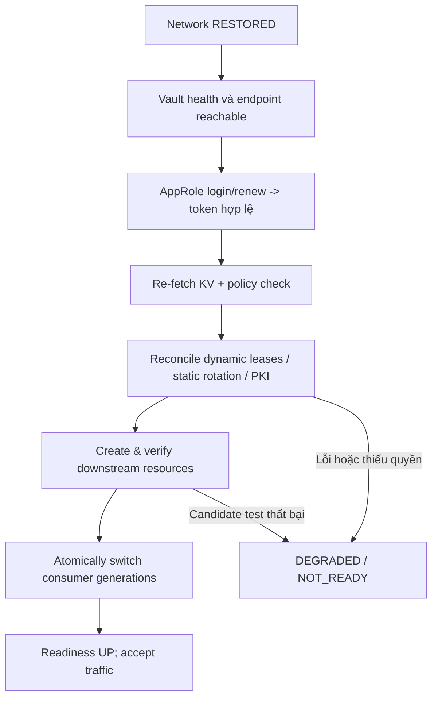

# Tái hiện mất kết nối, token hết hạn và quá trình phục hồi trong Spring Vault

> **Chương:** Thực hành tổng hợp  
> **Bài học:** Tái hiện mất kết nối, token hết hạn và quá trình phục hồi  
> **Công nghệ:** HashiCorp Vault, Spring Vault `VaultTemplate`, AppRole/workload authentication, token/lease lifecycle, KV v2, Toxiproxy, Testcontainers, JUnit 5 và Awaitility.

Bài thực hành này kết nối kiến thức của module **SPRING_VAULT**: ứng dụng Java truy cập Vault bằng danh tính workload và policy giới hạn, đọc KV secrets, đồng thời phải xử lý timeout, token hết hạn, secret lease, Transit/PKI và phục hồi sau sự cố. Trọng tâm không chỉ là làm Vault trả lời lại, mà còn là chứng minh **ứng dụng thực sự tiếp tục phục vụ đúng quyền và đúng dữ liệu** sau khi mạng hoạt động trở lại.

**Phạm vi an toàn:** Chỉ sử dụng Vault **lab/dev/test cô lập** và dữ liệu giả; không ngắt mạng, revoke token, seal Vault hoặc thay đổi password trên hệ thống production. Không commit root token, AppRole SecretID, credential DB hay plaintext vào tài liệu, repository hoặc log CI.

## 1. Mục tiêu và tiêu chí nghiệm thu

Sau khi hoàn thành, bạn phải chứng minh được:

1. **Baseline:** Ứng dụng Java dùng **AppRole** lấy một service token ngắn hạn và đọc được `lab-kv/data/recovery/marker` qua `VaultTemplate`; không dùng root token cho workload.
2. **Network outage:** Toxiproxy chặn đường **ứng dụng → Vault**, trong khi Vault vẫn chạy, vẫn đếm token TTL và tiếp tục quản lý lease.
3. **Token expiration:** Thời gian mất kết nối vượt giới hạn sống tuyệt đối của token cũ; ứng dụng không thể renew trong outage.
4. **Recovery:** Khi đường mạng mở lại, session manager có thể lấy **token mới qua AppRole** nếu RoleID/SecretID còn hợp lệ, sau đó đọc KV thành công.
5. **Ứng dụng thực:** Một thao tác nghiệp vụ và trạng thái readiness trở lại bình thường; không tuyên bố thành công chỉ dựa vào HTTP `/sys/health`.
6. **Phân loại sự cố:** Phân biệt lỗi transport, timeout, Vault sealed/503, 403 do token/policy, SecretID hết hạn và lease của dynamic secret đã hết hạn.
7. **An toàn:** Không bypass Vault bằng root token, credential hardcode hoặc lưu plaintext; không retry vô hạn hay tạo hàng loạt token/credential ngoài dự kiến.
8. **Đo lường:** Có mốc thời gian, assertion PASS/FAIL, bằng chứng đã che dữ liệu nhạy cảm và quy trình cleanup fault trong `finally`.

**Kết quả mong muốn:** *Cùng một Java process* tiếp tục đọc KV và thực hiện thao tác nghiệp vụ sau khi network được mở, dù token từng sử dụng đã hết hạn. Nếu thư viện/session strategy được chọn không tự phục hồi, test phải phát hiện và nhóm triển khai phải sửa cấu hình hoặc cơ chế tái xác thực trước khi kết luận PASS.

## 2. Bối cảnh, kiến trúc và thứ tự sự kiện

Giả sử service `order-worker` cần đọc một marker trong KV v2 để quyết định có cho phép xử lý job. Token được cấp bằng AppRole `order-recovery-role`, có TTL ngắn; các request đến Vault đi qua Toxiproxy.



**Hai con đường cần tách rõ:**

- **Đường quản trị/provisioning:** operator test giao tiếp trực tiếp với Vault lab để tạo KV mount, policy, AppRole, RoleID/SecretID. Kênh này không đi qua proxy trong bài test mất mạng nên vẫn có thể quan sát Vault đang chạy.
- **Đường workload:** mọi request **login AppRole, token renewal, KV read** của Java phải đi qua Toxiproxy. Nếu login đi đường trực tiếp còn KV read qua proxy, thử nghiệm token recovery không còn đại diện cho một outage thật của workload.

Trục thời gian mục tiêu:

```text
t0  AppRole login thành công -> token A, KV read PASS
t1  Test chặn upstream/downstream của proxy
t2  VaultTemplate bắt đầu timeout; readiness suy giảm
t3  Token A hết hạn ở Vault trong lúc proxy vẫn bị chặn
t4  Test mở lại proxy; Vault vẫn initialized và unsealed
t5  Session manager login lại -> token B, policy đúng
t6  VaultTemplate đọc marker và nghiệp vụ thật PASS
t7  Readiness trở về UP; metrics/retry ổn định
```



Không dựa vào thời gian chính xác tuyệt đối của scheduling để suy ra token hết hạn: kiểm chứng bằng lookup/status hoặc audit test đã che secret. Token **renewable** vẫn có thể đến `max_ttl` và không thể renew thêm; việc một token cũ đang sống lúc bắt đầu outage không chứng minh nó còn hợp lệ sau restore.

## 3. Phân biệt ba đồng hồ phải kiểm thử

| Đồng hồ | Thuộc về | Hết hạn nghĩa là gì? | Khôi phục bằng cách nào? |
| --- | --- | --- | --- |
| **Vault auth token TTL** | Token mà `VaultTemplate` dùng để gọi Vault | Vault từ chối request qua token đã expired/revoked | `LifecycleAwareSessionManager` renew nếu còn được phép; nếu không, **login lại bằng AppRole/workload identity** |
| **AppRole SecretID TTL / usage** | Thông tin đăng nhập gốc cho AppRole | Không thể dùng SecretID đó để xin token mới khi đã hết hạn/hết lượt dùng | Cấp/phân phối SecretID mới theo quy trình bootstrap an toàn |
| **Dynamic secret lease TTL** | Credential do Database/Cloud/PKI engine cấp | Credential có thể bị revoke hoặc phải thay mới; user DB có thể bị xóa/vô hiệu | Renew hoặc yêu cầu credential mới theo đúng engine; làm mới tài nguyên đang dùng |

Điều này giải thích ba kết quả rất khác nhau sau khi mạng trở lại:

- Token A **còn hạn** → Java có thể tiếp tục dùng A hoặc renew, không nhất thiết login lại.
- Token A **hết hạn**, nhưng AppRole SecretID **còn hiệu lực** → Java có thể login mới để nhận token B.
- Token A **hết hạn** và AppRole SecretID cũng **hết hạn/hết lượt** → Java **không tự phục hồi** chỉ nhờ mở mạng; phải được cấp nguồn xác thực hợp lệ mới.

**Giới hạn quan trọng:** nếu chương trình cấu hình `TokenAuthentication` với token tĩnh, việc token đó hết hạn **không** được giải quyết bằng cùng `SessionManager` như AppRole. Token tĩnh không có cơ chế tự tạo token mới. Bài lab phải dùng một auth method cho phép tái xác thực và có đủ credential nguồn.

## 4. Các tầng cần đo trong quá trình khôi phục

| Tầng | Chỉ báo | Điều gì chưa được chứng minh? |
| --- | --- | --- |
| L1 — Vault process/network | TCP kết nối lại, `/v1/sys/health` có trạng thái sẵn sàng | Token workload còn hạn hay không |
| L2 — Authentication | AppRole login/renew thành công, token mới có policy đúng | KV mount/path và ACL đã đúng |
| L3 — Secret API | `VaultTemplate.read("lab-kv/data/recovery/marker")` nhận `marker=ready` | JDBC pool/TLS client đang dùng credential mới |
| L4 — Business consumer | Job test xử lý thành công bằng dữ liệu hợp lệ | Tất cả instance trong cluster đã phục hồi |
| L5 — Stability | Lỗi và retry trở về mức bình thường; không rò thread/lease/token | Recovery được coi hoàn chỉnh theo SLO |

Ở HA Vault, `/sys/health` có mã mặc định `200` (active), `429` (standby), `501` (uninitialized), `503` (sealed) và các trường hợp DR/performance standby; diễn giải chính xác còn tùy API params và proxy. Ở bài lab Vault dev đơn node, kỳ vọng `initialized=true`, `sealed=false` trước và sau lỗi mạng, vì fault nằm ở Toxiproxy chứ không ở Vault.

Trước khi chọn retry, nhớ rằng `GET database/creds/<role>` có thể cấp credential mới **mỗi lần** gọi. Nó không phải health probe thuần đọc, và timeout sau khi server tạo user có thể khiến client không biết request đã tạo side effect. Smoke test đơn giản nên dùng một **KV test path chỉ đọc**.

## 5. Điều kiện tiên quyết và giới hạn lab

**Cần có:** Java 17+; Spring Boot + Spring Vault/Spring Cloud Vault phiên bản tương thích; JUnit 5; Testcontainers Vault + Toxiproxy; Docker/Podman runtime được hỗ trợ; một Vault dev instance hoặc Vault staging được tạo riêng; và khả năng kiểm tra kết quả/timing của test.

**Phân biệt phạm vi:**

| Môi trường | Dùng cho | Không dùng để kết luận |
| --- | --- | --- |
| Vault **dev container** (không storage bền vững) | Network outage trong khi Vault process chạy; token TTL tự hết hạn | Vault restart vẫn giữ mọi dữ liệu/token |
| Vault lab có **Raft/storage bền vững** | Restart, seal/unseal, HA và recovery dữ liệu | Hệ thống production sẽ tự phục hồi giống lab nếu cấu hình khác |
| Vault Enterprise staging | Namespace/replication và policy theo thực tế | Community dev container có đầy đủ Enterprise namespace |
| Database/PKI test riêng | Lease rotation, SSL certificate, pool cutover | Chỉ kiểm thử KV là đủ cho mọi backend |

**Quan trọng:** không dùng `vault server -dev` để thực hành init/unseal vì dev mode được init/unseal sẵn. Bài này **không yêu cầu seal**: chỉ chặn mạng phía ứng dụng, để Vault tiếp tục chạy và quản lý TTL. Khi cần test sealed/restart, tạo kịch bản độc lập cùng quy trình vận hành riêng.

## 6. Provisioning Vault lab: KV v2, policy và AppRole TTL ngắn

Giả sử `VAULT_ADDR` của **operator lab** trỏ trực tiếp vào Vault dev instance. Các lệnh trong phần này dùng token quản trị **chỉ trong test** và không chứa SecretID thật. Không đưa các giá trị trả về vào CI stdout hoặc shell history công khai.

### 6.1. Tạo KV fixture tách biệt

```bash
# Operator LAB: mount riêng, không phụ thuộc secret/ mặc định.
vault secrets enable -path=lab-kv -version=2 kv

# Giá trị hoàn toàn giả, dùng để kiểm thử đọc.
vault kv put -mount=lab-kv recovery/marker marker=ready stage=baseline

# Đọc lại bằng CLI admin để chứng minh fixture đã tồn tại.
vault kv get -mount=lab-kv recovery/marker
```

Cách hiểu path:

```text
CLI:            vault kv get -mount=lab-kv recovery/marker
HTTP:           GET /v1/lab-kv/data/recovery/marker
VaultTemplate:  read("lab-kv/data/recovery/marker")
KV v2 response: response.data.data.marker = "ready"
```

Không đặt `lab-kv/data` làm mount và không gửi `recovery/marker` qua raw `VaultTemplate.read()` mà thiếu tiền tố `lab-kv/data/`.

### 6.2. Policy chỉ được đọc một path

Nội dung file lab `order-recovery-read.hcl`:

```hcl
path "lab-kv/data/recovery/marker" {
  capabilities = ["read"]
}
```

Cài policy bằng operator:

```bash
vault policy write order-recovery-read order-recovery-read.hcl
```

Policy này **không** cho workload sửa secret, xem auth role, cấp token, quản trị Transit/PKI/Database, hoặc seal Vault. Khi kiểm thử, cần dùng token do AppRole cấp để chứng minh `read` được phép và `write` bị từ chối. Không dùng root token cho assert phân quyền.

### 6.3. AppRole phát service token có hard maximum TTL

```bash
# Operator LAB: chỉ bật AppRole auth nếu mount chưa tồn tại.
vault auth enable approle

# Service token có TTL mặc định 30s, hard cap 60s
# để outage dài hơn 60s chắc chắn đi qua thời điểm hết hạn.
vault write auth/approle/role/order-recovery-role \
  token_type=service \
  token_policies=order-recovery-read \
  token_ttl=30s \
  token_max_ttl=60s \
  token_explicit_max_ttl=60s \
  secret_id_ttl=30m \
  secret_id_num_uses=0
```

**Hai tùy chọn cố ý cho test:** `token_explicit_max_ttl=60s` tạo giới hạn cứng về vòng đời token phát hành; `secret_id_num_uses=0` cho phép login lại nhiều lần trong bài lab. Đây **không** phải khuyến nghị mặc định cho production, nơi SecretID nên có TTL/lượt dùng ngắn, được phân phối an toàn hoặc qua response wrapping.

Lấy hai credential nguồn bằng operator test:

```bash
vault read auth/approle/role/order-recovery-role/role-id
vault write -f auth/approle/role/order-recovery-role/secret-id
```

Lệnh thứ hai trả **SecretID nhạy cảm**. Giữ kết quả trong secret manager/cơ chế inject an toàn của test harness, không đưa vào log, commit hoặc ảnh chụp màn hình. Nếu SecretID hết hạn/hết lượt dùng trong outage, test recovery phải **FAIL** và chuyển sang quy trình cấp SecretID mới; không nới ACL hoặc dùng root token.

**Điều kiện để tách lỗi:** lúc bắt đầu lỗi mạng, xác nhận token A vừa được cấp và còn hạn. Thời gian chặn mạng nên lớn hơn **hard TTL 60s**, có biên an toàn cho CI scheduler; đây là một bài lab có chủ đích, không nên lấy TTL này cho môi trường production.
## 7. Cấu hình Spring Vault: workload login qua proxy

Tạo một ứng dụng Spring Boot test hoặc sử dụng ứng dụng Java test đã có `VaultTemplate`. Cấu hình AppRole authentication qua **một URI proxy duy nhất**:

```yaml
spring:
  config:
    import: "optional:vault://"
  cloud:
    vault:
      uri: ${LAB_VAULT_URI}
      authentication: APPROLE
      app-role:
        app-role-path: approle
        role-id: ${LAB_VAULT_ROLE_ID}
        secret-id: ${LAB_VAULT_SECRET_ID}
      kv:
        enabled: false
```

Trong bài lab, `spring.cloud.vault.kv.enabled=false` chỉ **tắt nạp KV thành Spring property source tự động** để phép đo tập trung vào các lệnh `VaultTemplate.read(...)` do ứng dụng gọi. Nó **không tắt** khả năng dùng `VaultTemplate` đọc trực tiếp `lab-kv/data/recovery/marker`.

- `LAB_VAULT_URI`: URL của **data port Toxiproxy**, không phải URL trực tiếp của Vault container.
- `LAB_VAULT_ROLE_ID` và `LAB_VAULT_SECRET_ID`: thông tin AppRole cấp qua cơ chế inject test; không ghi literal thật vào YAML.
- `optional:vault://` là lựa chọn xử lý ConfigData cho lab. Production cần xem xét fail-fast và secret bắt buộc theo quy trình boot; **không** dùng `optional` để che lỗi cần bảo vệ ngay từ startup.
- `app-role-path=approle` là mount **auth**. Đây không phải mount KV `lab-kv/`.
- Nếu project dùng Spring Vault thuần thay vì Spring Cloud Vault, cấu hình `AppRoleAuthentication` và `LifecycleAwareSessionManager` qua `AbstractVaultConfiguration` theo đúng phiên bản thư viện; **không thay bằng `TokenAuthentication` tĩnh** khi test cần login lại.

### 7.1. Code nghiệp vụ để chứng minh secret thực sự được đọc

```java
import java.util.Map;

import org.springframework.stereotype.Service;
import org.springframework.vault.core.VaultOperations;
import org.springframework.vault.support.VaultResponse;

@Service
public final class RecoveryMarkerService {

    private static final String PATH =
            "lab-kv/data/recovery/marker";

    private final VaultOperations vault;

    public RecoveryMarkerService(VaultOperations vault) {
        this.vault = vault;
    }

    public String currentMarker() {
        VaultResponse response = vault.read(PATH);

        if (response == null || response.getData() == null) {
            throw new IllegalStateException("Vault marker unavailable");
        }
        Object inner = response.getData().get("data");
        if (!(inner instanceof Map<?, ?> fields)) {
            throw new IllegalStateException("Unexpected KV v2 envelope");
        }
        Object marker = fields.get("marker");
        if (!(marker instanceof String value) || value.isBlank()) {
            throw new IllegalStateException("Vault marker invalid");
        }
        return value;
    }

    public boolean canProcessOrder() {
        // Test nghiệp vụ đơn giản, không được dùng root token.
        return "ready".equals(currentMarker());
    }
}
```

`VaultOperations` là interface do `VaultTemplate` triển khai. Trong Spring Boot có bean Vault phù hợp, service nhận cùng session/token lifecycle mà cấu hình Spring Vault quản lý. Nếu project đã cấu hình một `VaultTemplate` khác và tự hardcode token, phải sửa kiến trúc test để bảo đảm **bean được inject dùng AppRole**, không phải một client phụ.

**Điều kiện kiểm thử:** gọi `currentMarker()` trong baseline để xác nhận `"ready"`; gọi lại **trên cùng bean/cùng process** sau outage. Không tạo `VaultTemplate` mới bằng root token chỉ để làm assertion hồi phục.

### 7.2. Đặt timeout cho request, không để mạng lỗi làm treo test

Ví dụ cấu hình HTTP request factory của Spring trong một client test thuần:

```java
import org.springframework.http.client.SimpleClientHttpRequestFactory;

SimpleClientHttpRequestFactory factory =
        new SimpleClientHttpRequestFactory();
factory.setConnectTimeout(500);
factory.setReadTimeout(1_500);
```

Khi tự xây client, có thể dùng constructor của `VaultTemplate` nhận `ClientHttpRequestFactory` **và `SessionManager`**, để cùng chính sách timeout áp dụng cho API và authentication. Với Spring Cloud Vault, cấu hình thời gian chờ qua các properties và HTTP client factory **được hỗ trợ bởi đúng phiên bản**. Phải xác minh bằng fault injection thực tế rằng cả **login, renew và KV read** không chờ vô hạn.

Không thêm một `SimpleSessionManager` chỉ để cấu hình timeout: `SimpleSessionManager` không quản lý refresh/renew token. Với mục tiêu re-login trong bài này, dùng `LifecycleAwareSessionManager` hoặc session management tự động tương thích.

## 8. Nối Vault với Toxiproxy và điều khiển fault

Toxiproxy là **TCP proxy**, nên có thể chặn request mà không dừng Vault. Với Testcontainers Java, đặt Vault container và Toxiproxy container trên **cùng Docker network**, tạo proxy từ cổng `8666` tới `vault:8200`.

### 8.1. Khung fixture Testcontainers

```java
import java.net.URI;

import eu.rekawek.toxiproxy.ToxiproxyClient;
import eu.rekawek.toxiproxy.model.Proxy;
import org.testcontainers.containers.Network;
import org.testcontainers.containers.ToxiproxyContainer;
import org.testcontainers.vault.VaultContainer;

// Đoạn fixture dùng trong setup của một JUnit 5 integration test.
// Pin image/dependency versions theo BOM đã được kiểm thử.
Network network = Network.newNetwork();

VaultContainer<?> vault = new VaultContainer<>(
        "hashicorp/vault:1.18")
        .withVaultToken("root-token-only-inside-lab")
        .withNetwork(network)
        .withNetworkAliases("vault");

ToxiproxyContainer toxiproxy = new ToxiproxyContainer(
        "ghcr.io/shopify/toxiproxy:2.5.0")
        .withNetwork(network);

vault.start();
toxiproxy.start();

ToxiproxyClient control = new ToxiproxyClient(
        toxiproxy.getHost(),
        toxiproxy.getControlPort());

Proxy dataProxy = control.createProxy(
        "vault-workload",
        "0.0.0.0:8666",
        "vault:8200");

URI workloadUri = URI.create(
        "http://" + toxiproxy.getHost()
                + ":" + toxiproxy.getMappedPort(8666)
);

// Truyền workloadUri vào LAB_VAULT_URI trước khi Spring Context
// khởi tạo; mọi request của workload phải qua URI này.
```

Đây là **khung setup** để nhúng vào fixture JUnit, không phải một class hoàn chỉnh có thể copy chạy một mình. Trong project thực tế, cần khai báo dependencies, tạo/provision AppRole, xuất RoleID/SecretID qua memory-only test fixture, cấu hình `@DynamicPropertySource` hoặc property initializer **trước** khi Spring context tạo bean Vault, rồi đóng container/network ở teardown. API và image tag cần khớp BOM của project; không coi image tag ví dụ là phiên bản sản xuất được khuyên dùng.

**Quan trọng về mạng:** code JUnit chạy trên **host** thì dùng `toxiproxy.getHost()` và `getMappedPort(8666)`. Nếu Java app cũng chạy trong một container cùng Docker network, nó phải dùng **hostname proxy trong network và port nội bộ `8666`**, không dùng địa chỉ host mapped.

### 8.2. Cắt và mở kết nối bằng Toxiproxy

Theo Toxiproxy Java client, có thể thêm một toxic có bandwidth `0` cho cả hai hướng:

```java
import eu.rekawek.toxiproxy.model.ToxicDirection;

// Đã có biến Proxy dataProxy ở fixture:
dataProxy.toxics().bandwidth(
        "cut-downstream", ToxicDirection.DOWNSTREAM, 0);
dataProxy.toxics().bandwidth(
        "cut-upstream", ToxicDirection.UPSTREAM, 0);

try {
    // Chạy bước ASSERT during outage của test.
    // Vault vẫn chạy, nhưng app không còn gọi Vault qua proxy.
} finally {
    // Không để fault lọt sang test khác.
    dataProxy.toxics().get("cut-downstream").remove();
    dataProxy.toxics().get("cut-upstream").remove();
}
```

**Tại sao cần hai hướng?** Trong kịch bản chặn TCP, request có thể đi tới server nhưng response không trở về, hoặc ngược lại. Chặn cả hai hướng giúp test lỗi mạng rõ ràng hơn, nhưng cũng tạo ra trạng thái **không biết server đã xử lý thao tác chưa**. Vì vậy smoke test nên dùng KV GET thuần đọc; không thử vô hạn `GET database/creds/...`, `POST pki/issue/...` hoặc `sys/wrapping/unwrap`.

Nếu cần kiểm thử **connection refused** hoặc **RST**, dùng khả năng disable proxy hoặc đóng socket có kiểm soát thay vì bandwidth toxic; các lỗi này khác với timeout/blackhole. Cũng nên có bài thử latency+jitter, vì mạng chậm có thể tạo timeout dù vẫn kết nối thành công.

### 8.3. Cách provisioning không làm nhiễu fault test

Tạo mount/policy/AppRole bằng **đường trực tiếp** trước khi kích hoạt Spring Boot test context. Test harness không nên tạo mới role mỗi lần poll readiness.

Có thể dùng `VaultContainer.withInitCommand(...)` để tạo KV mount và ghi dữ liệu lab, ví dụ:

```java
VaultContainer<?> vault = new VaultContainer<>(
        "hashicorp/vault:1.18")
        .withVaultToken("lab-only-root")
        .withInitCommand(
                "secrets enable -path=lab-kv -version=2 kv",
                "kv put -mount=lab-kv recovery/marker marker=ready");
```

Sau khi container start, dùng operator client (không phải client của workload) để cấu hình auth/policy và lấy **RoleID + SecretID** trong bộ nhớ. Không in output chứa SecretID hoặc token ra logs của JUnit. Sau đó mới khởi tạo Spring context với env/config đã inject.

**Lưu ý:** Docker/Testcontainers cần thiết lập mỗi container cùng network và alias hợp lệ. `withInitCommand` là tiện ích của `VaultContainer`, không phải cách khởi tạo Vault server production hay làm init/unseal Shamir.

## 9. Tái hiện **mất mạng nhưng token còn hạn** (control case)

**Mục đích:** kiểm tra tầng HTTP client có thể kết nối trở lại mà chưa cần re-auth. Chạy case này **riêng** để tránh nhầm lỗi token.

| Bước | Thực hiện | Assertion |
| --- | --- | --- |
| A1 | AppRole login, xác minh `currentMarker()=="ready"` | PASS, nhận token có TTL còn lớn |
| A2 | Chặn proxy trong 5–10 giây (ngắn hơn token TTL) | `VaultTemplate` không thể đọc KV mới |
| A3 | Gọi `currentMarker()` trong outage | Exception/timeout nằm trong deadline; không trả `"ready"` giả |
| A4 | Mở proxy trong `finally` | Fault đã được gỡ |
| A5 | Đọc lại qua **cùng Java process** | Kết quả `"ready"` trong SLO |
| A6 | Gọi liên tiếp 10–20 lần sau recovery | Không lỗi kéo dài hoặc leak connection/thread |

Trong case A, **không yêu cầu token B khác A**: token A có thể vẫn hợp lệ và được tái sử dụng. Test chỉ chứng minh reconnect tầng transport và quyền đọc hiện hành. Đây là phép thử nền để khi case token hết hạn thất bại, ta biết do **authentication lifecycle** thay vì request factory không tái kết nối.

**Không bật retry vô hạn trong code nghiệp vụ:** với mỗi thao tác cần timeout và tổng deadline hữu hạn. Một response KV trong cache chỉ được sử dụng nếu chính sách cho phép giữ cache trong outage; nó không thay thế assertion `VaultTemplate.read` thật đã khôi phục.

## 10. Tái hiện **mạng mất lâu hơn TTL token** (case chính)

### 10.1. Setup và điều kiện đầu vào

1. Dùng service token **A** được cấp bằng AppRole ở bước 6.3. Ở t0, `VaultTemplate.read` thành công.
2. Token TTL ban đầu ~30 giây, explicit max TTL ~60 giây. Token có thể renew trong một phần vòng đời, nhưng **không vượt hard max TTL**.
3. SecretID dành cho login phải còn hiệu lực **dài hơn bài test** và còn lượt dùng. Đây là điều kiện test chủ động; không áp dụng giá trị `secret_id_num_uses=0` vào production.
4. Chặn **toàn bộ request auth + data** tới Vault qua proxy, để session manager không thể renew token hoặc login lại.
5. Duy trì outage **lâu hơn 60 giây có biên an toàn** (ví dụ 75–90 giây trong lab) để token A chắc chắn không còn khả dụng, dựa trên TTL thực tế quan sát được.
6. Gỡ fault, thử lại cho tới khi có **giao dịch nghiệp vụ thật** thành công hoặc tới deadline phục hồi.

### 10.2. Chờ token hết hạn mà không làm test flaky

Không chỉ dùng `Thread.sleep(61_000)` rồi khẳng định token A đã expire:

- Vault có thể đã cấp TTL khác vì mount/system policy; các giới hạn TTL có thể bị tune.
- Scheduler của Java, CI load và renew job có thể thay đổi mốc tương đối.
- Nếu request login thành công trễ hơn t0, khoảng chặn được tính sai.
- Trong Vault Enterprise/HA, đường đi và trạng thái của token cũng có điều kiện riêng.

**Cách xác minh tốt:** trước fault, đọc metadata/token TTL hoặc sự kiện login qua **kênh quan sát test an toàn**, không ghi raw token. Đặt outage dài hơn explicit max TTL **tính từ lúc token A được cấp**, không phải từ lúc một request bất kỳ bắt đầu. Sau khi khôi phục, dùng audit/accessor **đã redacted** để xác nhận có login mới thay vì chỉ thấy KV read thành công.

### 10.3. Kết quả kỳ vọng và dấu hiệu lỗi

| Thời điểm | Chờ thấy | Khi nào test FAIL? |
| --- | --- | --- |
| Trước outage | AppRole login + KV read thành công | Sai mount, token root, không qua proxy |
| Trong outage | Timeout/connect error trong deadline; login/renew thất bại có giám sát | Thread treo, retry storm, fallback plaintext |
| Token A qua hard TTL | A không được Vault chấp nhận | Dùng lại A và giả vờ token chưa expire |
| Sau restore | Session manager login mới với cùng AppRole còn hợp lệ | Reuse A đã expired, 403 lặp vô tận |
| KV read mới | Trả `marker=ready` qua token B có quyền `read` | Chỉ thấy Vault health, không thử đúng path |
| Business check | `canProcessOrder()==true` và readiness `UP` | Token mới có quyền nhưng component khác vẫn lỗi |
| Sau ổn định | Không còn retry/login storm, tài nguyên được giải phóng | Leaks hoặc xác thực lại mỗi HTTP request |

**Cách ứng xử thực tế của Spring Vault phụ thuộc phiên bản và session management được cấu hình.** `LifecycleAwareSessionManager` hỗ trợ renew token và login lại khi đạt giới hạn; nhưng một outage kéo dài, lỗi bootstrap hoặc SecretID hết hạn có thể khiến session không phục hồi theo kỳ vọng. Bài lab phải **đo** chứ không khẳng định mọi phiên bản Spring Cloud Vault luôn tự phục hồi.

## 11. Kiểm thử JUnit bằng pha kiểm soát, không phụ thuộc sleep cố định

Một test E2E cần fixture đã chuẩn bị:

- `RecoveryMarkerService markerService` đang dùng **VaultTemplate** qua proxy.
- `Proxy dataProxy` điều khiển cùng đường TCP mà Spring Vault sử dụng.
- `VaultLabAdmin admin` hoặc cơ chế fixture cho phép **quan sát riêng** token metadata/audit mà không lộ token.
- Cấu hình TTL/timeout có deadline rõ ràng; VaultContainer vẫn chạy trong toàn bộ test.

Ví dụ **khung assertion** để nhúng vào Spring Boot integration test:

```java
import java.time.Duration;

import org.junit.jupiter.api.Test;
import org.springframework.beans.factory.annotation.Autowired;
import org.springframework.boot.test.context.SpringBootTest;

import static org.awaitility.Awaitility.await;
import static org.junit.jupiter.api.Assertions.*;

@SpringBootTest
class TokenExpiryRecoveryIT {

    @Autowired
    RecoveryMarkerService markerService;

    // Trong fixture thực, proxy phải do Testcontainers setup tạo
    // trước khi Spring Context khởi tạo LAB_VAULT_URI.
    private Proxy dataProxy;

    @Test
    void reauthenticatesAfterLongNetworkOutage() throws Exception {
        assertEquals("ready", markerService.currentMarker());

        // Điều kiện để test được định nghĩa riêng:
        // AppRole service token explicit max TTL = 60s.
        // SecretID còn hợp lệ và không giới hạn lượt login (lab).
        long tokenHardTtlMillis = 60_000L;
        long safetyMarginMillis = 20_000L;

        dataProxy.toxics().bandwidth(
                "cut-downstream", ToxicDirection.DOWNSTREAM, 0);
        dataProxy.toxics().bandwidth(
                "cut-upstream", ToxicDirection.UPSTREAM, 0);

        try {
            assertThrows(RuntimeException.class,
                    () -> markerService.currentMarker());

            // Test harness dùng monotonic clock và await điều kiện TTL
            // quan sát được; phần dưới mô phỏng chờ qua hard cap.
            Thread.sleep(tokenHardTtlMillis + safetyMarginMillis);
        } finally {
            dataProxy.toxics().get("cut-downstream").remove();
            dataProxy.toxics().get("cut-upstream").remove();
        }

        await()
            .atMost(Duration.ofSeconds(45))
            .pollInterval(Duration.ofSeconds(2))
            .untilAsserted(() -> {
                assertEquals("ready", markerService.currentMarker());
                assertTrue(markerService.canProcessOrder());
            });
    }
}
```

Đây là **khung điều phối**, cố ý chưa bao gồm việc khởi tạo `dataProxy`, `@DynamicPropertySource` và các fixture quan sát token: phải nối chúng với setup từ phần 8 trước khi dùng, không copy nguyên class rồi tưởng test chạy độc lập. Để test chuẩn tránh flaky, **thay `Thread.sleep` bằng đồng hồ/điều kiện TTL được ghi nhận và Awaitility**; vẫn phải bảo đảm deadline tổng cho HTTP call nằm bên trong assertion. JUnit `assertThrows(RuntimeException.class, ...)` phải được thay bằng xác minh loại lỗi transport cụ thể trong dự án (không để một lỗi NullPointerException ngẫu nhiên khiến test xanh).

Không dùng `await().atMost(...)` để bao một HTTP call có timeout vô hạn. Trong môi trường CI có network slowness, thử với timeout thực tế trước rồi mới xác định recovery SLO.
## 12. Giai đoạn phục hồi không chỉ có login: reconcile KV, lease và consumer

Trong bài lab cơ bản, marker KV là dữ liệu **tĩnh có version**. KV v2 không tạo lease động cho mỗi `read`. Vì vậy sau khi mạng trở lại và AppRole login lại, Java có thể đọc marker ngay.

Nhưng khi một service tích hợp cả **KV + Transit + PKI + database** thì token mới **không tự khôi phục** mọi thành phần đã dùng token A.

| Thành phần | Khi token A hết hạn trong outage | Sau login bằng token B |
| --- | --- | --- |
| `VaultTemplate` đọc KV v2 | Request bằng A bị từ chối | Đọc lại bằng B, validate `data.data`/`metadata.version` |
| Transit encrypt/decrypt | Thao tác cần Vault thất bại khi mạng lỗi | Gọi lại endpoint bằng B với ACL tương ứng; không dùng plaintext fallback |
| Dynamic database credential cấp bởi A | Lease có thể hết hạn/bị thu hồi theo lifecycle token | Cấp credential mới bằng B, test JDBC **connection mới**, đổi pool, đóng pool cũ |
| Static database credential | Vault có thể rotate password của account cố định trong outage | Đọc `database/static-creds/...`, làm mới DataSource nếu password đổi |
| PKI certificate/key | Certificate vẫn có validity riêng; không thể reissue khi Vault unreachable | Nếu gần/hết hạn, xin certificate mới, validate chain/SAN và thay `SSLContext`/client |
| Cubbyhole của token A | Scope data theo token A, mất khi A bị revoke/expire | Token B có cubbyhole **khác**, không dùng marker Cubbyhole A làm state bền vững |
| Response wrapping token | TTL riêng và thường unwrap một lần | Kiểm tra còn hạn/chưa sử dụng; không retry unwrap mù hoặc tự tạo token thay thế |

**Thứ tự phục hồi an toàn:**



Một test có thể **PASS tầng KV** nhưng **FAIL tầng DataSource**. Không được gộp chúng thành một cờ `vaultRecovered=true` thiếu điều kiện. Nếu một chức năng không thiết yếu phụ thuộc Vault, có thể định nghĩa `DEGRADED` theo yêu cầu sản phẩm; chức năng bắt buộc mà credential không còn hợp lệ phải **fail closed**.

### 12.1. Mở rộng bài lab với Database Secrets Engine

Nếu muốn kiểm thử tích hợp sâu hơn, thêm PostgreSQL lab và dynamic Vault role:

```text
Vault:       database/creds/orders-readonly
Response:    data.username, data.password
Metadata:    lease_id, lease_duration, renewable
Consumer:    HikariCP/DataSource
```

Kịch bản:

1. Token A lấy DB credential A với lease còn hạn; tạo Hikari pool A và chạy `SELECT 1`.
2. Chặn mạng Java → Vault, đợi quá TTL token A/lease A để credential cũ không còn đáng tin.
3. Mở mạng; đăng nhập mới bằng AppRole để có token B.
4. Yêu cầu **một** DB credential B theo secret lifecycle; không gọi `GET database/creds/...` liên tục như health probe.
5. Tạo candidate pool B, thử **connection mới** và truy vấn kiểm tra quyền SQL phù hợp.
6. Chuyển request mới qua B, để transaction cũ hoàn thành theo quy tắc drain, rồi close A; nếu phù hợp, revoke lease A bằng quyền được cấp.
7. Quan sát không còn kết nối mới dùng credential A và không còn user DB test rò rỉ sau cleanup.

Spring Vault có `SecretLeaseContainer` để quản lý renewable lease, phát các event như `SecretLeaseCreatedEvent`, `AfterSecretLeaseRenewedEvent` và `SecretLeaseExpiredEvent`. Các event này là tín hiệu để ứng dụng **cập nhật resource**, không tự thay password trong mọi JDBC pool. Nếu Spring Cloud Vault đã quản lý cùng path, không tạo thêm một `SecretLeaseContainer` song song làm cấp nhiều credential.

### 12.2. Mở rộng với Transit encryption và PKI

**Transit:** ghi trước outage một ciphertext thử nghiệm được Vault mã hóa. Khi proxy bị chặn, encrypt/decrypt mới phải thất bại có kiểm soát. Sau khi mở proxy và có token B:

- Encrypt một payload giả mới bằng đúng Transit key/policy.
- Decrypt ciphertext cũ và xác minh plaintext gốc (chỉ trong memory/test).
- Nếu key được rotate trong outage, kiểm tra version/policy; không lấy AES key về Java hay lưu plaintext để chờ Vault.
- Nếu một request encrypt timeout **sau khi server đã xử lý**, không giả định lần retry phải trả cùng ciphertext. Ở tầng nghiệp vụ cần bảo đảm chỉ commit dữ liệu hợp lệ một lần.

**PKI:** cấp certificate thử nghiệm có validity phù hợp, ghi nhận `notAfter`. Trong outage, có thể certificate tới hạn reissue. Sau restore, kiểm tra certificate mới và chuỗi CA, private key tương ứng, SAN/hostname, rồi dựng client TLS mới và kiểm tra handshake. Không chỉ cập nhật PEM file nhưng vẫn giữ SSL context cũ; không dùng `trustAll` hoặc bỏ hostname verification.

### 12.3. Tại sao KV marker không dùng làm nguồn xác định token còn sống?

Một secret KV v2 có thể tiếp tục tồn tại qua nhiều token khác nhau nếu policy cho phép. Đọc thành công `marker=ready` **chứng minh token hiện tại có quyền đọc**, nhưng không tự chứng minh token A đã hết hạn hoặc đã có token B. Phải dùng bằng chứng auth/audit riêng (được xử lý bảo mật), ví dụ số lần login hợp lệ hoặc token accessor được băm/ẩn.

Ngược lại, **Cubbyhole theo token** không phải chỗ lưu fixture để kiểm tra được qua re-login: token B sẽ nhìn vùng Cubbyhole mới, có thể gây hiểu lầm rằng Vault đã mất dữ liệu. Dùng KV v2 cho phép thử khôi phục qua nhiều phiên xác thực.

## 13. Phân biệt “Vault phục hồi”, “mạng phục hồi” và “secret đã hợp lệ”

### 13.1. Ma trận trạng thái quan sát

| Hiện tượng | `sys/health` qua đường operator | Workload qua proxy | Diễn giải |
| --- | --- | --- | --- |
| Mạng Java bị chặn, Vault vẫn chạy | `200` (active dev lab) | Timeout | Sự cố mạng theo đường workload |
| Vault process down | Connection refused/timeout | Lỗi transport | Không phải chỉ lỗi proxy |
| Vault sealed (lab non-dev) | Thường `503` | API secret không phục vụ | Cần operator unseal; Java không tự làm |
| Vault unsealed, token A expired | `200` | 403 qua token A | Vấn đề auth/session, không phải Vault down |
| Vault unsealed, token B có policy sai | `200` | 403 tại KV path | Vấn đề ACL/auth role |
| Vault unsealed, AppRole SecretID hết hạn | `200` | Login AppRole thất bại | Không có nguồn tái xác thực hợp lệ |
| KV đọc được, DB user cũ bị revoke | `200` | KV `200`, DB login lỗi | Chưa phục hồi business consumer |
| Token mới + KV + DB/TLS đều hợp lệ | `200` | Giao dịch business PASS | Phục hồi ứng dụng đã hoàn tất |

`GET /sys/health` có ý nghĩa riêng ở active/standby. Với Vault HA, các status như `429` trên **health endpoint**, `472/473/474` có thể xuất hiện theo vai trò/khả năng liên lạc; không đồng nhất `429` của health với rate limit ở mọi API khác. Test phải đặt ngữ cảnh để không đưa ra kết luận sai.

### 13.2. Loại lỗi quyết định retry

| Lỗi | Retry? | Tại sao/cách xử lý |
| --- | --- | --- |
| Connection refused/reset, connect/read timeout với **KV read** | Có, giới hạn và backoff+jitter | KV GET thuần đọc không cấp credential mới |
| HTTP 503 sealed/unavailable | Chờ operator/cluster ready, retry có giới hạn | Không cấp quyền unseal cho workload |
| HTTP 429 ở API bị rate limit | Có giới hạn, tôn trọng tín hiệu retry nếu có | Không dồn request lúc Vault mới trở lại |
| HTTP 403 vì token expired | Cần session re-auth hợp lệ | Lặp mãi cùng token A không có tác dụng |
| HTTP 403 vì thiếu policy | Không retry mù | Chính sách và workload identity cần được sửa |
| HTTP 400 schema sai | Không retry | Cần sửa request/config |
| `GET database/creds/role` timeout | Thận trọng, đối soát side effect | Server có thể đã cấp một DB user nhưng response thất lạc |
| `POST pki/issue/role` timeout | Thận trọng | Có thể đã phát hành cert/serial |
| `POST sys/wrapping/unwrap` timeout | Không lặp mù | Wrapping token thường một lần dùng |
| DB login lỗi sau Vault recovery | Không chữa bằng cách đọc KV liên tục | Kiểm tra lease/rotation và thay pool |

**Kỷ luật timeout:** `connectTimeout`, `readTimeout`, deadline tổng và số lần retry phải thống nhất với HTTP deadline của request nghiệp vụ. Một test `await().atMost(30s)` không còn ý nghĩa nếu *mỗi* HTTP request bên trong có read timeout vô hạn.

## 14. SLO, readiness và log để kết luận PASS

Đo theo **thời điểm phục hồi giao dịch nghiệp vụ**, không theo thời điểm bật lại proxy.

```text
t1 = proxy CUT bắt đầu
t2 = lỗi đầu tiên được workload phát hiện
t3 = proxy RESTORED
t4 = session có token hợp lệ
t5 = VaultTemplate KV read thành công
t6 = business consumer thành công
t7 = readiness trở về UP

Detection latency = t2 - t1
Auth recovery latency = t4 - t3
Business recovery latency = t6 - t3
```

Ví dụ **mục tiêu lab** (chỉ để thiết kế assertion, không phải mặc định Spring Vault):

| Chỉ số | Ngưỡng ví dụ | Lưu ý |
| --- | --- | --- |
| Outage request deadline | Mỗi GET thất bại trong 2 giây | Cấu hình đúng HTTP request factory |
| Token hard cap | 60 giây | Test phải vượt giới hạn thực đo |
| Business recovery | 45 giây sau proxy restore | Tính từ t3 tới giao dịch PASS |
| Retry budget | Tối đa 2–3 attempt cho một read request | Có jitter, giới hạn concurrency |
| Readiness | `NOT_READY` nếu chức năng bắt buộc không phục vụ | Không reset JVM liên tục khi Vault down |
| Stability | Ít nhất 20 read nghiệp vụ liên tiếp thành công | Sau thời điểm recovery, không có lỗi lặp |

### 14.1. Metrics và audit an toàn

- `vault_network_failure_total{kind}`: số lỗi timeout/reset trong giai đoạn fault.
- `vault_login_attempt_total{result}` và `vault_token_renewal_error_total`: phân biệt login mới với renew.
- `vault_recovery_latency_seconds`: thời gian phục hồi từ t3 đến t6.
- `vault_kv_read_success_total`, `vault_kv_read_error_total`: nghiệp vụ đọc secret.
- `secret_lease_expired_total`: lease động cần reconcile.
- `jdbc_connection_auth_errors_total`, `tls_handshake_failure_total`: downstream chưa phục hồi.
- `application_readiness_state`: `UP`, `DEGRADED`, `RECOVERING`, `NOT_READY`.

**Không** ghi token A/B, SecretID, JWT, root token, `lease_id` đầy đủ, password, private key, payload KV hoặc plaintext Transit vào log/metric labels/traces. Khi cần so phiên token A/B, sử dụng `accessor` đã được bảo vệ hoặc fingerprint một chiều có bối cảnh test; không phát hành raw token vào evidence.

**Đề xuất trạng thái readiness:**

```text
NORMAL:
  Vault reachable; token và consumer đều hợp lệ.

DEGRADED:
  Một chức năng không bắt buộc phụ thuộc Vault không thể hoạt động.

NOT_READY:
  Không phục vụ được tác vụ thiết yếu an toàn, ví dụ thiếu credential hợp lệ.

RECOVERING:
  Vault reachable, đang re-auth/refresh lease/cutover resource.
```

Liveness nên phản ánh JVM/process có thể tiếp tục chạy, không tự restart-loop vì một network partition ngắn. Nếu ứng dụng không thể tiếp tục an toàn khi Vault down, từ chối traffic bằng readiness (hoặc lỗi nghiệp vụ rõ ràng), chứ không chuyển sang credential quản trị.

## 15. Ma trận test tổng hợp: một lỗi, một kết luận

| ID | Fault hoặc thay đổi trong lab | Khi lỗi xảy ra | Sau restore: PASS khi |
| --- | --- | --- | --- |
| **T01** | Ngắt mạng 5s, token còn hạn | KV read timeout | Cùng JVM đọc lại được KV, không nhất thiết có token mới |
| **T02** | Ngắt mạng > token hard TTL | A hết hạn; renew/login không thể gọi | AppRole cấp token B, KV + business PASS |
| **T03** | SecretID hết hạn trong outage | Không lấy được token mới | Fail closed + alert; sau cấp SecretID mới, login mới PASS |
| **T04** | Gỡ fault nhưng policy AppRole đã bị thu hẹp | Login có thể thành công; KV bị 403 | Báo thiếu quyền, không dùng root, chỉ PASS sau sửa policy đúng |
| **T05** | Vault sealed (non-dev lab) | 503/tác vụ secret thất bại | Operator unseal, workload auth + business phục hồi |
| **T06** | Vault process restart với storage bền vững | Không reachable một thời gian | Không re-init; sealed/unsealed xử lý đúng, KV content còn nguyên |
| **T07** | Vault dev restart (ephemeral storage) | Token/fixtures có thể mất | Test xác nhận giới hạn, không nhầm với durable recovery |
| **T08** | Latency toxic gây read timeout | Deadline và backoff hoạt động | Gỡ latency, p95 trở về baseline |
| **T09** | Chỉ chặn chiều response | Không biết request đã được server xử lý chưa | Không retry vô điều kiện thao tác có side effect |
| **T10** | Token A bị revoke chủ động | A bị 403 | AppRole re-auth thành công bằng identity hợp lệ, nếu thiết kế hỗ trợ |
| **T11** | Database dynamic lease hết hạn | Connection mới có thể thất bại | Credential B được cấp và pool B kết nối được |
| **T12** | Static DB password rotate trong outage | Pool giữ password cũ | Đọc static-creds mới, pool đổi, new connection thành công |
| **T13** | PKI cert hết hạn trong outage | TLS handshake thất bại | Reissue, validate, new SSL context/client hoạt động |
| **T14** | Transit key rotate trong outage | Encrypt/decrypt tạm lỗi | Encrypt mới, decrypt cũ theo policy; không fallback plaintext |
| **T15** | 30 pod đồng thời reconnect | Nguy cơ login storm | Backoff+jitter, rate/concurrency limit, cuối cùng tất cả sẵn sàng |
| **T16** | Vault health=200 nhưng DB backend vẫn down | KV có thể đọc, DB không hoạt động | Readiness chưa UP nếu DB là chức năng bắt buộc |
| **T17** | Response KV v2 thiếu data/marker | Schema validation thất bại | Không publish snapshot lỗi; sửa fixture rồi PASS |
| **T18** | Toxiproxy fault không được cleanup | Test sau tiếp tục lỗi | `finally` teardown luôn mở proxy/dọn toxic |
| **T19** | Khác phiên bản Spring Vault/session config | Re-login/renew behavior khác | Assertion auth và business xác minh trên version thực |
| **T20** | Concurrent reconnect + retry sau token expiry | Nhiều thread cùng xin session | Không có token/login storm, request sau phục hồi PASS |

**Báo cáo test phải ghi** cả kết quả của pha outage lẫn pha recovery. Nếu T02 chỉ ghi “lần đầu timeout; sau restore đọc lại được marker” mà không có bằng chứng **token A thực sự hết hạn, đã có B**, thì đó **chưa phải** kiểm thử token-expiry recovery hoàn chỉnh.
## 16. Runbook thực hành từ đầu đến cuối

Thực hiện các bước theo thứ tự và **ghi bằng chứng an toàn** sau mỗi chặng. Có thể chạy bằng JUnit test harness kết hợp Testcontainers/Toxiproxy hoặc thực hiện có giám sát trong môi trường lab tương đương.

### Pha 0 — Chuẩn bị

1. Tạo Vault dev container hoặc Vault lab riêng; kiểm tra `/v1/sys/health` và `vault status`, chắc chắn server đã initialized/unsealed.
2. Tạo KV v2 mount `lab-kv/`, ghi `recovery/marker` với `marker=ready`.
3. Tạo policy `order-recovery-read` chỉ có `read` trên `lab-kv/data/recovery/marker`.
4. Bật AppRole và role `order-recovery-role` với service token TTL 30s, hard max 60s; SecretID còn hạn/lượt dùng qua cả bài.
5. Tạo Toxiproxy trên cùng network với Vault và expose một data port; cấu hình `LAB_VAULT_URI` cho Java đi qua **proxy**.
6. Inject RoleID/SecretID vào ứng dụng bằng test harness, không lưu vào repository hoặc xuất log.
7. Bật logging đã redacted, metrics, request timeout và deadline tổng; xác định SLO phục hồi (ví dụ 45s sau restore).

### Pha 1 — Xác nhận baseline

1. Khởi động Spring Boot test application **sau** khi proxy/fixture đã sẵn sàng.
2. Gọi `RecoveryMarkerService.currentMarker()`, xác minh bằng `"ready"`.
3. Gọi `canProcessOrder()`, xác minh `true`.
4. Ghi t0 và bằng chứng token A được AppRole cấp, TTL/expiry được kiểm tra bằng kênh operator an toàn.
5. Dùng chính workload token thử **ghi** vào `lab-kv/data/recovery/marker`, xác minh HTTP 403; xác nhận ACL không rộng.
6. Ghi baseline latency và số connection/thread, không ghi secret/token vào báo cáo.

### Pha 2 — Fault injection và token expiry

1. Test runner chặn hai hướng proxy, ghi `network_cut_at`.
2. Gửi một request read mới. Assert lỗi transport/timeout **trong ngân sách**; không kiểm tra dữ liệu cache thay cho lệnh HTTP thật.
3. Quan sát retry budget, token renewal/login attempt (có thể lỗi trong thời gian mạng bị chặn), readiness `NOT_READY` nếu workload không còn thực hiện chức năng thiết yếu.
4. Duy trì fault qua **hard max TTL thực tế của token A** cộng biên an toàn.
5. Dùng kênh quản trị **không qua proxy** hoặc audit test để xác nhận token A không còn hiệu lực; không in token A hoặc SecretID.
6. Giữ Vault process chạy suốt bài để phân biệt lỗi mạng với lỗi restart/storage.

### Pha 3 — Restore và phục hồi nghiệp vụ

1. Gỡ tất cả toxics trong `finally`, ghi `network_restored_at`.
2. Kiểm tra trạng thái Vault qua kênh operator; với dev lab, kỳ vọng `initialized=true`, `sealed=false`.
3. Cho cùng Spring process thử lại qua Toxiproxy; session manager phải renew/login theo trạng thái thực tế.
4. Nếu token A đã hết hạn, xác nhận đã thực hiện một AppRole login hợp lệ để nhận token B; không retry vô hạn bằng A.
5. Gọi `currentMarker()` cho đến khi `"ready"` hoặc quá deadline; nếu timeout, test FAIL và ghi loại lỗi.
6. Gọi `canProcessOrder()` và transaction business mở rộng nếu có; chỉ lúc này mới ghi `business_recovered_at`.
7. Cho 20 request liên tiếp chạy thành công, quan sát không còn retry storm.
8. Nếu bài lab có dynamic DB/PKI, xác minh refresh credential/certificate và connection **mới**, không chỉ secret API.

### Pha 4 — Cleanup và báo cáo

1. Dừng lịch retry và đóng ứng dụng/test context đúng lifecycle; tránh để token renewal task tiếp tục chạy sau test.
2. Gỡ toxic/proxy, đóng container/network và thu hồi credential/secret test theo khả năng lab.
3. Không dùng lệnh xóa mount hoặc namespace của môi trường chia sẻ; chỉ xóa fixture do test sở hữu.
4. So số connection, thread, token/lease còn lại với baseline; không kết luận `no leak` nếu chưa quan sát.
5. Ghi pass/fail, SLO, lỗi có thể tái hiện, cách xử lý và rủi ro còn lại. Sau khi test, không giữ RoleID/SecretID hoặc root token trong build artifacts.

## 17. Mẫu báo cáo và checklist nghiệm thu

### 17.1. Mẫu báo cáo test T02

```text
Test: T02 – network outage longer than Vault token hard TTL
Environment: isolated Vault dev + Toxiproxy + Spring Vault AppRole
KV mount: lab-kv (KV v2)
KV key: recovery/marker (fake marker only)
Token auth: AppRole service token; explicit max TTL configured 60s
AppRole SecretID: still valid; never logged

BASELINE:
  AppRole login: PASS
  VaultTemplate KV read: marker=ready
  Business transaction: PASS
  Workload write denied by ACL: PASS

FAULT:
  Proxy directions blocked: BOTH
  Vault process: RUNNING
  HTTP request during fault: TRANSPORT/TIMEOUT within deadline
  Token A reached hard TTL: VERIFIED through protected operator evidence
  Raw token or SecretID in logs: NONE

RECOVERY:
  Proxy toxic removal: PASS
  Vault health/operator path: AVAILABLE
  New AppRole login after A expiration: VERIFIED
  VaultTemplate KV read after restore: PASS
  Business transaction after restore: PASS
  20 subsequent transactions: PASS
  Business recovery latency: <measured duration> / SLO <configured threshold>
  Readiness: UP after business transaction

SAFETY:
  Privilege escalation/root fallback: NONE
  Secret/token leakage: NONE OBSERVED
  Resource leaks: <tested result or not measured>
  Cleanup: COMPLETE
  RESULT: PASS / FAIL
```

Trong báo cáo thực tế, dấu `<measured duration>` phải được thay bằng giá trị **đo được**. Không tự điền PASS chỉ vì kỳ vọng ứng dụng sẽ làm như vậy; các mục không quan sát được phải ghi **NOT VERIFIED** và không dùng để chứng minh kết luận.

### 17.2. Checklist nghiệm thu

- [ ] Đã tách **Vault process** khỏi **đường mạng workload**; operator vẫn quan sát Vault trong khi proxy bị chặn.
- [ ] Mọi request login/renew/KV của Java đều đi qua cùng data proxy; không có đường đi tắt đến Vault.
- [ ] Workload xác thực bằng AppRole hoặc workload identity khác có thể login lại; không dùng root/TokenAuthentication tĩnh để test token recovery.
- [ ] Baseline có dữ liệu KV và thao tác nghiệp vụ thành công bằng workload policy.
- [ ] Timeout/retry có deadline, backoff và jitter; mạng bị chặn không làm treo JVM.
- [ ] Có phép thử riêng **mạng ngắn, token còn hạn** và **mạng dài, token hết hạn**.
- [ ] Token A được chứng minh đã hết hạn; không chỉ suy đoán theo `sleep`.
- [ ] AppRole SecretID còn hạn/lượt dùng; test phân biệt trường hợp SecretID hết hạn là failure mode khác.
- [ ] Sau restore, có bằng chứng token B được cấp qua workload auth nếu A expired.
- [ ] KV v2 path/schema đúng; không trả cache cũ như bằng chứng HTTP đã phục hồi.
- [ ] Trạng thái readiness chỉ UP khi chức năng cốt lõi thực hiện được.
- [ ] Database lease, static rotation, Transit, PKI/TLS được reconcile khi bài test bao gồm các thành phần đó.
- [ ] Không ghi hoặc xuất token/SecretID, password, plaintext, PEM/private key, unseal shares, lease IDs nhạy cảm.
- [ ] Cleanup luôn chạy khi test thất bại; không để Toxiproxy toxic tồn tại làm nhiễm bài khác.
- [ ] Tất cả kết luận có assertion/evidence đo được, không chỉ nhìn `/sys/health=200`.
- [ ] Đã lưu test runbook cho CI, có timeouts/TTL hợp lý để giảm flaky và tránh test trùng nhau.
- [ ] Không chạy hành động phá trạng thái trên môi trường production.

## 18. Những sai lầm thường gặp

1. **Chỉ ping `sys/health`:** chứng minh server reachable, không chứng minh phiên AppRole/JDBC pool/TLS consumer đã hồi phục.
2. **Dùng root token làm token của ứng dụng:** che lỗi 403 và không thử được re-login thực.
3. **Chặn chỉ KV GET, cho auth bypass proxy:** token vẫn renew bình thường; bài test token-expiry không còn đúng mục tiêu.
4. **Tắt hẳn Vault dev container rồi bật lại:** có thể mất toàn bộ storage/token, khác với sự cố mạng nhưng Vault vẫn chạy.
5. **Dùng SecretID một lần hoặc TTL quá ngắn mà không biết:** token A hết hạn, nhưng không thể cấp B; đây là lỗi bootstrap source, không phải lỗi Vault network chưa hồi phục.
6. **Cho rằng `LifecycleAwareSessionManager` luôn tự phục hồi bất kể cấu hình:** cần kiểm chứng trên đúng phiên bản Spring Vault/Cloud Vault, auth mode và session manager.
7. **Tin vào một exception bất kỳ:** `assertThrows(RuntimeException.class, ...)` có thể pass vì sai bean/config, nên cần xác minh loại lỗi thực.
8. **Bỏ qua HTTP timeout:** Awaitility timeout bên ngoài không thể ngăn một call bên trong bị treo vô hạn.
9. **Poll dynamic database credential để thăm dò:** có thể sinh nhiều DB user và lease, tạo hậu quả lớn khi retry storm.
10. **Chỉ thấy token B là kết thúc:** nếu JDBC pool vẫn dùng user cũ, business chưa hồi phục.
11. **Rollback bằng credential đã revoke:** Vault không tự làm credential cũ hợp lệ trở lại khi mở proxy.
12. **Không bảo vệ cleanup trong `finally`:** những test sau bị lỗi khó phân loại vì toxic còn tồn tại.
13. **Gộp mọi 403 thành token expired:** có thể là ACL, wrong namespace, auth mount hoặc token khác role.
14. **Tăng quyền để test qua:** nới policy, sử dụng root token hoặc tắt TLS chỉ làm test xanh giả và tạo rủi ro bảo mật.
15. **Đo recovery từ lúc Vault health UP thay vì request nghiệp vụ PASS:** đánh giá thấp thời gian phục hồi thực tế.

## 19. Tài liệu tham khảo

1. [HashiCorp Vault — AppRole auth method](https://developer.hashicorp.com/vault/docs/auth/approle)
2. [HashiCorp Vault — AppRole HTTP API: role, SecretID và login](https://developer.hashicorp.com/vault/api-docs/auth/approle)
3. [HashiCorp Vault — Token lifecycle, TTL và service token](https://developer.hashicorp.com/vault/docs/concepts/tokens)
4. [HashiCorp Vault — Lease lifecycle](https://developer.hashicorp.com/vault/docs/concepts/lease)
5. [HashiCorp Vault — KV secrets engine](https://developer.hashicorp.com/vault/docs/secrets/kv)
6. [HashiCorp Vault — System health API](https://developer.hashicorp.com/vault/api-docs/system/health)
7. [Spring Vault — Authentication and token lifecycle](https://docs.spring.io/spring-vault/reference/vault/authentication.html)
8. [Spring Vault — VaultTemplate](https://docs.spring.io/spring-vault/reference/vault/imperative-template.html)
9. [Spring Vault — SecretLeaseContainer and credential rotation](https://docs.spring.io/spring-vault/reference/vault/credential-rotation.html)
10. [Spring Cloud Vault — AppRole Authentication](https://docs.spring.io/spring-cloud-vault/reference/authentication.html)
11. [Testcontainers Java — Vault module](https://java.testcontainers.org/modules/vault/)
12. [Testcontainers Java — Toxiproxy module and network fault simulation](https://java.testcontainers.org/modules/toxiproxy/)
13. [Awaitility — Assertion DSL for asynchronous systems](https://github.com/awaitility/awaitility)


