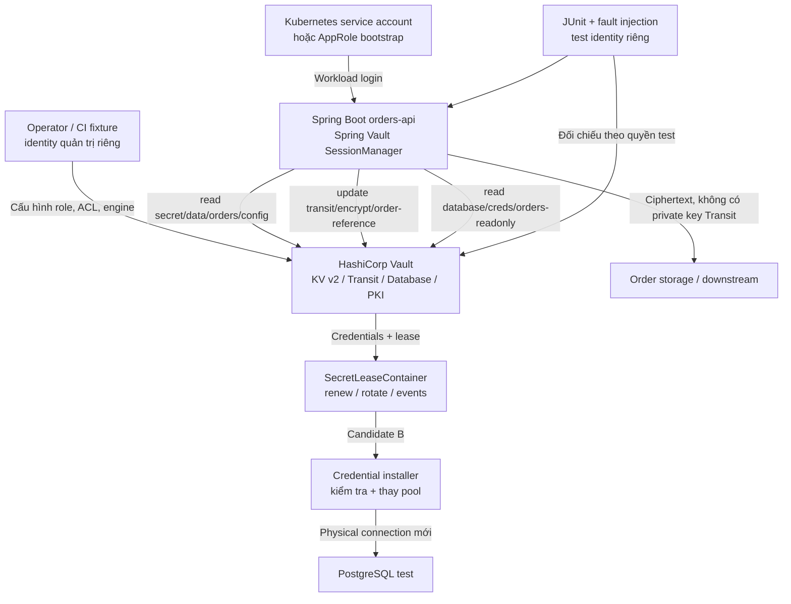
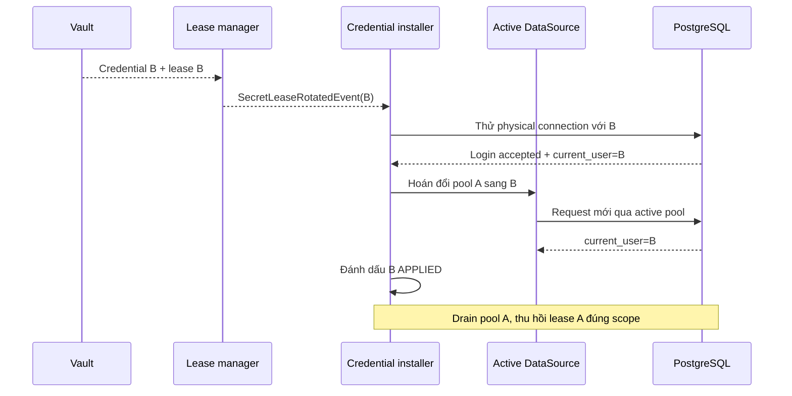
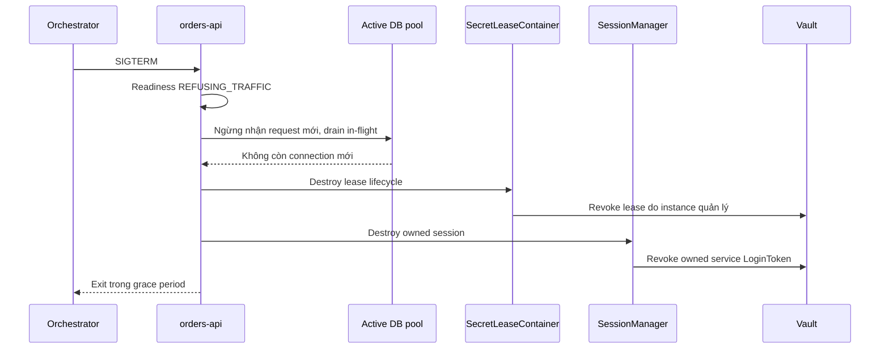

# Hoàn thiện ứng dụng bằng policy, kiểm thử và bằng chứng vòng đời

**Chương:** Thực hành tổng hợp  
**Module:** SPRING_VAULT

## 1. Đề bài capstone: chứng minh ứng dụng an toàn và vận hành được

Một dịch vụ Spring Boot tên **`orders-api`** cần dùng HashiCorp Vault cho ba mục đích: đọc một số thiết lập từ **KV v2**, mã hóa mã tham chiếu đơn hàng bằng **Transit**, và sử dụng **database credentials động** có lease. Trong môi trường có mTLS, dịch vụ cũng có thể lấy chứng thư **PKI** và tải lại TLS listener. Mọi request Vault được gửi qua **Spring Vault** (`VaultTemplate` / `VaultOperations`) và xác thực bằng **workload identity**, không nhúng root token vào mã nguồn.

Bài thực hành không dừng ở việc “request chạy được”. Một bản hoàn thiện cần chứng minh cùng lúc:

1. **Policy:** workload chỉ có quyền tối thiểu trên đúng Vault API path; thử truy cập trái phép thật sự nhận `403`.
2. **Hành vi nghiệp vụ:** Java đọc đúng KV v2, trả ciphertext Transit đúng định dạng và mở kết nối DB mới bằng credential do Vault cấp.
3. **Vòng đời:** token renew/re-login đúng loại, lease được renew hoặc rotate theo backend, consumer nhận và **áp dụng** credential mới.
4. **Khả năng phục hồi:** khi Vault mất mạng, thiếu quyền hoặc response bị mất, ứng dụng không retry mù thao tác có side effect và không trả thành công giả.
5. **Shutdown:** ứng dụng ngừng traffic, drain connection, cleanup lease/token thuộc quyền sở hữu; không thu hồi nhầm tài nguyên của instance khác.
6. **Bằng chứng kiểm thử:** một báo cáo có test ID, thời điểm, phiên bản, kỳ vọng, trạng thái thực, kết quả và dấu vết đã **loại bỏ secret**.

Đây là phần kết thúc thực hành của SPRING_VAULT: liên kết xác thực theo workload, policy/ACL, KV secrets, token và lease, Transit encryption, PKI, giám sát lỗi và kiểm thử tích hợp thành một hệ thống có thể nghiệm thu.

**Quy ước:** các tên `orders-api`, `orders-readonly`, `order-reference`, địa chỉ DB và giá trị token trong bài đều là **fixture thử nghiệm**. Chỉ dùng Vault/DB cô lập, không chạy lệnh quản trị hay revoke trên Vault production.

## 2. Kiến trúc mục tiêu và ranh giới quyền



**Ba identity tách biệt:**

| Identity | Nhiệm vụ | Có thể làm | Không được làm |
| --- | --- | --- | --- |
| **Fixture/operator** | Chuẩn bị engine/role/policy và dọn tài nguyên test | Enable secrets engine, tạo policy/role, lookup lease test, revoke đúng lease test | Không chạy làm identity của `orders-api` |
| **Workload `orders-api`** | Xử lý đơn hàng | Đọc đúng một KV path, encrypt Transit, lấy DB credential theo role | Không decrypt Transit, không sửa role/policy, không cấu hình DB engine, không revoke lease người khác |
| **Verifier/test** | Xác minh kết quả và negative test | Được cấp quyền riêng để decrypt ciphertext test hoặc quan sát lease/token test theo fixture | Không có root token trong code của ứng dụng |

Trong Kubernetes, nên dùng **Kubernetes auth** với service account được bind vào Vault role; trong môi trường integration test không có cluster, **AppRole** là một lựa chọn khả thi. Dù chọn cách nào, token được cấp vẫn mang Vault ACL. **Không sử dụng `VAULT_TOKEN` root** để kiểm thử rằng policy của workload đã đúng.

## 3. Phạm vi hoàn thành và bộ sản phẩm cần nộp

Bộ sản phẩm của bài capstone (đây là danh sách tài liệu/ví dụ cần người học tự tạo trong dự án bài tập, **không phải các file được tạo bởi bài Markdown này**) gồm:

| Hạng mục | Đầu ra mong đợi | Điều được kiểm chứng |
| --- | --- | --- |
| Vault test fixture | KV v2, Transit key, database test role, auth role, token policies | Engine/mount và ACL đúng cấu hình |
| Policy `orders-runtime.hcl` | Chỉ cấp các API path cần thiết | Positive/negative capability thực |
| Java service | `OrderProtectionService` với `VaultOperations` | KV v2 và Transit đúng semantics |
| Lease integration | `SecretLeaseContainer` hoặc Spring Cloud Vault lease manager cùng consumer adapter | Renew/rotate và thay DB client đã áp dụng |
| Test suite | Unit, integration, security, failure injection, shutdown | Assertion thực sự chạm tới Vault/backend ở integration layer |
| Báo cáo vòng đời | Evidence ID, test ID, timestamps, outcome, sanitized metadata | Có thể tra cứu lại, không chứa secret |
| Runbook | Cách khôi phục khi 403, timeout, stale credential hoặc Pod shutdown lỗi | Không sửa lỗi bằng cách mở rộng quyền bừa bãi |

**Cấp độ thực hành:** phần lõi KV/Transit có thể chạy với Vault test riêng. Phần database lease cần một PostgreSQL test thật và database secrets engine do operator cấu hình; PKI là nhánh mở rộng khi đã có issuer/role thử nghiệm. Không xem một bài test chỉ dùng Mockito là bằng chứng đã hoàn thành toàn bộ chuỗi vận hành.

## 4. Chuẩn bị fixture Vault cô lập

### 4.1. Điều kiện tiên quyết

Có JDK phù hợp với phiên bản Spring Boot/Spring Cloud Vault được chọn, Maven hoặc Gradle, Vault CLI, Vault server thử nghiệm và PostgreSQL test. Khóa **BOM tương thích** theo release train: tránh nâng riêng `spring-vault-core` trái với dependency graph của Spring Cloud Vault.

Nếu dùng Vault dev server, nó được thiết kế cho **phát triển cục bộ**, không có bảo đảm bảo mật/HA như production. Root token của dev fixture chỉ dành cho script khởi tạo trong máy test và phải được dọn sau bài. Không commit token, AppRole SecretID hoặc DB password vào Git/CI artifact.

Một phương án là Vault chạy trong container test (Testcontainers), PostgreSQL test chạy container riêng; test harness tạo engine, policy và role bằng **operator identity test**. Trên Kubernetes, có thể dùng namespace/test Vault cluster riêng. Không áp dụng các lệnh enable, rotate, revoke lên đường dẫn production.

### 4.2. Chuẩn bị KV v2 và Transit

Những lệnh sau chỉ mang tính minh họa, chạy bằng **operator test** trên Vault test. Nếu mount `secret` hoặc `transit` đã tồn tại, **kiểm tra engine/version trước**, không enable lần hai:

```bash
# Kiểm tra những mount đã có trong Vault test.
vault secrets list -detailed

# Chỉ enable nếu fixture chưa có mount tương ứng:
vault secrets enable -path=secret -version=2 kv
vault secrets enable -path=transit transit

# Giá trị thử nghiệm KHÔNG phải credential thật.
vault kv put secret/orders/config region=ap-southeast-1 feature_orders=true

# Khóa Transit do Vault giữ; ứng dụng chỉ được gọi encrypt.
vault write -f transit/keys/order-reference
```

`vault kv put secret/orders/config` dùng **logical KV path**; Vault CLI tự dùng đường dẫn HTTP KV v2 như `secret/data/orders/config`. Trong Java, `opsForKeyValue("secret", KV_2).get("orders/config")` cũng nhận logical path tương đối. **Policy ACL lại kiểm tra API path `secret/data/orders/config`**, vì đó là endpoint thực.

### 4.3. Database secrets engine

Để kiểm thử lease thật, operator chuẩn bị:

- PostgreSQL test với cơ sở dữ liệu/tables chỉ phục vụ test và một tài khoản cấu hình plugin có quyền tạo/thu hồi **user test**.
- Vault database mount `database`, database connection config `orders-pg` và role `orders-readonly`.
- Role tạo credential có quyền **SELECT** trên bảng test, `default_ttl` ngắn vừa đủ cho test (ví dụ 2 phút), `max_ttl` xác định rõ, cấu hình `renewable` theo backend và policy.
- Cơ chế teardown chỉ revoke lease ID tạo bởi **mỗi test instance**; không dùng `revoke-prefix` trên hệ chia sẻ.

Về nguyên tắc, operator dùng API `database/config/:name` và `database/roles/:name` để thiết lập plugin PostgreSQL, connection URL, username/password quản trị hạn chế và `creation_statements`/`revocation_statements`. Nội dung SQL khác nhau theo backend và quyền database. Không đưa password operator vào CLI command lưu trong shell history; dùng cơ chế truyền secret an toàn của test harness và xem [Database secrets engine](https://developer.hashicorp.com/vault/docs/secrets/databases).

Sau khi role sẵn sàng, một lệnh **đọc để cấp phát** credential thử nghiệm là:

```bash
# MỖI lần gọi có thể tạo thêm username/password và lease!
vault read -format=json database/creds/orders-readonly
```

Không biến lệnh này thành polling health check. Phản hồi có `data.username`, `data.password`, `lease_id`, `lease_duration` và `renewable` tùy role/plugin. Chỉ fixture và consumer được phép giữ những giá trị này trong bộ nhớ; không lưu nguyên output trong bài nộp.

### 4.4. Chuẩn bị PKI nếu làm bài nâng cao

Operator test có thể tạo PKI issuer và role `orders-server` cho hostname nội bộ thuộc phạm vi test. Java gọi `opsForPki("pki")` để issue/sign; khi có cert mới, ứng dụng phải reload **TLS listener thực**. Test PKI không dùng chứng thư nội bộ production và không cấp quyền quản trị CA cho `orders-api` chỉ để chạy test.

## 5. Policy least privilege: cấu hình cụ thể và test quyền phủ định

### 5.1. Policy cho workload

File ví dụ `orders-runtime.hcl`:

```hcl
# KV v2 chỉ được đọc một logical key.
path "secret/data/orders/config" {
  capabilities = ["read"]
}

# Chỉ encrypt, không decrypt hoặc thao tác key management.
path "transit/encrypt/order-reference" {
  capabilities = ["update"]
}

# Cấp dynamic credential theo đúng một database role.
path "database/creds/orders-readonly" {
  capabilities = ["read"]
}
```

Lưu ý `update` là capability tương ứng với HTTP `POST` của nhiều API Vault, không phải quyền `write` chung toàn mount. Không dùng `path "*"`, `transit/*`, `sys/*` hay `database/config/*` trong runtime policy.

Quyền `sys/leases/renew` / `auth/token/renew-self` / `auth/token/lookup-self` phụ thuộc loại token, `default` policy và cấu hình Vault; **kiểm tra quyền hiệu lực của identity thử nghiệm** trước khi thêm capability. Không tùy tiện mở `sys/leases/*` rộng để làm cho lease test qua.

Cài policy bằng operator test:

```bash
vault policy write orders-runtime orders-runtime.hcl
vault policy read orders-runtime
```

Nếu môi trường dùng AppRole để login test, operator tạo AppRole `orders-it` mang policy này; mỗi instance nên nhận SecretID riêng. Khi muốn test **re-login** sau terminal token TTL, phải dùng Kubernetes auth hoặc AppRole có khả năng tiếp tục cung cấp credential đăng nhập: **SecretID chỉ dùng một lần không thể tự được tái sử dụng để re-login**. Với production, cấp SecretID qua response wrapping và kênh bootstrap bảo vệ nếu dùng AppRole.

### 5.2. Ma trận quyền và phản hồi kỳ vọng

| Hành động của `orders-api` | API path | Capability | Kỳ vọng |
| --- | --- | --- | --- |
| Đọc cấu hình | `secret/data/orders/config` | `read` | **ALLOW** |
| Encrypt order reference | `transit/encrypt/order-reference` | `update` | **ALLOW** |
| Cấp DB credential test | `database/creds/orders-readonly` | `read` | **ALLOW** |
| Decrypt ciphertext | `transit/decrypt/order-reference` | `update` | **DENY** |
| Rotate Transit key | `transit/keys/order-reference/rotate` | `update` | **DENY** |
| Ghi KV config | `secret/data/orders/config` | `update` | **DENY** |
| Đọc secret khác | `secret/data/payments/config` | `read` | **DENY** |
| Cấu hình database role | `database/roles/orders-readonly` | `update` | **DENY** |
| Issue PKI cert | `pki/issue/orders-server` | `update` | **DENY** trừ khi bài nâng cao cấp policy riêng |
| Revoke hàng loạt lease | `sys/leases/revoke-prefix/*` | `update` | **DENY** |

Để xác minh, **đăng nhập bằng đúng workload identity** rồi chạy:

```bash
# Chạy CLI trong phiên token có policy của orders-api.
vault token capabilities secret/data/orders/config
vault token capabilities transit/encrypt/order-reference
vault token capabilities transit/decrypt/order-reference
vault token capabilities database/config/orders-pg
```

Kiểm tra capability trên path là bước đầu; integration test vẫn cần gửi **request thật** bằng chính identity đó và assert 2xx/403 tương ứng. Nếu test chạy bằng root token, negative test sẽ không có giá trị. Khi có `default` policy, quyền hiệu lực là kết hợp các policies — không chỉ file `orders-runtime.hcl`.

### 5.3. Tránh “test để lộ quyền” bằng cách gọi API nguy hiểm

Negative test có thể gọi một endpoint vô hại để xác nhận `403` hoặc kiểm tra capability trực tiếp. Không thử “DENY revoke” bằng cách gửi yêu cầu thu hồi **lease thật của workload khác**. Không lấy secret ngoài phạm vi mà test không sở hữu để chứng minh ACL. Nếu cần kiểm tra một thao tác có side effect, tạo đối tượng test dùng một lần và bảo đảm cleanup trong fixture riêng.

## 6. Xác thực workload trong Spring Boot

Với Spring Cloud Vault, hệ thống có thể cung cấp bean `VaultOperations` đã cấu hình. Ở **Kubernetes production**, chọn Kubernetes authentication với service account và Vault role bind đúng namespace. Trong integration test cục bộ, có thể dùng AppRole; luôn dùng TLS/trust trong môi trường thật và không chứa SecretID trong repository.

Ví dụ `application.yml` cho môi trường AppRole test:

```yaml
spring:
  application:
    name: orders-api
  config:
    # Chỉ cần khi sử dụng Spring Cloud Vault Config Data.
    # Nếu chỉ gọi VaultOperations, có thể dùng Vault auto-configuration
    # không nhập property source và bỏ mục import này theo stack đã chọn.
    import: "optional:vault://"
  cloud:
    vault:
      uri: "http://127.0.0.1:8200"  # CHỈ cho dev/test cục bộ
      authentication: APPROLE
      app-role:
        role-id: "${VAULT_APPROLE_ROLE_ID}"
        secret-id: "${VAULT_APPROLE_SECRET_ID}"
      kv:
        enabled: false  # Bài dùng VaultOperations để đọc KV, không auto-import KV.
      connection-timeout: 2000
      read-timeout: 5000
```

Khi render ví dụ này thành cấu hình thật, giá trị `VAULT_APPROLE_ROLE_ID` và `VAULT_APPROLE_SECRET_ID` phải đến từ hệ thống secret bootstrap hoặc môi trường test được bảo vệ. **Không khai báo mặc định chứa SecretID thật**; biến môi trường cũng có thể bị lộ qua debug/process diagnostics nên cần kiểm soát quyền truy cập và vòng đời.

Nếu ứng dụng dùng **Vault Agent/Proxy** để xác thực, vai trò login/token được chuyển sang Agent/Proxy, Spring Cloud Vault có thể dùng `authentication: NONE` và trỏ `uri` tới proxy nội bộ **đã cấu hình dùng auto-auth token**. Không vừa có Agent quản lý token, vừa tự thêm một luồng AppRole login trong ứng dụng mà không có thiết kế rõ. Các snippet trong bài giả định **AppRole direct** khi thử cục bộ; dùng Kubernetes auth cho deployment tương ứng.

**Dependency:** chọn `spring-cloud-starter-vault-config` hoặc `spring-vault-core` theo kiến trúc, đồng bộ Spring Boot/Spring Cloud BOM; thêm Actuator cho readiness/metrics, JUnit 5 và Mockito cho unit test, Testcontainers/PostgreSQL/JDBC test driver khi chạy integration. Phiên bản cụ thể cần lấy từ BOM của dự án, không hardcode các dependency riêng lệch version.

## 7. Java: đọc KV v2 và mã hóa Transit qua typed operations

Service `OrderProtectionService` là phần lõi: đọc một giá trị cấu hình ở KV v2 và mã hóa mã tham chiếu đơn hàng. Không lưu plaintext/secret trong log.

```java
import java.nio.charset.StandardCharsets;
import java.util.Map;

import org.springframework.stereotype.Service;
import org.springframework.vault.core.VaultKeyValueOperations;
import org.springframework.vault.core.VaultKeyValueOperationsSupport.KeyValueBackend;
import org.springframework.vault.core.VaultOperations;
import org.springframework.vault.core.VaultTransitOperations;
import org.springframework.vault.support.VaultResponse;
import org.springframework.vault.support.VaultTransitContext;

@Service
public class OrderProtectionService {

    private final VaultKeyValueOperations kv;
    private final VaultTransitOperations transit;

    public OrderProtectionService(VaultOperations vault) {
        this.kv =
            vault.opsForKeyValue("secret", KeyValueBackend.KV_2);
        this.transit = vault.opsForTransit("transit");
    }

    public ProtectedOrder protect(String reference) {
        if (reference == null || reference.isBlank()) {
            throw new IllegalArgumentException(
                "Order reference is required");
        }

        VaultResponse response = kv.get("orders/config");
        if (response == null) {
            throw new IllegalStateException(
                "Required Vault KV configuration is missing");
        }

        Map<String, Object> config = response.getRequiredData();
        Object regionValue = config.get("region");
        if (!(regionValue instanceof String region)
                || region.isBlank()) {
            throw new IllegalStateException(
                "Invalid region in Vault KV configuration");
        }

        String ciphertext = transit.encrypt(
            "order-reference",
            reference.getBytes(StandardCharsets.UTF_8),
            VaultTransitContext.empty());

        if (ciphertext == null
                || !ciphertext.startsWith("vault:v")) {
            throw new IllegalStateException(
                "Unexpected Transit encryption response");
        }

        return new ProtectedOrder(region, ciphertext);
    }

    // DTO chỉ chứa dữ liệu được phép trả cho tầng nghiệp vụ.
    // Tùy mô hình bảo mật, ciphertext cũng cần kiểm soát lưu trữ/log.
    public record ProtectedOrder(
        String region, String ciphertext) {}
}
```

**Vì sao đây là phương án hợp lý?**

- `opsForKeyValue("secret", KV_2)` xử lý route KV v2. `get("orders/config")` là logical path; không tự thêm `secret/data` trong tham số.
- `opsForTransit("transit")` hiểu định dạng plaintext/ciphertext của Transit; `encrypt(byte[], VaultTransitContext.empty())` tránh phụ thuộc default charset.
- `region` là giá trị demo, không phải password thật. Trong ứng dụng production, vẫn cần validate cấu hình, freshness và tác động khi KV thay đổi.
- `orders-api` **không có quyền Transit decrypt**. Chỉ verifier test có một policy riêng (nếu cần) được phép decrypt ciphertext **trong môi trường test**.
- Mã ví dụ không tự triển khai Spring Security, authentication của HTTP API người dùng hoặc persistence. Khi biến thành service công khai, phải thêm các ràng buộc đó; Vault policy không thay thế authorization của ứng dụng.

**Kỳ vọng:** gọi `protect("ORD-123")` cho kết quả region `ap-southeast-1` và ciphertext có dạng `vault:vN:...`. Không assert ciphertext giống nhau qua hai lần mã hóa; thuật toán có thể tạo IV/nonce ngẫu nhiên.

## 8. Cấp database credential và ghi nhận lease

Để thực hành **vòng đời**, đọc credential theo role test:

```java
import java.util.Map;

import org.springframework.vault.core.VaultOperations;
import org.springframework.vault.support.VaultResponse;

public final class TestDbCredentialIssuer {

    private final VaultOperations vault;

    public TestDbCredentialIssuer(VaultOperations vault) {
        this.vault = vault;
    }

    public IssuedDbCredential issue() {
        VaultResponse response =
            vault.read("database/creds/orders-readonly");

        if (response == null) {
            throw new IllegalStateException(
                "Vault did not issue database credentials");
        }

        Map<String, Object> data = response.getRequiredData();
        Object u = data.get("username");
        Object p = data.get("password");

        if (!(u instanceof String user) || user.isBlank()
                || !(p instanceof String password) || password.isBlank()
                || response.getLeaseId() == null
                || response.getLeaseId().isBlank()
                || response.getLeaseDuration() <= 0) {
            throw new IllegalStateException(
                "Invalid database credential/lease response");
        }

        return new IssuedDbCredential(
            user,
            password,
            response.getLeaseId(),
            response.getLeaseDuration(),
            response.isRenewable());
    }

    public record IssuedDbCredential(
        String username,
        String password,
        String leaseId,
        long ttlSeconds,
        boolean renewable) {
        // Record.toString() sẽ bao gồm password: KHÔNG log record.
    }
}
```

**Điểm bắt buộc:** `GET database/creds/orders-readonly` có thể **tạo credential và lease mới mỗi lần gọi**. Không polling method `issue()` để kiểm tra health; không retry mù khi mất response. Trường `lease_id` và `lease_duration` là metadata ngoài `data`. Khi response không tới, kết quả cấp phát là **UNKNOWN_RESULT**, không thể kết luận Vault chưa tạo user.

`IssuedDbCredential` minh họa dữ liệu được giữ trong bộ nhớ test, **không phải DTO trả qua HTTP**. Trong production, hạn chế thời gian tồn tại của plaintext password, không serialize object và quản lý client/pool theo chính sách.

## 9. Quản lý lease và rotation bằng Spring Vault

Có hai mô hình khả thi: dùng **Spring Cloud Vault lease management auto-configuration** hoặc chủ động tạo `SecretLeaseContainer` trong một phần adapter được kiểm soát. **Không sử dụng cả hai để cùng quản lý một path** nếu không có lý do: việc nhân đôi container có thể gây cấp/renew/rotate lặp và khó xác định ai sở hữu lease.

`SecretLeaseContainer` phân biệt:

- `requestRenewableSecret(path)`: nhấn mạnh renew lease hiện có.
- `requestRotatingSecret(path)`: nhận secret mới khi cần rotation; với lease renewable, container có thể **renew cho tới khi không renew được** hoặc đến hạn và sau đó mới rotate.
- `SecretLeaseCreatedEvent`: nhận secret đầu tiên.
- `AfterSecretLeaseRenewedEvent`: **TTL được gia hạn**, thường **không đổi password**.
- `SecretLeaseRotatedEvent`: nhận một secret mới; event này là specialization của created event.
- `SecretLeaseErrorEvent`: lỗi retrieve/renew/rotate; phải có observability và chính sách ứng dụng rõ.

### 9.1. Ví dụ listener chuyển credential cho consumer

Đây là mẫu wiring cho môi trường mà ứng dụng **tự sở hữu một container riêng**. Nếu dùng Spring Cloud Vault đã tạo container, hãy đăng ký listener vào bean có sẵn theo API/version của dự án.

```java
import java.util.Map;

import org.springframework.context.annotation.Bean;
import org.springframework.context.annotation.Configuration;
import org.springframework.scheduling.TaskScheduler;
import org.springframework.vault.core.VaultOperations;
import org.springframework.vault.core.lease.SecretLeaseContainer;
import org.springframework.vault.core.lease.domain.RequestedSecret;
import org.springframework.vault.core.lease.event.LeaseListenerAdapter;
import org.springframework.vault.core.lease.event.SecretLeaseCreatedEvent;
import org.springframework.vault.core.lease.event.SecretLeaseEvent;
import org.springframework.vault.core.lease.event.SecretLeaseRotatedEvent;

@Configuration
public class DbLeaseConfiguration {

    @Bean
    SecretLeaseContainer ordersLeaseContainer(
            VaultOperations vault,
            TaskScheduler taskScheduler,
            DbCredentialInstaller installer) {

        SecretLeaseContainer leases =
            new SecretLeaseContainer(vault, taskScheduler);

        RequestedSecret secret = leases.requestRotatingSecret(
            "database/creds/orders-readonly");

        leases.addLeaseListener(new LeaseListenerAdapter() {
            @Override
            public void onLeaseEvent(SecretLeaseEvent event) {
                if (!secret.equals(event.getSource())) {
                    return;
                }

                if (event instanceof SecretLeaseRotatedEvent rotated) {
                    installer.acceptCandidate(rotated.getSecrets());
                } else if (event instanceof SecretLeaseCreatedEvent created) {
                    installer.acceptCandidate(created.getSecrets());
                }
            }
        });

        // Khi được Spring quản lý, bean lifecycle sẽ init/start/destroy.
        // Không gọi thủ công destroy() và context.close() hai lần.
        return leases;
    }

    public interface DbCredentialInstaller {
        void acceptCandidate(Map<String, Object> secrets);
    }
}
```

Mã trên giả định có bean `TaskScheduler` và một implementation của `DbCredentialInstaller`. **Không xem `acceptCandidate` là apply thành công ngay:** trong implementation thật, đưa việc mở pool mới sang executor có giới hạn, validate credential, rồi mới cập nhật active pool/generation và phát `consumer_applied`. Callback có thể chạy trên background scheduler; không để nó block vô hạn khi thử kết nối DB.

**Quan trọng:** Spring-managed `SecretLeaseContainer` có `InitializingBean`/`SmartLifecycle`/`DisposableBean`; ứng dụng không tự gọi `afterPropertiesSet()`, `start()`, `destroy()` nếu framework đã sở hữu bean. Trong integration test tự quản lý container ngoài Spring context, phải init/start/destroy theo đúng API.

### 9.2. Tại sao consumer phải được kiểm chứng riêng?



Test cần xác nhận **kết nối mới qua chính DataSource đang phục vụ** dùng credential B, không chỉ kiểm tra event hoặc dùng `DriverManager` riêng. Khi A bị revoke, kết nối DB đã mở có thể vẫn tồn tại tùy backend; không khẳng định mọi session cũ bị cắt ngay.

Với HikariCP, chỉ gọi `setUsername/setPassword` trên configuration đang chạy **không đủ bằng chứng** các physical connections đã đổi. Có thể dùng kỹ thuật thay pool theo generation: build candidate pool B, thử mở kết nối, hoán đổi tham chiếu active, drain pool A và close đúng deadline. Trường hợp apply B lỗi, không công bố generation B hoặc đọc lại credential A vượt hạn/policy.

## 10. Thiết kế test suite: phân biệt unit, integration và security

| Nhóm | Chạy ở đâu | Assertion chính | Chưa chứng minh |
| --- | --- | --- | --- |
| **Unit** | Mockito/JUnit, không cần Vault | Java chọn mount/path, mapping, null/error; không log secret | Vault thực sự cấp quyền hay mã hóa |
| **Policy/security** | Vault test + token có ACL thực | Operation được phép thành công; operation cấm bị `403` | Consumer DB/TLS đã reload |
| **Integration KV/Transit** | Vault test thật | Đọc KV v2 đúng value; Transit output hợp lệ và verifier giải mã được | Lease database đã rotate |
| **Integration DB lease** | Vault + PostgreSQL test | Issue, TTL, renew/rotate, revoke đúng ID và connection qua pool | Startup/shutdown của Pod thật |
| **Deployment lifecycle** | Kubernetes/VM test | Readiness, SIGTERM, token/lease cleanup, rolling upgrade | Hoạt động dưới mọi outage chưa thử |
| **Fault injection** | Proxy test điều khiển network | Retry an toàn, UNKNOWN_RESULT, không double-issue | Không có lỗi ở mọi topology production |

### 10.1. Unit test cho KV/Transit service

Ví dụ JUnit 5 + Mockito, không kết nối Vault:

```java
import static org.junit.jupiter.api.Assertions.*;
import static org.mockito.ArgumentMatchers.*;
import static org.mockito.Mockito.*;

import java.util.Map;

import org.junit.jupiter.api.Test;
import org.springframework.vault.core.VaultKeyValueOperations;
import org.springframework.vault.core.VaultKeyValueOperationsSupport.KeyValueBackend;
import org.springframework.vault.core.VaultOperations;
import org.springframework.vault.core.VaultTransitOperations;
import org.springframework.vault.support.VaultResponse;
import org.springframework.vault.support.VaultTransitContext;

class OrderProtectionServiceTest {

    @Test
    void usesOnlyExpectedMountsAndEncryptsBytes() {
        VaultOperations vault = mock(VaultOperations.class);
        VaultKeyValueOperations kv = mock(VaultKeyValueOperations.class);
        VaultTransitOperations transit = mock(VaultTransitOperations.class);

        when(vault.opsForKeyValue("secret", KeyValueBackend.KV_2))
            .thenReturn(kv);
        when(vault.opsForTransit("transit")).thenReturn(transit);

        VaultResponse config = new VaultResponse();
        config.setData(Map.of("region", "ap-southeast-1"));
        when(kv.get("orders/config")).thenReturn(config);
        when(transit.encrypt(
                eq("order-reference"),
                any(byte[].class),
                any(VaultTransitContext.class)))
            .thenReturn("vault:v1:example-test-ciphertext");

        OrderProtectionService service =
            new OrderProtectionService(vault);

        var result = service.protect("ORD-123");

        assertEquals("ap-southeast-1", result.region());
        assertTrue(result.ciphertext().startsWith("vault:v"));
        verify(kv).get("orders/config");
        verify(transit).encrypt(eq("order-reference"),
            any(byte[].class), any(VaultTransitContext.class));
        verifyNoMoreInteractions(kv, transit);
    }

    @Test
    void missingConfigIsNotSilentlyAccepted() {
        VaultOperations vault = mock(VaultOperations.class);
        VaultKeyValueOperations kv = mock(VaultKeyValueOperations.class);
        when(vault.opsForKeyValue("secret", KeyValueBackend.KV_2))
            .thenReturn(kv);
        when(vault.opsForTransit("transit"))
            .thenReturn(mock(VaultTransitOperations.class));
        when(kv.get("orders/config")).thenReturn(null);

        OrderProtectionService service =
            new OrderProtectionService(vault);

        assertThrows(IllegalStateException.class,
            () -> service.protect("ORD-123"));
    }
}
```

Test này chứng minh **logic adapter**; ciphertext test là chuỗi giả, không chứng minh Vault Transit hoạt động. Ngoài ra, code test không kiểm chứng response của Vault thật hay ACL.

### 10.2. Integration test dùng Vault thật

Giả sử test context đã cấu hình AppRole/Kubernetes auth dành riêng cho fixture:

```java
import static org.junit.jupiter.api.Assertions.*;

import org.junit.jupiter.api.Test;
import org.springframework.beans.factory.annotation.Autowired;
import org.springframework.boot.test.context.SpringBootTest;

@SpringBootTest
class OrderProtectionIT {

    @Autowired
    OrderProtectionService service;

    @Test
    void canReadKvAndEncryptThroughVault() {
        var protectedOrder = service.protect("ORD-IT-001");

        assertEquals("ap-southeast-1", protectedOrder.region());
        assertTrue(protectedOrder.ciphertext().startsWith("vault:v"));
        assertNotEquals("ORD-IT-001", protectedOrder.ciphertext());

        // Test verifier ở identity khác có quyền Transit decrypt
        // sẽ decrypt ciphertext trong Vault test rồi so sánh bytes.
        // Workload orders-api vẫn KHÔNG có quyền decrypt.
    }
}
```

**Điều kiện:** Vault test đã sẵn mount `secret` KV v2, Transit key `order-reference` và role ACL tương ứng; `@SpringBootTest` phải load đúng profile/config của test. Nếu thiếu môi trường, test phải được **đánh dấu là integration và không tự chạy với production Vault**. Để xác minh round-trip, dùng verifier identity độc lập có `update` trên `transit/decrypt/order-reference`, giải mã về UTF-8 và assert đúng `ORD-IT-001`, nhưng không trao quyền decrypt đó cho app runtime.

### 10.3. Security test cần assert cả DENY

Trường hợp được phép:

```text
[IT-ACL-01] orders-api -> KV v2 read -> ALLOW
[IT-ACL-02] orders-api -> Transit encrypt -> ALLOW
[IT-ACL-03] orders-api -> DB creds role -> ALLOW
```

Trường hợp phải bị từ chối:

```text
[IT-ACL-04] orders-api -> Transit decrypt -> DENY (403)
[IT-ACL-05] orders-api -> KV write -> DENY (403)
[IT-ACL-06] orders-api -> DB engine config -> DENY (403)
[IT-ACL-07] orders-api -> PKI issue -> DENY (403)
```

Một test chỉ `assertTrue(vault.policy...)` trên file HCL không đủ; cần quyền **hiệu lực thực** của token. Nếu nhận `404` vì endpoint chưa tồn tại hoặc path sai, **đừng tự ghi “DENY 403 PASS”**. Cần tách failure của ACL khỏi lỗi fixture và mapping.

## 11. Bằng chứng vòng đời token: login, renew, re-login, shutdown

**Client token TTL không phải dynamic secret TTL.** Với Spring Vault, `LifecycleAwareSessionManager` quản lý token đăng nhập có lifecycle và có thể renew/re-login; khi shutdown, service `LoginToken` do app sở hữu có thể được revoke. `VaultToken` tĩnh từ `TokenAuthentication` không mặc định bị app tự revoke.

Để kiểm thử, dùng AppRole/Kubernetes role test cấp **service token** có TTL đủ ngắn để quan sát renewal nhưng không quá ngắn so với scheduler, hoặc dùng một token test xác định để kiểm tra nhánh static.

| Test ID | Hành động | Bằng chứng pass |
| --- | --- | --- |
| `IT-TOKEN-01` | Login bằng workload identity | API `secret/data/orders/config` thành công; accessor/TTL test hợp lệ |
| `IT-TOKEN-02` | Chờ renew trong test window | TTL thực sau renew hợp lý; không mất khả năng gọi API |
| `IT-TOKEN-03` | Buộc đến terminal TTL qua fixture thích hợp | Re-login và gọi API với phiên mới thành công; không retry bão |
| `IT-TOKEN-04` | Token bị revoke khi app chạy | Error/auth refresh được phân loại; không fallback root token |
| `IT-TOKEN-05` | Đóng app sở hữu service LoginToken | Operator test xác nhận token thuộc app bị revoke |
| `IT-TOKEN-06` | Đóng app dùng static VaultToken test | Token tĩnh còn hiệu lực nếu chưa hết TTL/bị bên ngoài revoke |

**Không log raw token hoặc accessor vào báo cáo nộp.** Nếu cần tra cứu lookup, giữ accessor chỉ trong **fixture test bảo vệ** và tổng hợp kết quả `token_invalid_after_shutdown=true`. Sự kiện network timeout lúc revoke khiến kết quả có thể **UNKNOWN_CLEANUP**; test phải đối chiếu bằng operator, không tự báo thành công.

Nếu dùng `SecretID` AppRole có `secret_id_num_uses=1`, lần re-login thứ hai có thể thất bại **đúng theo policy**. Test re-login phải dùng Kubernetes auth hoặc cơ chế cung cấp credential đăng nhập mới, không mở rộng `secret_id_num_uses` trong production chỉ để làm test xanh.

## 12. Bằng chứng vòng đời lease: cấp, renew, rotate, revoke

Có bốn mốc cần thu thập:

| Mốc | Khi nào | Điều phải chứng minh |
| --- | --- | --- |
| **L1 — Issued** | Vault trả credential A + lease A | Lease ID, TTL thực, user test A; mở được kết nối DB mới |
| **L2 — Renewed/Rotated** | `SecretLeaseContainer` xử lý vòng đời | Renew thay TTL hoặc rotation phát B đúng contract |
| **L3 — Consumer applied** | Installer thay active DataSource | Request DB mới thực sự đăng nhập bằng principal B |
| **L4 — Cleanup** | Revoke lease A / shutdown | A không được dùng cho kết nối mới sau khi backend áp revoke; không đụng lease B |

### 12.1. Test renew không được giả làm rotation

Nếu `renewable=true`, test renew lease A:

1. Ghi nhận TTL thực, thời điểm cấp và lease ID A trong fixture bảo vệ.
2. Để lease manager xử lý renew; theo dõi `AfterSecretLeaseRenewedEvent`.
3. Xác minh TTL đã thay đổi hợp lý (không assert chính xác một số giây vì đồng hồ và Vault max TTL).
4. **Không khẳng định username/password đổi**; renew có thể giữ nguyên A.
5. Mở kết nối mới bằng A khi lease còn hiệu lực để xác minh backend vẫn chấp nhận credential.

Nếu operator dùng CLI `vault lease renew` bên ngoài Java, điều đó **không bắt buộc** kích hoạt một event renew của `SecretLeaseContainer`; test listener phải quan sát renewal do chính container thực hiện.

### 12.2. Test rotation phải đi đến connection pool

Test rotation B:

1. Fixture cấu hình lease/TTL sao cho rotation sẽ xảy ra trong deadline test, hoặc dùng API rotation của container theo **phiên bản Spring Vault đang kiểm thử** trong fixture riêng.
2. Lắng nghe `SecretLeaseRotatedEvent` và nhận dữ liệu B. Vì event là subtype created event, xử lý **rotated trước created**.
3. Build candidate pool B; mở một **physical connection mới** tới PostgreSQL test, kiểm tra `SELECT current_user` tương ứng username B.
4. Chỉ sau khi B thành công mới publish active pool generation B; gửi một request qua **pool đang active** để xác nhận nó dùng B.
5. Drain pool A theo deadline, revoke **đúng lease ID A** khi test có quyền.
6. Khi backend áp revoke, kiểm tra **kết nối mới** bằng credential A bị từ chối; không mặc định session A đã mở phải bị ngắt ngay.
7. Kiểm tra B vẫn hoạt động; không dùng token/lease của instance khác.

Nếu event đã đến nhưng pool vẫn đang dùng A, đánh **L2 PASS, L3 FAIL**, không ghi `ROTATION_PASS`. Nếu Vault cấp B nhưng response bị mất, đánh `UNKNOWN_RESULT` và xử lý cleanup theo bằng chứng test/operator; không retry `GET database/creds` liên tục.

### 12.3. Test stop khác destroy

Theo Spring Vault `SecretLeaseContainer`:

- `stop()`: dừng renew, rotation và phát event; **không tự revoke lease active**.
- `destroy()`: shutdown và **cố gắng revoke các lease container quản lý**.

Để kiểm chứng, dùng container test **do test tự quản lý**, gọi `stop()` rồi lookup lease qua operator test (trước hạn hết lease); tiếp theo gọi `destroy()` khi Vault reachable và xác minh trạng thái đã revoke. Nếu container đã do Spring context sở hữu, **không tự gọi destroy hai lần**; test `context.close()` thay vào đó.

## 13. Graceful shutdown và kiểm tra tài nguyên sau close



Đây là **thứ tự mục tiêu phải được thiết kế và kiểm thử**, không bảo đảm mọi bean trong Spring sẽ tự chạy đúng thứ tự này. Spring Boot có `SmartLifecycle`, `DisposableBean`, bean dependencies và shutdown phase. Với Kubernetes, `terminationGracePeriodSeconds` phải đủ cho drain + revoke + dư địa; nếu hết grace period và process bị SIGKILL, không có Java cleanup callback.

Cấu hình minh họa:

```yaml
server:
  shutdown: graceful
spring:
  lifecycle:
    timeout-per-shutdown-phase: 20s
management:
  endpoint:
    health:
      probes:
        enabled: true
```

**Bằng chứng shutdown** cần có: timestamp ngừng traffic, thời điểm drain hoàn tất, lease cleanup outcome, token cleanup outcome và process exit trước grace period. Khi token service bị revoke trước lease, Vault có thể cascade revoke lease hoặc cleanup lease nhận `403`; phải đối chiếu bằng operator test thay vì coi mọi `403` lúc close là leak.

Trong rolling upgrade hai Pod, mỗi Pod cần **token/lease sở hữu riêng**. Khi A shutdown, không được revoke nhầm session/credential của B. Nếu rollback sau khi lease A đã revoke, phiên bản cũ phải **re-login và lấy credential mới**, không dùng lại token A.

## 14. Phân loại lỗi và retry theo ngữ nghĩa từng endpoint

| Hành động | Lỗi thường gặp | Retry an toàn mặc định? | Cách xử lý |
| --- | --- | --- | --- |
| KV v2 GET | Read timeout, 503 | Có thể bounded retry | Có giới hạn attempts, backoff/jitter, deadline |
| Transit encrypt | Timeout sau khi Vault đã xử lý | Chỉ khi nghiệp vụ chấp nhận ciphertext mới | Không giả định cùng plaintext cho cùng ciphertext |
| DB dynamic creds GET | Timeout sau cấp phát | **Không retry mù** | Có thể đã tạo user/lease; ghi UNKNOWN_RESULT, đối chiếu |
| KV v2 CAS write | Mất response | Không gửi lại bỏ CAS | Đọc version/operation marker, xử lý conflict |
| PKI issue | Mất certificate response | **Không tự động issue lại** | Có thể đã phát cert; điều tra serial, private key bị thất lạc |
| Wrapping unwrap | Mất response | **Không retry mù** | Token đã có thể tiêu thụ một lần |
| Lease renew/revoke | Timeout | Cần đối chiếu theo lease ID | Không báo cleanup success khi thiếu bằng chứng |
| Workload auth 403 | Policy/token không hợp lệ | Không retry quyền sai liên tục | Kiểm tra identity, role, token TTL, ACL |
| Vault `/sys/health` 200 | Engine/token workload 403 | Không có retry theo health | Vault node khỏe không chứng minh quyền của app |

**Trạng thái kết quả không xác định** là một trạng thái hệ phân tán hợp lệ. Một read timeout **không chứng minh Vault rollback**. Ứng dụng cần mã lỗi riêng như `VAULT_RESULT_UNKNOWN` và quy trình đối chiếu, thay vì nuốt lỗi rồi trả JSON thành công giả.

Khi Vault mất kết nối trong 30 giây, một service chỉ dùng KV đã nạp đúng chính sách freshness có thể tiếp tục phục vụ; một endpoint bắt buộc Transit online không thể hoàn thành nếu không có Vault khả dụng. **Không đưa Vault network ping vào liveness** để restart toàn bộ Pod khi dependency chung outage; readiness phải dựa trên khả năng phục vụ nghiệp vụ thực.

## 15. Thiết kế bằng chứng kiểm thử có thể kiểm toán

Một bộ test đáng tin cần **evidence** theo từng assertion, không chỉ screenshot “BUILD SUCCESSFUL”. Bảng sau mô tả đầu ra có thể gộp thành báo cáo đã khử dữ liệu bí mật:

| Evidence ID | Nguồn | Dấu hiệu cần kiểm tra | Kết luận tối đa có thể rút |
| --- | --- | --- | --- |
| `EV-01` | Vault effective capabilities | READ trên KV đúng path, UPDATE trên Transit encrypt, deny decrypt | Quyền **hiệu lực** của token test |
| `EV-02` | Integration KV/Transit | Region đọc đúng, ciphertext Vault hợp lệ, verifier round-trip | KV/Transit đã hoạt động end-to-end |
| `EV-03` | Lease issue + DB fresh connection | TTL/renewable được lấy thực, principal DB đúng | Credential mới được backend chấp nhận |
| `EV-04` | Renew event + lease lookup | TTL được gia hạn, A vẫn hoạt động | Renew lease, **chưa chứng minh rotation** |
| `EV-05` | Rotation event + active DataSource | B đã apply, request mới dùng principal B | Consumer đã chuyển thế hệ |
| `EV-06` | Revoke lease A + DB connection thử lại | A bị từ chối sau backend revoke | Cleanup đúng credential A |
| `EV-07` | Token lifecycle test | Re-login hoạt động và owned token invalid sau close | Chu kỳ phiên và shutdown token |
| `EV-08` | Fault injection | Không retry mù, có UNKNOWN_RESULT | Hành vi lỗi mạng theo contract |
| `EV-09` | Rolling upgrade test | Pod B vẫn hoạt động sau Pod A đóng | Không thu hồi nhầm session/lease |
| `EV-10` | Security/observability scan | Không có token/password/private key trong log/artifact | Kiểm soát rò dữ liệu của báo cáo |

### 15.1. Mẫu manifest bằng chứng **đã khử bí mật**

```json
{
  "run_id": "orders-capstone-it-001",
  "build_version": "candidate-build",
  "vault_environment": "isolated-test",
  "test_id": "IT-LEASE-ROTATION",
  "evidence_id": "EV-05",
  "operation": "database-credential-consumer-apply",
  "expected": "new active pool authenticates with generation B",
  "observed": "generation B validated on a fresh DB connection",
  "result": "PASS",
  "duration_ms": 826,
  "secret_values_recorded": false
}
```

**Không ghi** `lease_id`, raw token, token accessor, username/password động, PKI private key, ciphertext/plaintext nhạy cảm hoặc `VaultResponse` toàn bộ vào manifest công khai. Trong test fixture có thể giữ ID/serial/accessor phục vụ operator lookup theo kênh hạn chế; báo cáo chỉ cần **alias/generation ID không bí mật** và outcome. Những số liệu/thời gian trong JSON chỉ minh họa, không phải kết quả test thực tế.

### 15.2. Phân biệt PASS, FAIL, SKIPPED, UNKNOWN

- **PASS:** assertion được thực thi với bằng chứng đủ mạnh ở đúng tầng (ví dụ active DataSource thực sự mở connection dùng B).
- **FAIL:** thực thi nhưng không đạt, ví dụ app có quyền decrypt trái policy hoặc pool vẫn dùng A.
- **SKIPPED:** fixture thiếu Vault/Postgres/PKI test, không chạy được test; **không được tính thành PASS**.
- **UNKNOWN:** request có thể đã được xử lý nhưng mất response hoặc cleanup chưa đối chiếu được; phải có action owner, thời hạn xử lý và bằng chứng bổ sung.

Từng test nên ghi `setup_version`, `test_id`, `target_role`/`mount` đã allowlist và timestamp ở mức không làm lộ dữ liệu. Không biến metrics thành nhãn chứa lease/token ID có cardinality cao.

## 16. Hệ thống kiểm thử và lịch chạy thực tế

**Pha A — Unit (mỗi PR):** test input validation, đúng mount/path, mapping KV và Transit, kiểm soát lỗi thiếu secret; không gọi Vault thật. Nên chạy nhanh và không cần Vault token.

**Pha B — Integration cô lập (CI):** Vault và PostgreSQL test khởi chạy, fixture/operator setup policy/engine, workload login bằng AppRole test, chạy các phép thử thực cho KV, Transit và DB. Một test path với `403` bắt buộc.

**Pha C — Lease/token soak:** giảm TTL một cách có kiểm soát để quan sát renew/re-login/rotation. Dùng thời gian chờ có **deadline**, không dùng `Thread.sleep` cố định để đo vòng đời; test event và consumer applied riêng. TTL phải đủ dài cho network jitter và ngưỡng scheduler của phiên bản thư viện.

**Pha D — Fault injection:** cắt kết nối trước khi Vault nhận, sau khi Vault đã cấp credential nhưng trước khi client nhận response, giả lập Vault 503/timeout, token revoke, DB mất kết nối. Kiểm tra rollback/UNKNOWN_RESULT và không cấp phát lặp không kiểm soát.

**Pha E — Deployment/rolling:** chạy hai instance A và B trên môi trường test, xác minh readiness theo chức năng, graceful shutdown, lease/token cleanup và không ảnh hưởng instance B. Nếu test PKI, thực hiện TLS handshake mới và kiểm tra cert **đang được phục vụ**, không chỉ certificate vừa được tải.

### Thời gian chờ phải do hành vi quyết định

- `Awaitility.await().atMost(...)` phù hợp với event/polling bất đồng bộ trong JUnit.
- Dùng `Clock` giả cho **unit test** liên quan hạn dùng, nhưng Vault server và PostgreSQL có đồng hồ riêng: đồng hồ giả ở JVM không làm lease thật tự hết hạn.
- Không gọi `GET database/creds` nhiều lần chỉ để xem lease cũ “đã xoay” hay chưa: đó là lệnh cấp **lease mới**.
- Có thể dùng operator test `sys/leases/lookup` theo đúng ID lease test để đối chiếu TTL; quyền API cần được phân tách.
- Nếu cần rotation đúng thời gian, cấu hình TTL/max TTL của database role và `SecretLeaseContainer` thresholds phù hợp; với renewable lease, container có thể **renew mà không rotate** trong thời hạn test.

## 17. Nâng cao: PKI và API chuyên biệt so với HTTP có kiểm soát

**PKI:** nếu workflow cần mTLS, thêm role `orders-server` thuộc test issuer, cấp `pki/issue/orders-server` cho identity riêng. Xác minh cert còn hạn, SAN đúng, private key được bảo vệ, và **một TLS handshake mới** thấy serial/chứng thư mới sau reload. Cấp certificate mới không đồng nghĩa Spring Boot/Tomcat/Netty đã nạp nó. Quyền revoke cert cần tách khỏi quyền issue của workload thông thường.

**Transit:** ứng dụng chỉ encrypt; khóa được Vault quản lý. Nếu cần kiểm thử key rotation, operator test rotate key, ứng dụng tiếp tục encrypt, verifier identity riêng decrypt được ciphertext cũ/mới theo policy/key version; không xuất private key Transit sang JVM.

**Engine mở rộng:** nếu có endpoint chưa có abstraction trong Spring Vault, dùng `VaultOperations.read/write` hoặc `doWithSession` cho HTTP method/header cần thiết với allowlist path và typed response validation. Không tạo REST client riêng hardcode token nếu Spring Vault session đã có. Mọi endpoint mới phải thêm policy riêng và test được phép/bị cấm tương ứng.

**Response wrapping:** AppRole SecretID có thể chuyển qua response wrapping token TTL ngắn; bên nhận kiểm tra `creation_path` trước unwrap; unwrap thành công chỉ dùng một lần. Không dùng response wrapping token như login token thông thường. Test mất response lúc unwrap phải xử lý token có thể đã tiêu thụ.

## 18. Quy trình xử lý sự cố trong bài capstone

| Hiện tượng | Nhận định đầu tiên | Bằng chứng cần xem | Hành động phù hợp |
| --- | --- | --- | --- |
| `/sys/health` 200 nhưng app trả 403 | Node khỏe nhưng workload có thể thiếu ACL | Effective token policies, API path, auth role | Sửa role/policy đúng scope, không cấp root |
| `404` khi đọc KV v2 | Sai mount/version hoặc logical path | `opsForKeyValue(KV_2)`, `secret/data/*` | Sửa route, không che bằng retry vô hạn |
| Transit trả 403 | App không được encrypt hoặc path/key sai | Policy `transit/encrypt/order-reference`, key metadata | Không cấp decrypt chỉ để chữa lỗi encrypt |
| DB credential cấp được nhưng app kết nối lỗi | Pool chưa apply, backend role/privilege sai | Fresh connection, DB principal, active pool generation | Validate B trước swap; drain A đúng cách |
| Có event renew nhưng password không đổi | Renew khác rotate, thường đúng contract | Lease TTL, loại event | Không coi là rotation failure nếu chỉ yêu cầu renew |
| Có rotated event nhưng pool còn user A | Delivery pass, consumer apply fail | Active DataSource, new connection, apply errors | Không đánh dấu L3 PASS; sửa reload logic |
| Timeout sau `database/creds` | Có thể đã cấp credential nhưng mất response | Operator audit/lease test | UNKNOWN_RESULT, không retry mù |
| AppRole re-login lỗi sau lần đầu | SecretID dùng một lần hoặc TTL đã hết | `secret_id_num_uses`, auth role và bootstrap | Cấp credential đăng nhập mới hoặc chọn Kubernetes auth |
| Pod A đóng làm Pod B lỗi | Token/lease chung hoặc cascade revoke | Token ownership, lease tree, audit | Tách phiên/lease từng instance |
| Vault down nhưng service còn cache KV | Tùy freshness và chức năng | Local material TTL, readiness nghiệp vụ | Chỉ phục vụ trong policy; không restart vì Vault outage |
| Cleanup báo timeout | Revoke có thể đã được Vault xử lý | Operator lease/token lookup | UNKNOWN_CLEANUP và đối chiếu |
| Build/test pass nhưng thiếu DB/PKI fixture | Test đã bị skip | Test reports, skip count, test tags | Không tính test chưa chạy là PASS |

Khi thiếu bằng chứng, kết luận **UNKNOWN** và yêu cầu một bước đối chiếu cụ thể tốt hơn suy đoán. Không log raw response để điều tra: Vault audit, IDs bảo vệ và correlation ID có thể hỗ trợ mà không làm lộ secret.

## 19. Checklist nghiệm thu (definition of done)

### Policy và xác thực

- [ ] Có policy runtime chỉ cấp `secret/data/orders/config` read, `transit/encrypt/order-reference` update, `database/creds/orders-readonly` read và quyền vòng đời tối thiểu nếu cần.
- [ ] Effective capability được xác minh bằng **workload token thực**, không phải root.
- [ ] Negative tests chứng minh decrypt, KV write, DB config và PKI issue ngoài scope bị `403` khi endpoint tồn tại.
- [ ] AppRole/Kubernetes authentication được cấu hình theo workload; không commit token/SecretID vào repo.
- [ ] Token static và owned service `LoginToken` được phân biệt trong shutdown test.

### Nghiệp vụ và vòng đời

- [ ] KV v2 đọc đúng logical path và trả đúng vùng dữ liệu, không nhầm lớp `data.data`.
- [ ] Transit mã hóa UTF-8 và verifier có scope riêng xác nhận round-trip.
- [ ] Database credential test có lease ID/TTL thực, mở kết nối mới thành công.
- [ ] Renew giữ credential A hợp lệ trong giới hạn lease; **không nhầm renew với rotation**.
- [ ] Rotation sang B có event, candidate pool B được kiểm tra và active consumer thật sử dụng B.
- [ ] Revoke A đúng lease test; B tiếp tục dùng được, không ảnh hưởng lease instance khác.
- [ ] `SecretLeaseContainer.stop()` và `destroy()` được phân biệt theo hợp đồng.
- [ ] Shutdown/rolling upgrade có traffic drain, lease/token cleanup và xử lý SIGKILL bằng TTL/cleanup vận hành.
- [ ] Lỗi mất response có UNKNOWN_RESULT; không retry mù dynamic credential/PKI/wrapping.

### Bằng chứng, bảo mật và vận hành

- [ ] Các test L1→L3 có evidence ID, timestamps, expected/actual và artifact đã sanitize.
- [ ] Báo cáo ghi rõ PASS/FAIL/SKIPPED/UNKNOWN và phiên bản Vault/Spring Vault/Spring Boot được thử.
- [ ] Không có secret trong log, trace, metrics label, exception message hay CI artifact.
- [ ] Dashboard tách Vault health, lỗi VaultOperations, lease renewal và **consumer apply**.
- [ ] Readiness dựa trên khả năng phục vụ, không chỉ Vault `/sys/health`; liveness không restart vì outage dependency.
- [ ] Có hướng dẫn rollback khi policy mới gây 403 hoặc consumer chưa apply credential mới.
- [ ] Fixture cô lập và cleanup đúng tài nguyên test, không đụng production Vault.

**Quy tắc quyết định go/no-go:** một bài có unit test xanh nhưng thiếu negative ACL, chưa có connection DB bằng generation B, hoặc chỉ ghi `SecretLeaseRotatedEvent` mà không chứng minh consumer đã apply **chưa hoàn thành capstone**. Nếu một thử nghiệm P0 bị SKIPPED do thiếu môi trường, phải ghi rõ và chạy bổ sung trước khi nghiệm thu production.

## 20. Câu hỏi thực hành và tự đánh giá

1. Vì sao phải kiểm tra policy tại path `secret/data/orders/config` thay vì chỉ `secret/orders/config`?
2. Nếu workload chỉ cần encrypt, vì sao không cấp quyền `transit/decrypt/order-reference`?
3. Một integration test chạy bằng Vault root token có chứng minh được ACL của ứng dụng không?
4. Khi nào `GET database/creds/orders-readonly` có side effect mặc dù là HTTP GET?
5. `VaultResponse.getLeaseId()` và `getLeaseDuration()` nằm ở lớp response nào?
6. `AfterSecretLeaseRenewedEvent` khác `SecretLeaseRotatedEvent` thế nào?
7. Vì sao một event rotated B chưa chứng minh HikariCP đã thực sự dùng B?
8. Test nên làm gì khi credential B được cấp nhưng candidate pool B kết nối thất bại?
9. Vì sao kết nối DB đang mở bằng A có thể còn hoạt động sau khi revoke lease A?
10. Token TTL, database lease TTL, KV version và certificate `NotAfter` khác nhau ra sao?
11. Vì sao AppRole SecretID `num_uses=1` có thể khiến test re-login thất bại?
12. `SecretLeaseContainer.stop()` và `destroy()` khác nhau ở điểm nào?
13. Khi SIGKILL xảy ra, có bảo đảm session/lease đã revoke không?
14. Với timeout ngay sau lệnh issue database credentials, có nên gọi lại API lập tức không?
15. Khi Vault health báo 200 còn app báo 403, phải kiểm tra những lớp gì?
16. Vì sao cần ghi SKIPPED và UNKNOWN riêng với PASS/FAIL?
17. Thế nào là bằng chứng L1, L2 và L3 cho secret rotation?
18. Nếu rollout từ Pod A sang B, cần chứng minh điều gì để shutdown A không phá B?
19. Vì sao metrics label không nên chứa lease ID hoặc username động?
20. Trình bày ba tiêu chí go/no-go quan trọng nhất trước khi bàn giao ứng dụng.

**Gợi ý:** (1) KV v2 dùng API `data/`; (2) least privilege; (3) không, root bypass; (4) mỗi read có thể tạo user/lease; (5) metadata ngoài `data`; (6) gia hạn TTL vs cấp secret mới; (7) pool có thể còn connection A; (8) không publish B, kiểm tra A còn hợp lệ và readiness; (9) session DB cũ phụ thuộc backend; (10) bốn cơ chế phiên bản/hạn dùng độc lập; (11) login lần hai cần credential mới; (12) stop không revoke active leases, destroy cố revoke; (13) không, phải dựa TTL/cleanup ngoài JVM; (14) không, có thể đã cấp; (15) auth, ACL, mount, network, backend; (16) thiếu bằng chứng và trạng thái mơ hồ; (17) Vault cấp → Spring chuyển → consumer áp dụng; (18) token/lease độc lập; (19) rò dữ liệu và tăng cardinality; (20) policy, end-to-end consumer, lifecycle/security evidence.

## Tài liệu tham khảo

- [Spring Vault — VaultOperations API](https://docs.spring.io/spring-vault/reference/api/java/org/springframework/vault/core/VaultOperations.html): `VaultTemplate`, typed operations và các lời gọi Vault.
- [Spring Vault — KV Secrets Engine](https://docs.spring.io/spring-vault/reference/vault/vault-secret-engines.html): `opsForKeyValue`, KV v1/v2, Transit và các engine.
- [Spring Vault — VaultTransitOperations API](https://docs.spring.io/spring-vault/reference/api/java/org/springframework/vault/core/VaultTransitOperations.html): `encrypt`, `decrypt` và dữ liệu byte.
- [Spring Vault — Credential Rotation](https://docs.spring.io/spring-vault/reference/vault/credential-rotation.html): `SecretLeaseContainer`, events, rotate/renew và listener.
- [Spring Vault — SecretLeaseContainer Javadoc](https://docs.spring.io/spring-vault/reference/api/java/org/springframework/vault/core/lease/SecretLeaseContainer.html): `stop`, `destroy`, `requestRotatingSecret`.
- [Spring Vault — Authentication Methods](https://docs.spring.io/spring-vault/reference/vault/authentication.html): AppRole, Kubernetes, `ClientAuthentication` và token lifecycle.
- [Spring Cloud Vault — Authentication](https://docs.spring.io/spring-cloud-vault/reference/authentication.html): Spring Cloud Vault properties và auth theo workload.
- [Spring Cloud Vault — Config Data API](https://docs.spring.io/spring-cloud-vault/reference/config-data.html): `spring.config.import` và cách dùng `vault://`.
- [HashiCorp Vault — Policies](https://developer.hashicorp.com/vault/docs/concepts/policies): Vault ACL path/capability và effective privileges.
- [HashiCorp Vault — KV v2 HTTP API](https://developer.hashicorp.com/vault/api-docs/secret/kv/kv-v2): `data/`, `metadata/`, version/CAS.
- [HashiCorp Vault — Transit API](https://developer.hashicorp.com/vault/api-docs/secret/transit): đường dẫn encrypt/decrypt và định dạng ciphertext.
- [HashiCorp Vault — Database Secrets Engine](https://developer.hashicorp.com/vault/docs/secrets/databases): dynamic credential, role và lease.
- [HashiCorp Vault — Lease, Renew and Revoke](https://developer.hashicorp.com/vault/docs/concepts/lease): vòng đời credential/lease.
- [HashiCorp Vault — AppRole](https://developer.hashicorp.com/vault/docs/auth/approle): RoleID/SecretID, usage limit và response wrapping bootstrap.
- [Spring Boot — Actuator Endpoints](https://docs.spring.io/spring-boot/reference/actuator/endpoints.html): health groups, liveness/readiness.
- [Testcontainers for Java](https://java.testcontainers.org/): tạo fixture Vault/PostgreSQL test cô lập.
- [Awaitility](https://github.com/awaitility/awaitility): kiểm tra trạng thái bất đồng bộ với deadline.
