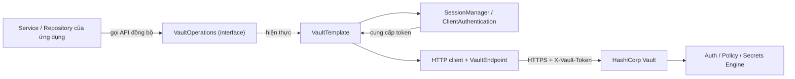
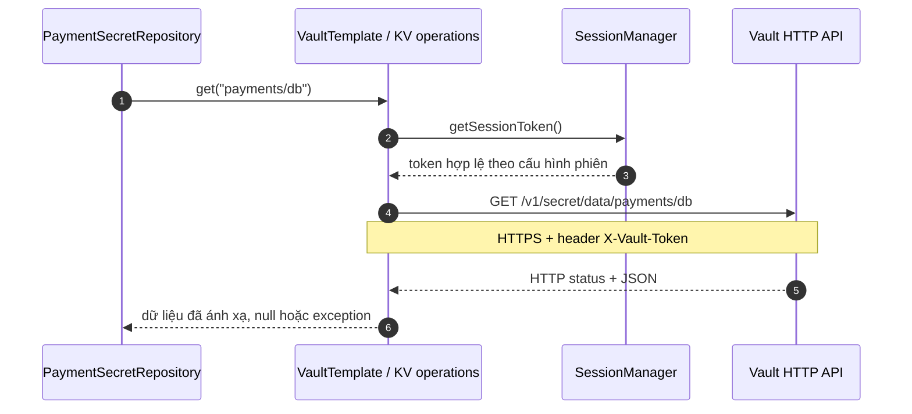

# VaultOperations và hợp đồng truy cập đồng bộ

Trong Spring Vault, ứng dụng Java thường cần đọc bí mật, ghi cấu hình nhạy cảm hoặc gọi các dịch vụ như Transit và PKI mà không tự ghép URL, header xác thực và JSON của HashiCorp Vault. **`VaultOperations` là giao diện trung tâm cho các thao tác đồng bộ**, còn **`VaultTemplate` là một hiện thực phổ biến** của giao diện đó. Sự phân tách này giúp mã nghiệp vụ phụ thuộc vào hợp đồng truy cập thay vì phụ thuộc trực tiếp vào HTTP client.

Bài này thuộc phần **Kiến trúc client** của Spring Vault. Sau khi học, bạn có thể:

- Giải thích vai trò của `VaultOperations`, `VaultTemplate`, `SessionManager` và API của Vault trong một lượt gọi.
- Chọn thao tác mức thấp (`read`, `write`, `list`, `delete`) hoặc API chuyên biệt cho KV, Transit, PKI.
- Phân biệt giá trị trả về hợp lệ, trường hợp không tìm thấy, lỗi quyền truy cập và lỗi hạ tầng.
- Thiết kế ranh giới truy cập secrets có thể kiểm thử, đồng thời hiểu chi phí và giới hạn của lời gọi **blocking**.

## 1. VaultOperations đứng ở đâu trong kiến trúc?

`VaultOperations` nằm trong package `org.springframework.vault.core`. Đây là **hợp đồng thao tác**, không phải một token, một kết nối mạng hay một kho lưu trữ bí mật. Một đối tượng `VaultOperations` cung cấp các phương thức chung và điểm vào các nhóm API chuyên biệt của Vault.

`VaultTemplate` triển khai hợp đồng đó. Khi ứng dụng gọi một phương thức, template phối hợp địa chỉ Vault, thành phần lấy token phiên và HTTP client để gửi yêu cầu tương ứng tới Vault. Phần quyền thực thi vẫn do **policy trên máy chủ Vault** quyết định; có phương thức trong Java không đồng nghĩa token được cấp phép gọi phương thức ấy.



Các thành phần có trách nhiệm khác nhau:

| Thành phần | Vai trò | Điều **không** tự bảo đảm |
|---|---|---|
| `VaultOperations` | Định nghĩa cách gọi Vault và truy cập các nhóm operations | Không định nghĩa cấu hình TLS, thời hạn token hay policy |
| `VaultTemplate` | Hiện thực thao tác đồng bộ, gửi request và ánh xạ response/lỗi | Không cấp thêm quyền cho token |
| `VaultEndpoint` | Chỉ ra scheme, host, port của Vault | Không chứng minh Vault đang sẵn sàng |
| `ClientAuthentication` | Xác thực để lấy token (ví dụ token tĩnh, AppRole, Kubernetes tùy cách cấu hình) | Không tự gia hạn mọi token |
| `SessionManager` | Cung cấp token phiên cho request; cách lưu/đổi mới token phụ thuộc hiện thực và cấu hình | Không quản lý mặc định mọi lease của dynamic secrets |
| Vault server | Kiểm tra token, policy và xử lý secret engine | Không bảo đảm thao tác liên tiếp của client tạo thành một transaction |

**Quy tắc thiết kế:** service nghiệp vụ nên khai báo phụ thuộc `VaultOperations` (hoặc một interface domain tự xây trên nó). Chỉ phần cấu hình hạ tầng cần biết đến `VaultTemplate`.

## 2. “Hợp đồng truy cập đồng bộ” nghĩa là gì?

Một lời gọi đồng bộ có ba đặc điểm:

1. **Thực thi trên luồng đang gọi.** Phương thức chỉ trả quyền điều khiển khi HTTP request được xử lý xong hoặc gặp lỗi/timeout; thời gian chờ mạng làm luồng đó bị chiếm dụng.
2. **Trả về kiểu dữ liệu trực tiếp.** Ví dụ `VaultResponse`, `List<String>` hoặc `void`, thay vì `Mono`/`Flux` của API reactive.
3. **Lỗi được phản ánh tại vị trí gọi.** Lỗi phản hồi HTTP, xác thực hoặc kết nối thường đi qua hệ thống ngoại lệ runtime của Spring Vault/Spring HTTP client; mã gọi cần phân biệt với kết quả “không có secret”.

Luồng xử lý điển hình:



Từ “đồng bộ” **không** hàm ý dữ liệu được cache, thao tác là nguyên tử giữa nhiều request hay Vault có transaction cho cả chuỗi `read → modify → write`. Mỗi lần gọi có ranh giới thành công/thất bại riêng. Nếu ứng dụng xử lý hàng nghìn request đồng thời, cần tính cả số luồng chờ, giới hạn kết nối và độ trễ của Vault. Khi cần luồng I/O bất đồng bộ, Spring Vault có API riêng như `ReactiveVaultOperations`/`ReactiveVaultTemplate`; đó là mô hình gọi khác.

## 3. Hợp đồng của các thao tác cơ bản

Các phương thức mức thấp của `VaultOperations` hoạt động trên **đường dẫn API của Vault** (không phải đường dẫn file). Đường dẫn phải phù hợp với secrets engine và phiên bản engine đã mount.

| Thao tác | Ý nghĩa | Kết quả cần xử lý |
|---|---|---|
| `read(path)` | Đọc dữ liệu tại một API path | Thường trả `VaultResponse`; có thể trả `null` khi tài nguyên không tồn tại |
| `write(path, body)` | Gửi payload ghi hoặc gọi endpoint yêu cầu body | Trả `VaultResponse` nếu endpoint có response body; `null` có thể là một phản hồi ghi thành công không có body |
| `delete(path)` | Gửi yêu cầu xóa tới path | Trả `void` khi request hoàn tất; cách xóa thực tế do engine/endpoint quyết định |
| `list(path)` | Liệt kê các khóa dưới path nếu endpoint và policy hỗ trợ | Danh sách tên khóa, hoặc `null` khi không có kết quả tương ứng |
| `opsForKeyValue(mount, backend)` | Lấy nhóm thao tác KV theo mount và KV v1/v2 | Trả một `VaultKeyValueOperations` để xử lý đường dẫn và cấu trúc dữ liệu KV |
| `opsForTransit()`, `opsForPki()` và các nhóm operations khác | Truy cập API theo nghiệp vụ của secret engine | Hợp đồng riêng cho thao tác mã hóa, chứng chỉ hoặc các chức năng Vault khác |

**Chú ý về `null`:** “không có body” sau một lệnh ghi không đồng nghĩa lệnh ghi thất bại; ngược lại, `null` khi đọc nên được ứng dụng diễn giải là trạng thái thiếu dữ liệu nếu đó là điều API đang gọi cho phép. Không dùng `null` để biểu diễn chung lỗi `403`, timeout hay Vault không hoạt động. Các lỗi đó cần đi theo nhánh xử lý lỗi.

### Đường dẫn KV v1 và KV v2 không giống nhau

Giả sử secrets engine KV v2 được mount ở `secret/` và bạn muốn lấy khóa logic `payments/db`:

| Cách truy cập | Ví dụ | Điều cần biết |
|---|---|---|
| API mức thấp | `read("secret/data/payments/db")` | Phải tự biết tiền tố `data/` của KV v2 và cấu trúc response lồng nhau |
| API KV mức cao | `opsForKeyValue("secret", KV_2).get("payments/db")` | Thư viện xử lý định tuyến KV v2 và trả dữ liệu secret theo hợp đồng KV |
| Liệt kê KV v2 mức thấp | API dưới `secret/metadata/...` | Quyền `list` và đường dẫn metadata khác quyền `read` dữ liệu |

Với KV v1, endpoint không có tiền tố `data/` và `metadata/` theo cách của KV v2. Vì vậy, việc dùng nhầm `KV_1`/`KV_2` hoặc ghép thủ công path thường gây `404` dù secret có tồn tại trong Vault.

Một response KV v2 mức thấp có cấu trúc khái niệm như sau (đã bỏ thông tin phụ):

```json
{
  "data": {
    "data": {
      "username": "payments_reader",
      "password": "<secret>"
    },
    "metadata": {
      "version": 3
    }
  }
}
```

Lớp `data` bên ngoài là envelope của Vault HTTP API; lớp `data` bên trong chứa các cặp key/value do người dùng ghi. Khi dùng nhóm `VaultKeyValueOperations`, ứng dụng tránh phải tự bóc hai lớp JSON này trong trường hợp thông thường.

## 4. Khởi tạo VaultTemplate và lập trình theo interface

Ví dụ Java sau minh họa **Vault chạy trên máy cục bộ** và token được cấp qua biến môi trường; chỉ dùng HTTP không mã hóa cho lab trên loopback. Trong môi trường thật, cấu hình endpoint HTTPS, xác minh chứng chỉ máy chủ và chọn phương thức xác thực theo workload thay vì phân phối token tĩnh trong mã nguồn.

```java
import java.util.Objects;
import org.springframework.vault.authentication.ClientAuthentication;
import org.springframework.vault.authentication.TokenAuthentication;
import org.springframework.vault.client.VaultEndpoint;
import org.springframework.vault.core.VaultOperations;
import org.springframework.vault.core.VaultTemplate;

public final class VaultClientFactory {
    public static VaultOperations localClient() {
        String token = Objects.requireNonNull(
            System.getenv("VAULT_TOKEN"), "Cần đặt VAULT_TOKEN cho bài lab"
        );
        VaultEndpoint endpoint = VaultEndpoint.create("127.0.0.1", 8200);
        ClientAuthentication auth = new TokenAuthentication(token);
        return new VaultTemplate(endpoint, auth);
    }
}
```

Để sử dụng trong ứng dụng Spring, có thể đăng ký đối tượng đó làm bean và inject qua kiểu `VaultOperations`. Nếu dự án dùng cơ chế tự cấu hình của Spring Cloud Vault, hãy sử dụng bean client đã được hệ thống tạo và cấu hình thay vì tạo thêm một client với token riêng.

Ví dụ sau giới hạn quyền truy cập Vault vào một lớp repository. Nó chỉ trả về thông tin cần thiết cho nghiệp vụ và **phân biệt key chưa tồn tại với lỗi request**:

```java
import java.util.Optional;
import org.springframework.vault.core.VaultKeyValueOperations;
import org.springframework.vault.core.VaultKeyValueOperationsSupport.KeyValueBackend;
import org.springframework.vault.core.VaultOperations;
import org.springframework.vault.support.VaultResponseSupport;

public final class PaymentSecretRepository {
    private final VaultKeyValueOperations kv;

    public PaymentSecretRepository(VaultOperations operations) {
        this.kv = operations.opsForKeyValue("secret", KeyValueBackend.KV_2);
    }

    public Optional<DbCredentials> findDbCredentials() {
        VaultResponseSupport<DbCredentials> response =
            kv.get("payments/db", DbCredentials.class);

        return response == null
            ? Optional.empty()
            : Optional.ofNullable(response.getData());
    }

    public static final class DbCredentials {
        private String username;
        private String password;

        public DbCredentials() { }

        public String getUsername() { return username; }
        public void setUsername(String username) { this.username = username; }
        public String getPassword() { return password; }
        public void setPassword(String password) { this.password = password; }
    }
}
```

Trong ví dụ:

- `secret` là **mount path**, còn `payments/db` là **đường dẫn secret logic**, không chứa `data/`.
- `DbCredentials` phải có cấu trúc ánh xạ phù hợp với dữ liệu Vault đang lưu; ví dụ dùng JavaBean với constructor không tham số và getter/setter.
- `Optional.empty()` chỉ biểu thị trường hợp API trả về thiếu dữ liệu; lỗi `403`, lỗi TLS và timeout không bị nuốt.
- Không ghi `password`, toàn bộ `VaultResponse` hay token ra log; hạn chế thời gian lưu credentials trong bộ nhớ theo nhu cầu thực tế.

Nếu cần ghi dữ liệu KV v2, dùng `kv.put("payments/db", payload)` với payload phù hợp. Khi cập nhật theo phiên bản và cần ngăn hai client ghi đè lẫn nhau, hãy xem API `VaultVersionedKeyValueOperations` và cơ chế check-and-set (CAS) của KV v2; chuỗi đọc rồi ghi thông thường không tự bảo đảm kiểm soát cạnh tranh.

## 5. Quyền truy cập, phiên xác thực và vòng đời secret

Luồng bảo mật nên được nhìn thành ba vòng đời tách biệt:

**Xác thực workload → token phiên → request.** Workload chứng minh danh tính qua cơ chế đã cấu hình (chẳng hạn Kubernetes hoặc AppRole); `SessionManager` cung cấp token để template đính kèm vào request. Vault sau đó kiểm tra token và policy cho từng API path.

**Token hết hạn hoặc bị thu hồi.** Nếu client dùng một `TokenAuthentication` tĩnh, không thể suy ra có cơ chế tự gia hạn token. Khi workload cần duy trì phiên lâu dài, chọn và cấu hình session manager hỗ trợ vòng đời tương ứng, kiểm soát TTL/khả năng renew và cách lấy lại token sau khi xác thực hết hiệu lực.

**Dynamic secret có lease.** Một lệnh đọc có thể trả credentials kèm lease ID và thời hạn sử dụng. `VaultOperations.read(...)` đơn lẻ không biến credentials đó thành tài nguyên tự gia hạn. Muốn đăng ký theo dõi, renew hoặc revoke lease, cần cơ chế quản lý lease thích hợp của Spring Vault (ví dụ `SecretLeaseContainer`) và kế hoạch thay credentials ở nơi sử dụng.

Ví dụ chính sách tối thiểu cho workload chỉ cần đọc một secret trên KV v2:

```hcl
path "secret/data/payments/db" {
  capabilities = ["read"]
}
```

Policy này không cấp quyền `list`, `create`, `update` hay đọc secret khác. Nếu ứng dụng cần duyệt danh sách khóa, quyền `list` phải được xem xét riêng cho path **metadata** của KV v2. Không cấp quyền rộng chỉ để tránh một lỗi `403`; trước tiên kiểm tra path thực sự mà client gửi lên.

## 6. Hợp đồng xử lý kết quả và lỗi

Xử lý kết quả phải phân biệt **trạng thái nghiệp vụ** và **sự cố truy cập Vault**. Một chiến lược điển hình:

| Tình huống | Diễn giải | Hành vi đề xuất |
|---|---|---|
| `get(...)` trả `null` | Secret không tồn tại hoặc phiên bản đang yêu cầu không có dữ liệu | Trả `Optional.empty()` hoặc thông báo cấu hình bắt buộc đang thiếu |
| Đọc thành công, thiếu field bắt buộc | Secret tồn tại nhưng sai schema | Báo lỗi cấu hình, không tự đặt mật khẩu/giá trị mặc định |
| `403 Forbidden` | Token không có capability phù hợp, đã mất hiệu lực hoặc bị từ chối | Kiểm tra chính sách, mount, danh tính workload và vòng đời token |
| `404 Not Found` | Path/engine/phiên bản không có hoặc request đến endpoint không đúng | Kiểm tra KV v1/v2, mount path và đường dẫn logic; lưu ý API mức cao có thể ánh xạ thành `null` |
| `429`, `5xx`, timeout hoặc mất kết nối | Vault đang giới hạn/tạm lỗi hoặc mạng có sự cố | Giới hạn thời gian chờ, retry có giới hạn và quan sát nguyên nhân |
| `put` đã gửi nhưng client timeout | Không biết server đã ghi thành công hay chưa | Đọc lại/truy vết trạng thái; không tự retry vô hạn các lệnh có tác dụng phụ |

Không nên viết logic kiểu `catch (Exception e) { return Optional.empty(); }` quanh thao tác Vault: nó biến sự cố bảo mật hoặc hạ tầng thành “secret chưa được cấu hình”. Thay vào đó, giữ lỗi gốc cho tầng xử lý phù hợp; khi ghi log chỉ lưu thông tin an toàn như operation, mount/đường dẫn đã được phép ghi, mã lỗi, request ID nếu có, độ trễ và correlation ID. Dữ liệu bí mật, giá trị token và payload phải được loại khỏi log/trace.

### Timeout, retry và idempotency

`VaultOperations` là interface thao tác, **không phải chính sách resiliency hoàn chỉnh**. Cấu hình timeout kết nối/đọc trên HTTP client dùng bởi `VaultTemplate`, đặt giới hạn đồng thời theo năng lực Vault, và thiết kế fallback phù hợp với dữ liệu nhạy cảm.

- **Đọc secret** thường có thể retry ngắn với exponential backoff và jitter khi lỗi tạm thời, nhưng cần giới hạn tổng thời gian chờ của request nghiệp vụ.
- **Ghi KV** có thể được lặp lại trong một số điều kiện nếu đã xác minh ngữ nghĩa idempotent, còn cấp token, tạo chứng chỉ PKI, cấp dynamic credentials hoặc gọi thao tác mã hóa có side effect cần đánh giá riêng.
- Với **timeout sau khi gửi request**, client có thể không biết phía server đã thực thi hay chưa. Không dựa vào việc phương thức ném ngoại lệ để kết luận thao tác chưa diễn ra.
- Nếu Vault không khả dụng, ứng dụng phải có chính sách rõ ràng: từ chối xử lý phần nghiệp vụ cần secret, hay dùng secret đã cache hợp lệ với TTL và yêu cầu bảo mật cụ thể. Không đặt secret mặc định trong mã nguồn.

## 7. Kiểm thử hợp đồng ở ba lớp

**Kiểm thử đơn vị:** truyền một `VaultOperations` giả hoặc mock vào repository, giả lập `VaultKeyValueOperations.get(...)` trả dữ liệu, trả `null` và ném lỗi. Xác nhận repository giữ nguyên ranh giới giữa không tìm thấy và lỗi truy cập. Không cần chạy Vault thật để kiểm tra việc chuyển đổi DTO.

**Kiểm thử tích hợp:** chạy Vault dành riêng cho test, tạo mount KV v2, policy và thông tin xác thực có TTL ngắn. Kiểm tra lần lượt: đọc secret tồn tại; đọc secret không tồn tại; KV v2 version; token chỉ có `read` bị từ chối khi `put`; sửa sai mount path; token hết hạn. Bài test phải dọn dữ liệu và không đẩy secret thật vào repository.

**Kiểm thử hành vi vận hành:** gây timeout, lỗi kết nối hoặc lỗi `5xx` ở client/test proxy. Quan sát số lần retry, tổng độ trễ và nội dung log. Kiểm tra rằng giá trị `password` và `X-Vault-Token` không xuất hiện trong log, trace hoặc thông báo lỗi trả cho người dùng.

## 8. Bài thực hành ngắn

Giả sử Vault dev/test đã có KV v2 tại mount `secret` và dữ liệu `payments/db`. Thực hiện lần lượt:

1. Tạo client `VaultOperations` từ cấu hình test, đưa nó vào `PaymentSecretRepository`, sau đó gọi `findDbCredentials()`. Kiểm tra dữ liệu trả về đúng kiểu và không cần tự xử lý lớp `data.data` của JSON.
2. Đọc `payments/unknown`, xác nhận repository trả `Optional.empty()` (với trường hợp API trả `null`).
3. Thử dùng token chỉ có quyền `read` để gọi `put`. Xác nhận request bị Vault từ chối; repository không được biến lỗi thành “không có secret”.
4. Đổi tạm cấu hình `KV_2` sang `KV_1` trong môi trường test, quan sát lỗi hoặc kết quả thiếu dữ liệu và giải thích tại sao đường dẫn API khác nhau.
5. Ghi nhận độ trễ và lỗi khi endpoint Vault không kết nối được; kiểm tra timeout và log, đồng thời xác nhận ứng dụng không lộ giá trị secret.

**Tự kiểm tra:** Vì sao cùng một token đọc được `secret/data/payments/db` nhưng không nhất thiết liệt kê được `secret/metadata/payments`? Vì sao `null` của `read` khác với `403`? Vì sao một lần `read` thành công không có nghĩa credentials động sẽ được tự gia hạn? Trả lời được ba câu hỏi này là bạn đã nắm phần cốt lõi của hợp đồng truy cập đồng bộ Spring Vault.
