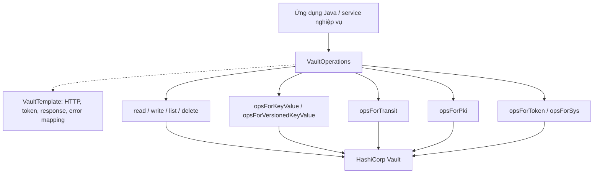
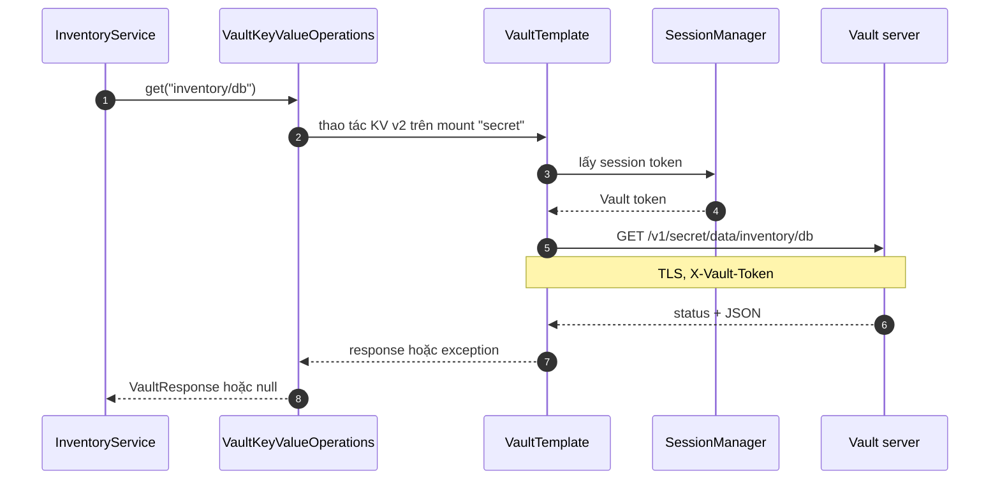
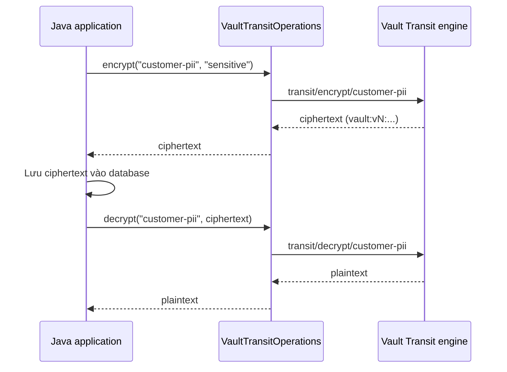
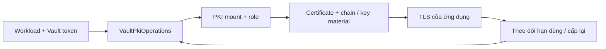

# VaultTemplate và các nhóm thao tác chuyên biệt

Trong **Spring Vault**, `VaultTemplate` là hiện thực đồng bộ phổ biến của interface `VaultOperations`, giúp ứng dụng Java gọi **HashiCorp Vault** mà không phải tự xây dựng từng HTTP request. Điểm đáng chú ý của template là ngoài các thao tác tổng quát như `read`, `write`, `list` và `delete`, nó còn cung cấp **những nhóm thao tác chuyên biệt** cho từng loại chức năng Vault: KV secrets, Transit encryption, PKI, token và quản trị hệ thống.

Bài này thuộc chương **Kiến trúc client**. Nó đặt việc sử dụng `VaultTemplate` vào bối cảnh xác thực theo workload, chính sách phân quyền, secrets có phiên bản, vòng đời token/lease, xử lý lỗi, giám sát và kiểm thử tích hợp. Nội dung tập trung vào việc **chọn đúng nhóm API**, hiểu ranh giới trách nhiệm và tổ chức mã Java để ít phụ thuộc vào cấu trúc HTTP thô của Vault.

Sau bài học, bạn có thể:

- Giải thích vì sao một `VaultTemplate` có thể phục vụ nhiều secrets engine nhưng mỗi nhóm operations có hợp đồng riêng.
- Chọn giữa `VaultOperations.read/write` và `opsForKeyValue`, `opsForVersionedKeyValue`, `opsForTransit`, `opsForPki`.
- Viết mã Java đọc KV v2 và mã hóa/giải mã qua Transit mà không tự ghép body JSON hoặc endpoint.
- Phân biệt thao tác của ứng dụng với việc cấp/gia hạn token, quản lý lease và cấu hình policy.
- Thiết kế lớp truy cập Vault có thể kiểm thử và hạn chế lộ dữ liệu nhạy cảm.

## 1. Từ VaultOperations đến các nhóm operations

`VaultOperations` là hợp đồng mà mã ứng dụng có thể phụ thuộc vào; `VaultTemplate` triển khai hợp đồng đó. Các phương thức `opsFor...` trên template trả về các đối tượng cung cấp API sát với miền nghiệp vụ hơn. Chúng vẫn sử dụng hạ tầng kết nối, cấu hình endpoint và thông tin xác thực của client, nhưng nắm thêm quy tắc đặc thù của từng engine.



Từ góc nhìn ứng dụng, các đối tượng operations này là **những cổng truy cập** đến API của Vault; chúng không phải một bản sao của dữ liệu bí mật và không mặc nhiên thực thi cache. Mỗi lần gọi vẫn là một thao tác đồng bộ có thể chờ mạng, bị từ chối do policy hoặc thất bại vì timeout.

| API | Mục đích điển hình | Điểm mạnh | Lưu ý quan trọng |
|---|---|---|---|
| `read/write/list/delete` | Endpoint tùy biến hoặc engine chưa có API riêng | Linh hoạt, truy cập sát Vault HTTP API | Tự hiểu path, HTTP semantics, envelope JSON |
| `opsForKeyValue(mount, backend)` | KV v1/v2 thông thường | Tự xử lý khác biệt đường dẫn và dữ liệu giữa hai phiên bản KV | Phải khai báo đúng mount và `KV_1`/`KV_2` |
| `opsForVersionedKeyValue(mount)` | KV v2 có version/CAS | Làm việc với phiên bản và metadata cụ thể | Chỉ phù hợp KV v2 |
| `opsForTransit()` | Encrypt/decrypt, thao tác khóa mã hóa theo Transit API | Không cần mang khóa mã hóa gốc về ứng dụng | Vault vẫn kiểm tra quyền tại path Transit |
| `opsForPki(...)` | Phát hành/quản lý certificate từ PKI engine | Trình bày thao tác bằng khái niệm certificate, role | Role, mount, TTL và chính sách PKI quyết định kết quả |
| `opsForToken()` | Các endpoint token do Vault hỗ trợ | Phân biệt nghiệp vụ token với request thông thường | Quyền tạo, tra cứu, gia hạn, thu hồi không mặc định được cấp |
| `opsForSys()` | Endpoint quản trị hệ thống Vault | Phục vụ tác vụ quản trị/cấu hình có chủ đích | Thường cần quyền cao, không nên đưa vào service nghiệp vụ |

Danh sách phương thức và overload cụ thể có thể khác nhau giữa các phiên bản Spring Vault. Khi dùng API mới hoặc đặc thù, hãy kiểm tra Javadoc của **phiên bản dependency đang chạy**.

## 2. VaultTemplate chịu trách nhiệm đến đâu?

Một `VaultTemplate` cần có thông tin kết nối và một cơ chế cung cấp token cho các request. Khi ứng dụng gọi một nhóm operations, template sử dụng những thành phần này để gửi yêu cầu đến Vault và ánh xạ kết quả.



Cần tách rạch ròi những trách nhiệm sau:

1. **`VaultTemplate` và các nhóm operations** chịu trách nhiệm gọi API, chuẩn hóa một phần request/response và phát sinh lỗi tương ứng.
2. **`ClientAuthentication` và `SessionManager`** quyết định cách lấy, giữ và (tùy hiện thực/cấu hình) gia hạn token phiên cho request. Một token tĩnh không tự trở thành token có khả năng renew.
3. **Vault server** xác thực token, áp policy và thực thi engine. Việc client có phương thức `put`, `encrypt` hoặc `issueCertificate` không chứng minh workload được cấp quyền tương ứng.
4. **Quản lý lease** của dynamic secrets/chứng chỉ có vòng đời riêng; một lần `get` hoặc `issue` thành công không làm client tự đổi mới secret tại nơi sử dụng.

Các phương thức `VaultTemplate` là **blocking**. Nếu Vault phản hồi chậm, luồng Java gọi phương thức vẫn phải chờ đến khi request hoàn tất hoặc hết timeout. Với ứng dụng có lưu lượng cao, cần cấu hình timeout/pool kết nối và giới hạn đồng thời; không nên để mỗi request người dùng thực hiện tùy ý nhiều lời gọi Vault.

## 3. Tổ chức client và dependency theo vai trò

Trong Spring, phần hạ tầng sở hữu bean `VaultOperations` hoặc `VaultTemplate`, còn service nghiệp vụ chỉ cần nhận interface đã cấu hình. Nếu ứng dụng dùng Spring Cloud Vault để tự cấu hình Vault client, nên tái sử dụng bean tương ứng thay vì vô tình tạo nhiều client với cấu hình token khác nhau.

Ví dụ xây dựng một adapter chuyên trách KV. Mã sau giả định đã có bean `VaultOperations` hoạt động và KV v2 được mount ở `secret`:

```java
import java.util.Map;
import java.util.Optional;

import org.springframework.stereotype.Repository;
import org.springframework.vault.core.VaultKeyValueOperations;
import org.springframework.vault.core.VaultKeyValueOperationsSupport.KeyValueBackend;
import org.springframework.vault.core.VaultOperations;
import org.springframework.vault.support.VaultResponse;

@Repository
public class InventorySecretRepository {

    private final VaultKeyValueOperations kv;

    public InventorySecretRepository(VaultOperations vault) {
        this.kv = vault.opsForKeyValue("secret", KeyValueBackend.KV_2);
    }

    public Optional<String> findJdbcUrl() {
        VaultResponse response = kv.get("inventory/db");
        if (response == null || response.getData() == null) {
            return Optional.empty();
        }

        Object value = response.getData().get("jdbcUrl");
        return value instanceof String ? Optional.of((String) value) : Optional.empty();
    }

    public void saveDbConfig(Map<String, Object> config) {
        kv.put("inventory/db", config);
    }
}
```

**Vì sao nên dùng adapter?** Service xử lý nghiệp vụ không cần biết mount `secret`, phiên bản KV, đường dẫn `data/` hoặc cấu trúc `VaultResponse`. Khi thêm kiểm tra schema, kiểm soát lỗi, cache có giới hạn hoặc thay engine, bạn sửa ở một điểm. Trong ứng dụng chỉ cần **đọc** secret, nên bỏ phương thức `saveDbConfig` khỏi interface nghiệp vụ và cấp token policy chỉ có quyền đọc.

Ví dụ minh họa dùng `Map<String, Object>` cho dữ liệu KV. Với cấu trúc ổn định, có thể ánh xạ trực tiếp sang DTO và kiểm tra các trường bắt buộc trước khi trả về cho service.

## 4. Nhóm KV: hai phiên bản và hai mức trừu tượng

KV là nơi dễ nhầm nhất giữa **đường dẫn logic của secret** và **đường dẫn HTTP thật sự**. Giả sử Vault mount KV ở `secret`, secret logic là `inventory/db`:

| Phương án | Lời gọi Java (minh họa) | Đường dẫn HTTP liên quan |
|---|---|---|
| KV v1 | `opsForKeyValue("secret", KV_1).get("inventory/db")` | `secret/inventory/db` |
| KV v2 | `opsForKeyValue("secret", KV_2).get("inventory/db")` | `secret/data/inventory/db` |
| Mức thấp, KV v2 | `read("secret/data/inventory/db")` | Phải tự chỉ ra `data/` |
| Liệt kê tên khóa, KV v2 | API metadata/list của KV v2 | `secret/metadata/inventory` |

Trong bảng trên, `secret` là **mount path**, còn `inventory/db` là **đường dẫn logic**. Không truyền `secret/data/inventory/db` vào `opsForKeyValue("secret", KV_2)`, vì nhóm này đã biết quy tắc path của KV v2.

### 4.1. API KV thông thường

Các thao tác hay dùng:

```java
VaultKeyValueOperations kv =
    vaultOperations.opsForKeyValue("secret", KeyValueBackend.KV_2);

VaultResponse response = kv.get("inventory/db");
if (response != null) {
    Object jdbcUrl = response.getData().get("jdbcUrl");
    // Chỉ sử dụng giá trị cần thiết; không log cả response.
}

kv.put("inventory/db", Map.of("jdbcUrl", "jdbc:postgresql://db.local/inventory"));
kv.delete("inventory/db");
```

*Các import chính trong đoạn mã trên:* `org.springframework.vault.core.VaultKeyValueOperations`, `org.springframework.vault.core.VaultKeyValueOperationsSupport.KeyValueBackend`, `org.springframework.vault.support.VaultResponse` và `java.util.Map`. Biến `vaultOperations` biểu diễn bean được inject.

Với KV v2, cần hiểu semantics của thao tác xóa: **xóa phiên bản hiện hành (soft delete)**, **xóa vĩnh viễn các phiên bản cụ thể** và **xóa metadata/toàn bộ lịch sử** là những endpoint khác nhau. Đừng suy luận rằng gọi `delete` thông thường sẽ xóa không thể khôi phục tất cả phiên bản của secret.

### 4.2. KV v2 có version và CAS

Khi cần đọc một phiên bản cụ thể, dùng các thao tác chuyên biệt của `VaultVersionedKeyValueOperations` thay cho việc tự thêm query parameter vào URL. API này mô hình hóa secret bằng dữ liệu và metadata phiên bản, thường qua kiểu `Versioned<T>`. Nó hữu ích khi:

- Xem phiên bản trước của cấu hình nhạy cảm.
- Chỉ cho phép ghi khi phiên bản hiện tại vẫn là phiên bản đã đọc (**check-and-set**, CAS).
- Phân biệt secret không tồn tại, phiên bản đã bị xóa hoặc metadata đang ở trạng thái khác.

Ví dụ ý tưởng:

```java
VaultVersionedKeyValueOperations versioned =
    vaultOperations.opsForVersionedKeyValue("secret");

Versioned<Map<String, Object>> current = versioned.get("inventory/db");
if (current != null) {
    // Kiểm tra dữ liệu và metadata/version theo hợp đồng Versioned.
    // Với cập nhật cạnh tranh, dùng API ghi có CAS tương ứng.
}
```

*Các import bổ sung:* `org.springframework.vault.core.VaultVersionedKeyValueOperations` và `org.springframework.vault.support.Versioned`.

**Điểm quan trọng:** thao tác `get` rồi `put` thông thường **không phải transaction**. Nếu hai instance cùng đọc cấu hình rồi cùng ghi, bản ghi sau có thể ghi đè bản ghi trước. KV v2 hỗ trợ CAS ở phía Vault; ứng dụng phải sử dụng đúng API và cách truyền expected version nếu cần chống lost update.

## 5. Nhóm Transit: mã hóa mà không xuất khóa gốc

**Transit secrets engine** cung cấp dịch vụ mật mã qua Vault: encrypt, decrypt và những khả năng khác tùy cấu hình key/engine. Thay vì tải khóa bí mật về ứng dụng, workload gửi dữ liệu cần xử lý tới Vault và nhận ciphertext hoặc plaintext theo quyền được cấp.

`VaultTransitOperations` ẩn các chi tiết của request Transit như encoding và cấu trúc payload:

```java
import org.springframework.vault.core.VaultOperations;
import org.springframework.vault.core.VaultTransitOperations;

public final class FieldCipher {
    private final VaultTransitOperations transit;

    public FieldCipher(VaultOperations vault) {
        this.transit = vault.opsForTransit();
    }

    public String encrypt(String plaintext) {
        return transit.encrypt("customer-pii", plaintext);
    }

    public String decrypt(String ciphertext) {
        return transit.decrypt("customer-pii", ciphertext);
    }
}
```

Ví dụ giả định đã tồn tại Transit key `customer-pii` tại mount mặc định `transit` và token có quyền cần thiết. Ciphertext Transit thường mang tiền tố phiên bản khóa, chẳng hạn `vault:v1:...`; cần lưu nguyên ciphertext để có thể giải mã về sau. Đừng cố tự tách hoặc sửa chuỗi này.



**Phạm vi bảo vệ:** Transit giúp giảm nhu cầu quản lý khóa mã hóa gốc ở ứng dụng. Nhưng plaintext vẫn xuất hiện trong bộ nhớ ứng dụng khi encrypt/decrypt, và payload đi qua kết nối đến Vault. Vì vậy vẫn phải dùng TLS, giới hạn quyền decrypt, không ghi payload vào log/trace và cân nhắc mức độ nhạy cảm của dữ liệu gửi đi.

**Thiết kế policy:** với workload chỉ mã hóa, cấp quyền `update` tại `transit/encrypt/customer-pii`. Chỉ workload thật sự cần giải mã mới được cấp thêm `update` tại `transit/decrypt/customer-pii`. Tạo, thay đổi, xoay vòng hoặc xuất khóa là quyền khác và không cần thiết cho luồng encrypt/decrypt thông thường.

Không phải mọi phương thức Transit đều có cùng ngữ nghĩa: hash/HMAC, sign/verify, rewrap và quản trị key cần được xem riêng theo phiên bản Spring Vault và engine đã bật. `opsForTransit` giúp diễn đạt thao tác mật mã, nhưng không thay thế việc xác định chính xác thuật toán, định dạng và chính sách rotation.

## 6. Nhóm PKI: làm việc với certificate và role

**PKI secrets engine** của Vault cho phép cấp chứng chỉ ngắn hạn dựa trên role và cấu hình CA. Nhóm `VaultPkiOperations` giúp ứng dụng biểu diễn thao tác qua các đối tượng certificate/request thay vì tự ghép JSON tới endpoint `pki/issue/{role}`.

Quy trình điển hình:

1. Nhóm vận hành cấu hình PKI mount, CA và role; role quy định domain được phép cấp, TTL tối đa và các ràng buộc cấp chứng chỉ.
2. Ứng dụng xác thực dưới danh tính workload; token có policy cho endpoint issue/sign phù hợp.
3. Ứng dụng gọi nhóm PKI operations để xin certificate theo role, nhận certificate, chain, private key hoặc metadata tùy loại API và cấu hình.
4. Ứng dụng nạp certificate vào TLS client/server theo cách bảo vệ private key, theo dõi thời hạn và thay chứng chỉ trước khi hết hạn.



Ví dụ về cách lấy đúng nhóm operations:

```java
import org.springframework.vault.core.VaultOperations;
import org.springframework.vault.core.VaultPkiOperations;

VaultPkiOperations pki = vaultOperations.opsForPki("pki-internal");
// Sử dụng API issueCertificate/sign... tương ứng với role,
// VaultCertificateRequest và cấu hình PKI của phiên bản Spring Vault.
// Xử lý certificate, chain, private key và thời hạn theo response thực tế.
```

Đoạn trên cố ý tập trung vào điểm truy cập; các overload của lệnh cấp certificate và kiểu request/response cần đối chiếu Javadoc theo phiên bản thư viện. Không nên đưa trực tiếp key material nhận được vào log, telemetry hoặc biến môi trường tồn tại lâu. PKI certificate có TTL **khác** TTL của token dùng để phát hành; token hết hạn không đồng nghĩa certificate đã cấp lập tức hết hạn, và certificate hết hạn không tự được gia hạn chỉ nhờ token vẫn hợp lệ.

Khi cần vòng đời certificate, hãy thiết kế **cấp lại và triển khai lại certificate** vào TLS stack theo một cơ chế chủ động. Tránh mặc định rằng `VaultTemplate` hoặc `VaultPkiOperations` sẽ tự thay keystore/TLS context của ứng dụng.

## 7. Token operations, Sys operations và các nhóm liên quan

Hai nhóm dễ được sử dụng nhầm trong mã nghiệp vụ:

**`opsForToken()`:** truy cập các chức năng token mà server cho phép, chẳng hạn tra cứu thông tin, tạo token con, renew/revoke theo quyền của caller. Đây là API để **gọi chức năng token của Vault**; nó không đồng nhất với `SessionManager` đang cung cấp token xác thực cho mọi request.

**`opsForSys()`:** dành cho endpoint hệ thống, ví dụ quản lý mount hoặc kiểm tra cấu hình của Vault theo phạm vi quyền tương ứng. Nhiều thao tác system yêu cầu quyền quản trị cao; không nên chèn vào service chạy theo mỗi HTTP request người dùng.

Bảng sau giúp phân biệt những khái niệm thường bị trộn lẫn:

| Nhu cầu | Thành phần phù hợp | Ranh giới |
|---|---|---|
| Đưa token hợp lệ vào mỗi request | `SessionManager`/`ClientAuthentication` được cấu hình | Đây là luồng xác thực client |
| Tạo/tra cứu/thu hồi token qua API Vault | `VaultTokenOperations` | Cần policy riêng; không thay thế session management |
| Đọc thông tin cấu hình hệ thống hoặc quản lý mount | `VaultSysOperations` | Chủ yếu cho ứng dụng quản trị/automation |
| Theo dõi và gia hạn lease của dynamic secret | Cơ chế lease lifecycle, ví dụ `SecretLeaseContainer` | Không tự xảy ra khi chỉ gọi `VaultOperations.read` |
| Dùng dynamic database credentials | Đọc đúng endpoint database secret engine hoặc dùng tích hợp phù hợp | TTL/lease và cách xoay credentials phải được quản lý |

Khi một engine chưa có nhóm operations riêng cho nhu cầu cụ thể, vẫn có thể sử dụng `read`/`write` mức thấp với path API và body đúng. Không nên cố ép mọi endpoint vào `opsForKeyValue`, vì KV chỉ xử lý KV engine.

## 8. Khi nào dùng API mức thấp?

Giả sử cần đọc dynamic database credentials từ endpoint `database/creds/reporting` và ứng dụng chưa dùng tích hợp chuyên biệt. API mức thấp có thể phù hợp:

```java
import org.springframework.vault.core.VaultOperations;
import org.springframework.vault.support.VaultResponse;

public final class ReportingLeaseClient {
    private final VaultOperations vault;

    public ReportingLeaseClient(VaultOperations vault) {
        this.vault = vault;
    }

    public VaultResponse requestCredentials() {
        return vault.read("database/creds/reporting");
    }
}
```

Response có thể chứa `data`, `lease_id`, `lease_duration` và `renewable`. Khi credentials được cấp động, **mỗi request có thể tạo ra cặp thông tin mới** cùng lease riêng. Lớp gọi phải quyết định ai giữ chúng, sử dụng đến khi nào và cách renew/revoke; không chỉ đọc `username/password` rồi bỏ qua hạn dùng.

Đối với những API mức thấp, hãy kiểm tra:

- Endpoint thuộc engine nào, nằm dưới mount nào và có hỗ trợ phương thức HTTP tương ứng không?
- Body cần những trường nào và response có bao nhiêu lớp `data`?
- Có tạo tài nguyên, lease hoặc side effect không? Nếu request timeout, retry có thể tạo trùng tài nguyên?
- Những capability nào của Vault policy áp dụng tại **path thật**?
- Secret/lease nào không được phép hiển thị trong log?

API chuyên biệt thường làm rõ hợp đồng và giảm lỗi định dạng, nhưng API mức thấp vẫn là công cụ hợp lệ cho các endpoint mà wrapper chưa bao phủ. Việc chọn API cần dựa trên semantics của engine, không chỉ dựa trên việc một method có vẻ ngắn hơn.

## 9. Chính sách quyền gắn trực tiếp với nhóm thao tác

Một instance `VaultTemplate` có thể lấy token dùng chung cho nhiều nhóm operations. **Quyền thực tế không nằm ở đối tượng Java**, mà nằm trong policy gắn với token và identity của workload.

Ví dụ service `reporting` cần đọc một secret KV v2, mã hóa dữ liệu qua Transit và cấp chứng chỉ TLS từ PKI. Mẫu policy giới hạn:

```hcl
path "secret/data/reporting/app" {
  capabilities = ["read"]
}

path "transit/encrypt/reporting-fields" {
  capabilities = ["update"]
}

path "pki-internal/issue/reporting-service" {
  capabilities = ["update"]
}
```

Policy trên **không** cấp quyền giải mã Transit, ghi KV hay quản trị mount. Nếu service cần decrypt, phải xét nhu cầu riêng và mở đúng `transit/decrypt/reporting-fields`. Nếu service cần list tên secret KV v2, phải xét policy cho endpoint `secret/metadata/...`; cấp `read` dưới `data/` không tự cấp `list` ở metadata.

Không nên tạo một workload token có toàn bộ quyền `sys`, `token`, KV, Transit và PKI chỉ vì `VaultTemplate` có thể truy cập tất cả các nhóm này. Có thể sử dụng một template cho những thao tác cùng trust boundary, hoặc tách danh tính/workload với policy riêng nếu các tác vụ có mức nhạy cảm khác nhau.

## 10. Kết quả, ngoại lệ và độ tin cậy

Một lỗi thiết kế thường gặp là coi mọi lần gọi Vault không trả dữ liệu là "không tìm thấy". Cần phân biệt:

| Tình huống | Cách hiểu | Cách xử lý ứng dụng |
|---|---|---|
| KV `get` trả `null` | Secret/path không có dữ liệu theo hợp đồng API đó | Trả `Optional.empty()` hoặc báo thiếu cấu hình bắt buộc |
| KV trả dữ liệu nhưng thiếu key bắt buộc | Secret tồn tại nhưng sai schema | Báo lỗi cấu hình, không tự tạo giá trị nhạy cảm mặc định |
| `403` hoặc lỗi xác thực | Token, policy, identity hoặc path không hợp lệ | Đưa về lỗi truy cập/cấu hình; không chuyển thành "không tồn tại" |
| `404` ở endpoint mức thấp | Sai mount/path/engine hoặc resource không có | Kiểm tra path logic và API engine, đặc biệt KV v1/v2 |
| Timeout, lỗi TLS, kết nối, `429`, `5xx` | Sự cố client, mạng hoặc Vault | Timeout rõ ràng, retry có giới hạn khi phù hợp, metrics |
| Timeout sau lệnh PKI issue hoặc tạo dynamic creds | Server có thể đã xử lý request dù client chưa nhận response | Xem là kết quả chưa xác định; tránh retry mù tạo thêm tài nguyên |

Các ngoại lệ cụ thể phụ thuộc phiên bản Spring Vault và HTTP client. Phân loại ít nhất thành **thiếu dữ liệu**, **từ chối truy cập**, **lỗi cấu hình** và **sự cố tạm thời**; giữ nguyên nguyên nhân gốc để chẩn đoán. Không sử dụng `catch (Exception)` rồi trả `null`/chuỗi rỗng cho mọi tình huống.

### Timeout, retry, cache

Vì các method của `VaultTemplate` là blocking, độ trễ mạng ảnh hưởng trực tiếp tới luồng đang gọi. Cấu hình thời gian chờ kết nối và phản hồi ở HTTP client; đo p50/p95/p99 latency theo nhóm operations (KV, Transit, PKI) và theo mã lỗi. Chỉ dùng dimension an toàn cho metrics, tránh đặt secret path có chứa thông tin nhạy cảm hoặc payload làm label.

- Lệnh **đọc KV** thường có thể retry ngắn khi lỗi tạm thời, với backoff, jitter và tổng thời gian chờ được giới hạn.
- Lệnh **Transit encrypt/decrypt** và các lệnh có side effect cần xem xét ngữ nghĩa operation và khả năng idempotent trước khi retry.
- Lệnh **PKI issue**, **token create**, **dynamic credential issue** có thể tạo ra đối tượng/lease mới; timeout không chứng minh server chưa chạy.
- Cache chỉ nên được dùng khi có yêu cầu rõ về TTL, bảo vệ dữ liệu trong bộ nhớ, vòng đời thu hồi và cách ứng dụng phản ứng khi secret thay đổi.

## 11. Kiểm thử cấu trúc các nhóm operations

**Unit test cho adapter:** giả lập `VaultOperations` và nhóm operations được trả về. Xác nhận adapter gọi đúng mount, backend và path; kiểm tra dữ liệu hợp lệ, thiếu dữ liệu và lỗi quyền/timeout. Không cần Vault thật để test logic ánh xạ DTO hoặc quyết định nghiệp vụ.

**Integration test với Vault riêng:** tạo mount KV v2, Transit key và PKI role dành cho bài test; nạp secret giả, tạo policy tối thiểu và thực hiện theo các kịch bản:

1. Dùng `opsForKeyValue("secret", KV_2)` đọc secret có sẵn, sau đó thử path không tồn tại.
2. Dùng `opsForVersionedKeyValue` xác nhận version; thử ghi CAS sai expected version và quan sát Vault từ chối.
3. Dùng `opsForTransit` encrypt/decrypt với key cho phép; thử token chỉ có encrypt để xác nhận decrypt bị từ chối.
4. Cấp chứng chỉ PKI bằng role test, kiểm tra các trường certificate/TTL theo policy role, không lưu private key vào báo cáo test.
5. Thử token không có quyền `write` KV, path mount sai, token hết hạn và Vault không phản hồi.

**Kiểm thử vận hành:** giới hạn timeout để kiểm chứng ứng dụng thoát khỏi request bị treo; kiểm tra số retry, cảnh báo và hệ thống log. Đảm bảo dữ liệu `password`, plaintext Transit, private key PKI và `X-Vault-Token` không xuất hiện trong test output, log hoặc tracing.

## 12. Bài thực hành: chọn nhóm thao tác theo yêu cầu

Bạn cần triển khai `ReportingService` với ba yêu cầu:

- Đọc `reporting/app` từ KV v2 mount `secret` để lấy địa chỉ dịch vụ phụ trợ.
- Mã hóa một định danh khách hàng trước khi ghi database bằng Transit key `reporting-fields`.
- Xin chứng chỉ TLS ngắn hạn từ PKI mount `pki-internal`, role `reporting-service`.

Hãy tổ chức ba adapter: `ReportingConfigRepository` dùng `VaultKeyValueOperations`; `ReportingFieldCipher` dùng `VaultTransitOperations`; `ReportingCertificateProvider` dùng `VaultPkiOperations`. Mỗi adapter chỉ lộ API nghiệp vụ và kiểm soát những lỗi mà tầng gọi cần biết. Đặt cấu hình endpoint, xác thực workload và TLS của client ở tầng hạ tầng; cấp policy chỉ cho các Vault path thật sự cần thiết.

Sau khi chạy tích hợp, trả lời bốn câu hỏi:

1. Vì sao `opsForKeyValue("secret", KV_2).get("reporting/app")` không cần tiền tố `data/`, còn `read(...)` mức thấp phải dùng đúng API path?
2. Vì sao `encrypt` thành công không đồng nghĩa cùng token gọi được `decrypt`?
3. Vì sao chứng chỉ PKI sắp hết hạn không được giải quyết chỉ bằng việc gia hạn token Vault?
4. Khi một request cấp certificate timeout, vì sao phải kiểm soát retry và theo dõi tài nguyên đã cấp?

Nắm được các điểm này, bạn đã có thể dùng `VaultTemplate` như một **cổng truy cập thống nhất** nhưng vẫn giữ đúng semantics, phân quyền và vòng đời riêng của từng nhóm thao tác Spring Vault.
