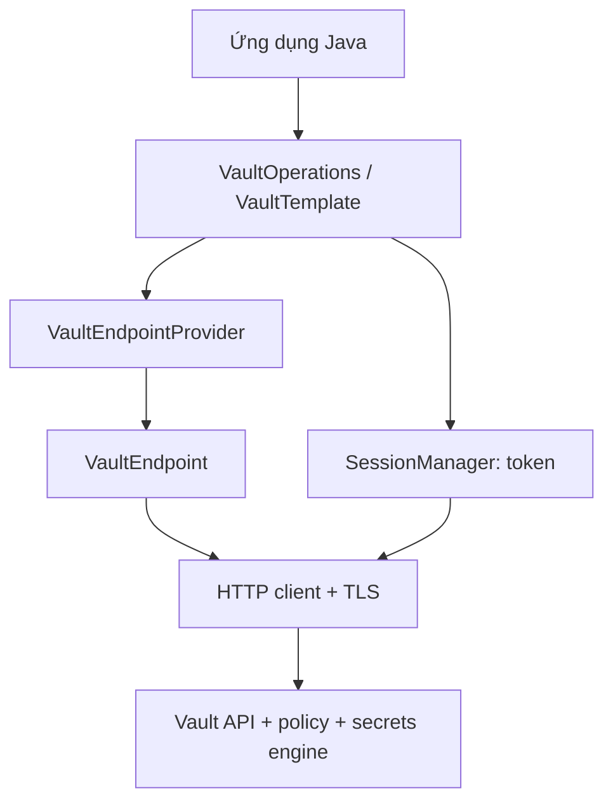
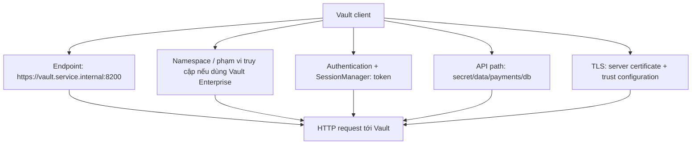

# VaultEndpoint và VaultEndpointProvider

Trong Spring Vault, ứng dụng Java cần biết **gửi request đến Vault ở đâu** trước khi có thể đọc KV secrets, gọi Transit encryption, xin chứng chỉ PKI hay thao tác với token và lease. Hai thành phần giải quyết bài toán địa chỉ kết nối là `VaultEndpoint` và `VaultEndpointProvider`. Chúng thuộc **kiến trúc client**, nằm bên dưới `VaultTemplate` và tách biệt với nội dung secret, danh tính workload cũng như policy phân quyền.

`VaultEndpoint` biểu diễn **một địa chỉ Vault**. `VaultEndpointProvider` biểu diễn **cách cung cấp địa chỉ Vault cho client**; nguồn địa chỉ có thể cố định hoặc được lựa chọn lại theo chính sách của ứng dụng. Hiểu đúng sự khác biệt này giúp bạn tránh ghép URL thủ công, cấu hình sai TLS và thiết kế failover gây lỗi khó phát hiện.

Mục tiêu bài học:

- Xác định trách nhiệm của `VaultEndpoint`, `VaultEndpointProvider` và `VaultTemplate` trong một yêu cầu đồng bộ.
- Cấu hình endpoint cố định cho ứng dụng Java và giải thích khi nào nên dùng địa chỉ dịch vụ ổn định.
- Hiểu cách provider có thể lấy endpoint động, cùng giới hạn của việc đổi địa chỉ khi Vault chạy HA.
- Phân biệt địa chỉ máy chủ, API path, KV mount, Vault namespace và thông tin xác thực.
- Chẩn đoán các lỗi kết nối/TLS/HTTP thường gặp và thiết kế kiểm thử không làm lộ token hoặc secret.

## 1. VaultEndpoint: mô tả địa chỉ của Vault

Lớp `org.springframework.vault.client.VaultEndpoint` là đối tượng cấu hình địa chỉ mà Spring Vault dùng làm cơ sở cho các request HTTP. Những thành phần thông thường của endpoint gồm:

| Thành phần | Ví dụ | Ý nghĩa |
|---|---|---|
| Scheme | `https` | Giao thức kết nối đến Vault; môi trường thật cần TLS |
| Host | `vault.service.internal` | Tên DNS hoặc địa chỉ đến dịch vụ Vault |
| Port | `8200` | Cổng HTTP API mà Vault hoặc proxy công bố |
| Base path nếu kiến trúc triển khai yêu cầu | Một tiền tố do reverse proxy quy định | Chỉ cấu hình nếu phiên bản thư viện và hạ tầng hỗ trợ cách triển khai đó |

Ví dụ địa chỉ cơ sở:

```text
https://vault.service.internal:8200
  ├─ scheme : https
  ├─ host   : vault.service.internal
  └─ port   : 8200
```

Một endpoint **không phải** đường dẫn đến secret cụ thể. Nếu KV v2 được mount ở `secret` và secret logic là `payments/db`, request đọc dữ liệu có thể đi tới:

```text
https://vault.service.internal:8200/v1/secret/data/payments/db
└───────────── địa chỉ Vault ───────────────┘└─ Vault API path ─────────┘
```

Trong đó:

- `https://vault.service.internal:8200` đến từ endpoint.
- `/v1/` là tiền tố API của Vault mà client biết cách sử dụng.
- `secret` là **mount path** của KV engine; `data` là thành phần API của KV v2.
- `payments/db` là tên secret logic bên trong engine.

Chính `VaultTemplate` và nhóm operations tương ứng chịu trách nhiệm xây dựng request. Khi dùng `opsForKeyValue("secret", KV_2)`, bạn truyền `payments/db`; nhóm KV v2 xử lý phần `data/`. Khi dùng `read(...)` mức thấp, bạn phải cung cấp path API chính xác như `secret/data/payments/db`.

**Không đưa token, password hoặc secret vào URL**. Địa chỉ endpoint là thông tin định tuyến, còn token được cung cấp qua cơ chế xác thực/session và truyền đến Vault bằng header phù hợp.

## 2. VaultEndpointProvider: hợp đồng cung cấp endpoint

`org.springframework.vault.client.VaultEndpointProvider` là interface cho phép client **lấy một `VaultEndpoint` khi cần**. Sự khác biệt quan trọng:

| Tiêu chí | `VaultEndpoint` | `VaultEndpointProvider` |
|---|---|---|
| Bản chất | Đối tượng địa chỉ | Giao diện cung cấp địa chỉ |
| Câu hỏi trả lời | “Vault nằm ở đâu?” | “Client nên dùng endpoint nào tại thời điểm truy vấn?” |
| Trường hợp điển hình | Một DNS/URL cố định | Có lớp chọn endpoint hoặc endpoint thay đổi theo cơ chế được kiểm soát |
| Chứa token? | Không | Không |
| Tự thực hiện HTTP request? | Không | Không |
| Tự kiểm tra HA, làm retry? | Không | Không; phụ thuộc hiện thực và cấu hình bổ sung |

Provider có thể đơn giản chỉ trả lại một endpoint đã biết. Nó cũng có thể tham chiếu một địa chỉ được cập nhật bởi thành phần discovery/health checking đáng tin cậy. Việc provider có khả năng cung cấp địa chỉ mới **không đồng nghĩa** nó tự dò node khỏe, tự xử lý chuyển leader hay tự gửi lại request thất bại.



Một interface provider hữu ích vì chiến lược định tuyến có thể đổi mà mã `read`/`write`/`encrypt` phía trên vẫn giữ nguyên. Tuy vậy, thời điểm endpoint được lấy và khả năng áp dụng thay đổi trong thực tế cần được kiểm chứng với **cách cấu hình HTTP client và phiên bản Spring Vault đang sử dụng**. Không suy luận rằng cứ gọi `set` trên một biến là mọi kết nối đang mở lập tức đổi máy chủ.

## 3. Cấu hình VaultEndpoint cố định với VaultTemplate

Đa số ứng dụng nên bắt đầu với một URL dịch vụ ổn định, ví dụ DNS nội bộ hoặc load balancer được quản lý. Client giữ endpoint trỏ vào địa chỉ đó; cơ chế HA và lựa chọn node nằm trong hạ tầng.

Ví dụ Spring Vault thuần, cấu hình endpoint HTTPS và nhận token từ biến môi trường trong một bài lab:

```java
import java.util.Objects;

import org.springframework.vault.authentication.ClientAuthentication;
import org.springframework.vault.authentication.TokenAuthentication;
import org.springframework.vault.client.VaultEndpoint;
import org.springframework.vault.core.VaultOperations;
import org.springframework.vault.core.VaultTemplate;

public final class VaultClientConfig {

    public static VaultOperations createClient() {
        VaultEndpoint endpoint =
            VaultEndpoint.create("vault.service.internal", 8200);
        endpoint.setScheme("https");

        String token = Objects.requireNonNull(
            System.getenv("VAULT_TOKEN"),
            "VAULT_TOKEN chưa được cung cấp"
        );

        ClientAuthentication authentication =
            new TokenAuthentication(token);

        return new VaultTemplate(endpoint, authentication);
    }
}
```

Giải thích:

1. `VaultEndpoint.create(host, port)` tạo đối tượng địa chỉ; `setScheme("https")` làm rõ yêu cầu dùng TLS.
2. `TokenAuthentication` trong ví dụ chỉ phù hợp bài lab hoặc tình huống có quản lý token riêng. Với workload trên Kubernetes, AppRole hay nền tảng đám mây, ứng dụng thực tế nên chọn cơ chế xác thực thích hợp và quản lý vòng đời token theo cấu hình.
3. `VaultTemplate` là client đồng bộ; mọi lệnh gọi có thể chờ HTTP response, phát sinh timeout hoặc ngoại lệ.
4. Khởi tạo client không đồng nghĩa đã kiểm tra được policy, Vault đang khỏe hay chứng chỉ TLS hợp lệ; những điều này được kiểm chứng khi kết nối và gửi request.

Ví dụ đọc secret KV v2 bằng bean `VaultOperations` đã được cấu hình:

```java
import org.springframework.vault.core.VaultKeyValueOperations;
import org.springframework.vault.core.VaultKeyValueOperationsSupport.KeyValueBackend;
import org.springframework.vault.core.VaultOperations;
import org.springframework.vault.support.VaultResponse;

public final class PaymentConfigReader {
    private final VaultKeyValueOperations kv;

    public PaymentConfigReader(VaultOperations operations) {
        this.kv = operations.opsForKeyValue(
            "secret", KeyValueBackend.KV_2);
    }

    public VaultResponse readConfig() {
        return kv.get("payments/db");
    }
}
```

`PaymentConfigReader` không cần biết host, port hoặc TLS. Sự tách lớp này giúp kiểm thử logic truy cập secret riêng với cấu hình mạng. Mã nghiệp vụ cũng không nên sửa `VaultEndpoint` sau khi client đã hoạt động.

Nếu dùng **Spring Cloud Vault** và cơ chế tự cấu hình của nó, hãy ưu tiên cấu hình URL và authentication theo properties của dự án, rồi inject client đã có. Tạo thêm `VaultTemplate` bằng tay có thể vô tình tạo ra luồng xác thực/token khác với cấu hình trung tâm.

## 4. Xây dựng VaultEndpointProvider có thể cập nhật

Giả sử một thành phần quản trị đã xác minh được hai endpoint thuộc **cùng một cụm Vault HA** và có cơ chế chọn địa chỉ đang phục vụ. Có thể cung cấp endpoint được chọn qua một provider. Mã sau minh họa cơ chế thay địa chỉ được chọn; nó **không tự phát hiện node lỗi**.

```java
import java.util.Objects;
import java.util.concurrent.atomic.AtomicReference;

import org.springframework.vault.client.VaultEndpoint;
import org.springframework.vault.client.VaultEndpointProvider;

public final class SwitchingEndpointProvider
        implements VaultEndpointProvider {

    private final AtomicReference<VaultEndpoint> selected =
        new AtomicReference<>(
            VaultEndpoint.create("vault-a.internal.example", 8200)
        );

    @Override
    public VaultEndpoint getVaultEndpoint() {
        return selected.get();
    }

    public void useEndpoint(VaultEndpoint next) {
        selected.set(Objects.requireNonNull(next));
    }
}
```

Cách truyền provider cho client, với overload hỗ trợ `VaultEndpointProvider` trong phiên bản Spring Vault đang dùng:

```java
import org.springframework.vault.authentication.ClientAuthentication;
import org.springframework.vault.authentication.TokenAuthentication;
import org.springframework.vault.client.VaultEndpoint;
import org.springframework.vault.core.VaultTemplate;

SwitchingEndpointProvider provider = new SwitchingEndpointProvider();
ClientAuthentication authentication =
    new TokenAuthentication(System.getenv("VAULT_TOKEN"));

VaultTemplate vault = new VaultTemplate(provider, authentication);

// Chỉ thành phần discovery/health checking đáng tin cậy
// mới được quyết định thay đổi endpoint:
provider.useEndpoint(
    VaultEndpoint.create("vault-b.internal.example", 8200)
);
```

Trong ví dụ này, `AtomicReference` cho phép thay **toàn bộ đối tượng endpoint** giữa các luồng. Không thay đổi từng trường host/port/scheme trên cùng đối tượng mà request khác đang đọc. Hai host `vault-a`/`vault-b` chỉ là tên minh họa; ứng dụng thực tế phải xác minh cả hai thuộc cụm được phép phục vụ, có chứng chỉ TLS đúng tên và sử dụng đúng hệ thống token/identity.

Nếu địa chỉ đang dùng đã hỏng, **provider không tự retry request đã thất bại**. Bạn cần cơ chế phát hiện sự cố, chọn endpoint phù hợp và xác định thao tác nào có thể thử lại một cách an toàn. Cách quản lý provider cũng phải phù hợp với kiến trúc HTTP client: connection pool, DNS cache và thời điểm tạo request có thể ảnh hưởng việc một thay đổi endpoint được sử dụng khi nào.

## 5. Chọn giữa endpoint cố định và provider động

Nên chọn theo **topology triển khai Vault**, không theo số lượng node nhìn thấy.

| Kiến trúc | Cách kết nối thường phù hợp | Lý do |
|---|---|---|
| Vault một node cho dev/test | `VaultEndpoint` cố định | Đơn giản, ít cấu hình |
| Vault HA có DNS/LB ổn định | Endpoint trỏ DNS/LB | Hạ tầng đảm nhiệm phát hiện node và định tuyến |
| Discovery nội bộ kiểm soát danh sách endpoint | `VaultEndpointProvider` kết hợp bộ chọn đã được kiểm chứng | Có thể điều chỉnh địa chỉ sử dụng |
| Nhiều cụm Vault độc lập | Cấu hình client/identity và ranh giới dữ liệu riêng | Không thể mặc nhiên thay host giữa các cụm như HA node |
| Vault qua service mesh/reverse proxy | Endpoint trỏ tới tên dịch vụ và cấu hình TLS/proxy phù hợp | Tránh nhúng danh sách IP node trong service |

Một dịch vụ DNS/LB duy nhất vẫn có thể trỏ tới **nhiều node Vault**. Vì vậy, số endpoint mà ứng dụng cấu hình có thể chỉ là một, dù phía sau là một cụm HA.

### Chuyển hướng và standby trong Vault HA

Tùy topology và mode hoạt động, request tới standby có thể được chuyển tiếp hoặc yêu cầu chuyển hướng tới active node. Hành vi cụ thể tùy phiên bản Vault, loại request và cách proxy/HTTP client xử lý. Không coi việc gửi request ngẫu nhiên đến mọi node là tương đương với một chiến lược HA hoàn chỉnh.

Cần đánh giá:

- **Redirect của request mang token:** client/proxy có xử lý đúng redirect HTTPS, host đích, header xác thực và semantics HTTP hay không?
- **Failover:** địa chỉ cũ còn nhận request trong lúc leadership đang đổi không, và lỗi tạm thời sẽ được phản ánh thế nào?
- **Một thao tác có side effect:** nếu request write/issue đã tới Vault nhưng client timeout, retry sang node khác có thể tạo thêm kết quả.
- **Consistency:** nếu ứng dụng đọc ngay sau khi ghi trong một hệ thống có replication hoặc định tuyến nhiều node, yêu cầu nhất quán phải được kiểm tra theo topology thực tế.

**Điểm an toàn:** không tự chuyển sang một cụm Vault khác chỉ vì hostname giống nhau hoặc có phản hồi HTTP. Token có thể không hợp lệ ở cụm khác; policy, keys Transit, CA PKI và dữ liệu KV cũng có thể khác nhau.

## 6. Endpoint, namespace, mount, auth và TLS là các lớp riêng

Một lỗi cấu hình phổ biến là đưa mọi thứ vào cùng một URL hoặc coi thay đổi endpoint sẽ tự giải quyết lỗi xác thực. Hãy tách rõ:



| Khái niệm | Được cấu hình ở đâu? | Khi cấu hình sai |
|---|---|---|
| Endpoint | `VaultEndpoint` hoặc provider | Không tìm thấy server, DNS/port/route sai, lỗi kết nối |
| TLS trust/hostname verification | HTTP client và TLS context | Lỗi bắt tay TLS hoặc xác minh chứng chỉ |
| Authentication/session | `ClientAuthentication`, `SessionManager` | Lỗi login, token hết hạn hoặc request bị từ chối |
| Vault Enterprise namespace | Cấu hình client/request tương ứng, thường liên quan header namespace | Request đến sai phạm vi/đường dẫn dù host đúng |
| Mount + secrets engine path | `opsFor...` hoặc API path của `read/write` | `404` hoặc truy cập sai endpoint KV v1/v2 |
| Vault policy | Server Vault áp trên token/identity | `403` mặc dù TCP/TLS và endpoint đúng |

**Tên DNS và chứng chỉ TLS:** nếu client kết nối `vault.service.internal`, certificate server cần hợp lệ với tên mà client sử dụng. Không khắc phục lỗi hostname bằng cách vô hiệu hóa kiểm tra TLS. Trường hợp kết nối qua IP, proxy hoặc load balancer cần cấu hình server name/trust phù hợp với topology.

**Token lifecycle:** `VaultEndpointProvider` không cung cấp token, không gia hạn token và không quản lý lease. Đó là trách nhiệm của cơ chế authentication/session và lease lifecycle phù hợp. Ví dụ dynamic database credentials có TTL và `lease_id` vẫn cần được theo dõi ngay cả khi endpoint HA được chọn đúng.

**Engine-specific APIs:** các thao tác KV, Transit và PKI vẫn sử dụng cùng cơ chế kết nối. Thay endpoint không thay đổi Transit key, PKI role, chính sách quyền hoặc định dạng response mà service phải hiểu.

## 7. Hợp đồng đồng bộ và chiến lược phục hồi khi endpoint lỗi

Vì `VaultTemplate` thực thi đồng bộ, thời gian thử kết nối và chờ response là một phần thời gian xử lý của luồng Java gọi nó. Khi endpoint không khả dụng, chiến lược an toàn gồm:

1. **Timeout hữu hạn:** đặt connection timeout và read/response timeout trên HTTP client được Spring Vault sử dụng. Nếu request kéo dài quá thời gian cho phép, cần giải phóng tài nguyên và phản ánh lỗi phù hợp.
2. **Giới hạn số request đồng thời:** tránh một đợt Vault chậm chiếm hết luồng của ứng dụng.
3. **Phân loại retry:** chỉ retry có giới hạn với lỗi tạm thời và thao tác phù hợp. Dùng backoff/jitter khi cần để tránh đồng loạt dồn tải sang node mới.
4. **Không làm mất lỗi gốc:** ghi nhận mã lỗi, operation, độ trễ, correlation ID/request ID nếu có; không ghi token hay dữ liệu bí mật.
5. **Không đổi cụm tùy tiện:** chỉ chuyển endpoint trong tập được xác minh cùng trust boundary và dữ liệu cần thiết.

| Kịch bản | Nguyên nhân có thể | Phản ứng hợp lý |
|---|---|---|
| Không phân giải DNS hoặc từ chối kết nối | Host/port sai, mạng hoặc proxy hỏng | Kiểm tra endpoint/DNS/route, áp timeout rõ ràng |
| TLS handshake/hostname verification failed | CA trust hoặc tên máy chủ không khớp | Sửa certificate/trust và cấu hình proxy, giữ kiểm tra TLS |
| HTTP `403` | Token/policy/namespace sai | Kiểm tra identity, policy và path; thay endpoint thường không giải quyết |
| HTTP `404` | Mount/path/API version sai | Kiểm tra KV v1/v2, tiền tố `data/` và namespace |
| HTTP `429`, `5xx` hoặc timeout | Quá tải, failover, sự cố tạm thời | Retry có kiểm soát nếu semantics cho phép; giám sát tần suất |
| Request ghi timeout sau khi gửi | Kết quả phía Vault không xác định | Kiểm tra trạng thái/thiết kế idempotency trước khi phát lại |
| Node standby/redirect | Route/LB/HA topology chưa phù hợp | Kiểm tra chế độ HA và cách HTTP client theo redirect |

### Vì sao retry cần hiểu ngữ nghĩa engine?

Đọc một KV secret thường có thể thử lại khi kết nối bị lỗi tạm thời. Nhưng các tác vụ **cấp chứng chỉ PKI**, **tạo token**, **cấp dynamic credentials** hoặc một số lệnh có tác dụng phụ có thể đã chạy thành công trên server mặc dù client chưa nhận response. Retry mù sang endpoint khác có thể tạo thêm chứng chỉ, token hoặc lease. Với thao tác ghi KV v2 cần chống cập nhật cạnh tranh, hãy xét **CAS/versioning** thay vì dựa vào một chuỗi `read → write` tưởng như nguyên tử.

## 8. Cấu hình trong ứng dụng Spring Boot

Khi có Spring Cloud Vault tự cấu hình, ứng dụng thường cấu hình địa chỉ Vault bằng property thay vì tự new `VaultTemplate`. Ví dụ định tuyến qua một DNS ổn định:

```yaml
spring:
  cloud:
    vault:
      uri: https://vault.service.internal:8200
```

Đây chỉ là **phần địa chỉ**. Authentication, trust store/certificate, namespace (nếu có), timeout và chính sách secrets backend vẫn cần được cấu hình tương ứng với phiên bản Spring Cloud Vault và môi trường triển khai. Không đặt token thật vào tệp cấu hình đưa lên git.

Khi dùng thư viện Spring Vault thuần, có thể đăng ký một bean `VaultOperations` được xây từ `VaultEndpoint`/`VaultEndpointProvider` và cơ chế xác thực đã chọn; các adapter nghiệp vụ inject interface. Khi đã bật auto-configuration, tránh tạo bean cạnh tranh nếu không có chủ đích.

Ví dụ cấu trúc lớp:

```text
Application services
    ├── PaymentSecrets       → VaultKeyValueOperations
    ├── PersonalDataCipher   → VaultTransitOperations
    └── CertificateIssuer    → VaultPkiOperations
                 │
           VaultOperations
                 │
           VaultTemplate
       ┌─────────┴──────────┐
       │                    │
VaultEndpointProvider   SessionManager
       │                    │
  VaultEndpoint          Vault token
       └─────────┬──────────┘
               HTTP / TLS
                   │
             HashiCorp Vault
```

Một `VaultEndpointProvider` không cần tồn tại trong code ứng dụng nếu DNS/LB đã giải quyết được việc tìm node Vault. Giữ topology đơn giản giúp tránh tạo thêm một cơ chế failover song song với hạ tầng.

## 9. Kiểm thử VaultEndpoint và VaultEndpointProvider

Mục tiêu kiểm thử không chỉ là xác nhận `getVaultEndpoint()` trả đúng host. Bạn cần chứng minh **client định tuyến đúng, giữ TLS và không làm mất ranh giới lỗi**.

### 9.1. Kiểm thử đơn vị provider

Với `SwitchingEndpointProvider` ở trên, kiểm tra giá trị khởi tạo và một lần cập nhật:

```java
import static org.junit.jupiter.api.Assertions.assertEquals;

import org.junit.jupiter.api.Test;
import org.springframework.vault.client.VaultEndpoint;

class SwitchingEndpointProviderTest {

    @Test
    void returnsCurrentEndpoint() {
        SwitchingEndpointProvider provider =
            new SwitchingEndpointProvider();

        assertEquals("vault-a.internal.example",
            provider.getVaultEndpoint().getHost());

        VaultEndpoint next =
            VaultEndpoint.create("vault-b.internal.example", 8200);
        provider.useEndpoint(next);

        assertEquals("vault-b.internal.example",
            provider.getVaultEndpoint().getHost());
    }
}
```

Test này xác nhận provider trả địa chỉ được chọn và cập nhật không phụ thuộc vào việc có Vault thật. Nó **không** chứng minh rằng HTTP client tự retry hay rằng node mới đã sẵn sàng phục vụ.

### 9.2. Kiểm thử tích hợp và tình huống sự cố

Với Vault dev/test hoặc môi trường mô phỏng proxy, thực hiện theo trình tự:

1. **Kết nối thành công:** endpoint trỏ Vault test có TLS/cấu hình xác thực hợp lệ; thử đọc một secret KV v2 không nhạy cảm.
2. **Sai DNS/port:** xác nhận lỗi kết nối được trả trong thời gian timeout cấu hình, không treo vô hạn.
3. **Sai CA/tên máy chủ:** xác nhận client từ chối TLS; không tắt kiểm tra chứng chỉ để ép bài test qua.
4. **Đúng endpoint nhưng sai policy:** token thiếu quyền `read` nhận lỗi truy cập; code nghiệp vụ không biến thành kết quả “secret không tồn tại”.
5. **Sai mount path:** cùng endpoint hợp lệ nhưng đọc `secret/data/...` sai mount/engine; xác nhận cách phát hiện `404` hoặc dữ liệu thiếu.
6. **Thay endpoint:** đổi provider sang endpoint thuộc cùng môi trường test, kiểm tra request mới đi đúng đích theo cách HTTP client thực sự sử dụng provider.
7. **Failover khi đang ghi:** gây timeout ở bước write, xác nhận ứng dụng không retry vô hạn và có cách xử lý kết quả chưa xác định.

Đối với mỗi kịch bản, ghi nhận latency, lỗi gốc, số lần retry và khả năng phục hồi. Chỉ log operation, thông tin định tuyến được phép và ID tương quan; không log `X-Vault-Token`, password, plaintext Transit hoặc private key PKI.

## 10. Bài thực hành: chọn endpoint cho một workload

**Bối cảnh:** một service Java xử lý đơn hàng chạy trong Kubernetes. Vault HA được công bố qua DNS `vault.service.internal:8200`. Service cần đọc KV v2 `secret/data/orders/db`, mã hóa dữ liệu qua Transit và xin chứng chỉ PKI cho kết nối nội bộ.

**Bước 1 — Quyết định cách định tuyến.** Khi DNS được quản lý để trỏ tới Vault HA, hãy dùng một endpoint HTTPS theo DNS. Không viết provider chuyển qua lại giữa hai IP chỉ vì thấy Vault có hai node.

**Bước 2 — Xác thực và quyền.** Dùng cách xác thực phù hợp với workload Kubernetes; kiểm tra policy chỉ cho phép các path cần thiết, ví dụ `read` ở `secret/data/orders/db`, `update` ở `transit/encrypt/order-fields` và `update` tại role issue của PKI. Endpoint không quyết định các quyền này.

**Bước 3 — Chọn API.** Inject `VaultOperations` vào ba adapter: `OrdersSecretRepository` dùng `opsForKeyValue("secret", KV_2)`, `OrderEncryptor` dùng `opsForTransit()` và adapter certificate dùng `opsForPki(...)` tương ứng với mount. Không đưa host/port vào từng adapter.

**Bước 4 — Kiểm thử lỗi.** Mô phỏng Vault DNS không phân giải được, TLS certificate sai và token thiếu quyền. Xác nhận mỗi tình huống tạo loại lỗi riêng và log không chứa dữ liệu nhạy cảm.

**Bước 5 — Nếu cần provider động.** Chỉ bổ sung `VaultEndpointProvider` khi đã có nguồn discovery đáng tin cậy, được phép đổi trong cùng cụm và có kiểm chứng hành vi của HTTP client. Xác định cơ chế retry, quan sát sự cố và kiểm thử chuyển endpoint trước khi đưa vào production.

### Câu hỏi tự kiểm tra

1. `VaultEndpoint` và `VaultEndpointProvider` khác nhau ở điểm nào nếu cả hai đều dẫn đến một URL cuối cùng?
2. Vì sao thay host của Vault không sửa được lỗi `403` hoặc KV v2 path sai?
3. Khi một lời gọi PKI issue timeout đúng lúc Vault đổi active node, nguy cơ của việc retry ngay trên endpoint mới là gì?
4. Vì sao cấu hình DNS/LB ổn định đôi khi đơn giản và an toàn hơn một provider tự chọn giữa các node?
5. Nếu dùng Vault Enterprise namespace, bạn cần kiểm tra phần nào ngoài scheme/host/port?

**Ghi nhớ:** `VaultEndpoint` định nghĩa *địa chỉ*, `VaultEndpointProvider` định nghĩa *cách lấy địa chỉ*, còn `VaultTemplate` dùng endpoint cùng cơ chế xác thực và HTTP client để gọi Vault. Ba thành phần này kết hợp với policy, TLS, vòng đời token/lease và semantics của từng secrets engine để tạo nên một client Spring Vault đáng tin cậy.
