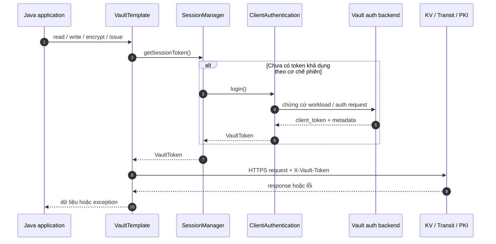
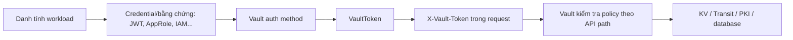
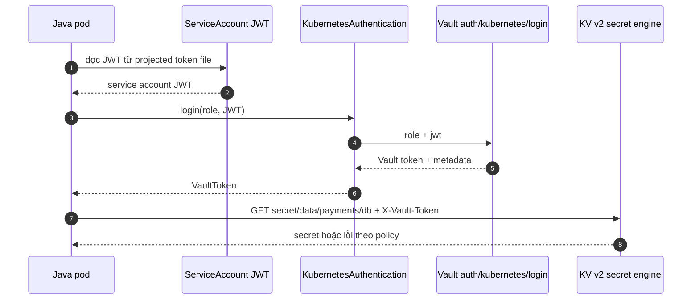
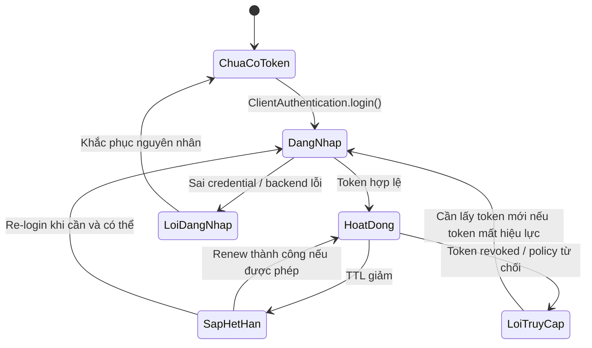

# ClientAuthentication và việc lấy VaultToken

Khi ứng dụng Java truy cập HashiCorp Vault qua Spring Vault, câu hỏi đầu tiên không phải “đọc secret bằng phương thức nào?” mà là **“ứng dụng chứng minh danh tính với Vault bằng cách nào và nhận token ở đâu?”**. `ClientAuthentication` định nghĩa bước lấy token đó; `VaultToken` biểu diễn token được dùng để gọi Vault API. Từ đây, `SessionManager` giúp client có token cho các request của `VaultTemplate`.

Bài học thuộc chương **Kiến trúc client** của SPRING_VAULT. Đây là nền tảng để đọc KV secrets, gọi Transit encryption, cấp chứng chỉ PKI, xử lý vòng đời token và lease, phân quyền theo workload, theo dõi lỗi xác thực và viết kiểm thử tích hợp một cách có kiểm soát.

Sau khi học, bạn có thể:

- Phân biệt **danh tính workload**, **thông tin xác thực ban đầu**, **VaultToken** và **policy**.
- Giải thích hợp đồng `ClientAuthentication.login()`, vai trò của `SessionManager` và việc `VaultTemplate` gửi token trong request.
- Chọn hướng xác thực bằng token có sẵn, Kubernetes hoặc AppRole theo bối cảnh triển khai.
- Nhận diện giới hạn của token tĩnh, token có TTL, token renewable và các cơ chế quản lý phiên.
- Chẩn đoán các lỗi đăng nhập, token hết hạn, thiếu quyền và sự cố hạ tầng mà không làm rò rỉ bí mật.

## 1. ClientAuthentication đứng ở đâu?

Interface `org.springframework.vault.authentication.ClientAuthentication` có hợp đồng cốt lõi:

```java
VaultToken login();
```

Nói cách khác, một hiện thực `ClientAuthentication` biết **cách lấy được một Vault token** cho một danh tính cụ thể. Hành vi bên trong phụ thuộc phương thức xác thực:

- Với **token có sẵn** (`TokenAuthentication`), `login()` có thể chỉ trả về token đã được cung cấp; không nhất thiết có request HTTP đến endpoint đăng nhập.
- Với **Kubernetes/AppRole và các cơ chế login khác**, implementation sử dụng chứng cứ của workload để gọi endpoint auth tương ứng trong Vault, nhận một token từ phản hồi đăng nhập.
- Với các cơ chế dựa trên danh tính hạ tầng (ví dụ cloud IAM), bằng chứng đăng nhập được tạo theo giao thức riêng trước khi gửi đến Vault.

`ClientAuthentication` **không** định nghĩa API đọc secret, không kiểm tra policy thay Vault, và không phải bản thân token. Token trả về mới là thông tin xác thực mà client gửi kèm các request Vault tiếp theo.



Sơ đồ thể hiện các **trách nhiệm logic**, không quy định rằng mỗi lời gọi nghiệp vụ đều chạy lại bước `login()`. Số lần login, cách giữ token và khả năng refresh phụ thuộc vào `SessionManager` cùng cấu hình thực tế.

| Thành phần | Trách nhiệm | Không chịu trách nhiệm |
|---|---|---|
| `ClientAuthentication` | Tạo hoặc lấy Vault token thông qua phương thức xác thực đã chọn | Quản lý mọi request nghiệp vụ và vòng đời dynamic secrets |
| `VaultToken` | Đóng gói token client cần đưa vào request | Tự gửi HTTP request, tự renew hay tự cấp thêm quyền |
| `SessionManager` | Cung cấp token phiên khi `VaultTemplate` cần sử dụng | Bảo đảm mọi loại token đều có thể renew |
| `VaultTemplate` / `VaultOperations` | Thực hiện API Vault đồng bộ với token từ phiên | Quyết định danh tính workload hoặc vượt quyền policy |
| Vault auth backend | Kiểm tra bằng chứng đăng nhập và phát hành token theo cấu hình | Cấp mặc định mọi quyền trên các secrets engine |
| Vault policy | Quyết định capability của token tại từng API path | Thay cho bước xác thực danh tính |

## 2. Phân biệt credential đăng nhập với VaultToken

**Credential đăng nhập** là thứ workload dùng để chứng minh nó là ai: một service account JWT của Kubernetes, cặp role ID/secret ID của AppRole, yêu cầu có chữ ký IAM hoặc một token được cấp từ trước. **Vault token** là thông tin Vault chấp nhận ở header `X-Vault-Token` cho các yêu cầu đã xác thực.

Hai thứ này có thể giống nhau về hình thức chuỗi ký tự trong phương án token tĩnh, nhưng không đồng nghĩa trong các phương án workload:



Ví dụ một phản hồi đăng nhập Vault có thể chứa phần `auth` theo cấu trúc khái quát:

```json
{
  "auth": {
    "client_token": "<redacted>",
    "accessor": "<redacted>",
    "policies": ["payments-read"],
    "lease_duration": 1800,
    "renewable": true
  }
}
```

Diễn giải:

- `client_token`: **bí mật mang quyền truy cập**. Ai sở hữu token có thể thực hiện các thao tác Vault mà policy cho phép trong thời hạn token còn hiệu lực.
- `lease_duration`: thời hạn token được biểu diễn bằng giây trong phản hồi tương ứng; không nên dùng giá trị này làm đồng hồ tuyệt đối nếu chưa xét thời điểm nhận và chính sách renewal.
- `renewable`: Vault cho biết token có khả năng renew theo quy tắc của token/auth method, **không** có nghĩa ứng dụng đã tự động renew.
- `policies`: tập policy được gắn với token; quyền thực tế còn tùy policy contents, identity và điều kiện Vault khác.
- `accessor`: định danh để tra cứu/quản trị token trong những trường hợp được phép; nó không thay `client_token` khi xác thực request và cũng không nên ghi log tùy tiện.

Trong Spring Vault, kiểu `VaultToken` (package `org.springframework.vault.support`) biểu diễn token. Tùy cách xác thực và phiên bản thư viện, token từ một lần login có thể là kiểu mang thêm metadata về TTL/renewal, chẳng hạn `LoginToken`. **Không giả định một `VaultToken` bất kỳ luôn có thông tin đầy đủ để gia hạn hoặc có quyền gia hạn.**

### Token có thể hợp lệ nhưng không có quyền đọc secret

Vault phân tách **xác thực** (ai đang gọi) và **phân quyền** (được phép làm gì):

1. Workload chứng minh danh tính thành công và nhận token.
2. `VaultTemplate` dùng token đó gọi `secret/data/payments/db`.
3. Vault kiểm tra capability `read` trên path thực tế; thiếu quyền sẽ dẫn đến lỗi truy cập, dù login trước đó thành công.

Vì vậy, không coi việc lấy được `VaultToken` là bằng chứng đã truy cập được KV, Transit hay PKI. Cần kiểm tra thêm policy, mount, namespace (nếu có) và đường dẫn của engine.

## 3. Ví dụ cơ bản: TokenAuthentication

`TokenAuthentication` là hiện thực đơn giản của `ClientAuthentication` cho trường hợp **đã có Vault token**. Ví dụ sau dùng token từ biến môi trường để mô phỏng môi trường phát triển; không nhúng token vào source code, test fixture công khai hoặc file cấu hình đưa lên Git.

```java
import java.util.Objects;

import org.springframework.vault.authentication.ClientAuthentication;
import org.springframework.vault.authentication.TokenAuthentication;
import org.springframework.vault.client.VaultEndpoint;
import org.springframework.vault.core.VaultOperations;
import org.springframework.vault.core.VaultTemplate;

public final class LocalVaultClientFactory {

    public static VaultOperations create() {
        String rawToken = Objects.requireNonNull(
            System.getenv("VAULT_TOKEN"),
            "Thiếu VAULT_TOKEN cho môi trường thực hành"
        );

        VaultEndpoint endpoint = VaultEndpoint.create("127.0.0.1", 8200);
        endpoint.setScheme("http"); // Chỉ dành cho Vault dev trên loopback

        ClientAuthentication authentication =
            new TokenAuthentication(rawToken);

        return new VaultTemplate(endpoint, authentication);
    }
}
```

Điều cần hiểu trong ví dụ:

- `TokenAuthentication` đã được cấp sẵn token; gọi `login()` không tương đương với việc gửi role ID/JWT đến auth backend để phát hành token mới.
- `VaultTemplate` có thể nhận `ClientAuthentication` trong constructor; code nghiệp vụ chỉ cần phụ thuộc vào `VaultOperations`.
- Địa chỉ `127.0.0.1` và HTTP chỉ dùng cho **Vault dev cô lập trên loopback**. Môi trường triển khai phải dùng TLS, xác minh chứng chỉ máy chủ và hạn chế quyền truy cập mạng.
- Việc lấy token từ biến môi trường chỉ minh họa cách tách secret khỏi source code; không phải mô hình phân phối token thích hợp cho mọi nền tảng production.

Để thấy hợp đồng `login()` trực tiếp, có thể viết:

```java
import org.springframework.vault.authentication.ClientAuthentication;
import org.springframework.vault.authentication.TokenAuthentication;
import org.springframework.vault.support.VaultToken;

ClientAuthentication authentication =
    new TokenAuthentication(System.getenv("VAULT_TOKEN"));

VaultToken token = authentication.login();
// Chuyển cho thành phần quản lý phiên nếu cần.
// Tuyệt đối không System.out.println(token), ghi token vào log hay response.
```

Trong ứng dụng thực tế, để `SessionManager` và cơ chế tự cấu hình quản lý việc cung cấp token cho `VaultTemplate`. Không nên gọi `login()` tùy ý trong mọi request HTTP của ứng dụng rồi giữ thêm nhiều bản token trong các service.

## 4. Xác thực theo workload: Kubernetes và AppRole

Một ứng dụng được triển khai nhiều bản sao nên có cơ chế xác thực dựa vào **danh tính workload**, thay vì dùng chung token tĩnh do con người sao chép thủ công.

### 4.1. Kubernetes authentication

Với Kubernetes auth method, pod dùng service account JWT được Kubernetes cấp và gửi yêu cầu đăng nhập vào Vault. Vault xác minh chứng cứ theo cấu hình auth method và role, sau đó phát hành Vault token có TTL và policies phù hợp.



Ví dụ cấu hình rút gọn khi ứng dụng sử dụng **Spring Cloud Vault**:

```yaml
spring:
  cloud:
    vault:
      uri: https://vault.service.internal:8200
      authentication: KUBERNETES
      kubernetes:
        role: payments-service
```

Giả định: Vault đã bật và cấu hình Kubernetes auth method; role `payments-service` đã ràng buộc với tên/namespace của service account và policy tương ứng; ứng dụng có thể đọc service account JWT hợp lệ; TLS trust được thiết lập. Đường dẫn token file và auth mount có thể cần cấu hình riêng theo nền tảng và phiên bản Spring Cloud Vault.

Đối với pod, **JWT của Kubernetes không phải Vault token**. JWT chỉ dùng ở bước login (theo hợp đồng auth method); Vault token nhận về mới được dùng để truy cập secrets engine. Khi JWT được xoay vòng hoặc hết hạn, cơ chế authentication phải có khả năng lấy JWT hợp lệ lúc cần đăng nhập lại; tránh chỉ đọc một lần rồi lưu mãi một JWT đã cũ.

### 4.2. AppRole authentication

AppRole thích hợp cho một số workload chạy ngoài Kubernetes, nhất là khi nền tảng có cơ chế phân phối chứng cứ bootstrap an toàn. Nó dùng:

- **Role ID**: định danh của AppRole, thường không đủ để đăng nhập một mình nếu role yêu cầu secret ID.
- **Secret ID**: bằng chứng bổ sung cần được phân phối, giới hạn thời gian/số lần dùng và bảo vệ như secret.
- **Vault token**: kết quả đăng nhập sau khi Vault kiểm tra role ID/secret ID.

Luồng cơ bản:

```text
Workload
  ├─ role_id ───────┐
  └─ secret_id ─────┴─> POST auth/approle/login
                              │
                         Vault kiểm tra
                              │
                         client_token
                              │
                       SessionManager
                              │
                        VaultTemplate
```

Role ID và secret ID **không** được truyền thay cho `X-Vault-Token` ở các request KV/Transit/PKI. Khi secret ID bị giới hạn số lần dùng, việc đăng nhập lại sau token hết hạn còn phụ thuộc khả năng nhận **secret ID mới**. Một session manager có hỗ trợ refresh token cũng không thể tự khắc phục nếu chứng cứ bootstrap đã không còn hợp lệ.

### 4.3. Chọn phương thức xác thực

| Môi trường | Cách tiếp cận thường phù hợp | Điểm cần kiểm soát |
|---|---|---|
| Local dev/test cô lập | Token ngắn hạn được cấp riêng cho bài test | Không dùng root token cho service, không commit token |
| Kubernetes | Kubernetes auth gắn với service account và role | Bound service account/namespace, JWT rotation, TLS |
| Workload bên ngoài Kubernetes | AppRole hoặc phương thức nhận diện hạ tầng tương ứng | Phân phối/rotation secret ID, quyền login, TTL |
| Cloud workload có danh tính IAM | Auth method hỗ trợ danh tính cloud | Trust role/identity, request signing, giới hạn quyền |
| Workload có Vault Agent/sidecar quản lý đăng nhập | Tích hợp theo cơ chế token sink/agent được triển khai | Quyền đọc token, cập nhật/rotation và quy trình bảo vệ token |

Chọn auth method theo **nơi workload chạy và danh tính nó có thể chứng minh**, không theo việc method nào dễ tạo token nhất. Trong mọi trường hợp, policy cần tuân thủ nguyên tắc quyền tối thiểu.

## 5. VaultToken, SessionManager và vòng đời phiên

Một lần `ClientAuthentication.login()` tạo hoặc trả về token **không giải quyết toàn bộ vòng đời phiên**. Token có thể hết hạn, bị thu hồi, vượt quá giới hạn số lần dùng hoặc không có quyền mong muốn.

Trong Spring Vault, `SessionManager` cung cấp token mà client sử dụng:

```java
import org.springframework.vault.authentication.SessionManager;
import org.springframework.vault.support.VaultToken;

// sessionManager được cấu hình ở tầng hạ tầng.
VaultToken currentToken = sessionManager.getSessionToken();
// Không đưa currentToken vào log, metrics hoặc thông điệp lỗi.
```

Ví dụ trên thể hiện cách gọi API, không phải một lớp Java hoàn chỉnh: biến `sessionManager` là dependency đã được thiết lập. Tùy cấu hình, Spring Vault có các cơ chế session đơn giản và những hiện thực hỗ trợ quản lý vòng đời, chẳng hạn `LifecycleAwareSessionManager`.

Phân biệt rõ:

| Khả năng | `ClientAuthentication` | `SessionManager` | Vault server |
|---|---|---|---|
| Đưa bằng chứng để nhận token | Thực hiện hoặc trả token có sẵn | Gọi cơ chế login khi cần theo hiện thực | Xác thực, phát hành token |
| Cung cấp token cho request | Trả token từ `login()` | Cung cấp qua `getSessionToken()` | Xác minh token khi request tới |
| Xoay/gia hạn token | Không phải nghĩa vụ chung của interface | Có thể quản lý theo hiện thực/cấu hình | Quyết định token có renewable và có được renew không |
| Xử lý token bị revoke | Có thể đăng nhập lại nếu chứng cứ còn hiệu lực | Chính sách phiên có thể lấy token mới | Từ chối token đã revoke |
| Quản lý lease của dynamic secret | Không | Không mặc định | Quản lý TTL/renew/revoke lease của secret engine |

### 5.1. Token tĩnh và token có vòng đời

Với `TokenAuthentication` được cung cấp một token tĩnh, client không thể tự suy ra credential gốc khác để đăng nhập lấy token mới. Khi token đó hết hạn hoặc bị thu hồi, chỉ tạo lại đối tượng từ **cùng một chuỗi đã hết hạn** sẽ không giúp ứng dụng hoạt động trở lại.

Ngược lại, authentication theo workload có thể đăng nhập lại bằng chứng cứ mới hoặc còn hiệu lực, nếu Vault auth method cho phép. Một session manager có quản lý lifecycle có thể theo dõi metadata TTL và thực hiện renew/re-login khi được cấu hình phù hợp. Tuy nhiên:

- Token phải **renewable** và đáp ứng chính sách Vault thì renew mới có thể thành công.
- Token định kỳ, giới hạn TTL tối đa, token bị revoke và policy thay đổi có những điều kiện khác nhau; không giả định cứ gần hết hạn là renew được.
- Đăng nhập lại có thể thất bại nếu JWT/secret ID bootstrap đã hết hạn, bị thu hồi hoặc mạng đến auth backend bị gián đoạn.
- Khi ứng dụng nhiều instance, mỗi instance thường có vòng đời phiên riêng; không coi token nhận từ một instance tự động đồng bộ cho các instance còn lại.



Sơ đồ là mô hình khái niệm; **không phải cam kết** mọi hiện thực `SessionManager` sẽ tự thực hiện tất cả chuyển trạng thái.

### 5.2. Lease của dynamic secrets là đồng hồ khác

Giả sử service có:

- Vault token do Kubernetes auth phát hành: TTL 30 phút.
- Database credentials từ `database/creds/reporting`: lease TTL 15 phút.
- Chứng chỉ từ PKI: thời hạn 1 giờ.

Ba thời hạn này **không thể hoán đổi**. Renew token không tự làm database password tồn tại lâu hơn; renew lease dynamic credentials không kéo dài token; token hết hạn không nhất thiết làm certificate đã cấp lập tức hết hạn. Nếu sử dụng dynamic secrets, hãy quản lý lease qua cơ chế phù hợp của Spring Vault, chẳng hạn `SecretLeaseContainer`, và thay credentials ở consumer đúng thời điểm.

## 6. Xác thực thành công không thay thế policy

Ví dụ workload `payments-api` chỉ cần đọc cấu hình từ KV v2 ở mount `secret`. Một policy Vault tối thiểu có thể là:

```hcl
path "secret/data/payments/db" {
  capabilities = ["read"]
}
```

Role của auth method (ví dụ Kubernetes role) cần gắn policy tương ứng khi phát hành token. Nhưng policy phía trên **không** cấp quyền:

- Đọc `secret/data/other-service/...`.
- Ghi `secret/data/payments/db`.
- Liệt kê `secret/metadata/payments/...` của KV v2.
- Gọi `transit/decrypt/...`, `pki/issue/...` hoặc các endpoint quản trị `sys/...`.

Nếu cùng workload cần mã hóa một trường qua Transit hoặc phát hành chứng chỉ PKI, bổ sung đúng capability trên path thực sự cần dùng và đúng role. Tránh cấp `root` hoặc policy toàn quyền cho workload chỉ để sửa lỗi `403`.

Khi bị từ chối truy cập, cần phân biệt **login bị từ chối** với **login thành công nhưng request secrets engine bị từ chối**. Hai lỗi này xảy ra ở các endpoint và bước xử lý khác nhau.

## 7. Xử lý lỗi lấy token và lỗi khi dùng token

Không nên bọc toàn bộ truy cập Vault trong `catch (Exception) { return null; }`. Cách đó che khuất lỗi xác thực và khiến hệ thống hiểu sai rằng một secret tùy chọn không tồn tại.

| Dấu hiệu | Vị trí có thể xảy ra | Nguyên nhân cần kiểm tra | Phản ứng phù hợp |
|---|---|---|---|
| Login bị từ chối (`400`/`403` tùy auth method) | `ClientAuthentication.login()` | Role ID/secret ID, JWT, bound role, auth mount hoặc policy auth | Báo lỗi cấu hình/danh tính; không retry vô hạn |
| Không lấy được token vì timeout/TLS | Login hoặc HTTP client | Endpoint, DNS, CA trust, mạng, Vault unavailable | Timeout hữu hạn, backoff có giới hạn khi lỗi tạm thời |
| Login thành công nhưng KV đọc bị `403` | `VaultTemplate` gọi engine | Token thiếu `read`, sai namespace/path hoặc token không còn hiệu lực | Kiểm tra Vault policy, path và token lifecycle |
| Token hết hạn/revoke khi chạy | Lúc dùng token hoặc renew/re-login | TTL, giới hạn renew, revocation, credential bootstrap hết hạn | Lấy phiên hợp lệ mới nếu cơ chế hỗ trợ; báo lỗi nếu không thể |
| Secret trả về `null` qua API KV mức cao | Thao tác đọc KV | Secret/key/version không có dữ liệu theo hợp đồng API | Phân biệt với lỗi auth; kiểm tra tính bắt buộc của cấu hình |
| `429`/`5xx` | Auth backend hoặc engine | Quá tải, failover, Vault không sẵn sàng | Giới hạn retry, đo độ trễ, tránh dồn tải |

Lưu ý khi retry:

1. Retry **đăng nhập** không giúp sửa role sai, JWT bị từ chối hoặc secret ID hết lượt dùng.
2. Lệnh **đọc KV** có thể retry ngắn khi lỗi mạng tạm thời; áp giới hạn thời gian chờ và số lần thử.
3. Lệnh **phát hành chứng chỉ/token**, cấp dynamic credentials hoặc thao tác có side effect có thể đã thành công ở Vault dù client timeout. Không retry mù dẫn đến tạo tài nguyên trùng.
4. Không fallback sang token toàn quyền, token của workload khác hoặc root token nếu token hiện tại không đủ quyền.

### Log và giám sát an toàn

Metrics nên ghi nhận: số lần login thành công/thất bại, tỷ lệ lỗi theo auth method (không theo giá trị credential), thời gian lấy token, sự cố renewal, số lần `403` theo operation và độ trễ của Vault. Tracing có thể dùng correlation/request ID an toàn. Không đưa token, JWT, AppRole secret ID, private key PKI, plaintext Transit hoặc toàn bộ body của response auth vào log/trace.

Đừng coi một lỗi `403` là tín hiệu chung “Vault down”. Đó có thể là Vault hoạt động bình thường và **đang thực thi policy đúng cách**.

## 8. Cấu trúc ứng dụng và ranh giới trách nhiệm

Một kiến trúc dễ bảo trì nên đặt việc cấu hình danh tính, endpoint và session trong tầng hạ tầng, còn repository/service nghiệp vụ làm việc với `VaultOperations`:

```text
Spring application
├── Infrastructure / Vault configuration
│   ├── VaultEndpoint / VaultEndpointProvider
│   ├── ClientAuthentication (Kubernetes, AppRole, Token...)
│   ├── SessionManager (cấu hình vòng đời token)
│   └── VaultTemplate implements VaultOperations
│
├── PaymentSecretsRepository
│   └── VaultOperations → opsForKeyValue("secret", KV_2)
├── PaymentFieldCipher
│   └── VaultOperations → opsForTransit()
└── CertificateProvider
    └── VaultOperations → opsForPki(...)
```

Service nghiệp vụ không nên tự đọc JWT, gọi `auth/kubernetes/login`, giữ token dạng `String` hoặc khởi tạo `VaultTemplate` cho từng request. Dành nhiệm vụ đó cho lớp cấu hình và cơ chế lifecycle đã lựa chọn.

Khi dùng **Spring Cloud Vault**, phần lớn cấu hình connection và authentication có thể được thực hiện qua properties/auto-configuration. Khi dùng **Spring Vault thuần**, ứng dụng có thể tự lắp ghép `ClientAuthentication`, `SessionManager` và `VaultTemplate`. Không tạo thêm một client khác với token tĩnh nếu dự án đã có client auto-configured, trừ khi có một ranh giới quyền truy cập riêng được thiết kế rõ.

## 9. Kiểm thử ClientAuthentication và token lifecycle

### 9.1. Kiểm thử đơn vị

Ở mức unit, hãy kiểm tra logic chọn phương thức xác thực và cách ứng dụng phản ứng với tình huống lấy token thành công/thất bại. Có thể giả lập `ClientAuthentication` để xác nhận thành phần quản lý phiên nhận được token; dùng mock của `VaultOperations` để kiểm tra các service đọc secret.

Ví dụ minh họa hợp đồng của một authentication stub:

```java
import org.springframework.vault.authentication.ClientAuthentication;
import org.springframework.vault.support.VaultToken;

final class StubAuthentication implements ClientAuthentication {

    @Override
    public VaultToken login() {
        // Giá trị giả chỉ dùng trong unit test, không gọi Vault thật.
        return VaultToken.of("test-token-only");
    }
}
```

Test này chỉ chứng minh thành phần nhận được `VaultToken`. Nó **không** chứng minh token được Vault chấp nhận, có TTL cụ thể hay policy cho phép đọc secret.

### 9.2. Kiểm thử tích hợp

Sử dụng một Vault dev/test cô lập, tạo auth role và KV v2 dữ liệu giả. Các kịch bản cần bao phủ:

1. **Login thành công:** workload nhận Vault token và đọc được đúng secret có quyền.
2. **Sai chứng cứ bootstrap:** JWT không hợp lệ hoặc AppRole secret ID sai/bị thu hồi bị từ chối tại bước login.
3. **Thiếu policy:** login vẫn thành công nhưng `get("payments/db")` bị từ chối theo path KV v2 thực tế.
4. **Token hết hạn:** xác nhận cách session manager phản ứng; phân biệt renew thành công, re-login hợp lệ và không thể phục hồi.
5. **Token revoke:** thu hồi token test và xác nhận request tiếp theo không tiếp tục sử dụng quyền truy cập cũ.
6. **Sự cố mạng/TLS:** ngắt endpoint Vault hoặc dùng certificate không đáng tin cậy, xác nhận timeout và ngoại lệ được xử lý đúng.
7. **Dynamic secret có lease:** nhận credentials test, theo dõi lease và kiểm tra rằng vòng đời này độc lập với phiên token.

Không dùng root token làm identity mặc định cho tất cả các bài test phân quyền: root có thể khiến kiểm thử thiếu capability cho kết quả sai. Mỗi kịch bản nên dùng token/role với quyền tối thiểu đúng mục đích, TTL ngắn và dọn tài nguyên sau test.

## 10. Bài thực hành: từ workload đến KV read

**Bối cảnh:** `payments-api` chạy trên Kubernetes, cần đọc cấu hình database trong KV v2 tại mount `secret`, path logic `payments/db`. Vault chạy qua endpoint HTTPS nội bộ.

**Bước 1 — Xác định danh tính:** tạo service account cho `payments-api` trong namespace dành riêng; cấu hình Vault Kubernetes auth role chỉ chấp nhận service account và namespace đó. Gắn policy `read` trên `secret/data/payments/db`.

**Bước 2 — Cấu hình client:** ứng dụng dùng Kubernetes authentication và session management phù hợp với vòng đời token; cấu hình URI Vault, TLS trust và role. Không để `VAULT_TOKEN` tĩnh hoặc root token trong deployment manifest.

**Bước 3 — Gọi KV v2:** tại repository, inject `VaultOperations` và gọi `opsForKeyValue("secret", KV_2).get("payments/db")`. Chỉ đọc những field cần thiết, kiểm tra schema và không log mật khẩu.

**Bước 4 — Kiểm tra giới hạn:** bỏ `read` khỏi policy để quan sát một lỗi khi dùng token, sau đó thử JWT/role không hợp lệ để quan sát lỗi tại `login()`. Hai tình huống này cần được phân biệt trong thông báo nội bộ và metrics.

**Bước 5 — Kiểm tra TTL:** dùng token test TTL ngắn để kiểm tra session manager và chiến lược renew/re-login. Đừng suy luận rằng đọc KV thành công một lần có nghĩa token sẽ luôn hợp lệ.

### Câu hỏi tự kiểm tra

1. Vì sao JWT của Kubernetes được dùng để đăng nhập Vault nhưng không nên gửi nó như `X-Vault-Token` cho mọi request KV?
2. `ClientAuthentication.login()` và `SessionManager.getSessionToken()` khác nhau ở mục đích gì?
3. Với `TokenAuthentication` dùng token tĩnh đã hết hạn, chỉ gọi lại `login()` có tạo ra token mới hợp lệ không?
4. Vì sao login thành công nhưng request `secret/data/payments/db` vẫn có thể trả lỗi `403`?
5. Token Vault còn hiệu lực 30 phút có bảo đảm database credentials có lease 15 phút vẫn sử dụng được trong 30 phút không?

**Ghi nhớ:** `ClientAuthentication` tạo hoặc lấy **VaultToken** cho danh tính workload; `SessionManager` cung cấp token theo vòng đời phiên; `VaultTemplate` dùng token đó để gọi các API Vault đồng bộ. Chính Vault server áp **policy và TTL** cho từng request. Tách đúng ba trách nhiệm này là nền tảng để truy cập KV, Transit, PKI và dynamic secrets an toàn, quan sát được và kiểm thử được.
