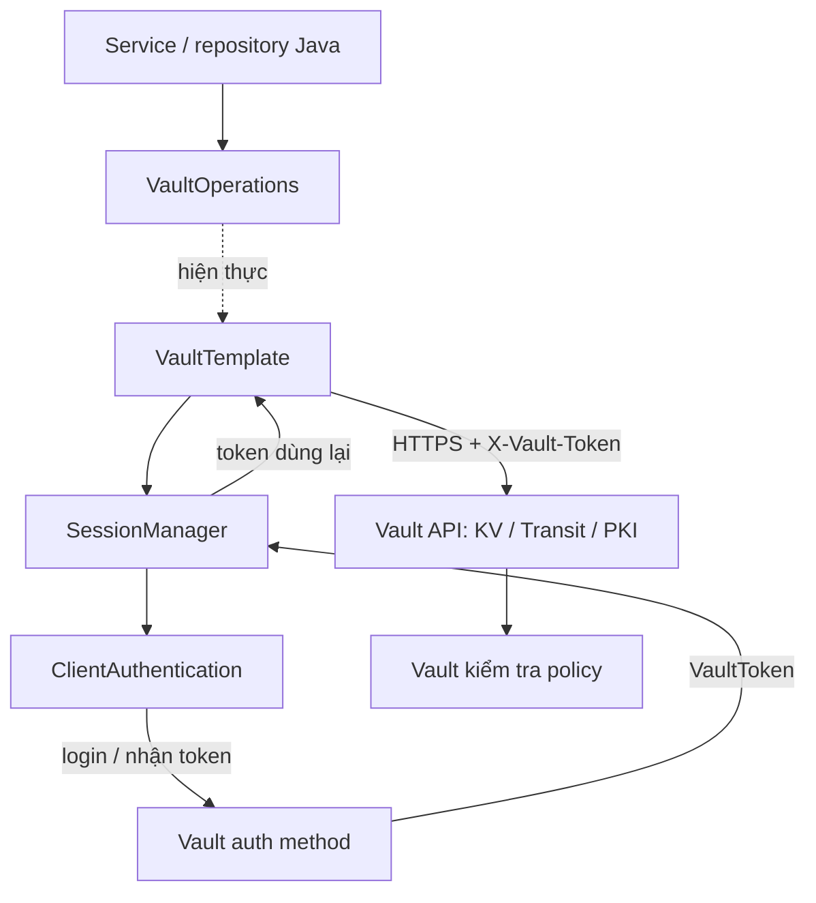
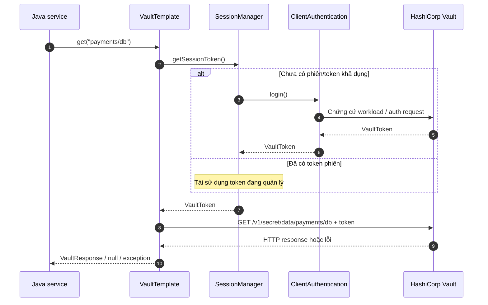
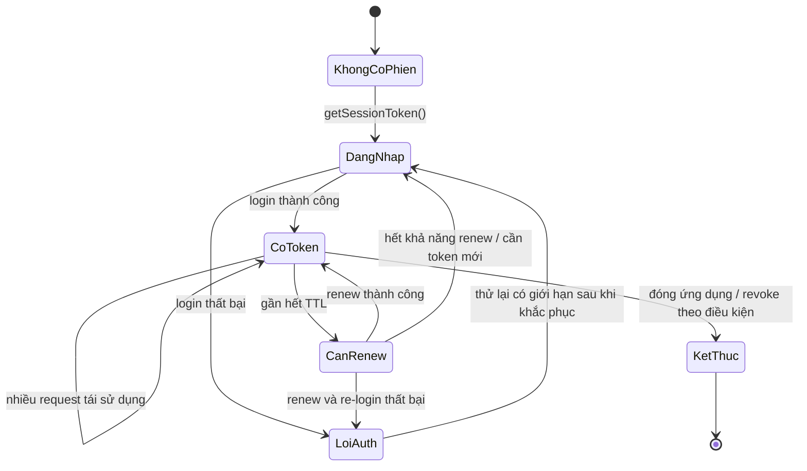
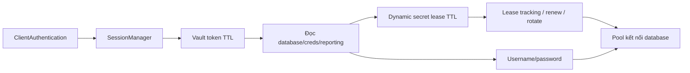

# SessionManager và tái sử dụng phiên xác thực

Trong Spring Vault, một ứng dụng Java có thể gọi HashiCorp Vault hàng trăm lần mỗi phút để đọc KV secrets, gọi Transit encryption, xin chứng chỉ PKI hoặc lấy dynamic credentials. Nếu mỗi lời gọi lại đăng nhập bằng Kubernetes JWT hay AppRole, ứng dụng sẽ tốn thêm một chuyến mạng, tạo nhiều token không cần thiết và khiến hệ thống auth của Vault chịu tải lớn. **`SessionManager` giải quyết vấn đề này bằng cách cung cấp và tái sử dụng Vault token cho các request trong cùng một phiên client.**

Bài học thuộc chương **Kiến trúc client** của module **SPRING_VAULT**. Trọng tâm là **đời sống của phiên xác thực**: token được lấy khi nào, được dùng lại ra sao, khi nào phải renew hoặc đăng nhập lại, làm gì lúc shutdown và vì sao phiên token khác với lease của secret. Hiểu được hợp đồng này giúp xây dựng ứng dụng an toàn hơn khi làm việc với `VaultTemplate`, các workload có identity riêng, policy tối thiểu và quá trình giám sát/kiểm thử tích hợp.

Sau bài học, bạn có thể:

- Phân biệt `ClientAuthentication`, `VaultToken`, `SessionManager` và `VaultTemplate`.
- Giải thích vì sao nhiều request có thể sử dụng **cùng một token phiên** mà không gọi login mỗi lần.
- So sánh `SimpleSessionManager` với `LifecycleAwareSessionManager`, bao gồm renewal và revocation có điều kiện.
- Tổ chức scope, concurrency và lifecycle của client trong Spring application.
- Thiết kế phản ứng với token hết hạn, token bị revoke, lỗi policy, timeout hoặc chứng cứ workload hết hiệu lực.
- Viết unit test cho cơ chế tái sử dụng phiên và integration test cho vòng đời token.

## 1. Vị trí của SessionManager trong kiến trúc client

`SessionManager` là interface thuộc package `org.springframework.vault.authentication`. Hợp đồng cốt lõi rất nhỏ:

```java
public interface SessionManager {
    VaultToken getSessionToken();
}
```

Phương thức `getSessionToken()` trả về token dùng để xác thực request Vault. Interface này **không quy định** mọi hiện thực phải refresh hay renew; những hành vi đó do cách triển khai `SessionManager` quyết định.

Mối quan hệ giữa các thành phần:



| Thành phần | Câu hỏi nó trả lời | Trách nhiệm chính |
|---|---|---|
| `ClientAuthentication` | “Workload chứng minh danh tính bằng gì?” | Thực hiện `login()` để lấy token, hoặc trả lại token đã được cấp |
| `VaultToken` / `LoginToken` | “Token nào được dùng cho request?” | Biểu diễn giá trị token; `LoginToken` có thêm thông tin TTL/renewability của lần login |
| `SessionManager` | “Lấy token nào cho request hiện tại, có dùng lại được không?” | Cung cấp token phiên; hiện thực cụ thể có thể điều phối renewal và revoke |
| `VaultTemplate` | “Gửi thao tác nào tới Vault?” | Thực thi request đồng bộ và gắn token khi cần |
| Vault server | “Token có hợp lệ và đủ quyền trên API path này không?” | Xác thực token, áp policy và thực thi engine |

Một yêu cầu đọc KV v2 có thể đi như sau:



Điều quan trọng là **luồng ứng dụng vẫn đồng bộ**. Khi cần login hoặc thực hiện HTTP request, luồng gọi `VaultTemplate` phải chờ kết quả. Hoạt động gia hạn token ở nền, nếu hiện thực hỗ trợ, là một cơ chế bổ sung cho vòng đời phiên; nó không biến các phương thức `VaultOperations` thành API reactive.

## 2. Tại sao không đăng nhập trên từng request?

Giả sử service `payments-api` gọi Vault để đọc cấu hình ở mỗi lượt khởi tạo một kết nối database. Nếu mọi lần truy cập đều gọi `auth/kubernetes/login`, số request auth tăng theo số lần dùng Vault:

```text
Không tái sử dụng:
  Request 1 → Login A → Token A → Read KV
  Request 2 → Login B → Token B → Read KV
  Request 3 → Login C → Token C → Read KV

Có tái sử dụng:
  Request 1 → Login A → Token A → Read KV
  Request 2 ──────────→ Token A → Read KV
  Request 3 ──────────→ Token A → Read KV
                       (cho đến khi phiên cần đổi)
```

Việc dùng lại một token khả dụng giúp:

1. **Giảm lượt đăng nhập:** bớt một round trip tới auth backend cho nhiều request.
2. **Giảm số token phát hành:** không sinh ra nhiều token ngắn hạn chỉ vì đọc cùng một secret.
3. **Giảm đua tranh khi nhiều luồng cùng cần token:** session manager có thể phối hợp việc lấy token đầu tiên và tránh login thừa.
4. **Tập trung vòng đời xác thực:** nơi sử dụng KV, Transit, PKI không cần tự theo dõi TTL token.

Tuy vậy, tái sử dụng token không có nghĩa **cache dữ liệu secret**. Mỗi lần gọi `kv.get(...)` vẫn có thể thực hiện HTTP request tới Vault; token chỉ là credential được gắn vào request. Một token được giữ lại cũng không bảo đảm nó luôn hợp lệ: Vault có thể thu hồi token hoặc policy có thể thay đổi trong lúc ứng dụng đang chạy.

## 3. SimpleSessionManager: một token cho một phiên đơn giản

Spring Vault cung cấp `SimpleSessionManager`, nhận một `ClientAuthentication` qua constructor và **đăng nhập theo cơ chế đồng bộ, rồi giữ token đã lấy để tái sử dụng** trong vòng đời của manager. Các lời gọi đồng thời lúc khởi tạo được đồng bộ hóa để không cần mỗi luồng thực hiện một lần login riêng.

```java
import org.springframework.vault.authentication.ClientAuthentication;
import org.springframework.vault.authentication.SessionManager;
import org.springframework.vault.authentication.SimpleSessionManager;
import org.springframework.vault.authentication.TokenAuthentication;
import org.springframework.vault.support.VaultToken;

ClientAuthentication auth =
    new TokenAuthentication(System.getenv("VAULT_TOKEN"));

SessionManager sessions = new SimpleSessionManager(auth);

VaultToken first  = sessions.getSessionToken();
VaultToken second = sessions.getSessionToken();

// Hai lần gọi dùng lại token do manager đang giữ.
// Không in token ra console hoặc log.
```

Trong ví dụ, `TokenAuthentication` dùng token đã có từ môi trường test. Với phương thức xác thực như Kubernetes hoặc AppRole, `ClientAuthentication.login()` có thể thực hiện HTTP login và nhận token do Vault mới phát hành.

### 3.1. Hạn chế cần nhớ

`SimpleSessionManager` **không thực hiện refresh/renew và revoke** token đã lấy. Điều này có các hệ quả:

- Nếu dùng token tĩnh do hệ thống ngoài tạo và gia hạn, phải bảo đảm lifecycle nằm ở hệ thống ngoài; một giá trị token bị thay mà manager vẫn giữ token cũ cần được xử lý ở cấp quản lý client/phiên.
- Nếu `ClientAuthentication` tạo ra token có TTL ngắn, manager đơn giản không bảo đảm thay token trước khi hết hạn. Ứng dụng có thể tiếp tục gửi token đã hết hiệu lực.
- Nếu Vault thu hồi token do phát hiện rủi ro, manager không tự động biến token cũ thành token mới.
- Khi đóng ứng dụng, `SimpleSessionManager` không gửi revoke cho token chỉ vì đối tượng bị hủy.

Do đó, nó phù hợp với bài lab, quá trình có vòng đời ngắn hoặc các triển khai đã có cơ chế quản lý token tách biệt. Với workload chạy lâu và token do auth method phát hành có TTL, cần xem xét cơ chế lifecycle.

## 4. LifecycleAwareSessionManager: theo dõi TTL, renew và đóng phiên

`LifecycleAwareSessionManager` mở rộng ý tưởng tái sử dụng: ngoài giữ token, nó **theo dõi thời hạn token, lập lịch gia hạn nếu token cho phép, và quản lý kết thúc phiên**. Các hành vi cụ thể còn phụ thuộc loại token, policy, Vault auth method và cấu hình của Spring Vault.

Theo tài liệu Spring Vault, manager này:

- Điều phối các luồng đồng thời đang yêu cầu token nhằm tránh nhiều lần login đầu tiên.
- Lên lịch **renew** với scheduler khi token có thông tin vòng đời và thỏa điều kiện renew.
- Khi token tới giới hạn TTL hoặc không thể renew, có thể lấy token mới bằng cách đăng nhập lại nếu chứng cứ workload còn hợp lệ.
- Hỗ trợ **revoke token phát sinh từ login** khi manager bị hủy, trong những trường hợp token và auth method cho phép; không coi mọi loại `VaultToken` đều bị revoke khi shutdown.
- Có thể phát sự kiện liên quan đến authentication và lỗi để ứng dụng theo dõi.



Đây là **sơ đồ khái niệm** của vòng đời phiên, không phải cam kết mỗi lỗi sẽ được xử lý theo đúng một chuyển trạng thái. Thời điểm scheduler chạy, việc refresh/re-login và phản ứng khi lỗi mạng cần được kiểm chứng với phiên bản Spring Vault đang sử dụng.

### 4.1. VaultToken và LoginToken khác nhau ở thông tin vòng đời

`VaultToken` là kiểu đại diện token nói chung. `LoginToken` biểu diễn token từ một lần đăng nhập, có thể mang các thông tin phục vụ việc xác định TTL và khả năng renew.

| Nguồn token | Kết quả điển hình | Ý nghĩa đối với lifecycle |
|---|---|---|
| `TokenAuthentication` với token có sẵn | `VaultToken` | Có thể không mang sẵn TTL/renewability trong object |
| Kubernetes/AppRole authentication trả kết quả login | Thường là `LoginToken` | Có thể mang thông tin để lên lịch renew/re-login |
| Token được cấp theo chính sách Vault | TTL, renewable, max TTL tùy Vault | Chính Vault quyết định token còn hợp lệ và renew được hay không |

`LifecycleAwareSessionManager` có cơ chế **self-lookup** đối với `VaultToken` thông thường để tìm metadata về TTL và renewability khi được bật. Tuy nhiên, quyền tra cứu token, giới hạn của auth method và cấu hình cụ thể vẫn phải được xét. Một manager có tên “lifecycle-aware” không thể gia hạn token bị revoke hoặc vượt quy tắc TTL của Vault.

**Không đánh đồng “renew” với “re-login”:**

- **Renew:** yêu cầu Vault kéo dài TTL của token hiện hành nếu được phép, thường không thay đổi token dùng để xác thực các request.
- **Re-login:** gửi chứng cứ xác thực mới hoặc còn hiệu lực để Vault cấp một token phiên khác. Token cũ có thể đã hết hạn hoặc không sử dụng được.
- **Revoke:** vô hiệu hóa token trước khi tự hết hạn, nếu caller và Vault policy cho phép. Revoke có thể ảnh hưởng đến tài nguyên gắn với token, nên cần cân nhắc khi shutdown hoặc rotation.

### 4.2. Cấu hình trong Spring application

Khi sử dụng cơ chế cấu hình mặc định dựa trên `AbstractVaultConfiguration`, Spring Vault cung cấp `SessionManager` có nhận thức về lifecycle. Các bean quản lý phiên có thể tham gia vào vòng đời của Spring container, giúp thực hiện cleanup khi context đóng.

Ví dụ **cấu hình tối thiểu phục vụ lab** với token lấy từ môi trường:

```java
import java.util.Objects;

import org.springframework.context.annotation.Configuration;
import org.springframework.vault.authentication.ClientAuthentication;
import org.springframework.vault.authentication.TokenAuthentication;
import org.springframework.vault.client.VaultEndpoint;
import org.springframework.vault.config.AbstractVaultConfiguration;

@Configuration
public class VaultLabConfiguration extends AbstractVaultConfiguration {

    @Override
    public VaultEndpoint vaultEndpoint() {
        VaultEndpoint endpoint =
            VaultEndpoint.create("127.0.0.1", 8200);
        endpoint.setScheme("http");
        return endpoint;
    }

    @Override
    public ClientAuthentication clientAuthentication() {
        String token = Objects.requireNonNull(
            System.getenv("VAULT_TOKEN"), "VAULT_TOKEN is required"
        );
        return new TokenAuthentication(token);
    }
}
```

Ở đây `AbstractVaultConfiguration` tổ chức bean `VaultTemplate` cùng `SessionManager` mặc định của Spring Vault. Ví dụ dùng Vault dev qua HTTP trên loopback; production cần HTTPS, xác minh server certificate, bảo vệ chứng cứ bootstrap và chọn auth method theo workload (Kubernetes, AppRole, IAM...). **Token tĩnh không tự biến thành token có thể đăng nhập lại** chỉ vì được truyền vào lifecycle-aware manager.

Với **Spring Cloud Vault**, hãy ưu tiên cơ chế auto-configuration và các property xác thực/URI mà dự án đang sử dụng. Tránh tạo thêm một `VaultTemplate` với session manager riêng ngoài ý muốn, vì có thể phát sinh nhiều phiên xác thực và nhiều token độc lập.

### 4.3. Có thể chia sẻ một SessionManager cho nhiều VaultTemplate không?

Có thể tái sử dụng cùng một session manager được thiết kế cho cùng **danh tính workload, trust boundary và cụm Vault**. Spring Vault có các constructor hoặc cơ chế cấu hình nhận `SessionManager` để dùng cho template. Trong Spring Vault 3.x, một cách lắp ghép rõ ràng là:

```java
import java.util.Objects;

import org.springframework.http.client.ClientHttpRequestFactory;
import org.springframework.http.client.SimpleClientHttpRequestFactory;
import org.springframework.vault.authentication.ClientAuthentication;
import org.springframework.vault.authentication.SessionManager;
import org.springframework.vault.authentication.SimpleSessionManager;
import org.springframework.vault.authentication.TokenAuthentication;
import org.springframework.vault.client.VaultEndpoint;
import org.springframework.vault.core.VaultTemplate;

VaultEndpoint endpoint = VaultEndpoint.create("127.0.0.1", 8200);
endpoint.setScheme("http"); // Chỉ dùng cho Vault dev

ClientAuthentication authentication =
    new TokenAuthentication(Objects.requireNonNull(System.getenv("VAULT_TOKEN")));
SessionManager sessions = new SimpleSessionManager(authentication);

SimpleClientHttpRequestFactory factory = new SimpleClientHttpRequestFactory();
factory.setConnectTimeout(2_000);
factory.setReadTimeout(5_000);

ClientHttpRequestFactory requestFactory = factory;
VaultTemplate vault = new VaultTemplate(endpoint, requestFactory, sessions);
```

Ví dụ sử dụng `SimpleSessionManager` để minh họa **cách tiêm một session manager vào template** và cấu hình timeout đơn giản. Trong production, chọn session manager có chính sách vòng đời phù hợp; đồng thời cấu hình HTTP client, TLS trust, connection pooling và timeout theo yêu cầu thực tế. Các constructor/HTTP client API có thể thay đổi giữa major version Spring Vault, vì vậy cần khớp với phiên bản dependency của dự án.

## 5. Concurrency và scope: một token được dùng lại bởi nhiều luồng

Các service Spring thông thường là singleton và có thể được nhiều luồng request sử dụng cùng lúc. `VaultTemplate` được thiết kế để tái sử dụng sau khi cấu hình; `SimpleSessionManager` đồng bộ hóa bước login đầu tiên, còn `LifecycleAwareSessionManager` có cơ chế điều phối việc lấy token đồng thời.

Điều này giải quyết hiện tượng **thundering herd ở bước login trong một instance**, nhưng cần phân biệt ba phạm vi:

| Phạm vi | Hành vi tái sử dụng | Điều không được mặc định |
|---|---|---|
| Nhiều request cùng một instance và cùng manager | Các request có thể dùng token phiên chung | Mỗi request sẽ không cần chờ mạng; thao tác Vault vẫn blocking |
| Nhiều `VaultTemplate` dùng cùng manager | Có thể dùng cùng token nếu cùng cấu hình danh tính | Các template có khác namespace/cụm/policy vẫn được phép chia token |
| Nhiều pod/container của cùng service | Mỗi instance thường có session/token riêng | Token tự động chia sẻ và được gia hạn tập trung giữa các pod |

Một kiến trúc điển hình:

```text
payments-api pod A
  ├── PaymentSecretsRepository ──┐
  ├── PaymentFieldCipher ────────┤
  └── CertificateClient ────────┤
                                ▼
                         VaultOperations
                                │
                         VaultTemplate
                                │
                   SessionManager [token A]

payments-api pod B
  └── VaultTemplate ── SessionManager [token B]
```

Nếu mỗi request tự tạo `new VaultTemplate(...)` cùng `new SimpleSessionManager(...)`, ứng dụng sẽ vô tình phá khả năng dùng lại phiên. Hãy quản lý client và session qua bean có vòng đời phù hợp, chỉ tạo nhiều client khi thật sự có nhu cầu tách **danh tính, môi trường Vault, namespace hoặc policy**.

Không dùng singleton session manager làm giải pháp chia sẻ token giữa những workload vốn phải có quyền khác nhau. Ví dụ service chỉ có quyền `transit/encrypt` không nên dùng chung token với service có quyền `transit/decrypt`.

## 6. Renewal, giới hạn TTL và bằng chứng workload

Lịch gia hạn token không thể tách khỏi chính sách trên Vault:

- **TTL hiện hành:** khoảng thời gian còn lại mà token đang được chấp nhận, có thể thay đổi khi renew.
- **Renewability:** token có được phép renew hay không.
- **Giới hạn vòng đời:** token có thể chịu ràng buộc max TTL, periodic token hoặc quy tắc riêng từ auth method.
- **Revocation:** Vault có thể thu hồi token trước hạn; việc đó làm token mất hiệu lực ngay cả khi client còn giữ cùng chuỗi.

Giả sử token được phát hành lúc 08:00 với TTL 20 phút và có thể renew. Một lifecycle-aware manager có thể lên lịch renew trước 08:20 nếu Vault cho phép. Nếu token tới giới hạn không thể gia hạn thêm, manager có thể phải re-login. **Mốc thời gian trên chỉ là ví dụ minh họa, không phải cấu hình mặc định của Spring Vault.**

### 6.1. Kubernetes

Trong Kubernetes auth, chứng cứ đăng nhập là service account JWT được workload cung cấp. Khi cần đăng nhập lại, JWT phải còn hiệu lực và phù hợp với role/bound service account/namespace; một JWT đã hết hạn hoặc không còn khớp cấu hình Vault sẽ khiến re-login thất bại.

Luồng cần nhìn:

```text
Kubernetes projected JWT
   ↓ dùng để đăng nhập / đăng nhập lại
ClientAuthentication
   ↓ nhận VaultToken
SessionManager
   ↓ tái sử dụng / renew tùy khả năng
VaultTemplate
   ↓ X-Vault-Token
KV / Transit / PKI requests
```

JWT của Kubernetes và Vault token là **hai credential khác nhau**, có TTL và quy tắc thu hồi riêng. Đừng ghi cả hai vào log; cũng đừng cố đưa JWT trực tiếp vào header `X-Vault-Token` của request KV.

### 6.2. AppRole

Trong AppRole auth, `role_id` và `secret_id` được dùng ở bước login. Secret ID có thể giới hạn số lần sử dụng hoặc TTL. Khi token Vault hết hạn, một manager có hỗ trợ re-login vẫn phải có **chứng cứ AppRole mới/còn hiệu lực**.

Ví dụ: nếu `secret_id` chỉ được dùng một lần, manager đã login thành công lần đầu nhưng không có quy trình lấy secret ID mới, lần re-login sau có thể bị từ chối. Việc renew token thành công trong một khoảng thời gian **không giải quyết** vấn đề bootstrap khi đến lúc phải cấp token khác.

### 6.3. TokenAuthentication

`TokenAuthentication` trả token đã được cung cấp; nó không mang một quy trình chứng minh danh tính khác để Vault tự phát hành token mới. Nếu token có thể renew và manager được cấu hình phù hợp, vẫn có thể có thao tác self-lookup/renew. Nhưng một token bị revoke hoặc đã hết hạn không thể được “sửa” bằng cách gọi lại `TokenAuthentication.login()` với chính chuỗi cũ.

## 7. Tách phiên xác thực với lease của secret

Một trong các nhầm lẫn nguy hiểm nhất là coi **TTL của Vault token** bằng **TTL của dynamic credentials**.

Ví dụ workload có:

| Tài nguyên | Nguồn | TTL minh họa | Ai quản lý vòng đời? |
|---|---|---|---|
| Vault token | Kubernetes auth | 30 phút | `SessionManager` kết hợp Vault auth |
| Database credentials | `database/creds/reporting` | 10 phút | Cơ chế lease/rotation của secret và consumer |
| Certificate PKI | PKI engine | 1 giờ | Bên sử dụng certificate phải quản lý hạn dùng/cấp lại |
| KV v2 secret | KV secrets engine | Không đồng nhất với token TTL | Cơ chế cập nhật, phiên bản và chính sách đọc KV |

Gia hạn Vault token **không tự gia hạn** lease của database credentials. Tương tự, gia hạn lease database không kéo dài token; certificate đã phát hành có thời hạn riêng. Spring Vault có cơ chế `SecretLeaseContainer` để đăng ký và theo dõi những secret/lease được hỗ trợ; cần kết nối cơ chế cập nhật credentials với thành phần thực sự sử dụng chúng.



Đặc biệt với connection pool, việc nhận một bộ credentials mới không tự cập nhật những connection đã mở bằng credentials cũ. Ứng dụng phải có kế hoạch chuyển đổi pool/session tương ứng.

## 8. Lỗi thường gặp khi tái sử dụng phiên

| Triệu chứng | Bước có thể lỗi | Nguyên nhân khả dĩ | Cách xử lý |
|---|---|---|---|
| Login thành công một lần, sau đó mọi request bị từ chối | Phiên/token | `SimpleSessionManager` tiếp tục giữ token đã hết hạn/revoked | Kiểm tra TTL, lifecycle manager và khả năng đăng nhập lại |
| Có nhiều token mới dù traffic thấp | Khởi tạo client | Tạo `VaultTemplate`/manager cho từng request hoặc nhiều instance không cần thiết | Dùng bean phù hợp, xem scope và số instance |
| Login đồng loạt khi service khởi động | Session acquisition | Không dùng chung manager hoặc từng instance login cùng thời điểm | Dùng manager đúng scope, áp retry/backoff và năng lực Vault |
| Renew thất bại | Token lifecycle | Token không renewable, max TTL, thiếu quyền hoặc Vault lỗi | Kiểm tra metadata/lease, phân loại lỗi, re-login khi có thể |
| Re-login AppRole thất bại sau vài giờ | Bootstrap credential | Secret ID đã hết TTL/hết số lượt dùng | Có chiến lược nhận chứng cứ mới an toàn |
| Re-login Kubernetes bị từ chối | Workload identity | JWT cũ, sai bound role/service account/namespace | Xác minh nguồn JWT đang dùng, auth mount/role |
| Login thành công nhưng `get(...)` bị `403` | Request secrets engine | Thiếu policy trên path, hoặc sai namespace/mount | Kiểm tra policy, không thay token bằng root |
| KV `get(...)` trả `null` | Dữ liệu secret | Secret không tồn tại theo hợp đồng KV | Phân biệt với lỗi token/mạng |
| Vault timeout hoặc TLS fail | Network/client | Endpoint sai, trust store lỗi, Vault unavailable | Timeout hữu hạn, chẩn đoán TLS và mạng |

### 8.1. Không nuốt lỗi xác thực như “secret không tồn tại”

Không viết:

```java
try {
    return kv.get("payments/db");
} catch (Exception ignored) {
    return null; // Sai: che mất 403, timeout, lỗi TLS...
}
```

Hãy phân biệt:

1. **Missing secret**: API KV mức cao trả trạng thái không có dữ liệu theo hợp đồng, ví dụ `null`.
2. **Authentication/authorization error**: login hoặc token bị từ chối; cần giữ nguyên bản chất lỗi và chẩn đoán policy/identity.
3. **Transient failure**: Vault quá tải, mạng lỗi hoặc failover; retry có giới hạn, timeout và backoff thích hợp.
4. **Invalid configuration**: sai mount, sai endpoint, TLS CA hoặc namespace; retry thuần túy không khắc phục.

Một yêu cầu đọc KV có thể retry ngắn khi lỗi mạng tạm thời; một lệnh tạo token, cấp chứng chỉ PKI hoặc tạo dynamic credentials có side effect cần xem xét kỹ trước khi phát lại sau timeout. **Timeout không chứng minh yêu cầu trước chưa được Vault xử lý.**

### 8.2. Chỉ ghi metadata an toàn vào log

Nên quan sát:

- Số lượt login so với số request Vault: tỷ lệ login tăng bất thường có thể chỉ ra mất tái sử dụng session.
- Số lần renew thành công/thất bại, thời gian đến lúc token hết hiệu lực (nếu có metadata phù hợp), sự kiện re-login và revoke.
- Độ trễ `getSessionToken()`, latency của KV/Transit/PKI, mã lỗi HTTP, số lần retry.
- Số lượng instance/client/session manager, giới hạn luồng và kết nối khi Vault không sẵn sàng.

Không log **`VaultToken.getToken()`**, `X-Vault-Token`, Kubernetes JWT, AppRole secret ID, toàn bộ response login, secret KV, plaintext Transit hay private key PKI. Nếu dùng sự kiện `AuthenticationListener`/`AuthenticationErrorListener`, chỉ đưa thông tin không nhạy cảm vào log/metrics và loại bỏ dữ liệu có thể chứa credential.

## 9. Unit test cơ chế tái sử dụng token

Vì `SessionManager` có một hợp đồng nhỏ, unit test nên kiểm tra **hành vi có thể quan sát**, thay vì chỉ xác nhận constructor chạy. Ví dụ JUnit 5 này cho thấy `SimpleSessionManager` gọi `ClientAuthentication.login()` một lần cho các yêu cầu tuần tự:

```java
import static org.junit.jupiter.api.Assertions.assertEquals;
import static org.junit.jupiter.api.Assertions.assertSame;

import java.util.concurrent.atomic.AtomicInteger;

import org.junit.jupiter.api.Test;
import org.springframework.vault.authentication.ClientAuthentication;
import org.springframework.vault.authentication.SessionManager;
import org.springframework.vault.authentication.SimpleSessionManager;
import org.springframework.vault.support.VaultToken;

class SessionReuseTest {

    @Test
    void reusesTokenWithoutLoggingInAgain() {
        AtomicInteger loginCalls = new AtomicInteger();
        ClientAuthentication authentication = () -> {
            loginCalls.incrementAndGet();
            return VaultToken.of("fake-token-for-unit-test");
        };

        SessionManager manager = new SimpleSessionManager(authentication);

        VaultToken first = manager.getSessionToken();
        VaultToken second = manager.getSessionToken();

        assertSame(first, second);
        assertEquals(1, loginCalls.get());
    }
}
```

Đây là test **không có HTTP request** và dùng token giả. Nó chứng minh việc tái sử dụng token trong manager, **không** chứng minh token được Vault chấp nhận hay có khả năng renew. Có thể mở rộng thành test nhiều luồng gọi cùng lúc và xác nhận số lượt login vẫn là một trong lúc khởi tạo.

Với `LifecycleAwareSessionManager`, cần kiểm thử việc lên lịch, token renewable/non-renewable, self-lookup và shutdown bằng scheduler/HTTP giả có kiểm soát. Không dùng sleep tùy ý để chờ token hết hạn trong unit test; thay clock/scheduler hoặc dùng integration test riêng có TTL ngắn.

## 10. Kiểm thử tích hợp và kịch bản vận hành

Chuẩn bị Vault dev/test độc lập, bật auth method và mount KV v2 cho dữ liệu giả. Sau đó xây dựng các kịch bản:

1. **Tái sử dụng phiên:** đọc `payments/db` nhiều lần qua cùng một bean `VaultTemplate`; quan sát số lần login từ audit/test metrics để xác nhận không login lại cho mỗi lần đọc.
2. **Token renewable:** dùng auth role phát hành token ngắn hạn có thể renew; giữ ứng dụng chạy quá TTL ban đầu và xác nhận token còn được dùng hợp lệ khi lifecycle hoạt động.
3. **Token không renewable hoặc chạm max TTL:** xác nhận khi cần re-login, chứng cứ bootstrap đủ điều kiện để lấy token mới; quan sát lỗi rõ nếu không thể.
4. **Token revoke:** thu hồi một token test và xác nhận ứng dụng xử lý request bị từ chối, không dùng token toàn quyền làm fallback.
5. **AppRole secret ID hết lượt:** sau lần login đầu, thử buộc phiên cần re-login; xác nhận phương án cấp chứng cứ mới.
6. **Thiếu quyền KV:** login thành công nhưng `secret/data/payments/db` bị `403`; hệ thống phân loại chính xác lỗi policy.
7. **Sự cố mạng:** ngắt Vault hoặc mô phỏng `5xx`/timeout; đo số lần retry, độ trễ, hàng đợi luồng và log.
8. **Lease độc lập:** đọc dynamic credentials có TTL ngắn hơn token; xác nhận cơ chế theo dõi lease riêng và việc consumer cập nhật credentials.
9. **Shutdown:** dừng Spring context có quản lý lifecycle, quan sát hành vi cleanup/revoke cho loại token thích hợp; kiểm tra Vault audit thay vì suy luận từ tên class.

Lưu ý: một số loại token không được phép revoke trên shutdown theo chính sách của implementation, ví dụ token có sẵn không phải token đăng nhập được manager sở hữu. Không viết assert rằng **mọi token** đều bị revoke khi ứng dụng dừng.

## 11. Bài thực hành: thiết kế SessionManager cho payments-api

**Bối cảnh:** `payments-api` chạy ba pod Kubernetes. Mỗi pod đọc một secret KV v2 ở `secret/data/payments/db` khi khởi động và gọi Transit `transit/encrypt/payments` trong thời gian xử lý giao dịch. Ứng dụng cần hoạt động liên tục; token có TTL và quyền bị giới hạn theo danh tính workload.

**Bài toán:** chọn cách cấu hình session, bảo đảm không login cho từng giao dịch và xử lý tình huống Vault không thể renew token.

### Yêu cầu triển khai

1. Cấu hình một `VaultTemplate`/`VaultOperations` được quản lý trong Spring context cho mỗi pod. Dùng xác thực Kubernetes với service account và role của workload.
2. Chọn `SessionManager` có xử lý vòng đời token phù hợp, hoặc cấu hình Spring Cloud Vault/`AbstractVaultConfiguration` để dùng cơ chế do framework cung cấp. Không tạo manager trong từng repository.
3. Giới hạn policy chỉ cần `read` trên `secret/data/payments/db` và `update` trên `transit/encrypt/payments`. Không cấp quyền decrypt nếu service không cần.
4. Ghi nhận số lần login/renew/re-login và lỗi theo operation bằng metrics an toàn. Không log token/JWT/secret.
5. Đặt timeout cho HTTP client, chuẩn bị phương án backoff khi auth backend/Vault tạm không khả dụng.
6. Dùng Vault test có token TTL ngắn để chứng minh request sau TTL ban đầu vẫn hoạt động nhờ renew/re-login, và xác nhận hành vi khi credential bootstrap không còn hợp lệ.

### Câu hỏi tự kiểm tra

1. Vì sao `SimpleSessionManager` giúp giảm lượt login nhưng vẫn có thể gây lỗi sau khi token hết hạn?
2. `LifecycleAwareSessionManager` có bảo đảm renew được mọi token, kể cả token đã bị revoke không? Tại sao?
3. Vì sao ba pod `payments-api` thường có ba vòng đời token riêng, dù cùng dùng một Kubernetes role?
4. Gia hạn Vault token thêm 30 phút có tự kéo dài lease của database credentials thêm 30 phút không?
5. Khi login thành công nhưng `opsForKeyValue("secret", KV_2).get("payments/db")` trả `403`, nên kiểm tra session hay policy/path trước?
6. Khi service bị shutdown, vì sao không thể mặc định mọi `VaultToken` đều sẽ bị revoke?

**Ghi nhớ:** `ClientAuthentication` cung cấp cách lấy token, `SessionManager` xác định token được sử dụng và tái sử dụng trong **phiên client**, còn `VaultTemplate` gắn token vào các lời gọi Vault đồng bộ. `SimpleSessionManager` ưu tiên tái sử dụng đơn giản; `LifecycleAwareSessionManager` bổ sung quản lý TTL/renewal và cleanup theo điều kiện. Hãy chọn theo vòng đời workload, không bỏ qua policy hoặc TTL của lease trên từng secrets engine.

## Tài liệu tham khảo

- [Spring Vault — Introduction to VaultTemplate, Session Management](https://docs.spring.io/spring-vault/reference/vault/imperative-template.html).
- [Spring Vault — Authentication Methods, Token Lifecycle](https://docs.spring.io/spring-vault/reference/vault/authentication.html).
- [Spring Vault API — SessionManager](https://docs.spring.io/spring-vault/reference/api/java/org/springframework/vault/authentication/SessionManager.html).
- [Spring Vault API — SimpleSessionManager](https://docs.spring.io/spring-vault/reference/api/java/org/springframework/vault/authentication/SimpleSessionManager.html).
- [Spring Vault API — LifecycleAwareSessionManager](https://docs.spring.io/spring-vault/reference/api/java/org/springframework/vault/authentication/LifecycleAwareSessionManager.html).
