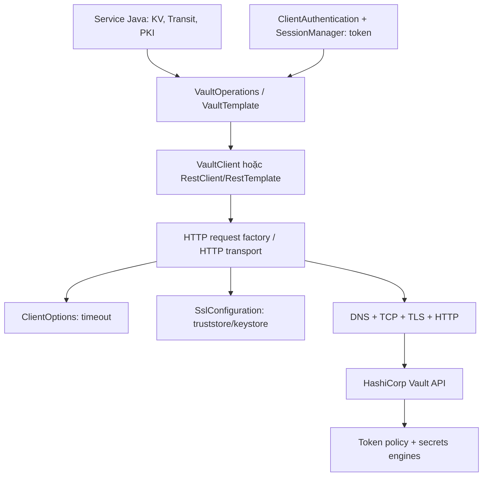
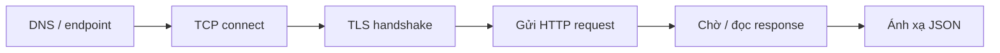
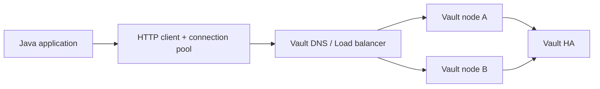

# ClientOptions, cấu hình TLS và HTTP transport

Với Spring Vault, một ứng dụng Java có thể đọc KV secrets, gọi Transit encryption hoặc cấp chứng chỉ PKI qua `VaultTemplate`. Tuy nhiên, mọi lời gọi đó vẫn đi qua mạng và phụ thuộc vào **HTTP transport**: kết nối tới Vault có mở được hay không, có tin cậy chứng chỉ máy chủ không, chờ phản hồi trong bao lâu và xử lý thế nào khi mạng bị lỗi.

Trong chương **Kiến trúc client** của module **SPRING_VAULT**, ba khái niệm trung tâm là:

- **`ClientOptions`**: các tham số kết nối cơ bản, đặc biệt connection timeout và read timeout.
- **`SslConfiguration`**: cấu hình truststore để kiểm tra chứng chỉ TLS của Vault, và keystore nếu client phải trình certificate/private key.
- **HTTP transport**: thành phần thực thi request thực tế, tích hợp qua `ClientHttpRequestFactory` và API client phù hợp với phiên bản Spring Vault.

Mục tiêu bài này là biết cấu hình một client đồng bộ an toàn, hiểu giới hạn timeout/retry, chọn đúng HTTP library, kiểm thử lỗi TLS, và liên hệ phần transport với xác thực workload, token/lease lifecycle, policy của KV, Transit, PKI.

## 1. Phân lớp khi Java gọi Vault

`VaultOperations` là interface thao tác Vault; `VaultTemplate` là hiện thực đồng bộ thông dụng. Phía dưới là client HTTP, cấu hình endpoint/TLS/timeout. `ClientAuthentication` và `SessionManager` cung cấp token cho request, trong khi Vault server kiểm tra token và policy.



| Thành phần | Phạm vi trách nhiệm | Không tự thực hiện |
|---|---|---|
| `VaultEndpoint` | Scheme, host, port của Vault | Cấu hình CA, quyền hoặc TTL token |
| `ClientOptions` | Connection/read timeout | Giới hạn tổng thời gian của mọi retry, pool size |
| `SslConfiguration` | Truststore, keystore và một số tham số TLS | Cấp Vault token hoặc xác định policy |
| HTTP client / request factory | Kết nối, gửi request, đọc response, quản lý pool/proxy tùy thư viện | Tự làm mới mọi credential hay lease |
| `SessionManager` | Cung cấp token phiên | Khắc phục lỗi DNS/TLS |
| `VaultTemplate` | Gọi API Vault và xử lý response | Cấp thêm quyền ngoài Vault policy |

Một request có thể thất bại trước khi Vault nhận được token (ví dụ lỗi DNS/TLS), hoặc Vault nhận token nhưng từ chối vì policy (`403`). Nhận diện **lỗi thuộc tầng nào** là kỹ năng quan trọng khi vận hành.

## 2. ClientOptions: connect timeout và read timeout

`org.springframework.vault.support.ClientOptions` là lớp cấu hình tham số kết nối. Spring Vault 3.2 và 4.1 đều hỗ trợ hai `Duration`:

```java
import java.time.Duration;
import org.springframework.vault.support.ClientOptions;

ClientOptions options = new ClientOptions(
    Duration.ofSeconds(3),  // connection timeout
    Duration.ofSeconds(10)  // read timeout
);
```

Theo Javadoc của `ClientOptions`, constructor không tham số dùng mặc định **5 giây cho kết nối** và **15 giây cho đọc**. Đây là mặc định của lớp, không phải SLA của một thao tác Vault đầy đủ; HTTP client bên dưới quyết định việc áp tham số ở từng giai đoạn.

| Cấu hình | Mục đích | Ví dụ cần quan sát |
|---|---|---|
| `connectionTimeout` | Giới hạn chờ thiết lập kết nối theo cơ chế client | Node không mở TCP, mạng lỗi, port không trả lời |
| `readTimeout` | Giới hạn chờ đọc response theo cơ chế client | Vault đã nhận request nhưng trả kết quả quá chậm |
| Pool acquisition timeout | Thời gian chờ mượn một connection từ pool | Pool hết chỗ do nhiều request đồng thời |
| Deadline tổng của tác vụ | Tổng thời gian cho DNS, login, request, backoff và retry | Request người dùng vượt SLA |

**Hai hàng cuối không phải thuộc tính của `ClientOptions`.** Chúng cần được cấu hình ở HTTP client, tầng retry hoặc tầng nghiệp vụ. `readTimeout` cũng không nhất thiết là “thời gian tối đa từ lúc gọi method đến lúc hoàn tất” vì nó có thể áp theo từng lần chờ đọc, tùy transport.

### Một lượt gọi gồm những giai đoạn nào?



Kết nối keep-alive có thể bỏ qua một số bước khi request tiếp theo tái sử dụng socket. Một request có `SessionManager` cũng có thể cần **đăng nhập Vault** trước khi gọi engine; login là thêm một HTTP round trip. Vì vậy, đừng chỉ cộng `connectionTimeout + readTimeout` để dự đoán chắc chắn tổng độ trễ.

Thời gian chờ nên được quyết định dựa trên mục tiêu độ trễ, vị trí mạng và số đo p95/p99 thực tế. KV read ở startup, Transit encrypt trên đường xử lý giao dịch, PKI issue và thao tác quản trị có thể cần các budget khác nhau.

## 3. HTTP transport: thư viện nào thực hiện request?

Tùy phiên bản, Spring Vault có cách chọn và cấu hình HTTP client khác nhau:

| Dòng Spring Vault | Kiến trúc HTTP thường gặp | Điểm mở rộng |
|---|---|---|
| 3.x | `RestTemplate` với JDK `HttpURLConnection` hoặc Apache Http Components/transport được hỗ trợ theo bản cụ thể | `ClientHttpRequestFactory` |
| 4.0 | Chuyển dần sang cơ chế `RestClient` | Cần đối chiếu Javadoc đúng bản |
| 4.1 | `VaultClient` là giao diện Vault HTTP, hỗ trợ JDK `HttpClient`, Apache Http Components, Reactor Netty và Jetty tùy classpath | `VaultClient.Builder`, request factory |

**Chọn transport có ý thức.** Việc thêm dependency HTTP client có thể làm thay đổi factory được chọn. Pooling, redirect, proxy, xử lý timeout và TLS context là những tính năng **phụ thuộc transport**.

Với Maven, nếu cần Apache Http Components 5 để dùng cấu hình SSL chuyên biệt của Spring Vault, thêm dependency:

```xml
<dependency>
  <groupId>org.apache.httpcomponents.client5</groupId>
  <artifactId>httpclient5</artifactId>
</dependency>
```

Để BOM phù hợp với Spring Vault quản lý phiên bản dependency. Không tùy ý thêm hàng loạt thư viện HTTP để dự phòng. **Theo tài liệu Spring Vault 4.1, `SslConfiguration` chỉ được áp dụng qua cơ chế client hỗ trợ khi Apache Http Components hiện diện**; nếu không, hãy kiểm tra rõ transport và SSL context mà client thực sự sử dụng.

### Lắp ghép transport bằng request factory

Ví dụ sử dụng API Spring Vault 3.x:

```java
import java.time.Duration;
import java.util.Objects;

import org.springframework.http.client.ClientHttpRequestFactory;
import org.springframework.vault.authentication.SessionManager;
import org.springframework.vault.authentication.SimpleSessionManager;
import org.springframework.vault.authentication.TokenAuthentication;
import org.springframework.vault.client.ClientHttpRequestFactoryFactory;
import org.springframework.vault.client.VaultEndpoint;
import org.springframework.vault.core.VaultTemplate;
import org.springframework.vault.support.ClientOptions;
import org.springframework.vault.support.SslConfiguration;

public final class VaultTransportFactory {
    public static VaultTemplate create() {
        ClientOptions options = new ClientOptions(
            Duration.ofSeconds(3), Duration.ofSeconds(10));

        // Dùng CA được JVM tin cậy; với CA nội bộ xem phần 4.
        SslConfiguration ssl = SslConfiguration.unconfigured();
        ClientHttpRequestFactory factory =
            ClientHttpRequestFactoryFactory.create(options, ssl);

        VaultEndpoint endpoint =
            VaultEndpoint.create("vault.service.internal", 8200);
        endpoint.setScheme("https");

        String token = Objects.requireNonNull(
            System.getenv("VAULT_TOKEN"), "Thiếu token của bài lab");
        SessionManager sessions = new SimpleSessionManager(
            new TokenAuthentication(token));

        return new VaultTemplate(endpoint, factory, sessions);
    }
}
```

Đây là **ví dụ học cách ghép thành phần**, dùng token tĩnh chỉ cho môi trường lab; workload production nên xác thực bằng danh tính Kubernetes, AppRole hoặc auth method phù hợp. Ở Spring Vault 4.1, constructor `VaultTemplate(endpoint, factory, sessions)` đã được đánh dấu deprecated để chuyển sang `VaultClient`.

Ví dụ kiểu API trong Spring Vault 4.1, giả định ba biến `endpoint`, `factory`, `sessions` đã tạo:

```java
import org.springframework.vault.client.VaultClient;
import org.springframework.vault.core.VaultTemplate;

VaultClient client = VaultClient.builder()
    .endpoint(endpoint)
    .requestFactory(factory)
    .build();

VaultTemplate template = new VaultTemplate(client, sessions);
```

Những adapter KV, Transit, PKI phía trên chỉ cần `VaultOperations`. Chúng không phải biết transport đang là Apache, JDK hay thư viện khác, miễn client được cấu hình đúng.

## 4. TLS: truststore, keystore và danh tính workload

Mọi request Vault mang token hoặc dữ liệu bí mật phải được bảo vệ trên đường truyền. Trong môi trường thật, dùng **HTTPS**, kiểm tra chuỗi chứng chỉ và tên máy chủ. Đừng bỏ qua xác minh certificate chỉ để hết lỗi kết nối.

### 4.1. Truststore để tin cậy Vault server

**Truststore** chứa CA/chứng chỉ mà Java client tin cậy khi Vault hoặc reverse proxy trình server certificate. Nếu Vault dùng CA công khai có trong JDK truststore, bạn có thể không cần file riêng. Với CA nội bộ, hãy cung cấp CA bundle/truststore phù hợp.

```text
Java client                                  Vault / LB
    |                                            |
    | ---------- TLS ClientHello -------------> |
    | <--------- Server certificate chain ----- |
    |                                            |
    | Kiểm tra CA chain, thời hạn, hostname/SAN |
    |                                            |
    | ====== Kết nối HTTPS sau xác minh ======= |
    | ------- X-Vault-Token + HTTP request ----> |
```

Nếu client gọi `https://vault.service.internal:8200`, certificate phải hợp lệ cho hostname `vault.service.internal` (thông thường qua Subject Alternative Name). Không vô hiệu hóa hostname verification, không trust-all certificate và không ép client đi HTTPS qua một proxy không thuộc trust boundary.

Ví dụ cấu hình truststore:

```java
import java.util.Objects;

import org.springframework.core.io.FileSystemResource;
import org.springframework.vault.support.SslConfiguration;

String trustStorePassword = Objects.requireNonNull(
    System.getenv("VAULT_TRUSTSTORE_PASSWORD"),
    "Thiếu password truststore"
);

SslConfiguration ssl = SslConfiguration.forTrustStore(
    new FileSystemResource("/etc/vault/tls/truststore.p12"),
    trustStorePassword.toCharArray()
);
```

Ví dụ giả định file đã tồn tại và keystore type tương thích với runtime; trong ứng dụng thực tế, cần xác minh PKCS12/JKS, quyền truy cập file, rotation và cách Apache HTTP client nạp `SslConfiguration`. Thay đổi một file truststore trên đĩa **không bảo đảm** connection pool/SSL context đang dùng tự nạp lại.

Nếu hệ thống phân phối CA dưới định dạng PEM, Spring Vault hỗ trợ cấu hình truststore từ PEM:

```java
import org.springframework.core.io.FileSystemResource;
import org.springframework.vault.support.SslConfiguration;
import org.springframework.vault.support.SslConfiguration.KeyStoreConfiguration;

KeyStoreConfiguration ca = KeyStoreConfiguration
    .of(new FileSystemResource("/etc/vault/tls/ca.pem"))
    .withStoreType("PEM");

SslConfiguration pemTls = SslConfiguration.forTrustStore(ca);
```

CA bundle này cần sẵn sàng **trước lần kết nối Vault đầu tiên**; không thể phụ thuộc vào việc tải CA từ chính một request HTTPS mà nó cần xác minh.

### 4.2. Keystore khi client có certificate

**Keystore** có thể chứa private key và client certificate để đáp ứng **mutual TLS (mTLS)**. Nó khác truststore:

| Kho TLS | Chứa gì? | Dùng để làm gì? |
|---|---|---|
| Truststore | CA hoặc certificate tin cậy | Kiểm tra server certificate |
| Keystore | Client certificate và private key (khi có) | Trình chứng chỉ client trong TLS handshake |

Môi trường dùng **Kubernetes/AppRole authentication** thường chỉ cần kiểm tra server TLS và dùng credential của workload để đăng nhập Vault, không nhất thiết phải có client certificate. Nếu bật Vault `cert` auth method, certificate của client có thể là bằng chứng đăng nhập để Vault cấp token. **TLS client identity và Vault token/policy vẫn là các lớp riêng.**

Ví dụ cấu hình hai kho:

```java
import org.springframework.core.io.FileSystemResource;
import org.springframework.vault.support.SslConfiguration;

SslConfiguration mtls = SslConfiguration.create(
    new FileSystemResource("/etc/vault/tls/client-identity.p12"),
    System.getenv("VAULT_KEYSTORE_PASSWORD").toCharArray(),
    new FileSystemResource("/etc/vault/tls/truststore.p12"),
    System.getenv("VAULT_TRUSTSTORE_PASSWORD").toCharArray()
);
```

Trong môi trường thật, kiểm tra biến môi trường/password không rỗng, giữ private key ngoài log/repository, giới hạn quyền file và làm rõ cơ chế cập nhật TLS context sau rotation. Với Spring Vault 4.1, hãy kiểm tra Apache Http Components có trên classpath nếu dựa vào `SslConfiguration` của Spring Vault.

### 4.3. Cấu hình toàn JVM hay chỉ cho Vault?

Java cho phép cấu hình hệ thống qua `javax.net.ssl.trustStore` hoặc truststore của JVM. Cách này có thể tác động tới nhiều HTTP client khác trong cùng tiến trình. `SslConfiguration` giúp mô tả TLS **riêng cho Vault client**, khi transport áp dụng nó đúng cách. Không nên thay truststore toàn cục mà không xét các kết nối khác của ứng dụng.

Các giao thức TLS/cipher suites có thể được giới hạn thông qua `SslConfiguration` hoặc API HTTP client tương ứng, nhưng nên dựa trên chính sách bảo mật và khả năng hỗ trợ hai phía. Đừng chọn giao thức yếu hoặc tắt certificate verification chỉ để qua được một bài test.

## 5. Cấu hình bằng Spring Cloud Vault

Nếu dùng Spring Cloud Vault auto-configuration, ưu tiên properties tương ứng phiên bản đang chạy. Ví dụ kết nối Vault qua DNS nội bộ, xác thực Kubernetes và truststore PKCS12:

```yaml
spring:
  cloud:
    vault:
      uri: https://vault.service.internal:8200
      connection-timeout: 3000    # mili giây
      read-timeout: 10000         # mili giây
      authentication: KUBERNETES
      kubernetes:
        role: payments-api
      ssl:
        trust-store: file:/etc/vault/tls/truststore.p12
        trust-store-type: PKCS12
        trust-store-password: ${VAULT_TRUSTSTORE_PASSWORD}
```

Giá trị `${VAULT_TRUSTSTORE_PASSWORD}` được Spring giải quyết từ biến môi trường hoặc nguồn cấu hình tương ứng; không commit mật khẩu truststore hay Vault token thật vào Git.

Các property `connection-timeout` và `read-timeout` trong Spring Cloud Vault là **mili giây**. Tên `uri` quyết định địa chỉ, còn `authentication` và nhóm `kubernetes` quyết định cách có token. Những thông số này không được thay thế cho Vault policy.

Ví dụ giả định role Kubernetes, Vault auth method và CA nội bộ đã được cấu hình đúng. Nếu ứng dụng muốn nạp properties từ Vault qua Spring Boot Config Data, còn cần `spring.config.import` phù hợp; đó là vấn đề khác với việc khởi tạo `VaultOperations` cho service.

## 6. Pooling, proxy và Vault HA

Một `VaultEndpoint` có thể trỏ tới một DNS/load balancer ổn định, phía sau là nhiều node Vault. HTTP client sẽ kết nối thông qua DNS, proxy, service mesh hoặc LB theo topology thực tế.



| Chủ đề | Nơi cấu hình | Rủi ro |
|---|---|---|
| Pool tối đa, idle/TTL | HTTP client (Apache/JDK/Netty/Jetty tùy bản) | Cạn socket, chờ connection quá lâu |
| DNS cache, health check | Hạ tầng, JVM, LB | Gửi request tới node lỗi quá lâu |
| Redirect khi HA đổi active | Vault, proxy và HTTP client | Gửi token sang host không tin cậy hoặc sai semantics |
| Keep-alive | HTTP client và LB | Dùng lại socket đã hỏng khi chuyển node |
| TLS termination | Vault/proxy/service mesh | Plaintext thoát trust boundary hoặc header bị ghi log |

**`ClientOptions` không cấu hình pool size hay proxy đầy đủ**. Khi dùng Apache Http Components hay transport khác, cần cấu hình pooling và vòng đời connection bằng API riêng của thư viện ấy. Đừng suy đoán rằng thêm một dependency tự động tạo pool tối ưu cho production.

Nếu Vault HA yêu cầu chuyển hướng/forwarding, cần xác minh client xử lý redirect tới host khác như thế nào, nhất là header `X-Vault-Token`. Không mở tự động redirect ngoài các endpoint Vault được phép; không dùng HTTP plaintext cho đường đi qua các mạng không tin cậy.

Ngoài ra, **Apache HTTP wire logging có thể lộ token, secret và plaintext trong body request**. Không bật wire logging trên production; với chẩn đoán phải có redaction, phạm vi quyền và thời gian lưu log phù hợp.

## 7. Timeout và retry phải tuân theo ngữ nghĩa Vault

Khi client timeout, không thể luôn khẳng định request chưa tới Vault. Đối với thao tác có side effect, server có thể đã thực thi nhưng response bị mất trên mạng:

| API Vault | Cách nghĩ về retry |
|---|---|
| KV read hoặc list metadata | Có thể thử lại ngắn khi lỗi tạm thời, với deadline tổng và backoff |
| KV write | Xem CAS/versioning, tính idempotent và nguy cơ ghi đè |
| Transit decrypt | Cần giới hạn retry và giữ plaintext khỏi log/trace |
| Transit encrypt | Xem xét số request, payload và semantics cụ thể trước retry |
| PKI issue certificate | Timeout có thể xảy ra sau khi chứng chỉ đã được cấp |
| Create token / dynamic credentials | Retry mù có thể sinh token/lease thứ hai |

Thiết kế tối thiểu:

1. Đặt **connect/read timeout hữu hạn**.
2. Đo latency thực, số lần retry, pool saturation và lỗi theo loại operation.
3. Chỉ retry lỗi tạm thời có khả năng phục hồi, với giới hạn số lần và exponential backoff/jitter.
4. Giữ **deadline của request nghiệp vụ** tách khỏi từng HTTP attempt.
5. Không retry vô hạn khi bị `403`, sai CA, sai hostname, sai auth role hoặc policy.
6. Nếu request ghi timeout sau khi đã gửi, xác định được trạng thái phía Vault trước khi phát lại nếu nghiệp vụ cần tính chính xác.

Gia hạn Vault token do `SessionManager` quản lý không phải công việc của HTTP transport. Lease của dynamic credentials và thời hạn chứng chỉ PKI cũng có vòng đời riêng; sửa timeout mạng không tự giải quyết TTL của các tài nguyên này.

## 8. Chẩn đoán lỗi theo tầng

| Triệu chứng | Giai đoạn | Cách xử lý phù hợp |
|---|---|---|
| DNS không phân giải được Vault | DNS | Kiểm tra `VaultEndpoint` và service discovery |
| `ConnectException`, connect timeout | TCP | Kiểm tra route, port Vault, network policy và LB |
| `SSLHandshakeException` / `PKIX path building failed` | TLS trust | Kiểm tra CA chain, truststore, SSL context đang dùng |
| Hostname/SAN mismatch | TLS verification | Cấp chứng chỉ khớp tên DNS; không tắt hostname check |
| HTTP `401/403` | Vault auth/authorization | Kiểm tra token TTL, namespace, role, policy và path |
| HTTP `404` | Vault API | Kiểm tra mount, KV v1/v2, `data/` và namespace |
| HTTP `429/5xx` | Server/proxy | Backoff/retry có kiểm soát và theo dõi health |
| Read timeout | Network/Vault latency | Kiểm tra độ trễ, timeout, pool và kết quả side effect |

**Không biến mọi lỗi thành “không tìm thấy secret”.** Ví dụ `opsForKeyValue("secret", KV_2).get("payments/db")` có thể trả `null` khi path không có dữ liệu theo hợp đồng API, nhưng `403` và lỗi TLS/timeout phải được xử lý riêng.

Khi giám sát, nên có metrics của request count, p95/p99 latency, timeout, TLS handshake failures, số kết nối/pool wait và retry count. Tag metrics theo operation có cardinality phù hợp; tránh đặt token, secret path nhạy cảm, plaintext Transit hoặc private key PKI làm label. Không ghi `X-Vault-Token` hay body auth response vào log.

## 9. Kiểm thử tích hợp cho TLS và HTTP transport

Unit test có thể kiểm tra `ClientOptions` giữ đúng `Duration`, nhưng **không chứng minh** HTTP client thực sự timeout hoặc áp truststore. Cần kiểm thử trên Vault dev/test và endpoint giả lập sự cố:

1. **HTTPS thành công:** Vault test trả certificate được truststore tin cậy, SAN khớp host, token test đọc được KV v2.
2. **CA không hợp lệ:** thay certificate chain, xác nhận client từ chối trước khi gửi request Vault.
3. **Sai hostname:** dùng certificate không chứa DNS đang kết nối; xác nhận lỗi xác minh tên.
4. **Connect timeout:** dùng endpoint test không phản hồi kết nối, đo thời gian lỗi.
5. **Read timeout:** endpoint chấp nhận request nhưng giữ response, quan sát timeout thực của transport.
6. **Thiếu quyền:** TLS thành công nhưng token không có `read` trả `403`.
7. **Pool dưới tải:** chạy nhiều request đồng thời, đo số connection đang dùng/chờ.
8. **HA failover:** đổi node sau LB, kiểm tra request sau phục hồi đúng; không tự retry lệnh phát hành certificate.
9. **Rotation truststore:** thay CA/certificate, xác nhận cơ chế reload SSL context và đóng connection cũ theo thiết kế.
10. **Bảo vệ log:** khẳng định không có Vault token, secret KV, plaintext Transit và private key PKI trong output test.

Không dùng root token để kiểm tra policy; chuẩn bị danh tính workload và policy tối thiểu riêng cho test. Các test TLS/timeout cần tách với bài test lease của database credentials và token renewal để biết nguyên nhân khi thất bại.

## 10. Bài thực hành: cấu hình payments-api

**Bối cảnh:** `payments-api` chạy trên Kubernetes; Vault HA công bố tại `https://vault.service.internal:8200` bằng CA nội bộ. Ứng dụng cần đọc `secret/data/payments/db` và gọi `transit/encrypt/payments`, yêu cầu bảo vệ toàn bộ dữ liệu trên đường truyền.

**Các bước:**

1. Cấu hình `ClientOptions` với connect timeout 3 giây và read timeout 10 giây ban đầu; sau đó đo p95/p99 để điều chỉnh.
2. Tạo truststore chứa CA nội bộ và lắp vào transport có hỗ trợ custom `SslConfiguration`; xác minh hostname.
3. Cấu hình Kubernetes authentication với service account/role được Vault chấp nhận, dùng `SessionManager` phù hợp TTL.
4. Cấp policy tối thiểu: `read` ở `secret/data/payments/db` và `update` ở `transit/encrypt/payments`.
5. Dùng `VaultTemplate` đọc cấu hình và mã hóa dữ liệu thử nghiệm. Không log token hoặc plaintext.
6. Gây lỗi CA, hostname, mạng, timeout và policy riêng biệt; quan sát cách client phân loại lỗi.
7. Mô phỏng failover, đo tác động của keep-alive, pool và retry budget trước khi dùng trong production.

### Câu hỏi tự kiểm tra

1. Vì sao `ClientOptions` không bảo đảm tổng thời gian gọi Vault bằng tổng connect/read timeout?
2. Truststore và keystore khác nhau thế nào? Workload dùng Kubernetes auth có bắt buộc phải có client private key TLS không?
3. Vì sao cần kiểm tra **HTTP transport thực tế** khi cấu hình `SslConfiguration`?
4. Tại sao lỗi `SSLHandshakeException` không sửa được bằng cách cấp thêm quyền trong Vault policy?
5. Nếu `VaultTemplate.write(...)` timeout sau khi gửi body, ta có thể khẳng định Vault chưa ghi không?
6. Vì sao connection pool, proxy và retry cần cấu hình riêng với `ClientOptions`?

**Ghi nhớ:** `ClientOptions` mô tả timeout cơ bản; `SslConfiguration` mô tả chứng chỉ được tin cậy và danh tính TLS của client; HTTP transport thực thi kết nối. Một client Spring Vault đáng tin cậy cần phối hợp ba phần này với endpoint, authentication theo workload, policy tối thiểu và vòng đời token/lease, đồng thời quan sát rõ lỗi mạng và thao tác có side effect.

## Tài liệu tham khảo

- [Spring Vault 4.1 — HTTP Client Support](https://docs.spring.io/spring-vault/reference/vault/client-support.html).
- [Spring Vault 3.2 — Client Support](https://docs.spring.io/spring-vault/reference/3.2-SNAPSHOT/vault/client-support.html).
- [Spring Vault API — ClientOptions](https://docs.spring.io/spring-vault/reference/api/java/org/springframework/vault/support/ClientOptions.html).
- [Spring Vault API — SslConfiguration](https://docs.spring.io/spring-vault/reference/api/java/org/springframework/vault/support/SslConfiguration.html).
- [Spring Vault API — ClientHttpRequestFactoryFactory](https://docs.spring.io/spring-vault/reference/api/java/org/springframework/vault/client/ClientHttpRequestFactoryFactory.html).
- [Spring Vault API — VaultTemplate](https://docs.spring.io/spring-vault/reference/api/java/org/springframework/vault/core/VaultTemplate.html).
- [Spring Cloud Vault — Common Application Properties](https://docs.spring.io/spring-cloud-vault/reference/appendix.html).
