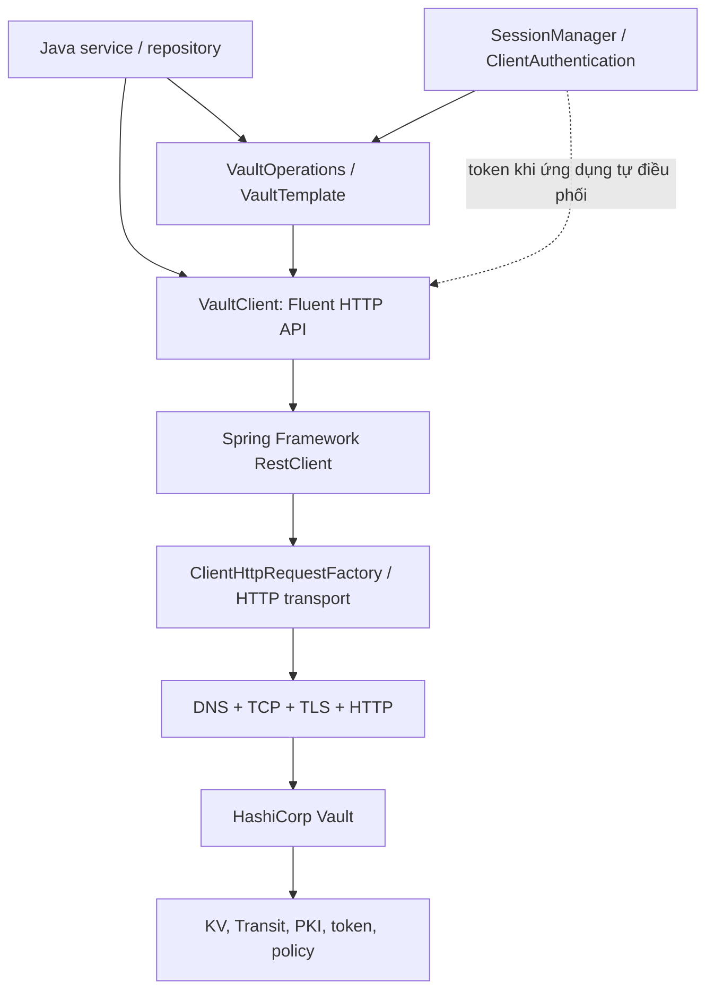
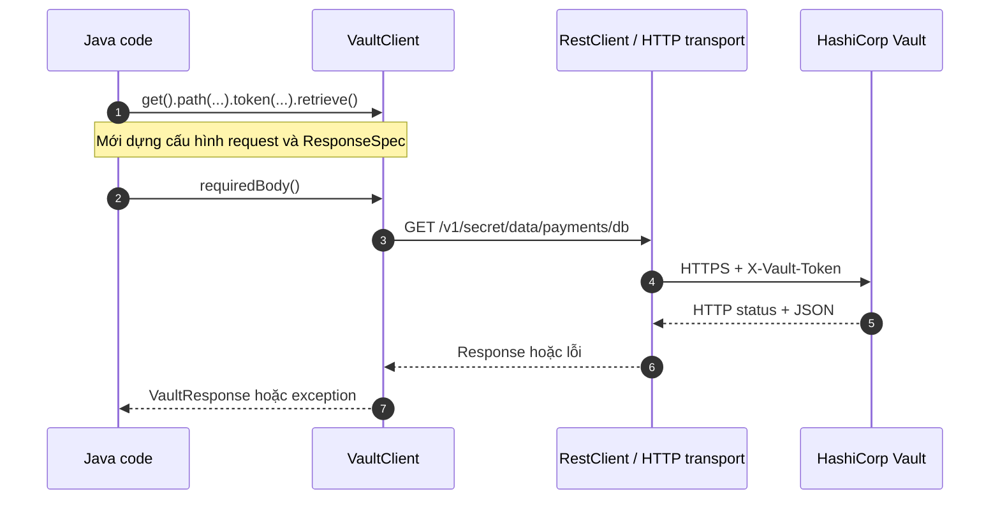
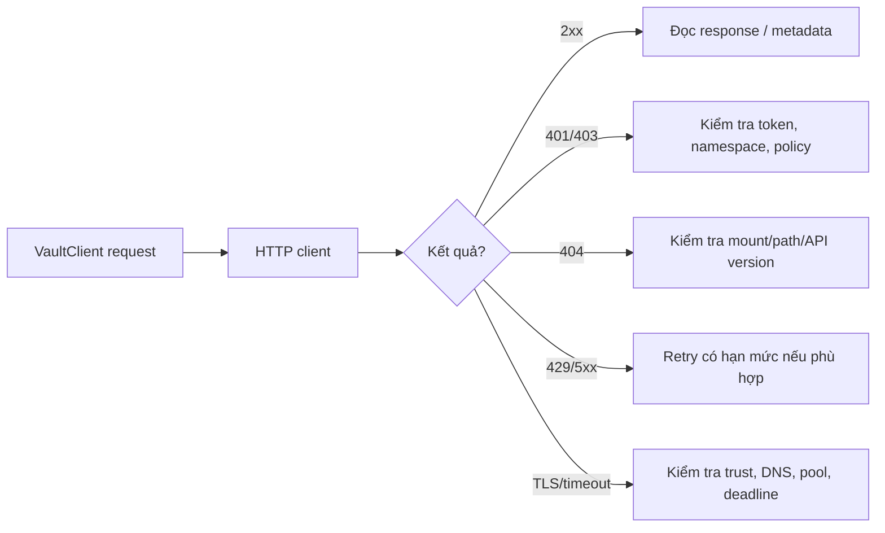

# VaultClient dựa trên RestClient từ Spring Vault 4.1

Trong **Spring Vault 4.1**, `VaultClient` là một cách truy cập **HashiCorp Vault HTTP API** theo kiểu *fluent* và **đồng bộ**, được xây dựng trên nền `RestClient` của Spring Framework. Thành phần này nằm giữa HTTP client tổng quát và `VaultTemplate`: ứng dụng có thể kiểm soát method, path, header, request body và response theo cấu trúc Vault mà không phải tự dựng toàn bộ URL/header với `RestClient` thuần.

Chủ đề thuộc chương **Kiến trúc client** của **SPRING_VAULT**. Khi ứng dụng Java dùng Vault để đọc KV secrets, mã hóa bằng Transit, cấp chứng chỉ PKI hoặc quản lý token và lease, việc hiểu `VaultClient` giúp chọn đúng mức trừu tượng và xác định rõ ranh giới giữa **gửi HTTP request**, **xác thực workload**, **phân quyền Vault** và **API của từng secrets engine**.

Sau bài học, bạn có thể:

- Giải thích mối quan hệ `RestClient → VaultClient → VaultTemplate` và so sánh với API reactive.
- Tạo `VaultClient` có endpoint, HTTP request factory và namespace phù hợp.
- Viết lệnh `GET`, `POST` với `path(...)`, `token(...)`, `body(...)`, `retrieve()` và các phương thức nhận response.
- Hiểu vì sao `retrieve()` chưa gửi request cho tới khi thực hiện thao tác terminal.
- Kết hợp `VaultClient` với `VaultTemplate` và `SessionManager` để sử dụng token theo vòng đời workload.
- Phân biệt lỗi HTTP, lỗi decode, trường hợp không có dữ liệu, lỗi policy và lỗi kết nối.
- Thiết kế kiểm thử tích hợp, timeout/TLS, log và retry an toàn khi truy cập Vault.

> **Phạm vi phiên bản:** API `VaultClient` được giới thiệu từ **Spring Vault 4.1**. Các mẫu mã dưới đây dành cho dòng **4.1.x**; cần kiểm tra BOM/Javadoc của phiên bản thực tế trong dự án nếu dùng nhánh 3.x hoặc 4.0.

## 1. Vì sao Spring Vault bổ sung VaultClient?

Trước đây, ứng dụng muốn truy cập Vault mức HTTP thường phải dùng `RestTemplate`/`RestClient` cùng những thiết lập riêng về URL, token, namespace và chuyển đổi response. `VaultTemplate` đã xử lý nhiều việc đó nhưng lại hướng tới **các operation mức cao**. Với những endpoint đặc thù chưa có operation wrapper, vẫn cần một client gần HTTP hơn.

`VaultClient` mang lại điểm cân bằng:

1. API *fluent* quen thuộc từ `RestClient`: chọn HTTP method, path, headers, body rồi nhận response.
2. **Hiểu ngữ cảnh Vault**: làm việc với `VaultEndpoint`/`VaultEndpointProvider`, `VaultToken`, namespace và `VaultResponse`.
3. Có thể **tùy biến transport** bằng request factory, header mặc định hoặc `RestClient.Builder`.
4. Là nền tảng mà `VaultTemplate` có thể sử dụng để thực hiện các thao tác cao hơn.



**Không phải** mọi ứng dụng cần gọi trực tiếp `VaultClient`. Nếu nhu cầu chỉ là `opsForKeyValue(...)`, `opsForTransit()` hay `opsForPki(...)`, `VaultTemplate` thường diễn đạt nghiệp vụ ngắn gọn hơn. `VaultClient` hữu ích khi cần endpoint Vault ít phổ biến, custom operation hoặc kiểm soát trực tiếp request/response.

### Bảng so sánh bốn mức API

| Tiêu chí | `RestClient` | `VaultClient` | `VaultTemplate` | `ReactiveVaultClient` |
|---|---|---|---|---|
| Mô hình | HTTP đồng bộ tổng quát | HTTP đồng bộ có hỗ trợ Vault | API Vault đồng bộ mức cao | HTTP Vault bất đồng bộ/reactive |
| Request | Tự chọn URI, header, body | `get/post/delete`, `path`, `token`, `namespace` | `read/write` và các `opsFor...` | API fluent trả publisher |
| Xác thực | Tự thêm header/token | Có helper token trên từng request | Có thể dùng `ClientAuthentication`/`SessionManager` | Token được cung cấp theo hợp đồng reactive |
| KV v2 path | Tự xây | Tự chọn path API | Nhóm KV hiểu mount/version | Tự chọn path API |
| Xử lý lỗi | Ngoại lệ HTTP của Spring | `VaultClientResponseException` và các lỗi liên quan | Ánh xạ qua lớp Vault operations | Lỗi theo pipeline reactive |
| Nên dùng | HTTP client tùy biến rất sâu | API Vault đặc thù, cần HTTP control | Phần lớn nghiệp vụ Vault thông thường | Workload reactive |

Về concurrency, một `VaultClient` sau khi tạo có thể được tái sử dụng bởi nhiều luồng. Bản thân việc sử dụng cùng client **không** có nghĩa cùng một Vault token sẽ tự renew; trách nhiệm token/session phải được cấu hình riêng.

## 2. Tạo VaultClient với VaultEndpoint

Trong Spring Vault 4.1, factory đơn giản có thể nhận một `VaultEndpoint`:

```java
import org.springframework.vault.client.VaultClient;
import org.springframework.vault.client.VaultEndpoint;

VaultEndpoint endpoint =
    VaultEndpoint.create("vault.service.internal", 8200);
endpoint.setScheme("https");

VaultClient client = VaultClient.create(endpoint);
```

Đối tượng `VaultEndpoint` biểu diễn **scheme/host/port** để truy cập Vault. `VaultClient` sẽ sử dụng endpoint này làm cơ sở cho các `path(...)` tương đối. Nó không làm nhiệm vụ đăng nhập và không cấp bất kỳ capability nào cho token.

Trong một môi trường thực tế, `vault.service.internal` nên là DNS/service name ổn định, kết nối qua HTTPS và có truststore xác minh certificate. Trong môi trường Vault HA, DNS/load balancer thường xử lý chọn node; nếu có cơ chế discovery riêng, builder có thể nhận `VaultEndpointProvider`.

`VaultClient` còn có các factory:

- `VaultClient.create()`: tạo client không khai báo endpoint; các lời gọi phải cung cấp URL tuyệt đối nếu cần.
- `VaultClient.create(String baseUrl)`: tạo client với base URL.
- `VaultClient.create(VaultEndpointProvider)`: dùng endpoint được provider cung cấp.
- `VaultClient.builder()`: lắp ghép cấu hình chi tiết.
- `VaultClient.builder(RestClient)` hoặc `builder(RestTemplate)`: khởi tạo builder từ cấu hình HTTP client đang có.

**Khuyến nghị:** cấu hình `VaultEndpoint` rõ ràng cho ứng dụng để những lời gọi với path tương đối được gắn với Vault server đã lựa chọn. Cần kiểm soát chặt dữ liệu đầu vào nếu dùng URI tuyệt đối, vì URI kiểu này có thể đi ngoài endpoint mặc định và làm token được gửi đến đích không mong muốn.

## 3. VaultClient.Builder: cấu hình HTTP transport

Builder hỗ trợ các phương thức:

| Phương thức | Công dụng |
|---|---|
| `endpoint(VaultEndpoint)` | Địa chỉ Vault mặc định |
| `endpoint(VaultEndpointProvider)` | Địa chỉ Vault theo provider |
| `requestFactory(ClientHttpRequestFactory)` | Chọn/cấu hình HTTP transport |
| `defaultHeader(name, values...)` | Header mặc định nếu request không ghi đè |
| `defaultNamespace(namespace)` | Namespace mặc định khi dùng Vault Enterprise |
| `configureRestClient(consumer)` | Tùy biến `RestClient.Builder` bên dưới |
| `uriBuilderFactory(factory)` | Cung cấp cơ chế dựng URI riêng; thay thế thiết lập endpoint thông thường |
| `build()` | Tạo một `VaultClient` từ builder |

Ví dụ Java tạo client với connect/read timeout hữu hạn. Đoạn này minh họa `SimpleClientHttpRequestFactory` cho một lab nhỏ; production cần xem xét pooling, TLS và giới hạn đồng thời theo tải thực:

```java
import org.springframework.http.client.SimpleClientHttpRequestFactory;
import org.springframework.vault.client.VaultClient;
import org.springframework.vault.client.VaultEndpoint;

public final class VaultHttpClientFactory {

    public static VaultClient create() {
        VaultEndpoint endpoint =
            VaultEndpoint.create("vault.service.internal", 8200);
        endpoint.setScheme("https");

        SimpleClientHttpRequestFactory httpFactory =
            new SimpleClientHttpRequestFactory();
        httpFactory.setConnectTimeout(3000);
        httpFactory.setReadTimeout(10000);

        return VaultClient.builder()
            .endpoint(endpoint)
            .requestFactory(httpFactory)
            .build();
    }
}
```

Một client production có thể dùng Apache Http Components, JDK HttpClient, Reactor Netty hoặc Jetty tùy dependency và cấu hình Spring Vault. Không nên cho rằng `VaultClient` mặc định có pool size, proxy và deadline phù hợp cho mọi ứng dụng. Nếu Vault dùng CA nội bộ, cần cấu hình truststore trên transport đang sử dụng; trong tài liệu Spring Vault 4.1, cơ chế `SslConfiguration` chuyên biệt yêu cầu **Apache Http Components** trên classpath.

### Tùy biến RestClient bên dưới

Builder cho phép can thiệp vào `RestClient.Builder` mà không làm mã ứng dụng phụ thuộc trực tiếp vào `RestClient` cho từng lời gọi Vault:

```java
VaultClient client = VaultClient.builder()
    .endpoint(endpoint)
    .configureRestClient(rest -> {
        // Áp các customizer/interceptor được kiểm soát theo chính sách.
        // Tránh logging toàn bộ header hoặc request body.
    })
    .build();
```

Các biến `endpoint` và `client` trong các đoạn mã ngắn cần được khai báo trong cùng phạm vi khi đưa vào chương trình hoàn chỉnh. Với Spring configuration infrastructure, bean `VaultClientCustomizer` có thể tùy biến `VaultClient.Builder` do Spring Vault tạo:

```java
import org.springframework.context.annotation.Bean;
import org.springframework.context.annotation.Configuration;
import org.springframework.vault.client.VaultClientCustomizer;

@Configuration
class VaultCustomization {

    @Bean
    VaultClientCustomizer namespaceCustomizer() {
        // Chỉ cấu hình namespace nếu hệ thống sử dụng Vault Enterprise.
        return builder -> builder.defaultNamespace("team-payments");
    }
}
```

Customizers dạng bean chỉ được áp khi bạn dùng **cơ chế tạo client của Spring Vault** có thu thập các bean này; nó không tự can thiệp vào một đối tượng do bạn tự tạo bằng `VaultClient.builder().build()` bên ngoài container.

## 4. Thực hiện GET theo kiểu fluent

Giả sử KV v2 được mount ở `secret`; secret logic là `payments/db`. Với API mức thấp, cần dùng path thực của KV v2: `secret/data/payments/db`.

```java
import java.util.Objects;
import org.springframework.vault.client.VaultClient;
import org.springframework.vault.support.VaultResponse;
import org.springframework.vault.support.VaultToken;

public final class PaymentConfigHttpReader {

    private final VaultClient client;
    private final VaultToken token;

    public PaymentConfigHttpReader(VaultClient client, VaultToken token) {
        this.client = Objects.requireNonNull(client);
        this.token = Objects.requireNonNull(token);
    }

    public VaultResponse fetch() {
        return client.get()
            .path("secret/data/payments/db")
            .token(token)
            .retrieve()
            .requiredBody();
    }
}
```

Ở đây `token(VaultToken)` là helper thêm token vào request, không đòi hỏi ứng dụng tự đặt header `X-Vault-Token` bằng chuỗi thô. **Nguồn token** phải được quản lý ở tầng xác thực; ví dụ constructor trên nhận token đã có từ bên ngoài. Khi ứng dụng xử lý nhiều request và token có TTL, hãy dùng `SessionManager` hoặc `VaultTemplate` để quản lý vòng đời phù hợp.

Chuỗi lệnh diễn ra:



**Quan trọng:** chỉ gọi `retrieve()` **chưa thực thi request**. Request bắt đầu khi gọi một phương thức terminal trên `ResponseSpec`, ví dụ `requiredBody()`, `body()`, `toEntity()` hoặc `toBodilessEntity()`.

### Response KV v2 có lớp dữ liệu lồng nhau

Một HTTP response KV v2 thường có envelope:

```json
{
  "data": {
    "data": {
      "username": "payments_reader",
      "password": "<redacted>"
    },
    "metadata": {
      "version": 4
    }
  }
}
```

`VaultClient` trả về `VaultResponse` của HTTP API; bạn vẫn cần hiểu `data.data` và `data.metadata` khi xử lý KV v2. Trái lại, nhóm `VaultKeyValueOperations` trong `VaultTemplate` biết quy tắc mount, KV v1/v2 và hỗ trợ ánh xạ ở mức phù hợp hơn.

Không in toàn bộ `VaultResponse` ra log hoặc trace: response có thể chứa dữ liệu bí mật. Chỉ trích xuất trường cần thiết và kiểm tra schema/kiểu dữ liệu.

## 5. POST và request body: ví dụ KV v2

`VaultClient` hỗ trợ `post()`, `put()`, `delete()`, `get()` và `method(HttpMethod)`. Với lệnh ghi KV v2, body phải bao quanh dữ liệu bằng trường `data` theo hợp đồng Vault.

Ví dụ hàm nhận payload từ tầng nghiệp vụ (không chứa mật khẩu hard-coded):

```java
import java.util.Map;
import org.springframework.vault.client.VaultClient;
import org.springframework.vault.support.VaultToken;

public final class PaymentConfigHttpWriter {

    private final VaultClient client;
    private final VaultToken token;

    public PaymentConfigHttpWriter(VaultClient client, VaultToken token) {
        this.client = client;
        this.token = token;
    }

    public void save(Map<String, Object> values) {
        client.post()
            .path("secret/data/payments/db")
            .token(token)
            .body(Map.of("data", values))
            .retrieve()
            .toBodilessEntity();
    }
}
```

Đây là ví dụ endpoint **KV v2**. Nếu engine mount ở vị trí khác, hoặc dùng KV v1, path và body sẽ khác. Lệnh write KV v2 có thể trả metadata về phiên bản mới; `toBodilessEntity()` phù hợp nếu caller chỉ quan tâm status nhưng **sẽ bỏ qua body metadata**. Nếu cần version mới, hãy dùng `body(...)` hoặc `toEntity(...)` với kiểu dữ liệu phù hợp.

Khi hai client có thể ghi đồng thời, sử dụng **CAS (check-and-set)** của KV v2 theo hợp đồng Vault để chống lost update; một chuỗi `GET → POST` thông thường không phải transaction. Với ứng dụng chỉ đọc secret, không tạo API write ở service nghiệp vụ và không cấp capability ghi cho token.

## 6. ResponseSpec: đọc dữ liệu, status và lỗi

Sau `retrieve()`, `VaultClient.ResponseSpec` cung cấp một số cách nhận kết quả:

| Phương thức | Kết quả | Khi nào sử dụng |
|---|---|---|
| `body()` | `VaultResponse` hoặc `null` khi không có body | Response Vault thông thường |
| `requiredBody()` | `VaultResponse` bắt buộc | Caller cần response body, không chấp nhận response rỗng |
| `body(MyType.class)` | Đối tượng được chuyển đổi hoặc `null` | Endpoint có DTO riêng |
| `requiredBody(MyType.class)` | DTO bắt buộc | Response đúng kiểu và phải có body |
| `toEntity()` | `ResponseEntity<VaultResponse>` | Cần thêm HTTP status và headers |
| `toEntity(MyType.class)` | `ResponseEntity<MyType>` | Cần body kiểu DTO và metadata HTTP |
| `toBodilessEntity()` | `ResponseEntity<Void>` | Request thành công, không cần xử lý body |
| `onStatus(predicate, handler)` | Tùy biến cách xử lý status | Cần ánh xạ lỗi HTTP theo quy tắc ứng dụng |

Ví dụ chỉ đọc thông tin HTTP metadata:

```java
import org.springframework.http.ResponseEntity;
import org.springframework.vault.support.VaultResponse;

ResponseEntity<VaultResponse> result = client.get()
    .path("secret/data/payments/db")
    .token(token)
    .retrieve()
    .toEntity();

int httpStatus = result.getStatusCode().value();
// Chỉ log mã HTTP và độ trễ; không log headers/body thô chứa secret.
```

Các biến `client`, `token` trong đoạn trên là những đối tượng đã được cung cấp từ tầng cấu hình/xác thực. Một số response Vault không có body sau khi ghi/xóa: dùng `requiredBody()` trong tình huống đó có thể tạo lỗi vì thiếu body **dù request đã thành công**.

### VaultClient và lỗi HTTP

Theo hợp đồng 4.1, lệnh terminal gặp **HTTP 4xx/5xx** thường ném một lớp con của `VaultClientResponseException`. Đây là kiểu ngoại lệ thuộc `org.springframework.vault.client`, khác với lỗi HTTP thuần từ `RestClient`. Có thể phân nhánh theo status:

```java
import org.springframework.vault.client.VaultClientResponseException;
import org.springframework.vault.support.VaultResponse;

try {
    VaultResponse response = client.get()
        .path("secret/data/payments/db")
        .token(token)
        .retrieve()
        .requiredBody();
    // Ánh xạ response ở đây, không log secret.
} catch (VaultClientResponseException exception) {
    int status = exception.getStatusCode().value();

    if (status == 403) {
        // Kiểm tra capability, identity, token TTL, mount và namespace.
        throw new IllegalStateException("Vault từ chối quyền truy cập", exception);
    }

    throw exception;
}
```

Trường hợp tài nguyên không tồn tại thường phản ánh HTTP `404` ở `VaultClient` mức thấp; nó **không đồng nghĩa** với việc gọi `VaultKeyValueOperations.get(...)` mức cao luôn ném exception. Một wrapper KV có thể diễn giải trường hợp thiếu secret thành `null` theo hợp đồng của nó. Đừng dùng `catch (Exception) { return null; }` cho mọi lỗi: cách đó biến `403`, lỗi TLS và timeout thành “không có secret”.

Bạn có thể dùng `onStatus(...)` để thay đổi phản ứng với status, nhưng nên giữ nguyên khả năng chẩn đoán và đặc biệt không lộ request/response body khi chứa token hoặc dữ liệu bí mật. Ngoại lệ cũng có thể xuất hiện do lỗi mạng, decode JSON hoặc I/O; hãy giữ cause và phân loại theo tầng.

## 7. Tích hợp VaultClient vào VaultTemplate

Một ứng dụng nên tập trung cấu hình HTTP transport trong `VaultClient`, rồi để `VaultTemplate` cung cấp API Vault mức cao cho repository/service. Spring Vault 4.1 có constructor:

```java
VaultTemplate(VaultClient client, SessionManager sessionManager)
```

Ví dụ lab đầy đủ dùng token test từ biến môi trường:

```java
import java.util.Objects;

import org.springframework.vault.authentication.ClientAuthentication;
import org.springframework.vault.authentication.SessionManager;
import org.springframework.vault.authentication.SimpleSessionManager;
import org.springframework.vault.authentication.TokenAuthentication;
import org.springframework.vault.client.VaultClient;
import org.springframework.vault.client.VaultEndpoint;
import org.springframework.vault.core.VaultOperations;
import org.springframework.vault.core.VaultTemplate;

public final class VaultClientComposition {

    public static VaultOperations connect() {
        VaultEndpoint endpoint =
            VaultEndpoint.create("vault.service.internal", 8200);
        endpoint.setScheme("https");

        VaultClient client = VaultClient.builder()
            .endpoint(endpoint)
            .build();

        String token = Objects.requireNonNull(
            System.getenv("VAULT_TOKEN"),
            "Cần cung cấp VAULT_TOKEN cho bài lab"
        );
        ClientAuthentication auth = new TokenAuthentication(token);
        SessionManager sessions = new SimpleSessionManager(auth);

        return new VaultTemplate(client, sessions);
    }
}
```

Khi service sử dụng interface `VaultOperations`:

```java
import org.springframework.vault.core.VaultKeyValueOperations;
import org.springframework.vault.core.VaultKeyValueOperationsSupport.KeyValueBackend;
import org.springframework.vault.core.VaultOperations;
import org.springframework.vault.support.VaultResponse;

public final class PaymentsSecretRepository {
    private final VaultKeyValueOperations kv;

    public PaymentsSecretRepository(VaultOperations operations) {
        kv = operations.opsForKeyValue("secret", KeyValueBackend.KV_2);
    }

    public VaultResponse fetchConfig() {
        // Chỉ truyền path logic; nhóm KV v2 tự xử lý prefix data/.
        return kv.get("payments/db");
    }
}
```

`VaultTemplate` dùng `SessionManager` để có token theo phiên, sau đó gọi API Vault thông qua client đã cấu hình. Điều này giảm nguy cơ mỗi repository tự gọi `login()` hoặc giữ token như một chuỗi lâu dài. Với workload chạy lâu, cần chọn session manager/ClientAuthentication hỗ trợ vòng đời token phù hợp; `SimpleSessionManager` chỉ tái sử dụng token đơn giản, không tự renew/revoke.

Trong production, ưu tiên danh tính workload (Kubernetes, AppRole, IAM...) và chính sách quyền tối thiểu. Nếu Spring Cloud Vault/`AbstractVaultConfiguration` đã tạo bean `VaultOperations`, hãy dùng bean đó, chỉ tùy biến qua điểm mở rộng được hỗ trợ thay vì tự dựng thêm một client với token khác.

### Vì sao constructor kiểu cũ bị deprecated?

Từ 4.1, nhiều constructor `VaultTemplate` dựa trực tiếp vào `VaultEndpoint + ClientHttpRequestFactory` hoặc `RestTemplateBuilder` được đánh dấu **deprecated** để khuyến khích tạo `VaultClient`/`RestClientBuilder`. Ý tưởng là tách **cấu hình HTTP client** khỏi **logic Vault operations**, giảm phụ thuộc vào một implementation HTTP cụ thể và cho phép customizer hoạt động nhất quán hơn.

Điều này **không** có nghĩa `RestTemplate`/`RestClient` lập tức không dùng được hoặc mọi project phải chuyển sang reactive. Khi nâng cấp, rà soát API, dependency và kiểm thử theo dòng phiên bản, không đổi constructor khi chưa xác minh cấu hình SSL/session của client mới.

## 8. Authentication, namespace và đường dẫn cần tách riêng

`VaultClient` cung cấp helper `token(VaultToken)` và `namespace(String)` trên từng request. Builder có thể thiết lập namespace mặc định cho client. Các giá trị này khác với endpoint và mount của secrets engine:

| Khái niệm | Ví dụ | Ý nghĩa |
|---|---|---|
| Endpoint | `https://vault.service.internal:8200` | Nơi kết nối HTTPS |
| Namespace | `team-payments` | Phạm vi Vault Enterprise, truyền qua header namespace |
| Token | `VaultToken` của workload | Danh tính/capability được Vault kiểm tra |
| KV mount | `secret` | Nơi gắn KV v2 engine |
| API path | `secret/data/payments/db` | Endpoint KV v2 thực sự dùng |
| Logical path | `payments/db` | Đường dẫn secret trong nhóm KV |

Nếu dùng Vault Enterprise namespace:

```java
VaultResponse response = client.get()
    .path("secret/data/payments/db")
    .namespace("team-payments")
    .token(token)
    .retrieve()
    .requiredBody();
```

Trong ứng dụng thường chỉ làm việc với một namespace, cấu hình `defaultNamespace(...)` trên builder có thể gọn hơn. Không dùng default namespace cho những workload thuộc trust boundary khác nhau nếu cần tách identity.

### Policy không do VaultClient quyết định

Token chỉ đọc KV v2 tại path trên có thể được gắn Vault policy:

```hcl
path "secret/data/payments/db" {
  capabilities = ["read"]
}
```

Lệnh `VaultClient.get()` có thể được thực hiện ở Java, nhưng Vault vẫn kiểm tra **capability trên path thật**. Nếu token không có `read`, request bị từ chối. Cần có quyền `list` riêng cho path metadata khi liệt kê KV v2; gọi `get()` thành công cũng không có nghĩa token được gọi Transit decrypt hay PKI issue.

Đối với Transit, khi gửi trực tiếp HTTP API bạn phải tự tuân thủ encoding/payload của endpoint; đối với PKI, cần hiểu role, TTL và certificate material trong response. Nếu chỉ cần khả năng phổ biến, dùng `opsForTransit()`/`opsForPki()` của `VaultTemplate` thường giảm lỗi cấu trúc request.

## 9. TLS, request factory, HA và observability

`VaultClient` chạy qua `RestClient` nên transport bên dưới quyết định pooling, proxy, timeout và SSL context. `VaultClient.Builder.requestFactory(...)` là điểm gắn một `ClientHttpRequestFactory` đã cấu hình.

### TLS và địa chỉ đích

- Dùng **HTTPS** và certificate hợp lệ cho hostname của `VaultEndpoint`; không tắt hostname verification.
- Nếu Vault dùng CA nội bộ, cấu hình truststore tương ứng với transport. `SslConfiguration` chuyên biệt của Spring Vault 4.1 yêu cầu Apache Http Components có trên classpath.
- Nếu bật mTLS, keystore chứa certificate/private key của client; đây vẫn khác với token do auth method của Vault cấp.
- Tránh truyền URL tuyệt đối, URI không kiểm soát hoặc dữ liệu path có thể điều khiển tới máy chủ ngoài. Một URI tuyệt đối có thể đi ngoài endpoint mặc định; không gắn token vào địa chỉ đích chưa được tin cậy.

### Pooling và failover

Một endpoint có thể trỏ tới DNS/load balancer đứng trước Vault HA. HTTP client có thể tái sử dụng TCP/TLS connection, nên hãy kiểm tra connection pool, idle timeout, DNS cache, redirect và quy trình failover thực tế. `VaultClient` không tự bảo đảm phát hiện leader, tự retry mọi request hoặc xử lý side effect an toàn.

### Giám sát

Theo dõi p50/p95/p99 latency, tỷ lệ 4xx/5xx, timeout kết nối/đọc, số lần retry và pool saturation. Tách metrics của request đăng nhập Vault khỏi KV/Transit/PKI khi có thể. Không ghi `X-Vault-Token`, JWT Kubernetes, AppRole secret ID, KV values, Transit plaintext hoặc private key PKI vào log/tracing. Wire logging ở tầng HTTP có thể lộ dữ liệu nhạy cảm.



### Retry khác nhau theo operation

| Operation | Khi thất bại tạm thời | Điều cần tránh |
|---|---|---|
| KV read | Retry ngắn, tổng deadline rõ ràng | Đọc lặp vô hạn khi `403` hoặc path sai |
| KV write | Kiểm tra version/CAS và idempotency | Ghi đè dữ liệu khi retry không kiểm soát |
| Transit encrypt/decrypt | Giới hạn retry và bảo vệ plaintext | Đưa payload/secret vào log |
| PKI issue | Xem request đã được thực hiện phía Vault chưa | Phát hành trùng chứng chỉ sau timeout |
| Token create/dynamic credentials | Cần kế hoạch theo dõi tài nguyên/lease | Tạo token/lease mới trên mỗi lần retry mù |

**Timeout không chứng minh một yêu cầu đã gửi chưa được Vault xử lý.** Với lệnh có side effect, ứng dụng phải đánh giá trạng thái hoặc có cơ chế idempotency phù hợp trước khi phát lại.

## 10. Kiểm thử hợp đồng VaultClient 4.1

Kiểm thử đơn vị nên tập trung vào adapter xử lý response: phân biệt DTO hợp lệ, dữ liệu thiếu, `403` và lỗi tầng transport. Có thể dùng request factory giả hoặc môi trường mock HTTP để xác nhận path, HTTP verb, token/namespace header và body. Không cần chạy Vault thật để thử logic chuyển đổi JSON, nhưng phải dùng dữ liệu giả.

Kiểm thử tích hợp với Vault dev/test độc lập giúp xác nhận hành vi HTTP và policy thực tế:

1. **GET KV v2:** mount KV v2 ở `secret`, tạo secret `payments/db`, dùng `VaultClient.get().path("secret/data/payments/db")` và kiểm tra response envelope.
2. **So sánh với VaultTemplate:** dùng `opsForKeyValue("secret", KV_2).get("payments/db")`, đối chiếu cách xử lý logical path và dữ liệu.
3. **Thiếu secret:** thử path không tồn tại, ghi nhận hành vi HTTP `404` ở client thấp và cách wrapper KV diễn giải.
4. **Policy từ chối:** token chỉ có quyền `read` dùng `POST` ghi KV, bảo đảm `403` không biến thành “secret thiếu”.
5. **Namespace:** với môi trường Vault Enterprise, thử đúng/sai namespace và xác minh request gửi đúng header.
6. **TLS:** thử CA không tin cậy và hostname sai, kiểm tra thất bại ở tầng TLS trước khi xử lý Vault API.
7. **Timeout:** endpoint test nhận kết nối rồi trì hoãn phản hồi, đo thời gian chờ và phân loại lỗi.
8. **HA/proxy:** đưa request qua LB và thử chuyển node; tránh tự retry write/PKI issue khi kết quả chưa xác định.
9. **Concurrency:** tái sử dụng một `VaultClient` từ nhiều luồng, quan sát pool và khả năng trả response độc lập; không tạo client mới cho từng request.
10. **Bảo vệ log:** xác nhận token, secret và plaintext không xuất hiện khi log có cấu hình debug.

Nếu không có Maven/Gradle project hay Vault test ở bước soạn tài liệu, các kịch bản trên là **hướng dẫn kiểm thử cần thực hiện khi tích hợp**, không phải kết quả test đã chạy.

## 11. Bài thực hành: từ VaultClient sang VaultTemplate

**Bối cảnh:** `payments-api` chạy trên Kubernetes. Vault nằm tại `https://vault.service.internal:8200`, dùng KV v2 mount `secret`, có Transit key `payments` và một PKI role phát hành chứng chỉ nội bộ. Service dùng Kubernetes authentication với quyền tối thiểu.

### Phần A — Gọi HTTP API qua VaultClient

1. Tạo `VaultClient` bằng `VaultClient.builder().endpoint(...).requestFactory(...).build()`; cấu hình HTTPS, timeout và truststore đúng.
2. Đăng nhập workload qua `ClientAuthentication`/`SessionManager` phù hợp để lấy token; với bài lab có thể dùng token test từ môi trường.
3. Gọi `get().path("secret/data/payments/db").token(token).retrieve().requiredBody()`, giải thích vì sao KV v2 có hai lớp `data`.
4. Gọi một path không tồn tại và một path thiếu quyền để nhận ra sự khác nhau giữa `404` và `403`. Không bắt chung thành `Optional.empty()`.

### Phần B — Dùng VaultTemplate cho nghiệp vụ

1. Tạo `VaultTemplate(client, sessionManager)`; inject dưới kiểu `VaultOperations` vào repository.
2. Thay lời gọi HTTP thô bằng `opsForKeyValue("secret", KV_2).get("payments/db")`.
3. Nếu cần Transit/PKI, cân nhắc nhóm operations chuyên biệt thay vì tự xây body JSON; đảm bảo policy của workload chỉ mở đúng endpoint.
4. Thử token hết hạn, lỗi TLS và timeout để xác minh lỗi được phân loại đúng và hệ thống không ghi secret vào log.

### Câu hỏi tự kiểm tra

1. Điểm khác nhau giữa `RestClient` thuần, `VaultClient` và `VaultTemplate` là gì?
2. Vì sao chỉ gọi `client.get().path(...).retrieve()` chưa chắc đã gửi HTTP request?
3. Khi nào dùng `requiredBody()`, khi nào dùng `toBodilessEntity()`?
4. Vì sao path `secret/data/payments/db` phải được viết trực tiếp khi dùng `VaultClient`, nhưng `VaultKeyValueOperations` nhận path logic `payments/db`?
5. `VaultClient` có tự renew token sau khi gọi `token(VaultToken)` không? Nếu không, cơ chế nào chịu trách nhiệm?
6. Vì sao việc truyền URI tuyệt đối ngoài phạm vi `VaultEndpoint` là nguy hiểm với request mang Vault token?
7. Vì sao không nên retry mù `POST` cấp certificate hoặc dynamic credentials sau read timeout?

**Ghi nhớ:** `VaultClient` trong Spring Vault 4.1 là client **HTTP đồng bộ theo kiểu fluent dựa trên `RestClient`**, có helper chuyên cho Vault nhưng vẫn đòi hỏi bạn hiểu path và response của từng engine. Khi nghiệp vụ chỉ cần KV/Transit/PKI thông thường, kết hợp `VaultClient` với `VaultTemplate` và `SessionManager` giúp mã rõ trách nhiệm hơn, dễ kiểm thử và quản lý token an toàn hơn.

## Tài liệu tham khảo

- [Spring Vault 4.1 — Vault Client Access](https://docs.spring.io/spring-vault/reference/vault/vault-client.html).
- [Spring Vault 4.1 — HTTP Client Support](https://docs.spring.io/spring-vault/reference/vault/client-support.html).
- [Javadoc — VaultClient](https://docs.spring.io/spring-vault/reference/api/java/org/springframework/vault/client/VaultClient.html).
- [Javadoc — VaultClient.Builder](https://docs.spring.io/spring-vault/reference/api/java/org/springframework/vault/client/VaultClient.Builder.html).
- [Javadoc — VaultClient.ResponseSpec](https://docs.spring.io/spring-vault/reference/api/java/org/springframework/vault/client/VaultClient.ResponseSpec.html).
- [Javadoc — VaultClientResponseException](https://docs.spring.io/spring-vault/reference/api/java/org/springframework/vault/client/VaultClientResponseException.html).
- [Javadoc — VaultTemplate](https://docs.spring.io/spring-vault/reference/api/java/org/springframework/vault/core/VaultTemplate.html).
