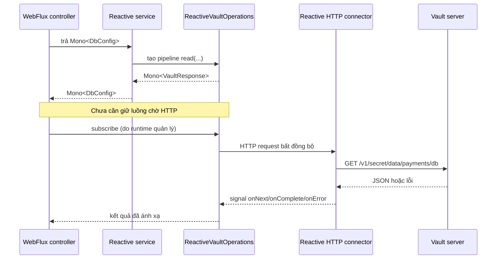
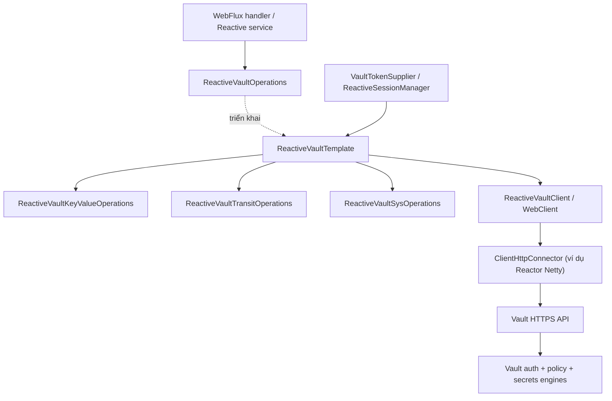
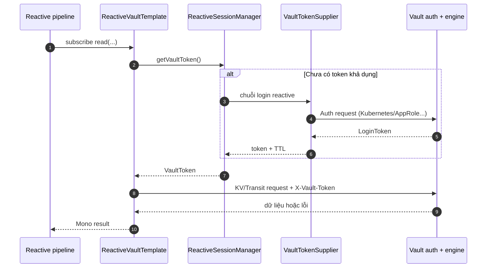

# ReactiveVaultOperations và thành phần cho mô hình không chặn

Trong Spring Vault, ứng dụng Java có thể truy cập HashiCorp Vault bằng API đồng bộ `VaultOperations`/`VaultTemplate` hoặc API **reactive** `ReactiveVaultOperations`/`ReactiveVaultTemplate`. Mục đích của mô hình reactive là **không giữ một luồng Java chỉ để chờ phản hồi HTTP** khi ứng dụng cần đọc KV secrets, mã hóa bằng Transit hoặc gọi những endpoint khác của Vault. Kết quả được biểu diễn bằng `Mono` và `Flux` của Project Reactor để kết hợp các bước bất đồng bộ.

Bài học thuộc chương **Kiến trúc client** của module **SPRING_VAULT**. Ngoài kiến trúc client, nội dung kết nối với xác thực theo workload, policy quyền tối thiểu, vòng đời token/lease, PKI, xử lý lỗi, giám sát và kiểm thử tích hợp. Trọng tâm là **hợp đồng truy cập không chặn và các thành phần tạo nên nó**, không phải chỉ đổi kiểu trả về từ `VaultResponse` sang `Mono<VaultResponse>`.

Sau bài học, bạn có thể:

- Phân biệt API đồng bộ với API reactive, `Mono` với `Flux` và ý nghĩa của việc subscribe.
- Nhận biết vai trò của `ReactiveVaultOperations`, `ReactiveVaultTemplate`, `ReactiveVaultClient`, `WebClient` và `ClientHttpConnector`.
- Đọc/ghi KV v2 và mã hóa bằng Transit bằng cách ghép pipeline Reactor, không chặn event loop.
- Cấu hình `VaultTokenSupplier`/`ReactiveSessionManager` để tái sử dụng token phiên mà vẫn bảo vệ chứng cứ workload.
- Xử lý `Mono.empty()`, timeout, retry và backpressure đúng ngữ nghĩa của Vault.
- Viết kiểm thử với `StepVerifier` và chuẩn bị các kịch bản tích hợp với Vault test.

> **Phạm vi API:** ví dụ dựa trên dòng Spring Vault **4.1** và Reactor. Các nhóm operations có thể khác giữa phiên bản Spring Vault; đặc biệt không được giả định mọi API đồng bộ đều có đối tác reactive cùng tên. Hãy đối chiếu Javadoc theo đúng phiên bản dependency của dự án.

## 1. Đồng bộ và không chặn khác nhau ở đâu?

Ở API đồng bộ, lời gọi:

```java
VaultResponse response = vaultOperations.read("secret/data/payments/db");
```

thường chờ request HTTP hoàn tất trước khi trả về. Ở API reactive:

```java
Mono<VaultResponse> response =
    reactiveVaultOperations.read("secret/data/payments/db");
```

biến `response` là một **publisher mô tả công việc bất đồng bộ**, không phải secret vừa được đọc. Khi một subscriber đăng ký, pipeline có thể thực hiện HTTP request, phát dữ liệu, hoàn thành rỗng hoặc phát lỗi.



| Tiêu chí | `VaultOperations` đồng bộ | `ReactiveVaultOperations` |
|---|---|---|
| Lời gọi đọc | `VaultResponse` hoặc `null` theo hợp đồng | `Mono<VaultResponse>` |
| Liệt kê | Danh sách khóa | `Flux<String>` |
| Xóa | `void` | `Mono<Void>` |
| Xử lý nhiều bước | Gọi tuần tự trên luồng hiện tại | `map`, `flatMap`, `zip`, `then` và các toán tử khác |
| Khi Vault chậm | Luồng thực thi có thể bị giữ trong lúc chờ | Transport bất đồng bộ có thể giải phóng luồng chờ I/O |
| Khi lỗi | Ngoại lệ tại lời gọi | `onError` trong luồng tín hiệu |
| Khi thiếu dữ liệu | Có API trả `null` | `Mono.empty()` / `Flux.empty()` |

**Reactive không có nghĩa Vault xử lý nhanh hơn.** Nó giúp sử dụng tài nguyên luồng hiệu quả hơn trong ứng dụng có nhiều I/O đồng thời, nhưng thời gian đi mạng, giới hạn connection và độ trễ của Vault vẫn tồn tại. Một luồng reactive cũng không biến chuỗi nhiều request thành transaction.

### Mono và Flux

- `Mono<T>`: phát **0 hoặc 1** phần tử, hoặc lỗi; phù hợp với một lần đọc secret, một ciphertext Transit, hoặc tín hiệu hoàn thành một thao tác ghi.
- `Flux<T>`: phát **0 đến nhiều** phần tử, hoặc lỗi; phù hợp với kết quả liệt kê keys hay các batch operation.
- Publisher thường có tính **lazy/cold**; việc tạo nhiều subscription đến pipeline gọi Vault có thể kích hoạt **nhiều request**. Không dùng `subscribe()` thủ công rồi bỏ qua kết quả khi đang ở controller/service WebFlux.
- `Mono.empty()` là **hoàn thành không có giá trị**, khác với `Mono.just(null)` (không hợp lệ trong Reactor) và khác với `onError`.

## 2. Kiến trúc các thành phần reactive

`ReactiveVaultOperations` thuộc package `org.springframework.vault.core`. `ReactiveVaultTemplate` triển khai interface này và ánh xạ các thao tác Vault thành publisher. Tầng HTTP bên dưới là `WebClient`; từ Spring Vault 4.1 có thêm `ReactiveVaultClient` với API fluent dành riêng cho Vault, xây trên `WebClient`.



| Thành phần | Hợp đồng và vai trò |
|---|---|
| `ReactiveVaultOperations` | Interface đầu vào chính cho các thao tác Vault reactive |
| `ReactiveVaultTemplate` | Hiện thực các thao tác, chuyển response/error sang Reactor publisher, dùng client và nguồn token |
| `ReactiveVaultClient` | Client HTTP fluent riêng cho Vault từ Spring Vault 4.1; thích hợp cho endpoint đặc thù |
| `WebClient` | HTTP client bất đồng bộ của Spring WebFlux, cùng codec giải/đóng gói JSON |
| `ClientHttpConnector` | Transport HTTP thực tế, mặc định thường dùng Reactor Netty theo cấu hình client |
| `VaultTokenSupplier` | Cung cấp token qua `Mono<VaultToken>`; có thể login hoặc trả token có sẵn |
| `ReactiveSessionManager` | Cung cấp token phiên trong mô hình reactive, tái sử dụng/lifecycle tùy hiện thực |
| `ReactiveVaultEndpointProvider` | Cung cấp `Mono<VaultEndpoint>` khi địa chỉ Vault được chọn bất đồng bộ |

Chính Vault server mới kiểm tra capability của token tại API path thật. Một client reactive vẫn nhận `403` nếu thiếu quyền; chạy non-blocking không thay đổi policy, TTL hay yêu cầu TLS.

## 3. Các phương thức chính của ReactiveVaultOperations

Trong dòng 4.1, những điểm vào phổ biến gồm:

| Nhóm | API tiêu biểu | Kiểu trả về |
|---|---|---|
| Đọc path mức thấp | `read(path)` | `Mono<VaultResponse>` |
| Đọc vào DTO | `read(path, Dto.class)` | `Mono<VaultResponseSupport<Dto>>` |
| Ghi path mức thấp | `write(path, body)` | `Mono<VaultResponse>` |
| Xóa path | `delete(path)` | `Mono<Void>` |
| Liệt kê path | `list(path)` | `Flux<String>` |
| KV v1/v2 | `opsForKeyValue(mount, KV_1/KV_2)` | `ReactiveVaultKeyValueOperations` |
| KV v2 version/CAS | `opsForVersionedKeyValue(mount)` | `ReactiveVaultVersionedKeyValueOperations` |
| Transit | `opsForTransit()` hoặc `opsForTransit(mount)` | `ReactiveVaultTransitOperations` |
| System | `opsForSys()` | `ReactiveVaultSysOperations` |
| API tùy biến đã xác thực | `doWithSession(callback)` | Publisher do callback tạo |
| API tùy biến không có session | `doWithVault(callback)` | Publisher do callback tạo |

**Giới hạn quan trọng:** ở Spring Vault 4.1, `ReactiveVaultOperations` không có sẵn một `opsForPki()` tương đương với API đồng bộ. Khi cần endpoint PKI trong luồng reactive, có thể sử dụng `doWithSession(...)`/`WebClient` hoặc `ReactiveVaultClient` cùng một cách cung cấp token phù hợp, thay vì gọi một phương thức không tồn tại.

Đối với đường dẫn KV v2, cần phân biệt:

| Mức API | Gọi để đọc secret logic `payments/db` ở mount `secret` |
|---|---|
| Mức thấp | `read("secret/data/payments/db")` |
| Nhóm KV v2 | `opsForKeyValue("secret", KV_2).get("payments/db")` |
| Nhóm KV phiên bản | `opsForVersionedKeyValue("secret").get("payments/db")` |

Nhóm KV biết cách thêm tiền tố API như `data/`/`metadata/`. Tự truyền `secret/data/payments/db` vào nhóm KV đã chọn mount `secret` có thể khiến path bị ghép sai. KV v2 cũng hỗ trợ CAS; một chuỗi `get → put` thông thường không tự bảo đảm tránh lost update.

## 4. Tạo ReactiveVaultTemplate và kết nối HTTP

Đối với một ứng dụng Spring, nên đăng ký client ở tầng hạ tầng, tái sử dụng cùng đối tượng đã cấu hình và inject qua `ReactiveVaultOperations`. Cách thuận tiện là dùng `AbstractReactiveVaultConfiguration` hoặc auto-configuration tương ứng của dự án. Ví dụ cấu hình lab dùng một Vault token được cấp sẵn:

```java
import java.util.Objects;

import org.springframework.context.annotation.Configuration;
import org.springframework.vault.authentication.ClientAuthentication;
import org.springframework.vault.authentication.TokenAuthentication;
import org.springframework.vault.client.VaultEndpoint;
import org.springframework.vault.config.AbstractReactiveVaultConfiguration;

@Configuration
public class ReactiveVaultLabConfiguration
        extends AbstractReactiveVaultConfiguration {

    @Override
    public VaultEndpoint vaultEndpoint() {
        VaultEndpoint endpoint =
            VaultEndpoint.create("127.0.0.1", 8200);
        endpoint.setScheme("http"); // Chỉ dùng Vault dev trên loopback
        return endpoint;
    }

    @Override
    public ClientAuthentication clientAuthentication() {
        String token = Objects.requireNonNull(
            System.getenv("VAULT_TOKEN"), "Cần token cho bài lab");
        return new TokenAuthentication(token);
    }
}
```

Spring Vault có thể khởi tạo bean `ReactiveVaultTemplate`, `ReactiveVaultClient` và phiên token reactive thông qua lớp cấu hình này. Ví dụ dùng `TokenAuthentication` để bắt đầu đơn giản; môi trường triển khai phải chọn Kubernetes/AppRole/IAM auth hoặc phương pháp phù hợp với danh tính workload, bảo đảm TLS và không đưa token vào code hoặc logs.

### Lắp ghép trực tiếp trong Spring Vault 4.1

Nếu không dùng container/auto-configuration, có thể lắp một client reactive và một token supplier. Ví dụ sau chỉ minh họa **cấu trúc constructor**, dùng token test tĩnh:

```java
import java.util.Objects;

import org.springframework.vault.authentication.VaultTokenSupplier;
import org.springframework.vault.client.ReactiveVaultClient;
import org.springframework.vault.client.VaultEndpoint;
import org.springframework.vault.core.ReactiveVaultOperations;
import org.springframework.vault.core.ReactiveVaultTemplate;
import org.springframework.vault.support.VaultToken;

import reactor.core.publisher.Mono;

public final class ReactiveVaultClientFactory {

    public static ReactiveVaultOperations create() {
        VaultEndpoint endpoint =
            VaultEndpoint.create("vault.service.internal", 8200);
        endpoint.setScheme("https");

        ReactiveVaultClient client =
            ReactiveVaultClient.builder().endpoint(endpoint).build();

        String rawToken = Objects.requireNonNull(
            System.getenv("VAULT_TOKEN"), "Thiếu token lab");
        VaultTokenSupplier tokenSupplier =
            () -> Mono.just(VaultToken.of(rawToken));

        return new ReactiveVaultTemplate(client, tokenSupplier);
    }
}
```

**Phạm vi ví dụ:** token tĩnh ở đây không có logic tự renew hoặc re-login; `ReactiveVaultClient` mặc định cần transport TLS tin cậy với CA của máy chủ. Nếu Vault dùng CA nội bộ, cấu hình `ClientHttpConnector`/SSL context phù hợp. Việc khởi tạo client không chứng minh token có policy hợp lệ hoặc Vault đang khỏe; các lỗi này xuất hiện khi pipeline được thực thi.

Trong Spring Vault 4.1, builder có thể cấu hình:

```java
ReactiveVaultClient client = ReactiveVaultClient.builder()
    .endpoint(endpoint)
    .clientConnector(connector)
    .build();
```

`connector` trong đoạn trên là một `ClientHttpConnector` đã cấu hình timeout, TLS trust, connection pool và proxy. `ReactiveVaultClient.Builder` cũng hỗ trợ `configureWebClient(...)`, `defaultNamespace(...)` và `endpoint(ReactiveVaultEndpointProvider)`. Dùng endpoint từ danh sách được tin cậy; không đưa URL tùy ý do người dùng điều khiển vào request mang token.

## 5. Đọc KV v2 mà không chặn luồng

Giả sử KV v2 được mount tại `secret` và chứa cấu hình database ở path logic `payments/db`. Adapter dưới đây dùng `ReactiveVaultKeyValueOperations` và trả `Mono<DbConfig>` để service WebFlux có thể tiếp tục kết hợp các bước khác:

```java
import org.springframework.vault.core.ReactiveVaultKeyValueOperations;
import org.springframework.vault.core.ReactiveVaultOperations;
import org.springframework.vault.core.VaultKeyValueOperationsSupport.KeyValueBackend;
import org.springframework.vault.support.VaultResponseSupport;
import reactor.core.publisher.Mono;

public final class PaymentsConfigRepository {

    private final ReactiveVaultKeyValueOperations kv;

    public PaymentsConfigRepository(ReactiveVaultOperations vault) {
        this.kv = vault.opsForKeyValue(
            "secret", KeyValueBackend.KV_2);
    }

    public Mono<DbConfig> find() {
        return kv.get("payments/db", DbConfig.class)
            .flatMap(response -> Mono.justOrEmpty(response.getData()));
    }

    public Mono<DbConfig> requireConfig() {
        return find().switchIfEmpty(Mono.error(
            new IllegalStateException("Thiếu cấu hình payments/db")));
    }

    public static class DbConfig {
        private String jdbcUrl;

        public DbConfig() { }
        public String getJdbcUrl() { return jdbcUrl; }
        public void setJdbcUrl(String jdbcUrl) {
            this.jdbcUrl = jdbcUrl;
        }
    }
}
```

Trong ví dụ:

1. `kv.get(..., DbConfig.class)` trả publisher của `VaultResponseSupport<DbConfig>`; nếu secret không tồn tại, publisher có thể **hoàn thành rỗng**.
2. `flatMap(response -> Mono.justOrEmpty(response.getData()))` xử lý trường hợp response có data và không có data mà không phát `null`.
3. `find()` dùng `Mono.empty()` để biểu diễn thiếu dữ liệu theo hợp đồng; `requireConfig()` chuyển trường hợp này thành lỗi cấu hình bắt buộc.
4. Lỗi `403`, timeout và TLS không bị biến thành “không tìm thấy”; chúng đi qua `onError` đến tầng xử lý.
5. Kiểu `DbConfig` phải khớp JSON do KV lưu; ứng dụng thực tế nên kiểm tra các field bắt buộc, tuyệt đối không đưa password ra log.

### Ghi KV v2

Nhóm KV reactive có phương thức `put(path, body)` trả `Mono<Void>`. Ví dụ:

```java
import java.util.Map;
import reactor.core.publisher.Mono;

Mono<Void> saving = vault.opsForKeyValue(
        "secret", KeyValueBackend.KV_2)
    .put("payments/db", Map.of("jdbcUrl",
        "jdbc:postgresql://db.internal/payments"));

// Ở service WebFlux, trả về hoặc nối tiếp publisher để runtime subscribe.
// Không gọi saving.block() trên event loop.
```

Nếu cần xác nhận version hoặc chống ghi đè đồng thời, dùng `ReactiveVaultVersionedKeyValueOperations` và cơ chế CAS của KV v2. `Mono<Void>` phát tín hiệu hoàn thành khi thao tác xong; việc thiếu giá trị `onNext` **không** đồng nghĩa request chưa được gửi.

## 6. Gọi Transit encryption trong pipeline

`ReactiveVaultTransitOperations` cung cấp API reactive cho Transit engine. Ví dụ, key `payments-fields` đã tồn tại ở mount `transit`:

```java
import org.springframework.vault.core.ReactiveVaultOperations;
import org.springframework.vault.core.ReactiveVaultTransitOperations;
import reactor.core.publisher.Mono;

public final class PaymentsFieldCipher {

    private final ReactiveVaultTransitOperations transit;

    public PaymentsFieldCipher(ReactiveVaultOperations operations) {
        this.transit = operations.opsForTransit();
    }

    public Mono<String> encrypt(String plaintext) {
        return transit.encrypt("payments-fields", plaintext);
    }

    public Mono<String> decrypt(String ciphertext) {
        return transit.decrypt("payments-fields", ciphertext);
    }
}
```

Hai method đều trả `Mono<String>`; chúng chỉ phát kết quả khi có subscription. Ciphertext của Transit thường mang dạng `vault:vN:...` và phải được lưu nguyên vẹn. **Transit không làm plaintext biến mất khỏi bộ nhớ ứng dụng**: nó vẫn đi qua client khi encrypt/decrypt và phải được bảo vệ bằng TLS, kiểm soát log và hạn chế quyền.

Một service có thể kết hợp nhiều bước:

```java
public Mono<String> encryptCustomerId(
        PaymentsConfigRepository configRepo,
        PaymentsFieldCipher cipher,
        String customerId) {

    return configRepo.requireConfig()
        .flatMap(config -> cipher.encrypt(customerId));
}
```

Ở đây `flatMap` cho phép bước Transit chạy sau khi có cấu hình. Nếu hai lời gọi độc lập, `Mono.zip(...)` có thể phối hợp chúng thay vì bắt chạy tuần tự; không lạm dụng song song khi cần bảo đảm thứ tự hoặc khi Vault có giới hạn đồng thời.

**Policy tối thiểu cho trường hợp chỉ encrypt:**

```hcl
path "transit/encrypt/payments-fields" {
  capabilities = ["update"]
}
```

Quyền encrypt không tự cấp quyền decrypt. Nếu ứng dụng cần decrypt, phải cấp đúng capability trên `transit/decrypt/payments-fields` và kiểm soát ai có thể sử dụng nó.

## 7. Endpoint đặc thù và PKI với doWithSession

`ReactiveVaultOperations` 4.1 có các nhóm reactive cho KV, Transit, Sys nhưng **không có `opsForPki()`** trên interface này. Khi cần gọi PKI issue hoặc endpoint Vault đặc thù mà chưa có wrapper, dùng callback `doWithSession(...)` để truy cập `WebClient` có ngữ cảnh session token.

Ví dụ khái niệm cấp certificate qua PKI role `payments-service` ở mount `pki-internal`:

```java
import java.util.Map;

import org.springframework.vault.core.ReactiveVaultOperations;
import org.springframework.vault.support.VaultResponse;
import reactor.core.publisher.Mono;

public final class ReactiveCertificateIssuer {
    private final ReactiveVaultOperations vault;

    public ReactiveCertificateIssuer(ReactiveVaultOperations vault) {
        this.vault = vault;
    }

    public Mono<VaultResponse> issue() {
        return vault.doWithSession(webClient ->
            webClient.post()
                .uri("pki-internal/issue/payments-service")
                .bodyValue(Map.of(
                    "common_name", "payments.internal"))
                .retrieve()
                .bodyToMono(VaultResponse.class)
        );
    }
}
```

Đây là **lệnh có side effect**, không nên retry mù sau timeout: Vault có thể đã cấp certificate nhưng response không đến ứng dụng. Response PKI có thể chứa certificate, chain và **private key**; không ghi cả response ra log, test output hay trace. Thời hạn chứng chỉ cũng cần được quản lý riêng với TTL của token dùng để xin cấp chứng chỉ.

`doWithVault(callback)` cho phép gọi không gắn session token, chỉ phù hợp với endpoint được thiết kế để truy cập không cần xác thực (hoặc có giao thức bootstrap khác). Với request đọc secret, encrypt hoặc cấp PKI thông thường, cần ngữ cảnh xác thực; không dùng `doWithVault` để né lỗi policy.

Từ Spring Vault 4.1, `ReactiveVaultClient` cung cấp API HTTP fluent trên `WebClient`. Khi gọi trực tiếp client này, bạn chịu trách nhiệm đưa token từ `VaultTokenSupplier`/`ReactiveSessionManager` vào request và hiểu payload/response của engine; `ReactiveVaultTemplate` tự phối hợp ngữ cảnh phiên cho nhóm operations và callback có xác thực.

## 8. Phiên xác thực reactive và vòng đời token

Một client reactive cần **nguồn token không chặn**. Interface `VaultTokenSupplier` có hợp đồng:

```java
Mono<VaultToken> getVaultToken();
```

`ReactiveSessionManager` mở rộng hợp đồng này để cung cấp token phiên, còn `ReactiveLifecycleAwareSessionManager` quản lý việc giữ token và một phần vòng đời khi cấu hình phù hợp. Hai mục tiêu không thể thiếu:

- **Không login mỗi request:** reuse token còn hợp lệ, tránh tăng tải auth backend và cấp nhiều token không cần thiết.
- **Xử lý TTL và renewal:** token có thể hết hạn, bị revoke, không renewable hoặc cần re-login bằng chứng cứ workload mới/còn hợp lệ.



**Kubernetes auth:** service account JWT là bằng chứng login, **không** phải Vault token gắn vào request KV. JWT có vòng đời riêng và phải được đọc/đổi mới hợp lệ khi cần đăng nhập lại.

**AppRole:** role ID/secret ID dùng ở bước login; secret ID có thể hết TTL hoặc số lần sử dụng. Một manager có thể renew Vault token nhưng không tự tạo secret ID mới khi chứng cứ bootstrap hết hiệu lực.

**Token tĩnh:** `VaultTokenSupplier` trả cùng một `VaultToken` không tự bảo đảm renew/re-login. Nếu token hết hạn hoặc bị revoke, pipeline sẽ gặp lỗi truy cập trừ khi có cơ chế cấp lại hợp lệ.

### Token lease khác secret lease

| Tài nguyên | Ví dụ TTL | Ai cần theo dõi? |
|---|---|---|
| Vault token | 30 phút | `ReactiveSessionManager` và chiến lược auth |
| Database credentials từ `database/creds/reporting` | 15 phút | Consumer credentials + cơ chế lease/rotation |
| PKI certificate | 1 giờ | Thành phần TLS/certificate lifecycle |
| KV v2 secret | Phiên bản secret, không có TTL mặc định như token | Logic cập nhật/version và policy |

Gia hạn Vault token **không tự gia hạn** dynamic credentials, và certificate PKI không tự được cấp lại khi token được renew. Nếu một cơ chế quản lý lease thực tế cung cấp API imperative, không gọi trực tiếp logic blocking của nó trên event loop; thiết kế adapter phù hợp và kiểm thử vòng đời credentials tại nơi sử dụng.

## 9. Backpressure, concurrency và rủi ro của block()

**Backpressure** cho phép downstream điều tiết nhu cầu phần tử từ upstream trong chuỗi reactive, nhưng điều đó không có nghĩa Vault tự giới hạn số **HTTP request** theo policy hoặc tốc độ phản hồi của database. Khi nguồn là hàng nghìn ID cần đọc Vault, ứng dụng phải giới hạn concurrency chủ động.

Ví dụ thực hiện tối đa 8 lời gọi Vault đang được subscribe trong một nhóm xử lý:

```java
import reactor.core.publisher.Flux;
import reactor.core.publisher.Mono;
import org.springframework.vault.core.ReactiveVaultOperations;
import org.springframework.vault.support.VaultResponse;

public Flux<VaultResponse> loadConfigs(
        ReactiveVaultOperations vault,
        Flux<String> paths) {

    return paths.flatMap(
        vault::read,
        8 // Giới hạn số publisher read đang chạy đồng thời
    );
}
```

`flatMap(..., 8)` cho phép kết quả không theo thứ tự input. Nếu cần giữ thứ tự hoặc giới hạn chặt hơn, cân nhắc `concatMap`, `flatMapSequential` và chính sách pool/tốc độ gọi Vault. Một giới hạn ở Reactor **không thay thế** pool HTTP client, rate limiting, retry budget hoặc khả năng xử lý của Vault.

### Những hành vi làm mất tính không chặn

| Cách viết | Hệ quả | Hướng xử lý |
|---|---|---|
| `vault.read(path).block()` trong handler WebFlux | Chặn luồng đang gọi, có thể gây cạn event loop | Trả `Mono` và để runtime subscribe |
| `Thread.sleep(...)` trong `map`/`flatMap` | Giữ luồng xử lý không cần thiết | Dùng toán tử async/timer hoặc bỏ thao tác chặn |
| Gọi JDBC hoặc SDK blocking trực tiếp trong pipeline | Pipeline thành hỗn hợp blocking | Dùng client reactive hoặc cô lập lời gọi blocking |
| Gọi `subscribe()` thủ công trong service | Mất quyền kiểm soát lỗi, thời gian sống và cancellation | Trả publisher cho caller |
| `collectList()` trên nguồn dữ liệu không giới hạn | Tăng bộ nhớ | Giới hạn dữ liệu hoặc xử lý tuần tự/streaming phù hợp |
| `cache()` bừa bãi với publisher chứa secrets | Giữ secret trong bộ nhớ lâu ngoài dự kiến | Thiết kế TTL và xóa/rotation rõ ràng |

Nếu bắt buộc gọi một thư viện chỉ có API blocking, có thể cô lập ở nơi chuyển tiếp:

```java
Mono<VaultResponse> bridged = Mono.fromCallable(
        () -> imperativeVaultOperations.read("secret/data/payments/db"))
    .subscribeOn(reactor.core.scheduler.Schedulers.boundedElastic());
```

Đây chỉ là **cầu nối** để tránh khóa event loop, không biến API blocking thành non-blocking thực sự: mỗi request vẫn chiếm tài nguyên luồng khi chờ I/O. Nếu ứng dụng có đường đi reactive hoàn chỉnh, hãy ưu tiên `ReactiveVaultOperations` cùng HTTP connector bất đồng bộ.

## 10. Timeout, retry và xử lý lỗi theo tín hiệu

Các toán tử của Reactor giúp mô tả cách phản ứng khi Vault không sẵn sàng. Ví dụ một read có hạn thời gian:

```java
import java.time.Duration;
import org.springframework.vault.support.VaultResponse;
import reactor.core.publisher.Mono;

Mono<VaultResponse> result = reactiveVaultOperations
    .read("secret/data/payments/db")
    .timeout(Duration.ofSeconds(2));
```

`timeout` đặt một giới hạn cho publisher đang được subscribe. Nó **không** thay thế connect/read timeout ở `ClientHttpConnector`; cần cấu hình cả hai nếu bài toán yêu cầu kiểm soát connection pool, DNS/TLS và tổng deadline request.

### Phân loại ba kết quả quan trọng

| Tình huống | Tín hiệu Reactor có thể thấy | Quyết định |
|---|---|---|
| Secret không có theo hợp đồng KV | `Mono.empty()` | `switchIfEmpty(...)` nếu secret bắt buộc; hoặc trả empty có chủ đích |
| Vault trả `403` / token không hợp lệ | `onError` | Kiểm tra role, token lifecycle, policy/mount/path; không coi là missing |
| Network/TLS/`5xx`/timeout | `onError` | Phân loại tạm thời hay cấu hình; áp timeout và retry giới hạn |

Tránh:

```java
return repository.find()
    .onErrorResume(error -> Mono.empty()); // Sai nếu lỗi 403/TLS/timeout
```

Việc này làm lỗi truy cập bị diễn giải thành “secret không tồn tại”. Thay vào đó, chỉ xử lý lỗi đã phân loại và ghi nhận nguyên nhân an toàn. `doOnError(...)` thích hợp để đo metric/log metadata nhưng không nên ghi payload hay token.

### Retry không áp dụng đồng loạt

| Thao tác | Quyết định retry |
|---|---|
| Đọc KV/metadata | Có thể retry ngắn khi lỗi tạm thời, với backoff/jitter và deadline |
| Ghi KV v2 | Cần xét CAS/idempotency vì request có thể đã ghi trước timeout |
| Transit encrypt/decrypt | Xét tính chất thao tác, tải Vault và bảo vệ plaintext |
| PKI issue | Có thể đã cấp certificate nhưng response bị mất; retry có thể tạo thêm |
| Tạo token/dynamic credentials | Có thể phát hành thêm token/lease; cần cơ chế theo dõi rõ |

Một retry pipeline phải **lọc lỗi cụ thể**, không retry `403`, credential bootstrap sai hoặc TLS truststore sai. Cancellation/timeout phía client cũng không bảo đảm Vault server hủy một thao tác đã nhận. Không đưa password, JWT, ciphertext nhạy cảm, PKI private key hay `X-Vault-Token` vào exception message.

## 11. Quan sát và vận hành reactive client

Môi trường production cần quan sát đồng thời **kết quả Vault** và **sức khỏe reactive runtime**:

- **Vault operations:** latency p50/p95/p99, HTTP 4xx/5xx, timeout, số request/s, loại operation KV/Transit/PKI.
- **Phiên xác thực:** lượt login/re-login, token renewal success/failure và số token đã được cấp; không dùng token làm label.
- **Reactor/HTTP:** số kết nối đang mở, pool saturation, pending acquisition, pending subscription, concurrency và request bị cancellation.
- **Ứng dụng:** số request user bị chậm vì Vault, thread pool/event loop, backpressure, số lần retry và tổng retry budget.

Luôn che payload và header nhạy cảm trong tracing/logging. Nếu cần correlate, dùng request ID/correlation ID an toàn; không đưa đường dẫn secret chứa định danh nhạy cảm hoặc giá trị token vào tag có cardinality lớn. Cần kiểm tra TLS certificate, hostname và truststore của connector mà `WebClient` sử dụng.

Với Vault HA sau load balancer, mô hình reactive vẫn phải xử lý timeout và chuyển node có kiểm soát. Không suy đoán `ReactiveVaultEndpointProvider` tự health-check hay retry; đó là hợp đồng **cung cấp endpoint**, không phải cơ chế resilience hoàn chỉnh.

## 12. Kiểm thử bằng StepVerifier và Vault test

### 12.1. Unit test publisher

`StepVerifier` thuộc `reactor-test`, cho phép kiểm tra thứ tự tín hiệu `onNext`, `onComplete` và `onError` mà không phải gọi `block()` trong mã production. Ví dụ với một publisher bất kỳ:

```java
import static org.junit.jupiter.api.Assertions.assertEquals;
import org.junit.jupiter.api.Test;
import reactor.core.publisher.Mono;
import reactor.test.StepVerifier;

class ReactiveResultTest {

    @Test
    void distinguishesMissingSecretFromError() {
        Mono<String> missing = Mono.empty();

        StepVerifier.create(missing)
            .verifyComplete();

        Mono<String> denied = Mono.error(
            new IllegalStateException("Vault denied access"));

        StepVerifier.create(denied)
            .expectError(IllegalStateException.class)
            .verify();
    }
}
```

Test này kiểm tra **hợp đồng tín hiệu Reactor**, chưa kiểm tra endpoint Vault. Khi unit test repository, giả lập `ReactiveVaultKeyValueOperations.get(...)` trả response hợp lệ, `Mono.empty()` hoặc `Mono.error(...)`; xác nhận adapter chuyển đúng trạng thái và không nuốt lỗi.

### 12.2. Kiểm thử tích hợp với Vault dev/test

Chuẩn bị một Vault cô lập và quyền tối thiểu. Các trường hợp cần thực hiện:

1. **KV v2 tồn tại:** `opsForKeyValue("secret", KV_2).get("payments/db")` phát dữ liệu đúng schema rồi hoàn thành.
2. **KV v2 không tồn tại:** pipeline hoàn thành rỗng; test `switchIfEmpty` trong repository.
3. **Thiếu quyền:** token đăng nhập được nhưng không có `read` ở `secret/data/payments/db` thì publisher phát lỗi, không phải empty.
4. **Transit:** encrypt/decrypt bằng test key; thử token chỉ có quyền encrypt và xác nhận decrypt bị từ chối.
5. **Token TTL:** token ngắn hạn được renew/re-login bằng session manager phù hợp, tách khỏi TTL của credentials động.
6. **PKI:** gọi role test qua callback có xác thực, kiểm tra certificate và thời hạn; tuyệt đối không lưu private key thật vào test report.
7. **Sự cố mạng:** mô phỏng timeout, TLS CA không tin cậy, Vault tạm unavailable; đo thời gian và xác nhận không block event loop.
8. **Concurrency:** gửi nhiều request với `flatMap` có giới hạn, quan sát connection pool và không tạo bão login/retry.
9. **Cancellation:** ngắt subscription giữa chừng; đảm bảo resource client được giải phóng nhưng không suy luận request đã bị Vault hủy.
10. **Bảo vệ thông tin:** kiểm tra log/tracing/test output không chứa `X-Vault-Token`, credential KV, plaintext Transit hoặc key PKI.

Không nên dùng root token mặc định khi kiểm thử chính sách, vì test `403` sẽ không phản ánh giới hạn của workload thực tế. Mỗi kịch bản dùng role/policy riêng, dữ liệu giả và cleanup rõ ràng.

## 13. Bài thực hành: chuyển payments-api sang WebFlux

**Bối cảnh:** `payments-api` chạy Spring WebFlux trên Kubernetes. Vault HA tại `https://vault.service.internal:8200` có KV v2 ở mount `secret`, key Transit `payments-fields`, và PKI role `payments-service`. Workload dùng Kubernetes authentication và token có TTL.

### Nhiệm vụ

1. Cấu hình `ReactiveVaultTemplate` qua `AbstractReactiveVaultConfiguration` hoặc bean tương ứng, dùng HTTPS/TLS trust đúng và `ReactiveSessionManager` phù hợp.
2. Tạo `PaymentsConfigRepository` trả `Mono<DbConfig>` từ `opsForKeyValue("secret", KV_2)`. Khi không có secret, quyết định hợp đồng `Mono.empty()` hay lỗi cấu hình bắt buộc.
3. Tạo `PaymentsFieldCipher` dùng `opsForTransit()`. Chỉ cấp policy `update` trên `transit/encrypt/payments-fields` nếu service chỉ mã hóa.
4. Trong handler WebFlux, **trả publisher** cho runtime; không gọi `block()` hoặc `subscribe()` thủ công.
5. Nếu có danh sách lớn cần xử lý, giới hạn concurrency bằng `flatMap(..., concurrency)`; đo số connection đồng thời.
6. Cấu hình timeout và retry có giới hạn cho KV read; không retry mù PKI issue hoặc dynamic credentials.
7. Test khi Vault trả `403`, khi path không có dữ liệu, khi token hết hạn và khi TLS/timeout thất bại.

Ví dụ controller WebFlux trả publisher:

```java
import org.springframework.web.bind.annotation.GetMapping;
import org.springframework.web.bind.annotation.RestController;
import reactor.core.publisher.Mono;

@RestController
public class PaymentsConfigController {
    private final PaymentsConfigRepository repository;

    public PaymentsConfigController(PaymentsConfigRepository repository) {
        this.repository = repository;
    }

    @GetMapping("/internal/payments/config-health")
    public Mono<Boolean> configAvailable() {
        return repository.find()
            .map(config -> true)
            .defaultIfEmpty(false);
    }
}
```

Endpoint minh họa chỉ trả **boolean**, không xuất secret ra HTTP response. Trong production phải bảo vệ endpoint bằng cơ chế authorization phù hợp, và nếu `payments/db` là cấu hình bắt buộc thì nên trả trạng thái health/unavailable theo quy định vận hành thay vì diễn giải mọi lỗi là `false`.

### Câu hỏi tự kiểm tra

1. Vì sao tạo `Mono<VaultResponse>` chưa đồng nghĩa HTTP request đã hoàn tất?
2. Điều gì khác nhau giữa `Mono.empty()` và `Mono.error(...)` khi Vault thiếu secret hoặc từ chối token?
3. Vì sao gọi `block()` bên trong handler WebFlux làm mất lợi ích non-blocking?
4. `ReactiveVaultOperations` 4.1 có `opsForPki()` không? Nếu không, gọi endpoint PKI bằng cách nào?
5. Vì sao `ReactiveLifecycleAwareSessionManager` không tự gia hạn lease của dynamic database credentials?
6. `flatMap(..., 8)` có bảo đảm kết quả được phát đúng thứ tự input không?
7. Timeout/cancellation sau khi gửi yêu cầu cấp chứng chỉ có chứng minh Vault chưa cấp certificate không?

**Ghi nhớ:** `ReactiveVaultOperations` là hợp đồng thao tác Vault **không chặn**, `ReactiveVaultTemplate` hiện thực hợp đồng bằng `Mono`/`Flux` và các thành phần HTTP reactive. `VaultTokenSupplier` và `ReactiveSessionManager` quản lý nguồn token cho request, còn Vault server tiếp tục áp policy và TTL. Một thiết kế tốt phải giữ pipeline không chặn từ đầu đến cuối, kiểm soát concurrency, tách missing data khỏi lỗi truy cập và quản lý riêng vòng đời token, dynamic lease và certificate.

## Tài liệu tham khảo

- [Spring Vault — Reactive Infrastructure](https://docs.spring.io/spring-vault/reference/vault/reactive-template.html).
- [Spring Vault API — ReactiveVaultOperations](https://docs.spring.io/spring-vault/reference/api/java/org/springframework/vault/core/ReactiveVaultOperations.html).
- [Spring Vault API — ReactiveVaultTemplate](https://docs.spring.io/spring-vault/reference/api/java/org/springframework/vault/core/ReactiveVaultTemplate.html).
- [Spring Vault API — ReactiveVaultKeyValueOperations](https://docs.spring.io/spring-vault/reference/api/java/org/springframework/vault/core/ReactiveVaultKeyValueOperations.html).
- [Spring Vault API — ReactiveVaultTransitOperations](https://docs.spring.io/spring-vault/reference/api/java/org/springframework/vault/core/ReactiveVaultTransitOperations.html).
- [Spring Vault API — ReactiveVaultClient](https://docs.spring.io/spring-vault/reference/api/java/org/springframework/vault/client/ReactiveVaultClient.html).
- [Spring Vault API — VaultTokenSupplier](https://docs.spring.io/spring-vault/reference/api/java/org/springframework/vault/authentication/VaultTokenSupplier.html).
- [Spring Vault API — ReactiveLifecycleAwareSessionManager](https://docs.spring.io/spring-vault/reference/api/java/org/springframework/vault/authentication/ReactiveLifecycleAwareSessionManager.html).
