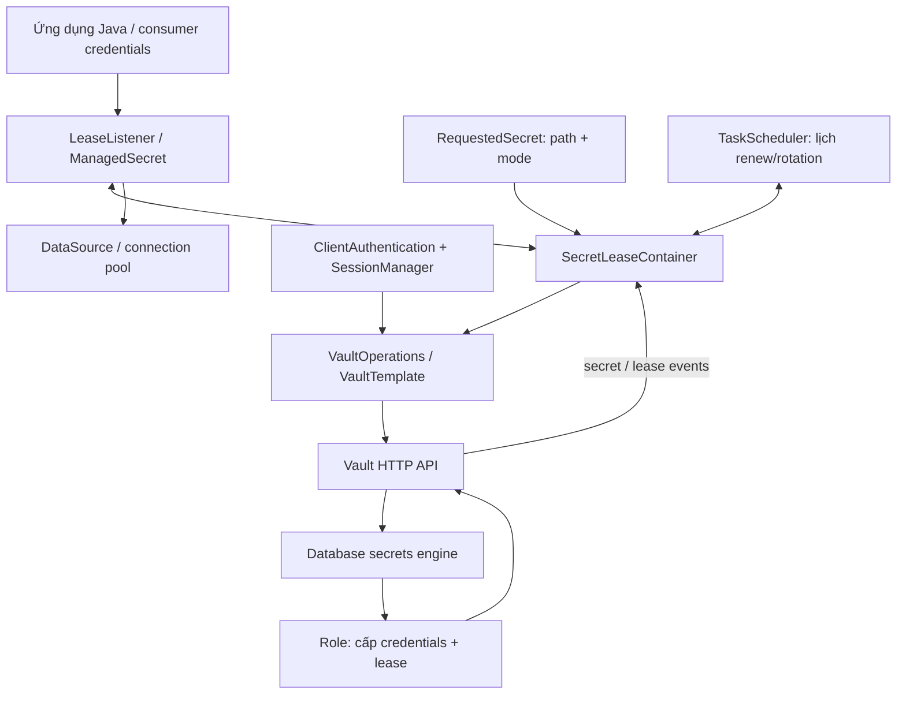
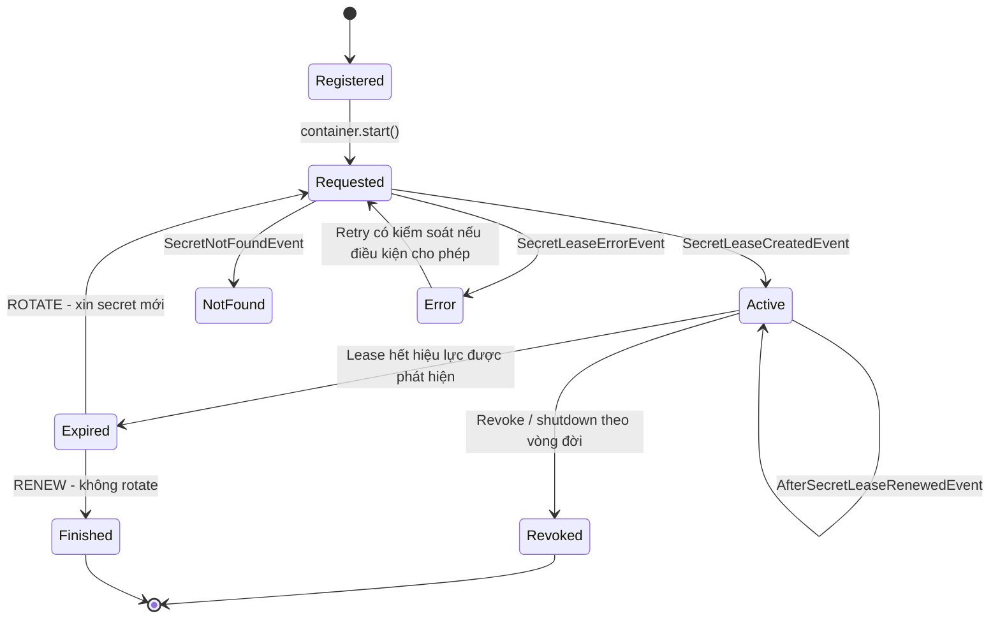

# SecretLeaseContainer và việc theo dõi secret có lease

Một ứng dụng Java có thể gọi `VaultTemplate.read("database/creds/reporting")` để xin cặp tài khoản cơ sở dữ liệu động từ HashiCorp Vault. Nhưng kết quả này **không phải mật khẩu dùng vĩnh viễn**: Vault gắn một **lease** có thời hạn và có thể thu hồi credentials trước hoặc khi lease hết hiệu lực. Nếu ứng dụng chỉ đọc cặp tài khoản một lần rồi giữ trong connection pool, những kết nối mới có thể bắt đầu thất bại khi lease hết hạn.

Trong Spring Vault, **`SecretLeaseContainer`** theo dõi những secret cần quản lý, yêu cầu Vault gia hạn lease khi có thể, xin secret mới khi cấu hình ở chế độ rotation và phát **sự kiện vòng đời** để ứng dụng cập nhật nơi sử dụng secret. Đây là một phần quan trọng của chương **Kiến trúc client**: `VaultTemplate` thực hiện HTTP request, `SessionManager` cung cấp token phiên, còn `SecretLeaseContainer` theo dõi **vòng đời của secret được cấp kèm lease**.

Bài học thuộc module **SPRING_VAULT**, hướng tới ứng dụng Java làm việc với KV secrets, xác thực workload và policy, token/lease lifecycle, Transit encryption, PKI, xử lý lỗi, giám sát và kiểm thử tích hợp. Trọng tâm của bài là lease của **dynamic secrets**, đặc biệt credentials từ Database secrets engine.

Sau bài học, bạn có thể:

- Giải thích các trường `lease_id`, `lease_duration` và `renewable` của Vault response.
- Phân biệt **gia hạn (renewal)**, **cấp secret mới (rotation)** và **thu hồi (revocation)**.
- Đăng ký `RequestedSecret`, lựa chọn `RENEW` hoặc `ROTATE` và nhận sự kiện từ `SecretLeaseContainer`.
- Kết nối sự kiện rotation với tầng sử dụng credentials, tránh việc connection pool giữ thông tin hết hạn.
- Hiểu mối liên hệ giữa token của `SessionManager` và lease của secret.
- Thiết kế timeout, giám sát, phân quyền và kiểm thử lỗi không làm lộ thông tin nhạy cảm.

## 1. Lease trong Vault là gì?

Một số secrets engine tạo **dynamic secret** khi có request. Chẳng hạn Database secrets engine có thể sinh username/password mới cho role `reporting`. Vault trả dữ liệu cùng một lease, đại diện cho quyền sử dụng credentials trong khoảng thời gian được cấp.

Phản hồi HTTP khái quát từ đường dẫn `database/creds/reporting`:

```json
{
  "request_id": "<request-id>",
  "lease_id": "database/creds/reporting/<opaque-id>",
  "renewable": true,
  "lease_duration": 900,
  "data": {
    "username": "v-reporting-generated",
    "password": "<redacted>"
  }
}
```

| Thuộc tính | Ý nghĩa | Điều cần tránh suy luận |
|---|---|---|
| `lease_id` | Định danh lease được Vault cấp để quản lý, gia hạn hoặc thu hồi | Không phải Vault token hoặc username |
| `lease_duration` | Thời hạn lease, thường biểu diễn bằng giây trong response | Không có nghĩa credentials tồn tại vô thời hạn nếu tiếp tục dùng |
| `renewable` | Lease có thể được xem xét gia hạn theo quy tắc Vault | Không bảo đảm mọi lần renew đều thành công |
| `data.username/password` | Credentials mà workload cần sử dụng | Không được ghi vào log/trace hoặc phản hồi HTTP công khai |
| Auth token của request | Danh tính đã xin secret và được policy cho phép | Không thay thế lease ID hay đồng hồ TTL của secret |

**Lease được quản lý ở phía Vault.** Ứng dụng không thể kéo dài giá trị `lease_duration` chỉ bằng cách sửa biến Java. Việc renew/revoke phải gọi Vault; khả năng gia hạn còn phụ thuộc role, TTL tối đa, trạng thái lease và quyền truy cập. Lease cũng có thể bị thu hồi bởi quản trị viên hoặc do token cha mất hiệu lực.

### Secret có lease khác KV v2 và Transit như thế nào?

| Ví dụ | Có lease kiểu dynamic credentials? | Cách quản lý phù hợp |
|---|---|---|
| `database/creds/reporting` | Thường có lease ID, TTL, renewable tùy role | `SecretLeaseContainer` để renew/rotate, cập nhật consumer |
| `secret/data/payments/db` (KV v2) | Không mặc nhiên có lease động như Database engine | Quản lý version, CAS, policy và cơ chế refresh cấu hình riêng |
| `transit/encrypt/payments` | Ciphertext không trở thành dynamic secret có lease | Quản lý Transit key/rotation và ciphertext theo chính sách mật mã |
| Certificate phát hành qua PKI | Certificate thường có ngày hết hạn và nhiều trường hợp không có lease Vault | Quản lý certificate theo expiry/re-issue; Spring Vault 4.1 có `CertificateContainer` |

Đừng đưa mọi secret vào `SecretLeaseContainer` với kỳ vọng chúng đều được gia hạn. Container chỉ có thể renew những lease mà Vault thực sự cấp và cho phép renew; cơ chế rotation phải tương thích với endpoint đang gọi.

## 2. SecretLeaseContainer nằm ở đâu trong kiến trúc?

`SecretLeaseContainer` nằm trong package `org.springframework.vault.core.lease`. Nó nhận `VaultOperations` và một scheduler tùy cấu hình, theo dõi các `RequestedSecret` đã đăng ký rồi phát sự kiện khi nhận secret, renew, rotate, expire hoặc gặp lỗi.



Phân tách trách nhiệm:

| Thành phần | Trách nhiệm |
|---|---|
| `VaultOperations` | Gọi API Vault đồng bộ; xác thực bằng token phiên khi request |
| `ClientAuthentication` / `SessionManager` | Lấy, tái sử dụng hoặc gia hạn **token đăng nhập** theo cơ chế phiên |
| `SecretLeaseContainer` | Xin secret đã đăng ký; giữ lịch renew/rotation, phát sự kiện và quản lý lease |
| `RequestedSecret` | Khai báo **đường dẫn secret** và **chế độ RENEW hoặc ROTATE** |
| `TaskScheduler` | Lên lịch tác vụ renew/rotate trên luồng nền |
| `LeaseListener` / `LeaseErrorListener` | Nhận sự kiện thành công/thất bại theo vòng đời lease |
| Credential consumer | Cập nhật cấu hình, pool kết nối hoặc tài nguyên cần secret mới |

`SecretLeaseContainer` không tự biến một `DataSource` đang chạy thành pool có khả năng đổi password; ứng dụng phải nhận sự kiện rồi cập nhật nơi tiêu thụ. Nếu consumer không tiếp nhận credentials mới, việc container xoay vòng secret thành công vẫn chưa bảo đảm nghiệp vụ tiếp tục hoạt động.

## 3. Hai chế độ của RequestedSecret: RENEW và ROTATE

`RequestedSecret` thuộc `org.springframework.vault.core.lease.domain`, mô tả một path Vault và `RequestedSecret.Mode`. Hai cách tạo thường dùng:

```java
import org.springframework.vault.core.lease.domain.RequestedSecret;

RequestedSecret renewable =
    RequestedSecret.renewable("database/creds/reporting");

RequestedSecret rotating =
    RequestedSecret.rotating("database/creds/reporting");
```

Path ở đây là **API path của secrets engine**, không có dấu `/` đầu và không phải một URL đầy đủ; nó cũng không phải logical path của KV operations.

| Chế độ | Hành vi của container | Khi lease đến giới hạn hết hạn |
|---|---|---|
| `RENEW` | Thử gia hạn lease nếu đủ điều kiện | Lease hết hiệu lực; không mặc nhiên xin credentials khác |
| `ROTATE` | Thử renew khi có thể, đồng thời quản lý vòng đời rotation | Xin secret mới cùng lease mới sau khi lease cũ hết hạn/được xem là hết hạn |

Không nên hiểu `ROTATE` là “xin một username/password mới sau mỗi chu kỳ scheduler”. Khi lease còn gia hạn hợp lệ, container có thể **giữ nguyên secret** và chỉ gia hạn TTL. Khi cần secret mới, nó mới gọi endpoint cấp phát tương ứng. Thời điểm phát sự kiện có thể trễ hơn thời điểm thực tế lease hết hạn vì Vault **không chủ động đẩy sự kiện hết hạn tới Java client**.



Sơ đồ mô tả các trạng thái **khái niệm**. Các sự kiện không cam kết được phát đúng tại thời khắc TTL bằng 0, và tùy lỗi renew/rotation có thể có đường xử lý khác theo `LeaseStrategy`.

### Đăng ký trùng

Một `SecretLeaseContainer` quản lý các đăng ký `RequestedSecret` duy nhất. Đăng ký lại **cùng path và mode** không có nghĩa sẽ tạo một chu kỳ mới độc lập hay phát lại toàn bộ sự kiện `SecretLeaseCreatedEvent` cho mỗi người đăng ký. Nếu nhiều thành phần cần cùng credentials, tổ chức một điểm phân phối dữ liệu đáng tin cậy thay vì kỳ vọng mọi listener đăng ký muộn đều lập tức nhận lại giá trị trước đó.

## 4. Vòng đời start, stop và destroy

`SecretLeaseContainer` implements `InitializingBean`, `DisposableBean` và `SmartLifecycle`. Khi được Spring quản lý như bean thông thường, container có thể được khởi tạo, start và stop theo vòng đời application context.

- **Đăng ký trước khi start:** `requestRotatingSecret(path)`, `requestRenewableSecret(path)` hoặc `addRequestedSecret(...)`. Listener nên đăng ký trước khi container có thể phát sự kiện.
- **`afterPropertiesSet()`:** hoàn tất khởi tạo khi bạn tự quản lý container ngoài Spring.
- **`start()`:** yêu cầu các secret đã đăng ký, lên lịch các lease cần quản lý và phát sự kiện.
- **`stop()`:** ngừng theo dõi/renew/rotation và dừng phát sự kiện; **không** được xem là revoke mọi lease đang hoạt động.
- **`destroy()`:** đóng container, ngừng renew và **revoke các lease mà container đang quản lý** theo hợp đồng; cần xét ảnh hưởng tới consumer khi ứng dụng shutdown.
- **`unregister(requestedSecret)`:** ngừng theo dõi một đăng ký; không mặc nhiên tương đương thao tác revoke tại Vault.

Nếu đăng ký secret **sau khi container đã start**, hành vi xử lý sẽ phụ thuộc thời điểm đăng ký; listener bổ sung muộn có thể **bỏ lỡ sự kiện tạo secret đầu tiên**. Thiết kế cơ chế nạp initial credentials và readiness để consumer không tự hoạt động trước khi secret sẵn sàng.

## 5. Ví dụ Spring Bean quản lý dynamic database credentials

Giả sử Vault Database secrets engine được mount tại `database`, role `reporting` cấp cặp username/password có lease. Ứng dụng đã có bean `VaultOperations` cấu hình HTTPS và workload authentication; đồng thời có bean `TaskScheduler` dành cho tác vụ nền.

Ví dụ tạo container, đăng ký listener và đưa kết quả tới một adapter chịu trách nhiệm thay credentials trong pool:

```java
import java.util.Map;

import org.springframework.context.annotation.Bean;
import org.springframework.context.annotation.Configuration;
import org.springframework.scheduling.TaskScheduler;
import org.springframework.vault.core.VaultOperations;
import org.springframework.vault.core.lease.SecretLeaseContainer;
import org.springframework.vault.core.lease.domain.RequestedSecret;
import org.springframework.vault.core.lease.event.SecretLeaseCreatedEvent;
import org.springframework.vault.core.lease.event.SecretLeaseEvent;
import org.springframework.vault.core.lease.event.SecretLeaseExpiredEvent;

@Configuration
class ReportingLeaseConfiguration {

    @Bean
    SecretLeaseContainer reportingLeaseContainer(
            VaultOperations vault,
            TaskScheduler scheduler,
            DatabaseCredentialSink sink) {

        SecretLeaseContainer container =
            new SecretLeaseContainer(vault, scheduler);

        RequestedSecret requested =
            RequestedSecret.rotating("database/creds/reporting");

        container.addLeaseListener(event -> {
            if (!requested.equals(event.getSource())) {
                return;
            }

            if (event instanceof SecretLeaseCreatedEvent created) {
                Map<String, Object> secrets = created.getSecrets();
                Object user = secrets.get("username");
                Object pass = secrets.get("password");

                if (user instanceof String username
                        && pass instanceof String password) {
                    sink.replace(username, password);
                } else {
                    sink.markUnavailable();
                }
            } else if (event instanceof SecretLeaseExpiredEvent) {
                sink.markUnavailable();
            }
        });

        container.addErrorListener((event, error) -> {
            // Ghi metric/lỗi loại thao tác, không ghi secret hoặc raw body.
            sink.reportLeaseFailure();
        });

        container.addRequestedSecret(requested);
        return container; // Spring quản lý afterPropertiesSet/start/destroy
    }
}

interface DatabaseCredentialSink {
    void replace(String username, String password);
    void markUnavailable();
    void reportLeaseFailure();
}
```

**Điểm đáng chú ý:**

1. `SecretLeaseRotatedEvent` là một dạng `SecretLeaseCreatedEvent`, nên nhánh `instanceof SecretLeaseCreatedEvent` cũng nhận dữ liệu sau rotation.
2. `event.getSource()` là `RequestedSecret`, giúp lọc đúng đăng ký khi một container theo dõi nhiều path.
3. `getSecrets()` trả về `Map<String, Object>` chứa thông tin nhạy cảm, ở đây chỉ lấy hai field cần thiết và không ghi ra log.
4. `DatabaseCredentialSink` là interface do ứng dụng tự định nghĩa; nó cần implementation xử lý **đổi credentials một cách an toàn**, quản lý readiness và connection pool.
5. Không gọi thủ công `afterPropertiesSet()` hoặc `start()` trong method tạo `@Bean`; Spring container chịu trách nhiệm lifecycle. Nếu không dùng Spring container, phải tự khởi tạo/start/cleanup đúng thứ tự.

Ví dụ giả định có bean `TaskScheduler` phù hợp. Có thể cấu hình `ThreadPoolTaskScheduler` riêng, đo độ dài hàng đợi và tránh chạy logic nặng trực tiếp trên luồng scheduler. Không nên tạo một scheduler mới trên mỗi HTTP request.

### Nếu tạo container ngoài Spring

Trong chương trình Java thuần hoặc bài lab, có thể tự kiểm soát các bước:

```java
SecretLeaseContainer container =
    new SecretLeaseContainer(vaultOperations, taskScheduler);

RequestedSecret requested =
    container.requestRotatingSecret("database/creds/reporting");

container.addLeaseListener(event -> {
    if (requested.equals(event.getSource())) {
        // Nhận và chuyển sự kiện tới consumer.
    }
});

container.afterPropertiesSet();
container.start();

// Khi kết thúc vòng đời ứng dụng:
// container.destroy();
```

Hai biến `vaultOperations` và `taskScheduler` là dependency có sẵn. Không chỉ gọi `stop()` rồi quên `destroy()` nếu ứng dụng sở hữu container và cần cleanup. Trong một chương trình thật, nên đặt cleanup trong nhánh shutdown có kiểm soát và xác định ý nghĩa revocation với những credentials đang được dùng.

## 6. Nhận diện các sự kiện lease

Container phát event qua `LeaseListener` và lỗi qua `LeaseErrorListener`. Các lớp nằm trong package `org.springframework.vault.core.lease.event`.

| Sự kiện | Ý nghĩa | Hành động consumer gợi ý |
|---|---|---|
| `SecretLeaseCreatedEvent` | Vừa lấy được secret, có thể kèm lease | Nạp credentials ban đầu |
| `SecretLeaseRotatedEvent` | Vừa xin được secret mới sau rotation | Chuẩn bị và thay credentials trong nơi sử dụng |
| `AfterSecretLeaseRenewedEvent` | Gia hạn lease thành công | Cập nhật metadata TTL; thông thường không cần thay username/password |
| `SecretLeaseExpiredEvent` | Container xác định lease đã hết hiệu lực | Ngăn cấp connection mới bằng credentials cũ; đợi bản mới |
| `SecretNotFoundEvent` | Không tìm thấy secret ở path đã đăng ký | Báo lỗi cấu hình/path/role; quyết định readiness |
| `BeforeSecretLeaseRevocationEvent` | Chuẩn bị revoke lease | Dừng tiếp nhận công việc phụ thuộc secret nếu phù hợp |
| `AfterSecretLeaseRevocationEvent` | Vault đã revoke lease | Dọn tài nguyên dùng credentials đã thu hồi |
| `SecretLeaseErrorEvent` | Có lỗi khi đọc/renew/rotate/revoke | Ghi nhận metric/cảnh báo và phân loại nguyên nhân |

Listener có thể được gọi ngay trên **luồng khởi động** hoặc từ **luồng worker nền** khi renew/rotate. Vì vậy:

- Không block lâu trong callback; nếu cập nhật pool phức tạp, dùng queue/executor có giới hạn và đảm bảo thứ tự cập nhật.
- Consumer phải an toàn với đồng thời, đặc biệt khi nhận sự kiện hết hạn và tạo secret mới gần nhau.
- Không giả định mỗi kiểu sự kiện sẽ xảy ra đúng một lần trong mọi điều kiện mạng; tổ chức update idempotent và đo đạc.
- Nếu khởi tạo secret thất bại, không bật readiness chỉ vì application context đã được tạo.

### Vì sao listener không tự giải quyết chuyện connection pool?

Đổi `username`/`password` trên cấu hình của một pool **không làm các connection đã mở tự xác thực lại**. Một số pool chỉ áp credentials mới khi tạo connection tiếp theo; các session cũ vẫn giữ quyền và trạng thái cũ cho tới khi đóng hoặc bị database/Vault thu hồi. Thiết kế thực tế nên:

1. Nhận một cặp credentials mới và kiểm tra schema.
2. Thử mở connection mới với credentials mới theo chính sách timeout an toàn.
3. Chuyển traffic sang pool/datasource đã sẵn sàng hoặc thay đổi cấu hình và loại bỏ connection cũ có kiểm soát.
4. Đóng tài nguyên cũ theo kế hoạch drain, tránh đột ngột làm lỗi transaction đang chạy.
5. Chỉ đánh dấu ứng dụng sẵn sàng khi consumer có credentials còn hiệu lực.

Khi lease cũ hết hạn đột ngột, có thể phải chuyển sang trạng thái degraded/unavailable tạm thời. Không sử dụng mật khẩu dự phòng trong source code để né lỗi rotation.

## 7. Cấu hình thời điểm gia hạn và chiến lược lỗi

Lease thường được tính theo TTL. `SecretLeaseContainer` sử dụng scheduler và các ngưỡng để xác định khi nào renew hoặc coi secret đã hết hạn:

| Thiết lập | Ý nghĩa |
|---|---|
| `setExpiryThreshold(Duration)` | Khoảng ngưỡng dùng để coi lease là gần/hết hạn theo thuật toán container |
| `setMinRenewal(Duration)` | Khoảng renewal tối thiểu giúp tránh renew quá dày |
| `setExpiryPredicate(Predicate<Lease>)` | Cho phép tùy biến tiêu chí xác định lease hết hạn |
| `setLeaseStrategy(LeaseStrategy)` | Điều chỉnh cách xử lý lỗi renew/lease |
| `setTaskScheduler(TaskScheduler)` | Gắn scheduler cho các công việc nền |

Theo tài liệu Spring Vault 4.1, ngưỡng expiry mặc định là **1 phút** và minimum renewal mặc định **10 giây**. Đây là tham số của container, không phải giá trị TTL mà Vault mặc định cấp cho mọi secret.

Ví dụ tinh chỉnh khi đã đo đạc độ trễ và TTL của role:

```java
import java.time.Duration;

container.setExpiryThreshold(Duration.ofSeconds(45));
container.setMinRenewal(Duration.ofSeconds(10));
```

Những lời gọi này nên thực hiện **trước khi container start**. Không đặt `expiryThreshold` tùy tiện lớn hơn nhiều so với TTL của secret, vì bạn có thể khiến việc xác định hết hạn và rotation diễn ra ngoài dự kiến. Hãy dùng test có TTL ngắn để quan sát thuật toán thật sự trước khi dùng trong production.

### Vault không gửi event khi lease hết hạn

Container dựa trên **đồng hồ/scheduler phía client** và kết quả tương tác với Vault để xác định expiry. Khi JVM bị pause, event loop/scheduler bị nghẽn, máy lệch giờ hoặc mạng gián đoạn, sự kiện hết hạn có thể **đến muộn**. Do đó, event không thay thế readiness check, TTL guard và các cơ chế bảo vệ của consumer.

### Retry phải hiểu thao tác cấp secret mới

Một yêu cầu `database/creds/reporting` có thể **tạo tài khoản động mới**. Nếu Vault đã cấp credentials nhưng response bị mất do timeout, retry tùy tiện có thể tạo thêm một tài khoản/lease. Cần áp timeout, retry budget, backoff và giám sát số lượng lease/credentials; không giả định “không có response” nghĩa là server chưa cấp secret.

## 8. Phiên xác thực của Vault và secret lease liên hệ ra sao?

Một workload có thể sở hữu **Vault token** với TTL riêng, và nhận **dynamic database credentials** với lease TTL khác. `SessionManager` quan tâm vòng đời token; `SecretLeaseContainer` quan tâm các secret/lease mà container đã đăng ký.

```mermaid
flowchart LR
    ID["Kubernetes/AppRole workload"] --> LOGIN["ClientAuthentication.login()"]
    LOGIN --> TOKEN["Vault token TTL"]
    TOKEN --> SESSION["SessionManager"]
    SESSION --> VAULTOPS["VaultOperations"]
    VAULTOPS --> ISSUE["database/creds/reporting"]
    ISSUE --> LEASE["Dynamic secret lease TTL"]
    LEASE --> CONTAINER["SecretLeaseContainer"]
    CONTAINER --> POOL["Consumer / DataSource"]
```



Ví dụ:

| Thành phần | TTL minh họa | Hậu quả khi hết hạn |
|---|---|---|
| Vault login token | 30 phút | Request dùng token cũ có thể bị từ chối, các lease con cũng có thể bị revoke |
| Database credentials | 15 phút | Database account có thể bị Vault thu hồi/không dùng được |
| PKI certificate | 1 giờ | TLS handshake sử dụng certificate hết hạn có thể thất bại |

**Gia hạn token không tự gia hạn database lease.** Ngược lại, nếu Vault token cha hết hạn hoặc bị revoke, Vault có thể revoke những lease được cấp dưới token đó, dù container đang nghĩ chúng còn thời gian. Với Spring Vault, có các listener tích hợp với session authentication để phối hợp restart việc xin secret khi cần re-login; cần cấu hình cơ chế này nếu ứng dụng tự lắp ghép session/container.

Trong Spring Vault 4.1, tài liệu cũng đề cập `SessionLeaseContainer` cho phối hợp lease với phiên xác thực và các callback `getAuthenticationListener()` / `getAuthenticationErrorListener()`. Không mặc định rằng cứ tạo `SecretLeaseContainer` là nó đã tự theo dõi và sửa mọi lần token login thất bại.

### Thời hạn certificate PKI cần cơ chế chuyên biệt

Chứng chỉ PKI có hạn `notAfter` riêng, và nhiều triển khai PKI không dùng lease để gia hạn chứng chỉ. Spring Vault 4.1 có `CertificateContainer` để theo dõi/cấp lại certificate theo vòng đời của chúng. Dùng `SecretLeaseContainer` cho dynamic secrets và chọn công cụ phù hợp cho certificate; đừng coi renew một lease là renew X.509 certificate.

## 9. Sử dụng ManagedSecret trong Spring Vault 4.1

Khi chỉ cần chuyển credentials sang một consumer, Spring Vault **4.1** cung cấp `ManagedSecret`, một trừu tượng cao hơn để đăng ký secret và xử lý sự kiện bằng callback. Nó làm việc trên nền `SecretLeaseContainer`, giúp ứng dụng không phải tự viết toàn bộ event switch.

Ví dụ theo cấu trúc API 4.1:

```java
import org.springframework.context.annotation.Bean;
import org.springframework.context.annotation.Configuration;
import org.springframework.vault.core.lease.ManagedSecret;
import org.springframework.vault.core.lease.ManagedSecret.UsernamePassword;

@Configuration
class ManagedReportingCredentials {

    @Bean
    ManagedSecret reportingCredentials(DatabaseCredentialSink sink) {
        return ManagedSecret.rotating(
            "database/creds/reporting",
            secrets -> secrets.as(UsernamePassword::from)
                .applyTo(sink::replace)
        );
    }
}
```

Một `ManagedSecret` bean có thể được thu thập và đăng ký thông qua cơ chế `SecretRegistrar`/`AbstractVaultConfiguration`. Đây là mẫu dùng cho dòng 4.1; phiên bản cũ không có API này. Callback `replace` vẫn cần xử lý **pool transition** và readiness như đã phân tích, thay vì chỉ lưu password vào biến Java.

Khi tự tạo container và registrar ngoài auto-configuration, cần đăng ký `ManagedSecret` với `SecretsRegistry`/container theo hợp đồng API và bảo đảm thứ tự startup. Tránh tạo hai container độc lập cùng quản lý một secret nếu ứng dụng không có chủ đích về lease/token, vì việc revoke/rotate có thể gây tác động lẫn nhau.

## 10. Phân quyền tối thiểu, bảo mật và vận hành

Token của workload phải được Vault cho phép **xin credentials** tại đúng path:

```hcl
path "database/creds/reporting" {
  capabilities = ["read"]
}
```

Policy này là ví dụ tối thiểu cho **đọc endpoint cấp credentials**. Việc renew/revoke lease còn phụ thuộc API lease, identity, token ownership và chính sách Vault; cần đối chiếu quyền thực tế, không tự mở rộng `sys/*` hoặc toàn bộ `database/*` chỉ để khắc phục lỗi. Root token không phù hợp làm danh tính mặc định của service production.

Các nguyên tắc cần giữ:

- Bảo vệ đường truyền đến Vault bằng **HTTPS/TLS**, xác minh certificate và hostname.
- Dùng workload authentication (Kubernetes, AppRole hoặc phương thức phù hợp); không nhúng token, secret ID hoặc database password vào source code.
- Không đưa `lease_id`, username/password, token hoặc toàn bộ `SecretLeaseCreatedEvent.getSecrets()` vào log/trace; lease ID cũng có thể hỗ trợ thao tác quản lý nhạy cảm.
- Giới hạn số secret đang theo dõi; một request cấp dynamic credentials có thể tạo tài khoản thực trên database.
- Giám sát số lần **create/renew/rotate/revoke**, lỗi auth/permission, timeout, độ trễ cập nhật consumer và số pool connection còn dùng credentials cũ.
- Khi lease hết hạn và không có secret thay thế, **từ chối hoạt động cần credentials** hoặc giảm tải theo chiến lược rõ ràng; không sử dụng mật khẩu fallback công khai.

## 11. Phân loại lỗi và cách phản ứng

| Tình huống | Nguyên nhân có thể | Hành động gợi ý |
|---|---|---|
| `SecretNotFoundEvent` khi start | Sai mount/role/path hoặc backend chưa bật | Kiểm tra `database/creds/reporting` và quyền đọc |
| `SecretLeaseErrorEvent` khi renew | Mạng/TLS lỗi, token bị từ chối, lease không còn renewable | Đo mã lỗi và retry có kiểm soát; xác định lease còn hợp lệ không |
| Login token hết hạn | `SessionManager` không renew/re-login hoặc chứng cứ workload hết hiệu lực | Phục hồi xác thực, kiểm tra lại những lease con |
| Lease gần hết hạn nhưng renew lỗi | Max TTL hoặc sự cố Vault | Chuẩn bị rotation hoặc trạng thái unavailable |
| Đã rotate nhưng DB connections vẫn lỗi | Consumer/pool chưa sử dụng credentials mới | Kiểm tra readiness, việc tạo pool mới và drain pool cũ |
| Có nhiều user database phát sinh | Dùng nhiều đăng ký/client hoặc retry create quá mức | Kiểm tra số instance, đếm lease và retry budget |
| Scheduler chạy chậm hoặc JVM pause dài | Lease hết hạn trước khi callback được xử lý | Giám sát thời gian schedule và readiness của consumer |
| Shutdown khiến credentials cũ mất hiệu lực | `destroy()` thực hiện revoke | Bảo đảm dừng nhận request và đóng tài nguyên trước khi revoke |

Đừng viết logic kiểu `catch (Exception e) { return oldPassword; }`. Giữ một password cũ đã mất hiệu lực có thể khiến lỗi liên tục lan qua pool. Thay vào đó, phân loại nguyên nhân, ghi metric an toàn và chỉ chuyển workload sang ready khi có credentials dùng được.

## 12. Kiểm thử SecretLeaseContainer

### 12.1. Unit test event consumer

Tách phần **chuyển đổi event thành hành động cập nhật** khỏi code truy cập Vault. Trong unit test, tạo event giả với dữ liệu giả và kiểm tra rằng consumer:

1. Chỉ nhận event đúng `RequestedSecret`.
2. Lấy đúng field `username/password` mà không log dữ liệu.
3. Nhận `SecretLeaseCreatedEvent` và `SecretLeaseRotatedEvent` để thay credentials.
4. Khi nhận `SecretLeaseExpiredEvent`, đánh dấu consumer không sẵn sàng.
5. Không cập nhật credentials nếu dữ liệu thiếu hoặc sai kiểu.

Sử dụng mock/fake `DatabaseCredentialSink` giúp kiểm tra hành vi mà không cần tạo user database thật. Test này **không chứng minh** Vault có renew lease được hoặc pool sẽ chuyển connection đúng cách.

### 12.2. Integration test với Vault và database dành riêng cho test

Chuẩn bị Vault dev/test, bật Database secrets engine trỏ tới **database thử nghiệm**, tạo role `reporting` có TTL ngắn và policy chỉ có quyền cần thiết. Có thể dùng container test hoặc một dịch vụ Vault cô lập; không dùng database production.

| Kịch bản | Kỳ vọng |
|---|---|
| Container khởi động | Request credentials và phát `SecretLeaseCreatedEvent` |
| Lease renewable còn trong hạn | Có hành vi renew và `AfterSecretLeaseRenewedEvent` khi Vault cho phép |
| Lease đến max TTL / không renew được | Chế độ `ROTATE` xin secret mới và phát `SecretLeaseRotatedEvent` |
| Chế độ `RENEW` tới expiry | Không tự chuyển thành cơ chế rotation |
| Thu hồi lease ở Vault | Credentials mất hiệu lực; ứng dụng phản ánh lỗi/đổi secret theo chính sách |
| Token cha bị revoke | Các lease phụ thuộc có thể bị thu hồi; kiểm tra phiên và khả năng xin lại |
| Vault trả `403` hoặc mất kết nối | Listener lỗi nhận được trạng thái phù hợp; không log payload |
| Start/stop/destroy | Xác minh việc lên lịch, ngừng renew và revoke theo đúng lifecycle |
| Consumer cập nhật pool | Connection mới dùng credentials mới; connection cũ được drain |
| Đăng ký listener muộn | Xác định rõ cơ chế nạp secret ban đầu để không bỏ lỡ update |

Vì kiểm thử lease phụ thuộc **thời gian thật, max TTL và scheduler**, không chỉ dùng `Thread.sleep(...)` rồi suy luận một event chắc chắn phải phát đúng mili giây. Theo dõi audit/metrics của Vault, đợi theo điều kiện có timeout hữu hạn và kiểm tra chuỗi sự kiện theo khả năng của Vault.

### 12.3. Kiểm thử lỗi hệ thống

Gây timeout trong lần xin credentials, tạm chặn network ở thời điểm renew, buộc token hết hạn và mô phỏng database từ chối credentials cũ. Đo số lần request, độ trễ phục hồi, số lần cập nhật pool và cảnh báo. Cần xác nhận người dùng không nhận được thông điệp chứa lease ID, password hoặc Vault token.

## 13. Bài thực hành: theo dõi credentials cho reporting-service

**Bối cảnh:** `reporting-service` chạy trên Kubernetes, dùng `VaultTemplate` và Kubernetes authentication để xin credentials tại `database/creds/reporting`. Credentials có TTL ngắn và được đưa vào datasource. Service cũng đọc KV v2 để lấy cấu hình ít thay đổi, nhưng KV v2 không phải đối tượng được rotate bằng Database lease.

### Các bước triển khai

1. Trên Vault test, cấu hình Database secrets engine và role `reporting` cấp user/password vào database test. Chỉ cấp capability `read` tại `database/creds/reporting` cho workload.
2. Cấu hình `VaultOperations` với HTTPS, `SessionManager` quản lý token theo workload và một `TaskScheduler` cho lease container.
3. Tạo `RequestedSecret.rotating("database/creds/reporting")`, đăng ký listener trước khi container start và gắn `DatabaseCredentialSink`.
4. Khi nhận `SecretLeaseCreatedEvent`, xác minh credentials và khởi tạo datasource; khi nhận `SecretLeaseRotatedEvent`, tạo connection mới với tài khoản mới và thay pool có kiểm soát.
5. Với `SecretLeaseExpiredEvent` hoặc lỗi không thể phục hồi, đưa service về unavailable/degraded theo yêu cầu nghiệp vụ; không dùng password cũ quá hạn.
6. Tạo kịch bản renew thành công, max TTL dẫn tới rotation, Vault timeout, token bị revoke và shutdown; đo metrics thay vì chỉ nhìn log.
7. Xác minh mọi request được bảo vệ bằng TLS, các listener không log password/token và các transaction đang xử lý được drain đúng cách.

### Câu hỏi tự kiểm tra

1. `SecretLeaseContainer` giải quyết vấn đề gì mà `VaultTemplate.read(...)` không tự giải quyết?
2. Khi nào `RENEW` và `ROTATE` cho kết quả khác nhau? Vì sao `ROTATE` không nhất thiết tạo secret mới sau mỗi lần scheduler chạy?
3. Vì sao `SecretLeaseExpiredEvent` có thể đến trễ hơn thời điểm Vault thực sự thu hồi lease?
4. `SessionManager` renew Vault token có tự kéo dài database lease không? Token bị revoke sẽ ảnh hưởng gì đến lease con?
5. Nếu listener nhận username/password mới, có đủ để các connection hiện tại trong pool tự đổi danh tính không?
6. Sự khác biệt giữa `stop()`, `destroy()` và `unregister(...)` là gì?
7. Khi nào nên cân nhắc `ManagedSecret` hoặc `CertificateContainer` thay vì tự xử lý `SecretLeaseContainer`?

**Ghi nhớ:** `SecretLeaseContainer` quản lý **secret có lease** bằng đăng ký `RequestedSecret`, scheduler và sự kiện. `RENEW` cố duy trì lease hiện có; `ROTATE` có thể yêu cầu secret mới khi lease cũ hết hiệu lực. Tầng tiêu thụ credentials phải tiếp nhận dữ liệu mới và bảo vệ connection pool, còn `SessionManager` quản lý token đăng nhập. Kết hợp đúng các vòng đời đó mới giúp ứng dụng Java truy cập Vault ổn định và an toàn.

## Tài liệu tham khảo

- [Spring Vault 4.1 — Credential Rotation](https://docs.spring.io/spring-vault/reference/vault/credential-rotation.html).
- [Spring Vault API — SecretLeaseContainer](https://docs.spring.io/spring-vault/reference/api/java/org/springframework/vault/core/lease/SecretLeaseContainer.html).
- [Spring Vault API — RequestedSecret](https://docs.spring.io/spring-vault/reference/api/java/org/springframework/vault/core/lease/domain/RequestedSecret.html).
- [Spring Vault API — SecretLeaseCreatedEvent](https://docs.spring.io/spring-vault/reference/api/java/org/springframework/vault/core/lease/event/SecretLeaseCreatedEvent.html).
- [Spring Vault API — ManagedSecret (4.1)](https://docs.spring.io/spring-vault/reference/api/java/org/springframework/vault/core/lease/ManagedSecret.html).
- [Spring Vault API — Lease Events](https://docs.spring.io/spring-vault/reference/api/java/org/springframework/vault/core/lease/event/package-summary.html).
