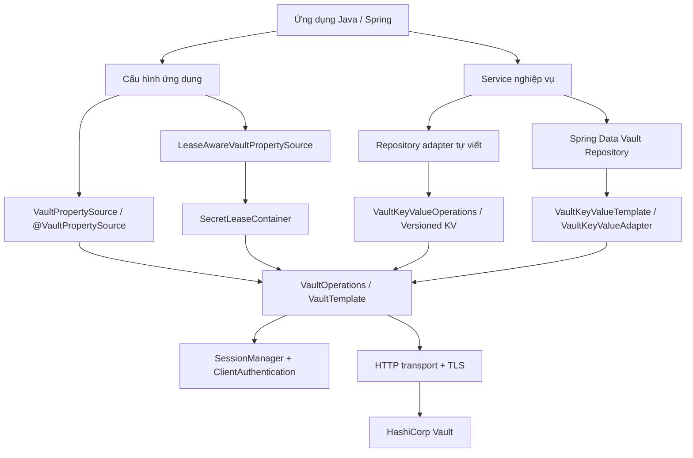
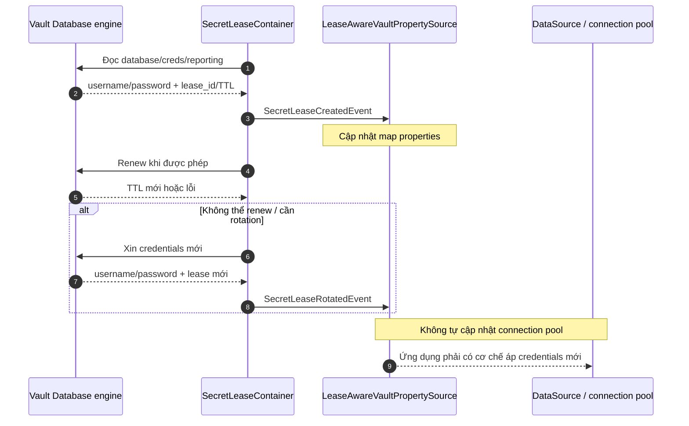
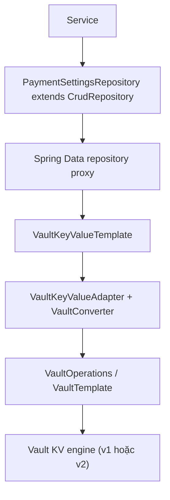
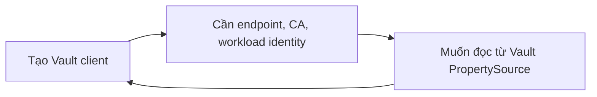

# PropertySource và repository xây trên các API cốt lõi

Trong **Spring Vault**, cùng một secret lưu tại **HashiCorp Vault** có thể được sử dụng theo hai hướng rất khác nhau. Thứ nhất, ứng dụng có thể đưa các giá trị cấu hình vào Spring `Environment` để đọc bằng `@Value`, `Environment.getProperty(...)` hoặc cơ chế binding. Thứ hai, ứng dụng có thể truy cập Vault như một kho key/value thông qua repository có hợp đồng đọc, ghi, xóa rõ ràng. Hai hướng tương ứng với **`VaultPropertySource`** và **repository xây trên `VaultOperations`/Spring Data Vault**.

Bài này thuộc chương **Kiến trúc client** của module **SPRING_VAULT**: ứng dụng Java truy cập Vault thông qua `VaultTemplate`, xác thực theo workload, giới hạn quyền bằng policy và vận hành KV secrets, token/lease, Transit, PKI cùng giám sát và kiểm thử. Nội dung tập trung vào cách **lắp ghép các API cốt lõi thành tầng cấu hình hoặc tầng dữ liệu**, tránh nhầm lẫn giữa đọc secret tại thời điểm startup với đọc dữ liệu trong thời gian chạy.

Sau bài học, bạn có thể:

- Phân biệt `PropertySource`, adapter repository tự viết và **Spring Data Vault Repository**.
- Dùng `@VaultPropertySource` hoặc đăng ký `VaultPropertySource` trực tiếp vào `Environment`.
- Hiểu thứ tự ưu tiên property, thời điểm khởi tạo, flatten JSON và đường dẫn KV v2.
- Nhận diện `LeaseAwareVaultPropertySource`, `SecretLeaseContainer`, các chế độ renew/rotate và giới hạn của việc cập nhật property động.
- Xây repository có kiểu dữ liệu rõ ràng trên `VaultKeyValueOperations` và xử lý lỗi thiếu secret, quyền hoặc mạng.
- Dùng `@Secret`, `@Id`, `@Version`, `CrudRepository` và `@EnableVaultRepositories` khi cần repository theo Spring Data.
- Chọn chính sách quyền, giám sát, kiểm thử tích hợp và chiến lược lifecycle cho từng cách tiếp cận.

> Các ví dụ sử dụng API Spring Vault **4.1.x** và Spring Data tương thích. Một số kiểu/hợp đồng có mặt từ các phiên bản trước nhưng cấu hình auto-configuration thay đổi theo Spring Boot/Spring Cloud. Hãy đối chiếu dependency/BOM của dự án trước khi sao chép mã.

## 1. Một lõi Vault, ba cách tổ chức truy cập

`VaultOperations` là hợp đồng thao tác Vault đồng bộ; `VaultTemplate` là hiện thực phổ biến. Tầng phía trên có thể chọn nhiều cách tiêu thụ dữ liệu tùy mục đích:



| Lựa chọn | Đối tượng nhận kết quả | Khi nào thích hợp | Điểm phải kiểm soát |
|---|---|---|---|
| `VaultPropertySource` | Spring `Environment` | Cấu hình cần có lúc khởi động | Bootstrap, thứ tự ưu tiên, thiếu secret |
| `LeaseAwareVaultPropertySource` | `Environment` với map có thể thay đổi | Properties lấy từ secret có vòng đời/lease | Renew/rotate, cập nhật consumer, sự kiện hết hạn |
| Repository adapter tự viết | DTO/`Optional`/kiểu miền nghiệp vụ | Secret có hợp đồng và xử lý lỗi riêng | KV v1/v2, quyền, TTL/cache, schema |
| Spring Data Vault Repository | Entity và API `CrudRepository` | CRUD đối tượng KV theo ID, mapping tự động | Giới hạn query, list/performance, version/CAS |

Một đối tượng `VaultTemplate` có thể dùng chung cho các adapter thuộc **cùng danh tính workload và ranh giới quyền truy cập**. Nhưng khả năng gọi nhiều nhóm API từ Java không có nghĩa token được quyền làm tất cả: Vault kiểm tra **policy trên path thật** của từng request.

## 2. VaultPropertySource đưa secret vào Spring Environment

Spring Framework phân giải cấu hình qua các đối tượng `PropertySource` được lưu trong `MutablePropertySources` của `ConfigurableEnvironment`. `org.springframework.vault.core.env.VaultPropertySource` là một `EnumerablePropertySource<VaultOperations>`: nó **đọc map properties từ Vault khi được khởi tạo** và cung cấp các key cho `Environment`.

Giả sử KV v2 mount tại `secret`, secret logic tại `payments/application` có nội dung:

```json
{
  "jdbc": {
    "url": "jdbc:postgresql://db.internal/payments",
    "username": "payments_reader",
    "password": "<redacted>"
  },
  "feature": {
    "reconciliation": true
  }
}
```

Khi được expose thành property, map lồng nhau có thể được **flatten** thành các key như `jdbc.url`, `jdbc.username`, `jdbc.password` và `feature.reconciliation`. Đây là giá trị logic của secret, không phải nguyên JSON envelope chứa `data.data` và metadata phiên bản của KV v2.

### 2.1. Đăng ký trực tiếp bằng Java

Với một `VaultOperations` đã được cấu hình, có thể đăng ký nguồn cấu hình vào `Environment`:

```java
import org.springframework.core.env.ConfigurableEnvironment;
import org.springframework.vault.core.VaultOperations;
import org.springframework.vault.core.env.VaultPropertySource;

public final class PaymentVaultEnvironment {

    public static void register(
            ConfigurableEnvironment environment,
            VaultOperations vaultOperations) {

        VaultPropertySource source = new VaultPropertySource(
            "payments-vault",
            vaultOperations,
            "secret/payments/application"
        );

        // Đặt trước các nguồn khác nếu chủ đích ưu tiên Vault.
        environment.getPropertySources().addFirst(source);
    }
}
```

Đoạn mã trên là **hàm đăng ký**; phải gọi vào giai đoạn bootstrap **trước khi tạo các bean cần property**. Constructor `VaultPropertySource` đã thực hiện nạp properties, nên `vaultOperations` và cơ chế lấy token/TLS phải hoạt động được tại thời điểm này. Không nên chạy hàm sau khi các singleton đã được bind rồi kỳ vọng `@Value` hoặc `@ConfigurationProperties` trên chúng lập tức đổi theo.

Lúc đọc:

```java
String jdbcUrl =
    environment.getProperty("jdbc.url");

Boolean enabled =
    environment.getProperty("feature.reconciliation", Boolean.class);
```

Hai biến `environment` và các bean dùng nó là thành phần được Spring cung cấp; ví dụ không đưa password vào stdout, log hoặc HTTP response.

### 2.2. Thứ tự ưu tiên nguồn cấu hình

Với `MutablePropertySources`, `addFirst(...)` làm `VaultPropertySource` được tìm **trước** các nguồn có độ ưu tiên thấp hơn; `addLast(...)` đưa nó xuống sau. Nếu key `jdbc.url` đồng thời tồn tại trong Vault và một nguồn khác, **thứ tự này quyết định giá trị được trả về**.

```text
Spring Environment
  1. payments-vault           (được addFirst)
  2. nguồn cấu hình khác
  3. cấu hình mặc định
       |
       +-- getProperty("jdbc.url")
                |
             giá trị đầu tiên tìm thấy
```

Thay đổi precedence cần có chủ đích. Đẩy Vault lên cao nhất có thể ghi đè giá trị local cần cho bài test; đặt thấp nhất có thể khiến cấu hình không an toàn từ nguồn khác thắng secret được quản trị trong Vault. Nếu quy trình deploy phụ thuộc chặt vào precedence, nên chọn cơ chế cấu hình tập trung và kiểm thử thứ tự thực tế, không dựa vào thứ tự quét `@Configuration` vốn khó đoán.

## 3. @VaultPropertySource: đăng ký khai báo

Annotation `org.springframework.vault.annotation.VaultPropertySource` kết nối Vault với `Environment` trên một lớp `@Configuration`. Đây là **annotation khác** với class `org.springframework.vault.core.env.VaultPropertySource` ở phần trước, dù chúng cùng tên đơn giản.

```java
import org.springframework.context.annotation.Configuration;
import org.springframework.vault.annotation.VaultPropertySource;

@Configuration
@VaultPropertySource(
    value = "secret/payments/application",
    propertyNamePrefix = "payments.",
    ignoreSecretNotFound = false
)
public class PaymentVaultPropertyConfiguration {
}
```

Với prefix này, các key được expose thành:

```text
payments.jdbc.url
payments.jdbc.username
payments.jdbc.password
payments.feature.reconciliation
```

Bean có thể dùng `Environment` để truy xuất:

```java
import org.springframework.core.env.Environment;
import org.springframework.stereotype.Component;

@Component
public final class PaymentConnectionSettings {
    private final Environment environment;

    public PaymentConnectionSettings(Environment environment) {
        this.environment = environment;
    }

    public String jdbcUrl() {
        return environment.getRequiredProperty("payments.jdbc.url");
    }
}
```

Ở đây `getRequiredProperty(...)` gây lỗi rõ khi thiếu key bắt buộc; không cần đọc/công bố `payments.jdbc.password` chỉ để kiểm tra kết nối. Trong ứng dụng production, nên kiểm tra schema và hạn chế nơi được phép lấy password. Nếu dữ liệu có vòng đời động, thiết kế consumer cập nhật trực tiếp thay vì dựa vào một singleton chỉ bind một lần.

### 3.1. Các thuộc tính quan trọng của annotation

| Thuộc tính | Ý nghĩa | Mặc định |
|---|---|---|
| `value` | Một hoặc nhiều Vault path để nạp | Bắt buộc |
| `propertyNamePrefix` | Tiền tố thêm trước mọi property key | Chuỗi rỗng |
| `ignoreSecretNotFound` | Bỏ qua lỗi thiếu secret nếu nguồn thực sự tùy chọn | `true` |
| `vaultTemplateRef` | Tên bean `VaultTemplate` dùng để truy cập Vault | `"vaultTemplate"` |
| `renewal` | Chính sách gia hạn/rotation cho secret có lease | `Renewal.OFF` |

**Cảnh báo mặc định:** `ignoreSecretNotFound = true` phù hợp với nguồn tùy chọn, nhưng secret cấu hình database bắt buộc thường nên đặt `false` hoặc kiểm tra fail-fast. Đừng biến lỗi TLS, `403` hoặc path sai thành “giá trị mặc định” không an toàn.

Annotation nhận nhiều path, tạo nguồn tương ứng theo thứ tự đã khai báo. Có thể dùng placeholder trong path được phân giải từ **những property source đã có sẵn**:

```java
@VaultPropertySource(
    value = "secret/payments/${spring.profiles.active:default}",
    propertyNamePrefix = "payments."
)
class ProfileVaultConfiguration {
}
```

Giá trị `spring.profiles.active` trong ví dụ phải có sẵn khi annotation được xử lý; vòng phụ thuộc “phải đọc Vault mới biết endpoint/token để đọc Vault” sẽ không tự giải quyết.

### 3.2. KV v2: không tự thêm data/

Khi KV v2 được mount tại `secret`, annotation thường nhận:

```text
@VaultPropertySource("secret/payments/application")
                              ↑
               mount + đường dẫn logic
```

**Không dùng `secret/data/payments/application` trong annotation chỉ vì HTTP API KV v2 có đoạn `data/`.** Spring Vault xác định phiên bản KV mount và áp quy tắc endpoint tương ứng cho abstraction này. Ngược lại, nếu dùng `VaultOperations.read(...)` mức thấp, path `secret/data/payments/application` mới là API path KV v2 cần ghi rõ.

Điểm liên quan đến **quyền**: Spring Vault có thể cần truy cập `sys/internal/ui/mounts/...` để xác định mount và KV version; policy phải cho phép cơ chế khám phá mount này trong cấu hình thực tế, bên cạnh capability `read` ở `secret/data/...`. Không mặc định chỉ có `read` trên data path là đủ để mọi abstraction hoạt động.

## 4. PropertySource có tự cập nhật khi secret đổi không?

`VaultPropertySource` thông thường **nạp dữ liệu khi khởi tạo**, không phải một kết nối streaming tới Vault. Sau khi quản trị viên ghi phiên bản KV v2 mới, không thể mặc định các object `VaultPropertySource` và bean đã tạo sẽ thấy giá trị mới ngay tức khắc.

Ba khái niệm cần tách:

1. **Đọc/refresh giá trị ở nguồn:** truy vấn Vault để lấy phiên bản secret mới.
2. **Cập nhật `Environment`:** map của `PropertySource` có thực sự đổi hay không.
3. **Cập nhật consumer:** bean `DataSource`, client HTTP hoặc đối tượng đã nhận `@Value` có tự thay cấu hình và kết nối đang hoạt động hay không.

Ngay cả khi một `PropertySource` có dữ liệu mới, các bean đã bind thường **không tự rebind**. Ví dụ thay password trong property source không tự làm connection pool đóng toàn bộ connection cũ hoặc đăng nhập lại bằng credentials mới. Việc refresh/configuration change phải có một pipeline riêng.

Khi dùng Spring Cloud Vault cho **cấu hình khởi động**, có thể tích hợp qua cơ chế Spring Boot Config Data:

```yaml
spring:
  config:
    import: "vault://"
  cloud:
    vault:
      uri: https://vault.service.internal:8200
      authentication: KUBERNETES
      kubernetes:
        role: payments-api
```

Đây là một hướng **Spring Cloud Vault** khác với annotation Spring Vault thuần. Nó cần dependency, auth method, bootstrap và các properties phù hợp phiên bản Spring Cloud/Boot. `spring.config.import` không phải cam kết tất cả bean sẽ hot-reload khi secret đổi.

## 5. LeaseAwareVaultPropertySource và secret có lease

Đối với dynamic secrets như `database/creds/reporting`, Vault có thể trả `lease_id`, `lease_duration` và `renewable`. Spring Vault cung cấp `org.springframework.vault.core.env.LeaseAwareVaultPropertySource` để lấy secret thông qua `SecretLeaseContainer`, đồng thời cập nhật properties theo **sự kiện renew/rotate**.

Ví dụ tạo nguồn theo dõi rotating secret, giả định `SecretLeaseContainer` do Spring quản lý:

```java
import org.springframework.vault.core.env.LeaseAwareVaultPropertySource;
import org.springframework.vault.core.lease.SecretLeaseContainer;
import org.springframework.vault.core.lease.domain.RequestedSecret;

RequestedSecret requested =
    RequestedSecret.rotating("database/creds/reporting");

LeaseAwareVaultPropertySource source =
    new LeaseAwareVaultPropertySource(
        "reporting-dynamic-credentials",
        secretLeaseContainer,
        requested
    );
```

`secretLeaseContainer` là bean có lifecycle/scheduler đã thiết lập; đoạn mã chỉ mô tả cách ghép nguồn cấu hình, không phải một ứng dụng đầy đủ. `LeaseAwareVaultPropertySource` nhận giá trị qua sự kiện từ container, lưu trong map có thể thay đổi từ background threads; khi lease hết hạn hoặc bị revoke, properties liên quan có thể bị **loại khỏi map**.

Ở cấp annotation, có thể yêu cầu rotate:

```java
import org.springframework.context.annotation.Configuration;
import org.springframework.vault.annotation.VaultPropertySource;

@Configuration
@VaultPropertySource(
    value = "database/creds/reporting",
    propertyNamePrefix = "reporting.",
    renewal = VaultPropertySource.Renewal.ROTATE,
    ignoreSecretNotFound = false
)
class ReportingDbCredentialsProperties {
}
```

Chế độ renewal mặc định của `@VaultPropertySource` là `OFF`. Với `RENEW`, hệ thống tìm cách kéo dài lease hiện có; với `ROTATE`, nó có thể cấp secret mới khi lease hiện tại không còn sử dụng được, tùy điều kiện Vault và chiến lược quản lý. Không diễn giải `ROTATE` thành “mỗi lượt đọc property tạo một tài khoản mới”.



**Điểm then chốt:** property map có thể đã được đổi, trong khi `DataSource` vẫn giữ username/password từ lần khởi tạo trước. Với dynamic database credentials, nên dùng callback/sự kiện lease hoặc adapter quản lý credentials, kiểm tra connection mới rồi thay pool và drain connection cũ có kiểm soát.

TTL của **Vault token** (do `SessionManager` quản lý) và TTL của **dynamic secret** (do `SecretLeaseContainer` quản lý) là hai vòng đời khác nhau. Renew token không tự renew database lease; renew lease không thay token phiên; chứng chỉ PKI còn có ngày hết hạn riêng.

## 6. Repository adapter tự viết trên VaultOperations

Khi secret cần đọc **trong thời gian chạy** với hợp đồng kiểu dữ liệu rõ, repository adapter tự viết thường dễ kiểm soát hơn `PropertySource`. Repository này không nhất thiết dùng Spring Data; nó chỉ là một lớp Java phụ thuộc vào interface `VaultOperations`.

Ví dụ KV v2 mount tại `secret`, logical path `payments/db`. DTO có constructor rỗng/getter/setter để Jackson ánh xạ dữ liệu:

```java
public final class PaymentDatabaseSecret {
    private String jdbcUrl;
    private String username;
    private String password;

    public PaymentDatabaseSecret() {}

    public String getJdbcUrl() { return jdbcUrl; }
    public void setJdbcUrl(String jdbcUrl) { this.jdbcUrl = jdbcUrl; }

    public String getUsername() { return username; }
    public void setUsername(String username) { this.username = username; }

    public String getPassword() { return password; }
    public void setPassword(String password) { this.password = password; }

    // Không tự tạo toString() có thể in password.
}
```

Adapter:

```java
import java.util.Optional;

import org.springframework.stereotype.Repository;
import org.springframework.vault.core.VaultKeyValueOperations;
import org.springframework.vault.core.VaultKeyValueOperationsSupport.KeyValueBackend;
import org.springframework.vault.core.VaultOperations;
import org.springframework.vault.support.VaultResponseSupport;

@Repository
public class PaymentSecretsRepository {

    private final VaultKeyValueOperations kv;

    public PaymentSecretsRepository(VaultOperations vault) {
        this.kv = vault.opsForKeyValue("secret", KeyValueBackend.KV_2);
    }

    public Optional<PaymentDatabaseSecret> findDatabaseConfig() {
        VaultResponseSupport<PaymentDatabaseSecret> response =
            kv.get("payments/db", PaymentDatabaseSecret.class);

        if (response == null || response.getData() == null) {
            return Optional.empty();
        }

        PaymentDatabaseSecret secret = response.getData();
        if (secret.getJdbcUrl() == null || secret.getUsername() == null
                || secret.getPassword() == null) {
            throw new IllegalStateException(
                "Vault secret payments/db thiếu trường bắt buộc");
        }

        return Optional.of(secret);
    }
}
```

Ưu điểm:

- `PaymentSecretsRepository` không cần dựng HTTP URL `/v1/secret/data/...`. `opsForKeyValue("secret", KV_2)` đã hiểu mount và API KV v2.
- Service nghiệp vụ nhận `Optional<PaymentDatabaseSecret>` và không cần biết `VaultResponse` có metadata gì.
- Lỗi `403`, timeout hoặc TLS vẫn phát sinh như lỗi truy cập; chỉ secret không tồn tại mới được diễn giải thành `Optional.empty()` theo hợp đồng adapter.
- Có thể thêm validation, metric, cache TTL giới hạn và kiểm soát lỗi ở một vị trí.

**Tránh dùng `Optional.empty()` cho mọi exception.** Một secret cấu hình bắt buộc bị từ chối đọc phải làm hệ thống nhận diện lỗi policy/cấu hình, không giả thành “không tìm thấy”.

### 6.1. Đọc phiên bản cụ thể và CAS

Khi workload có quyền ghi KV v2 hoặc nhiều instance cập nhật cùng secret, cần cân nhắc `VaultVersionedKeyValueOperations`:

```java
import java.util.Map;
import org.springframework.vault.core.VaultVersionedKeyValueOperations;
import org.springframework.vault.core.VaultOperations;
import org.springframework.vault.support.Versioned;

VaultVersionedKeyValueOperations versioned =
    vaultOperations.opsForVersionedKeyValue("secret");

Versioned<Map<String, Object>> current =
    versioned.get("payments/db");

if (current != null) {
    // Kiểm tra version và sử dụng API ghi có CAS
    // nếu cần tránh mất cập nhật cạnh tranh.
}
```

Biến `vaultOperations` biểu thị bean đã inject. Lệnh `get → put` thông thường không phải transaction; hai instance có thể đọc cùng phiên bản rồi ghi đè lên nhau. KV v2 cho phép CAS, nên repository cần dùng đúng API/expected version khi hợp đồng yêu cầu cập nhật an toàn.

## 7. Spring Data Vault Repository: từ @Secret đến CrudRepository

Spring Vault còn hỗ trợ **Spring Data repositories** cho KV secrets engine, qua các thành phần `VaultKeyValueTemplate`, `VaultKeyValueAdapter`, `VaultConverter` và repository proxy. Đây là **một abstraction khác** với adapter tự viết ở phần trước, dù cả hai đều dùng `VaultOperations` bên dưới.



Spring Data Vault repositories yêu cầu các thành phần Spring Data như `spring-data-commons` và `spring-data-keyvalue` trên classpath, tương thích với BOM của Spring Vault/Spring Data. Chúng **không** là JPA repository và không có SQL query engine phía Vault.

### 7.1. Entity với @Secret và @Id

Ví dụ entity lưu cấu hình dưới mount `secret`, keyspace `payment-settings`:

```java
import org.springframework.data.annotation.Id;
import org.springframework.data.annotation.Version;
import org.springframework.vault.repository.mapping.Secret;

@Secret(value = "payment-settings", backend = "secret")
public class PaymentSetting {

    @Id
    private String id;

    @Version
    private Long version;

    private String endpoint;

    public PaymentSetting() {}

    public String getId() { return id; }
    public void setId(String id) { this.id = id; }

    public Long getVersion() { return version; }
    public void setVersion(Long version) { this.version = version; }

    public String getEndpoint() { return endpoint; }
    public void setEndpoint(String endpoint) { this.endpoint = endpoint; }
}
```

Ở đây:

- `@Secret` đánh dấu aggregate root lưu trong Vault. `value` là keyspace; `backend` là mount path (mặc định thường `secret`).
- `@Id` là ID dùng trong path dạng `keyspace/id`; Vault repositories yêu cầu định danh kiểu `String`.
- `@Version` là thuộc tính số, hỗ trợ optimistic locking với KV v2 thông qua CAS.
- Các field được chuyển thành JSON bởi `VaultConverter`. Đừng nhầm `_class` metadata của mapping với secret nghiệp vụ; cân nhắc phạm vi type mapping và cấu trúc dữ liệu khi chia sẻ KV với ứng dụng không dùng Spring Data Vault.

### 7.2. Repository interface và khai báo quét

```java
import java.util.List;
import org.springframework.data.repository.CrudRepository;

public interface PaymentSettingsRepository
        extends CrudRepository<PaymentSetting, String> {

    List<PaymentSetting> findByIdStartsWith(String prefix);
}
```

```java
import org.springframework.context.annotation.Configuration;
import org.springframework.vault.repository.configuration.EnableVaultRepositories;

@Configuration
@EnableVaultRepositories(
    basePackageClasses = PaymentSettingsRepository.class
)
public class VaultRepositoryConfiguration {
    // Cần có bean VaultOperations/VaultTemplate đã cấu hình
    // cùng các dependency Spring Data tương thích.
}
```

Khi repository được khởi tạo đúng, service có thể:

```java
PaymentSetting setting = new PaymentSetting();
setting.setId("payments-gateway");
setting.setEndpoint("https://gateway.internal");

repository.save(setting);
PaymentSetting loaded = repository.findById("payments-gateway")
    .orElseThrow();

repository.deleteById("payments-gateway");
```

Với KV mount `secret`, keyspace `payment-settings` và ID `payments-gateway`, bản ghi tương ứng path logic `payment-settings/payments-gateway`. Spring Vault dùng cơ chế khám phá mount để xác định KV v1/v2 và ánh xạ đường dẫn API phù hợp.

**Lưu ý về quyền:** repository cần policy phù hợp cả việc đọc/ghi/xóa và **list metadata** nếu dùng query/list/count. Nó cũng có thể truy vấn `sys/internal/ui/mounts/...` để phát hiện mount. Một token chỉ có `read` ở một secret đơn lẻ thường không đủ cho `findAll()`, query theo ID prefix hoặc `count()`.

## 8. Giới hạn query và optimistic locking của repository

Vault KV **không phải cơ sở dữ liệu truy vấn tùy ý**. Spring Data Vault dịch các query method thành thao tác **liệt kê ID dưới keyspace**, lọc ID và có thể tải các secret về để sắp xếp/phân trang. Predicate được hỗ trợ tập trung vào thuộc tính `@Id`; không nên suy luận rằng các tên method tương tự JPA sẽ tạo index/filter ở server.

Ví dụ hợp lý:

```java
List<PaymentSetting> matching =
    repository.findByIdStartsWith("payments-");
```

Đây không phải truy vấn SQL `WHERE id LIKE 'payments-%'` chạy ở Vault. Với keyspace lớn, chi phí list và đọc có thể cao, đặc biệt khi phân trang/sort yêu cầu nạp nhiều bản ghi rồi xử lý trong bộ nhớ.

| Nhu cầu | Repository có phù hợp? | Lưu ý |
|---|---|---|
| Đọc theo ID đã biết | Có | Dùng `findById` hoặc adapter KV |
| CRUD các đối tượng cấu hình nhỏ | Có | Kiểm tra policy, KV version và mapping |
| Lọc theo tiền tố ID | Có giới hạn | Có thể cần list keyspace; không phải server-side index |
| Tìm theo password/status bất kỳ | Không phải trường hợp tối ưu | Vault không có general query engine |
| Phân trang rất lớn và sort nhiều field | Cần đánh giá kỹ | Có thể phải lấy nhiều ID/secret về client |
| Transaction nhiều aggregate | Không | Dùng cơ sở dữ liệu thích hợp nếu cần ACID |

### 8.1. @Version và CAS trong KV v2

Trong KV v2, entity có `@Version` cho phép Spring Data Vault gửi CAS khi ghi và từ chối update nếu version đang lưu khác expected version.

```java
PaymentSetting first = repository.findById("payments-gateway")
    .orElseThrow();
PaymentSetting stale = repository.findById("payments-gateway")
    .orElseThrow();

first.setEndpoint("https://gateway-v2.internal");
repository.save(first);

stale.setEndpoint("https://gateway-stale.internal");
// Có thể ném OptimisticLockingFailureException
// vì stale chứa version cũ:
repository.save(stale);
```

Giải pháp là đọc lại phiên bản mới, đối chiếu thay đổi và quyết định merge/retry có giới hạn theo nghiệp vụ. Không nuốt lỗi optimistic locking rồi ghi đè dữ liệu bằng một lệnh không có CAS.

### 8.2. Delete của KV v2 không đồng nghĩa hủy mọi phiên bản

Trong KV v2, lệnh delete của Spring Data Vault dùng semantics `DELETE` của secrets engine, thường **soft-delete phiên bản** chứ không tự xóa vĩnh viễn toàn bộ lịch sử. Nếu muốn destroy metadata/versions, cần API Vault riêng và quyền quản trị tương ứng; không nên phát hành lệnh destroy trong repository CRUD thông thường.

Khi ánh xạ một entity rồi `save(...)`, Spring Data Vault có thể **ghi lại toàn bộ entry**. Các field do công cụ khác thêm nhưng không được mapping có nguy cơ mất khi lưu bản mới. Với secret cùng được quản lý bởi nhiều hệ thống, phải có hợp đồng schema/versioning rõ và tránh cập nhật mất dữ liệu.

## 9. So sánh PropertySource và Repository khi đưa vào sản phẩm

Sự khác biệt lớn nhất là **thời điểm dữ liệu được tiêu thụ**:

| Câu hỏi | PropertySource | Repository |
|---|---|---|
| Khi nào gọi Vault? | Thường lúc bootstrap/khởi tạo nguồn | Khi service gọi method repository |
| Kết quả ở đâu? | `Environment` và có thể bind vào bean | DTO/entity/`Optional` theo method |
| Có cần cấu hình trước Spring beans? | Thường có | Không nhất thiết |
| Xử lý version/CAS | Không phải API write | Có thể dùng versioned KV hoặc `@Version` |
| Query theo ID | Không phải mục đích chính | Có, với giới hạn của Vault KV |
| Lease/rotate | Dùng `LeaseAwareVaultPropertySource` và container | Tự tích hợp lifecycle/lease nếu dữ liệu động |
| Rủi ro phổ biến | Bean đã bind không tự refresh khi source thay đổi | Ghi đè entity, query scan và quyền list quá rộng |
| Nên dùng | Secret/config bootstrap, ít thay đổi | Truy cập dữ liệu có hợp đồng nghiệp vụ rõ |

Một thiết kế thường hiệu quả là **kết hợp có chọn lọc**: Spring Cloud Vault/PropertySource nạp cấu hình bootstrap tối thiểu; repository adapter đọc secret ứng dụng theo yêu cầu; lease container/consumer riêng quản lý dynamic credentials. Không bắt mọi loại secret đi qua cùng một abstraction.

### Cẩn thận với chu trình bootstrap

Nếu `VaultPropertySource` dùng TLS truststore, endpoint hoặc credential đăng nhập **chỉ có trong chính secret mà nó đang cố đọc**, ứng dụng bị mắc vòng phụ thuộc:



Endpoint, CA bundle, danh tính workload và bí mật bootstrap phải được cung cấp bằng cơ chế **đủ tin cậy trước khi kết nối Vault** (ví dụ cấu hình hạ tầng, service account, keystore được mount an toàn). Sau đó Vault mới có thể cấp các secret ứng dụng.

## 10. Phân quyền tối thiểu và cách phân loại lỗi

Một token dùng đọc KV v2 cấu hình `secret/payments/application` cần capability phù hợp trên **path API thật**:

```hcl
path "secret/data/payments/application" {
  capabilities = ["read"]
}
```

Với repository CRUD trên `payment-settings/*`, policy phải được thiết kế riêng theo những method thực sự sử dụng: `read`, `create`/`update`/`delete` hoặc `list` trên metadata KV v2 khi cần. Không cấp quyền ghi cho ứng dụng chỉ cần đọc cấu hình, không dùng root token để “thử cho chạy”.

Lớp PropertySource/repository có thể cần truy vấn mount qua `sys/internal/ui/mounts/...`. Hãy kiểm tra Vault audit và policy của phiên bản Vault cụ thể, chỉ cho phép discovery ở phạm vi mount cần dùng; tránh mở toàn bộ `sys/*`.

| Tình huống | Tầng nhận diện | Hướng xử lý |
|---|---|---|
| Secret không tồn tại | `VaultPropertySource` hoặc KV read | Nếu bắt buộc: fail startup/throw; nếu tùy chọn: giá trị thiếu có chủ đích |
| `403` vì policy hoặc token | Vault auth/authorization | Kiểm tra workload identity, token TTL, path, namespace, capability |
| `404` do sai KV v1/v2 mount | HTTP/Vault operations | Kiểm tra logical path, mount và discovery; không chỉ retry |
| TLS handshake hoặc hostname sai | HTTP transport | Sửa truststore/certificate, không tắt TLS verification |
| Timeout/`5xx` | Network/Vault | Retry đọc có giới hạn; đo độ trễ và tổng deadline |
| Ghi KV v2 bị CAS conflict | Repository/versioned KV | Đọc lại, xử lý cạnh tranh, không ghi đè mù |
| Lease hết hạn/rotated | Lease-aware property source/container | Cập nhật consumer; readiness và pool thay credentials |

**Đừng ghi giá trị secret vào log**, kể cả khi debug `PropertySource` hoặc `VaultResponse`. Các phần nhạy cảm gồm password KV, JWT Kubernetes, AppRole secret ID, `X-Vault-Token`, lease ID và private key PKI. Dùng metrics theo nhóm operation, status, latency và số lần retry/renew; tránh gắn secret path chứa định danh riêng thành label.

### Retry và consistency

Một lần `findById` thường là thao tác đọc, có thể retry ngắn khi Vault tạm lỗi. Nhưng `save`/`delete` hay lệnh cấp dynamic credentials có side effect: timeout sau khi gửi body **không chứng minh server chưa thực thi**. Thiết kế retry cần xét CAS, idempotency và kết quả chưa xác định.

Trong môi trường nhiều instance, một property source nạp tại startup có thể giữ phiên bản khác với instance vừa khởi động sau đó. Nếu bắt buộc cùng phiên bản cấu hình khi rollout, hãy dùng cơ chế version pinning/rollout có điều phối thay vì giả định tất cả instance sẽ tự cập nhật đồng thời.

## 11. Kiểm thử đơn vị và tích hợp

### 11.1. Unit test cho adapter tự viết

Mock `VaultOperations` và `VaultKeyValueOperations` để kiểm tra repository chọn đúng mount `secret`, backend `KV_2` và logical path `payments/db`. Các tình huống:

1. `get` trả DTO hợp lệ → `Optional` có dữ liệu.
2. `get` trả `null` → `Optional.empty()`.
3. DTO thiếu `jdbcUrl`/`username`/`password` → lỗi schema rõ ràng.
4. Vault từ chối quyền hoặc timeout → giữ nguyên lỗi, không đổi thành `Optional.empty()`.

Unit test này **không** chứng minh Vault mount là KV v2 hoặc token có policy thật; cần integration test cho các hợp đồng đó.

### 11.2. Test precedence của PropertySource

Với `MockEnvironment`/`ConfigurableEnvironment`, đăng ký hai property sources có cùng key ở vị trí khác nhau, xác nhận `getProperty(...)` trả giá trị có precedence cao hơn. Đừng đưa password thật vào fixture/test assertion.

Test khởi động nên còn bao phủ:

- Secret bắt buộc không tồn tại với `ignoreSecretNotFound=false`.
- Annotation có `propertyNamePrefix` đúng, nested JSON flatten thành key đúng.
- Key source bị trùng và thứ tự ưu tiên đúng theo yêu cầu.
- Bootstrap Vault không phụ thuộc vào secret chỉ có thể lấy sau khi login.

### 11.3. Integration test với Vault dev/test

Chuẩn bị Vault test độc lập, KV v2 mount `secret`, dữ liệu giả và token chỉ có quyền cần thiết:

| Kịch bản | Kỳ vọng |
|---|---|
| `@VaultPropertySource("secret/payments/application")` | Nạp đúng properties, không thêm `data/` |
| KV2 nested JSON | Flatten key `jdbc.url` hoặc `payments.jdbc.url` theo prefix |
| Mount discovery không đủ quyền | Lỗi rõ, kiểm tra `sys/internal/ui/mounts/...`, không bỏ qua bằng root token |
| Repository `save/findById` | Mapping `@Secret`/`@Id` đúng logical path |
| `findByIdStartsWith` | Danh sách trả theo ID, đo số request list/read |
| Hai update cạnh tranh có `@Version` | Phát sinh optimistic locking conflict |
| `deleteById` trên KV v2 | Xác minh soft delete, không hiểu là destroy mọi version |
| KV2 path sai và policy `403` | Hai nhóm lỗi được phân loại riêng |
| Dynamic `LeaseAwareVaultPropertySource` | Có cập nhật property map khi lease rotate; consumer thay credentials riêng |
| Mạng lỗi/TLS/timeout | Không log token/secret, không treo request vô hạn |

Không dùng database production hoặc root token làm danh tính workload cho test. Với lease động, dùng TTL ngắn ở Vault test và chờ theo **điều kiện có timeout** thay vì dựa vào `Thread.sleep` tùy tiện. Dọn secret, token và lease test khi kết thúc.

## 12. Bài thực hành: cấu hình và repository cho payments-api

**Bối cảnh:** `payments-api` chạy trên Kubernetes. Vault được cung cấp qua HTTPS, KV v2 mount `secret`. Hai nhóm dữ liệu:

- **Cấu hình bootstrap:** `secret/payments/application` chứa `jdbc.url`, tên dịch vụ và feature flags; được nạp qua PropertySource.
- **Secret nghiệp vụ:** `secret/payments/db` chứa cấu hình database nhạy cảm; service truy cập qua adapter `VaultKeyValueOperations`. Một nhóm metadata cấu hình khác có thể được quản lý bằng Spring Data Vault repository `PaymentSettingsRepository`.

### Các bước thực hiện

1. Cấu hình workload authentication bằng Kubernetes service account hoặc phương thức thích hợp; TLS CA và Vault endpoint phải sẵn sàng trước khi nạp PropertySource.
2. Thêm `@VaultPropertySource(value="secret/payments/application", propertyNamePrefix="payments.", ignoreSecretNotFound=false)`; kiểm tra `Environment.getRequiredProperty("payments.jdbc.url")`.
3. Xây `PaymentSecretsRepository` trả `Optional<PaymentDatabaseSecret>`; phân biệt thiếu dữ liệu với lỗi policy/TLS.
4. Khai báo `@Secret` entity và `CrudRepository` cho keyspace `payment-settings`, bật `@EnableVaultRepositories` với dependency Spring Data tương thích. Kiểm thử `findById` và `findByIdStartsWith`.
5. Thử hai lần cập nhật cùng ID ở KV v2 với `@Version` để thấy optimistic locking.
6. Thử `deleteById` rồi kiểm tra version history/metadata trên Vault test; giải thích vì sao delete không phải destroy.
7. Nếu chuyển sang dynamic database credentials, dùng `LeaseAwareVaultPropertySource`/`SecretLeaseContainer`; thiết kế callback cập nhật pool an toàn, không tin rằng `@Value` sẽ tự refresh.
8. Kiểm tra policy cho cả data path, metadata/list và mount discovery; giám sát số request/latency, không log nội dung secret.

### Câu hỏi tự kiểm tra

1. Vì sao `VaultPropertySource` cần khởi tạo trước các bean phụ thuộc cấu hình, còn repository có thể gọi Vault trong runtime?
2. Khi dùng KV v2, vì sao `@VaultPropertySource("secret/payments/application")` không chứa đoạn `data/`?
3. `ignoreSecretNotFound=true` có phù hợp với mật khẩu database bắt buộc không?
4. Khi `LeaseAwareVaultPropertySource` cập nhật password mới, vì sao `DataSource` đã khởi tạo có thể vẫn dùng password cũ?
5. `findByIdStartsWith(...)` có thực sự được Vault thực hiện như một truy vấn có index không?
6. Vì sao `@Version` giúp chống cập nhật cạnh tranh trên KV v2, còn `CrudRepository.deleteById(...)` không xóa vĩnh viễn mọi version?
7. Những API nào cần policy ngoài `secret/data/...` khi Spring Vault khám phá mount hoặc liệt kê danh sách repository?
8. Khi nào nên chọn adapter repository tự viết thay vì Spring Data Vault repository?

**Ghi nhớ:** `PropertySource` là cách đưa secret vào **cấu hình Spring**, còn repository là cách biểu diễn **hợp đồng truy cập dữ liệu** trên `VaultOperations`. `VaultPropertySource` phù hợp với bootstrap; `LeaseAwareVaultPropertySource` kết hợp lease lifecycle nhưng không tự thay bean/connection pool; adapter KV và Spring Data Vault phù hợp với nghiệp vụ cần đọc/ghi theo ID. Chọn abstraction theo thời điểm sử dụng, quyền truy cập, semantics KV v1/v2 và nhu cầu cập nhật thực tế.

## Tài liệu tham khảo

- [Spring Vault — Property Sources](https://docs.spring.io/spring-vault/reference/vault/propertysource.html).
- [Spring Vault — Vault Repositories](https://docs.spring.io/spring-vault/reference/vault/vault-repositories.html).
- [Spring Vault API — VaultPropertySource](https://docs.spring.io/spring-vault/reference/api/java/org/springframework/vault/core/env/VaultPropertySource.html).
- [Spring Vault API — LeaseAwareVaultPropertySource](https://docs.spring.io/spring-vault/reference/api/java/org/springframework/vault/core/env/LeaseAwareVaultPropertySource.html).
- [Spring Vault API — @VaultPropertySource](https://docs.spring.io/spring-vault/reference/api/java/org/springframework/vault/annotation/VaultPropertySource.html).
- [Spring Vault API — @EnableVaultRepositories](https://docs.spring.io/spring-vault/reference/api/java/org/springframework/vault/repository/configuration/EnableVaultRepositories.html).
- [Spring Vault API — VaultKeyValueOperations](https://docs.spring.io/spring-vault/reference/api/java/org/springframework/vault/core/VaultKeyValueOperations.html).
- [Spring Vault API — VaultKeyValueTemplate](https://docs.spring.io/spring-vault/reference/api/java/org/springframework/vault/repository/core/VaultKeyValueTemplate.html).
