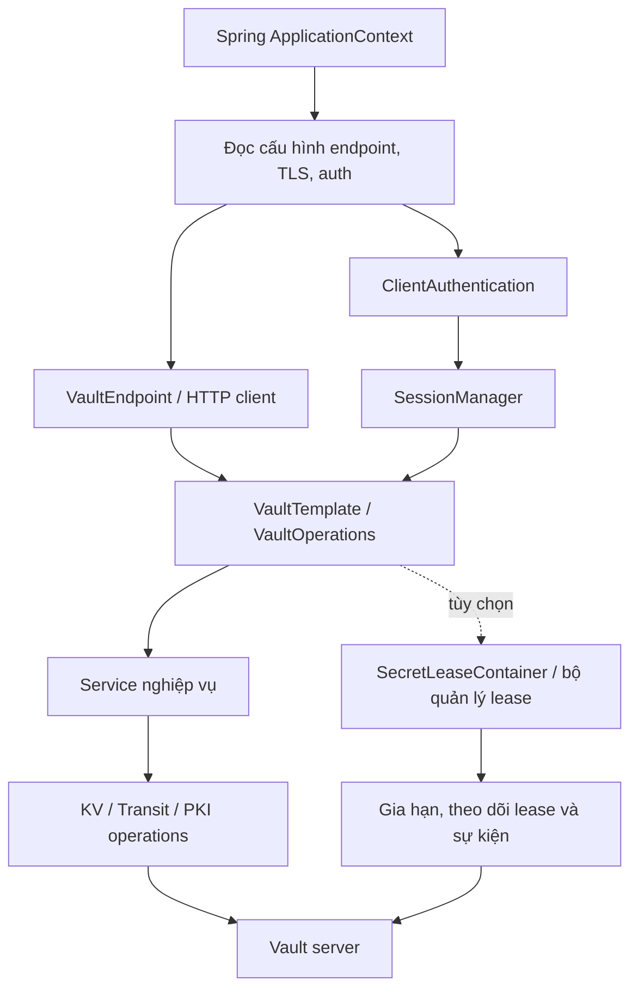
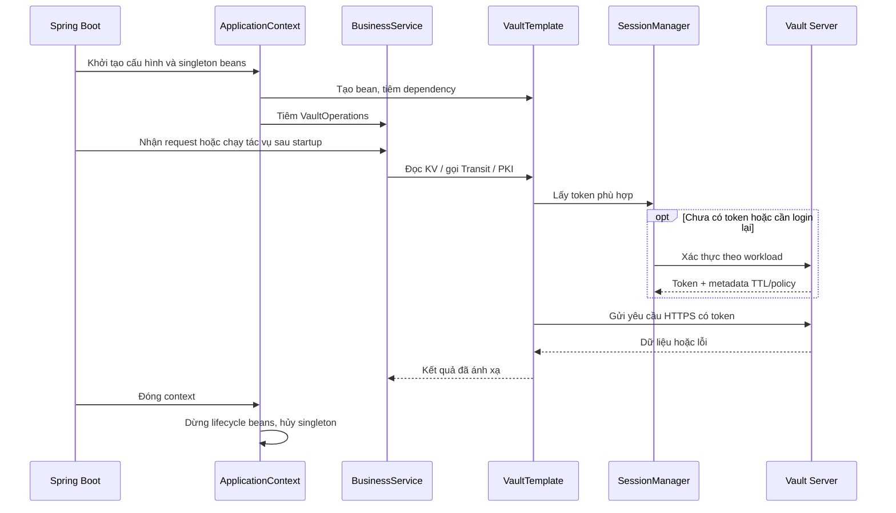
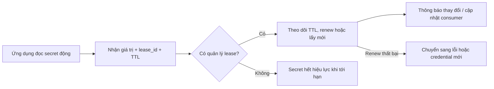

# Vòng đời bean khi khởi tạo, sử dụng và dừng ứng dụng

Trong ứng dụng Java dùng **Spring Vault**, vòng đời của bean quyết định thời điểm client được tạo, xác thực được thực hiện, tài nguyên được sử dụng và các thành phần quản lý token/lease được dừng. Hiểu đúng các giai đoạn này giúp sử dụng `VaultTemplate` an toàn khi truy cập HashiCorp Vault, đặc biệt với xác thực theo workload, KV secrets, Transit, PKI và các secret có thời hạn.

Bài học thuộc chương **Kiến trúc client** của module **SPRING_VAULT**. Trọng tâm là sự phối hợp giữa Spring IoC container, `VaultTemplate`/`VaultOperations`, `ClientAuthentication`, `SessionManager` và những thành phần quản lý lease; các ví dụ dùng Spring Framework/Spring Boot và Spring Vault.

## 1. Ba vòng đời khác nhau cần phân biệt

Một lỗi thiết kế phổ biến là cho rằng bean `VaultTemplate` còn sống thì token Vault và secret cũng còn hiệu lực. Trên thực tế, chúng có vòng đời độc lập:

| Đối tượng | Ai quản lý? | Bắt đầu/kết thúc khi nào? | Điều cần lưu ý |
| --- | --- | --- | --- |
| **Spring bean** như `VaultTemplate` | `ApplicationContext` | Thường từ lúc context tạo bean singleton đến khi context đóng | Bean tồn tại không chứng minh kết nối, token hay policy đang hợp lệ. |
| **Phiên xác thực/token** | Vault và `ClientAuthentication`/`SessionManager` | Khi login/cấp token; hết TTL, bị thu hồi hoặc được gia hạn theo cơ chế hỗ trợ | TTL, khả năng gia hạn, loại auth method và policy quyết định quyền thực tế. |
| **Secret/lease** | Vault; có thể được theo dõi bởi `SecretLeaseContainer` | Khi đọc/cấp secret, cho đến khi hết TTL hoặc bị revoke/rotate | Secret động và chứng chỉ PKI có thời hạn riêng; KV tĩnh không tự sinh lease chỉ vì được đọc. |

`VaultTemplate` là đối tượng Java gọi Vault REST API. `SessionManager` cung cấp token cho yêu cầu HTTP; nó không phải một socket đăng nhập liên tục. Việc tạo `VaultTemplate` thường chỉ tạo và nối các đối tượng client; yêu cầu mạng và login có thể diễn ra ở lần thao tác đầu hoặc trong bước khởi động một thành phần quản lý vòng đời, tùy cấu hình cụ thể.

## 2. Đồ thị bean và thứ tự tổng quát



Sơ đồ thể hiện **quan hệ trách nhiệm**, không phải danh sách bean cố định của mọi dự án. Với Spring Vault core, có thể cấu hình bằng `AbstractVaultConfiguration` hoặc các `@Bean` phù hợp. Với Spring Cloud Vault, một số đối tượng và property source được tự cấu hình theo starter, phiên bản và các thuộc tính bật/tắt. Không nên đăng ký trùng `VaultTemplate` hoặc `SessionManager` khi một cơ chế auto-configuration đã sở hữu chúng.

Một chuỗi hoạt động điển hình:



Điểm cốt lõi: **dependency injection hoàn tất không đồng nghĩa thao tác tới Vault đã thành công**. Độ sẵn sàng thực sự còn phụ thuộc DNS, TLS, auth, policy, trạng thái Vault, secret engine và path.

## 3. Pha khởi tạo: từ định nghĩa bean đến ứng dụng sẵn sàng

### 3.1. Spring tạo và khởi tạo bean

Đối với singleton không lazy, thứ tự khái quát là:

1. Spring đọc `@Configuration`, `@Component` và các bean definition, giải quyết dependency.
2. Container tạo đối tượng bằng constructor hoặc factory method `@Bean`, sau đó thực hiện injection.
3. `BeanPostProcessor` chạy trước khởi tạo; các callback như `@PostConstruct`, `InitializingBean.afterPropertiesSet()` và `initMethod` được gọi theo cơ chế Spring tương ứng.
4. `BeanPostProcessor` chạy sau khởi tạo; bean có thể được bọc proxy (ví dụ do AOP). `ApplicationContext` hoàn tất refresh và các thành phần `Lifecycle`/`SmartLifecycle` phù hợp được khởi động.
5. Với Spring Boot, `ApplicationRunner`/`CommandLineRunner` chạy trước sự kiện `ApplicationReadyEvent`. Khi đó ứng dụng mới đi vào trạng thái ready theo chuỗi khởi động Boot thông thường.

Đây là mô tả tổng quát: các bean `@Lazy`, bean scope khác singleton, `FactoryBean` và cấu hình đặc biệt có thể thay đổi thời điểm tạo. **Spring không tự quản lý callback hủy cho prototype bean** như đối với singleton.

### 3.2. Cấu hình một client Spring Vault core

Ví dụ cấu hình tối giản dưới đây dùng token từ biến môi trường để giải thích cách Spring tạo các bean. Mục đích là thực hành cục bộ; trong production nên thay bằng `ClientAuthentication` phù hợp với workload (Kubernetes, AppRole hoặc cơ chế identity do nền tảng cấp), tránh vận hành bằng token tĩnh dài hạn.

```java
import java.net.URI;

import org.springframework.context.annotation.Configuration;
import org.springframework.vault.authentication.ClientAuthentication;
import org.springframework.vault.authentication.TokenAuthentication;
import org.springframework.vault.client.VaultEndpoint;
import org.springframework.vault.config.AbstractVaultConfiguration;

@Configuration
public class VaultClientConfig extends AbstractVaultConfiguration {

    @Override
    public VaultEndpoint vaultEndpoint() {
        String address = requiredEnv("VAULT_ADDR");
        return VaultEndpoint.from(URI.create(address));
    }

    @Override
    public ClientAuthentication clientAuthentication() {
        return new TokenAuthentication(requiredEnv("VAULT_TOKEN"));
    }

    private static String requiredEnv(String name) {
        String value = System.getenv(name);
        if (value == null || value.isBlank()) {
            throw new IllegalStateException("Missing environment variable: " + name);
        }
        return value;
    }
}
```

`AbstractVaultConfiguration` cung cấp cấu hình nền cho những thành phần Spring Vault cần thiết, bao gồm `VaultTemplate` và cơ chế phiên. Ở dự án Spring Boot có Spring Cloud Vault, hãy chọn **một** cách cấu hình và xác minh các bean auto-configured trước khi thêm cấu hình thủ công. `VAULT_ADDR` phải dùng `https://` với TLS được kiểm chứng trong môi trường thực tế; không tắt xác minh chứng chỉ để khắc phục lỗi truststore.

Trong production, không đồng nhất `ClientAuthentication` với một token cố định: AppRole có thể login bằng `role_id`/`secret_id`, Kubernetes dùng JWT service account để login theo role, còn những nền tảng khác dùng identity tương ứng. Các thông tin xác thực ban đầu phải được cung cấp an toàn bởi môi trường triển khai. Policy Vault của mỗi workload cần chỉ cho phép các path và operation thực sự cần.

### 3.3. Việc nào nên làm khi khởi tạo?

- **Constructor**: nhận dependency, kiểm tra dữ liệu cấu hình bất biến; không đặt việc đọc secret hay gọi Transit ở đây.
- **`@PostConstruct`/`afterPropertiesSet()`**: dành cho kiểm tra và khởi tạo cục bộ nhanh, có thể dự đoán được. Gọi Vault ở đây dễ làm quá trình dựng context phụ thuộc vào mạng và khiến lỗi khó kiểm soát.
- **`ApplicationRunner`**: thích hợp khi yêu cầu sản phẩm bắt buộc phải kiểm tra Vault trước khi báo startup hoàn tất; cần timeout, thông báo lỗi rõ ràng và chính sách fail-fast đã được quyết định.
- **Readiness probe hoặc tác vụ nền**: thích hợp khi ứng dụng được phép khởi động trước rồi chờ Vault sẵn sàng. Không biến liveness thành phép gọi Vault liên tục, vì sự cố mạng ngắn có thể gây vòng lặp khởi động lại.

Nếu dùng Spring Cloud Vault để nạp secret thành **configuration property**, việc lấy cấu hình từ Vault có thể diễn ra trong pha chuẩn bị `Environment` **trước khi bean nghiệp vụ được tạo**. Đây là trường hợp khác với một service tự gọi `VaultTemplate` trong runtime và cần được xem xét riêng khi điều tra startup failure.

## 4. Pha sử dụng: bean singleton và các thao tác Vault

### 4.1. Tiêm `VaultOperations` thay vì tự tạo client trong mỗi request

`VaultTemplate` thực thi giao diện `VaultOperations`. Service nghiệp vụ thường chỉ cần phụ thuộc vào giao diện này, giữ client và cấu hình phiên tập trung:

```java
import org.springframework.stereotype.Service;
import org.springframework.vault.core.VaultKeyValueOperationsSupport.KeyValueBackend;
import org.springframework.vault.core.VaultOperations;
import org.springframework.vault.support.VaultResponse;

@Service
public class OrdersSecretReader {
    private final VaultOperations vault;

    public OrdersSecretReader(VaultOperations vault) {
        this.vault = vault;
    }

    public String databaseUsername() {
        // Mount "secret" đang bật KV v2; đường dẫn logic là "apps/orders".
        VaultResponse response = vault
            .opsForKeyValue("secret", KeyValueBackend.KV_2)
            .get("apps/orders");

        if (response == null || response.getData() == null) {
            throw new IllegalStateException("Required KV secret is missing");
        }

        Object username = response.getData().get("username");
        if (!(username instanceof String value) || value.isBlank()) {
            throw new IllegalStateException("KV field username is missing");
        }
        return value;
    }
}
```

Ví dụ dùng cú pháp pattern matching `instanceof` của Java hiện đại. Với KV v2, API `opsForKeyValue(..., KV_2)` tự giải quyết đường dẫn API tương ứng; **không** truyền `secret/data/apps/orders` làm path logic trong ví dụ này. Cần mount KV v2 `secret`, secret `apps/orders` và policy `read` tương ứng để chạy thành công.

Một `VaultTemplate` đã cấu hình có thể được chia sẻ cho nhiều service và request; vòng đời token và HTTP transport nên do thành phần được cấu hình tập trung quản lý. Không tạo `VaultTemplate` mới mỗi lần xử lý HTTP chỉ để lấy secret. Cũng không cache token hoặc secret vô hạn trong trường `static` của service: điều đó bỏ qua TTL, revoke và rotation.

### 4.2. Khi mỗi phương thức được gọi, điều gì xảy ra?

1. Service gọi thao tác KV, Transit hoặc PKI qua `VaultOperations`/các operations API chuyên biệt.
2. Client dùng `SessionManager` lấy token. Tùy triển khai, manager có thể trả token đang dùng, thực hiện login, làm mới hoặc xin lại token.
3. Yêu cầu HTTPS được gửi đến Vault, mang token với quyền tương ứng.
4. Vault đánh giá policy và trạng thái của engine/path, rồi trả dữ liệu, metadata lease hoặc lỗi.
5. Spring Vault chuyển response thành đối tượng Java; service xử lý kết quả với hợp đồng nghiệp vụ của mình.

Không nên giả định mọi lời gọi đều đăng nhập mới, mọi token đều được gia hạn, hoặc lỗi `403` có thể giải quyết bằng cách retry. Việc Vault xác thực một token và việc token **được phép** gọi operation là hai kiểm tra khác nhau.

### 4.3. Phân biệt các nhóm API trong cùng vòng đời bean

| Nhóm thao tác | Mẫu sử dụng | Ý nghĩa vòng đời |
| --- | --- | --- |
| **KV v1/v2** | `opsForKeyValue(mount, backend)` | Thường đọc dữ liệu tĩnh có version (KV v2); rotation do hệ thống ghi secret quản lý, không phụ thuộc bean sống bao lâu. |
| **Transit** | Các thao tác mã hóa, giải mã hoặc ký/xác minh qua Transit operations | Khóa chủ nằm ở Vault; client dùng token có policy phù hợp. Không coi ciphertext là secret lease. |
| **PKI** | Yêu cầu phát hành chứng chỉ qua PKI operations/REST | Chứng chỉ có thời hạn, có thể cần thay mới trước expiry; hủy bean không mặc nhiên thu hồi mọi chứng chỉ đã cấp. |
| **Dynamic secret** | Ví dụ credential database được Vault cấp có `lease_id`/TTL | Cần xác định ai theo dõi, renew hoặc revoke lease, và ứng dụng làm gì khi credential hết hạn. |

## 5. Token và lease sống độc lập với bean

### 5.1. Xác thực và `SessionManager`

`ClientAuthentication` thực hiện bước login (hoặc cung cấp token đã có). `SessionManager` quyết định cách lấy token dùng cho request và, với triển khai phù hợp, xử lý một phần vòng đời của token. Ví dụ, `SimpleSessionManager` phù hợp cho cấu hình đơn giản; `LifecycleAwareSessionManager` hỗ trợ quản lý token có vòng đời, nhưng việc renew/login lại còn tùy auth method, đặc tính token và cấu hình cụ thể.

Với xác thực workload, cần kiểm tra các câu hỏi sau:

- Workload lấy credential khởi đầu bằng cách nào, ví dụ JWT service account được mount vào Pod hay thông tin AppRole được cấp qua cơ chế an toàn?
- Login trả token có TTL và policy gì? Token có được phép gia hạn, có bị giới hạn `max_ttl` hay phụ thuộc thời hạn identity bên ngoài không?
- Nếu login hoặc renew thất bại, request mới sẽ dùng token hiện hành, thử login lại hay báo lỗi? Hành vi này phải được kiểm tra với `SessionManager` đang dùng.
- Khi Kubernetes thay JWT, Pod restart, Vault seal hoặc policy bị thay đổi, ứng dụng có phục hồi được hay cần restart có kiểm soát?

**Không tự viết một scheduler gia hạn token song song** với cơ chế quản lý phiên đã cung cấp: nhiều nơi cùng đổi hoặc revoke token có thể tạo race condition. Nếu cần hành vi đặc thù, thiết kế một owner rõ ràng cho session và kiểm thử đường lỗi.

### 5.2. Vòng đời secret động và lease

Ví dụ Vault cấp database credential có TTL 15 phút. `VaultTemplate` singleton có thể tồn tại hàng ngày, nhưng credential đó vẫn hết hạn nếu không được renew hoặc cấp mới. Khi dùng secret có lease, thành phần như `SecretLeaseContainer` có thể theo dõi các lease được đăng ký, lịch gia hạn và sự kiện thay đổi. Nó cần được cấu hình, khởi động và dừng phù hợp; **đừng giả định gọi `VaultTemplate.read(...)` một lần sẽ tự đăng ký hoặc tự gia hạn mọi lease**.



Renew lease thành công vẫn chưa đủ nếu connection pool đang giữ credential cũ. Với credential database hoặc chứng chỉ TLS, cần có chiến lược cập nhật pool, thay chứng chỉ hoặc tái tạo kết nối, cùng thời điểm chuyển đổi thích hợp. Với KV v2, đọc lại khi có thay đổi là chiến lược refresh riêng; KV không phát hành lease động chỉ vì có version.

## 6. Pha đóng ứng dụng: dừng công việc và giải phóng tài nguyên

Khi Spring Boot nhận tín hiệu dừng bình thường, Spring đóng `ApplicationContext` và thực hiện các cơ chế lifecycle tương ứng. Trình tự chi tiết phụ thuộc bean và quan hệ phụ thuộc, nhưng có các điểm quan trọng:

1. Ứng dụng ngừng nhận công việc mới theo quy trình graceful shutdown của server/worker. Những tác vụ đang xử lý cần được cho thời gian hoàn tất hoặc bị hủy có kiểm soát.
2. Spring dừng những thành phần `Lifecycle`/`SmartLifecycle` đang chạy theo quy tắc phase và dependency, trong đó có thể có tác vụ liên quan đến lease hoặc scheduler nếu chúng được quản lý như lifecycle beans.
3. Spring hủy singleton có callback như `@PreDestroy`, `DisposableBean.destroy()` hay `@Bean(destroyMethod = ...)`. Các bean phụ thuộc thường được hủy trước dependency của chúng; tránh dựa vào thứ tự ngẫu nhiên giữa hai bean không có quan hệ phụ thuộc rõ ràng.
4. HTTP client, thread pool và các tài nguyên do bean sở hữu được đóng thông qua cơ chế hủy tương ứng. Không cho tác vụ bất đồng bộ tiếp tục dùng session đã bị dừng.

`@PreDestroy` phù hợp để **ngừng scheduler do chính bean tạo, đóng connection pool do bean sở hữu hoặc giải phóng tài nguyên cục bộ**; không nên đặt một lệnh revoke token chung vào mọi service. Token được cấp từ Vault, đặc biệt token cung cấp từ bên ngoài, có thể còn được thành phần khác sử dụng. Việc revoke token hoặc lease khi shutdown phải dựa trên quyền sở hữu và hợp đồng thực tế; Vault không bảo đảm tự revoke mọi secret ngay khi JVM dừng.

Phân biệt hai tình huống:

- **Dừng bình thường:** callback destroy có cơ hội chạy. Cần giới hạn thời gian, bắt và ghi nhận lỗi cleanup, không log token/secret.
- **Dừng đột ngột (`SIGKILL`, mất điện, node biến mất):** callback Java có thể **không** chạy. TTL, max TTL, Vault revoke và quy trình rotation phía server là lớp bảo vệ bắt buộc.

Với `SmartLifecycle`, `start()` và `stop()` được Spring phối hợp cùng phase lifecycle; với `DisposableBean`/`@PreDestroy`, callback hủy chỉ xảy ra trong quá trình quản lý hủy bean hợp lệ. Hai cơ chế có mục đích khác nhau và có thể cùng xuất hiện ở một thành phần quản lý tài nguyên.

## 7. Ví dụ theo timeline: một service đọc cấu hình trước khi phục vụ

Giả sử ứng dụng `orders-service` chạy trong Kubernetes, cần KV v2 `secret/apps/orders`, dùng Vault Transit để mã hóa một trường và có thể xin chứng chỉ PKI ngắn hạn.

| Mốc thời gian | Spring/Vault làm gì? | Quyết định triển khai |
| --- | --- | --- |
| **T0 – Đọc cấu hình** | Spring lấy địa chỉ Vault, TLS, lựa chọn auth và role workload. | Cấp truststore/CA, role và quyền Vault tối thiểu. |
| **T1 – Tạo bean** | Tạo các bean auth/session/template, tiêm `VaultOperations` vào service. | Không ép gọi mạng trong constructor. |
| **T2 – Kiểm tra startup** | Nếu sản phẩm yêu cầu, `ApplicationRunner` hoặc readiness kiểm tra khả năng lấy dữ liệu cần thiết. | Xác định fail-fast hay cho phép chờ, kèm timeout. |
| **T3 – Request đầu tiên** | Service gọi KV/Transit/PKI; session cung cấp token và Vault kiểm tra policy. | Ánh xạ lỗi, retry có giới hạn cho lỗi tạm thời, không log secret. |
| **T4 – Chạy lâu dài** | Token có thể đến kỳ login/renew; lease/chứng chỉ/credential có thể thay đổi. | Đăng ký cơ chế quản lý vòng đời phù hợp từng loại secret. |
| **T5 – Rolling shutdown** | Ngừng nhận request, dừng job và các lifecycle beans, hủy tài nguyên. | Cleanup theo ownership; không dựa hoàn toàn vào callback khi Pod bị kill. |

Một bước kiểm tra startup có thể dùng lại service đã được inject:

```java
import org.springframework.boot.ApplicationArguments;
import org.springframework.boot.ApplicationRunner;
import org.springframework.stereotype.Component;

@Component
class VaultStartupProbe implements ApplicationRunner {
    private final OrdersSecretReader secrets;

    VaultStartupProbe(OrdersSecretReader secrets) {
        this.secrets = secrets;
    }

    @Override
    public void run(ApplicationArguments args) {
        // Chỉ bật cơ chế fail-fast nếu sản phẩm yêu cầu Vault sẵn sàng ngay.
        secrets.databaseUsername(); // Xác minh truy cập; không ghi giá trị ra log.
    }
}
```

`ApplicationRunner` làm lỗi đọc Vault ảnh hưởng đến quá trình startup. Đây là lựa chọn **chính sách vận hành**, không phải callback bắt buộc của Spring Vault. Nếu yêu cầu cho phép chạy tạm thời khi Vault không sẵn sàng, chuyển kiểm tra sang readiness hoặc retry nền có giới hạn và thông báo rõ trạng thái phụ thuộc.

## 8. Lỗi thường gặp theo từng pha và cách xử lý

| Pha | Triệu chứng | Nguyên nhân cần kiểm tra | Hướng xử lý |
| --- | --- | --- | --- |
| Khởi tạo | `BeanCreationException`, `UnsatisfiedDependencyException` | Thiếu bean `VaultOperations`, cấu hình đè auto-config hoặc biến môi trường thiếu | Kiểm tra bean graph và một nguồn cấu hình Vault duy nhất; fail sớm với thông báo không chứa secret. |
| Login/lần gọi đầu | `401`, login thất bại | JWT/AppRole/token hết hạn, mount auth hoặc role không đúng | Kiểm tra auth method, audience, role binding, TTL và nguồn credential của workload. |
| Gọi KV/Transit/PKI | `403 permission denied` | Policy path/capability thiếu hoặc operation sai | So sánh policy với path API và operation thực tế; không retry vô hạn. |
| Đọc KV | Kết quả `null`/`404` | Mount sai, path thiếu, KV v1/v2 nhầm, version đã bị xóa/hủy | Kiểm tra mount type và logic path; xử lý missing secret như nhánh nghiệp vụ rõ ràng. |
| Runtime kéo dài | Trước chạy được, sau bị `403`/token invalid | Token TTL, renew/login lại thất bại, policy bị đổi | Quan sát session/token metadata an toàn, thử theo chiến lược auth chính thức. |
| Secret động | Connection tới database bắt đầu lỗi sau TTL | Lease hết hạn, pool giữ credential cũ | Dùng lease management/rotation và tái tạo kết nối khi credential đổi. |
| Network | TLS handshake, timeout, Vault `5xx`/`429` | CA/truststore, DNS, Vault seal/HA, tải hệ thống | Thiết lập connect/read timeout, retry có giới hạn và backoff; đánh giá idempotency trước khi retry thao tác ghi. |
| Shutdown | Job tiếp tục gọi Vault khi context đóng | Task/scheduler không do Spring sở hữu hoặc stop không chờ xử lý | Gắn lifecycle cho executor/job, chặn công việc mới và đóng tài nguyên đúng thứ tự. |

Đối với thao tác ghi KV, phát hành PKI hoặc gọi Transit có side effect, cần xác định operation có an toàn khi retry không. Một timeout không chứng minh Vault chưa thực hiện yêu cầu; lặp lại mù có thể tạo phiên bản KV, chứng chỉ hoặc kết quả khác ngoài dự kiến. Khi chỉ kiểm tra tình trạng Vault, không sử dụng thao tác tạo secret như một health check.

## 9. Quan sát và kiểm thử vòng đời

### 9.1. Các tín hiệu nên theo dõi

- **Startup:** thời gian tạo context, thời gian xác thực/đọc secret đầu tiên, nguyên nhân thất bại khi khởi tạo hoặc ready.
- **Runtime:** số request Vault, độ trễ theo nhóm KV/Transit/PKI, lỗi phân theo HTTP status/cause, retry và timeout.
- **Auth và lease:** login/renew thất bại, khoảng thời gian còn lại của token/lease ở dạng metric tổng hợp; sự kiện secret rotation hay lease bị thu hồi.
- **Shutdown:** tác vụ dở dang, thời gian đóng executor/client, cleanup lỗi và số thao tác bị hủy.

Không log `X-Vault-Token`, JWT, AppRole secret ID, dữ liệu KV, private key, ciphertext nhạy cảm hoặc toàn bộ response body. Tag metric nên dùng tên operation/engine ở mức cần thiết, tránh đưa đường dẫn secret chứa thông tin riêng vào nhãn có cardinality cao. Dữ liệu audit chi tiết phải được quản lý theo chính sách Vault và hệ thống log bảo mật.

### 9.2. Kiểm thử theo mức độ

| Loại kiểm thử | Tình huống tối thiểu | Kết quả mong đợi |
| --- | --- | --- |
| Unit test service | Mock `VaultOperations` trả KV response, `null` hoặc lỗi | Service xử lý dữ liệu và lỗi đúng; không cần Vault thật. |
| Spring context test | Khởi tạo bean graph và đóng context | Injection đúng; callback tài nguyên do ứng dụng sở hữu chạy khi context đóng. |
| Integration với Vault cô lập | Vault dev/Testcontainers, mount KV v2, policy chỉ đọc và auth test | Đọc đúng path; thiếu policy trả lỗi; không phụ thuộc token production. |
| TTL/rotation | Token hoặc credential TTL ngắn, renew/login thất bại, secret bị revoke | Ứng dụng phát hiện lỗi, phục hồi hoặc chuyển trạng thái không sẵn sàng có kiểm soát. |
| Graceful shutdown | Đang xử lý request và tác vụ lease khi gửi tín hiệu dừng | Không nhận công việc mới; tài nguyên và task do ứng dụng sở hữu được dừng đúng. |

Khi dùng Vault dev trong test, chỉ dùng credential/secret giả, cô lập namespace và dọn môi trường test sau khi chạy. Kiểm thử TTL nên dùng giá trị ngắn riêng cho test thay vì chờ TTL thực tế của production. Đặc biệt nên có một ca chứng minh **Spring context khởi động được nhưng lần gọi Vault đầu thất bại**: ca này thể hiện rõ khác biệt giữa vòng đời bean và trạng thái sẵn sàng của Vault.

## 10. Nguyên tắc thiết kế và câu hỏi tự kiểm tra

Một kiến trúc Spring Vault có vòng đời rõ ràng cần xác định: bean nào sở hữu cấu hình HTTP/TLS; bean nào sở hữu session; thành phần nào chịu trách nhiệm renew/refresh secret; service xử lý thế nào khi Vault không sẵn sàng; và hành vi shutdown bình thường hoặc đột ngột ra sao. Mỗi trách nhiệm cần có một owner và hợp đồng vận hành đủ cụ thể.

Hãy tự trả lời bốn câu hỏi sau khi đọc mã nguồn ứng dụng:

1. Khi `VaultTemplate` được inject xong nhưng Vault đang seal, ứng dụng đã thực sự kết nối thành công chưa? **Chưa chắc**; cần biết lúc nào có network call và readiness được đánh giá thế nào.
2. Một singleton service giữ database credential có TTL 15 phút thì sau một giờ credential còn hợp lệ không? **Không mặc nhiên**; phải xét lease renew/rotation và connection pool.
3. `@PreDestroy` có chắc chắn chạy khi Kubernetes giết Pod cưỡng bức không? **Không**; phải dựa thêm vào TTL và cơ chế server-side.
4. Lỗi `403` khi gọi Transit có được sửa bằng tạo lại `VaultTemplate` không? **Thông thường không**; trước tiên phải kiểm tra Vault policy, path, capability và identity/token.

Khi tách bạch **lifecycle của Spring bean**, **lifecycle token/phiên** và **lifecycle secret/lease**, ta có thể thiết kế client Vault khởi động có kiểm soát, vận hành lâu dài dưới token rotation và dừng an toàn mà không phụ thuộc vào giả định sai về thời gian tồn tại của một bean Java.
