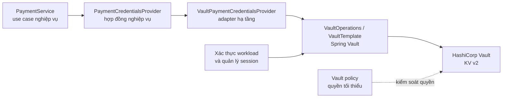

# Thiết kế lớp truy cập secret theo nhu cầu nghiệp vụ

Trong chương **Kiến trúc client**, mục tiêu của bài này là thiết kế một lớp truy cập secret để ứng dụng Java sử dụng **Spring Vault** và **HashiCorp Vault** mà vẫn giữ được ranh giới rõ ràng giữa nghiệp vụ và hạ tầng bảo mật. Spring Vault cung cấp `VaultOperations` / `VaultTemplate` để gọi Vault; kiến trúc tốt quyết định **ai được lấy secret nào, vào thời điểm nào, khi nào phải làm mới và ứng dụng phản ứng ra sao khi Vault gặp lỗi**.

Sau bài học, bạn có thể:

- Chọn hợp đồng truy cập secret xuất phát từ use case thay vì để tầng nghiệp vụ tự truyền đường dẫn Vault.
- Ánh xạ KV v2 thành kiểu dữ liệu nghiệp vụ, kiểm tra trường bắt buộc và đóng gói lỗi.
- Kết nối adapter với `VaultOperations`, xác thực theo workload và Vault policy quyền tối thiểu.
- Xác định chiến lược cache, rotation, token/lease, xử lý sự cố và quan sát hệ thống theo tính chất secret.
- Kiểm thử lớp truy cập độc lập và xác nhận cấu hình thật bằng integration test.

## 1. Vì sao cần một lớp truy cập secret riêng?

Giả sử dịch vụ `payment-api` cần thông tin xác thực của cổng thanh toán. Cách triển khai trực tiếp thường là:

```java
// Ví dụ phản diện: mã nghiệp vụ biết cả mount, đường dẫn và cấu trúc Vault.
VaultResponse response = vaultOperations
        .opsForKeyValue("secret", KeyValueBackend.KV_2)
        .get("payments/prod/gateway");
String apiKey = (String) response.getData().get("apiKey");
```

Cách gọi này hoạt động khi mọi thứ đúng, nhưng khiến service phải biết chi tiết lưu trữ: tên mount, engine version, đường dẫn, tên field, quy tắc thiếu secret và lỗi gọi mạng. Các use case khác có thể tự sao chép đoạn code, diễn giải lỗi khác nhau, hoặc vô tình ghi giá trị secret vào log. Khi chuyển từ KV v2 sang nguồn khác, mọi use case đều phải sửa.

Một lớp truy cập secret theo nhu cầu nghiệp vụ đặt **hợp đồng đủ hẹp** giữa use case và Vault:



Service chỉ yêu cầu `PaymentCredentials`; adapter chịu trách nhiệm tìm, đọc, giải mã cấu trúc và chuyển lỗi. Việc xin và gia hạn Vault token nằm ở cơ chế authentication/session được cấu hình cho Spring Vault. Vault policy thực thi quyền ở phía server, kể cả khi mã Java bị gọi sai.

## 2. Chọn thiết kế từ đặc tính nghiệp vụ

Trước khi tạo một interface như `SecretService`, hãy xác định **loại bí mật, mục đích dùng, vòng đời và hậu quả khi thiếu dữ liệu**. Các loại thao tác với Vault có ngữ nghĩa rất khác nhau.

| Nhu cầu nghiệp vụ | Vault engine / cơ chế | Hợp đồng nên cung cấp | Điểm cần kiểm soát |
|---|---|---|---|
Gọi API đối tác với cặp khóa tĩnh | KV v2 | `PaymentCredentialsProvider.current()` | Schema, rotation, khả năng đọc khi Vault gián đoạn |
Kết nối cơ sở dữ liệu bằng tài khoản cấp tạm | Database secrets engine | Thành phần quản lý credential/connection có lease | TTL, renew/revoke, thay connection pool đúng lúc |
Mã hóa hoặc ký dữ liệu | Transit | `DataProtectionService.encrypt(...)` / `sign(...)` | Khóa nên ở trong Vault; kiểm soát context và quyền gọi |
Cấp chứng chỉ dịch vụ | PKI | `CertificateIssuer.issue(...)` | TTL, chu kỳ gia hạn, lưu private key an toàn |
Secret riêng cho khách hàng/tenant | KV hoặc engine phù hợp | `TenantCredentialProvider.forTenant(tenantId)` | Xác thực tenant, ánh xạ đường dẫn đã kiểm soát và cô lập quyền |

Không nên dùng một hàm công khai `getSecret(String vaultPath)` cho mọi trường hợp. Nó chuyển quyền quyết định đường dẫn sang caller, buộc caller biết schema và khiến kiểm tra phân quyền ở tầng ứng dụng khó thống nhất. Có thể tái sử dụng một adapter hạ tầng nội bộ, nhưng **API dành cho nghiệp vụ phải diễn đạt ý định**.

Những câu hỏi cần trả lời trước khi viết code:

1. Secret là một giá trị cấu hình lâu dài, một thông tin cấp động có lease, hay một thao tác mật mã không trả khóa về client?
2. Caller cần đọc mỗi request, khi khởi động, hay khi một phiên kết nối phải được tạo mới?
3. Secret thiếu hoặc hết hạn có bắt buộc chặn giao dịch không? Có hành vi suy giảm chức năng nào được phép không?
4. Độ trễ chấp nhận được là bao nhiêu? Có cần cache, TTL, refresh và giới hạn số lần gọi đồng thời không?
5. Workload nào sở hữu quyền truy cập và môi trường nào chứa secret? Có cần cô lập tenant không?

Các quyết định này dẫn tới interface, chính sách lỗi và cơ chế refresh cụ thể. Không nên cố gắng đưa mọi secret qua một cache chung hoặc một kiểu dữ liệu `Map<String, Object>` truyền đến cuối chuỗi gọi.

## 3. Thiết kế hợp đồng Java gắn với use case

Ví dụ xuyên suốt: `PaymentService` cần hai trường `apiKey` và `apiSecret` để gọi cổng thanh toán. Một secret KV v2 có thể được tổ chức như sau:

| Thành phần | Giá trị minh họa | Ý nghĩa |
|---|---|---|
Mount | `secret` | Nơi mount KV v2 trên Vault |
Logical path | `payments/prod/gateway` | Đường dẫn **tương đối so với mount** |
Data fields | `apiKey`, `apiSecret` | Schema mà adapter phải xác minh |
Workload | `payment-api` | Định danh runtime được xác thực với Vault |
Quyền | `read` | Chỉ đọc đúng secret phục vụ use case |

Đường dẫn logical này là cấu hình tin cậy của adapter, không lấy trực tiếp từ URL hay JSON của request.

**Bước 1 — khai báo interface nghiệp vụ.**

```java
public interface PaymentCredentialsProvider {
    PaymentCredentials current();
}
```

Tên `current()` thể hiện mong muốn lấy credential đang hợp lệ theo chính sách của provider. Nó **không tự bảo đảm** giá trị luôn là bản mới nhất: mức độ mới phụ thuộc chiến lược cache/refresh được mô tả ở phần sau.

**Bước 2 — trả về kiểu dữ liệu có kiểm tra cấu trúc.**

```java
public final class PaymentCredentials {
    private final String apiKey;
    private final String apiSecret;

    public PaymentCredentials(String apiKey, String apiSecret) {
        if (apiKey == null || apiKey.isBlank()
                || apiSecret == null || apiSecret.isBlank()) {
            throw new IllegalArgumentException(
                    "Thông tin xác thực cổng thanh toán không hợp lệ");
        }
        this.apiKey = apiKey;
        this.apiSecret = apiSecret;
    }

    public String apiKey() {
        return apiKey;
    }

    public String apiSecret() {
        return apiSecret;
    }

    @Override
    public String toString() {
        return "PaymentCredentials[REDACTED]";
    }
}
```

Tránh dùng `record` mặc định cho đối tượng chứa secret nếu không kiểm soát `toString()`, vì `record` tự sinh chuỗi chứa toàn bộ field. Dữ liệu Java `String` không thể chủ động xóa khỏi bộ nhớ; giảm thời gian giữ tham chiếu, tránh đưa vào thông điệp lỗi, tracing, metric labels hoặc log. Việc che `toString()` chỉ là một lớp bảo vệ, không thay thế quy trình xử lý dữ liệu nhạy cảm.

## 4. Hiện thực adapter bằng Spring Vault KV v2

Spring Vault có `VaultOperations` làm giao diện thao tác Vault và `VaultTemplate` là hiện thực thường dùng. Với KV v2, sử dụng `opsForKeyValue(mount, KeyValueBackend.KV_2)` để Spring Vault xử lý chi tiết API KV v2 thay vì tự ghép URL `/data/` và tự bóc lớp `data` của phản hồi HTTP.

**Bước 3 — tạo adapter.** Đoạn ví dụ dưới đây tập trung vào đường đọc; ứng dụng có thể tách từng lớp thành các file Java riêng.

```java
import java.util.Map;
import java.util.Objects;

import org.springframework.vault.VaultException;
import org.springframework.vault.core.VaultKeyValueOperations;
import org.springframework.vault.core.VaultKeyValueOperationsSupport.KeyValueBackend;
import org.springframework.vault.core.VaultOperations;
import org.springframework.vault.support.VaultResponse;

public final class VaultPaymentCredentialsProvider
        implements PaymentCredentialsProvider {

    private final VaultKeyValueOperations kv;
    private final String logicalPath;

    public VaultPaymentCredentialsProvider(
            VaultOperations operations, String mount, String logicalPath) {
        Objects.requireNonNull(operations, "operations");
        if (mount == null || mount.isBlank()
                || logicalPath == null || logicalPath.isBlank()) {
            throw new IllegalArgumentException("Thiếu cấu hình secret path");
        }
        this.kv = operations.opsForKeyValue(mount, KeyValueBackend.KV_2);
        this.logicalPath = logicalPath;
    }

    @Override
    public PaymentCredentials current() {
        final VaultResponse response;
        try {
            response = kv.get(logicalPath);
        } catch (VaultException ex) {
            // Không ghi response, token hoặc nội dung secret vào log.
            throw new SecretAccessException(
                    "Không thể truy cập credential cổng thanh toán", ex);
        }

        if (response == null || response.getData() == null) {
            throw new SecretConfigurationException(
                    "Credential cổng thanh toán chưa được cấu hình");
        }
        Map<String, Object> fields = response.getData();
        return new PaymentCredentials(
                requiredString(fields, "apiKey"),
                requiredString(fields, "apiSecret"));
    }

    private static String requiredString(
            Map<String, Object> fields, String name) {
        Object value = fields.get(name);
        if (!(value instanceof String)
                || ((String) value).isBlank()) {
            throw new SecretConfigurationException(
                    "Thiếu hoặc sai kiểu trường secret: " + name);
        }
        return (String) value;
    }
}

class SecretAccessException extends RuntimeException {
    SecretAccessException(String message, Throwable cause) {
        super(message, cause);
    }
}

class SecretConfigurationException extends RuntimeException {
    SecretConfigurationException(String message) {
        super(message);
    }
}
```

Ở đây:

- `mount` là tên KV mount (`secret`), còn `logicalPath` là `payments/prod/gateway`. Không truyền `secret/data/payments/...` vào `kv.get(...)` vì adapter KV v2 sẽ thêm các đoạn API cần thiết.
- `get(...)` trả về `VaultResponse` cho trường hợp có dữ liệu; kiểm tra cả phản hồi rỗng và kiểu dữ liệu của các field.
- Lỗi hạ tầng và lỗi schema được tách riêng: một trường hợp liên quan liên lạc/quyền truy cập Vault, trường hợp còn lại cho biết cấu hình secret chưa đạt hợp đồng nghiệp vụ.
- Ví dụ luôn yêu cầu hai field và không tự sử dụng giá trị mặc định cho khóa xác thực. Nếu secret sai, xử lý **fail closed** là phù hợp cho giao dịch thanh toán.

Không nên bọc toàn bộ code bằng `catch (Exception)` rồi trả `null` hoặc một chuỗi rỗng: cách đó khiến giao dịch có thể tiếp tục trong trạng thái không an toàn, đồng thời làm mất tín hiệu chẩn đoán nguyên nhân.

**Bước 4 — cấu hình wiring tại composition root.**

```java
import org.springframework.beans.factory.annotation.Value;
import org.springframework.context.annotation.Bean;
import org.springframework.context.annotation.Configuration;
import org.springframework.vault.core.VaultOperations;

@Configuration
class PaymentVaultConfiguration {

    @Bean
    PaymentCredentialsProvider paymentCredentialsProvider(
            VaultOperations operations,
            @Value("${app.vault.kv-mount}") String mount,
            @Value("${app.vault.payment-path}") String path) {
        return new VaultPaymentCredentialsProvider(
                operations, mount, path);
    }
}
```

```yaml
app:
  vault:
    kv-mount: secret
    payment-path: payments/prod/gateway
```

Đường dẫn là thông tin cấu hình, còn giá trị `apiKey` / `apiSecret` chỉ nằm trong Vault. Thay vì dùng một đường dẫn cố định `prod` cho mọi môi trường, hãy cung cấp path tương ứng qua cấu hình triển khai.

Ví dụ giả định ứng dụng đã có bean `VaultOperations` được cấu hình bởi Spring Vault hoặc Spring Cloud Vault. Nếu tự dùng `VaultTemplate`, phải cấu hình endpoint, HTTPS, authentication/session manager và các timeout phù hợp trước khi inject. Không tạo `VaultTemplate` và thực hiện login mới trong mỗi request.

**Bước 5 — dùng hợp đồng trong service.**

```java
public final class PaymentService {
    private final PaymentCredentialsProvider credentialsProvider;
    private final PartnerPaymentClient partnerClient;

    public PaymentService(
            PaymentCredentialsProvider credentialsProvider,
            PartnerPaymentClient partnerClient) {
        this.credentialsProvider = credentialsProvider;
        this.partnerClient = partnerClient;
    }

    public PaymentResult charge(PaymentRequest request) {
        PaymentCredentials credentials = credentialsProvider.current();
        return partnerClient.charge(
                request, credentials.apiKey(), credentials.apiSecret());
    }
}
```

`PartnerPaymentClient`, `PaymentRequest` và `PaymentResult` là các kiểu minh họa của miền thanh toán. `PaymentService` không có import của Spring Vault, không chứa đường dẫn Vault và không quyết định xử lý KV v1/KV v2. Nhờ vậy, có thể thay provider bằng fake trong unit test hoặc đổi cách lấy secret mà không sửa logic thanh toán.

## 5. Xác thực workload và phân quyền tối thiểu

Lớp Java chỉ thực hiện đúng chức năng khi phía Vault cấp quyền phù hợp. Trong môi trường Kubernetes, có thể dùng cơ chế xác thực Kubernetes của Vault để workload nhận Vault token thông qua service account và role đã ràng buộc. Ví dụ cấu hình **Spring Cloud Vault**:

```yaml
spring:
  cloud:
    vault:
      uri: https://vault.internal.example:8200
      authentication: KUBERNETES
      kubernetes:
        role: payment-api
```

Ví dụ này giả định đã cấu hình Kubernetes auth method tại Vault, role `payment-api` liên kết đúng service account/namespace và workload đọc được service account token theo cấu hình môi trường. Bảo đảm kết nối TLS được kiểm chứng; không tắt xác minh chứng chỉ để xử lý lỗi môi trường. Nếu chạy trên VM hoặc cloud khác, cân nhắc AppRole hoặc phương thức identity/workload auth tương ứng; không hardcode một Vault token dài hạn vào mã nguồn.

Với KV v2 được mount tại `secret`, policy tối thiểu để đọc riêng credential ví dụ là:

```hcl
path "secret/data/payments/prod/gateway" {
  capabilities = ["read"]
}
```

Policy này áp dụng cho **đường dẫn API thật của KV v2** (có đoạn `data`). Ngược lại, `kv.get(...)` trong Java nhận logical path **không** có đoạn đó. Hai loại đường dẫn phục vụ hai tầng khác nhau.

Không cấp `list` trên `secret/metadata/*`, `create`, `update` hoặc `delete` nếu use case chỉ cần đọc một key. Mỗi môi trường và workload nên có role/policy tách biệt. Nếu quy trình rotation dùng một workload khác để ghi secret, workload đọc của `payment-api` không cần quyền ghi.

## 6. Lựa chọn thời điểm đọc và chính sách cache

`current()` có thể đọc Vault mỗi lần hoặc lấy từ cache. Không có một cách tối ưu cho mọi secret; cần lựa chọn dựa trên ngân sách độ trễ, lượng request, tần suất rotation và mức sẵn sàng mong muốn.

| Chiến lược | Phù hợp khi | Đổi lại |
|---|---|---|
Đọc Vault khi cần | Số lần dùng thấp, cần thấy bản cập nhật sớm, chấp nhận phụ thuộc Vault theo request | Tăng latency và tải Vault, request thất bại nếu Vault không sẵn sàng |
Cache ngắn hạn có TTL | Lưu lượng lớn, chấp nhận độ trễ nhìn thấy bản rotation trong giới hạn rõ ràng | Có thể dùng giá trị cũ trong TTL, cần quản lý invalidation và refresh |
Nạp khi khởi động + refresh chủ động | Secret bắt buộc cho toàn bộ instance, quy trình vận hành có cơ chế thay đổi được thiết kế | Cần kiểm soát refresh lỗi, readiness và đồng bộ sau rotation |

Khi thiết kế cache, cần trả lời rõ:

- **Độ cũ tối đa** cho phép là bao lâu? TTL cache phải nhỏ hơn cửa sổ giữ hiệu lực của credential cũ khi rotation, có thêm biên an toàn.
- Cache theo key nào? Chỉ cho phép tập đường dẫn đã định nghĩa; nếu có tenant, ràng buộc khóa cache với tenant đã được xác thực.
- Khi nhiều request cùng gặp cache miss, có cần gộp chúng thành một lượt nạp để tránh tăng đột biến traffic tới Vault?
- Khi refresh thất bại, có được dùng bản cũ không? Điều đó chỉ hợp lệ nếu credential cũ vẫn còn được phía đối tác chấp nhận và chính sách nghiệp vụ cho phép.
- Lúc shutdown hoặc evict, có còn giữ bản sao secret trong thread-local, log, dump hay đối tượng sử dụng lâu dài không?

Đặc biệt, **KV v2 và secret cấp động có lease không cùng vòng đời**. Một giá trị KV v2 được lưu theo phiên bản và không mặc nhiên có lease renew được. Credential do Database secrets engine phát hành thường có TTL, lease ID và cơ chế renew/revoke. Không dùng cùng một cache TTL tùy ý cho cả hai. Với dynamic credentials, sử dụng cơ chế quản lý lease phù hợp (ví dụ `SecretLeaseContainer` khi tích hợp theo hướng Spring Vault) và bảo đảm connection pool thay thông tin xác thực theo lịch hết hạn/rotation.

Vault token dùng để truy cập các secret cũng có thời hạn và có thể được renew/revoke; session manager hoặc cơ chế Spring Cloud Vault tương ứng phải đảm nhiệm vòng đời này. Không tái sử dụng JWT workload như Vault token, không tự giữ mã token trong singleton nghiệp vụ và không coi việc cache credential là thay thế quản lý session.

## 7. Lỗi và hành vi của ứng dụng

Cách phản ứng khi Vault không trả dữ liệu là một phần của hợp đồng nghiệp vụ. Nên phân biệt **thiếu secret**, **schema sai**, **không đủ quyền** và **sự cố tạm thời** thay vì gộp mọi trường hợp thành `null`.

| Tình huống | Ý nghĩa | Cách xử lý đề xuất |
|---|---|---|
KV path không tồn tại | Secret chưa được cấp/provision | Báo lỗi cấu hình; không tự tạo secret hoặc dùng khóa mặc định |
Thiếu `apiKey` / `apiSecret` | Tài liệu Vault không thỏa schema | Dừng use case liên quan, gửi cảnh báo cấu hình với tên field, không log giá trị |
Vault trả lỗi quyền 403 | Workload/role/policy sai hoặc token không hợp lệ | Phân loại lỗi auth/authorization, cảnh báo vận hành; không retry liên tục để “vượt” quyền |
Timeout, mất kết nối, lỗi server tạm thời | Vault hoặc mạng có thể phục hồi | Retry giới hạn với backoff và jitter nếu thao tác an toàn; dùng circuit breaker khi cần |
Secret vừa rotate, đối tác từ chối key cũ | Cache chưa được refresh hoặc rollout chưa đồng bộ | Invalidate cache theo quy trình rotation, kiểm tra thời gian hiệu lực song song |
Credential có lease bị revoke/hết hạn | Phiên kết nối dựa trên credential cũ có thể không còn hợp lệ | Phát hành lại credential theo lease manager, tái tạo/đổi connection pool |

Ví dụ adapter ở trên chỉ tách lỗi truy cập tổng quát và lỗi cấu hình. Khi triển khai thật, có thể **phân loại HTTP status/cause** từ ngoại lệ Spring Vault ở tầng hạ tầng để tạo mã lỗi có ý nghĩa cho telemetry và quyết định retry; cần tránh để thông điệp gốc chứa thông tin nhạy cảm xuất hiện trong HTTP response trả về client.

Với thanh toán, không thể trả một credential giả rồi tiếp tục gọi API đối tác. Với một tính năng tùy chọn (ví dụ xuất báo cáo không quan trọng), có thể cho phép tạm tắt chức năng đó theo yêu cầu nghiệp vụ. Hai use case cần hai chính sách lỗi khác nhau, dù cùng dùng Spring Vault.

## 8. Quan sát, vận hành và bảo vệ dữ liệu

Để xử lý sự cố mà không lộ secret, nên ghi nhận các tín hiệu **không chứa payload**:

- Số lần đọc secret thành công/thất bại, chia theo **mã use case hữu hạn** (ví dụ `payment-gateway`), loại lỗi và môi trường.
- Latency của lệnh đọc Vault và tỉ lệ cache hit/miss nếu có cache.
- Trạng thái token renewal/authentication và lease renewal/revoke khi dùng dynamic credentials.
- Thời điểm refresh thành công gần nhất, tuổi của phiên bản credential đang phục vụ và số lần refresh thất bại.
- Cảnh báo tăng đột biến lỗi quyền, lỗi schema, timeout hoặc secret sắp vượt thời gian chấp nhận độ cũ.

Không dùng secret value, token, raw Vault response, đường dẫn tenant do người dùng nhập hoặc ciphertext nhạy cảm làm metric label. Tránh `log.debug(response)`, in exception body của Vault ra log công khai, đưa secret vào URL, message queue, audit event nghiệp vụ hoặc HTTP error. Nếu bật tracing, lọc header như `X-Vault-Token` và dữ liệu request/response trước khi xuất span.

Với rotation, nên tổ chức quy trình có kiểm chứng: phát hành credential mới, cập nhật Vault, buộc provider/caches nhìn thấy giá trị mới, xác nhận downstream chấp nhận, sau đó thu hồi credential cũ theo thời gian chồng lấn đã thỏa thuận. Cần kiểm thử trường hợp nhiều instance của `payment-api` cập nhật không đồng thời.

## 9. Kiểm thử theo từng ranh giới

**Unit test của adapter** không cần Vault thật. Mock `VaultOperations` và `VaultKeyValueOperations` để xác minh ánh xạ từ map dữ liệu sang `PaymentCredentials`. Ví dụ:

```java
import static org.junit.jupiter.api.Assertions.assertEquals;
import static org.mockito.Mockito.*;

import java.util.Map;
import org.junit.jupiter.api.Test;
import org.springframework.vault.core.VaultKeyValueOperations;
import org.springframework.vault.core.VaultKeyValueOperationsSupport.KeyValueBackend;
import org.springframework.vault.core.VaultOperations;
import org.springframework.vault.support.VaultResponse;

class VaultPaymentCredentialsProviderTest {
    @Test
    void readsAndValidatesPaymentCredentials() {
        VaultOperations vault = mock(VaultOperations.class);
        VaultKeyValueOperations kv = mock(VaultKeyValueOperations.class);
        when(vault.opsForKeyValue("secret", KeyValueBackend.KV_2))
                .thenReturn(kv);

        VaultResponse response = new VaultResponse();
        response.setData(Map.of(
                "apiKey", "test-key",
                "apiSecret", "test-secret"));
        when(kv.get("payments/prod/gateway")).thenReturn(response);

        PaymentCredentials credentials =
                new VaultPaymentCredentialsProvider(
                        vault, "secret", "payments/prod/gateway")
                        .current();
        assertEquals("test-key", credentials.apiKey());
        assertEquals("test-secret", credentials.apiSecret());
        verify(kv).get("payments/prod/gateway");
    }
}
```

Các test có giá trị tiếp theo gồm: `kv.get(...)` trả `null`; thiếu một field; field sai kiểu; `VaultException` xuất hiện; `toString()` không lộ secret; service chỉ phụ thuộc provider. Không cần mock chi tiết HTTP của Vault trong unit test này vì Spring Vault đã đảm nhận wire protocol.

**Integration test** nên chạy với Vault thử nghiệm tách biệt (có thể dùng container Vault), tạo mount KV v2, policy và auth phù hợp rồi kiểm tra:

1. Đọc thành công theo logical path; xác nhận adapter không nhầm đường dẫn `data/`.
2. Workload có quyền `read` đọc được đúng key; truy cập key khác hoặc thao tác ghi bị từ chối.
3. Khi xóa/ẩn một key hoặc sửa schema, ứng dụng trả lỗi dự kiến mà không lộ giá trị.
4. Sau khi thay phiên bản KV, giá trị mới xuất hiện theo SLA refresh/cache của ứng dụng.
5. Khi Vault timeout/ngừng đáp ứng, số retry, latency và cảnh báo phù hợp với chính sách đã chọn.
6. Với dynamic secret, thử hết hạn/thu hồi lease và kiểm tra kết nối mới không tái sử dụng credential hết hạn.

Secret thử nghiệm phải là dữ liệu giả. Tài khoản và policy test cần tách khỏi môi trường production, và phải thu hồi token/lease thử nghiệm khi dọn môi trường.

## 10. Các lỗi thiết kế thường gặp

| Thiết kế chưa phù hợp | Tác hại | Hướng sửa |
|---|---|---|
Use case nhận `VaultTemplate` trực tiếp | Phụ thuộc đường dẫn, schema, engine version | Inject interface `PaymentCredentialsProvider` |
API tiện ích `getSecret(path)` mở cho toàn bộ code | Truy cập tùy ý; khó audit theo nghiệp vụ | Tách provider theo domain, path từ cấu hình tin cậy |
Chỉ đọc một lần lúc startup nhưng rotation không refresh | Tiếp tục dùng key bị thu hồi | Thiết kế TTL/refresh hoặc restart có kiểm soát |
Cache vô thời hạn dynamic credentials | Dùng lease hết hạn | Gắn lifecycle với TTL và cơ chế lease manager |
Trộn `mount` và đường dẫn API KV v2 | `404` dù secret tồn tại | `opsForKeyValue(mount, KV_2).get(logicalPath)` |
Ghi toàn bộ `VaultResponse` vào log | Có thể lộ credential | Log mã lỗi, use case và thời gian, không log payload |
Policy `secret/*` với quyền ghi/xóa | Workload có quyền vượt nhu cầu | Thu hẹp `read` theo đúng `secret/data/...` |
Dùng fallback key mặc định khi Vault lỗi | Dẫn tới truy cập sai, rò rỉ hoặc bỏ qua kiểm soát | Fail closed cho giao dịch quan trọng |

## 11. Bài thực hành: thiết kế thêm hai provider

**Tình huống A — Thông tin webhook đối tác.** Một service cần secret để xác minh chữ ký webhook. Hãy đề xuất interface `WebhookSigningSecretProvider`, schema có field `signingSecret`, quy tắc rotation (có thể hỗ trợ song song key hiện tại/key trước trong một cửa sổ ngắn) và cách kiểm thử chữ ký mà không ghi secret vào log. Giải thích vì sao cache có TTL phù hợp hơn hay kém hơn việc đọc Vault từng webhook.

**Tình huống B — Tài khoản PostgreSQL cấp động.** Một service lấy user/password có lease từ Vault Database secrets engine. Hãy mô tả component sở hữu lease và connection pool, hành động khi credential hết hạn và quyền Vault cần thiết. Chỉ ra vì sao không thể dùng nguyên `VaultPaymentCredentialsProvider` rồi cache kết quả vô thời hạn.

Một thiết kế đạt yêu cầu cần thể hiện được: **interface xuất phát từ nghiệp vụ**, adapter Spring Vault được cô lập, **secret path và policy được kiểm soát**, vòng đời khớp với loại secret, lỗi được phân loại để ứng dụng quyết định đúng, và khả năng chứng minh các tính chất đó bằng kiểm thử.
