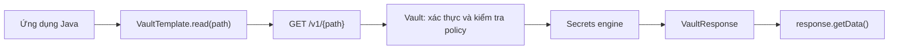

# Đọc dữ liệu bằng `read()` và `VaultResponse` trong Spring Vault

`VaultTemplate` là điểm truy cập chính của Spring Vault khi ứng dụng Java cần làm việc trực tiếp với HashiCorp Vault. Một thao tác nền tảng là gọi `read(path)` để lấy secret theo đường dẫn API của Vault, sau đó đọc dữ liệu trong đối tượng `VaultResponse`. Nắm rõ hai bước này đặc biệt quan trọng khi làm việc với KV secrets: đường dẫn KV phiên bản 1 và 2 khác nhau, và cấu trúc `data` trả về cũng khác nhau.

Bài học thuộc phần **VaultTemplate** của module **SPRING_VAULT**. Module hướng đến việc ứng dụng Java truy cập HashiCorp Vault qua `VaultTemplate`, sử dụng xác thực theo workload và chính sách phân quyền, đồng thời tìm hiểu vòng đời token/lease, Transit encryption, PKI, xử lý lỗi, giám sát và kiểm thử tích hợp. Trong bài này, ta tập trung vào **đọc dữ liệu an toàn bằng `read()` và diễn giải đúng `VaultResponse`**; các cơ chế xác thực và engines khác đóng vai trò bối cảnh.

## Mục tiêu học tập

Sau bài học, bạn có thể:

- Giải thích `VaultTemplate.read(path)` gọi API nào và `VaultResponse` chứa những gì.
- Phân biệt đường dẫn và cấu trúc dữ liệu của KV v1 với KV v2.
- Viết Java code đọc secret, kiểm tra dữ liệu thiếu/sai kiểu trước khi sử dụng.
- Nhận diện lỗi không tìm thấy secret, thiếu quyền, lỗi xác thực và lỗi kết nối mà không làm lộ thông tin nhạy cảm.
- Thiết kế kiểm thử đọc secret và cấu hình quyền `read` tối thiểu.

## 1. Luồng đọc secret: từ Java tới Vault

`VaultTemplate` triển khai giao diện `VaultOperations`, cung cấp các phương thức làm việc với Vault. Phương thức dùng trong bài là:

```java
VaultResponse response = vaultTemplate.read("secret/data/app/db");
```

Giá trị truyền vào là **đường dẫn API tương đối của Vault**, không kèm URL máy chủ và không kèm tiền tố `/v1/`. Với ví dụ trên, Spring Vault thực hiện yêu cầu HTTP tương đương `GET /v1/secret/data/app/db` tới Vault server đã cấu hình. `VaultTemplate` sử dụng cơ chế xác thực được kết nối với nó để gửi yêu cầu; Vault đánh giá policy trước khi trả dữ liệu.



Ví dụ trên giả định ứng dụng đã có bean `VaultTemplate` được cấu hình với endpoint, TLS và phương thức xác thực hợp lệ. Trong môi trường vận hành, nên sử dụng danh tính workload (chẳng hạn Kubernetes hoặc AppRole phù hợp) và policy chỉ cho phép các path cần đọc. **Không đặt Vault token hoặc mật khẩu production trực tiếp trong mã nguồn.**

### `VaultResponse` chứa dữ liệu gì?

Vault thường trả JSON gồm các trường cấp cao như `request_id`, `lease_id`, `renewable`, `lease_duration`, `data`, `warnings` và các trường liên quan khác tùy endpoint. Spring Vault ánh xạ phần phản hồi vào `VaultResponse`; phần secret được truy cập qua:

```java
Map<String, Object> data = response.getData();
```

Điểm cần nhớ: `getData()` trả **map của trường `data` ở cấp ngoài của phản hồi HTTP**, không đảm bảo luôn là map chứa trực tiếp các key nghiệp vụ như `username` hoặc `password`. Hình dạng map phụ thuộc secrets engine và API path. Đối tượng `VaultResponse` cũng có thể mang thông tin lease từ phản hồi, nhưng **KV secret thông thường không phải là dynamic credential có lease cần gia hạn**; không suy diễn vòng đời secret chỉ từ sự có mặt của các trường lease.

## 2. Đường dẫn và dữ liệu của KV v1 so với KV v2

Giả sử key logic mà ứng dụng cần là `app/db` trong KV engine. Ta dùng hai mount *khác nhau* để minh họa vì không thể đồng thời cấu hình KV v1 và KV v2 trên cùng một mount:

| Nội dung | KV v1 | KV v2 |
|---|---|---|
| Mount ví dụ | `legacy` | `secret` |
| Key logic | `app/db` | `app/db` |
| Đường dẫn `read(...)` | `legacy/app/db` | `secret/data/app/db` |
| `response.getData()` | Các cặp key/value của secret | Map có `data` (secret) và `metadata` (phiên bản, thời điểm, ...) |
| Hỗ trợ versioning | Không | Có |
| ACL để đọc ví dụ | `legacy/app/db` | `secret/data/app/db` |

Lệnh CLI tham khảo cho môi trường Vault thử nghiệm (bỏ lệnh `secrets enable` nếu mount đã tồn tại):

```bash
# KV v1: mount tại legacy
vault secrets enable -path=legacy -version=1 kv
vault kv put -mount=legacy app/db username=demo_user password=demo-only

# KV v2: mount tại secret
vault secrets enable -path=secret -version=2 kv
vault kv put -mount=secret app/db username=demo_user password=demo-only
vault kv get -mount=secret app/db
```

`demo-only` chỉ là giá trị minh họa, không phải thông tin đăng nhập thật. Với CLI `vault kv`, bạn nhập *mount* và *key logic*; khi gọi trực tiếp `VaultTemplate.read()`, phải dùng **đường dẫn API tương ứng**. Đối với KV v2, đoạn `/data/` là một phần quan trọng của API.

### Trường hợp KV v1

Đọc `legacy/app/db` có thể trả JSON rút gọn như sau:

```json
{
  "data": {
    "username": "demo_user",
    "password": "demo-only"
  }
}
```

Khi đó `response.getData().get("username")` là `"demo_user"`.

### Trường hợp KV v2

Đọc `secret/data/app/db` có thể trả JSON rút gọn như sau:

```json
{
  "data": {
    "data": {
      "username": "demo_user",
      "password": "demo-only"
    },
    "metadata": {
      "version": 1,
      "destroyed": false,
      "deletion_time": ""
    }
  }
}
```

Đối với KV v2, biểu thức `response.getData().get("username")` thường trả `null`: key `username` nằm trong **`response.getData().get("data")`**. Cấp `data` bên ngoài là trường phản hồi chung của Vault; cấp `data` bên trong là nội dung secret của KV v2. Trường `metadata` chứa thông tin về phiên bản, không phải nơi lưu dữ liệu đăng nhập.

> **Lưu ý:** Các JSON trên đã rút gọn để làm rõ cấu trúc. Phản hồi thực tế có thêm trường cấp cao, và metadata của KV v2 có thể chứa nhiều thuộc tính khác. Không nên ràng buộc code vào một JSON minh họa nguyên vẹn.

## 3. Ví dụ Java: đọc `VaultResponse` an toàn

Ví dụ dưới đây dùng Java 17+, Spring và một bean `VaultTemplate` **đã được cấu hình sẵn**. Dịch vụ hỗ trợ cả hai KV engine để thể hiện sự khác nhau ở đường dẫn và cách tách dữ liệu. Đọc secret là thao tác tại thời điểm gọi; code không tự động theo dõi các thay đổi mới trong Vault.

```java
import java.util.Map;

import org.springframework.stereotype.Service;
import org.springframework.vault.core.VaultTemplate;
import org.springframework.vault.support.VaultResponse;

@Service
public class DatabaseSecretReader {

    private final VaultTemplate vaultTemplate;

    public DatabaseSecretReader(VaultTemplate vaultTemplate) {
        this.vaultTemplate = vaultTemplate;
    }

    // Ví dụ khi mount "legacy" dùng KV v1.
    public DbSecret readKv1() {
        VaultResponse response = vaultTemplate.read("legacy/app/db");
        return toDbSecret(requiredData(response));
    }

    // Ví dụ khi mount "secret" dùng KV v2.
    public DbSecret readKv2() {
        VaultResponse response = vaultTemplate.read("secret/data/app/db");
        Map<?, ?> envelope = requiredData(response);

        Object nestedData = envelope.get("data");
        if (!(nestedData instanceof Map<?, ?> secretData)) {
            throw new IllegalStateException("Vault KV v2 trả về cấu trúc data không hợp lệ");
        }

        return toDbSecret(secretData);
    }

    private static Map<?, ?> requiredData(VaultResponse response) {
        if (response == null || response.getData() == null) {
            throw new IllegalStateException("Không tìm thấy dữ liệu secret trong Vault");
        }
        return response.getData();
    }

    private static DbSecret toDbSecret(Map<?, ?> values) {
        return new DbSecret(
                requiredString(values, "username"),
                requiredString(values, "password"));
    }

    private static String requiredString(Map<?, ?> values, String key) {
        Object value = values.get(key);
        if (value instanceof String text && !text.isBlank()) {
            return text;
        }
        throw new IllegalStateException("Secret thiếu trường hợp lệ: " + key);
    }

    public record DbSecret(String username, String password) {
        // Tránh toString() mặc định của record vô tình in password vào log.
        @Override
        public String toString() {
            return "DbSecret[REDACTED]";
        }
    }
}
```

Đọc `VaultResponse` như trên có ba lớp phòng vệ: kiểm tra response/`data` có tồn tại, kiểm tra cấu trúc bọc `data` của KV v2, rồi xác thực kiểu và giá trị của các trường cần dùng. Các thông báo lỗi chỉ nêu **tên trường và trạng thái**, không đưa giá trị secret vào exception hoặc log.

Trong một ứng dụng Spring, `DatabaseSecretReader` có thể được inject vào service khác để lấy thông tin kết nối lúc cần. Trước khi triển khai, cần chọn chiến lược tải và làm mới cấu hình phù hợp; đọc một lần vào lúc khởi động sẽ không tự nhận được giá trị đã cập nhật sau đó trong Vault.

### Khi nào dùng API có kiểu hoặc KV operations?

`VaultOperations` còn có API đọc dữ liệu ánh xạ vào kiểu Java, ví dụ `read(path, MyType.class)` trả `VaultResponseSupport<MyType>`. Cơ chế ánh xạ này cần hiểu đúng JSON của endpoint; với KV v2, có thêm lớp `data` bên trong nên không nên giả định phép ánh xạ giống KV v1.

Nếu ứng dụng làm việc chủ yếu với KV v2, có thể cân nhắc `vaultTemplate.opsForKeyValue("secret", KeyValueBackend.KV_2)` và các thao tác `get(...)` của `VaultKeyValueOperations`. API này biết ngữ nghĩa KV engine nên giảm nguy cơ lẫn đường dẫn API và key logic. Dù chọn API nào, vẫn phải xử lý dữ liệu thiếu, quyền truy cập và việc bảo vệ thông tin nhạy cảm.

## 4. Policy và xác thực quyết định việc `read()` có thành công hay không

Một Vault token hợp lệ **không đồng nghĩa** token có quyền đọc mọi secret. Vault kiểm tra capability trên đường dẫn API thực tế. Ví dụ, để workload chỉ đọc key KV v2 `app/db` trong mount `secret`, có thể dùng policy HCL:

```hcl
path "secret/data/app/db" {
  capabilities = ["read"]
}
```

Nếu đọc KV v1 tại `legacy/app/db`, path policy tương ứng là `legacy/app/db`. Với KV v2, cấp quyền trên `secret/app/db` sẽ không khớp API đọc dữ liệu `secret/data/app/db`. Quyền `list` trên đường dẫn metadata là một nhu cầu riêng; thao tác đọc key cụ thể ở đây không yêu cầu mở rộng quyền chỉ để liệt kê.

Workload nhận policy qua phương thức xác thực được tổ chức triển khai, chẳng hạn Kubernetes authentication hoặc AppRole. Cần cấp quyền đúng danh tính ứng dụng, định kỳ đánh giá policy và bảo đảm session/token còn hợp lệ. Token hết hạn hoặc bị thu hồi có thể khiến lệnh `read()` thất bại mặc dù path và cấu trúc dữ liệu đúng.

## 5. Phân biệt dữ liệu thiếu với lỗi truy cập

`VaultTemplate.read()` không bảo đảm luôn trả đối tượng chứa map hợp lệ. Theo endpoint và loại lỗi, bạn có thể nhận `null` hoặc gặp exception từ tầng Vault/HTTP/kết nối. Đặc biệt, **không nên bắt mọi exception rồi biến thành “secret không tồn tại”**: làm vậy che giấu lỗi quyền truy cập và sự cố hệ thống.

| Hiện tượng | Khả năng thường gặp | Cách xử lý |
|---|---|---|
| `response == null` hoặc không có `data` | Không thấy dữ liệu ở path đang đọc; KV v2 có version bị xóa hoặc key chưa được tạo | Kiểm tra mount, key, phiên bản và hành vi endpoint; trả lỗi nghiệp vụ có kiểm soát |
| Phản hồi có `data` nhưng thiếu `username` | Nhầm KV v1/KV v2 hoặc secret không đúng schema | Kiểm tra lớp `data` của KV v2 và schema bắt buộc |
| HTTP 403 / exception liên quan quyền | Policy thiếu `read` trên API path, hoặc danh tính không phù hợp | Kiểm tra ACL và identity của workload; không tự nới quyền quá mức |
| HTTP 401 hoặc lỗi token/session | Xác thực không hợp lệ, token hết hạn hoặc bị thu hồi | Kiểm tra cấu hình xác thực và vòng đời session/token |
| Timeout, mất kết nối, Vault 5xx | Network, TLS, Vault server hoặc trạng thái dịch vụ | Quan sát metric/log đã loại dữ liệu nhạy cảm; chỉ retry có giới hạn khi lỗi tạm thời |

Trên nhiều luồng đọc của Spring Vault, phản hồi 404 được diễn giải thành `null`; tuy nhiên hành vi cụ thể phụ thuộc endpoint, phiên bản thư viện và cấu hình xử lý lỗi. Hãy kiểm thử thực tế với phiên bản đang dùng. Không dựa vào một kiểu trả về duy nhất để phân loại mọi lỗi.

### Nguyên tắc xử lý lỗi trong ứng dụng

1. **Phân loại lỗi:** tách trường hợp thiếu dữ liệu, sai schema, thiếu quyền, lỗi xác thực và lỗi dịch vụ; trả mã lỗi nội bộ nhất quán cho tầng gọi.
2. **Hạn chế retry:** chỉ áp dụng backoff và giới hạn số lần cho lỗi tạm thời (chẳng hạn timeout/5xx). Không retry vô hạn với 403 hoặc secret sai schema.
3. **Giữ bí mật trong log:** không log `VaultResponse`, toàn bộ map từ `getData()`, giá trị `password`, token, hoặc `toString()` của DTO chứa secret.
4. **Quan sát không lộ dữ liệu:** có thể ghi nhận tên thao tác, trạng thái thành công/thất bại, độ trễ và loại lỗi; cân nhắc hạn chế cả path nếu tên path là thông tin nhạy cảm.
5. **Cấu hình an toàn:** cấu hình endpoint HTTPS, trust store/TLS và danh tính workload trong hạ tầng; tránh hardcode thông tin truy cập.

## 6. Thực hành kiểm thử đọc secret

Hãy sử dụng Vault thử nghiệm riêng, tạo mount KV v2 `secret`, lưu key `app/db` bằng giá trị giả và cấp policy chỉ có capability `read` trên `secret/data/app/db` cho danh tính kiểm thử. Sau đó gọi `readKv2()` từ một ứng dụng đã cấu hình `VaultTemplate` và kiểm tra DTO nhận đúng hai trường. Thử thay giá trị bằng lệnh `vault kv put -mount=secret app/db ...` và gọi đọc lại để xác nhận ứng dụng nhận được version mới ở lần đọc kế tiếp.

Các trường hợp nên kiểm thử:

| Kịch bản | Kết quả mong đợi |
|---|---|
| Key KV v2 tồn tại, policy hợp lệ | Đọc được `username`, `password`; bóc đúng lớp `data` bên trong |
| Truy cập KV v1 ở mount `legacy` | Đọc trực tiếp các key từ `response.getData()` |
| Đường dẫn không tồn tại | Ứng dụng phân loại là thiếu secret, không gây `NullPointerException` |
| Token có quyền trên sai path, chẳng hạn `secret/app/db` | Vault từ chối truy cập KV v2; ứng dụng nhận diện lỗi quyền |
| Secret thiếu `password` hoặc `password` không phải chuỗi | Ứng dụng từ chối dữ liệu sai schema với thông báo không chứa giá trị secret |
| Vault tạm thời không kết nối được | Ứng dụng báo lỗi dịch vụ có kiểm soát, không retry vô hạn |
| Kiểm tra log trong tất cả các kịch bản | Không xuất hiện token, mật khẩu hoặc nội dung toàn bộ response |

Kiểm thử tích hợp nên chạy với Vault thực hoặc một Vault container được cô lập để xác minh đồng thời đường dẫn API, policy và lớp dữ liệu KV v2. Unit test bằng mock `VaultTemplate` hữu ích cho nhánh `null` và kiểm tra schema, nhưng không thay thế được bài kiểm thử tích hợp về ACL và API path.

## 7. Những nhầm lẫn thường gặp

**Nhầm key logic với API path.** `vault kv get -mount=secret app/db` dùng key logic; `vaultTemplate.read("secret/data/app/db")` dùng API path của KV v2. Thiếu `/data/` thường khiến đọc sai endpoint.

**Coi `VaultResponse.getData()` luôn là secret thực.** Với KV v2, cần lấy tiếp field `data`; với các engine khác như Transit hoặc PKI, cấu trúc phản hồi còn có thể khác nữa. Luôn dựa vào contract của endpoint đang gọi.

**Giả định quyền đọc tự động có sẵn.** Xác thực thành công chỉ cung cấp identity/token; policy mới quy định thao tác nào được phép. Cấp quyền đúng path cụ thể theo nguyên tắc ít quyền nhất.

**Nhầm metadata/lease với vòng đời của KV.** KV v2 versioning và trạng thái xóa phiên bản khác với dynamic secrets có thời hạn lease. Token/session dùng để truy cập Vault cũng có vòng đời độc lập với giá trị KV đang lưu.

**Dùng `read()` như cơ chế tự đồng bộ.** Mỗi lần `read()` là một thao tác yêu cầu dữ liệu; để xử lý thay đổi secret, ứng dụng cần chủ động thiết kế việc đọc lại, cache/TTL (nếu phù hợp), hoặc chiến lược cấu hình khác.

## Câu hỏi tự kiểm tra

1. Vì sao `vaultTemplate.read("secret/app/db")` không phải đường dẫn đọc KV v2 đúng khi mount tên là `secret`?
2. Với `VaultResponse` của KV v2, bạn truy cập `username` qua những lớp map nào?
3. Hai lần đọc thất bại do secret bị thiếu và do token thiếu quyền `read` cần được xử lý khác nhau như thế nào?
4. Vì sao không nên log trực tiếp đối tượng `VaultResponse` hoặc một Java record chứa mật khẩu?

**Gợi ý đối chiếu:** KV v2 cần đường dẫn `secret/data/app/db`; dữ liệu nằm tại `response.getData().get("data")`; thiếu secret cần được phân biệt với lỗi ACL/xác thực; việc log toàn bộ response hoặc DTO có thể làm lộ giá trị bí mật. Khi nắm vững các điểm này, bạn đã có nền tảng để tiếp tục với ghi dữ liệu, API KV chuyên biệt và các secrets engines khác của Spring Vault.
