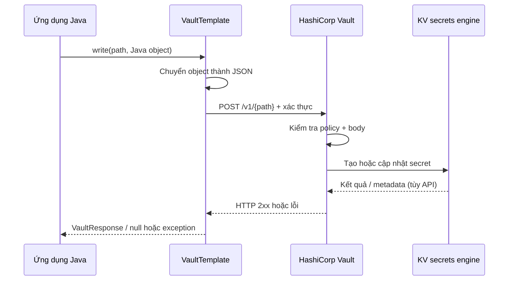
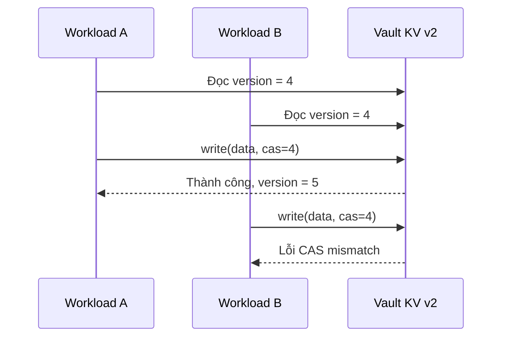

# Ghi dữ liệu bằng `write()` và đối tượng đầu vào trong Spring Vault

Trong **Spring Vault**, `VaultTemplate` cho phép ứng dụng Java gửi yêu cầu đến HashiCorp Vault mà không phải tự viết HTTP client. Sau thao tác đọc qua `read()`, kỹ năng quan trọng tiếp theo là **ghi dữ liệu** bằng `write(path, body)`: lựa chọn đúng API path, chuẩn bị đối tượng Java để được chuyển thành JSON và hiểu phản hồi cũng như các trường hợp lỗi.

Bài thuộc chương **VaultTemplate** của module **SPRING_VAULT**. Phạm vi module gồm truy cập Vault bằng Java, xác thực theo workload, policy phân quyền, KV secrets, vòng đời token và lease, Transit encryption, PKI, xử lý lỗi, giám sát và kiểm thử tích hợp. Bài này đi sâu vào **`write()` và đối tượng đầu vào**, chủ yếu với KV v1/KV v2; sự khác biệt giữa các secrets engine được nhắc đến khi quyết định cấu trúc request.

## Mục tiêu học tập

Sau bài học, bạn có thể:

1. Giải thích `VaultTemplate.write(String path, Object body)` gửi yêu cầu đến Vault như thế nào.
2. Dùng `Map` hoặc đối tượng Java (POJO/record) làm request body; dự đoán đúng JSON được gửi.
3. Phân biệt đường dẫn API và payload cần dùng để ghi KV v1 so với KV v2.
4. Áp dụng **check-and-set (CAS)** của KV v2 khi cần ngăn ghi đè ngoài ý muốn.
5. Cấu hình policy ghi tối thiểu, xử lý lỗi và kiểm thử mà không làm lộ secret.

## 1. `VaultTemplate.write()` làm gì?

Ở mức API, thao tác có dạng:

```java
VaultResponse response = vaultTemplate.write(
        "legacy/app/db",
        Map.of("username", "demo_user", "password", "demo-only"));
```

- `path` là **đường dẫn API tương đối** sau `/v1/`. Không truyền URL máy chủ hay `/v1/` vào đầu path.
- `body` là đối tượng Java được bộ chuyển đổi HTTP của Spring Vault chuyển thành nội dung yêu cầu, thường là **JSON**.
- Với đường dẫn KV phù hợp, Vault thực hiện thao tác tạo/cập nhật secret nếu identity có quyền.
- `write()` trả về `VaultResponse` khi endpoint có phản hồi phù hợp; **có endpoint ghi thành công mà không trả nội dung**. Vì vậy không dùng điều kiện `response != null` làm tiêu chí thành công chung.
- Khi Vault hoặc tầng HTTP từ chối yêu cầu, thao tác có thể ném exception; cần phân biệt lỗi dữ liệu, quyền và hạ tầng.

Đối với các endpoint được bàn trong bài, yêu cầu HTTP tương đương là `POST /v1/{path}` với JSON body. Đây là thao tác gọi một API endpoint; `write()` **không có nghĩa** mọi endpoint đều lưu một cặp key/value. Ví dụ, đối với Transit engine, cùng cơ chế `write()` có thể gửi dữ liệu tới endpoint mã hóa và nhận lại ciphertext, chứ không tạo một KV secret.



Ví dụ mặc định giả sử `VaultTemplate` đã được cấu hình endpoint HTTPS, chứng chỉ TLS và danh tính workload thích hợp (như Kubernetes Auth hoặc AppRole). **Không nhúng Vault token, thông tin đăng nhập thật hoặc endpoint quản trị nhạy cảm vào source code.**

## 2. Đối tượng đầu vào được biểu diễn thành JSON

Đối số `Object body` có thể là một `Map` hoặc object với các thuộc tính được bộ chuyển đổi JSON hỗ trợ. Hình dạng JSON là **contract của endpoint Vault**, nên cần kiểm tra nó trước khi chọn kiểu Java.

### Cách 1: dùng `Map`

```java
Map<String, Object> credentials = Map.of(
        "username", "demo_user",
        "password", "demo-only"
);

vaultTemplate.write("legacy/app/db", credentials);
```

Khi được chuyển thành JSON, body tương ứng:

```json
{
  "username": "demo_user",
  "password": "demo-only"
}
```

Ưu điểm của `Map` là nhanh, linh hoạt và dễ biểu diễn body lồng nhau. Đổi lại, các tên key ở dạng chuỗi nên dễ gõ sai; người viết code phải tự đảm bảo đúng schema. Lưu ý `Map.of(...)` **không chấp nhận key/value `null`**; xác thực đầu vào trước khi tạo map.

### Cách 2: dùng POJO hoặc Java record

Với Java 17+ và một bộ chuyển đổi JSON hỗ trợ record (chẳng hạn Jackson được cấu hình trong HTTP client), có thể dùng kiểu dữ liệu có tên trường rõ ràng:

```java
public record DbCredentials(String username, String password) {
    public DbCredentials {
        if (username == null || username.isBlank()
                || password == null || password.isBlank()) {
            throw new IllegalArgumentException("Thiếu trường secret bắt buộc");
        }
    }

    @Override
    public String toString() {
        return "DbCredentials[REDACTED]";
    }
}

DbCredentials credentials = new DbCredentials("demo_user", "demo-only");
vaultTemplate.write("legacy/app/db", credentials);
```

Nếu serializer hoạt động như mong đợi, object `DbCredentials` tạo ra JSON với hai trường `username` và `password`, giống `Map` ở ví dụ trên. Cần kiểm tra tên field thực tế nếu dùng annotations đổi tên thuộc tính, cấu hình Jackson riêng, kiểu ngày/giờ hoặc object phức tạp.

**Bảo vệ dữ liệu đầu vào:** `record` mặc định sinh `toString()` chứa tất cả field; override ở ví dụ nhằm giảm nguy cơ ghi mật khẩu vào log. Tuy nhiên `toString()` an toàn không ngăn mọi cách rò rỉ: không in toàn bộ body, exception, HTTP trace hoặc log debug có chứa request.

## 3. KV v1 và KV v2: cùng ý định ghi, khác API path và body

Giả sử ta dùng **hai mount riêng** để minh họa: `legacy` là KV v1 và `secret` là KV v2. Với key logic `app/db`:

| Thuộc tính | KV v1 (`legacy`) | KV v2 (`secret`) |
|---|---|---|
| Đường dẫn `write(...)` | `legacy/app/db` | `secret/data/app/db` |
| JSON body | Các key/value của secret ở cấp ngoài | Phải bọc secret trong trường `data` |
| Metadata phiên bản | Không có versioning | Có phiên bản và metadata sau khi ghi |
| Tùy chọn CAS | Không hỗ trợ CAS của KV v2 | Hỗ trợ `options.cas` |
| Ghi lại key đã tồn tại | Thay thế nội dung hiện tại | Tạo phiên bản mới với nội dung được gửi |
| Path policy để ghi | `legacy/app/db` | `secret/data/app/db` |

### Ghi KV v1

```java
vaultTemplate.write(
        "legacy/app/db",
        Map.of("username", "demo_user", "password", "demo-only"));
```

Yêu cầu gửi tới `POST /v1/legacy/app/db` có body:

```json
{
  "username": "demo_user",
  "password": "demo-only"
}
```

Với KV v1, dữ liệu gửi lên là nội dung của secret. Một lần ghi mới thay thế dữ liệu đang lưu tại key đó; **đừng giả định các field không có trong body cũ sẽ tự được giữ nguyên**. Để bổ sung một field trong khi vẫn giữ các field khác, ứng dụng phải thiết kế thao tác đọc–gộp–ghi và chấp nhận rủi ro tranh chấp khi không có CAS.

### Ghi KV v2

KV v2 yêu cầu phần dữ liệu được đặt **bên trong `data`**:

```java
vaultTemplate.write(
        "secret/data/app/db",
        Map.of("data", Map.of(
                "username", "demo_user",
                "password", "demo-only"
        )));
```

Yêu cầu gửi tới `POST /v1/secret/data/app/db` có body:

```json
{
  "data": {
    "username": "demo_user",
    "password": "demo-only"
  }
}
```

Phần `/data/` trong URL là thành phần **API path** của KV v2; `data` trong JSON là thành phần **request body**. Hai vị trí này có ý nghĩa khác nhau và **đều cần đúng** khi gọi `write()` trực tiếp. Nếu chỉ truyền `Map.of("username", ...)` cho API KV v2, Vault không nhận được cấu trúc `data` yêu cầu.

Phản hồi ghi KV v2 thành công thường có metadata về version mới, ví dụ rút gọn:

```json
{
  "data": {
    "created_time": "2026-01-01T00:00:00Z",
    "version": 2
  }
}
```

Đây là **metadata về lần ghi**, không phải nội dung secret. Với `VaultResponse`, metadata kiểu này được đọc qua `response.getData()` khi endpoint trả payload. KV v1 có thể trả phản hồi HTTP thành công nhưng không có body, khiến kết quả `write()` là `null`.

> **Lưu ý về cập nhật:** Với KV v2, ghi một object `data` mới tạo **một phiên bản chứa toàn bộ object vừa gửi**; thao tác này không tự hợp nhất từng field với phiên bản trước. Nếu cần patch riêng một phần dữ liệu, hãy cân nhắc API KV v2 PATCH và các điều kiện về version/policy của endpoint, thay vì cho rằng `write()` tự thực hiện merge.

## 4. Ví dụ Spring Java: viết `Map`, record và bảo vệ bằng CAS

Dịch vụ dưới đây cho thấy cách sử dụng object có kiểu ở KV v1 và cách bọc object tương tự thành request KV v2. Ví dụ dùng Java 17+, `VaultTemplate` đã được cấu hình và hai mount như mục trước.

```java
import java.util.Map;
import java.util.OptionalInt;

import org.springframework.stereotype.Service;
import org.springframework.vault.core.VaultTemplate;
import org.springframework.vault.support.VaultResponse;

@Service
public class DatabaseSecretWriter {

    private final VaultTemplate vaultTemplate;

    public DatabaseSecretWriter(VaultTemplate vaultTemplate) {
        this.vaultTemplate = vaultTemplate;
    }

    // KV v1: Object được serialize trực tiếp thành JSON secret.
    public void replaceKv1(DbCredentials secret) {
        vaultTemplate.write("legacy/app/db", secret);
    }

    // KV v2: cas=0 chỉ cho tạo key khi key chưa tồn tại.
    public OptionalInt createKv2(DbCredentials secret) {
        return writeKv2(secret, 0);
    }

    // KV v2: chỉ cập nhật khi version hiện tại khớp expectedVersion.
    public OptionalInt replaceKv2(DbCredentials secret, int expectedVersion) {
        if (expectedVersion <= 0) {
            throw new IllegalArgumentException("expectedVersion phải lớn hơn 0");
        }
        return writeKv2(secret, expectedVersion);
    }

    private OptionalInt writeKv2(DbCredentials secret, int cas) {
        Map<String, Object> payload = Map.of(
                "data", secret,
                "options", Map.of("cas", cas));

        VaultResponse response = vaultTemplate.write(
                "secret/data/app/db", payload);

        // Không có response body không tự động đồng nghĩa với thất bại.
        if (response == null || response.getData() == null) {
            return OptionalInt.empty();
        }

        // KV v2 thường trả version ở response.data.version.
        Object version = response.getData().get("version");
        if (version instanceof Number number) {
            return OptionalInt.of(number.intValue());
        }
        return OptionalInt.empty();
    }

    public record DbCredentials(String username, String password) {
        public DbCredentials {
            if (username == null || username.isBlank()
                    || password == null || password.isBlank()) {
                throw new IllegalArgumentException(
                        "Secret thiếu username hoặc password hợp lệ");
            }
        }

        @Override
        public String toString() {
            return "DbCredentials[REDACTED]";
        }
    }
}
```

Ở đây `OptionalInt` chỉ cho biết **có đọc được số version từ response hay không**. Một response không có metadata không đủ để kết luận thao tác thất bại; thông tin lỗi phải được xử lý từ exception/trạng thái HTTP của lời gọi. Không ghi `secret`, `payload` hoặc `response` ra log.

Ví dụ dùng record để giữ schema ổn định; `Map.of("data", secret, ...)` cho phép serializer chuyển record nằm bên trong `data` thành JSON. Nếu HTTP message converter trong dự án không hỗ trợ kiểu object này, có thể truyền `Map<String, Object>` chứa giá trị đơn giản thay thế và kiểm tra JSON thực tế bằng kiểm thử tích hợp.

### Vì sao cần `cas`?

KV v2 hỗ trợ **Check-And-Set** (kiểm tra phiên bản trước khi ghi). `options.cas` giúp tránh tình huống hai phiên bản ghi đè không có kiểm soát:

| Giá trị `cas` | Ý nghĩa trong KV v2 |
|---|---|
| Không truyền | Ghi theo cấu hình mount; nếu `cas_required=true`, Vault từ chối yêu cầu thiếu CAS |
| `0` | Chỉ ghi khi key chưa có dữ liệu hiện hành; thường dùng cho thao tác tạo mới |
| Số nguyên dương `N` | Chỉ ghi khi version hiện tại của key bằng `N` |

Ví dụ hai workload đều đọc version 4. Workload A ghi với `cas=4` và tạo version 5. Workload B vẫn gửi `cas=4`: Vault từ chối, giúp B phát hiện rằng dữ liệu đã thay đổi, thay vì âm thầm tạo phiên bản mới đè lên kết quả của A.



Trước khi gọi `replaceKv2(..., expectedVersion)`, ứng dụng cần biết version kỳ vọng từ **một lần đọc/metadata đáng tin cậy**. Nếu gặp CAS mismatch, hãy đọc lại phiên bản mới nhất và giải quyết xung đột theo nghiệp vụ. Không tự động bỏ CAS hoặc retry cùng version mãi mãi.

Nếu thiết kế cần đảm bảo mọi writer dùng CAS, Vault KV v2 có tùy chọn cấu hình `cas_required` ở cấp mount hoặc key; ví dụ Java vẫn gửi CAS tường minh để tránh phụ thuộc vào mặc định. Tùy phiên bản và trạng thái key, việc xóa/destroy phiên bản ảnh hưởng tới khả năng tạo lại; kiểm thử các trường hợp này trên Vault dùng thực tế.

## 5. Quyền ghi được áp dụng trên API path, không phải key logic

Một token hợp lệ chỉ xác định danh tính của workload; **policy** mới cho phép hay từ chối thao tác. Ví dụ policy HCL cho workload có quyền tạo và cập nhật đúng một key KV v2:

```hcl
path "secret/data/app/db" {
  capabilities = ["create", "update"]
}
```

Đối với KV v1 tại mount `legacy`, quy tắc path tương ứng là:

```hcl
path "legacy/app/db" {
  capabilities = ["create", "update"]
}
```

Hai quyền này phục vụ các tình huống khác nhau: `create` cho việc tạo key mới; `update` cho cập nhật key đã tồn tại. Chỉ cấp quyền thực sự cần thiết. Nếu writer cần **đọc phiên bản hiện hành** trước khi thực hiện CAS, có thể cần cấp thêm `read` cho path đọc KV v2 `secret/data/app/db`; nếu quy trình tách reader/writer, hãy phân quyền cho từng identity theo nhiệm vụ.

Không cần cấp `list` chỉ để ghi một key cụ thể. Không dùng policy rộng `path "secret/*" { capabilities = ["sudo", ...] }` cho trường hợp này. Tùy hạ tầng, gắn policy với identity từ Kubernetes Auth/AppRole, để quản lý việc cấp, thu hồi và xoay vòng token. KV secret đã ghi không mặc nhiên hết hạn theo lease của token ghi; vòng đời token/lease và dữ liệu KV là hai khái niệm khác nhau.

## 6. Xử lý phản hồi và lỗi ghi dữ liệu

Thao tác ghi có thể thất bại trước khi Vault chấp nhận JSON, tại bước kiểm tra policy hoặc khi xác minh CAS/schema. Không nên bắt mọi exception rồi báo "ghi thành công" hoặc chỉ trả về `false`, vì như vậy sẽ che khuất nguyên nhân cần sửa.

| Tình huống | Dấu hiệu thường gặp | Phản ứng phù hợp |
|---|---|---|
| Ghi KV v1 thành công, endpoint không có body | HTTP thành công, `VaultResponse` có thể là `null` | Chấp nhận kết quả thành công; đừng ép `response != null` |
| Ghi KV v2 thành công | Có metadata về version mới (nếu endpoint trả) | Chỉ trích xuất metadata cần dùng; không log toàn bộ response |
| Sai đường dẫn KV v2 hoặc thiếu `data` | HTTP 400/404 hoặc lỗi endpoint/schema | Kiểm tra API path `secret/data/... ` và lớp JSON `data` |
| CAS không khớp hoặc thiếu CAS bắt buộc | Lỗi yêu cầu (thường HTTP 400) | Đọc lại version, xử lý tranh chấp, không bỏ CAS để lách lỗi |
| Thiếu quyền ghi | Vault từ chối (thường HTTP 403) | Kiểm tra policy `create`/`update` trên đúng API path |
| Danh tính/token không hợp lệ | Lỗi authentication/permission | Kiểm tra cấu hình workload authentication và vòng đời token |
| Timeout, TLS lỗi, Vault 5xx | Exception kết nối hoặc lỗi dịch vụ | Đặt timeout; giám sát độ trễ; thận trọng retry vì chưa chắc server chưa nhận lần ghi trước |

Một timeout sau khi gửi POST **không chứng minh rằng Vault chưa ghi**. Nếu retry mù với KV v2, bạn có thể tạo thêm version; với CAS, lời gọi lặp thường sẽ phát hiện version đã thay đổi nhưng vẫn cần cơ chế xác minh kết quả theo nghiệp vụ. Khi thiết kế luồng cập nhật quan trọng, kết hợp CAS với đọc lại metadata để xác định tình trạng trước khi quyết định thử lại.

Hướng xử lý lỗi ở tầng service:

1. Phân loại lỗi xác thực/phân quyền, sai schema, CAS conflict, key/mount không đúng và lỗi hạ tầng. Mã lỗi nghiệp vụ cần ổn định, tránh phụ thuộc tuyệt đối vào thông điệp HTTP.
2. Giới hạn retry, backoff và timeout cho lỗi có thể phục hồi; không retry vô hạn với 400/403.
3. Ghi metric như số lần ghi thành công/thất bại, latency, loại lỗi và phiên bản thư viện nếu hữu ích. Hạn chế log path nếu tên key là thông tin nhạy cảm.
4. Không log raw HTTP request body, credentials, token, `Map` chứa secret hoặc exception được định dạng kèm dữ liệu nhạy cảm.
5. Sử dụng HTTPS/TLS được xác minh và quản lý chứng chỉ, identity, policy bằng cơ chế phù hợp với môi trường triển khai.

## 7. Khi nào nên dùng `VaultKeyValueOperations`?

`VaultTemplate.write()` là API mức thấp, phù hợp khi cần kiểm soát chính xác **đường dẫn** và **request body** của endpoint. Nó hữu ích cả khi làm việc với các engine khác KV nhưng đòi hỏi người phát triển hiểu contract riêng của từng endpoint.

Nếu ứng dụng chủ yếu thao tác KV secrets, Spring Vault có API chuyên biệt:

```java
import org.springframework.vault.core.VaultKeyValueOperations;
import org.springframework.vault.core.VaultTemplate;
import org.springframework.vault.core.VaultKeyValueOperationsSupport.KeyValueBackend;

VaultKeyValueOperations kv2 =
        vaultTemplate.opsForKeyValue("secret", KeyValueBackend.KV_2);

kv2.put("app/db", Map.of(
        "username", "demo_user",
        "password", "demo-only"));
```

Ở API này, `"secret"` là mount còn `"app/db"` là **key logic**; thư viện tự xử lý sự khác nhau về API path/body của KV v2 cho thao tác cơ bản. Đừng chuyển nguyên chuỗi `secret/data/app/db` vào `put()` khi nó mong đợi key logic. Với yêu cầu CAS hoặc tùy chọn endpoint chuyên biệt, xem contract API/version Spring Vault đang dùng và lựa chọn cách gọi hỗ trợ điều kiện ghi cần thiết.

## 8. Thực hành và kiểm thử tích hợp

Trong môi trường Vault **thử nghiệm**, tạo mount v1/v2 trên hai đường dẫn riêng nếu các mount đó chưa tồn tại:

```bash
# Chạy trong Vault test, khi mount legacy/secret chưa tồn tại.
vault secrets enable -path=legacy -version=1 kv
vault secrets enable -path=secret -version=2 kv

# Xác minh nội dung sau khi Java service gọi write().
vault kv get -mount=legacy app/db
vault kv get -mount=secret app/db

# Xem version KV v2 khi cần kiểm tra CAS.
vault kv metadata get -mount=secret app/db
```

Các lệnh CLI chỉ minh họa môi trường test; Vault dev server có thể đã có mount `secret` mặc định. Ví dụ `demo-only` trong tài liệu là secret giả; không nhập mật khẩu thực vào lệnh shell vì nó có thể lưu trong history hoặc log.

Đề xuất thực hiện lần lượt:

| Bài thử | Kết quả mong đợi |
|---|---|
| `replaceKv1()` với record hợp lệ | KV v1 lưu được `username` và `password` như JSON ở cấp ngoài |
| `createKv2()` với key chưa tồn tại | Tạo version đầu tiên; JSON có lớp `data` đúng |
| Gọi `createKv2()` lần nữa với cùng key | Bị từ chối do `cas=0`, tránh ghi đè |
| `replaceKv2()` với version chính xác | Tạo version mới và trả metadata (nếu endpoint hỗ trợ) |
| `replaceKv2()` với version cũ | Bị từ chối do CAS mismatch; không thay thế secret hiện tại |
| Thiếu quyền `create` hoặc `update` | Vault từ chối; ứng dụng phân loại đúng lỗi policy |
| Thiếu `data` trong payload KV v2 | Bị từ chối như request không hợp lệ |
| Đầu vào có `username`/`password` trống | Validation từ chối trước khi gửi secret |
| Mô phỏng timeout hoặc Vault không sẵn sàng | Nhận lỗi hạ tầng và xử lý retry có giới hạn; không log nội dung bí mật |

Trong unit test, có thể mock `VaultTemplate` để kiểm tra path, wrapper `data`/`options.cas`, validation và việc xử lý response `null`. Với integration test, dùng Vault server/container cô lập và identity có policy thật để xác minh serializer, HTTP, KV v2 versioning và ACL; mock không thể khẳng định policy/endpoint tương tác đúng.

## 9. Những lỗi thiết kế thường gặp

**Gửi JSON của KV v1 tới KV v2.** Đường dẫn `secret/data/app/db` vẫn cần body có `data`. Tên JSON field `data` không tự xuất hiện khi truyền `DbCredentials` trực tiếp cho `write()`.

**Trộn lẫn API path và key logic.** `write("secret/data/app/db", ...)` dùng đường dẫn HTTP của KV v2; `opsForKeyValue("secret", KV_2).put("app/db", ...)` dùng key logic.

**Coi `null` response là ghi thất bại.** Nhiều endpoint ghi không có response body. Cần phân biệt HTTP thành công, response có metadata và exception.

**Giả định ghi sẽ tự merge các field cũ.** KV v1 và thao tác ghi phiên bản KV v2 thường thay thế nội dung secret. Đọc–gộp–ghi không có CAS còn có nguy cơ lost update.

**Thử lại mọi lỗi giống nhau.** CAS mismatch, thiếu quyền và JSON sai cần sửa logic/policy, trong khi timeout có thể đòi hỏi kiểm tra hậu trạng thái trước khi thử lại.

**Đặt secret vào log hoặc source code.** Mọi object đầu vào có thể chứa dữ liệu nhạy cảm; quản lý vòng đời dữ liệu trong bộ nhớ, log và monitoring tương xứng với mức độ bí mật.

## Câu hỏi tự kiểm tra

1. Trong `vaultTemplate.write("secret/data/app/db", body)`, path và body đóng vai trò gì? Body tối thiểu của KV v2 phải có trường nào?
2. Vì sao có thể dùng `Map` hoặc Java record làm đầu vào, và cần kiểm tra điều gì liên quan đến serializer?
3. `cas=0` khác `cas=5` như thế nào? CAS giúp xử lý tình huống hai workload cập nhật cùng key ra sao?
4. Nếu `VaultTemplate.write()` trả `null` nhưng không có exception, bạn có thể kết luận thao tác thất bại không?
5. Vì sao quyền `create`/`update` cần khai báo trên `secret/data/app/db` thay vì `secret/app/db` đối với KV v2?

**Gợi ý đối chiếu:** `write()` gửi object đã serialize tới API path; KV v2 cần lớp `data`; CAS 0 dùng khi tạo, CAS dương phải khớp version; `null` không đủ kết luận lỗi; policy phải khớp đường dẫn API thực tế. Khi nắm chắc các nguyên tắc này, bạn có thể mở rộng sang thao tác KV nâng cao và những endpoint Vault dùng POST cho các nghiệp vụ khác như Transit hoặc PKI.
