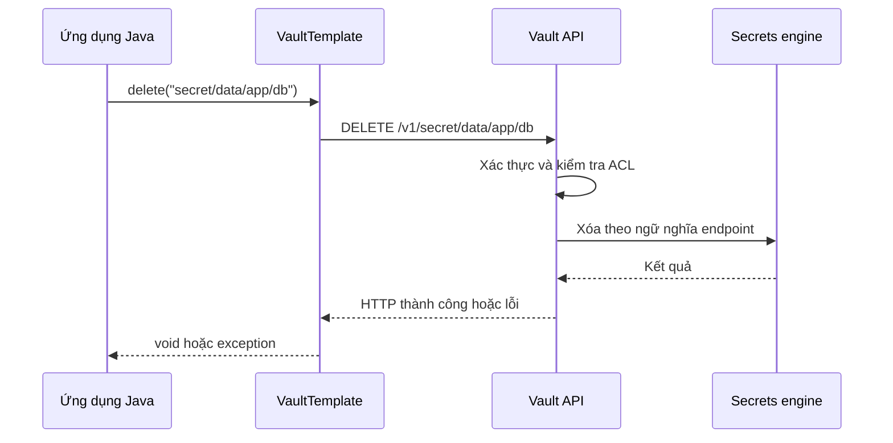
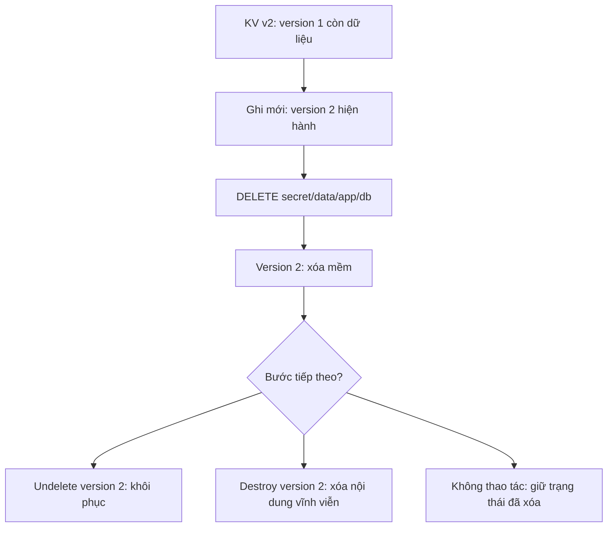

# Xóa theo đường dẫn bằng `delete()` trong Spring Vault

Trong **Spring Vault**, `VaultTemplate.delete(path)` là cách trực tiếp để ứng dụng Java gọi thao tác xóa trên một API endpoint của HashiCorp Vault. Phần dễ nhầm là **cùng một lệnh `delete()` nhưng ý nghĩa xóa phụ thuộc vào secrets engine và API path**: KV v1 xóa dữ liệu tại key, còn KV v2 thường chỉ đánh dấu xóa phiên bản mới nhất để có thể khôi phục. Hiểu điều này giúp tránh xóa nhầm, kiểm soát quyền và xác minh kết quả chính xác.

Bài thuộc chương **VaultTemplate** của module **SPRING_VAULT**. Toàn module tìm hiểu Java truy cập Vault bằng `VaultTemplate`, xác thực theo workload và chính sách phân quyền, KV secrets, vòng đời token/lease, Transit encryption, PKI, xử lý lỗi, giám sát và kiểm thử tích hợp. Ở đây, trọng tâm là **xóa theo đường dẫn bằng `delete()`**, lấy KV v1/v2 làm ví dụ và đặt thao tác trong bối cảnh an toàn vận hành.

## Mục tiêu học tập

Sau bài học, bạn có thể:

1. Giải thích đối số `path`, yêu cầu HTTP và giá trị trả về của `VaultTemplate.delete()`.
2. Phân biệt xóa dữ liệu KV v1 với xóa mềm phiên bản hiện hành của KV v2.
3. Biết khi nào cần API xóa phiên bản cụ thể, khôi phục phiên bản hoặc xóa vĩnh viễn trong KV v2.
4. Viết service Java chỉ xóa key được cho phép và áp dụng chính sách ACL tối thiểu.
5. Xử lý lỗi, giám sát và kiểm thử thao tác xóa mà không làm lộ secret.

## 1. `VaultTemplate.delete(path)` hoạt động như thế nào?

`VaultTemplate` triển khai giao diện `VaultOperations` và cung cấp thao tác xóa theo đường dẫn:

```java
vaultTemplate.delete("legacy/app/db");
```

Với một `VaultTemplate` đã cấu hình kết nối, lệnh trên tương đương yêu cầu HTTP:

```http
DELETE /v1/legacy/app/db
```

Các điểm cần nhớ:

- `path` là **đường dẫn API tương đối của Vault**, không chứa URL máy chủ và không thêm tiền tố `/v1/`. Đường dẫn cụ thể do secrets engine quy định.
- `delete()` **không nhận request body**. Vì vậy, muốn xóa một số phiên bản cụ thể của KV v2 phải dùng endpoint khác, có body tương ứng.
- Phương thức `delete(String path)` trả về **`void`**. Nếu hoàn tất mà không phát sinh exception, mã gọi biết yêu cầu đã được xử lý theo semantics của endpoint, chứ không nhận được object chứng minh chính xác dữ liệu nào đã biến mất.
- Vault kiểm tra token/identity và policy trên **API path thực tế**. Xác thực thành công không có nghĩa workload được quyền xóa.
- Ý nghĩa xóa là do **endpoint quyết định**; không nên coi tất cả các `DELETE` của Vault đều có cùng tính chất hoàn tác.



Ví dụ giả định Spring Vault đã được cấu hình endpoint HTTPS, TLS phù hợp và xác thực theo workload (như Kubernetes Auth hay AppRole). Không đặt token thật vào mã ví dụ hoặc log.

## 2. KV v1 và KV v2 khác nhau như thế nào khi xóa?

Giả sử ứng dụng lưu key logic `app/db` trong hai mount thử nghiệm **riêng biệt**: `legacy` là KV v1 và `secret` là KV v2. Không thể cấu hình cùng một mount vừa là KV v1 vừa là KV v2.

| Khía cạnh | KV v1 — mount `legacy` | KV v2 — mount `secret` |
|---|---|---|
| Gọi Java | `delete("legacy/app/db")` | `delete("secret/data/app/db")` |
| HTTP tương đương | `DELETE /v1/legacy/app/db` | `DELETE /v1/secret/data/app/db` |
| Đối tượng bị xóa | Secret tại key `app/db` | **Phiên bản mới nhất** của secret |
| Phiên bản lịch sử | Không hỗ trợ versioning | Các phiên bản cũ có thể còn tồn tại |
| Khôi phục qua KV API | Không có thao tác undelete kiểu KV v2 | Có thể `undelete` phiên bản đã xóa mềm |
| Metadata phiên bản | Không có metadata phiên bản KV v2 | Metadata/version thường vẫn được giữ |
| ACL cần thiết cho lệnh trên | `delete` tại `legacy/app/db` | `delete` tại `secret/data/app/db` |

### KV v1: xóa secret tại đường dẫn

```java
vaultTemplate.delete("legacy/app/db");
```

Vault xóa dữ liệu được lưu dưới key `app/db` trong mount `legacy`. KV v1 không có tính năng versioning/undelete của KV v2. Nếu cần khôi phục sau khi xóa, tổ chức phải dựa vào cơ chế sao lưu hoặc quy trình phục hồi độc lập đã được chuẩn bị trước; không thể dựa vào việc “quay về version trước” trong KV v1.

### KV v2: xóa mềm phiên bản hiện hành

```java
vaultTemplate.delete("secret/data/app/db");
```

Ở KV v2, đường dẫn `secret/data/app/db` được dùng để **xóa mềm phiên bản mới nhất**. Vault ghi nhận trạng thái deleted của phiên bản đó; nội dung có thể khôi phục qua API `undelete` nếu chưa bị destroy/xóa metadata và còn trong thời hạn bảo lưu theo cấu hình. Các phiên bản trước không tự bị xóa theo.

Ví dụ chuỗi sự kiện:

1. Workload ghi `app/db` lần đầu: version 1.
2. Workload cập nhật secret: version 2.
3. Ứng dụng gọi `delete("secret/data/app/db")`.
4. Version 2 chuyển sang trạng thái bị xóa mềm; version 1 không bị xóa bởi lệnh này.
5. Đọc mặc định key không còn trả nội dung version 2 như trước; một client có quyền đọc version cũ vẫn có thể truy cập version 1 nếu version đó còn khả dụng.
6. Nếu có quyền thích hợp, phiên bản 2 có thể được khôi phục bằng endpoint `undelete`.



**Phân biệt:** Token hết hạn hoặc bị thu hồi không tự động xóa secret KV. Xóa mềm KV v2 không phải lease expiry của dynamic secret. Vòng đời token, lease và phiên bản KV là các cơ chế khác nhau, dù đều được vận hành qua Vault.

## 3. Đọc đúng các đường dẫn xóa trong KV v2

KV v2 có nhiều endpoint liên quan đến xóa; chúng **không thể thay thế cho nhau**. Bảng dưới đây dùng mount `secret` và key logic `app/db`:

| Mục đích | API endpoint tương đối | HTTP | Gợi ý Spring Vault |
|---|---|---|---|
| Xóa mềm **version mới nhất** | `secret/data/app/db` | `DELETE` | `delete("secret/data/app/db")` |
| Xóa mềm **các version được chỉ định** | `secret/delete/app/db` | `POST` | `write("secret/delete/app/db", body)` |
| Khôi phục các version đã xóa mềm | `secret/undelete/app/db` | `POST` | `write("secret/undelete/app/db", body)` |
| Destroy dữ liệu của version cụ thể | `secret/destroy/app/db` | `POST` | `write("secret/destroy/app/db", body)` |
| Xóa metadata **và toàn bộ lịch sử phiên bản** | `secret/metadata/app/db` | `DELETE` | `delete("secret/metadata/app/db")` |

Tham số body cho xóa mềm/khôi phục/hủy phiên bản cụ thể là danh sách phiên bản:

```json
{
  "versions": [2, 3]
}
```

Ví dụ yêu cầu xóa mềm **chỉ version 2** (không gọi `delete()`):

```java
import java.util.List;
import java.util.Map;

// POST /v1/secret/delete/app/db
vaultTemplate.write(
        "secret/delete/app/db",
        Map.of("versions", List.of(2)));
```

`VaultTemplate.write()` phù hợp ở đây bởi endpoint nhận `POST` và JSON body, còn `delete()` không nhận body để chỉ định versions. Khi khôi phục, đổi path thành `secret/undelete/app/db` với cùng cấu trúc `versions`. Khi destroy, path là `secret/destroy/app/db`; **destroy không có thao tác undelete** cho dữ liệu đã bị hủy.

### Tại sao xóa metadata nguy hiểm hơn?

```java
// Chỉ dùng trong quy trình đã phê duyệt rõ ràng.
// Lệnh này xóa toàn bộ versions và metadata của key KV v2.
vaultTemplate.delete("secret/metadata/app/db");
```

Đây là thao tác xóa key KV v2 cùng **toàn bộ lịch sử phiên bản**. Dù cùng gọi `delete()`, nó khác căn bản với xóa mềm version mới nhất tại `secret/data/app/db`. Nên giới hạn endpoint metadata vào identity/quy trình đặc biệt, tách khỏi quyền xóa mềm thường ngày. Trước khi áp dụng cho dữ liệu quan trọng, cần có quy trình sao lưu, phê duyệt và phục hồi tương ứng.

**Không nhầm vị trí chữ `data`:** `secret/data/app/db` là path API của thao tác đọc/ghi/xóa mềm phiên bản; `secret/delete/app/db` là API xóa các phiên bản **được liệt kê trong body**. Việc bỏ `/data/` không khiến lệnh `delete()` tự hiểu là “xóa cả key”.

## 4. Triển khai Java: một service xóa theo path kiểm soát được

Một service nên thể hiện rõ **ý định xóa** ngay ở tên method và chỉ cho phép path thuộc phạm vi ứng dụng. Nếu path được xây từ input bên ngoài, phải validate từng segment để tránh xóa nhầm secret khác.

```java
import java.util.regex.Pattern;

import org.springframework.stereotype.Service;
import org.springframework.vault.core.VaultTemplate;

@Service
public class VaultSecretDeletionService {

    private static final Pattern TENANT_ID =
            Pattern.compile("[a-z0-9][a-z0-9-]{0,62}");

    private final VaultTemplate vaultTemplate;

    public VaultSecretDeletionService(VaultTemplate vaultTemplate) {
        this.vaultTemplate = vaultTemplate;
    }

    // KV v1: xóa hẳn secret tại key app/db của mount legacy.
    public void deleteLegacyDatabaseSecret() {
        vaultTemplate.delete("legacy/app/db");
    }

    // KV v2: xóa mềm version mới nhất tại key app/db.
    public void softDeleteLatestDatabaseSecret() {
        vaultTemplate.delete("secret/data/app/db");
    }

    // KV v2: xóa mềm key của một tenant đã được xác thực.
    public void softDeleteTenantDatabaseSecret(String tenantId) {
        if (tenantId == null
                || !TENANT_ID.matcher(tenantId).matches()) {
            throw new IllegalArgumentException("tenantId không hợp lệ");
        }

        String apiPath = "secret/data/tenants/" + tenantId + "/db";
        vaultTemplate.delete(apiPath);
    }
}
```

Các điểm thiết kế trong ví dụ:

- Method `deleteLegacyDatabaseSecret()` và `softDeleteLatestDatabaseSecret()` nói rõ loại hành động đối với từng mount.
- Chỉ có phần `tenantId` được biến đổi từ input; method cố định mount, tiền tố `tenants/` và hậu tố `/db`. Regex giới hạn segment, tránh dấu `/`, `..`, ký tự điều khiển và các dạng path không hợp lệ.
- **Validate cú pháp không thay thế kiểm tra quyền nghiệp vụ**. Trước khi gọi method cho một tenant, ứng dụng phải chứng minh caller được phép quản lý tenant đó; Vault policy cũng phải giới hạn workload vào phạm vi cần thiết.
- `VaultTemplate` là dependency được inject; mã ví dụ không tự tạo client bằng token hardcode.
- `delete()` là `void`; ví dụ không gọi `getData()` hoặc diễn giải `null` như kết quả xóa.

### Không có CAS trên `VaultTemplate.delete(path)`

KV v2 hỗ trợ **Check-And-Set** khi ghi version thông qua request body, nhưng lệnh xóa mềm version mới nhất bằng `DELETE secret/data/app/db` **không nhận version kỳ vọng trong body**. Nếu hai tác vụ đồng thời đọc metadata rồi một tác vụ ghi version mới trước khi tác vụ kia gọi `delete()`, lệnh xóa có thể tác động đến version mới nhất tại thời điểm Vault xử lý yêu cầu.

Khi nghiệp vụ yêu cầu xóa **chính xác version đã chọn**, hãy dùng API `POST secret/delete/app/db` với `{"versions":[N]}` và workflow xác nhận phù hợp. Nếu cần bảo đảm sự phối hợp với writers đồng thời, sử dụng quy trình kiểm soát tranh chấp ở tầng nghiệp vụ; đừng giả định “đọc metadata rồi gọi `delete()`” là thao tác nguyên tử.

## 5. Policy: cấp quyền xóa đúng endpoint

Ví dụ một workload có quyền xóa **mềm** đúng key KV v2 `app/db`:

```hcl
path "secret/data/app/db" {
  capabilities = ["delete"]
}
```

Đối với KV v1 tại `legacy`:

```hcl
path "legacy/app/db" {
  capabilities = ["delete"]
}
```

Vault đánh giá capability trên đường dẫn API thực tế. Không cấp `delete` trên `secret/metadata/app/db` nếu workload chỉ cần xóa mềm phiên bản mới nhất. Tùy quy trình, có thể cần các quyền riêng sau:

| Endpoint KV v2 | Capability thường cần | Lý do cần tách riêng |
|---|---|---|
| `secret/data/app/db` | `delete` | Xóa mềm version mới nhất |
| `secret/delete/app/db` | `update` | Xóa mềm các version trong JSON body |
| `secret/undelete/app/db` | `update` | Khôi phục version đã xóa mềm |
| `secret/destroy/app/db` | `update` | Hủy vĩnh viễn nội dung một số version |
| `secret/metadata/app/db` | `delete` | Xóa mọi version/metadata của key |

Với yêu cầu **kiểm tra trạng thái sau xóa**, một workload kiểm thử có thể cần thêm quyền `read` trên `secret/data/app/db` hoặc `secret/metadata/app/db`. Việc xác minh không phải lý do để cấp quyền rộng cho workload production: có thể tách quyền xác minh sang identity vận hành chỉ đọc. Đối với API xóa theo version, phân quyền `update` khác với `delete` trên `secret/data/...`.

Trong triển khai thực tế, identity và token nên được cấp theo workload (ví dụ Kubernetes Auth/AppRole) với TTL và policy phù hợp. Việc token bị thu hồi làm mất khả năng gọi API mới, nhưng **không đảo ngược các thao tác xóa đã thực hiện trước đó**.

## 6. Xử lý lỗi và xác minh kết quả

`delete()` là thao tác có tác dụng phụ; chỉ đơn thuần “không có exception” chưa đủ để xác minh **đúng secret và đúng version** đã bị xóa theo kỳ vọng. Muốn khẳng định nội dung nào bị ảnh hưởng, cần biết semantics của endpoint và trạng thái trước/sau trong một quy trình kiểm thử/đối soát được cấp quyền.

| Tình huống | Biểu hiện có thể gặp | Hướng xử lý |
|---|---|---|
| Path không đúng hoặc mount không tồn tại | HTTP 404, exception hoặc ứng xử riêng của error handler | Kiểm tra tên mount và API path, không mặc định xóa thành công |
| Key đã thiếu hoặc version đã xóa | Có thể không có nội dung khi đọc lại; xử lý lỗi tùy endpoint | Dùng metadata/version và yêu cầu nghiệp vụ để phân loại |
| Token không có quyền `delete` | Vault thường từ chối HTTP 403 | Xem policy trên đúng API path; không cấp quyền rộng để “chữa” lỗi |
| Token hết hạn hoặc xác thực thất bại | Lỗi xác thực/permission | Kiểm tra authentication và vòng đời token của workload |
| Vault không sẵn sàng, TLS lỗi, timeout | Exception kết nối hoặc lỗi dịch vụ | Giới hạn timeout, quan sát trạng thái và retry có điều kiện |
| Yêu cầu trả lỗi sau khi gửi đến Vault | Không chắc thao tác đã được áp dụng hay chưa | Đối soát metadata/trạng thái trước khi thực hiện lại |

**Thận trọng với retry:** Nếu một lệnh DELETE bị timeout sau khi Vault đã xử lý xóa, gọi lại có thể không có hiệu ứng thêm trong trường hợp không có thay đổi đồng thời. Nhưng với KV v2, nếu writer khác đã tạo version mới giữa hai lần DELETE, retry có thể xóa **version mới** mà caller không định xóa. Không retry mù trong luồng có nhiều writer; cân nhắc xóa version cụ thể hoặc điều phối thao tác.

**Đọc lại sau xóa không phải lúc nào cũng cho câu trả lời đầy đủ:** `read("secret/data/app/db")` sau xóa mềm version mới nhất có thể không trả nội dung khả dụng; điều này chưa chứng minh metadata và mọi version đã biến mất. Để kiểm tra lịch sử version, sử dụng API metadata với quyền phù hợp. Cũng cần phân biệt “không tìm thấy”, “không có quyền đọc” và “Vault tạm thời lỗi”.

### Quan sát mà không lộ secret

Nên ghi nhận action như `vault.kv.delete_latest`, kết quả, thời gian thực hiện, identity/workload và correlation ID không nhạy cảm khi có hệ thống audit thích hợp. Hạn chế ghi nguyên path nếu chứa thông tin tenant hoặc tên khóa bí mật; đặc biệt không log request header, token, body của lệnh đọc/ghi, hoặc nội dung secret. Vault audit devices có thể hỗ trợ truy vết yêu cầu ở phía server, nhưng việc cấu hình và quyền truy cập audit log phải được kiểm soát riêng.

## 7. Thực hành trong Vault thử nghiệm

Các thao tác dưới đây được thực hiện **chỉ trên Vault thử nghiệm cô lập**, không dùng secret thật. Dùng hai mount riêng để quan sát sự khác biệt; bỏ lệnh `secrets enable` nếu mount đã tồn tại. Mount `secret` có thể có sẵn trong Vault dev server.

```bash
# Thiết lập khi các mount chưa tồn tại.
vault secrets enable -path=legacy -version=1 kv
vault secrets enable -path=secret -version=2 kv

# KV v1: tạo dữ liệu demo.
vault kv put -mount=legacy app/db username=demo_user password=demo-only

# KV v2: tạo hai version khác nhau.
vault kv put -mount=secret app/db username=demo_user password=first-demo
vault kv put -mount=secret app/db username=demo_user password=second-demo

# Gọi Java service tại đây: deleteLegacyDatabaseSecret()
# và softDeleteLatestDatabaseSecret().

# Kiểm tra KV v1 sau khi xóa, có thể không còn key.
vault kv get -mount=legacy app/db

# Kiểm tra trạng thái và version của KV v2 sau khi xóa mềm.
vault kv metadata get -mount=secret app/db
vault kv get -mount=secret -version=1 app/db

# Nếu muốn khôi phục version 2 bằng CLI trong môi trường thử nghiệm:
vault kv undelete -mount=secret -versions=2 app/db
vault kv get -mount=secret app/db
```

Các lệnh `kv get` và `metadata get` yêu cầu quyền đọc riêng; nếu dùng token chỉ có quyền xóa, hãy kiểm thử bằng identity đọc chuyên biệt. Giá trị `demo-only`, `first-demo`, `second-demo` là dữ liệu giả. Tránh nhập secret thật vào shell vì có thể xuất hiện trong lịch sử lệnh.

### Ma trận kiểm thử đề xuất

| Kịch bản | Kết quả cần xác minh |
|---|---|
| KV v1 có key, gọi `delete("legacy/app/db")` | Secret ở key đó không còn được đọc qua KV v1 |
| KV v2 có version 1 và 2, gọi `delete("secret/data/app/db")` | Version 2 bị xóa mềm; metadata còn, version 1 vẫn khả dụng nếu chưa bị xóa/destroy |
| Khôi phục version 2 bằng API `undelete` | Version 2 có thể đọc lại nếu vẫn đủ điều kiện khôi phục |
| Xóa version 1 có chủ đích bằng `POST secret/delete/app/db` | Chỉ version được chỉ định bị xóa mềm |
| Gọi `delete()` khi thiếu ACL `delete` | Nhận lỗi phân quyền; không được xem như thành công |
| Tạo path từ tenantId chứa `../` hoặc `/` | Validation chặn đầu vào trước khi gọi Vault |
| Timeout trong lúc xóa | Ứng dụng không retry mù; có quy trình kiểm tra trạng thái và ngăn xóa nhầm version mới |
| Xem metric và audit log | Có dấu vết thao tác phù hợp, không lộ giá trị secret hoặc token |

Kiểm thử unit bằng mock `VaultTemplate` có thể xác nhận **path được truyền đúng** và input không hợp lệ bị từ chối. Tuy nhiên unit test không kiểm tra semantics xóa KV v2, ACL hay timeout. Để xác nhận các đặc tính này, cần kiểm thử tích hợp với Vault thử nghiệm riêng hoặc Vault container được cô lập. Đối với tình huống nhiều writer, hãy kiểm thử chuỗi “đọc version → writer khác tạo version → xóa” để xác định phương án tránh xóa nhầm.

## 8. Những hiểu lầm thường gặp

**“`delete()` xóa vĩnh viễn mọi phiên bản KV v2.”** Sai. `DELETE secret/data/...` xóa mềm phiên bản mới nhất; xóa mọi phiên bản và metadata cần endpoint `secret/metadata/...` riêng, còn destroy một số phiên bản dùng `secret/destroy/...`.

**“Có thể truyền versions vào `delete()`.”** Không. Phương thức nhận path, không nhận body. Xóa phiên bản cụ thể của KV v2 dùng `write()` đến `secret/delete/...` với `versions`.

**“Xóa thành công đồng nghĩa đọc lại không có gì trong toàn bộ lịch sử.”** Không. KV v2 có versioning và metadata; đọc mặc định không đại diện cho mọi phiên bản.

**“Có quyền đọc secret là có thể xóa secret.”** Sai. Capability `read` và `delete` độc lập; `update` cho các endpoint xóa version/undelete cũng được quản lý riêng.

**“Retry DELETE luôn an toàn tuyệt đối.”** Không. KV v2 delete latest có thể ảnh hưởng tới version mới được tạo giữa các lần thử nếu có writer đồng thời.

**“Xóa KV secret cũng thu hồi các token hoặc lease đã dùng để đọc nó.”** Không. Xóa KV và vòng đời token/lease của Vault là các cơ chế khác nhau. Nếu credential đã bị rò rỉ, có thể cần quy trình rotate/revoke riêng ngoài việc xóa key khỏi Vault.

## Câu hỏi tự kiểm tra

1. `vaultTemplate.delete("secret/data/app/db")` xóa gì trong KV v2? Vì sao không thể kết luận mọi phiên bản đều đã bị xóa?
2. Lệnh xóa KV v1 và KV v2 khác nhau ở API path thế nào khi key logic đều là `app/db`?
3. Nếu chỉ cần xóa mềm version 3 nhưng version 4 vừa được ghi, bạn sẽ chọn endpoint nào? Vì sao không nên gọi `delete()` để xóa “latest”?
4. Capability nào phải cấp trên `secret/data/app/db` cho xóa mềm latest? Capability nào dùng cho `secret/delete/app/db`?
5. Khi nhận timeout sau lệnh xóa KV v2, vì sao việc retry ngay có thể gây xóa nhầm dữ liệu mới?

**Gợi ý đối chiếu:** `delete(path)` gửi HTTP DELETE và trả `void`; KV v1 xóa secret ở key, KV v2 xóa mềm latest version; xóa phiên bản xác định dùng `POST secret/delete/...` với danh sách `versions`; ACL phải khớp API path; cần cân nhắc đồng thời và trạng thái sau lỗi trước khi retry. Đây là nền tảng để xây dựng các thao tác quản lý secret có kiểm soát trong ứng dụng Java.
