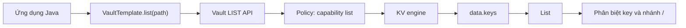

# Liệt kê khóa bằng `list()` và xử lý kết quả trong Spring Vault

Khi ứng dụng Java cần hiển thị các khóa có trong một thư mục secret, kiểm tra cấu trúc cấu hình hoặc khám phá các nhánh con của HashiCorp Vault, `VaultTemplate.list(path)` là thao tác phù hợp. Phương thức này trả về **tên khóa/nhánh**, không trả về giá trị secret. Điểm quan trọng nhất là **đường dẫn liệt kê tùy vào loại KV engine**: KV v1 liệt kê trực tiếp dưới mount, còn KV v2 liệt kê qua nhánh `metadata`.

Bài học nằm trong chương **VaultTemplate** của module **SPRING_VAULT**, hướng dẫn Java truy cập HashiCorp Vault bằng `VaultTemplate`, xác thực theo workload và policy phân quyền, thực hành KV secrets, token/lease, Transit encryption, PKI, xử lý lỗi, giám sát và kiểm thử tích hợp. Trong phạm vi này, chúng ta tập trung vào **liệt kê khóa bằng `list()`, diễn giải kết quả và bảo vệ thông tin cấu trúc secret**. Các thao tác đọc/ghi/xóa hoặc quản lý token được nhắc đến khi cần phân biệt quyền và tác dụng của `list()`.

## Mục tiêu học tập

Sau khi hoàn thành bài, bạn có thể:

1. Giải thích `VaultTemplate.list(String path)`, cơ chế liệt kê của Vault API và giá trị `List<String>` nhận được.
2. Chọn đúng đường dẫn cho KV v1 và KV v2, bao gồm phân biệt nhánh `metadata` với `data`.
3. Xử lý danh sách rỗng, phần tử có dấu `/` ở cuối và danh sách các cấp thư mục.
4. Xây dựng service trả về kết quả có cấu trúc, kiểm soát path đầu vào và không suy diễn quyền đọc từ quyền liệt kê.
5. Cấp quyền `list` tối thiểu, xử lý lỗi 403/404, quan sát và kiểm thử tích hợp.

## 1. `VaultTemplate.list()` trả về gì?

`VaultTemplate` triển khai `VaultOperations`. API thường dùng có dạng:

```java
List<String> keys = vaultTemplate.list("secret/metadata/app");
```

Ở đây `"secret/metadata/app"` là **đường dẫn API tương đối** sau `/v1/`, không phải URL đầy đủ và không chứa phần `/v1/` trong tham số. Phương thức gọi API **liệt kê của Vault** trên đường dẫn đã chỉ định. Về HTTP, Vault hỗ trợ ngữ nghĩa `LIST /v1/secret/metadata/app` hoặc biến thể tương đương `GET /v1/secret/metadata/app?list=true`; cách client chuyển yêu cầu sang HTTP phụ thuộc phiên bản/implementation. Điểm bất biến là endpoint phải hỗ trợ thao tác **list**.

Vault thường trả JSON rút gọn như sau:

```json
{
  "data": {
    "keys": ["cache", "db", "services/"]
  }
}
```

Spring Vault bóc tách trường `data.keys` của phản hồi liệt kê để trả về danh sách các chuỗi. Vì vậy bạn sử dụng trực tiếp `List<String>`, **không truy cập `VaultResponse.getData()`** như khi gọi `read()`. Chuỗi `services/` biểu diễn **nhánh con có thể liệt kê tiếp**, trong khi `cache` và `db` là các tên khóa ở cấp hiện tại.

Các đặc tính cần ghi nhớ:

- Kết quả là **các tên con trực tiếp** dưới prefix đã yêu cầu; `list()` **không tự đệ quy** qua mọi cấp.
- Một phần tử kết thúc bằng `/` thường chỉ **nhánh thư mục/prefix**. Không nên loại bỏ dấu `/` trước khi phân loại.
- **Tên khóa không phải giá trị secret.** Liệt kê `db` không tự cấp quyền đọc `username` hay `password` ở key đó.
- Không mặc định thứ tự trả về có ý nghĩa; có thể sắp xếp ở tầng Java để giao diện ổn định.
- Không nên dùng `list()` như cách kiểm tra giá trị secret hay đánh giá secret còn hiệu lực; đó là các nhiệm vụ khác.



## 2. Đường dẫn của KV v1 và KV v2

Giả sử hai mount **riêng biệt** đã được cấu hình trên Vault thử nghiệm:

- `legacy` sử dụng KV **v1**.
- `secret` sử dụng KV **v2**.

Cả hai đều có key logic `app/db`, `app/cache` và `app/services/api`. Thao tác liệt kê danh sách dưới `app` được thực hiện khác nhau:

| Nội dung | KV v1 (`legacy`) | KV v2 (`secret`) |
|---|---|---|
| Mount | `legacy` | `secret` |
| Prefix logic cần liệt kê | `app` | `app` |
| `vaultTemplate.list(...)` | `list("legacy/app")` | `list("secret/metadata/app")` |
| Endpoint Vault tương ứng | `LIST /v1/legacy/app` | `LIST /v1/secret/metadata/app` |
| Trường trả về | `data.keys` | `data.keys` |
| Policy cho liệt kê | `list` trên `legacy/app` | `list` trên `secret/metadata/app` |
| Đường dẫn đọc giá trị của `app/db` | `legacy/app/db` | `secret/data/app/db` |

### Ví dụ KV v1

```java
List<String> children = vaultTemplate.list("legacy/app");
```

Với các key vừa nêu, kết quả có thể là:

```text
["cache", "db", "services/"]
```

Trong KV v1, đường dẫn liệt kê tương ứng trực tiếp với prefix secret. Để đi sâu vào nhánh con:

```java
List<String> serviceKeys = vaultTemplate.list("legacy/app/services");
// Ví dụ: ["api"]
```

### Ví dụ KV v2

```java
List<String> children = vaultTemplate.list("secret/metadata/app");
```

Kết quả `List<String>` có hình dạng tương tự KV v1 nhưng path API dùng **`metadata`**:

```text
["cache", "db", "services/"]
```

Nếu cần liệt kê nhánh `services/`:

```java
List<String> serviceKeys =
        vaultTemplate.list("secret/metadata/app/services");
// Ví dụ: ["api"]
```

**Dễ nhầm:** `secret/data/app/db` là đường dẫn **đọc, ghi và xóa mềm phiên bản hiện hành** của KV v2. Liệt kê tên key phải dùng `secret/metadata/app`. Truy vấn `list("secret/data/app")` không tương đương với liệt kê KV v2.

Dùng CLI Vault cũng cần phân biệt **key logic** và **API path**. Ví dụ:

```bash
# CLI nhận mount và prefix logic, không yêu cầu tự thêm /metadata/.
vault kv list -mount=legacy app/
vault kv list -mount=secret app/
```

CLI có thể tự định tuyến theo phiên bản KV mount; `VaultTemplate.list()` nhận đường dẫn API mà người lập trình đã cung cấp.

## 3. Diễn giải danh sách con và dấu `/`

Vault dùng prefix path để tổ chức key. Giả sử có các key logic:

```text
app/
├── cache
├── db
└── services/
    ├── api
    └── worker
```

Thao tác liệt kê `app` thường trả về ba phần tử `cache`, `db` và `services/`. Chỉ khi gọi `list()` lần nữa vào `app/services` mới nhìn thấy `api` và `worker`.

| Giá trị trả về | Ý nghĩa | Xử lý đề xuất |
|---|---|---|
| `db` | Tên key tại prefix hiện tại | Hiển thị như khóa; chỉ đọc nội dung nếu có quyền `read` riêng |
| `cache` | Tên key tại prefix hiện tại | Hiển thị như khóa, không tự suy đoán kiểu dữ liệu |
| `services/` | Prefix có khóa con | Hiển thị như thư mục; có thể gọi `list()` sâu hơn khi người dùng yêu cầu |
| `[]` hoặc kết quả không có khóa | Không có tên con được trả về | Hiển thị trạng thái trống; phân biệt với exception |
| Lỗi 403 | Không có quyền liệt kê | Hiển thị lỗi quyền; không coi là thư mục trống |

**Lưu ý về tên:** Một namespace có thể có cả key tại một prefix và những key bên dưới prefix đó. Không dùng phép cắt dấu `/` để gộp mọi phần tử về cùng một tên nếu điều đó khiến ứng dụng đánh mất sự khác biệt giữa **khóa** và **nhánh**.

### Danh sách và quyền đọc độc lập

Ứng dụng có thể thấy tên `app/db` qua `list` mà **không có** quyền `read` nội dung của key đó. Ngược lại, workload chỉ có quyền `read` trên `secret/data/app/db` vẫn có thể đọc secret cụ thể nếu biết path, nhưng **không tự động** được phép liệt kê các key khác dưới `app`. Thiết kế giao diện cần phân biệt “nhìn thấy tên” với “có thể mở giá trị”.

Việc KV v2 xóa mềm phiên bản hiện hành qua `DELETE secret/data/app/db` cũng **không đồng nghĩa metadata của key đã biến mất**. Key có thể vẫn xuất hiện trong danh sách metadata sau xóa mềm hoặc destroy một số version, bởi metadata còn tồn tại. Do đó, không dùng riêng `list()` để khẳng định secret có nội dung hiện hành có thể đọc được. Khi xóa toàn bộ metadata của key, hành vi hiển thị trong danh sách mới thay đổi theo trạng thái lưu trữ của KV engine.

## 4. Viết Java service xử lý kết quả `list()`

Ví dụ dưới đây dùng **Java 17+**, Spring và bean `VaultTemplate` đã được cấu hình. Service trả một danh sách DTO có cờ phân biệt thư mục, giữ nguyên tên gốc và sắp xếp để bên gọi dễ hiển thị. Ví dụ xử lý kết quả `null`/**rỗng** một cách an toàn; hành vi cụ thể khi prefix không tồn tại có thể khác nhau tùy endpoint và phiên bản thư viện.

```java
import java.util.Comparator;
import java.util.List;
import java.util.Objects;
import java.util.regex.Pattern;

import org.springframework.stereotype.Service;
import org.springframework.vault.core.VaultTemplate;

@Service
public class SecretKeyBrowser {

    private static final Pattern SAFE_TENANT =
            Pattern.compile("[a-z0-9][a-z0-9-]{0,62}");

    private final VaultTemplate vaultTemplate;

    public SecretKeyBrowser(VaultTemplate vaultTemplate) {
        this.vaultTemplate = vaultTemplate;
    }

    // Liệt kê con trực tiếp của prefix app trong KV v1.
    public List<Entry> listLegacyApp() {
        return listEntries("legacy/app");
    }

    // Liệt kê con trực tiếp của prefix app trong KV v2.
    public List<Entry> listSecretApp() {
        return listEntries("secret/metadata/app");
    }

    // prefix nằm trong vùng tenants/<tenantId> đã xác thực.
    public List<Entry> listTenant(String tenantId) {
        if (tenantId == null || !SAFE_TENANT.matcher(tenantId).matches()) {
            throw new IllegalArgumentException("tenantId không hợp lệ");
        }

        // tenantId phải tiếp tục được kiểm tra quyền nghiệp vụ
        // đối với caller trước khi gọi method này.
        return listEntries("secret/metadata/tenants/" + tenantId);
    }

    private List<Entry> listEntries(String apiPath) {
        List<String> names = vaultTemplate.list(apiPath);
        if (names == null || names.isEmpty()) {
            return List.of();
        }

        return names.stream()
                .filter(Objects::nonNull)
                .filter(name -> !name.isBlank() && !name.equals("/"))
                .map(name -> new Entry(name, name.endsWith("/")))
                .sorted(Comparator.comparing(Entry::name))
                .toList();
    }

    // Giữ nguyên dấu "/" trong tên nhánh để caller có đủ ngữ cảnh.
    public record Entry(String name, boolean directory) {}
}
```

Ví dụ `listSecretApp()` có thể trả về (biểu diễn JSON của DTO):

```json
[
  {"name": "cache", "directory": false},
  {"name": "db", "directory": false},
  {"name": "services/", "directory": true}
]
```

Các lựa chọn thiết kế trong ví dụ:

1. **Null-safe:** `null` hoặc danh sách rỗng trở thành `List.of()` để tránh `NullPointerException` trong UI. Tuy nhiên **exception về quyền/kết nối vẫn được truyền ra** để tầng ứng dụng xử lý đúng.
2. **Giữ metadata phân loại:** `directory` được xác định bằng `endsWith("/")`; vẫn lưu tên gốc nên không mất thông tin dấu phân cách.
3. **Sắp xếp chủ động:** `sorted(...)` bảo đảm thứ tự hiển thị ổn định; không phụ thuộc thứ tự bên Vault.
4. **Kiểm soát path:** `tenantId` chỉ được chứa tập ký tự giới hạn; không cho input tự thay mount hay thêm `/`, `..`. Điều này chưa thay thế kiểm tra **caller có thuộc tenant hay không** và policy ở Vault.
5. **Không đọc secret:** Service chỉ liệt kê tên. Trường `directory=false` không bao hàm rằng workload có quyền hoặc khả năng đọc nội dung; muốn đọc phải thực hiện bước riêng trên path `data` của KV v2.

### Tự duyệt sâu nhiều cấp: chỉ khi thực sự cần

`VaultTemplate.list()` **không đệ quy**. Nếu giao diện cần duyệt `app/services/`, lấy phần tử `services/` rồi gọi tiếp `list("secret/metadata/app/services")`, với policy phù hợp. Không gọi liệt kê đệ quy không giới hạn để “quét” toàn bộ Vault.

Nếu phải duyệt nhiều cấp, hãy thiết kế giới hạn độ sâu, số lượng request, tốc độ, thời gian tối đa và khả năng dừng. Nên kiểm tra path hợp lệ cho mỗi nhánh, sử dụng kết quả như danh sách tên thay vì tự động đọc tất cả secret và tránh tăng quyền để đi sâu vào những subtree không cần thiết. Trong hệ thống nhiều tenant, quyền duyệt và giới hạn phạm vi cần được áp dụng tại cả tầng Java lẫn Vault ACL.

## 5. Phân quyền `list` cho KV v1 và KV v2

Vault cho phép hoặc từ chối thao tác liệt kê dựa trên **capability `list`** của token ở path tương ứng. Ví dụ policy tối thiểu để liệt kê **một cấp** dưới `app` của KV v2:

```hcl
path "secret/metadata/app" {
  capabilities = ["list"]
}
```

Để liệt kê một cấp dưới `app` của KV v1:

```hcl
path "legacy/app" {
  capabilities = ["list"]
}
```

Nếu workload được phép mở các nhánh con dưới `app`, phải bổ sung policy trên các **path listing thực sự cần thiết**, ví dụ:

```hcl
path "secret/metadata/app/services" {
  capabilities = ["list"]
}
```

Đối với môi trường mà thư viện/đường dẫn canonical có dấu `/` ở cuối, kiểm tra lại path được Vault audit ghi nhận và quy tắc match policy thực tế. Không giả định quyền `list` tại một prefix sẽ tự bao phủ mọi prefix con; cũng không cấp wildcard rộng chỉ để xử lý lỗi 403.

Quyền `read` để lấy nội dung KV v2 là capability độc lập:

```hcl
# Chỉ cần bổ sung nếu workload thực sự phải đọc secret này.
path "secret/data/app/db" {
  capabilities = ["read"]
}
```

**Bảo vệ tên secret:** Vault không có cơ chế lọc các khóa trả về trong một lần liệt kê dựa trên quyền đọc của từng key. Một danh sách có thể chứa tên mà workload **không được phép đọc nội dung**. Vì vậy, bản thân capability `list` có thể làm lộ cấu trúc, tên ứng dụng, môi trường, tenant hoặc mục đích của secret. Không đặt giá trị nhạy cảm vào tên đường dẫn; phân tách mount/prefix theo phạm vi phù hợp và hạn chế danh tính được liệt kê.

Token và policy nên được gắn với **workload identity** (như Kubernetes Auth/AppRole) và quản lý theo vòng đời riêng. Hết hạn token không có nghĩa các tên/key KV bị xóa; token/lease và dữ liệu KV là các cơ chế độc lập.

## 6. Phân loại kết quả trống và lỗi

Một lời gọi `list()` có thể thành công và trả tên, trả danh sách rỗng, hoặc gặp lỗi từ Vault/HTTP. Tùy endpoint và phiên bản client, prefix không tồn tại có thể được Vault phản hồi bằng 404 và được thư viện chuyển thành `null`/danh sách rỗng hoặc exception. **Đừng coi tất cả kết quả không có tên là thư mục chắc chắn tồn tại và rỗng.**

| Tình huống | Quan sát thường gặp | Cách xử lý |
|---|---|---|
| Prefix có khóa con | `List<String>` có phần tử | Chuẩn hóa hiển thị, giữ phân biệt `directory` |
| Prefix không có khóa được trả về | `null` hoặc `[]`, phụ thuộc API/client | Hiển thị trạng thái không có mục; nếu nghiệp vụ cần phân biệt “không tồn tại”, phải kiểm chứng thêm |
| Sai path KV v2 (dùng `data` thay vì `metadata`) | Danh sách rỗng hoặc lỗi endpoint | Kiểm tra mount và API listing chính xác |
| Thiếu capability `list` | Thường là HTTP 403, exception phân quyền | Không chuyển lỗi 403 thành “không có key” |
| Token thiếu/hết hạn | Lỗi authentication/permission | Kiểm tra phương thức xác thực và vòng đời session |
| Lỗi TLS, mạng, timeout hoặc Vault 5xx | Exception kết nối/lỗi dịch vụ | Áp dụng timeout, backoff và retry có giới hạn cho lỗi tạm thời |
| Có tên key nhưng đọc key thất bại | `list` và `read` có quyền/path riêng; hoặc version không khả dụng | Phân loại lỗi đọc độc lập, không xóa tên khỏi danh sách theo suy đoán |

Phân lớp API phía Java nên trả về trạng thái khác nhau cho “không có mục”, “không đủ quyền” và “dịch vụ tạm thời không khả dụng”. Ví dụ `SecretKeyBrowser` ở trên cố ý chỉ xử lý danh sách `null`/rỗng; việc chuyển exception thành mã lỗi nghiệp vụ thuộc tầng trên để không che mất nguyên nhân.

### Giám sát và tránh lộ thông tin

Có thể ghi metric theo tác vụ như `vault.kv.list`, kết quả thành công/thất bại, thời gian thực hiện và loại lỗi. Hạn chế ghi tên các key hoặc full path vào log ứng dụng, đặc biệt khi đường dẫn chứa tenant, môi trường hoặc thông tin khách hàng. Không log token, response body chứa dữ liệu khác từ các thao tác Vault, hay secret values. Vault audit log cũng cần được bảo vệ theo chính sách nội bộ.

Liệt kê nhiều prefix trong vòng lặp có thể tạo tải đáng kể lên Vault; áp dụng giới hạn truy vấn, cache ngắn hạn nếu nghiệp vụ cho phép và biện pháp chống truy vấn lặp liên tục. Vì trạng thái secret có thể thay đổi giữa hai lần gọi, coi kết quả `list()` là **ảnh chụp tại thời điểm truy vấn**, không phải bản kê có tính nhất quán giao dịch với những lần đọc/ghi kế tiếp.

## 7. Thực hành trên Vault thử nghiệm

Các lệnh sau dùng **Vault thử nghiệm cô lập**, dữ liệu hoàn toàn giả. Mount `secret` có thể đã tồn tại, ví dụ trong Vault dev server; khi đó bỏ lệnh tạo mount trùng.

```bash
# Chỉ chạy lệnh enable khi hai mount chưa tồn tại.
vault secrets enable -path=legacy -version=1 kv
vault secrets enable -path=secret -version=2 kv

# Tạo các key để quan sát cả key trực tiếp và nhánh con.
vault kv put -mount=legacy app/db username=demo_user password=demo-only
vault kv put -mount=legacy app/cache type=redis
vault kv put -mount=legacy app/services/api enabled=true

vault kv put -mount=secret app/db username=demo_user password=demo-only
vault kv put -mount=secret app/cache type=redis
vault kv put -mount=secret app/services/api enabled=true
vault kv put -mount=secret app/services/worker enabled=true

# CLI liệt kê prefix logic, không cần thêm /metadata/.
vault kv list -mount=legacy app/
vault kv list -mount=secret app/
vault kv list -mount=secret app/services/
```

Sau đó trong ứng dụng Java đã cấu hình VaultTemplate:

```java
List<String> v1Names = vaultTemplate.list("legacy/app");
List<String> v2Names = vaultTemplate.list("secret/metadata/app");
List<String> nested = vaultTemplate.list("secret/metadata/app/services");
```

Kiểm tra rằng hai danh sách đầu đều chứa các tên như `db`, `cache` và `services/`, nhưng chỉ danh sách `nested` mới có `api` và `worker` với mount KV v2. Không phụ thuộc thứ tự phần tử. Nếu dùng token chỉ có quyền `list`, lệnh CLI đọc/ghi thử nghiệm phải chạy bằng identity quản trị test khác; không nâng quyền production token chỉ để setup dữ liệu.

### Ma trận kiểm thử

| Kịch bản | Điều cần xác minh |
|---|---|
| KV v1 có key trực tiếp và nhánh | `list("legacy/app")` trả tên trực tiếp và tên nhánh có `/` |
| KV v2 có key trực tiếp và nhánh | `list("secret/metadata/app")` trả tên đúng, không cần `data` trong path |
| Gọi `list("secret/metadata/app/services")` | Trả các key con `api` và `worker`; không tự duyệt sâu hơn |
| Không có khóa dưới prefix thử nghiệm | Tầng Java xử lý `null`/`[]` an toàn, không `NullPointerException` |
| Token chỉ có quyền `read` trên `secret/data/app/db` | Không được tự động liệt kê `secret/metadata/app` |
| Token có quyền `list` nhưng không có `read` | Có thể thấy tên, nhưng không được đọc secret value |
| Xóa mềm latest version của `app/db` trong KV v2 | Tên có thể vẫn xuất hiện vì metadata của key còn tồn tại |
| Tenant ID chứa `../` hoặc `/` | Validation loại bỏ trước khi gọi Vault |
| Vault timeout/403 | Exception được phân loại, không biến thành danh sách trống |
| Giám sát/log | Không chứa token, secret values hoặc tên path nhạy cảm |

Trong unit test, mock `VaultTemplate.list(path)` để thử các trường hợp trả `null`, `[]`, phần tử `services/` và thứ tự không xác định. Kiểm thử tích hợp cần Vault test thật hoặc container cô lập để xác minh **đúng endpoint metadata, policy `list`, trạng thái 404 và tác động của xóa mềm KV v2**. Mock không thể chứng minh quyền ACL trên server được cấu hình đúng.

## 8. Những nhầm lẫn thường gặp

**Liệt kê KV v2 qua `data`.** API `secret/data/...` phục vụ đọc/ghi/xóa mềm secret version; muốn lấy tên khóa cần `secret/metadata/...`.

**Lẫn key logic với API path.** Lệnh `vault kv list -mount=secret app/` do CLI định tuyến. Gọi `vaultTemplate.list("secret/metadata/app")` cần ghi rõ path API phù hợp.

**Coi `services/` là một key chứa giá trị.** Hậu tố `/` là dấu hiệu prefix có con. Gọi `list()` thêm một lần ở prefix đó để khám phá tên con khi có quyền.

**Coi quyền `list` là quyền `read`.** Danh sách chỉ chứa tên; đọc giá trị cần policy `read` trên path phù hợp, và không có chuyện kết quả `list` tự lọc theo quyền đọc từng key.

**Coi tên có trong danh sách là secret còn đọc được.** Với KV v2, metadata và version có vòng đời riêng. Xóa mềm phiên bản hiện hành không nhất thiết làm tên key biến mất.

**Coi mọi lỗi là danh sách rỗng.** 403, lỗi xác thực hoặc lỗi hạ tầng không được biến thành “không có key”; xử lý riêng để tránh che giấu sự cố.

**Duyệt đệ quy không giới hạn.** `list()` chỉ trả một cấp; tự gọi nhiều lần có thể làm lộ cấu trúc và gây tải. Chỉ duyệt nhánh cần thiết, giới hạn ngân sách truy vấn và áp dụng ACL tương ứng.

## Câu hỏi tự kiểm tra

1. Vì sao `vaultTemplate.list("secret/data/app")` không phải đường dẫn đúng để liệt kê key trong mount KV v2 `secret`?
2. Kết quả `["db", "services/"]` khác gì với danh sách hai key thông thường? Làm sao xem các tên con bên dưới `services`?
3. Token chỉ có capability `read` trên `secret/data/app/db` có tự động liệt kê được `secret/metadata/app` không? Vì sao?
4. Sau khi xóa mềm latest version của `app/db` ở KV v2, tại sao tên `db` vẫn có thể nằm trong danh sách?
5. Vì sao cần phân biệt kết quả rỗng với HTTP 403, và nên giám sát thao tác `list` thế nào để không lộ thông tin nhạy cảm?

**Gợi ý đối chiếu:** `VaultTemplate.list()` trả tên khóa/nhánh dưới một prefix; KV v2 dùng đường dẫn `metadata`, KV v1 dùng prefix trực tiếp; hậu tố `/` biểu thị nhánh con; `list` là quyền độc lập với `read`; metadata có thể còn tồn tại sau xóa mềm; lỗi quyền và lỗi dịch vụ không phải danh sách rỗng. Các quy tắc này giúp xây dựng công cụ duyệt secret an toàn trên nền Spring Vault.
