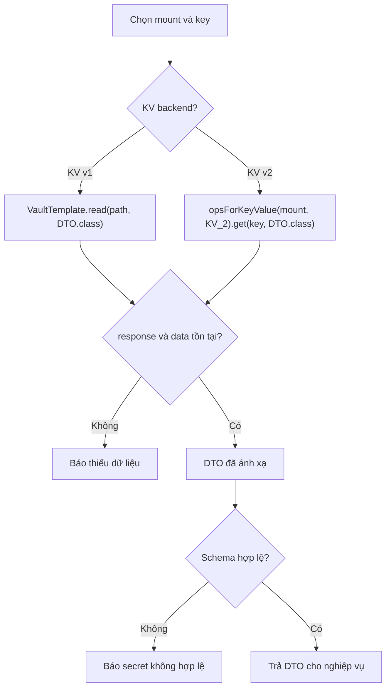

# Đọc dữ liệu thành kiểu Java cụ thể với Spring Vault

`VaultTemplate.read(path)` có thể trả về `VaultResponse` chứa `Map<String, Object>`. Cách này linh hoạt, nhưng khi ứng dụng Java cần sử dụng secret như một cấu hình có cấu trúc ổn định, việc tự lấy từng khóa, ép kiểu và xử lý `null` dễ gây lỗi. **Đọc dữ liệu thành một kiểu Java cụ thể** giúp chuyển phần dữ liệu secret thành DTO/POJO/record có ý nghĩa nghiệp vụ, thuận tiện kiểm tra và sử dụng.

Bài nằm trong chương **VaultTemplate** của module **SPRING_VAULT**. Module hướng tới việc dùng Java truy cập HashiCorp Vault qua `VaultTemplate`, kết hợp xác thực theo workload, policy phân quyền, KV secrets, vòng đời token/lease, Transit encryption, PKI, xử lý lỗi, giám sát và kiểm thử tích hợp. Trong bài này, trọng tâm là **đọc secret và ánh xạ sang kiểu Java**, đặc biệt là sự khác biệt giữa **KV v1 và KV v2**. Chúng ta giả định ứng dụng đã kết nối Vault qua TLS và có danh tính workload được cấp quyền thích hợp.

## Mục tiêu học tập

Sau bài học, bạn có thể:

1. Phân biệt `VaultResponse` với `VaultResponseSupport<T>` và giải thích `getData()` trả giá trị gì.
2. Sử dụng `VaultTemplate.read(path, MyType.class)` để đọc dữ liệu có kiểu trên endpoint phù hợp, ví dụ KV v1.
3. Đọc KV v2 thành DTO thông qua `VaultKeyValueOperations.get(key, MyType.class)`, tránh nhầm lớp `data` của API.
4. Thiết kế DTO/record khớp JSON secret và kiểm tra các trường bắt buộc, kiểu dữ liệu và trạng thái thiếu secret.
5. Viết code xử lý lỗi, phân quyền và kiểm thử tích hợp mà không làm lộ thông tin nhạy cảm.

## 1. Tại sao cần ánh xạ sang kiểu Java?

Giả sử secret trong Vault lưu thông tin kết nối tới một cơ sở dữ liệu (giá trị chỉ để minh họa):

```json
{
  "username": "demo_user",
  "password": "demo-only",
  "host": "db.internal",
  "port": 5432
}
```

Nếu đọc bằng API không định kiểu, ứng dụng phải tự truy cập một `Map`:

```java
VaultResponse response = vaultTemplate.read("legacy/app/database");
Map<String, Object> data = response.getData();

String username = (String) data.get("username");
String password = (String) data.get("password");
int port = (Integer) data.get("port");
```

Đây là ví dụ **không đủ an toàn**: `response` hoặc `data` có thể là `null`, field có thể thiếu hoặc sai kiểu, và kiểu số trả về có thể phụ thuộc cách giải mã JSON. Một phép ép kiểu trực tiếp có thể gây `NullPointerException` hoặc `ClassCastException`.

Ta muốn dữ liệu được biểu diễn qua một kiểu Java:

```java
public record DatabaseSecret(
        String username,
        String password,
        String host,
        Integer port) {

    @Override
    public String toString() {
        return "DatabaseSecret[REDACTED]";
    }
}
```

Khi ánh xạ đúng, tầng nghiệp vụ có thể dùng `secret.host()` hoặc `secret.port()` mà không cần tự ép kiểu từ `Map`. Tuy nhiên **ánh xạ thành công không đồng nghĩa dữ liệu hợp lệ**: vẫn phải kiểm tra field bắt buộc, giá trị rỗng và các ràng buộc như `1 <= port <= 65535`. Việc override `toString()` giúp hạn chế vô tình in mật khẩu vào log; không phải biện pháp bảo mật toàn diện.

## 2. `VaultResponse` và `VaultResponseSupport<T>`

Hai kiểu kết quả cần phân biệt là:

| API | Kiểu kết quả | Nội dung thường lấy |
|---|---|---|
| `vaultTemplate.read(path)` | `VaultResponse`, có thể `null` | `Map<String, Object>` qua `getData()` |
| `vaultTemplate.read(path, MyType.class)` | `VaultResponseSupport<MyType>`, có thể `null` | Đối tượng `MyType` qua `getData()` |
| `kvOperations.get(key, MyType.class)` | `VaultResponseSupport<MyType>`, có thể `null` | Đối tượng `MyType`, với thao tác KV biết rõ phiên bản backend |

### `VaultResponse`: truy cập dữ liệu dạng map

```java
VaultResponse response = vaultTemplate.read("legacy/app/database");
if (response == null || response.getData() == null) {
    throw new IllegalStateException("Không tìm thấy dữ liệu secret");
}
Map<String, Object> values = response.getData();
```

`VaultResponse` phù hợp khi cần quan sát cấu trúc phản hồi của một endpoint, hoặc secret có schema động. Người viết code chịu trách nhiệm kiểm tra các cấp dữ liệu và ánh xạ các giá trị.

### `VaultResponseSupport<T>`: dữ liệu có kiểu

```java
VaultResponseSupport<DatabaseSecret> response =
        vaultTemplate.read("legacy/app/database", DatabaseSecret.class);

if (response == null || response.getData() == null) {
    throw new IllegalStateException("Không tìm thấy dữ liệu secret");
}

DatabaseSecret secret = response.getData();
```

`VaultResponseSupport<T>` biểu diễn phản hồi có phần `data` được ánh xạ thành kiểu `T`. Nó còn có thể mang thông tin phản hồi chung từ Vault tùy endpoint; điều cần quan tâm trong ví dụ là `getData()` đã là `DatabaseSecret`. Với các secrets engine khác, cấu trúc JSON `data` vẫn có thể khác; cung cấp `MyType.class` **không tự sửa một đường dẫn sai hoặc bóc mọi cấp JSON lồng nhau**.

> **Quan trọng:** Các phương thức đọc trên có thể trả `null` khi không tìm thấy tài nguyên, tùy endpoint và cấu hình xử lý HTTP. Lỗi quyền, xác thực, kết nối hoặc chuyển đổi dữ liệu có thể tạo exception. Không bắt mọi lỗi rồi quy về “secret không tồn tại”.

## 3. KV v1: ánh xạ trực tiếp trường `data`

Giả sử mount `legacy` được cấu hình KV v1, lưu key logic `app/database`. Phản hồi HTTP rút gọn từ API `GET /v1/legacy/app/database` có dạng:

```json
{
  "data": {
    "username": "demo_user",
    "password": "demo-only",
    "host": "db.internal",
    "port": 5432
  }
}
```

Phần `data` ở cấp ngoài chính là các field nghiệp vụ cần ánh xạ. Khi đó, dùng overload nhận `Class<T>`:

```java
VaultResponseSupport<DatabaseSecret> response =
        vaultTemplate.read("legacy/app/database", DatabaseSecret.class);

if (response == null || response.getData() == null) {
    throw new IllegalStateException("KV v1: không tìm thấy database secret");
}

DatabaseSecret credentials = response.getData();
```

Để minh họa dữ liệu được tạo trong Vault thử nghiệm:

```bash
# Chỉ chạy khi mount legacy chưa tồn tại.
vault secrets enable -path=legacy -version=1 kv

vault kv put -mount=legacy app/database \
  username=demo_user password=demo-only host=db.internal port=5432
```

**Lưu ý:** Trong Vault CLI, cách nhập `port=5432` có thể được lưu dưới dạng chuỗi tùy cách tạo dữ liệu. Nếu DTO khai báo `Integer port`, kết quả ánh xạ có thể phụ thuộc cấu hình chuyển đổi kiểu của JSON mapper; tốt nhất xác nhận kiểu dữ liệu thực tế bằng kiểm thử, hoặc lưu JSON có kiểu số đúng khi tạo secret. Tránh mặc nhiên cho rằng CLI luôn tạo kiểu số nguyên từ văn bản đầu vào.

## 4. KV v2: cần tôn trọng lớp `data` bên trong

Ở KV v2, đường dẫn API cho key logic `app/database` trong mount `secret` là `secret/data/app/database`. Phản hồi rút gọn:

```json
{
  "data": {
    "data": {
      "username": "demo_user",
      "password": "demo-only",
      "host": "db.internal",
      "port": 5432
    },
    "metadata": {
      "version": 3,
      "destroyed": false,
      "deletion_time": ""
    }
  }
}
```

Có **hai lớp `data`**: lớp bên ngoài thuộc cấu trúc phản hồi Vault, lớp bên trong là nội dung secret KV v2. Nếu gọi trực tiếp:

```java
// Không nên mặc định cách này ánh xạ đúng database secret KV v2.
vaultTemplate.read("secret/data/app/database", DatabaseSecret.class);
```

thì kiểu Java đích có thể được áp dụng vào lớp dữ liệu bọc của KV v2 thay vì object chứa `username`, `password`, `host` và `port`. Kết quả phụ thuộc mapper và phiên bản thư viện; có thể mất field hoặc phát sinh lỗi ánh xạ. **Cách ưu tiên là dùng API KV v2 chuyên biệt** để thư viện xử lý lớp bọc.

### Cách nên dùng: `VaultKeyValueOperations`

```java
import org.springframework.vault.core.VaultKeyValueOperations;
import org.springframework.vault.core.VaultKeyValueOperationsSupport.KeyValueBackend;
import org.springframework.vault.core.VaultTemplate;
import org.springframework.vault.support.VaultResponseSupport;

VaultKeyValueOperations kv2 = vaultTemplate.opsForKeyValue(
        "secret", KeyValueBackend.KV_2);

VaultResponseSupport<DatabaseSecret> response =
        kv2.get("app/database", DatabaseSecret.class);

if (response == null || response.getData() == null) {
    throw new IllegalStateException("KV v2: không tìm thấy database secret");
}

DatabaseSecret secret = response.getData();
```

Trong API này:

- `"secret"` là **tên mount KV v2**.
- `"app/database"` là **key logic**, không chứa tiền tố `secret/data/`.
- `KV_2` cho thư viện biết backend sử dụng API version 2.
- `get(..., DatabaseSecret.class)` trả phần secret đã ánh xạ, không yêu cầu code nghiệp vụ tự bóc `response.data.data`.
- Cấu trúc và thời hạn của dữ liệu KV là vấn đề riêng với **token/session** dùng để xác thực yêu cầu.

Ví dụ tạo secret trong môi trường test:

```bash
# Chỉ chạy khi mount secret chưa tồn tại.
vault secrets enable -path=secret -version=2 kv

vault kv put -mount=secret app/database \
  username=demo_user password=demo-only host=db.internal port=5432

vault kv get -mount=secret app/database
```

Câu lệnh `vault kv` trong CLI nhận mount và key logic; không nhập `secret/data/app/database` làm key logic. Đừng để dữ liệu secret thật xuất hiện trong shell history, build logs hoặc test fixtures công khai.

### Cách mức thấp: bóc `data` rồi chuyển sang DTO

Nếu ứng dụng buộc phải dùng `VaultTemplate.read(path)` thô cho KV v2, cần bóc lớp `data` thứ hai trước khi chuyển đổi bằng mapper tương ứng:

```java
import java.util.Map;

import com.fasterxml.jackson.databind.ObjectMapper;
import org.springframework.vault.support.VaultResponse;

public DatabaseSecret readKv2Manually(
        VaultTemplate vaultTemplate, ObjectMapper mapper) {

    VaultResponse response =
            vaultTemplate.read("secret/data/app/database");

    if (response == null || response.getData() == null) {
        throw new IllegalStateException("Không tìm thấy KV v2 secret");
    }

    Object nested = response.getData().get("data");
    if (!(nested instanceof Map<?, ?>)) {
        throw new IllegalStateException("KV v2: lớp data không hợp lệ");
    }

    DatabaseSecret secret = mapper.convertValue(
            nested, DatabaseSecret.class);
    validate(secret);
    return secret;
}
```

Hàm `validate(secret)` trong ví dụ là hàm xác thực DTO do ứng dụng định nghĩa; ví dụ triển khai đầy đủ ở mục sau. Kiểu `ObjectMapper` phải có cấu hình phù hợp với DTO của dự án. Cách bóc thủ công hữu ích để hiểu JSON nhưng dễ lặp logic, nên ưu tiên `VaultKeyValueOperations` cho thao tác KV thường ngày.

## 5. Ví dụ Java đầy đủ: typed reader có kiểm tra dữ liệu

Ví dụ sau dùng Java 17+, Spring Vault và Jackson hỗ trợ Java record. Các mount `legacy` (KV v1) và `secret` (KV v2) chỉ là tên minh họa. Bean `VaultTemplate` đã được cấu hình endpoint TLS và workload authentication theo môi trường ứng dụng.

```java
import org.springframework.stereotype.Service;
import org.springframework.vault.core.VaultKeyValueOperations;
import org.springframework.vault.core.VaultKeyValueOperationsSupport.KeyValueBackend;
import org.springframework.vault.core.VaultTemplate;
import org.springframework.vault.support.VaultResponseSupport;

@Service
public class DatabaseSecretReader {

    private final VaultTemplate vaultTemplate;
    private final VaultKeyValueOperations kv2;

    public DatabaseSecretReader(VaultTemplate vaultTemplate) {
        this.vaultTemplate = vaultTemplate;
        this.kv2 = vaultTemplate.opsForKeyValue(
                "secret", KeyValueBackend.KV_2);
    }

    public DatabaseSecret readKv1() {
        VaultResponseSupport<DatabaseSecret> response =
                vaultTemplate.read(
                        "legacy/app/database", DatabaseSecret.class);
        return requireValidData(response);
    }

    public DatabaseSecret readKv2() {
        VaultResponseSupport<DatabaseSecret> response =
                kv2.get("app/database", DatabaseSecret.class);
        return requireValidData(response);
    }

    private static DatabaseSecret requireValidData(
            VaultResponseSupport<DatabaseSecret> response) {

        if (response == null || response.getData() == null) {
            throw new IllegalStateException(
                    "Không tìm thấy database secret");
        }

        DatabaseSecret secret = response.getData();
        validate(secret);
        return secret;
    }

    private static void validate(DatabaseSecret secret) {
        if (secret.username() == null || secret.username().isBlank()
                || secret.password() == null || secret.password().isBlank()
                || secret.host() == null || secret.host().isBlank()
                || secret.port() == null
                || secret.port() < 1 || secret.port() > 65535) {

            throw new IllegalStateException(
                    "Database secret thiếu trường hoặc sai giá trị");
        }
    }

    public record DatabaseSecret(
            String username,
            String password,
            String host,
            Integer port) {

        @Override
        public String toString() {
            return "DatabaseSecret[REDACTED]";
        }
    }
}
```

Luồng của service:



**Tại sao validation nằm sau mapping?** Mapper có thể tạo DTO khi một số field là `null` hoặc dữ liệu thiếu, tùy cấu hình. Vì đây là secret dùng để kết nối hệ thống, việc kiểm tra tất cả giá trị bắt buộc trước khi sử dụng là cần thiết.

**Tại sao không in DTO ra log?** Các kiểu như Java record tự sinh `toString()` chứa toàn bộ field. Ví dụ override để che giá trị, nhưng log formatter, debug HTTP và serialization ở nơi khác vẫn có thể làm lộ secret. Hạn chế quan sát ở mức tên thao tác, thời gian thực hiện, trạng thái và mã lỗi đã được khử thông tin nhạy cảm.

## 6. Thiết kế kiểu Java khớp với secret thực tế

### Record, POJO và tên trường JSON

Java record hữu ích cho cấu hình nhỏ, ít thay đổi; POJO với constructor/getter/setter phù hợp khi dự án dùng phiên bản Java/Jackson cũ hoặc có quy tắc ánh xạ riêng. Các thuộc tính Java nên khớp tên JSON hoặc dùng annotation để đổi tên.

Ví dụ JSON dùng `db_host`, `max_connections`:

```json
{
  "db_host": "db.internal",
  "max_connections": 15
}
```

Một record rõ ràng:

```java
import com.fasterxml.jackson.annotation.JsonProperty;

public record PoolConfig(
        @JsonProperty("db_host") String host,
        @JsonProperty("max_connections") Integer maxConnections) {
}
```

Nếu bỏ annotation trong khi serializer không có quy tắc đổi `snake_case` sang `camelCase`, dữ liệu có thể ánh xạ sai hoặc bị từ chối.

### Kiểu số, ngày giờ và dữ liệu lồng nhau

| Dữ liệu Vault JSON | Kiểu Java thường dùng | Điểm cần kiểm tra |
|---|---|---|
| `"username": "demo_user"` | `String` | Không null/rỗng; giới hạn độ dài |
| `"port": 5432` | `Integer` | Kiểu số thực tế; giới hạn 1–65535 |
| `"enabled": true` | `Boolean` | Không nhầm với chuỗi `"true"` |
| `"timeout_ms": 1500` | `Long` hoặc `Integer` | Khoảng giá trị và tràn số |
| `"roles": ["read", "write"]` | `List<String>` | Phần tử hợp lệ; null/empty |
| `"tls": {"required": true}` | Nested record/POJO | Đúng cấu trúc object con |

Nếu secret có trường tùy chọn, phân biệt **thiếu trường** với **giá trị mặc định** theo nghiệp vụ. Chẳng hạn, không nên âm thầm mặc định `tls.required=false` nếu yêu cầu bảo mật bắt buộc TLS. Có thể dùng Jakarta Bean Validation hoặc logic rõ ràng sau mapping; không phụ thuộc hoàn toàn vào default của Jackson.

### Khác biệt giữa `Class<T>` và kiểu generic

`read(path, MyType.class)` sử dụng `Class<T>`, phù hợp với DTO cụ thể. Nhưng `List<MyType>.class` không tồn tại trong Java do type erasure. Khi secret chứa danh sách hoặc map có phần tử phức tạp, có thể dùng **DTO bao ngoài**:

```json
{
  "backends": [
    {"name": "primary", "host": "db-a.internal"},
    {"name": "replica", "host": "db-b.internal"}
  ]
}
```

```java
public record Backend(String name, String host) {}
public record BackendSettings(
        java.util.List<Backend> backends) {}

VaultResponseSupport<BackendSettings> response =
        vaultTemplate.read(
                "legacy/app/backends", BackendSettings.class);
```

Cách này giúp mapper thấy cấu trúc generic thông qua field trong DTO. Với schema phức tạp hoặc bất định, cân nhắc xử lý từng trường qua `Map`, nhưng phải kiểm tra dữ liệu đầu vào trước khi sử dụng.

## 7. Quyền đọc, lỗi và vòng đời secret

Đọc có kiểu **không làm thay đổi** chính sách truy cập: Vault vẫn kiểm tra capability `read` trên endpoint. Ví dụ policy HCL cho đúng key `app/database`:

```hcl
# KV v1: mount legacy
path "legacy/app/database" {
  capabilities = ["read"]
}

# KV v2: mount secret
path "secret/data/app/database" {
  capabilities = ["read"]
}
```

Không cần cấp quyền `list` chỉ để đọc một key đã biết path. Hãy gắn policy tối thiểu vào đúng workload identity. Không cấu hình token cố định trong mã nguồn, và không tự mở rộng quyền khi xảy ra HTTP 403.

### Phân biệt các lỗi

| Tình huống | Biểu hiện thường gặp | Hướng xử lý |
|---|---|---|
| Key/path không tồn tại hoặc version không khả dụng | Kết quả `null`, thiếu `data` hoặc lỗi 404 tùy endpoint/client | Phân loại thiếu secret; kiểm tra mount/path và metadata KV v2 |
| JSON không khớp DTO | Lỗi chuyển đổi, sai kiểu, field null hoặc validation thất bại | Xác minh schema và cấu hình mapper; không đưa secret vào thông điệp lỗi |
| Quyền `read` thiếu trên API path | Thường HTTP 403 | Kiểm tra identity/policy, không coi là secret trống |
| Token/session không hợp lệ | Lỗi xác thực hoặc permission | Xử lý vòng đời token và cấu hình xác thực theo workload |
| TLS, timeout hoặc Vault 5xx | Exception kết nối/lỗi dịch vụ | Timeout hợp lý; retry có giới hạn cho lỗi tạm thời |
| Đọc thành công nhưng secret đã đổi sau đó | DTO là dữ liệu tại thời điểm đọc | Thiết kế cơ chế đọc lại/refresh phù hợp với nhu cầu |

KV v2 có versioning và trạng thái xóa mềm: một **record Java có kiểu** không thay thế việc kiểm tra phiên bản hoặc lịch sử khi nghiệp vụ cần điều đó. Secret KV thông thường cũng không tự tạo dynamic lease giống các secrets engines cấp credential tạm thời; vòng đời **token**, **lease** và **phiên bản KV** cần được quản lý đúng cơ chế.

### Đọc lại khi secret bị rotate

`readKv2()` mỗi lần gọi sẽ truy vấn dữ liệu mới tại thời điểm đó; nếu ứng dụng chỉ gọi một lần khi khởi động rồi giữ DTO trong bộ nhớ, giá trị đã rotate trên Vault không tự xuất hiện trong đối tượng Java hiện có. Khi thiết kế cache:

1. Xác định thời gian chấp nhận dữ liệu cũ dựa trên nghiệp vụ và quy trình rotation.
2. Có chiến lược refresh, giới hạn retry, xử lý lỗi tạm thời mà không làm gián đoạn dịch vụ ngoài mong đợi.
3. Hạn chế chia sẻ DTO chứa secret rộng rãi; không đưa nó vào log, exception hoặc response HTTP cho client.
4. Xử lý dữ liệu cũ theo yêu cầu bảo mật và tính khả thi của runtime Java, không giả định `String` có thể được xóa sạch khỏi heap theo ý muốn.

## 8. Kiểm thử tích hợp đọc DTO từ Vault

Nên sử dụng Vault thử nghiệm riêng hoặc container Vault cô lập, tạo hai mount KV v1/v2 và policy thực tế. Với dữ liệu test, tuyệt đối không dùng credential production. Gợi ý chuỗi thử nghiệm:

```bash
# Tạo hai mount nếu chưa tồn tại; tránh tạo trùng mount có sẵn.
vault secrets enable -path=legacy -version=1 kv
vault secrets enable -path=secret -version=2 kv

# Lưu dữ liệu giả bằng KV CLI.
vault kv put -mount=legacy app/database \
  username=demo_user password=demo-only host=db.internal port=5432

vault kv put -mount=secret app/database \
  username=demo_user password=demo-only host=db.internal port=5432

# Xác minh dữ liệu đã được lưu theo key logic.
vault kv get -mount=legacy app/database
vault kv get -mount=secret app/database
```

Với môi trường sử dụng CLI trên Windows PowerShell, thay lệnh nhiều dòng bằng **một dòng** hoặc dùng ký tự xuống dòng hợp lệ của PowerShell; `\` trong snippet Bash là cú pháp tiếp dòng của shell Unix.

Sau khi ứng dụng gọi `readKv1()` và `readKv2()`, kiểm tra kết quả ánh xạ và validation. Nếu muốn buộc `port` là JSON number thay vì chuỗi, hãy tạo secret bằng API/JSON phù hợp hoặc chủ động chuẩn hóa schema; không phụ thuộc ngầm vào cách `vault kv put` suy luận kiểu.

| Kịch bản kiểm thử | Kết quả cần xác minh |
|---|---|
| KV v1 có dữ liệu đúng schema | `VaultTemplate.read(path, DTO.class)` trả DTO với field chính xác |
| KV v2 có dữ liệu đúng schema | `opsForKeyValue(..., KV_2).get(key, DTO.class)` bóc lớp `data` đúng |
| KV v2 đọc sai API path `secret/data/...` bằng API key logic | Test phát hiện key/path sai; không trả DTO sai một cách im lặng |
| Key không tồn tại hoặc version KV v2 bị xóa mềm | Ứng dụng xử lý không có dữ liệu; không `NullPointerException` |
| Thiếu `password` hoặc `host` | Validation trả lỗi rõ nghĩa, không lộ giá trị secret |
| `port` không hợp lệ hoặc nằm ngoài khoảng | Converter/validation từ chối hoặc xử lý theo schema đã quy định |
| Token chỉ có quyền đọc đúng path | Đọc được key cho phép; truy cập path khác bị Vault từ chối |
| Token không có quyền `read` | Lỗi phân quyền được phân loại, không giả dạng “không có secret” |
| Rotate secret và gọi đọc lần nữa | DTO nhận giá trị mới ở lần gọi sau |
| Bật monitoring/log theo quy định | Không xuất hiện token, giá trị mật khẩu hoặc raw response |

**Unit test** có thể mock `VaultTemplate` và `VaultKeyValueOperations` để thử `null`, DTO thiếu trường và logic validation; **integration test** cần Vault thật/container để xác minh serializer, JSON contract, policy và cách xử lý HTTP/404. Không kết luận cấu hình Vault thật hoạt động chỉ vì mock trả về DTO đúng.

## 9. Sai lầm thường gặp và cách khắc phục

**Gọi typed `read(path, DTO.class)` cho KV v2 mà không kiểm tra JSON.** API KV v2 có lớp `data` lồng nhau; dùng `VaultKeyValueOperations` với `KV_2` để tách logic KV khỏi DTO nghiệp vụ.

**Truyền API path vào `get(key, DTO.class)`.** Với `opsForKeyValue("secret", KV_2)`, đối số `key` là `"app/database"`. Truyền `"secret/data/app/database"` sẽ khiến đường dẫn được ghép sai.

**Cho rằng một DTO luôn có dữ liệu hợp lệ.** Mapper có thể dựng object có field `null`/mặc định; validate trước khi tạo kết nối, gọi API hoặc dựng đối tượng chứa cấu hình nhạy cảm.

**Ép kiểu số từ `Map` một cách tùy tiện.** JSON number, chuỗi và cách serializer chuyển đổi có thể khác nhau; dùng kiểu DTO hợp lý và kiểm tra dữ liệu thực tế.

**Dùng `toString()` của record chứa password trong log.** Record mặc định in các field; override và bảo vệ cả đường đi khác của secret trong log/metrics.

**Bắt hết exception rồi trả DTO mặc định.** Làm vậy che giấu lỗi phân quyền, sai schema và sự cố Vault; cần lỗi có phân loại, chính sách fallback rõ ràng và giám sát phù hợp.

**Xem dữ liệu KV có kiểu như cache tự cập nhật.** DTO đã đọc không tự đổi khi secret xoay vòng. Cần cơ chế refresh và kiểm soát vòng đời token/session.

## Câu hỏi tự kiểm tra

1. Khi nào nên dùng `VaultResponseSupport<DatabaseSecret>` thay vì `VaultResponse` và `Map<String,Object>`?
2. Vì sao typed `VaultTemplate.read("legacy/app/database", DatabaseSecret.class)` phù hợp với KV v1, nhưng KV v2 nên dùng `VaultKeyValueOperations`?
3. `"secret/data/app/database"` và `"app/database"` được dùng ở những API nào?
4. Vì sao vẫn cần validate `password`, `host` và `port` sau khi mapper đã trả về `DatabaseSecret`?
5. Nếu đọc secret thất bại do policy 403, vì sao trả về DTO với giá trị mặc định là cách xử lý nguy hiểm?
6. Khi version KV v2 mới được ghi, một DTO đã lưu trong cache có tự đổi theo không?

**Gợi ý đối chiếu:** API typed ánh xạ `data` sang một `T`; KV v1 có dữ liệu trực tiếp dưới `data`, KV v2 cần bóc lớp `data` của engine; `opsForKeyValue(..., KV_2).get(key, DTO.class)` nhận **key logic**, quản lý wrapper KV v2; validation, ACL và xử lý lỗi vẫn là trách nhiệm của ứng dụng. Những nguyên tắc này giúp Java service dùng secret có kiểu rõ ràng và an toàn hơn khi tích hợp Spring Vault.
