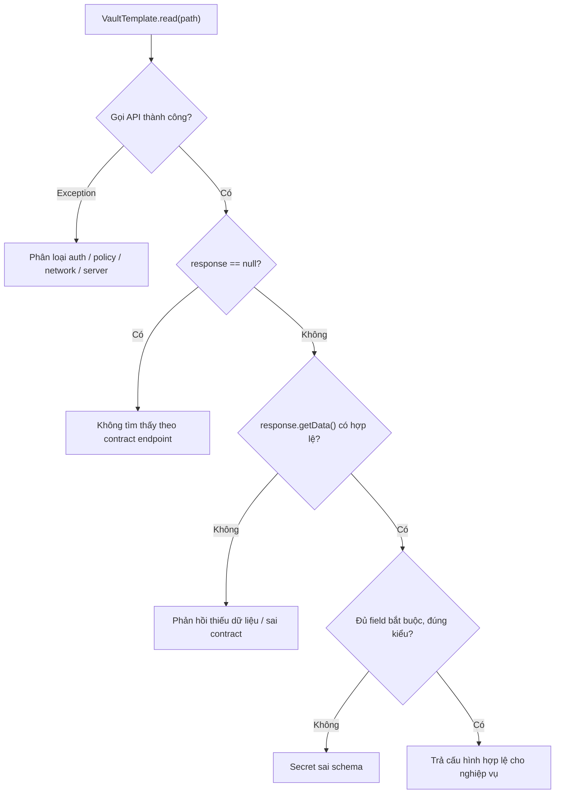

# Phản hồi rỗng, dữ liệu không tồn tại và trường bắt buộc trong Spring Vault

Khi ứng dụng Java gọi `VaultTemplate.read()`, không phải lúc nào Vault cũng trả về một secret đầy đủ. Key có thể chưa được tạo, phiên bản KV v2 có thể đã bị xóa mềm, token có thể không có quyền đọc, hoặc secret vẫn tồn tại nhưng thiếu trường bắt buộc. **Các tình huống này cần được phân biệt**: nếu biến mọi lỗi thành `null` hoặc dùng giá trị mặc định tùy tiện, ứng dụng dễ chạy sai cấu hình hoặc che giấu sự cố bảo mật.

Bài thuộc chương **VaultTemplate** của module **SPRING_VAULT**, hướng dẫn Java truy cập HashiCorp Vault qua `VaultTemplate`, xác thực theo workload và policy phân quyền, thực hành KV secrets, vòng đời token/lease, Transit encryption, PKI, xử lý lỗi, giám sát và kiểm thử tích hợp. Trọng tâm tại đây là **phản hồi rỗng, dữ liệu không tồn tại và trường bắt buộc** khi đọc KV secrets; các endpoint khác có thể có cấu trúc và quy ước phản hồi riêng.

## Mục tiêu học tập

Sau bài này, bạn có thể:

1. Phân biệt `VaultResponse == null`, `getData() == null`, map rỗng và map thiếu key bắt buộc.
2. Xác định đúng lớp `data` của KV v1 và KV v2 trước khi kiểm tra schema.
3. Xử lý trường vắng mặt, `null`, chuỗi rỗng, sai kiểu hoặc giá trị không hợp lệ bằng thông báo an toàn.
4. Phân biệt secret không tìm thấy với lỗi xác thực, thiếu quyền, mất kết nối và lỗi chuyển đổi dữ liệu.
5. Thiết kế service Java và kiểm thử tích hợp để **fail closed** đối với secret bắt buộc, nhưng cho phép giá trị tùy chọn theo quy tắc rõ ràng.

## 1. Một thao tác đọc có thể cho những kết quả nào?

Ví dụ cơ bản:

```java
VaultResponse response = vaultTemplate.read("legacy/app/db");
```

`VaultTemplate.read(path)` truy vấn đường dẫn API tương đối trên Vault, không bao gồm prefix `/v1/`. Khi dùng KV v1 tại mount `legacy`, `legacy/app/db` là đường dẫn đọc trực tiếp. Sau khi gọi, có nhiều trạng thái cần phân biệt:

| Trạng thái | Ví dụ quan sát | Ý nghĩa đối với ứng dụng |
|---|---|---|
| Có response và đủ dữ liệu | `response.getData()` chứa `username`, `password` | Có thể tiếp tục **sau khi kiểm tra schema** |
| Response là `null` | Endpoint không có dữ liệu khả dụng; một số luồng HTTP 404 được chuyển thành `null` | Có thể coi là **không tìm thấy** theo contract của thao tác đang dùng |
| Có response, `getData() == null` | JSON không có `data` hoặc endpoint trả dữ liệu khác kỳ vọng | **Không kết luận** key không tồn tại nếu chưa xem contract |
| Có response, `getData().isEmpty()` | `"data": {}` | Secret có thể tồn tại nhưng **thiếu field bắt buộc** |
| Map có field bằng `null` hoặc chuỗi trống | `"password": null` hoặc `"password": ""` | Field **không hợp lệ**, dù key có mặt |
| Map có giá trị sai kiểu | `"password": 123` | Sai schema; không ép thành chuỗi một cách âm thầm |
| API ném exception | HTTP 403, lỗi token, timeout, TLS, mapper | Phân loại lỗi và xử lý ở tầng tương ứng |

**Cẩn trọng về HTTP 404:** Với một số thao tác `read`, Spring Vault diễn giải “không tìm thấy” thành giá trị `null`; với endpoint, phiên bản thư viện hoặc cấu hình xử lý lỗi khác, ứng dụng có thể gặp exception. Không thể suy ra mọi HTTP 404 của Vault đều dẫn đến `null` trên tất cả API.



Một service quan trọng, chẳng hạn service kết nối cơ sở dữ liệu, thường phải **dừng hoặc báo lỗi rõ ràng** khi thiếu secret hoặc sai schema. Cung cấp username/password mặc định để “chạy tạm” có thể tạo kết nối nhầm môi trường hoặc gây lỗi bảo mật khó phát hiện.

## 2. Phân biệt `null`, map rỗng và field không hợp lệ

Ba trạng thái dưới đây rất dễ bị gộp làm một:

### Secret không tồn tại hoặc không có phiên bản khả dụng

Giả sử ứng dụng tìm key `app/db` nhưng key chưa được tạo:

```java
VaultResponse response = vaultTemplate.read("legacy/app/db");
if (response == null) {
    // Trường hợp không có resource theo hành vi đọc của client/endpoint.
}
```

Trong luồng này, `response == null` có thể được diễn giải là **không tìm thấy** nếu đã xác nhận contract API và hành vi error handler của phiên bản Spring Vault đang dùng.

### Secret tồn tại nhưng không có dữ liệu đúng cấu trúc

Ví dụ phản hồi JSON rút gọn:

```json
{
  "data": {}
}
```

Ứng dụng nhận `VaultResponse` khác `null` nhưng `response.getData().isEmpty()` là `true`. Nếu `username` và `password` là bắt buộc, đây là **secret sai schema**; không nên báo giống trường hợp “key không tồn tại”.

Một tình huống khác là endpoint trả `"data": null` hoặc không có trường `data`. Với API đọc KV đã xác định contract, điều đó cần được xử lý có chủ đích: có thể là phiên bản dữ liệu không khả dụng, phản hồi bất thường hoặc cách endpoint biểu diễn trạng thái đặc biệt. Kiểm tra API và metadata nếu nghiệp vụ đòi hỏi xác định chính xác nguyên nhân.

### Map có key nhưng giá trị không dùng được

```json
{
  "data": {
    "username": "demo_user",
    "password": ""
  }
}
```

`containsKey("password")` trả `true`, nhưng mật khẩu rỗng vẫn không thỏa điều kiện bắt buộc. Tương tự, giá trị `null`, số nguyên hoặc chuỗi chỉ chứa khoảng trắng cũng không nên được chấp nhận cho mật khẩu nếu contract quy định phải là chuỗi không rỗng.

| Kiểm tra | Phát hiện được | Không đủ để khẳng định |
|---|---|---|
| `response != null` | Có đối tượng phản hồi | Phần `data` tồn tại và đúng kiểu |
| `response.getData() != null` | Có map dữ liệu | Map có đủ field hoặc giá trị hợp lệ |
| `!data.isEmpty()` | Map có ít nhất một entry | Đã có **tất cả** field bắt buộc |
| `data.containsKey("password")` | Map có key `password` | Giá trị khác `null`, không rỗng, đúng kiểu |
| `value instanceof String text && !text.isBlank()` | Giá trị là chuỗi không trắng | Đáp ứng mọi quy tắc nghiệp vụ bổ sung |

**Nguyên tắc:** Kiểm tra từ bên ngoài vào: phản hồi → lớp dữ liệu → từng field → ràng buộc nghiệp vụ. Không gọi chuỗi `response.getData().get(...).toString()` khi chưa kiểm tra các điều kiện trước.

## 3. KV v1 và KV v2 đặt dữ liệu ở các cấp khác nhau

Giả sử hai mount thử nghiệm độc lập: `legacy` là KV v1, `secret` là KV v2. Key logic ở cả hai đều là `app/db`.

| Thuộc tính | KV v1 | KV v2 |
|---|---|---|
| Đường dẫn đọc với `VaultTemplate.read()` | `legacy/app/db` | `secret/data/app/db` |
| Nội dung `response.getData()` | Map secret trực tiếp | Map chứa `data` và `metadata` |
| Cách lấy `username` | `response.getData().get("username")` | `((Map<?, ?>) response.getData().get("data")).get("username")`, sau kiểm tra kiểu |
| Trạng thái xóa phiên bản | Không có versioning KV v2 | Có thể xóa mềm/destroy version, metadata tồn tại riêng |

### KV v1: `data` trực tiếp là secret

```json
{
  "data": {
    "username": "demo_user",
    "password": "demo-only"
  }
}
```

Với KV v1, sau khi xác nhận response và map hợp lệ, lấy `username` và `password` ngay từ `getData()`.

### KV v2: `data.data` mới là secret

```json
{
  "data": {
    "data": {
      "username": "demo_user",
      "password": "demo-only"
    },
    "metadata": {
      "version": 4,
      "destroyed": false,
      "deletion_time": ""
    }
  }
}
```

Khi gọi:

```java
VaultResponse response =
        vaultTemplate.read("secret/data/app/db");
```

thì `response.getData()` là **map bao ngoài**. Để lấy `username` cần xác minh `response.getData().get("data")` là một `Map`, sau đó mới đọc các field nghiệp vụ. Không lấy `username` trực tiếp từ map bao ngoài và kết luận trường bị thiếu.

KV v2 còn cho phép phiên bản mới nhất bị xóa mềm. Khi đó thao tác đọc có thể không trả phiên bản khả dụng dù metadata và các phiên bản trước còn được lưu. **Không suy diễn “key bị xóa vĩnh viễn” từ việc `read()` không có dữ liệu.** Nếu cần kiểm tra lịch sử, dùng endpoint metadata và quyền tương ứng; nhiệm vụ đọc giá trị thường ngày không cần cấp thêm quyền metadata chỉ để đoán trạng thái.

### API KV có kiểu giúp tránh nhầm lớp dữ liệu

Đối với KV v2, thay vì tự bóc map, có thể dùng:

```java
import org.springframework.vault.core.VaultKeyValueOperations;
import org.springframework.vault.core.VaultKeyValueOperationsSupport.KeyValueBackend;
import org.springframework.vault.support.VaultResponseSupport;

VaultKeyValueOperations kv2 =
        vaultTemplate.opsForKeyValue("secret", KeyValueBackend.KV_2);

VaultResponseSupport<DbSecret> typed =
        kv2.get("app/db", DbSecret.class);

DbSecret secret = typed == null ? null : typed.getData();
```

Ở đây `"secret"` là **mount**, `"app/db"` là **key logic**. API KV hiểu cách bọc dữ liệu và versioning của KV v2. Tuy nhiên nó vẫn có thể trả `null` khi không có secret khả dụng, hoặc ánh xạ được object có trường thiếu. Vì vậy, **DTO có kiểu không thay thế bước kiểm tra bắt buộc**.

## 4. Thiết kế field bắt buộc và field tùy chọn

Giả sử ứng dụng cần secret kết nối:

```json
{
  "username": "demo_user",
  "password": "demo-only",
  "host": "db.internal",
  "port": 5432,
  "connection_label": "staging-db"
}
```

Quy ước schema minh họa:

| Trường | Bắt buộc? | Kiểu mong đợi | Validation |
|---|---|---|---|
| `username` | Có | `String` | Khác `null`, không trống hoặc toàn khoảng trắng |
| `password` | Có | `String` | Khác `null`, không trống hoặc toàn khoảng trắng |
| `host` | Có | `String` | Khác `null`, không trống; không chứa chuỗi tùy ý nếu hệ thống yêu cầu danh sách host cho phép |
| `port` | Có | Số nguyên | Trong khoảng 1–65535 |
| `connection_label` | Không | `String` | Nếu có thì không được rỗng; không chứa secret |

Field **tùy chọn** không đồng nghĩa được phép có mọi kiểu. Có thể chọn chính sách rõ ràng: **vắng mặt** thì dùng default không nhạy cảm; **có mặt nhưng sai kiểu** thì báo lỗi schema. Chẳng hạn, mặc định `connection_label="unnamed"` là phù hợp nếu chỉ phục vụ hiển thị, nhưng mặc định `password="admin"` không an toàn.

Không nên ép các loại dữ liệu tùy tiện bằng `String.valueOf(...)`. Nếu `password` là số `123`, ép thành `"123"` sẽ che giấu sai contract. Với `port`, JSON number có thể được mapper biểu diễn thành `Integer`, `Long` hoặc các kiểu `Number` khác; code cần kiểm tra nằm trong phạm vi và là **số nguyên**, không tự cắt phần thập phân.

## 5. Ví dụ Java: kiểm tra phản hồi và fail closed

Ví dụ sau dùng Java 17+, Spring Vault và một bean `VaultTemplate` đã được cấu hình sẵn. Để minh họa chính xác các tầng dữ liệu, code đọc **raw `VaultResponse`**, phân biệt key vắng mặt với map sai schema và không log giá trị secret. `Optional.empty()` chỉ dành cho trường hợp `read()` trả `null` theo contract đã xác định; trường hợp phản hồi tồn tại nhưng không đúng cấu trúc sẽ ném exception riêng.

```java
import java.math.BigDecimal;
import java.util.Map;
import java.util.Optional;

import org.springframework.stereotype.Service;
import org.springframework.vault.core.VaultTemplate;
import org.springframework.vault.support.VaultResponse;

@Service
public class DatabaseSecretReader {

    private final VaultTemplate vaultTemplate;

    public DatabaseSecretReader(VaultTemplate vaultTemplate) {
        this.vaultTemplate = vaultTemplate;
    }

    public Optional<DbSecret> readKv1() {
        VaultResponse response = vaultTemplate.read("legacy/app/db");

        if (response == null) {
            return Optional.empty(); // Không tìm thấy theo API đang dùng
        }

        Map<String, Object> data = response.getData();
        if (data == null) {
            throw new InvalidSecretException("KV v1 thiếu data");
        }

        return Optional.of(toSecret(data));
    }

    public Optional<DbSecret> readKv2() {
        VaultResponse response =
                vaultTemplate.read("secret/data/app/db");

        if (response == null) {
            return Optional.empty(); // Không có version khả dụng
        }

        Map<String, Object> envelope = response.getData();
        if (envelope == null) {
            throw new InvalidSecretException("KV v2 thiếu envelope");
        }

        Object rawData = envelope.get("data");
        if (!(rawData instanceof Map<?, ?> values)) {
            throw new InvalidSecretException(
                    "KV v2 thiếu data hoặc sai cấu trúc");
        }

        return Optional.of(toSecret(values));
    }

    private static DbSecret toSecret(Map<?, ?> data) {
        String username = requiredString(data, "username");
        String password = requiredString(data, "password");
        String host = requiredString(data, "host");
        int port = requiredPort(data, "port");
        String label = optionalLabel(data, "connection_label");

        return new DbSecret(username, password, host, port, label);
    }

    private static String requiredString(Map<?, ?> data, String field) {
        if (!data.containsKey(field)) {
            throw new InvalidSecretException(
                    "Thiếu trường bắt buộc: " + field);
        }

        Object value = data.get(field);
        if (!(value instanceof String s) || s.isBlank()) {
            throw new InvalidSecretException(
                    "Trường bắt buộc sai kiểu hoặc rỗng: " + field);
        }
        return s;
    }

    private static int requiredPort(Map<?, ?> data, String field) {
        Object value = data.get(field);
        if (!(value instanceof Number number)) {
            throw new InvalidSecretException(
                    "Trường số bắt buộc không hợp lệ: " + field);
        }

        // Chấp nhận các dạng JSON number nhưng không làm tròn phần lẻ.
        final int port;
        try {
            port = new BigDecimal(number.toString()).intValueExact();
        } catch (ArithmeticException | NumberFormatException ex) {
            throw new InvalidSecretException(
                    "Trường số không nguyên: " + field);
        }

        if (port < 1 || port > 65535) {
            throw new InvalidSecretException(
                    "Trường số vượt phạm vi: " + field);
        }
        return port;
    }

    private static String optionalLabel(Map<?, ?> data, String field) {
        if (!data.containsKey(field)) {
            return "unnamed"; // Default phi nhạy cảm, có chủ đích
        }

        Object value = data.get(field);
        if (!(value instanceof String s) || s.isBlank()) {
            throw new InvalidSecretException(
                    "Trường tùy chọn không hợp lệ: " + field);
        }
        return s;
    }

    public record DbSecret(
            String username,
            String password,
            String host,
            int port,
            String connectionLabel) {

        @Override
        public String toString() {
            return "DbSecret[REDACTED]";
        }
    }

    public static final class InvalidSecretException
            extends RuntimeException {
        public InvalidSecretException(String message) {
            super(message);
        }
    }
}
```

Điểm quan trọng của triển khai:

1. **Không giải thích mọi `null` như nhau.** `response == null` là trường hợp không có tài nguyên theo contract đọc; `response != null` nhưng cấu trúc `data` bất thường được báo lỗi schema. Nếu Vault/client trả `null data` để biểu diễn một trạng thái KV v2 đặc biệt, phải cập nhật nhánh xử lý dựa trên contract cụ thể đã kiểm chứng.
2. **Kiểm tra field trước khi chuyển kiểu.** `containsKey` giúp nêu đúng trường vắng mặt; `instanceof String`, `isBlank()` giúp từ chối giá trị null, trống hoặc sai kiểu.
3. **Không làm tròn số.** `BigDecimal(...).intValueExact()` từ chối giá trị `5432.5` hoặc số vượt phạm vi Java `int`; tiếp tục kiểm tra cổng hợp lệ.
4. **Default có chủ đích.** Chỉ `connection_label` là tùy chọn và không nhạy cảm. Các field kết nối đều bắt buộc và không có fallback ngầm.
5. **Không làm lộ secret.** Exception chỉ chứa tên trường và loại lỗi; `DbSecret.toString()` đã được che. Không log `response`, map hoặc mật khẩu ở nơi khác.

### Lớp gọi quyết định secret có bắt buộc hay không

Với secret **bắt buộc** để khởi động service:

```java
DatabaseSecretReader.DbSecret dbSecret = reader.readKv2()
        .orElseThrow(() -> new IllegalStateException(
                "Thiếu secret cấu hình database bắt buộc"));
```

Với một tính năng **tùy chọn** có thể tắt khi không có secret, tầng nghiệp vụ có thể sử dụng `Optional.empty()` để quyết định không kích hoạt tính năng. Tuy nhiên nếu secret **có tồn tại nhưng sai schema**, luồng vẫn cần báo lỗi; đừng bắt `InvalidSecretException` rồi trả `Optional.empty()`. Quyết định fallback phải thuộc về yêu cầu nghiệp vụ cụ thể.

## 6. Bảng quyết định: thiếu secret, sai schema hay lỗi hệ thống?

Đọc secret có thể bị gián đoạn bởi vấn đề ngoài schema. Bảng sau giúp phân loại trước khi trả lỗi lên ứng dụng:

| Tình huống | Dấu hiệu | Cách xử lý |
|---|---|---|
| Key không tồn tại | `read()` có thể trả `null` hoặc endpoint báo 404 | Phân loại **not found** sau khi xác nhận contract; không tự tạo credential giả |
| KV v2 latest version đã xóa mềm | Không có nội dung phiên bản mới nhất khả dụng; metadata có thể còn | Phân biệt thiếu dữ liệu khả dụng với **xóa vĩnh viễn**; kiểm tra metadata khi được phép và cần thiết |
| `data` rỗng, thiếu `password` | Response có nhưng map không đủ schema | **Invalid secret**, sửa dữ liệu nguồn |
| `password: null` hoặc `password: 123` | Field hiện diện nhưng sai kiểu | **Invalid secret**, không ép chuỗi âm thầm |
| `port: 5432.5` hoặc `port: 70000` | Số không nguyên/ngoài phạm vi | **Invalid secret**, từ chối trước khi kết nối |
| Sai mount hoặc sai KV v2 path | Có thể 404, sai cấu trúc hoặc lỗi endpoint | Kiểm tra mount, `/data/` và phiên bản KV |
| Thiếu policy `read` | Thường HTTP 403 | **Permission denied**, sửa ACL/danh tính, không trả empty |
| Token hết hạn hoặc chưa xác thực | Lỗi auth/session/token | Kiểm tra workload auth và vòng đời session; không coi là not found |
| TLS, network, timeout, Vault 5xx | Exception từ HTTP hoặc kết nối | **Unavailable**, timeout và retry có giới hạn nếu phù hợp |
| Mapper/DTO không khớp JSON | Exception chuyển đổi hoặc object có field `null` | **Invalid schema**, kiểm tra cấu trúc và validation |

**Không dùng `catch (Exception e) { return Optional.empty(); }`.** Cách đó biến cả 403, lỗi kết nối và dữ liệu hỏng thành “không có secret”, gây khó chẩn đoán và có thể kích hoạt fallback sai. Nếu muốn chuyển exception Spring Vault sang mã lỗi nghiệp vụ, hãy giữ nguyên phân biệt nguyên nhân và tránh ghi payload nhạy cảm vào response gửi ra ngoài.

### Chính sách retry

Lỗi dữ liệu thiếu trường, field sai kiểu và thiếu policy là lỗi cần điều chỉnh cấu hình hoặc dữ liệu; retry liên tục không giúp ích. Với timeout hoặc Vault tạm thời trả 5xx, có thể retry **có giới hạn**, backoff và circuit breaker tùy yêu cầu vận hành. Cần đo tác động đến thời gian khởi động, độ trễ request và trạng thái cache; không cho phép retry vô hạn khiến ứng dụng treo.

## 7. Policy tối thiểu, token và bảo vệ thông tin nhạy cảm

Để ứng dụng đọc đúng hai path minh họa:

```hcl
# Đọc KV v1 tại legacy/app/db.
path "legacy/app/db" {
  capabilities = ["read"]
}

# Đọc KV v2 tại secret/data/app/db.
path "secret/data/app/db" {
  capabilities = ["read"]
}
```

Một workload chỉ cần đọc `secret/data/app/db` không mặc nhiên cần quyền `list` trên `secret/metadata/...`. Kiểm tra trạng thái version bằng metadata là thao tác khác, có thể cấp cho identity kiểm thử/giám sát riêng thay vì mở quyền ở service production.

Ứng dụng nên xác thực bằng identity của workload, chẳng hạn Kubernetes Auth hoặc AppRole, để Vault kiểm tra policy tại thời điểm yêu cầu. **Token hết hạn hoặc bị thu hồi không làm biến mất dữ liệu KV**, nhưng khiến những yêu cầu đọc tiếp theo thất bại. Secret KV thường không có lease động như database credentials phát sinh từ secrets engine; đừng đánh đồng trạng thái thiếu KV với việc lease của dynamic secret hết hạn.

Khi ghi log/metric:

- Chỉ ghi tên thao tác như `vault.kv.read`, trạng thái thành công/thất bại, thời gian và nhóm lỗi (`not_found`, `invalid_schema`, `permission_denied`, `unavailable`).
- Tránh log raw `VaultResponse`, toàn bộ map, token, mật khẩu hoặc DTO chứa secret. Cân nhắc che cả API path nếu chứa tên tenant hay thông tin nhạy cảm.
- Tránh để exception parser chứa chính giá trị đầu vào được đẩy nguyên văn ra log hoặc API response. Các exception tự định nghĩa trong ví dụ chỉ chứa tên field, không chứa value.
- Không đưa secret thật vào ví dụ, test fixture, source control hoặc lệnh shell có thể được lưu history.

## 8. Thực hành và kiểm thử tích hợp

Dùng Vault thử nghiệm hoặc Vault container cô lập. Các lệnh dưới đây mang tính minh họa và sử dụng giá trị giả; bỏ lệnh tạo mount nếu mount đã tồn tại:

```bash
# KV v1 và KV v2 là hai mount riêng.
vault secrets enable -path=legacy -version=1 kv
vault secrets enable -path=secret -version=2 kv

# Key hợp lệ ở KV v1.
vault kv put -mount=legacy app/db \
  username=demo_user password=demo-only host=db.internal port=5432

# Key hợp lệ ở KV v2.
vault kv put -mount=secret app/db \
  username=demo_user password=demo-only host=db.internal port=5432

# Xem dữ liệu để kiểm tra môi trường thử nghiệm.
vault kv get -mount=legacy app/db
vault kv get -mount=secret app/db
```

Lưu ý: CLI `vault kv put` có thể lưu `port=5432` dưới dạng **chuỗi**, tùy cách nhập dữ liệu và phiên bản/đường gọi. Ví dụ Java ở mục 5 yêu cầu `Number` thực sự; hãy chuẩn bị JSON typed qua API phù hợp hoặc thay schema/mapper có chủ đích để đọc kiểu chuỗi. Không nên âm thầm chuyển chuỗi thành số nếu contract đã quy định phải là JSON number.

### Ma trận tình huống cần kiểm tra

| Kiểm thử | Kết quả mong đợi |
|---|---|
| KV v1 có đủ field đúng kiểu | `readKv1()` trả `Optional.of(DbSecret)` |
| KV v2 có đủ field đúng kiểu | `readKv2()` bóc `data.data` và trả DTO |
| Path không có key | Có thể trả `Optional.empty()` theo contract đọc; không phát sinh `NullPointerException` |
| Response có `data: {}` | `InvalidSecretException` vì thiếu field bắt buộc |
| Có `username` nhưng thiếu `password` | Thông báo tên field thiếu, không lộ giá trị khác |
| `password` là `null`, `""`, `"   "` hoặc số | Từ chối kiểu/giá trị không hợp lệ |
| `port` âm, 0, 70000 hoặc 5432.5 | Từ chối giá trị ngoài phạm vi/không nguyên |
| `connection_label` vắng mặt | Dùng default `"unnamed"` đã định nghĩa |
| `connection_label` có mặt nhưng là số | Từ chối như sai schema |
| KV v2 version mới nhất bị xóa mềm | Xác minh quy ước “không có version khả dụng” và metadata bằng identity test được cấp quyền |
| Token thiếu quyền `read` | Lỗi 403 được phân loại, không biến thành `Optional.empty()` |
| Vault timeout hoặc mất kết nối | Phân loại lỗi hạ tầng, có giới hạn retry |
| Log/metric của mọi tình huống | Không xuất hiện username/password/token/response thô |

**Unit test** có thể mock `VaultTemplate.read(...)` với response `null`, `data` rỗng và map sai kiểu để kiểm tra logic validation. **Integration test** với Vault thật/container xác nhận API path KV v1/v2, phản hồi sau khi xóa mềm, cơ chế auth/policy và cách thư viện xử lý HTTP 404/403. Unit test không thay thế được phần này.

Trong Windows PowerShell, dấu `\` ở cuối dòng của ví dụ Bash không phải ký tự nối dòng; dùng lệnh một dòng hoặc cú pháp PowerShell tương ứng.

## 9. Những sai lầm thường gặp

**Coi `null` và `data: {}` là một.** Không tìm thấy key khác với secret tồn tại nhưng thiếu schema. Phân loại giúp hướng sửa đúng: tạo key hoặc cập nhật dữ liệu.

**Đọc KV v2 mà quên lớp `data` thứ hai.** Truy cập `response.getData().get("password")` có thể trả `null` dù secret hợp lệ; cần bóc `response.getData().get("data")` hoặc dùng `VaultKeyValueOperations`.

**Chỉ kiểm tra `containsKey`.** Field có thể chứa `null`, chuỗi trắng hoặc sai kiểu; phải xác minh cả giá trị và quy tắc nghiệp vụ.

**Dùng default cho credential bắt buộc.** Mật khẩu, username và host cần fail closed nếu cấu hình thiếu; default không an toàn làm mờ lỗi và có thể mở ra kết nối ngoài ý muốn.

**Nuốt tất cả exception thành secret thiếu.** HTTP 403, sai token hay lỗi mạng đều cần phân loại riêng và phát tín hiệu giám sát phù hợp.

**Lấy metadata KV v2 làm bằng chứng dữ liệu còn đọc được.** Metadata có thể còn sau khi version bị xóa mềm hoặc destroy; khả năng đọc phụ thuộc trạng thái version.

**Log thẳng DTO có mật khẩu.** Nhiều record/POJO có `toString()` sinh giá trị field; cần tránh ghi log và debug HTTP chứa secret ngay cả khi có xử lý lỗi.

**Cho rằng dữ liệu đọc một lần sẽ tự cập nhật.** Khi secret bị rotate, object Java cũ và cache cũ không tự đổi. Cần chiến lược refresh phù hợp với thời gian chấp nhận cấu hình cũ.

## Câu hỏi tự kiểm tra

1. `response == null` khác `response.getData().isEmpty()` về ý nghĩa và hướng xử lý như thế nào?
2. Nếu `password` hiện diện nhưng là chuỗi `"  "`, tại sao `containsKey("password")` không đủ?
3. KV v2 có hai lớp `data` nào? Vì sao thiếu bước bóc lớp dẫn đến kết luận sai về field bắt buộc?
4. Khi token bị từ chối HTTP 403, tại sao không được chuyển thành `Optional.empty()`?
5. Khi nào field tùy chọn nên dùng default, và vì sao không nên dùng default cho credential nhạy cảm?
6. Một key KV v2 có metadata nhưng latest version đã xóa mềm có nghĩa key chắc chắn đọc được không?
7. Nên kiểm thử những lớp nào để xác minh cả logic validation lẫn hành vi lỗi của Vault thực tế?

**Gợi ý đối chiếu:** `read()` có thể trả `null` theo contract endpoint hoặc ném exception; response tồn tại chưa đảm bảo `data` hợp lệ. KV v1 chứa secret trực tiếp trong `data`, KV v2 chứa trong `data.data`. Field bắt buộc phải có mặt, đúng kiểu và giá trị; lỗi 403, auth hoặc mạng không phải trường hợp thiếu key. Kết hợp kiểm tra response, schema, policy và integration test giúp ứng dụng Spring Vault xử lý cấu hình bí mật đáng tin cậy hơn.
