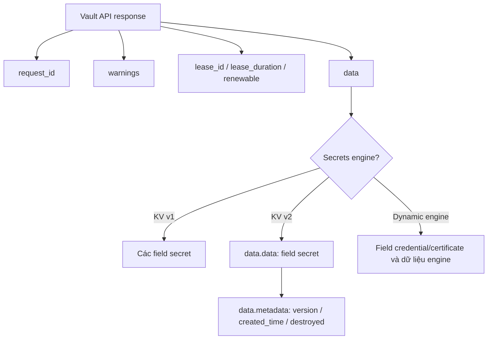
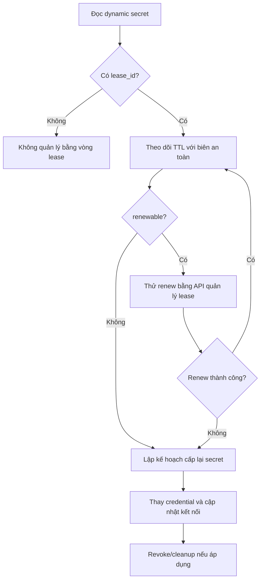

# Đọc metadata, cảnh báo và thông tin lease trong phản hồi Spring Vault

Khi gọi **`VaultTemplate`**, ứng dụng Java thường quan tâm trước tiên đến dữ liệu secret. Tuy nhiên, phản hồi của HashiCorp Vault còn mang nhiều thông tin cần thiết để vận hành đúng: **metadata của yêu cầu**, **cảnh báo (`warnings`)** và **thông tin lease** cho những secret có thời hạn. Với KV v2, còn có một lớp **metadata của phiên bản** nằm bên trong phần `data`. Nếu nhầm những khái niệm này, ứng dụng có thể gia hạn một secret không có lease, bỏ sót cảnh báo, hoặc đọc nhầm version của cấu hình.

Bài thuộc chương **VaultTemplate** của module **SPRING_VAULT**: sử dụng Java và Spring Vault để truy cập HashiCorp Vault thông qua `VaultTemplate`, xác thực theo workload, cấp policy tối thiểu, thực hành KV secrets, vòng đời token/lease, Transit encryption, PKI, xử lý lỗi, giám sát và kiểm thử tích hợp. Ở bài này, chúng ta tập trung vào **cách quan sát và diễn giải metadata, warnings và lease trong phản hồi**; việc thực sự gia hạn/thu hồi lease được giải thích ở mức vòng đời để tránh nhầm với thao tác đọc.

## Mục tiêu học tập

Sau bài học, bạn có thể:

1. Phân biệt **các trường ở cấp phản hồi Vault** với **metadata phiên bản KV v2** trong `data.metadata`.
2. Đọc `request_id`, `warnings`, `lease_id`, `lease_duration` và `renewable` qua `VaultResponse`/`VaultResponseSupport<T>`.
3. Giải thích khi nào lease có ý nghĩa; phân biệt lease của dynamic secret, thời hạn token và versioning của KV.
4. Xây dựng Java code chỉ trích xuất thông tin vận hành cần thiết, có kiểm tra `null`/sai kiểu và không ghi log nội dung secret.
5. Thiết kế kiểm thử phản hồi có cảnh báo, có/không có lease, KV v2 có metadata và các lỗi Vault thông thường.

## 1. Cấu trúc một phản hồi Vault

Ví dụ yêu cầu đọc một key KV v2 trong mount `secret`:

```java
VaultResponse response =
        vaultTemplate.read("secret/data/app/database");
```

Giả sử key `app/database` có version 4, phản hồi HTTP của Vault có thể có dạng **rút gọn**:

```json
{
  "request_id": "example-request-id",
  "lease_id": "",
  "renewable": false,
  "lease_duration": 0,
  "data": {
    "data": {
      "username": "demo_user",
      "password": "demo-only"
    },
    "metadata": {
      "created_time": "2026-01-15T09:30:00Z",
      "deletion_time": "",
      "destroyed": false,
      "version": 4,
      "custom_metadata": null
    }
  },
  "warnings": null
}
```

Đây là ví dụ minh họa, **không phải schema cố định cho mọi endpoint**. Một số trường có thể vắng mặt, rỗng hoặc được trả về dưới hình thức khác, tùy engine, operation và phiên bản Vault. Khi được ánh xạ bằng Spring Vault, các trường chung thường nằm trên `VaultResponse`, còn `response.getData()` là map ứng với trường JSON `data` bên ngoài.

| Trường | Cấp trong JSON Vault | Ý nghĩa |
|---|---|---|
| `request_id` | Cấp cao nhất | Định danh truy vết của yêu cầu tới Vault |
| `warnings` | Cấp cao nhất | Các cảnh báo/thông điệp từ Vault, có thể trống hoặc vắng |
| `lease_id` | Cấp cao nhất | Định danh lease của **secret có lease**; có thể rỗng |
| `lease_duration` | Cấp cao nhất | Thời hạn lease do Vault trả về, thường tính bằng **giây** |
| `renewable` | Cấp cao nhất | Vault đánh dấu lease trong phản hồi có khả năng gia hạn hay không |
| `data` | Cấp cao nhất | Payload của endpoint; với KV v2 lại có `data` và `metadata` bên trong |
| `data.metadata` | Bên trong `data` của KV v2 | Phiên bản, thời điểm tạo, trạng thái xóa và metadata riêng của **KV key** |

**Điểm phân biệt then chốt:** `lease_duration` ở cấp cao nhất và `metadata.version` của KV v2 phục vụ **hai cơ chế khác nhau**. Versioning KV ghi nhận lịch sử của secret tĩnh; lease mô tả thời gian tồn tại và vòng đời của một secret được cấp phát theo lease.



## 2. Đọc metadata chung qua `VaultResponse`

`VaultResponse` cho phép truy cập dữ liệu và các thuộc tính chung của phản hồi mà không cần parse JSON thô. Một ví dụ Java:

```java
VaultResponse response =
        vaultTemplate.read("secret/data/app/database");

if (response == null) {
    throw new IllegalStateException(
            "Vault không trả dữ liệu khả dụng tại key yêu cầu");
}

String requestId = response.getRequestId();
String leaseId = response.getLeaseId();
long leaseDurationSeconds = response.getLeaseDuration();
boolean renewable = response.isRenewable();
```

Các tên method trên thuộc nhóm getter thông tin phản hồi của Spring Vault. Trong một dự án có phiên bản Spring Vault khác, cần đối chiếu API thực tế của phiên bản dependency trước khi dùng các chức năng nâng cao. **Không cần in toàn bộ `response` để kiểm tra các trường này.**

### `request_id` để làm gì?

`request_id` được Vault tạo để hỗ trợ tương quan sự kiện trong vận hành và điều tra lỗi. Nếu response có ID, có thể đưa vào **log nội bộ đã được kiểm soát** hoặc hệ thống truy vết tương ứng, cùng tên operation và kết quả xử lý. Một `request_id`:

- Không phải path của secret hay key nghiệp vụ.
- Không phải lease ID hay token.
- Không chứng minh ứng dụng đã đọc được dữ liệu phù hợp schema.
- Có thể thiếu trong một số nhánh không có phản hồi hữu ích; luôn xử lý `null`.

Khi trả lỗi cho người dùng cuối, có thể dùng **correlation ID nội bộ** thay cho việc trả raw nội dung Vault. Đừng dùng request ID làm dữ liệu định danh cho logic nghiệp vụ.

### `data` không phải metadata chung

`response.getData()` chứa phần payload theo contract endpoint. Với KV v2, map này chứa cả `data` của secret lẫn `metadata` của version. Với dynamic database credentials, phần `data` có thể chứa `username`, `password`; nó **không tự chứa lease metadata ở cùng cấu trúc như KV v2**. Không dùng một cách ép map cho mọi secrets engine.

## 3. Metadata riêng của KV v2

Metadata version của KV v2 nằm trong lớp `data.metadata` của JSON phản hồi. Khi dùng raw `VaultTemplate.read()`, phải bóc map bọc ngoài:

```java
VaultResponse response =
        vaultTemplate.read("secret/data/app/database");

if (response == null || response.getData() == null) {
    throw new IllegalStateException("Không tìm thấy secret KV v2");
}

Map<String, Object> envelope = response.getData();
Object rawMetadata = envelope.get("metadata");

if (!(rawMetadata instanceof Map<?, ?> metadata)) {
    throw new IllegalStateException(
            "Phản hồi KV v2 thiếu metadata phiên bản");
}

Object rawVersion = metadata.get("version");
if (!(rawVersion instanceof Number number)) {
    throw new IllegalStateException(
            "Metadata KV v2 thiếu số version hợp lệ");
}

int version = number.intValue();
```

Ở trên, ví dụ cố ý giải thích **đường đi của dữ liệu**. Khi triển khai production cần kiểm tra version là số nguyên dương hợp lệ và tránh `intValue()` cắt phần thập phân hoặc tràn số; ví dụ service đầy đủ ở mục sau thực hiện kiểm tra chặt chẽ.

Một số trường thường gặp trong metadata đọc KV v2:

| Trường | Kiểu thường gặp | Diễn giải |
|---|---|---|
| `version` | Số nguyên | Phiên bản của secret vừa đọc |
| `created_time` | Chuỗi thời gian RFC 3339 | Thời điểm tạo phiên bản |
| `deletion_time` | Chuỗi thời gian hoặc rỗng | Thời điểm đánh dấu xóa mềm; rỗng thường là chưa xóa |
| `destroyed` | Boolean | Dữ liệu của version đã bị destroy hay chưa |
| `custom_metadata` | Object hoặc `null` | Metadata tùy chỉnh của key nếu có |

Trường `metadata` này **không thay thế** việc gọi các endpoint quản lý metadata riêng của KV v2, chẳng hạn `GET secret/metadata/app/database`, khi cần thông tin lịch sử version, cấu hình CAS hoặc trạng thái của nhiều phiên bản. Endpoint metadata riêng đòi hỏi policy `read` trên `secret/metadata/...`; thao tác đọc giá trị KV v2 sử dụng path `secret/data/...`.

### Metadata KV v2 không phải lease

Giả sử `version=4` và `created_time` là vài ngày trước. Điều đó không có nghĩa secret còn lease bốn ngày, hoặc ứng dụng phải gia hạn theo `created_time`. Versioning là cơ chế lưu các lần ghi. **KV secret thông thường không phải dynamic secret có lease tự động**; muốn thay đổi thông tin trong KV, ứng dụng phải ghi phiên bản mới theo quy trình rotation riêng.

Khi phiên bản mới nhất bị xóa mềm, một lần đọc giá trị có thể không trả nội dung khả dụng dù metadata key còn tồn tại. Vì vậy, “không đọc được secret” không đồng nghĩa “metadata đã bị xóa vĩnh viễn”.

## 4. Đọc và xử lý `warnings`

Vault có thể đính kèm `warnings` trong phản hồi để thông báo tình trạng cần lưu ý mà **không nhất thiết biến yêu cầu thành lỗi**. Cảnh báo có thể nói về cấu hình, chính sách API hoặc trạng thái vận hành, tùy endpoint. Ví dụ JSON rút gọn:

```json
{
  "request_id": "example-request-id",
  "data": {
    "result": "example"
  },
  "warnings": [
    "Example warning from Vault endpoint"
  ]
}
```

Trong Spring Vault, có thể đọc danh sách cảnh báo từ phản hồi:

```java
VaultResponse response = vaultTemplate.read("some/endpoint");
if (response != null) {
    List<String> warnings = response.getWarnings();

    if (warnings != null && !warnings.isEmpty()) {
        // Ghi nhận số lượng hoặc mã phân loại cảnh báo.
        // Tránh in toàn bộ response và secret vào log.
    }
}
```

**Lưu ý:** Đường dẫn `some/endpoint` chỉ minh họa API; bạn phải thay bằng path có endpoint hỗ trợ, policy phù hợp và có ý nghĩa trong môi trường thật. Không có bảo đảm Vault luôn trả `warnings` cho một thao tác cụ thể. Không nên viết unit test mong mọi lần đọc KV đều có cảnh báo.

Nguyên tắc xử lý:

1. **Cảnh báo không đồng nghĩa HTTP error.** Nếu endpoint trả thành công kèm warning, việc dừng nghiệp vụ hay tiếp tục là quyết định dựa trên loại cảnh báo và yêu cầu ứng dụng.
2. **Chấp nhận `null` và danh sách rỗng.** Không phải mọi response đều có trường warnings.
3. **Không log nguyên văn theo mặc định.** Thông điệp có thể chứa path, tên mount hay chi tiết vận hành; nên phân loại, giới hạn độ dài và khử dữ liệu nhạy cảm trước khi đưa ra hệ thống quan sát.
4. **Không bỏ qua tất cả warnings.** Nếu có cảnh báo lặp lại hoặc tăng bất thường, cần cảnh báo vận hành, nhưng đừng thiết kế hệ thống phụ thuộc vào một chuỗi thông điệp tự do không được bảo đảm cố định.
5. **Phân biệt warnings với exception.** HTTP 403, timeout hoặc lỗi TLS vẫn cần đường xử lý exception riêng.

Nếu ứng dụng phải phản ứng khác nhau với từng loại warning, nên dựa vào contract chính thức của endpoint và các tín hiệu có cấu trúc nếu có, thay vì chỉ tìm một đoạn text trong warning.

## 5. Lease trong phản hồi là gì?

**Lease** là cơ chế Vault gắn một vòng đời cho một số secret được cấp phát động, chẳng hạn credentials từ database secrets engine. Phản hồi có thể trả ba trường:

- `lease_id`: định danh lease do Vault cấp, dùng trong các thao tác quản lý lease thích hợp.
- `lease_duration`: thời hạn phản hồi, thường tính bằng **giây**; không phải timestamp tuyệt đối.
- `renewable`: cho biết lease có thể được gia hạn theo contract của Vault hay không; **không bảo đảm** một lần gia hạn trong tương lai sẽ thành công.

Ví dụ giả định ứng dụng đọc dynamic database credentials từ mount `database`:

```java
VaultResponse response =
        vaultTemplate.read("database/creds/app-reader");

if (response == null || response.getData() == null) {
    throw new IllegalStateException(
            "Vault chưa trả thông tin credential");
}

String leaseId = response.getLeaseId();
long ttlSeconds = response.getLeaseDuration();
boolean renewable = response.isRenewable();
Map<String, Object> credentials = response.getData();
```

Phản hồi JSON rút gọn có thể giống:

```json
{
  "request_id": "example-dynamic-request",
  "lease_id": "database/creds/app-reader/example-lease",
  "lease_duration": 3600,
  "renewable": true,
  "data": {
    "username": "v_example_user",
    "password": "example-only"
  }
}
```

Đường dẫn `database/creds/app-reader` chỉ hợp lệ nếu hệ thống đã cấu hình database secrets engine và role tương ứng. Ví dụ trên **không thiết lập engine hay phát hành secret thật**; các giá trị đều giả. Với engine khác như PKI, trường dữ liệu, thời hạn và cơ chế thu hồi có thể khác. Với Transit, thao tác mã hóa/trả ciphertext không có cùng ý nghĩa lease như dynamic database credentials.

### Cách hiểu thời hạn

Nếu Vault trả `lease_duration = 3600`, đây là một **khoảng thời gian khoảng một giờ tính bằng giây**, không phải “hết hạn vào giây thứ 3600 của ngày”. Khi ứng dụng nhận phản hồi, thời gian đã bắt đầu trôi; không nên lấy thời điểm parse client cộng duration để coi đó là hạn tuyệt đối chính xác. Cần tính đến độ trễ mạng, chênh lệch đồng hồ, thời gian xử lý và khả năng lease bị thu hồi sớm.

Nếu có `lease_id` và `renewable=false`, ứng dụng có thể cần cấp phát credential mới trước khi lease hết hạn, theo chính sách của engine. Nếu `renewable=true`, vẫn phải dùng cơ chế gia hạn/thu hồi được quản lý, xử lý lỗi quyền hoặc lease không còn hiệu lực. Không xây vòng lặp gia hạn vô hạn từ một lần đọc.

### KV secret thường không có lease động

Một lần đọc KV v1/v2 thường trả `lease_id` rỗng, `lease_duration` bằng `0` và `renewable=false`. Điều này **không có nghĩa secret không tồn tại** hoặc “đã hết hạn”; chỉ là thao tác đọc KV đó không phát hành lease động như database credentials.

| Loại dữ liệu | Thông tin thời hạn nên theo dõi | Cách xử lý phù hợp |
|---|---|---|
| KV v1/v2 tĩnh | Version KV v2, quy trình rotation riêng | Đọc lại/refresh khi cần; không tự gia hạn lease KV |
| Database dynamic credentials | Lease ID, TTL, renewable, lỗi renew/revoke | Quản lý vòng đời lease và thay credential kịp thời |
| Token truy cập Vault | TTL/renewable của token theo cơ chế xác thực | Quản lý token/session theo auth lifecycle |
| Transit encrypt/decrypt | Phản hồi mã hóa và trạng thái key | Không coi ciphertext là dynamic credential có lease |

**Token khác lease của secret.** Identity/token mà Spring Vault dùng để gọi `read()` có TTL và cơ chế gia hạn riêng. Không lấy `response.getLeaseDuration()` từ một lần đọc KV để suy ra TTL của token. Phản hồi của một endpoint xác thực có thể có thông tin token trong trường `auth` với cách biểu diễn riêng; cần dùng API/auth lifecycle thích hợp để quản lý token.

## 6. Ví dụ Java: tách nội dung secret và thông tin vận hành

Dịch vụ sau sử dụng Java 17+, `VaultTemplate` đã được cấu hình, và một key KV v2 có cấu trúc `username`/`password`. Nó **chỉ đưa ra bên ngoài thông tin vận hành đã chọn**, không trả map thô hay log mật khẩu. Metadata version được kiểm tra theo kiểu số nguyên, warnings chỉ được đếm, thông tin lease được tóm tắt bằng boolean và duration.

```java
import java.math.BigDecimal;
import java.time.Duration;
import java.util.List;
import java.util.Map;

import org.springframework.stereotype.Service;
import org.springframework.vault.core.VaultTemplate;
import org.springframework.vault.support.VaultResponse;

@Service
public class VaultResponseInspector {

    private final VaultTemplate vaultTemplate;

    public VaultResponseInspector(VaultTemplate vaultTemplate) {
        this.vaultTemplate = vaultTemplate;
    }

    public InspectedSecret readKv2DatabaseSecret() {
        VaultResponse response =
                vaultTemplate.read("secret/data/app/database");

        if (response == null || response.getData() == null) {
            throw new IllegalStateException(
                    "Không tìm thấy dữ liệu KV v2");
        }

        Map<String, Object> envelope = response.getData();
        Map<?, ?> values = requireMap(
                envelope.get("data"), "KV v2 data");
        Map<?, ?> metadata = requireMap(
                envelope.get("metadata"), "KV v2 metadata");

        DatabaseSecret secret = new DatabaseSecret(
                requiredString(values, "username"),
                requiredString(values, "password"));

        int version = requiredVersion(metadata.get("version"));

        ResponseInfo info = summarize(response);
        return new InspectedSecret(secret, version, info);
    }

    public ResponseInfo inspectDynamicCredentialResponse() {
        VaultResponse response =
                vaultTemplate.read("database/creds/app-reader");

        if (response == null || response.getData() == null) {
            throw new IllegalStateException(
                    "Không nhận được dynamic credentials");
        }

        // Chỉ tóm tắt metadata; không ghi vào log hoặc
        // trả về nội dung username/password ở response.getData().
        return summarize(response);
    }

    private static ResponseInfo summarize(VaultResponse response) {
        String leaseId = response.getLeaseId();
        boolean hasLease = leaseId != null && !leaseId.isBlank();

        long rawSeconds = response.getLeaseDuration();
        long seconds = Math.max(0L, rawSeconds);

        List<String> warnings = response.getWarnings();
        int warningCount = warnings == null ? 0 : warnings.size();

        String requestId = response.getRequestId();

        return new ResponseInfo(
                requestId,
                hasLease,
                Duration.ofSeconds(seconds),
                hasLease && response.isRenewable(),
                warningCount);
    }

    private static Map<?, ?> requireMap(
            Object value, String field) {
        if (!(value instanceof Map<?, ?> result)) {
            throw new IllegalStateException(
                    "Phản hồi Vault thiếu cấu trúc: " + field);
        }
        return result;
    }

    private static String requiredString(
            Map<?, ?> values, String field) {
        Object value = values.get(field);
        if (!(value instanceof String text) || text.isBlank()) {
            throw new IllegalStateException(
                    "Secret thiếu field hợp lệ: " + field);
        }
        return text;
    }

    private static int requiredVersion(Object raw) {
        if (!(raw instanceof Number number)) {
            throw new IllegalStateException(
                    "Thiếu KV version dạng số");
        }

        final int version;
        try {
            version = new BigDecimal(number.toString()).intValueExact();
        } catch (NumberFormatException | ArithmeticException ex) {
            throw new IllegalStateException(
                    "KV version không phải số nguyên hợp lệ");
        }

        if (version < 1) {
            throw new IllegalStateException(
                    "KV version phải là số nguyên dương");
        }
        return version;
    }

    public record DatabaseSecret(
            String username, String password) {
        @Override
        public String toString() {
            return "DatabaseSecret[REDACTED]";
        }
    }

    public record ResponseInfo(
            String requestId,
            boolean hasLease,
            Duration leaseDuration,
            boolean renewable,
            int warningCount) {}

    public record InspectedSecret(
            DatabaseSecret secret,
            int kvVersion,
            ResponseInfo responseInfo) {
        // Tránh toString() của record chứa DatabaseSecret
        // làm lộ thông tin hoặc mở rộng log theo thói quen.
        @Override
        public String toString() {
            return "InspectedSecret[REDACTED]";
        }
    }
}
```

Ví dụ trên cố ý dùng `response.getLeaseId()` để đánh giá **có ID lease** hay không. Nó **không trả raw lease ID** trong DTO tóm tắt: lease ID có thể được dùng cho hành động quản trị, vì vậy không nên chia sẻ không cần thiết. `requestId` được đưa vào DTO vận hành nhưng cần giới hạn nơi tiêu thụ; không nhất thiết cung cấp cho client bên ngoài.

`Duration.ofSeconds(...)` giúp biểu diễn TTL rõ đơn vị. Với KV, trường `hasLease=false` thường là tín hiệu quan trọng hơn con số `0`. Tuy nhiên `ResponseInfo` chỉ là **ảnh chụp thời điểm phản hồi** và không tự thực hiện renew/revoke, refresh hay cache.

### Lựa chọn typed response

Với API có kiểu `VaultResponseSupport<T>`, các thông tin chung về phản hồi vẫn có thể được quan sát theo API của `VaultResponseSupport`, nhưng phần dữ liệu `getData()` được ánh xạ thành kiểu `T`. Đối với KV v2, nên dùng `VaultKeyValueOperations` phù hợp với backend để thư viện bóc lớp `data`, và dùng API/response đặc thù nếu cần metadata version chi tiết. Đừng tự cho rằng DTO của secret sẽ có field `lease_id` hoặc `version` nếu hai giá trị đó thuộc cấp khác của JSON.

## 7. Quan sát lease qua cơ chế quản lý vòng đời

Việc đọc `lease_id`, `lease_duration` và `renewable` chỉ cung cấp thông tin đầu vào. Một ứng dụng dùng dynamic credentials cần một quy trình quản lý vòng đời:

1. **Nhận secret có lease:** cấp phát dynamic credential bằng identity/policy phù hợp.
2. **Theo dõi TTL còn lại:** sử dụng thời gian có biên an toàn; không giả định TTL trả về là hạn tuyệt đối từ lúc client xử lý.
3. **Gia hạn nếu được phép và phù hợp:** khi `renewable=true`, sử dụng API quản lý lease tương ứng; xử lý giới hạn TTL tối đa, quyền và kết quả renew.
4. **Cấp phát lại nếu cần:** với lease không renewable, lỗi gia hạn hoặc credential sắp hết hạn, lấy credential mới và cập nhật các thành phần đang sử dụng.
5. **Thu hồi và đóng kết nối:** khi credential không còn cần thiết hoặc đã bị thay thế, thực hiện quy trình revoke/cleanup theo khả năng của engine.
6. **Giám sát lỗi gia hạn/thu hồi:** đo độ trễ, số lease đang quản lý, khả năng thay thế credential, cảnh báo trước khi mất kết nối.

Spring Vault có các cơ chế hỗ trợ vòng đời secret/lease (ví dụ `SecretLeaseContainer`) khi ứng dụng cần theo dõi việc cấp phát và gia hạn. Cần thiết kế chiến lược cache, rotation và kết nối tới dịch vụ đích riêng cho từng secrets engine. Không nên viết timer dựa trên `getLeaseDuration()` của **một lần đọc KV** để tự gia hạn key KV.



## 8. Phân quyền, lỗi và an toàn khi xử lý phản hồi

Để đọc KV v2 `secret/data/app/database`, policy tối thiểu có thể là:

```hcl
path "secret/data/app/database" {
  capabilities = ["read"]
}
```

Để đọc dynamic database credentials, nếu database engine và role đã cấu hình, policy đọc trên path ví dụ:

```hcl
path "database/creds/app-reader" {
  capabilities = ["read"]
}
```

Quyền `read` của từng endpoint **không tự cấp** quyền quản trị lease, đổi policy, xóa metadata hoặc truy cập toàn bộ path khác. Nếu cần gọi API quản lý lease hoặc metadata, cấp quyền bổ sung theo đúng nhu cầu và identity phù hợp; không cấp quyền rộng `sudo` chỉ vì muốn đọc một field phản hồi.

### Các lỗi cần phân loại

| Trường hợp | Ý nghĩa có thể gặp | Cách xử lý |
|---|---|---|
| `response == null` | Không có resource khả dụng hoặc hành vi riêng của endpoint/client | Kiểm tra contract; báo thiếu dữ liệu mà không suy diễn có lease |
| `response.getData() == null` | Không có payload cần thiết hoặc response khác kỳ vọng | Không gọi sâu vào `data`; xác định schema endpoint |
| KV v2 thiếu `metadata` hoặc `version` sai kiểu | Phản hồi không đúng contract đang sử dụng | Báo lỗi schema; không mặc định version bằng `0` |
| `warnings == null` hoặc `warnings.isEmpty()` | Không có cảnh báo được trả về | Tiếp tục nếu dữ liệu/schema hợp lệ |
| `lease_id` rỗng, `lease_duration=0` | Thường không có lease dynamic, nhất là KV | Không cố renew theo giá trị này |
| `renewable=false` | Không thể giả định được gia hạn | Thiết kế cấp phát lại/rotation cho engine có lease |
| HTTP 403 | Thiếu quyền trên path hoặc identity không phù hợp | Kiểm tra ACL; không chuyển thành cảnh báo thông thường |
| Auth/token lỗi | Workload không xác thực được hoặc token đã hết hạn | Xử lý token/session lifecycle |
| Timeout, TLS hoặc Vault 5xx | Hạ tầng tạm thời không khả dụng | Timeout và retry có giới hạn, ghi metric đã khử dữ liệu nhạy cảm |

Dù metadata hay warnings không phải password, chúng vẫn có thể tiết lộ tên mount, đường dẫn, cấu trúc hệ thống và trạng thái vận hành. Do vậy:

- **Không log toàn bộ `VaultResponse` hoặc `getData()`**; raw response có thể chứa secret.
- Chỉ ghi metric như `vault.read.duration`, `vault.read.success`, số cảnh báo, cờ có lease, trạng thái lỗi. Tránh gắn nguyên lease ID, username, secret path động hoặc token vào metric labels vì có thể lộ dữ liệu và tạo cardinality rất lớn.
- Hạn chế log nguyên văn warnings; nếu phải lưu để điều tra, kiểm soát quyền truy cập, khử thông tin nhạy cảm và giới hạn thời gian lưu.
- Dùng HTTPS/TLS được xác minh và xác thực theo workload. Token TTL và secret lease TTL phải được quan sát theo cơ chế riêng.

## 9. Thực hành và kiểm thử tích hợp

Sử dụng Vault thử nghiệm riêng hoặc container Vault được cô lập. Để quan sát metadata KV v2, cần mount phiên bản 2 và key có ít nhất một version:

```bash
# Chỉ bật mount nếu chưa tồn tại (Vault dev có thể có sẵn secret).
vault secrets enable -path=secret -version=2 kv

# Lưu secret giả để tạo version 1.
vault kv put -mount=secret app/database \
  username=demo_user password=demo-only

# Ghi một lần nữa để tạo version tiếp theo.
vault kv put -mount=secret app/database \
  username=demo_user password=rotated-demo

# Xem version và metadata bằng CLI.
vault kv get -mount=secret app/database
vault kv metadata get -mount=secret app/database
```

Đây là cú pháp Bash; nếu chạy trong Windows PowerShell, dùng lệnh một dòng hoặc ký tự nối dòng tương ứng. Các giá trị chỉ là dữ liệu giả. Việc quan sát `database/creds/app-reader` chỉ có ý nghĩa nếu bạn **đã triển khai database secrets engine và role test**; không thể dùng lệnh KV để tự tạo dynamic database lease.

### Ma trận kiểm thử

| Trường hợp | Kỳ vọng |
|---|---|
| Đọc KV v2 version hiện hành | Tách đúng `data.data` và `data.metadata` |
| Đọc KV v2 có `metadata.version` là số nguyên | Trích xuất đúng version, không dùng nó như lease TTL |
| `metadata.version` thiếu/sai kiểu/âm | Phát hiện schema không hợp lệ, không trả version mặc định |
| KV v2 có `lease_id=""`, `lease_duration=0`, `renewable=false` | Nhận diện không có dynamic lease, vẫn chấp nhận secret hợp lệ |
| Phản hồi có `warnings=null` | `warningCount=0`, không có lỗi null |
| Phản hồi có hai cảnh báo | `warningCount=2`, không log raw response |
| Dynamic credentials có lease | Nhận diện `hasLease=true`, đọc TTL theo giây và renewable flag |
| Dynamic credentials có `renewable=false` | Không đánh dấu khả năng renew; thiết kế cấp lại phù hợp |
| Path không tồn tại hoặc KV version đã xóa mềm | Không dereference `null`, phân biệt với dữ liệu có metadata |
| Token thiếu quyền `read` | Xử lý lỗi 403 thay vì trả thông tin vận hành giả |
| Timeout, Vault 5xx hoặc TLS lỗi | Phân loại hạ tầng, retry giới hạn; không log credential |
| Log/metric/audit | Không chứa raw token, password hoặc lease ID không cần thiết |

Trong **unit test**, có thể mock `VaultTemplate.read()` trả các `VaultResponse` với tổ hợp metadata/warnings/lease để kiểm tra cách tóm tắt và validation. **Integration test** với Vault thật hoặc container mới xác nhận JSON, cách ánh xạ từng trường, policy, trạng thái KV v2 và lease thật của dynamic engine. Đối với phần gia hạn, nên có bài test riêng cho lease gần hết hạn, renew thất bại và thay credential, thay vì suy ra từ một phản hồi giả.

## 10. Các nhầm lẫn thường gặp

**Đồng nhất `metadata.version` với `lease_duration`.** Version KV v2 là số lần ghi, không phải TTL. Lease duration tính theo giây cho lease do Vault cấp.

**Cho rằng KV secret có `lease_duration=0` là đã hết hạn.** KV thường không phát hành dynamic lease khi đọc. Việc key có dữ liệu khả dụng hay không phải xác định theo contract KV và trạng thái version.

**Giả định `renewable=true` bảo đảm có thể renew thành công.** Thao tác renew còn phụ thuộc TTL tối đa, policy, trạng thái lease và engine; phải xử lý lỗi và có kế hoạch thay thế.

**Dùng lease của secret để đo TTL token.** Token/session và dynamic secret lease có thể có thời hạn và quy tắc khác nhau. Không trộn logic auth với logic quản lý lease.

**In warnings và cả response vào log.** `VaultResponse` thường chứa chính secret; warnings có thể mang chi tiết vận hành nhạy cảm. Chỉ trích xuất thông tin đã kiểm soát.

**Bỏ qua lớp `data` của KV v2.** `response.getData()` chứa envelope; metadata version ở `response.getData().get("metadata")`, còn secret value ở `response.getData().get("data")`.

**Coi warnings là exception, hoặc ngược lại.** Một HTTP response thành công có thể có warning; 403/timeout phải xử lý như lỗi, không biến thành chuỗi cảnh báo.

**Cho rằng một lần đọc đã đủ để quản lý lease mãi mãi.** Lease cần theo dõi thời gian, refresh, renew/revoke khi áp dụng, xử lý dịch vụ ngừng hoạt động và vòng đời credential.

## Câu hỏi tự kiểm tra

1. Trong JSON phản hồi KV v2, `request_id` và `data.metadata.version` nằm ở những cấp nào? Hai trường có ý nghĩa gì?
2. Khi `warnings` là `null`, ứng dụng nên xử lý ra sao? Vì sao không nên log nguyên văn mọi warning?
3. Nếu một lần đọc KV có `lease_id=""` và `lease_duration=0`, có thể kết luận secret đã hết hạn không?
4. `lease_duration=3600` nghĩa là gì? Vì sao không nên coi đó là timestamp tuyệt đối?
5. Nếu `renewable=true`, ứng dụng cần thêm những kiểm soát nào trước khi phụ thuộc vào việc gia hạn lease?
6. Tại sao không thể lấy `VaultResponse.getLeaseDuration()` của secret KV để suy ra thời hạn token đang dùng?
7. Cần kiểm thử những kịch bản nào để phát hiện nhầm lẫn giữa metadata version, warnings và lease?

**Gợi ý đối chiếu:** Các trường chung (`request_id`, `warnings`, `lease_id`, `lease_duration`, `renewable`) thuộc cấp phản hồi Vault; `data.metadata` của KV v2 mô tả phiên bản secret. Warnings là tín hiệu vận hành, lease mô tả vòng đời secret được cấp phát theo lease, còn token TTL và KV versioning có cơ chế riêng. Trích xuất đúng lớp dữ liệu, kiểm tra kiểu/`null`, bảo vệ log và kiểm thử tích hợp giúp ứng dụng Java sử dụng Spring Vault an toàn hơn.
