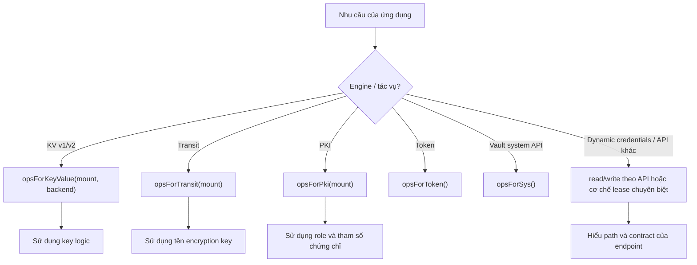

# Chọn nhóm `opsFor` tương ứng với loại secrets engine trong Spring Vault

Khi dùng **Spring Vault**, lập trình viên có thể gọi trực tiếp `VaultTemplate.read()`, `write()` và `delete()` theo đường dẫn HTTP của Vault. Tuy nhiên, mỗi **secrets engine** có API và quy tắc dữ liệu riêng: KV v2 có lớp `data` và versioning, Transit xử lý mã hóa, PKI phát hành chứng chỉ, còn database engine có thể cấp thông tin đăng nhập động với lease. Vì vậy, Spring Vault cung cấp các nhóm thao tác dạng **`opsFor...`** để ứng dụng làm việc ở mức nghiệp vụ rõ ràng hơn.

Bài thuộc chương **VaultTemplate** của module **SPRING_VAULT**. Phạm vi module là dùng Java truy cập HashiCorp Vault qua `VaultTemplate`, xác thực theo workload và phân quyền bằng policy; thực hành KV secrets, vòng đời token và lease, Transit encryption, PKI, xử lý lỗi, giám sát và kiểm thử tích hợp. Trong bài này, mục tiêu chính là **chọn nhóm `opsFor` phù hợp với secrets engine và tác vụ**, đồng thời hiểu khi nào cần quay về API mức thấp hoặc cơ chế quản lý lease riêng.

## Mục tiêu học tập

Sau bài học, bạn có thể:

1. Giải thích sự khác nhau giữa thao tác mức thấp của `VaultTemplate` và các facade như `opsForKeyValue`, `opsForTransit`, `opsForPki`.
2. Chọn đúng `KeyValueBackend.KV_1` hoặc `KeyValueBackend.KV_2` cho mount KV tương ứng.
3. Phân biệt mount path, key logic và API path để tránh gửi sai endpoint.
4. Nhận diện tác vụ token/system và dynamic secret không nên bị gán nhầm sang một nhóm `opsFor` khác.
5. Viết Java service sử dụng nhóm operations, cấp policy phù hợp và kiểm thử sai cấu hình, sai quyền, sai phiên bản engine.

## 1. Vì sao cần nhóm `opsFor`?

`VaultTemplate` thực thi giao diện `VaultOperations`, cung cấp cả các lời gọi theo path lẫn các nhóm operations chuyên biệt. Ví dụ, để đọc một key KV v2 bằng API mức thấp, ứng dụng cần biết endpoint:

```java
VaultResponse raw = vaultTemplate.read("secret/data/app/database");
```

Đường dẫn `secret/data/app/database` là API path của KV v2. `raw.getData()` chứa map bọc với `data` và `metadata`, nên code còn phải kiểm tra cấu trúc để lấy secret. Nếu dùng facade KV v2:

```java
VaultKeyValueOperations kv2 = vaultTemplate.opsForKeyValue(
        "secret", KeyValueBackend.KV_2);

VaultResponseSupport<DatabaseSecret> response =
        kv2.get("app/database", DatabaseSecret.class);
```

Ở đây `"secret"` là mount, `"app/database"` là **key logic**; Spring Vault xử lý ngữ nghĩa KV v2 để lấy phần dữ liệu theo kiểu Java.



**Facade không tự bật engine hay cấp quyền.** Trước khi gọi, Vault server phải có mount, cấu hình key/role tương ứng, và token của workload phải có capability cho API path thật. Một facade được tạo thành công trong Java không chứng minh endpoint tồn tại trên server.

## 2. Bảng chọn nhanh nhóm operations

| Nhu cầu | Mount hoặc API ví dụ | Lựa chọn Spring Vault | Điều cần phân biệt |
|---|---|---|---|
| Đọc/ghi/xóa key KV **v1** | `legacy/app/database` | `opsForKeyValue("legacy", KV_1)` | Key logic là `app/database`; không có versioning KV v2 |
| Đọc/ghi key KV **v2** | `secret/data/app/database` | `opsForKeyValue("secret", KV_2)` | Facade dùng key logic và xử lý lớp `data` |
| Mã hóa/giải mã bằng **Transit** | `transit/encrypt/app-key` | `opsForTransit("transit")` | Dùng tên encryption key; ciphertext khác với một KV secret |
| Quản lý chứng chỉ bằng **PKI** | `pki/issue/web` | `opsForPki("pki")` | Chú ý role, CN/SAN, thời hạn và private key |
| Thao tác với **Vault token** | `auth/token/...` | `opsForToken()` | Đây là API token; không tương đương vòng đời của KV |
| Quản trị **Vault system** | `sys/...` | `opsForSys()` | Dành cho tác vụ hệ thống, thường cần quyền riêng |
| Đọc **database dynamic credentials** | `database/creds/app-reader` | `VaultTemplate.read(path)` hoặc cơ chế quản lý lease | Không tự suy diễn có một `opsForDatabase` chuẩn |
| Endpoint engine chưa có facade phù hợp | Tùy API của engine | `read()`, `write()`, `delete()` tương ứng | Tự quản lý path, JSON body, phản hồi và lỗi |

Các tên API ở trên minh họa họ interface thường dùng của Spring Vault. Khi triển khai cần đối chiếu API được cung cấp bởi **phiên bản thư viện thực tế**; một số overload và chức năng nâng cao có thể khác nhau theo phiên bản. Đặc biệt, **`opsFor...` không phải quy tắc đặt tên tùy ý**: đừng tự giả định mọi engine đều có một phương thức `opsFor<Engine>()` tương ứng.

## 3. Trước khi chọn API: xác định mount, backend và operation

Trong Vault, **mount** là đường dẫn secrets engine được bật, ví dụ:

```text
legacy/             KV v1
secret/             KV v2
transit/            Transit
pki/                PKI
database/           Database secrets engine
```

Đây chỉ là cấu hình ví dụ. Tên mount có thể được tổ chức đổi thành `kv/`, `application-secrets/`, `crypto/` hoặc tên khác; **không được mặc định mọi cluster đều có mount tên `secret`**. Một mount chỉ dùng một loại/phiên bản engine tương ứng theo cấu hình của nó.

Đối với mỗi thao tác, cần trả lời ba câu hỏi:

1. **Engine nào?** KV v1, KV v2, Transit, PKI, database engine, token API hay system API?
2. **Đường dẫn mount nào?** Chẳng hạn `secret`, `transit`, `pki` do Vault admin cấu hình.
3. **Operation và contract nào?** `get/put/delete/list` một KV key, `encrypt/decrypt` với Transit key, yêu cầu certificate từ PKI role hay yêu cầu dynamic credentials từ database role?

Ví dụ cùng chuỗi `"app/database"` có vai trò khác nhau:

| Ngữ cảnh | Chuỗi `app/database` được hiểu là |
|---|---|
| `kv2.get("app/database")` | Key logic trong mount KV v2 đã chọn |
| `vaultTemplate.read("secret/data/app/database")` | Phần cuối của API path KV v2 |
| `transit.encrypt("app/database", plaintext)` | **Không nên tự dùng như KV path**; Transit nhận tên key theo contract riêng |
| `pki` issue certificate | Không phải key chứa password; PKI dùng role/các tham số chứng chỉ |

Đừng đưa full URL như `https://vault.example/v1/secret/data/app/database` vào `opsForKeyValue().get()`, và đừng tự thêm `/data/` hoặc `/metadata/` vào key logic của facade KV v2.

## 4. KV v1 và KV v2: chọn đúng `KeyValueBackend`

Spring Vault có `VaultKeyValueOperations` để thao tác KV. Enum `KeyValueBackend` giúp thư viện biết cách xây dựng request theo version engine.

### KV v1: `KV_1`

Giả sử mount `legacy` là KV v1. Đối tượng Java và code đọc/ghi:

```java
import java.util.Map;

import org.springframework.vault.core.VaultKeyValueOperations;
import org.springframework.vault.core.VaultKeyValueOperationsSupport.KeyValueBackend;
import org.springframework.vault.core.VaultTemplate;
import org.springframework.vault.support.VaultResponse;

VaultKeyValueOperations kv1 = vaultTemplate.opsForKeyValue(
        "legacy", KeyValueBackend.KV_1);

kv1.put("app/database", Map.of(
        "username", "demo_user",
        "password", "demo-only"
));

VaultResponse response = kv1.get("app/database");
if (response == null || response.getData() == null) {
    throw new IllegalStateException("Không tìm thấy KV v1 secret");
}

Object username = response.getData().get("username");
```

KV v1 lưu trực tiếp key/value, không có versioning. Khi gọi `kv1.get("app/database")`, facade định tuyến tới API path của mount `legacy`.

### KV v2: `KV_2`

Giả sử mount `secret` là KV v2:

```java
import java.util.Map;

import org.springframework.vault.core.VaultKeyValueOperations;
import org.springframework.vault.core.VaultKeyValueOperationsSupport.KeyValueBackend;
import org.springframework.vault.support.VaultResponseSupport;

VaultKeyValueOperations kv2 = vaultTemplate.opsForKeyValue(
        "secret", KeyValueBackend.KV_2);

kv2.put("app/database", Map.of(
        "username", "demo_user",
        "password", "demo-only"
));

VaultResponseSupport<DbSecret> response =
        kv2.get("app/database", DbSecret.class);

if (response == null || response.getData() == null) {
    throw new IllegalStateException("Không tìm thấy KV v2 secret");
}

DbSecret secret = response.getData();
```

DTO `DbSecret` của ví dụ:

```java
public record DbSecret(String username, String password) {
    @Override
    public String toString() {
        return "DbSecret[REDACTED]";
    }
}
```

`KV_2` cho thư viện biết cần dùng endpoint KV v2 như `secret/data/app/database` và wrapper `data` cho thao tác cơ bản. Kết quả typed `get(...)` hướng đến secret thực, tránh việc code nghiệp vụ phải tự xử lý `response.data.data`.

**Chọn sai backend gây lỗi thật:** nếu mount `secret` đang là KV v2 nhưng dùng `KV_1`, code có thể gọi sai endpoint, nhận 404/400 hoặc xử lý sai payload. Không dựa vào tên mount để đoán phiên bản. Cần đối chiếu mount đã bật trên Vault và cấu hình ứng dụng.

### Bảng so sánh API thô và KV facade

| Tác vụ | `VaultTemplate` thô KV v2 | `VaultKeyValueOperations` KV v2 |
|---|---|---|
| Đọc | `read("secret/data/app/database")` | `kv2.get("app/database")` |
| Đọc có kiểu | Tự hiểu lớp `data` của response | `kv2.get("app/database", DbSecret.class)` |
| Ghi | `write("secret/data/app/database", Map.of("data", values))` | `kv2.put("app/database", values)` |
| Xóa latest | `delete("secret/data/app/database")` | `kv2.delete("app/database")` |
| Liệt kê key | `list("secret/metadata/app")` | Chọn API liệt kê tương ứng theo phiên bản thư viện hoặc dùng raw API đúng metadata path |

**Giới hạn:** API convenience cho KV không thay thế toàn bộ các endpoint quản lý phiên bản. Khi cần CAS bắt buộc, xóa/destroy nhiều version hay đọc metadata lịch sử chi tiết, kiểm tra interface/version hiện dùng và chọn API đáp ứng đúng contract; đừng giả định `put()` thông thường tự bật CAS hay hợp nhất nội dung cũ.

## 5. Transit: chọn `opsForTransit` để mã hóa và giải mã

**Transit secrets engine** thực hiện thao tác mật mã và quản lý encryption key tại Vault. Nó không phải KV store để ứng dụng ghi rồi đọc lại plaintext. Với Transit, client thường đưa plaintext tới endpoint mã hóa và nhận ciphertext; khi giải mã, gửi ciphertext để nhận plaintext theo policy.

Giả sử mount là `transit` và Transit key tên `app-key` đã được tạo, có policy phù hợp:

```java
import org.springframework.vault.core.VaultTransitOperations;

VaultTransitOperations transit =
        vaultTemplate.opsForTransit("transit");

String ciphertext =
        transit.encrypt("app-key", "demo-only");

String plaintext =
        transit.decrypt("app-key", ciphertext);
```

Trong ví dụ:

- `"transit"` là **mount**, `"app-key"` là **tên Transit key**, không phải key logic KV.
- `encrypt()`/`decrypt()` thể hiện ý định nghiệp vụ rõ ràng; facade xử lý hình thức request/response cho operation được hỗ trợ.
- Vault Transit thường làm việc với plaintext/ciphertext được mã hóa Base64 ở **API HTTP thô**. Khi dùng facade, tránh tự Base64 thêm nếu API Java đã xử lý việc đó theo contract phiên bản đang dùng.
- Ciphertext có định dạng và version key riêng, ví dụ dạng `vault:v1:...`; đây **không phải** JSON wrapper KV v2. Không parse rồi gộp với `metadata.version` của KV.
- Ví dụ sử dụng chuỗi `"demo-only"` chỉ để học API. Trong production, không log plaintext, ciphertext nhạy cảm, token hoặc toàn bộ request/response; bảo vệ dữ liệu trong bộ nhớ và trong luồng truyền.

Nếu Transit key chưa được tạo hoặc policy thiếu quyền trên endpoint mã hóa/giải mã, thao tác sẽ thất bại. Việc nhận đối tượng `VaultTransitOperations` không tự khởi tạo Transit engine hay key.

## 6. PKI: chọn `opsForPki` cho tác vụ chứng chỉ

**PKI secrets engine** cho phép Vault phát hành và quản lý chứng chỉ theo role/CA đã cấu hình. Tác vụ điển hình là yêu cầu chứng chỉ cho service, lấy certificate chain và xử lý thời hạn/thu hồi, không phải đọc `username` và `password` từ một KV key.

```java
import org.springframework.vault.core.VaultPkiOperations;

VaultPkiOperations pki =
        vaultTemplate.opsForPki("pki");
```

`"pki"` là mount được bật cho PKI. Các phương thức chuyên biệt của `VaultPkiOperations` giúp biểu đạt tác vụ chứng chỉ bằng đối tượng/contract tương ứng. Trước khi gọi một chức năng phát hành hoặc thu hồi, phải xác định **role**, CN/SAN hợp lệ, TTL cho phép, CA/issuer, định dạng khóa và loại private key mà môi trường yêu cầu.

Ví dụ API HTTP mức thấp tương đương khi muốn **yêu cầu phát hành** bằng role test `web` (chỉ để minh họa contract, không phải lệnh cần chạy trong production):

```java
import java.util.Map;
import org.springframework.vault.support.VaultResponse;

VaultResponse issued = vaultTemplate.write(
        "pki/issue/web",
        Map.of(
                "common_name", "service.internal",
                "ttl", "1h"));
```

Dữ liệu phản hồi từ endpoint cấp chứng chỉ có thể chứa **private key**. Tuyệt đối không log `issued` hoặc phát tán kết quả vào response HTTP/monitoring. Khi dùng `opsForPki`, hãy chọn method đúng nhu cầu và kiểu phản hồi được phiên bản Spring Vault hiện tại hỗ trợ; ví dụ raw HTTP trên chỉ dùng để chỉ ra **PKI role và đường dẫn API** khác hoàn toàn với key logic KV.

**Thời hạn chứng chỉ khác KV version:** PKI certificate có thời hạn trong chính X.509; một số thao tác có thông tin lease hoặc chính sách revoke riêng. Không xem `metadata.version` của KV v2 là thời hạn của certificate, và không sử dụng lịch refresh KV để suy ra kế hoạch gia hạn chứng chỉ.

## 7. Token, system API và dynamic secret: không gán nhầm vào engine KV

Không phải mọi nhóm `opsFor` tương ứng với một secrets engine. Có các nhóm thao tác cho **Vault token API** hoặc **Vault system API**:

```java
import org.springframework.vault.core.VaultTokenOperations;
import org.springframework.vault.core.VaultSysOperations;

VaultTokenOperations tokens = vaultTemplate.opsForToken();
VaultSysOperations sys = vaultTemplate.opsForSys();
```

- **`opsForToken()`**: các thao tác liên quan Vault token theo interface và quyền được cấp. Đây là vòng đời **identity/session token**, không phải cơ chế đọc một key KV hay lease của dynamic secret.
- **`opsForSys()`**: các tác vụ system như cấu hình/quản lý thành phần Vault được API hỗ trợ. Thường cần quyền quản trị riêng; ứng dụng nghiệp vụ chỉ cần đọc secret không nên được cấp quyền admin.
- **Database dynamic secret**: một role như `database/creds/app-reader` là endpoint để Vault tạo thông tin đăng nhập có lease khi đọc. Trong trường hợp sử dụng API mức thấp:

```java
import org.springframework.vault.support.VaultResponse;

VaultResponse credentials =
        vaultTemplate.read("database/creds/app-reader");

if (credentials == null || credentials.getData() == null) {
    throw new IllegalStateException(
            "Vault không cấp thông tin đăng nhập động");
}

// Xử lý credentials.getData() theo contract database secrets engine.
// Lease ID/TTL phải được quản lý riêng nếu workflow yêu cầu.
```

**Đừng tự giả định có `opsForDatabase()` hoặc `opsForLease()` trong `VaultTemplate`.** Nếu một engine không được cung cấp facade chuyên biệt phù hợp với phiên bản đang dùng, gọi `VaultTemplate` theo endpoint chính thức hoặc dùng cơ chế cấp phát/giám sát lease như `SecretLeaseContainer` khi phù hợp.

Với dynamic credentials, `lease_id`, `lease_duration` và `renewable` ảnh hưởng tới kế hoạch refresh/renew/revoke. Với KV v1/v2, đọc secret tĩnh thường không phát hành một dynamic lease tương tự; token dùng để truy cập Vault có TTL và lifecycle riêng. Chọn API theo **loại dữ liệu và hành vi**, không chỉ theo tên biến `secret`.

## 8. Ví dụ service Java kết hợp hai facade đúng vai trò

Một ứng dụng có thể đọc cấu hình database từ KV v2 và sử dụng Transit để mã hóa một giá trị khác. Để tránh chồng lẫn ngữ nghĩa, service sau tạo từng operations từ mount tương ứng:

```java
import org.springframework.stereotype.Service;
import org.springframework.vault.core.VaultKeyValueOperations;
import org.springframework.vault.core.VaultKeyValueOperationsSupport.KeyValueBackend;
import org.springframework.vault.core.VaultTemplate;
import org.springframework.vault.core.VaultTransitOperations;
import org.springframework.vault.support.VaultResponseSupport;

@Service
public class ApplicationVaultService {

    private final VaultKeyValueOperations kv2;
    private final VaultTransitOperations transit;

    public ApplicationVaultService(VaultTemplate vaultTemplate) {
        this.kv2 = vaultTemplate.opsForKeyValue(
                "secret", KeyValueBackend.KV_2);
        this.transit = vaultTemplate.opsForTransit("transit");
    }

    public DatabaseSecret loadDatabaseSecret() {
        VaultResponseSupport<DatabaseSecret> response =
                kv2.get("app/database", DatabaseSecret.class);

        if (response == null || response.getData() == null) {
            throw new IllegalStateException(
                    "Không tìm thấy cấu hình database");
        }

        DatabaseSecret secret = response.getData();
        if (secret.username() == null || secret.username().isBlank()
                || secret.password() == null
                || secret.password().isBlank()) {
            throw new IllegalStateException(
                    "Database secret thiếu trường bắt buộc");
        }
        return secret;
    }

    public String encryptReference(String plaintext) {
        if (plaintext == null || plaintext.isBlank()) {
            throw new IllegalArgumentException(
                    "Nội dung cần mã hóa không hợp lệ");
        }
        return transit.encrypt("app-key", plaintext);
    }

    public record DatabaseSecret(
            String username, String password) {
        @Override
        public String toString() {
            return "DatabaseSecret[REDACTED]";
        }
    }
}
```

Hành vi được phân chia rõ: `loadDatabaseSecret()` lấy **key logic** `app/database` từ KV v2; `encryptReference()` gửi plaintext đến **Transit key** `app-key`. Hai thao tác đều cần danh tính workload có capability phù hợp, nhưng không dùng chung request schema. Không log input/output chứa secret từ bất kỳ method nào.

**Lưu ý vận hành:** DTO đã đọc từ KV không tự cập nhật sau khi secret bị rotate. Transit ciphertext và phiên bản encryption key có semantics riêng, không làm mới KV secret. Nếu ứng dụng cần refresh, quản lý cache/TTL và rotation theo từng loại dữ liệu.

## 9. Chọn policy theo **API path thực tế**

Facade `opsFor...` đơn giản hóa code Java, nhưng Vault vẫn áp dụng policy trên endpoint HTTP. Ví dụ policy HCL cho workload **chỉ đọc một key KV v2 và sử dụng Transit key `app-key` để encrypt**:

```hcl
path "secret/data/app/database" {
  capabilities = ["read"]
}

path "transit/encrypt/app-key" {
  capabilities = ["update"]
}
```

Nếu service cần giải mã, cấp thêm quyền ở endpoint tương ứng:

```hcl
path "transit/decrypt/app-key" {
  capabilities = ["update"]
}
```

Một workload chuyên yêu cầu chứng chỉ từ role PKI `web` có thể cần:

```hcl
path "pki/issue/web" {
  capabilities = ["update"]
}
```

Để đọc dynamic credentials từ role database `app-reader`:

```hcl
path "database/creds/app-reader" {
  capabilities = ["read"]
}
```

Các policy là **ví dụ tách biệt theo vai trò**. Chỉ kết hợp quyền thực sự cần trên cùng một workload identity. `opsForToken()` và `opsForSys()` có các endpoint/capability riêng; không cấp quyền rộng cho `auth/token/*` hoặc `sys/*` chỉ để ứng dụng đọc KV. Vault token nên được quản lý bằng phương thức xác thực theo workload như Kubernetes Auth hoặc AppRole, thay vì hardcode vào mã.

Đối với KV v2, liệt kê key dùng `secret/metadata/...` và capability `list`; quyền đọc nội dung dùng `secret/data/...` và `read`. Lựa chọn đúng facade không thay thế việc phân quyền đúng path.

## 10. Xử lý lỗi khi chọn sai operations

| Tình huống | Dấu hiệu khả dĩ | Cách khắc phục |
|---|---|---|
| Chọn `KV_1` cho mount KV v2 | Lỗi endpoint, JSON sai cấu trúc hoặc không lấy được secret | Đối chiếu phiên bản mount và chọn `KV_2` |
| Truyền `secret/data/app/database` cho `kv2.get()` | Path bị ghép sai, không tìm thấy key | Truyền **`app/database`** là key logic |
| Gọi `opsForTransit("secret")` trong khi `secret` là KV | Endpoint encrypt/decrypt không tồn tại | Chọn mount Transit thực tế, ví dụ `transit` |
| Transit key `app-key` chưa tồn tại | Vault trả lỗi cho request encrypt/decrypt | Kiểm tra cấu hình key và policy đúng engine |
| PKI role hoặc CN/SAN không phù hợp | Yêu cầu issue bị từ chối | Kiểm tra role, TTL, allowed domains và cấu hình CA |
| Policy chỉ có `read` nhưng Transit cần `update` | Thường lỗi 403 | Cấp capability đúng endpoint, không mở rộng wildcard |
| Token không hợp lệ hoặc hết hạn | Authentication/permission error | Kiểm tra workload authentication/session lifecycle |
| Vault timeout, TLS lỗi, 5xx | Exception kết nối hoặc lỗi dịch vụ | Timeout, quan sát, retry có giới hạn khi phù hợp |
| Đọc KV thành công nhưng field bắt buộc thiếu | DTO thiếu giá trị | Kiểm tra schema và fail closed; không dùng credential mặc định |
| Dynamic secret có lease sắp hết hạn | Credential mất hiệu lực về sau | Thiết kế lease renew/reacquire và thay kết nối |

Phân loại **lỗi cấu hình facade**, **lỗi dữ liệu**, **lỗi policy/token** và **lỗi hạ tầng** ngay tại biên tích hợp. Không bắt tất cả exception rồi trả `null` hoặc chuyển lỗi 403 thành “secret không tồn tại”. Khi retry các thao tác có tác dụng phụ như issue certificate hay rotate/transit key, cần kiểm tra khả năng đã thực hiện thành công trước timeout; không giả định retry vô hạn luôn an toàn.

### Giám sát mà không lộ secret

Có thể đo operation, engine category, thời gian, success/error class và số lần retry. Tránh log toàn bộ `VaultResponse`, plaintext/ciphertext nhạy cảm, private key, token, lease ID hoặc payload issue certificate. Nếu path chứa tenant/tên hệ thống nhạy cảm, dùng nhãn đã chuẩn hóa (như `engine=kv2`, `operation=get`) thay cho raw path để tránh lộ thông tin và tăng cardinality.

## 11. Thực hành kiểm thử tích hợp

Sử dụng Vault thử nghiệm riêng hoặc Vault container cô lập. Không dùng credential, khóa mã hóa hoặc chứng chỉ production trong bài thực hành. Trước tiên xác định mount bằng quy trình quản trị của môi trường; **chỉ bật mount mới nếu chưa tồn tại** và bạn được phép thao tác. CLI tham khảo cho hai mount KV:

```bash
# Chạy trên Vault thử nghiệm; bỏ từng lệnh nếu mount đã tồn tại.
vault secrets enable -path=legacy -version=1 kv
vault secrets enable -path=secret -version=2 kv

vault kv put -mount=legacy app/database \
  username=demo_user password=demo-only

vault kv put -mount=secret app/database \
  username=demo_user password=demo-only

vault kv get -mount=legacy app/database
vault kv get -mount=secret app/database
```

Bên Java, gọi `opsForKeyValue("legacy", KV_1)` và `opsForKeyValue("secret", KV_2)` để đọc cùng key logic. Sau đó thử cố ý chọn sai backend để xác nhận hệ thống **báo lỗi rõ ràng**, không trả DTO trống như một lần đọc thành công.

Bài thử Transit/PKI/database **chỉ thực hiện nếu môi trường test đã có engine, key, CA, role và policy riêng**. Với Transit, hãy mã hóa một chuỗi test bằng key thử nghiệm rồi giải mã qua API facade; đối với PKI, kiểm tra issuance trên role test và xử lý certificate/private key an toàn. Với database dynamic credentials, kiểm tra lease metadata và chiến lược refresh thay vì coi dữ liệu như KV tĩnh.

| Kịch bản | Kết quả mong đợi |
|---|---|
| KV v1, `KV_1` đúng mount | Đọc/ghi bằng key logic, dữ liệu không có wrapper version KV v2 |
| KV v2, `KV_2` đúng mount | Đọc DTO từ key logic, facade xử lý lớp `data` |
| Backend KV không khớp | Lỗi endpoint/contract được nhận diện, không im lặng |
| `kv2.get("secret/data/app/database")` | Test phát hiện cách dùng path sai, sửa về `app/database` |
| Transit mount/key hợp lệ | `encrypt` trả ciphertext, `decrypt` khôi phục plaintext test |
| Transit key thiếu hoặc ACL thiếu `update` | Lỗi được phân loại, không ghi payload nhạy cảm |
| PKI issue khi role hợp lệ | Nhận certificate theo policy test; private key không xuất hiện trong log |
| Database dynamic credentials | Phân biệt dữ liệu và lease metadata; kiểm tra TTL/renewability |
| Token chỉ có KV `read` | Đọc được key đã cấp, không tự có quyền Transit/PKI/sys |
| Vault 403/404/timeout | Tầng ứng dụng phân loại đúng quyền, thiếu endpoint và sự cố hạ tầng |
| Kiểm tra audit và metrics | Không lộ secret, ciphertext, private key, token hoặc lease ID |

**Unit test** có thể mock `VaultTemplate`/facade để kiểm tra lựa chọn operations, key logic, validation và phân loại lỗi. **Integration test** với Vault test thật cần thiết để xác nhận version mount, endpoint, serializer, ACL và phản hồi thực tế. Việc một Java facade được tạo thành công khi unit test chạy không đảm bảo engine hoặc role đã được cấu hình trên Vault.

## 12. Những nhầm lẫn phổ biến

**“Mọi engine đều có `opsFor...` riêng.”** Không. Một số tác vụ dùng facade có sẵn (KV, Transit, PKI), một số dùng Vault token/sys operations và một số sử dụng trực tiếp API hoặc lease lifecycle container.

**“`opsForKeyValue` tự phát hiện mount KV v1/v2.”** Khi truyền `KeyValueBackend`, người gọi phải chọn đúng backend; muốn thay đổi loại mount cần sửa cấu hình tương ứng.

**“Đường dẫn đưa vào KV facade giống hệt path của `VaultTemplate.read()`.”** Không. Facade nhận mount khi khởi tạo và key logic khi gọi `get/put`; `VaultTemplate.read()` nhận API path tương đối.

**“Transit cũng là nơi lưu các cặp `username/password`.”** Transit chuyên xử lý cryptographic operations và quản lý encryption key; KV lưu dữ liệu key/value. Không đọc ciphertext như một KV secret.

**“Có thể dùng `opsForSys()` để giải quyết mọi lỗi permission.”** System operations là phạm vi quản trị riêng. Lỗi policy cần sửa đường dẫn/capability theo least privilege.

**“Token TTL và lease của dynamic secret giống KV version.”** Đây là ba khái niệm khác nhau: token xác thực workload, dynamic secret có lease có thể renew/revoke, KV v2 có lịch sử version.

**“Dùng facade sẽ tự động xử lý hết lỗi và bảo mật log.”** Facade giúp đúng contract phổ biến; ứng dụng vẫn phải validate field, xử lý `null`/exception, theo dõi lease và tránh log thông tin nhạy cảm.

## Câu hỏi tự kiểm tra

1. Với mount KV v2 tên `secret` và key logic `app/database`, vì sao nên dùng `opsForKeyValue("secret", KV_2).get("app/database")`?
2. Khi chuyển từ KV v1 sang KV v2, những thông tin nào phải xác minh và thay đổi trong code/policy?
3. Nhu cầu mã hóa văn bản bằng Transit key `app-key` nên dùng facade nào? Vì sao không dùng `opsForKeyValue`?
4. Vì sao PKI issuance và database dynamic credentials không nên bị xem như thao tác đọc/ghi một KV key?
5. `opsForToken()` và `opsForSys()` khác các groups gắn với secrets engine thế nào?
6. Một workload chỉ có `read` trên `secret/data/app/database` có thể tự động issue certificate hoặc encrypt bằng Transit không?
7. Khi facade được khởi tạo thành công nhưng thao tác trả 404/403, bạn cần kiểm tra những gì?
8. Vì sao vẫn cần integration test với Vault thực dù đã có unit test kiểm tra typed operations?

**Gợi ý đối chiếu:** Chọn facade theo engine và operation: **KV v1/v2 → `opsForKeyValue`**, **Transit → `opsForTransit`**, **PKI → `opsForPki`**; token và system dùng nhóm riêng; dynamic secret có thể cần `VaultTemplate.read()` và cơ chế quản lý lease. Mount, backend version, key logic, API path và policy phải khớp nhau. Việc kiểm soát dữ liệu, exception, log và kiểm thử tích hợp vẫn là trách nhiệm của ứng dụng Java.
