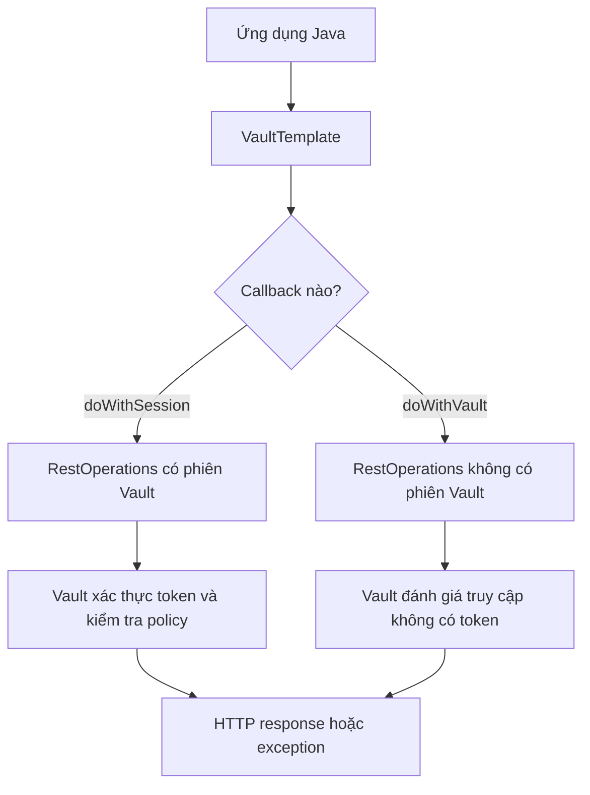

# Callback trong phiên xác thực và ngoài phiên với `VaultTemplate`

Spring Vault cho phép ứng dụng Java truy cập HashiCorp Vault qua `VaultTemplate.read()`, `write()`, `delete()` hoặc các nhóm `opsFor...`. Đôi khi các API mức cao không thể hiện hết yêu cầu của một endpoint đặc thù: cần điều khiển HTTP method, header hoặc tự xử lý kiểu response. Khi đó, **callback của `VaultTemplate`** cho phép thực hiện các lệnh HTTP qua một đối tượng `RestOperations` do thư viện chuẩn bị.

Điểm cốt lõi của bài là phân biệt **callback trong phiên xác thực** (`doWithSession()`) và **callback ngoài phiên** (`doWithVault()`). Chọn nhầm có thể dẫn đến lỗi quyền, kết luận sai về tình trạng Vault hoặc rủi ro làm lộ token nếu gửi request tới một URI không đáng tin cậy.

Đây là bài thuộc chương **VaultTemplate** của module **SPRING_VAULT**: ứng dụng Java tích hợp Vault bằng xác thực theo workload và policy, thực hành KV secrets, vòng đời token/lease, Transit encryption, PKI, xử lý lỗi, giám sát và kiểm thử tích hợp. Nội dung dưới đây tập trung vào ngữ cảnh xác thực của callback; các ví dụ dùng KV v2 và health endpoint để minh họa.

## Mục tiêu học tập

Sau bài học, bạn có thể:

1. Giải thích callback `RestOperationsCallback<T>` và giá trị mà callback trả về.
2. Phân biệt `doWithSession()` với `doWithVault()` về token, endpoint và kiểm tra ACL.
3. Xây dựng URI Vault API an toàn, gọi HTTP từ Java và xử lý phản hồi.
4. Hiểu vì sao callback không phải transaction, không bảo đảm một token bất biến và không quản lý secret lease.
5. Kiểm thử trường hợp có/không có phiên, HTTP status, thiếu quyền và nguy cơ gửi token sang host không đáng tin cậy.

## 1. Callback khác gì `read()` và `write()` thông thường?

Với API mức cao, lời gọi đọc KV v2 có thể là:

```java
VaultResponse response =
        vaultTemplate.read("secret/data/app/service");
```

Đối số `"secret/data/app/service"` là **API path tương đối**. Với facade chuyên biệt, ứng dụng còn có thể dùng:

```java
VaultKeyValueOperations kv2 = vaultTemplate.opsForKeyValue(
        "secret", KeyValueBackend.KV_2);
VaultResponseSupport<AppSecret> response =
        kv2.get("app/service", AppSecret.class);
```

Ở đây `"secret"` là mount KV v2 và `"app/service"` là **key logic**; facade xử lý lớp JSON `data` của KV v2. Trong khi đó, callback trao một HTTP client để tự tạo yêu cầu:

```java
VaultResponse response = vaultTemplate.doWithSession(
        rest -> rest.getForObject(
                vaultApiUri, VaultResponse.class));
```

Hình thức lambda ở trên tương ứng với callback kiểu `RestOperationsCallback<T>` trong Spring Vault. Callback nhận `RestOperations` và có thể trả về đối tượng Java bất kỳ phù hợp với kiểu `T`. Ví dụ, `getForObject(...)` có thể trả `VaultResponse`; `getForEntity(...)` trả `ResponseEntity<T>`; callback cũng có thể trả một DTO sau khi kiểm tra dữ liệu.

Khác với facade KV, callback tự chịu trách nhiệm về:

- Chọn HTTP method phù hợp với **contract** endpoint.
- Chọn URI Vault REST API, bao gồm `/v1/` và phần path của secrets engine.
- Xử lý JSON, trạng thái HTTP, body rỗng và exception.
- Bảo vệ dữ liệu nhạy cảm trong request, response, log và tracing.

**Ưu tiên API mức cao** khi nó đã hỗ trợ đầy đủ nghiệp vụ. Callback hữu ích cho những endpoint đặc thù hoặc khi cần quyền kiểm soát HTTP mà API mức cao chưa đáp ứng.

## 2. `doWithSession()` và `doWithVault()`

| Khía cạnh | `doWithSession(callback)` | `doWithVault(callback)` |
|---|---|---|
| Ngữ cảnh | HTTP client gắn với phiên Vault | HTTP client không sử dụng phiên xác thực Vault |
| Token | Dùng cơ chế token/session do `SessionManager` quản lý | Không tự thêm token của `SessionManager` |
| Mục đích | Gọi endpoint yêu cầu xác thực, ví dụ KV/Transit/PKI được bảo vệ | Gọi endpoint Vault có thể truy cập mà không cần token, ví dụ health khi được phép |
| Chính sách ACL | Token vẫn phải có capability đúng path | Endpoint phải cho phép truy cập không có phiên; không bỏ qua cơ chế bảo vệ |
| Giá trị trả về | Kiểu `T` do callback trả | Tương tự |
| Sai lầm thường gặp | Tưởng callback là một transaction hoặc có thể dùng tùy ý URL | Tưởng không có phiên vẫn có quyền đọc secret |
| Rủi ro riêng | Đưa token tới host không tin cậy nếu URI bị kiểm soát | Che giấu lỗi 403 bằng cách coi endpoint bị thiếu |

**`doWithVault()` không phải quyền quản trị không cần token.** Nó chỉ sử dụng đường gọi không dựa vào phiên xác thực. Nếu endpoint yêu cầu token, Vault vẫn có thể từ chối. **`doWithSession()` cũng không cấp quyền tự động**: Vault áp dụng policy của identity trên từng endpoint.



### “Phiên” không có nghĩa một lần đăng nhập mới

Spring Vault sử dụng `SessionManager` để cung cấp ngữ cảnh token theo cơ chế xác thực đã cấu hình, chẳng hạn Kubernetes Auth hoặc AppRole. Khi callback trong phiên thực hiện request, client sử dụng cơ chế authentication đó; người viết code **không tự thêm header `X-Vault-Token`**.

Tuy nhiên, việc gọi `doWithSession()` không bảo đảm mỗi lần sẽ tạo token mới, dùng một TCP connection duy nhất hoặc giữ nguyên token trong một chuỗi thao tác dài. Token có thể hết hạn, bị thu hồi hoặc được quản lý lại theo cấu hình của session manager. Token không phải lease của một dynamic secret và cũng không phải version của KV v2.

## 3. Chọn callback theo loại endpoint

| Nhu cầu | Lựa chọn nên dùng | Ghi chú |
|---|---|---|
| Đọc/ghi/xóa KV thường ngày | `opsForKeyValue(..., KV_1/KV_2)` | Ít lỗi path, body và JSON wrapper |
| Mã hóa/giải mã Transit | `opsForTransit(mount)` | Dùng tên encryption key, không phải KV path |
| PKI certificate issue | `opsForPki(mount)` nếu method hỗ trợ | Phải bảo vệ private key và thông tin chứng chỉ |
| API Vault yêu cầu xác thực nhưng chưa có facade thích hợp | `doWithSession()` | Tự kiểm soát method, URI, schema |
| Endpoint public health | `doWithVault()` | Không cần session token nếu deployment cho phép |
| Token/system operations có API mức cao | `opsForToken()` / `opsForSys()` | Không mặc định dùng callback raw HTTP |
| Dynamic database credential có lease | API phù hợp và cơ chế quản lý lease | Callback không thay thế renew/revoke |

Ngữ nghĩa của callback phụ thuộc **API thực tế**. Ví dụ, `GET /v1/sys/health` có thể truy cập không cần token theo cấu hình mặc định, nhưng reverse proxy, firewall hoặc chính sách triển khai có thể chặn nó. Không vì một endpoint dùng phương thức GET mà suy ra endpoint công khai.

## 4. URI trong callback phải được xây dựng từ nguồn tin cậy

Một điểm khác biệt dễ gây lỗi:

```text
VaultTemplate.read(...)                  : secret/data/app/service
VaultKeyValueOperations.get(...)        : app/service
RestOperations callback với URI đầy đủ : https://vault.example.invalid:8200/v1/secret/data/app/service
```

Với `RestOperations`, dùng **URI tuyệt đối** được xây từ base URL đã được quản trị giúp tránh nhầm quy tắc resolve của HTTP client:

```java
import java.net.URI;

URI apiBase = URI.create(
        "https://vault.example.invalid:8200/v1/");

URI secretUri = apiBase.resolve("secret/data/app/service");
URI healthUri = apiBase.resolve("sys/health");
```

`URI.resolve()` cần base `/v1/` có dấu `/` cuối để ghép đường dẫn tương đối đúng. Nếu deployment có reverse proxy/path prefix, cần cấu hình URI theo kiến trúc thật và kiểm tra lại bằng integration test.

**Cảnh báo bảo mật:** callback đã xác thực có thể gắn token của workload vào request. Nếu truyền URI do người dùng nhập, hoặc URI lấy từ phản hồi ngoài chưa kiểm soát, token có nguy cơ bị gửi tới host khác. Không dùng callback như một proxy HTTP tổng quát. Base URI phải lấy từ cấu hình đáng tin cậy, trỏ đúng origin Vault mà `VaultTemplate` đang sử dụng, có HTTPS và xác thực chứng chỉ. Cần kiểm soát cả chuyển hướng HTTP để tránh chuyển credential ra khỏi origin tin cậy.

## 5. Callback trong phiên: đọc KV v2 bằng HTTP

Giả sử Vault có mount `secret` (KV v2), key logic `app/service` và policy cho phép đọc. Endpoint tương ứng:

```http
GET /v1/secret/data/app/service
```

Đoạn code sau minh họa `doWithSession()` và cách tự bóc lớp `data`. Trong ứng dụng production chỉ đọc KV, thường nên thay bằng `opsForKeyValue("secret", KV_2)`.

```java
import java.net.URI;
import java.util.Map;

import org.springframework.vault.core.VaultTemplate;
import org.springframework.vault.support.VaultResponse;

public class AuthenticatedCallbackExample {

    private final VaultTemplate vaultTemplate;
    private final URI apiBase;

    public AuthenticatedCallbackExample(
            VaultTemplate vaultTemplate, URI apiBase) {
        this.vaultTemplate = vaultTemplate;
        this.apiBase = apiBase;
    }

    public String readServiceName() {
        URI uri = apiBase.resolve("secret/data/app/service");

        VaultResponse response = vaultTemplate.doWithSession(
                rest -> rest.getForObject(uri, VaultResponse.class));

        if (response == null || response.getData() == null) {
            throw new IllegalStateException(
                    "KV v2 không trả dữ liệu khả dụng");
        }

        // KV v2: response.data.data là nội dung secret.
        Object rawData = response.getData().get("data");
        if (!(rawData instanceof Map<?, ?> fields)) {
            throw new IllegalStateException(
                    "Phản hồi KV v2 sai cấu trúc data");
        }

        Object rawName = fields.get("service_name");
        if (!(rawName instanceof String name) || name.isBlank()) {
            throw new IllegalStateException(
                    "Thiếu trường service_name hợp lệ");
        }
        return name;
    }
}
```

Các điểm cần nắm:

1. `apiBase` phải là URI tin cậy, cùng Vault endpoint đang được `VaultTemplate` sử dụng.
2. Callback nhận `RestOperations`; client làm việc trong phiên xác thực được quản lý.
3. Vault kiểm tra capability `read` tại `secret/data/app/service`.
4. JSON KV v2 có hai lớp `data`, nên phải kiểm tra kiểu trước khi lấy field.
5. Không log toàn bộ `VaultResponse` vì có thể chứa mật khẩu hoặc dữ liệu bí mật khác.

### Cần HTTP method/header cụ thể? Dùng `exchange()`

```java
import java.net.URI;

import org.springframework.http.HttpEntity;
import org.springframework.http.HttpMethod;
import org.springframework.http.ResponseEntity;
import org.springframework.vault.support.VaultResponse;

URI uri = apiBase.resolve("secret/data/app/service");

ResponseEntity<VaultResponse> response =
        vaultTemplate.doWithSession(rest -> rest.exchange(
                uri,
                HttpMethod.GET,
                HttpEntity.EMPTY,
                VaultResponse.class));
```

Với POST, có thể tạo `HttpEntity<Map<String,Object>>` chứa JSON body và `Content-Type` phù hợp. **Không** tự gắn `X-Vault-Token` trong callback đã xác thực. Khi gọi endpoint đặc thù, kiểm tra HTTP method, format body và kiểu response được Vault hỗ trợ, thay vì coi `exchange()` là cách tự động phát hiện contract.

## 6. Callback ngoài phiên: trạng thái Vault health

`doWithVault()` phù hợp cho endpoint mà môi trường cho phép truy cập **không có token**, ví dụ `sys/health`.

```java
import java.net.URI;

import org.springframework.vault.core.VaultTemplate;

public class HealthCallbackExample {

    private final VaultTemplate vaultTemplate;
    private final URI apiBase;

    public HealthCallbackExample(
            VaultTemplate vaultTemplate, URI apiBase) {
        this.vaultTemplate = vaultTemplate;
        this.apiBase = apiBase;
    }

    public String getHealthResponse() {
        URI uri = apiBase.resolve("sys/health");

        return vaultTemplate.doWithVault(
                rest -> rest.getForObject(uri, String.class));
    }
}
```

Đây là ví dụ cách gọi callback, **không phải health indicator production đầy đủ**. Vault health có thể báo active, standby, sealed hoặc uninitialized bằng mã HTTP khác nhau. Một số mã **không phải 2xx** khiến error handler của `RestOperations` ném exception trước khi body được trả về.

Cần phân biệt:

- HTTP 200 từ health và JSON hợp lệ không chứng minh workload có quyền đọc KV secret.
- Một HTTP 429/472/473/501/503 từ health có thể phản ánh trạng thái Vault hoặc cấu hình truy cập; không mặc nhiên là token sai.
- Endpoint health không có phiên vẫn chịu giới hạn mạng, TLS, reverse proxy và policy triển khai.
- Không đưa nguyên nội dung trạng thái cluster ra endpoint công khai của ứng dụng nếu nó chứa thông tin vận hành nhạy cảm.

Khi cần health probe production, nên diễn giải HTTP status của endpoint và cấu hình cách kiểm tra active/standby/sealed theo mục tiêu giám sát; không đơn thuần coi `getForObject()` trả chuỗi khác rỗng là healthy.

## 7. Java service kết hợp hai callback một cách có chủ đích

Ví dụ dưới đây sử dụng Java 17+ và Spring; `VaultTemplate` được cấu hình sẵn với HTTPS, certificate validation và xác thực workload. Để tránh nhận URI không tin cậy lúc chạy, base URL được inject từ **cấu hình vận hành**.

```java
import java.net.URI;
import java.util.Map;

import org.springframework.beans.factory.annotation.Value;
import org.springframework.stereotype.Service;
import org.springframework.vault.core.VaultTemplate;
import org.springframework.vault.support.VaultResponse;

@Service
public class VaultCallbackGateway {

    private final VaultTemplate vaultTemplate;
    private final URI apiBase;

    public VaultCallbackGateway(
            VaultTemplate vaultTemplate,
            @Value("${app.vault.api-base-uri}") String apiBaseUri) {
        this.vaultTemplate = vaultTemplate;

        URI candidate = URI.create(apiBaseUri);
        if (!"https".equalsIgnoreCase(candidate.getScheme())
                || candidate.getHost() == null
                || candidate.getPath() == null
                || !candidate.getPath().endsWith("/v1/")
                || candidate.getRawQuery() != null
                || candidate.getRawFragment() != null) {
            throw new IllegalArgumentException(
                    "Cấu hình Vault API base URI không hợp lệ");
        }
        // Cấu hình phải trùng origin Vault tin cậy của VaultTemplate.
        this.apiBase = candidate;
    }

    // Endpoint không cần session token, nếu được phép.
    public String publicHealthDocument() {
        URI uri = apiBase.resolve("sys/health");
        return vaultTemplate.doWithVault(
                rest -> rest.getForObject(uri, String.class));
    }

    // Endpoint có xác thực và ACL.
    public String authenticatedServiceName() {
        URI uri = apiBase.resolve("secret/data/app/service");

        VaultResponse result = vaultTemplate.doWithSession(
                rest -> rest.getForObject(uri, VaultResponse.class));

        if (result == null || result.getData() == null) {
            throw new IllegalStateException("KV v2 thiếu dữ liệu");
        }

        Object payload = result.getData().get("data");
        if (!(payload instanceof Map<?, ?> fields)) {
            throw new IllegalStateException(
                    "KV v2 thiếu cấu trúc data.data");
        }

        Object value = fields.get("service_name");
        if (!(value instanceof String name) || name.isBlank()) {
            throw new IllegalStateException(
                    "KV v2 thiếu service_name");
        }
        return name;
    }
}
```

Ví dụ cấu hình giả:

```properties
# Cấu hình triển khai tin cậy; không phải địa chỉ hoạt động thực.
app.vault.api-base-uri=https://vault.example.invalid:8200/v1/
```

**Giới hạn:** Validation trong constructor kiểm tra HTTPS, host và format `/v1/`, nhưng **chưa đủ để chứng minh origin khớp** với client thực tế. Tại khâu triển khai, cần ràng buộc địa chỉ cấu hình với VaultEndpoint đã phê duyệt hoặc allowlist riêng. Không nhận `apiBaseUri` từ request của end user. Callback có phiên càng đòi hỏi kiểm soát redirect và host.

Hàm `publicHealthDocument()` trả raw health body để minh họa API, không nên đưa nguyên body đó ra public REST endpoint nếu policy quan sát yêu cầu che thông tin. Hàm `authenticatedServiceName()` chỉ trả trường đã validate; trong ứng dụng thật, thông tin secret vẫn phải được giới hạn nơi sử dụng.

## 8. Callback không phải transaction hoặc lease manager

Một callback có thể thực hiện nhiều request:

```java
VaultResponse result = vaultTemplate.doWithSession(rest -> {
    VaultResponse first = rest.getForObject(
            firstUri, VaultResponse.class);

    VaultResponse second = rest.getForObject(
            secondUri, VaultResponse.class);

    return second;
});
```

Hai request trên **không tạo transaction nguyên tử**. Một request có thể thành công và request kế tiếp thất bại; ứng dụng không có rollback tự động. Giữa hai request, workload khác có thể ghi KV v2 version mới, token có thể hết hạn hoặc trạng thái Vault có thể thay đổi.

| Khái niệm | Ý nghĩa | Không có nghĩa |
|---|---|---|
| `doWithSession()` | Gọi HTTP trong ngữ cảnh phiên Vault | Transaction hoặc lock |
| `SessionManager` | Quản lý token/session của client | Gia hạn mọi lease secret động |
| KV v2 CAS | Kiểm tra version khi ghi | Tự động làm mọi request callback nguyên tử |
| Dynamic secret lease | Thời gian và trạng thái secret được Vault cấp phát | Tương đương token TTL |
| Token TTL | Hiệu lực identity/token hiện tại | Tuổi của KV key hoặc version |

Khi cần thao tác KV có tranh chấp, sử dụng **CAS** và giải quyết xung đột ở tầng nghiệp vụ. Khi ứng dụng dùng database dynamic credentials, dùng cơ chế quản lý lease/rotation phù hợp (ví dụ `SecretLeaseContainer` khi cần). Một callback `doWithSession()` không tự theo dõi và renew/revoke các credential đó.

## 9. Policy và phân loại lỗi

Để đọc key KV v2 trong ví dụ `doWithSession()`, workload cần policy tối thiểu:

```hcl
path "secret/data/app/service" {
  capabilities = ["read"]
}
```

Token được cấp theo workload identity như Kubernetes Auth hoặc AppRole. Việc có token không đảm bảo có quyền: `read` tại `secret/data/app/service` khác `list` tại `secret/metadata/app` và khác quyền `update` của Transit/PKI.

Với `doWithVault()`, không nên cấp policy quản trị để biến lời gọi không phiên thành lời gọi quyền cao. Nếu endpoint yêu cầu xác thực, hãy chọn callback có phiên và cấp ACL tối thiểu; nếu endpoint công khai, cần xem xét điều kiện truy cập ở Vault và proxy.

| Tình huống | Dấu hiệu có thể gặp | Hướng xử lý |
|---|---|---|
| `doWithVault()` gọi KV được bảo vệ | Lỗi xác thực/phân quyền, thường 403 | Dùng `doWithSession()` nếu tác vụ có thẩm quyền |
| `doWithSession()` token hết hạn hoặc không hợp lệ | Lỗi auth/session/token | Kiểm tra workload auth và `SessionManager` |
| Token có phiên nhưng thiếu `read` | HTTP 403 | Sửa policy path/capability, không dùng token root |
| URI sai `/v1/` hoặc sai mount | HTTP 404 hoặc phản hồi bất thường | Kiểm tra URI, endpoint và version engine |
| KV v2 thiếu `data.data` | Phản hồi sai schema hoặc không có secret khả dụng | Kiểm tra response; ưu tiên facade KV |
| Health trả non-2xx | Error handler có thể ném exception | Phân loại tình trạng health, không mặc định do token |
| Timeout, TLS, Vault 5xx | Exception hạ tầng | Timeout và retry giới hạn, quan sát độ trễ |
| Callback xử lý JSON sai | `ClassCastException` hoặc validation failure | Kiểm tra kiểu và field trước khi dùng |

**Không dùng `catch (Exception e) { return null; }` để nuốt mọi lỗi**. Hãy phân biệt `not_found`, `unauthenticated`, `permission_denied`, `invalid_response` và `unavailable`. Không trả token, raw response hoặc chi tiết hệ thống nhạy cảm ra API cho người dùng cuối.

### Retry có kiểm soát

GET có thể retry có giới hạn khi lỗi mạng tạm thời. Nhưng nếu callback thực hiện POST cấp chứng chỉ, tạo dynamic credentials hoặc thay đổi key, server có thể đã xử lý thao tác trước khi client timeout; retry mù có thể tạo tác dụng phụ lần nữa. Callback không tự biến request thành idempotent. Lỗi 403 do thiếu quyền cũng không nên retry vô hạn.

## 10. Giám sát và bảo vệ dữ liệu khi dùng callback

- Không log `RestOperations` request/response thô, header `X-Vault-Token`, password, private key, ciphertext nhạy cảm hoặc lease ID.
- Chỉ ghi operation category (`kv2.read`, `sys.health`), latency, nhóm HTTP status và mã lỗi đã chuẩn hóa; không gắn path đầy đủ chứa tenant/secret vào metric labels.
- Nếu cần request ID để đối soát Vault audit log, lưu ở hệ thống nội bộ đã phân quyền.
- Kiểm tra TLS certificate, giới hạn host và redirect; không tắt xác minh TLS để né lỗi.
- Đặt timeout kết nối/đọc phù hợp; không giữ một callback đồng bộ quá lâu hoặc quét toàn Vault bằng vòng lặp không giới hạn.
- Tách quyền giám sát health khỏi quyền đọc secret nếu yêu cầu bảo mật của hệ thống cần.

## 11. Thực hành và kiểm thử tích hợp

Sử dụng **Vault thử nghiệm cô lập**. Giả sử mount KV v2 `secret` đã tồn tại hoặc được tạo trong môi trường test; đặt key chứa giá trị giả:

```bash
# Chỉ enable mount nếu mount secret chưa tồn tại.
vault secrets enable -path=secret -version=2 kv

# Secret demo, không dùng credential thật.
vault kv put -mount=secret app/service service_name=demo-svc

# Kiểm tra key logic qua CLI.
vault kv get -mount=secret app/service
```

Thử `doWithSession()` với identity được phép đọc `secret/data/app/service`, sau đó thử token chỉ có quyền khác và xác nhận Vault từ chối. Dùng `doWithVault()` cho `sys/health` theo cấu hình test; tiếp theo cố tình dùng callback không phiên gọi endpoint KV được bảo vệ để thấy khác biệt.

| Kịch bản | Kết quả mong đợi |
|---|---|
| `doWithSession()`, token có `read` | Đọc được response KV v2 và bóc `data.data` |
| `doWithSession()`, token thiếu `read` | HTTP 403 được phân loại, không coi là secret rỗng |
| `doWithVault()` gọi `sys/health` hợp lệ | Nhận trạng thái health theo contract endpoint |
| `doWithVault()` gọi KV được bảo vệ | Bị Vault từ chối vì thiếu phiên xác thực |
| Health trả non-2xx do sealed/standby | Phân loại health, không khẳng định token hỏng |
| URI sai base hoặc thiếu `/v1/` | Validation hoặc integration test phát hiện path sai |
| Cấu hình URI trỏ host không được phép | Bị chặn theo allowlist/configuration policy |
| Callback nhận response thiếu `data` | Java xử lý an toàn, không dereference `null` |
| Token hết hạn hoặc mất kết nối | Phân loại lỗi auth/hạ tầng; retry không mù |
| Hai request trong một callback, request thứ hai lỗi | Không coi request thứ nhất đã rollback |
| Log/tracing | Không chứa token, secret hoặc raw body |

**Unit test** nên kiểm tra xử lý JSON, validation URI và phân loại lỗi; **integration test** cần Vault server/container hoặc HTTP test server có thể quan sát headers để xác nhận hành vi có/không có token. Mock service không thể chứng minh callback gắn header đúng, Vault áp dụng ACL đúng hay URI khác origin đã bị chặn.

## 12. Sai lầm thường gặp

**“`doWithSession()` mở một transaction.”** Không. Nó thực hiện HTTP trong ngữ cảnh phiên xác thực, không có rollback hoặc snapshot chung cho nhiều request.

**“`doWithVault()` là tài khoản admin không cần token.”** Không. Nó không sử dụng phiên Vault; endpoint có bảo vệ vẫn từ chối.

**“Có token là đủ đọc mọi secret.”** Không. Vault còn kiểm tra capability và API path của mỗi request.

**“Callback cho phép truyền URL bất kỳ.”** Không. Callback authenticated có thể gửi credential đến URL được truyền; phải dùng Vault origin tin cậy, không để end user điều khiển.

**“`RestOperations` hiểu key logic của KV facade.”** Không. Callback gọi HTTP API, phải dùng URI/endpoint theo schema Vault, chẳng hạn `secret/data/...` cho đọc KV v2.

**“`doWithVault()` thất bại health nghĩa là secret sai.”** Không. Health, token và dữ liệu KV là ba luồng độc lập.

**“Callback tự gia hạn dynamic lease.”** Không. `SessionManager` quản lý token/session; lease của secret cần cơ chế riêng.

**“Callback tự che password trong log.”** Không. Ứng dụng vẫn phải tránh log raw request, response và exception có dữ liệu nhạy cảm.

## Câu hỏi tự kiểm tra

1. Khi nào dùng `doWithSession()` thay vì `VaultTemplate.read()` hoặc `opsForKeyValue()`?
2. Callback `doWithSession()` và `doWithVault()` khác nhau ở đâu về phiên/token?
3. Vì sao có thể dùng `doWithVault()` cho health nhưng không nên dùng để đọc KV secret được bảo vệ?
4. Tại sao hai request trong một callback không phải transaction?
5. Vì sao tuyệt đối không gửi URI do người dùng nhập trực tiếp vào callback có phiên?
6. Với KV v2, raw callback cần xử lý những lớp `data` nào?
7. Có phiên token nhưng nhận HTTP 403: bạn cần kiểm tra những yếu tố nào?
8. Vì sao integration test phải xác minh cả headers, origin và policy thay vì chỉ mock dữ liệu?

**Gợi ý đối chiếu:** `doWithSession()` dùng HTTP client trong ngữ cảnh phiên Vault do `SessionManager` quản lý; `doWithVault()` dùng HTTP client không dựa vào phiên xác thực. Callback không cấp quyền, không tạo transaction và không quản lý secret lease. Chọn endpoint phù hợp, dùng URI đáng tin cậy, áp dụng policy tối thiểu và kiểm thử thực tế là những bước thiết yếu khi mở rộng Spring Vault bằng callback.
